# 第十四章 区块链服务平台设计

**规模是困难之源。**

信息产业过去的十年，是云计算的十年。云计算技术为传统信息行业带来了前所未有的便捷。用户无需在意底层实现细节，通过简单的操作，即可获得可用的计算资源，节约大量运维管理的时间成本。

区块链平台作为分布式基础设施，其部署和维护过程需要多方面的技能，这对很多应用开发者来说都是不小的挑战。为了解决这些问题，区块链即服务（Blockchain as a Service, BaaS）平台应运而生。BaaS 可以利用云服务基础设施的部署和管理优势，为开发者提供创建、使用，甚至安全监控区块链平台的快捷服务。目前，业界已有一些区块链前沿技术团队率先开发并上线了区块链服务平台。

本章将首先介绍 BaaS 的概念，之后回顾 IBM Bluemix/IBM Blockchain Platform 和微软 Azure Blockchain Service 等历史方案；这些托管区块链服务已停止或转向其他支持路径，今天更多场景会选择在云主机、Kubernetes 或厂商市场模板上自行部署。最后，还介绍超级账本的区块链管理平台 —— Cello 项目，以及如何使用它快速搭建一套可以个性化的区块链服务平台。

## 简介

区块链即服务（Blockchain as a Service，BaaS），是部署在云计算基础设施之上，对外提供区块链网络的生命周期管理和运行时服务管理等功能的一套工具。

构建一套分布式的区块链方案绝非易事，既需要硬件基础设施的投入，也需要全方位的开发和运营管理（DevOps）。BaaS 作为一套工具，可以帮助开发者快速生成必要的区块链环境，进而验证所开发的上层应用。

除了区块链平台本身，一套完整的解决方案实际上还可以包括设备接入、访问控制、服务监控等管理功能。这些功能，让 BaaS 平台可以为开发者提供更强大的服务支持。

从 2016 年起，业界已有一些前沿技术团队发布了 BaaS 平台，除了商业的方案如 IBM Bluemix 和微软 Azure 云之外，超级账本开源项目也发起了 Cello 项目，以提供一套实现区块链平台运营管理功能的开源框架。

### 参考架构

下图给出了区块链即服务功能的参考架构，自上而下分为多层结构。最上层面向应用开发者和平台管理员提供不同的操作能力；核心层负责完成包括资源编排、系统监控、数据分析和权限管理等重要功能；下层可以通过多种类型的驱动和代理组件来访问和管理多种物理资源。

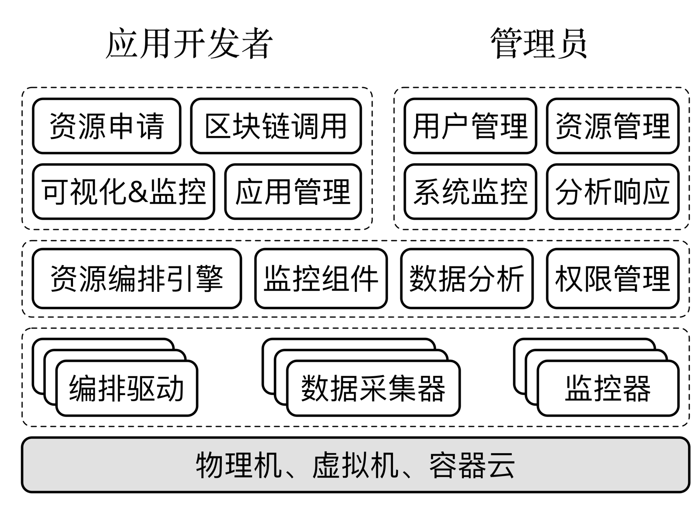

典型地，BaaS 平台所提供的业务能力通常包括：

* 用户按需申请区块链网络，以及所需的计算、存储与网络连接资源；
* 用户对申请到的区块链进行生命周期管理，甚至支持灵活、弹性的区块链配置；
* 通过提供接口，让用户自由访问所申请到的区块链网络并进行调用；
* 提供直观的区块链可视化监控与操作界面，将区块链应用与底层平台无缝对接；
* 提供简单易用的智能合约开发与测试环境，方便用户对应用代码进行管理；
* 为管理员提供用户管理和资源管理操作；
* 为管理员提供对系统各项健康状态的实时监控；
* 提供对平台内各项资源和应用层的数据分析和响应能力。

### 考量指标

对于 BaaS 服务提供方，搭建这样一套功能完善、性能稳定的 BaaS 平台存在诸多挑战。可以从如下几个角度进行考量设计。

* 性能保障：包括区块链和应用的响应速度，监控实时性等；
* 可扩展性：支持大规模场景下部署和管理的能力，可以快速进行扩展；
* 资源调度：对于非均匀的资源请求类型可以智能的予以平缓化处理，合理分配系统资源；
* 安全性：注意平衡用户操作区块链的自由度与平台自身的安全可控；
* 可感知性：深度感知数据行为，如可以准确实时评估区块链的运行状况，给用户启发；
* 底层资源普适性：底层应当支持多种混合计算架构，容易导入物理资源。

此外，对于面向开发者的 BaaS 服务，创建的区块链环境应当尽量贴近实际应用场景，让用户可以将经过检验的区块链模型很容易地迁移到生产环境。甚至可以直接联动支持第三方发布平台，直接将经过验证的应用推向发布环境。

## IBM Blockchain Platform

IBM Blockchain Platform 是 IBM 曾推出的企业级区块链管理平台，基于 Hyperledger Fabric 技术构建。它并非简单的云服务，而是一套完整的区块链网络管理工具；但该产品现已进入历史阶段，本节内容应主要作为演进背景参考。

### 服务介绍

IBM Blockchain Platform 曾允许用户在任何计算环境（IBM Cloud、AWS、Azure、本地数据中心等）中部署、操作和扩展区块链网络。它基于 Kubernetes 容器化技术，提供了较高的灵活性和可移植性。

该平台的核心优势包括：

*   **多云部署**：支持在任何 Kubernetes 集群（v1.14+）上运行；
*   **先进的运维工具**：提供可视化的控制台（Console）来管理节点、通道、智能合约和身份；
*   **开发支持**：集成了 VS Code 扩展（IBM Blockchain Platform Extension），方便开发者编写、测试和调试智能合约；
*   **企业级安全**：支持硬件安全模块（HSM）集成等高级安全特性。

需要注意，IBM 已宣布该软件在 2023 年 4 月 30 日结束支持；今天更合适的理解方式是：它代表了一代企业级 Fabric 运维产品思路，而不是当前仍在持续演进的主流服务。

### 使用服务

通过 IBM Blockchain Platform console，用户曾可以直观地管理网络。

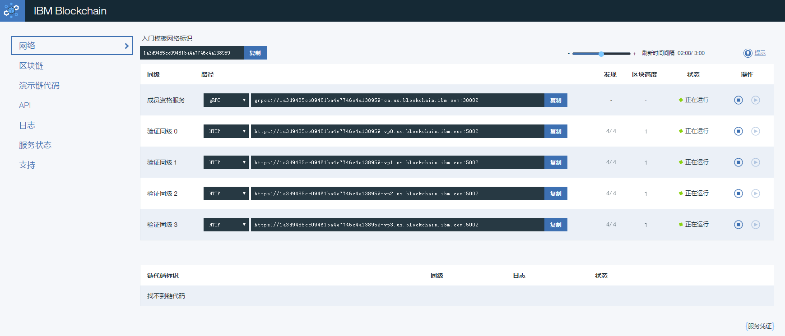

用户可以通过界面轻松完成以下操作：
1.  **创建 CA 和节点**：快速部署 Peer、Orderer 和 CA 节点；
2.  **管理组织和身份**：注册用户，颁发证书；
3.  **创建通道**：定义通道成员和策略；
4.  **安装和实例化链码**：将智能合约部署到通道中。

平台曾提供丰富的 API 和 SDK 支持，方便应用与区块链网络进行交互。

*注：早期的 IBM Bluemix 品牌已于 2017 年完全整合入 IBM Cloud。原有的简单 Fabric 试用服务后来演进为 IBM Blockchain Platform，但该产品也已结束支持。阅读本节时，应把它理解为企业级 Fabric 管理平台的历史案例，而不是当前的最新采购建议。*

## 微软 Azure 区块链方案

Azure 是微软推出的云计算平台，向用户提供开放的 IaaS 和 PaaS 服务。

微软曾提供 Azure Blockchain Service，但该服务已于 2021 年 9 月 10 日正式停止支持和停用（Retired）。后续的 Quorum Blockchain Service（QBS）也已结束历史阶段，不应再视为当前可选的主流托管路径。本文档中的 Azure Blockchain Service 相关内容仅供历史参考；对今天的用户来说，更现实的方案是直接在 Azure 的虚拟机、AKS 或其他通用基础设施上自行部署区块链网络。

用户可以在 Azure 应用市场（https://azuremarketplace.microsoft.com/en-us/marketplace/apps）中搜索 “blockchain” 关键字查看最新的区块链相关镜像、模板或合作伙伴方案。需要注意：市场条目不等同于 Azure 官方托管区块链服务，部署前应核对发布方、维护状态和安全更新策略。

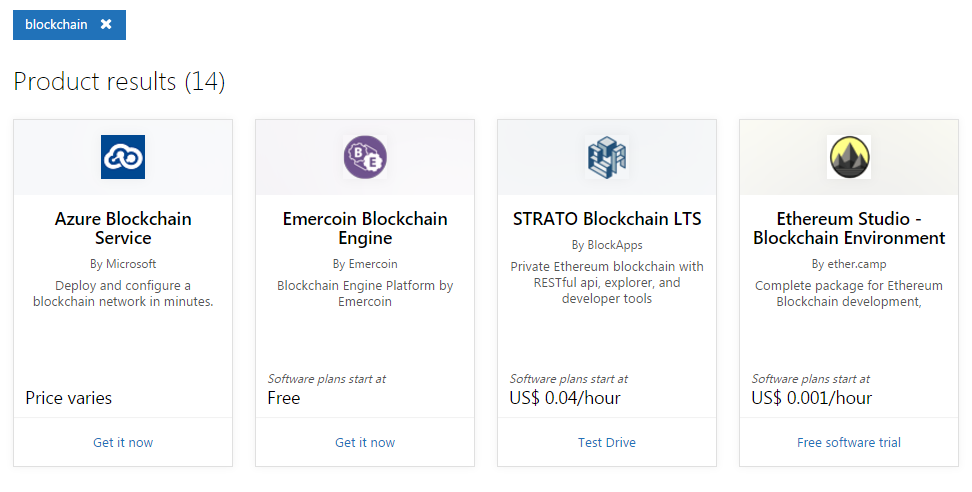

### 替代方案：在 AKS 上自建 Hyperledger Fabric

对于希望在 Azure 上运行 Hyperledger Fabric 的用户，更稳妥的路径是在 Azure Kubernetes Service (AKS) 或虚拟机上按 Fabric 官方文档自建网络，或审慎采用仍在维护的第三方模板。

该方案具有以下特点：
*   **完全控制**：用户对网络拥有完全的控制权；
*   **云原生**：利用 Kubernetes 的编排能力管理 Fabric 容器；
*   **集成**：可与 Azure Active Directory (AAD)、Azure Monitor 等服务集成。

用户可以通过 Azure CLI、Bicep/ARM、Helm 或 Kubernetes 清单部署 Orderer 组织和 Peer 组织。部署完成后，用户可以通过标准的 Fabric CLI、Gateway SDK 和运维监控工具与网络进行交互。

*注：由于云厂商服务策略调整频繁，建议在选择 BaaS 服务前查阅最新的官方文档。*

## 使用超级账本 Cello 搭建区块链服务

从前面的讲解中可以看到，区块链服务平台能够有效加速对区块链技术的应用，解决企业和开发者进行手动运营管理的负担。但是这些方案都是商业用途，并且只能在线使用。

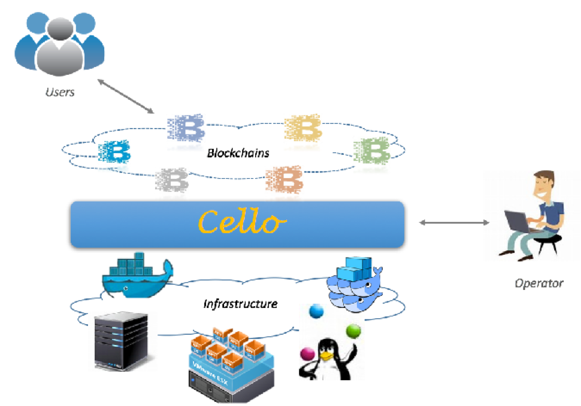

超级账本的 Cello 项目为本地搭建区块链服务管理平台提供了开源的解决方案，可以实现在多种类型的物理资源上实现区块链网络的生命周期管理。

> **版本提示（2026-05-16）**：本节保留 Cello 作为 Hyperledger BaaS 管理平台的历史和架构示例。具体部署命令、Fabric 版本、镜像名称和端口暴露方式应以 Cello 官方仓库和当前发行说明为准；不要把早期示例直接照搬到生产环境。

正如 Cello 的名字所蕴意，它就像一把精巧的大提琴，以区块链为琴弦，可以奏出更加动人的乐章。

### 基本架构和特性

Cello 项目由笔者领导的 IBM 技术团队于 2017 年 1 月贡献到超级账本社区，主要基于 Python 和 JavaScript 语言编写。该项目的定位为区块链管理平台，支持部署、运行时管理和数据分析等功能，可以实现一套完整的 BaaS 系统的快速搭建。其基本架构如下图所示。

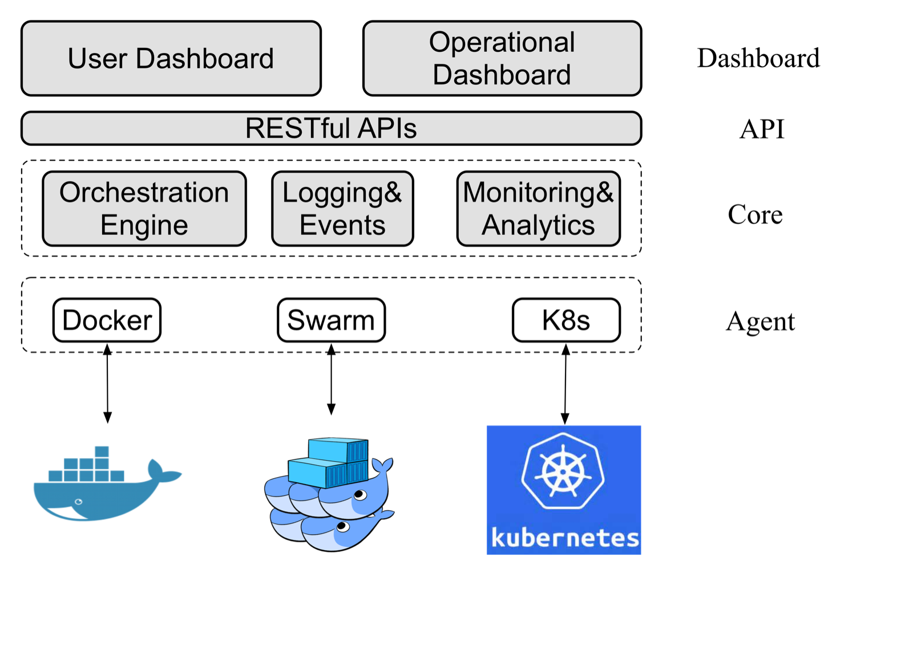

在实现区块链环境快速部署的同时，Cello 也提供了不少对区块链平台进行运行时管理的特性，这些特性总结如下。

* 管理区块链的全生命周期，包括创建、配置、使用、健康检查、删除等。
* 支持多种基础架构作为底层资源池，包括裸机、虚拟机、容器云（Docker、Swarm、Kubernetes）等。
* 支持多种区块链平台及自定义配置（目前以支持超级账本 Fabric 为主）。
* 支持监控和分析功能，实现对区块链网络和智能合约的运行状况分析。
* 提供可插拔的框架设计，包括区块链平台、资源调度、监控、驱动代理等都很容易引入第三方实现。

下面具体介绍如何以 Docker 主机为资源池，用 Cello 快速搭建一个区块链服务平台。

### 环境准备

Cello 采用了典型的主从（Master-Worker）架构。用户可以自行准备一个 Master 物理节点和若干个 Worker 节点。

其中，Master 节点负责管理（例如，创建和删除）Worker 节点中的区块链集群，其通过 8081 端口对外提供网页 Dashboard，通过 8080 端口对外提供 RESTful API。Worker 节点负责提供区块链集群的物理资源，例如基于 Docker 主机或 Swarm 的方式启动多个集群，作为提供给用户可选的多个区块链网络环境。

下图中展示了一个典型的 Master-Worker 部署拓扑。每个节点默认为 Linux（如 Ubuntu 22.04）服务器或虚拟机。

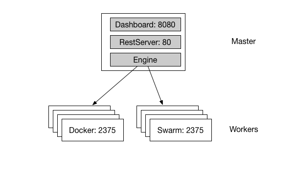

为了支持区块链网络，Worker 和 Master 节点需要配备足够的物理资源。例如，如果希望在一个 Worker 节点上能够启动至少 10 个区块链集群，则建议节点配置至少为 8 CPU、16G 内存、100G 硬盘容量。

### 下载 Cello 源码

Cello 代码的官方仓库在 GitHub 上，读者可以获取代码。例如通过如下命令从官方仓库下载 Cello 源码。

```sh
$ git clone https://github.com/hyperledger-cello/cello.git && cd cello
```

### 配置 Worker 节点

#### 安装和配置 Docker 服务

首先安装 Docker。早期 Cello 文档常见的 “Docker 1.12 或更新版本” 已不适合作为今天的部署建议；请按当前 Docker 官方文档选择受支持的 Docker Engine / Docker Desktop 版本，并优先使用系统包仓库或企业镜像源安装。`get.docker.com` 便利脚本只适合开发和测试环境，不建议用于生产环境。

```sh
$ curl -fsSL https://get.docker.com -o get-docker.sh
$ sudo sh get-docker.sh --dry-run
```

如果只是本地实验，可在阅读脚本输出并确认风险后运行；生产或长期环境应按 Docker 官方的 apt/yum 仓库方式安装。安装成功后，不要把 Docker daemon 以未加密方式暴露到所有网络地址的 2375 端口。Docker API 等价于主机 root 权限，生产或联网环境应优先使用 SSH Docker context；确需远程 API 时，应使用 TLS 认证的 2376 端口并限制来源地址。

```sh
$ docker context create cello-worker --docker "host=ssh://cello@worker.example.com"
$ docker --context cello-worker ps
```

如果历史 Cello 组件只能填写 Daemon URL，可让 Worker 仅在本机回环地址监听，再通过 SSH 隧道或内网代理映射，避免公网监听：

```sh
$ ssh -L 127.0.0.1:2375:127.0.0.1:2375 cello@worker.example.com
```

#### 下载 Docker 镜像

对于早期超级账本 Fabric v1.0 集群所需的镜像，历史版本可以使用如下命令进行自动下载。当前新部署应优先参考 Fabric 与 Cello 官方文档选择受支持版本。

```sh
$ cd scripts/worker_node_setup && bash download_images.sh
```

#### 防火墙配置

为了确保 Worker 上的容器可以正常访问，通过如下命令确保主机开启 IP 转发。

```sh
$ sysctl -w net.ipv4.ip_forward=1
```

同时检查主机的 iptables 设置，确保必要的 Fabric 业务端口被打开（如 7050~10000 等）。不要向公网开放未认证的 `2375` 端口；如必须使用远程 Docker API，应使用 TLS 认证的 `2376` 并限制安全组来源。

### 配置 Master 节点

#### 准备环境与启动服务

首先确保安装了 Docker Compose V2。然后可以通过如下命令对 Master 节点进行配置，包括设置本地存储路径和启动服务。

```sh
$ export CELLO_STORAGE_PATH=$(pwd)/cello
$ make local
```

如果希望自行构建 Cello 所需的 Docker 镜像，可运行：

```sh
$ make docker
```

随后通过运行如下命令来启动 Cello 相关的组件服务，包括 `cello-agent-docker`、`postgres`、`cello-api-engine` 和 `cello-dashboard`。

```sh
$ make start
```

如果启动过程没有提示出现问题，则说明当前环境满足了运行条件。如果出现问题，可通过查看日志信息进行定位。可以在终端看到类似以下的容器输出，说明服务启动成功：
```sh
CONTAINER ID   IMAGE                            COMMAND                  CREATED         STATUS         PORTS                                                                                  NAMES
81e6459965ec   hyperledger/cello-agent-docker   "gunicorn server:app…"   4 seconds ago   Up 2 seconds   127.0.0.1:5001->5001/tcp                    cello.docker.agent
04367ab6bd5e   postgres:16.4                    "docker-entrypoint.s…"   4 seconds ago   Up 2 seconds   127.0.0.1:5432->5432/tcp                    cello-postgres
29b56a279893   hyperledger/cello-api-engine     "/bin/sh -c 'bash /e…"   4 seconds ago   Up 2 seconds   127.0.0.1:8080->8080/tcp                    cello-api-engine
a272a06d8280   hyperledger/cello-dashboard      "bash -c 'nginx -g '…"   4 seconds ago   Up 2 seconds   127.0.0.1:8081->8081/tcp                    cello-dashboard
```

#### 管理平台服务

运行 `make stop` 可以停止服务。

若希望停止并清理所有容器，可运行如下命令。

```sh
$ make clean
```

可以通过如下命令查看支持的所有 Make 操作规则。

```sh
$ make help
```

### 使用 Cello 管理区块链

Cello 服务启动后，管理员可以通过 Cello 的 Dashboard 页面管理区块链。

默认情况下，可通过 Master 节点的 8081 端口访问 Dashboard（例如 localhost:8081）。默认的登录用户名和密码为 `admin:pass`；该凭据仅适合本地测试，首次登录后应立即修改，并且在修改前不要把 Dashboard 暴露到共享网络。

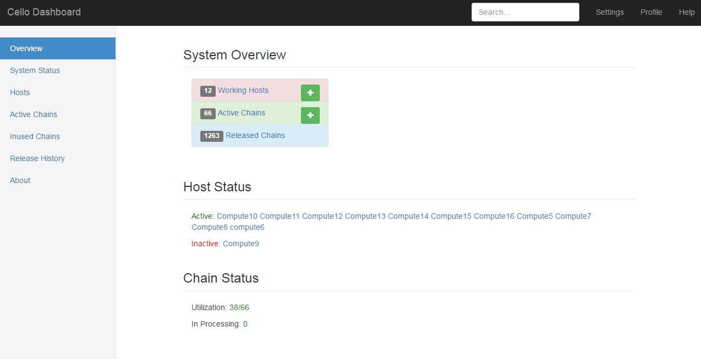

如图，Dashboard 有多个页面，各页面的功能如下。

| 页面 |  功能 |
| --- |  --- |
| Overview |  展示系统整体状态 |
| System Status |  展示一些统计信息 |
| Hosts |  管理所有主机（Worker 节点） |
| Active Chains |  管理资源池中的所有链 |
| Inused Chains |  管理正在被用户占用的链 |
| Released History  | 查看链的释放历史 |

#### Hosts 页面

在 Hosts 页面，管理员可以管理所有资源池中已存在的主机，或添加新主机。表格中会显示主机的类型、状态、正在运行的区块链数量、区块链数量上限等。所有设定为 non-schedulable （不会自动分配给用户）的主机会用灰色背景标识，如下图所示。

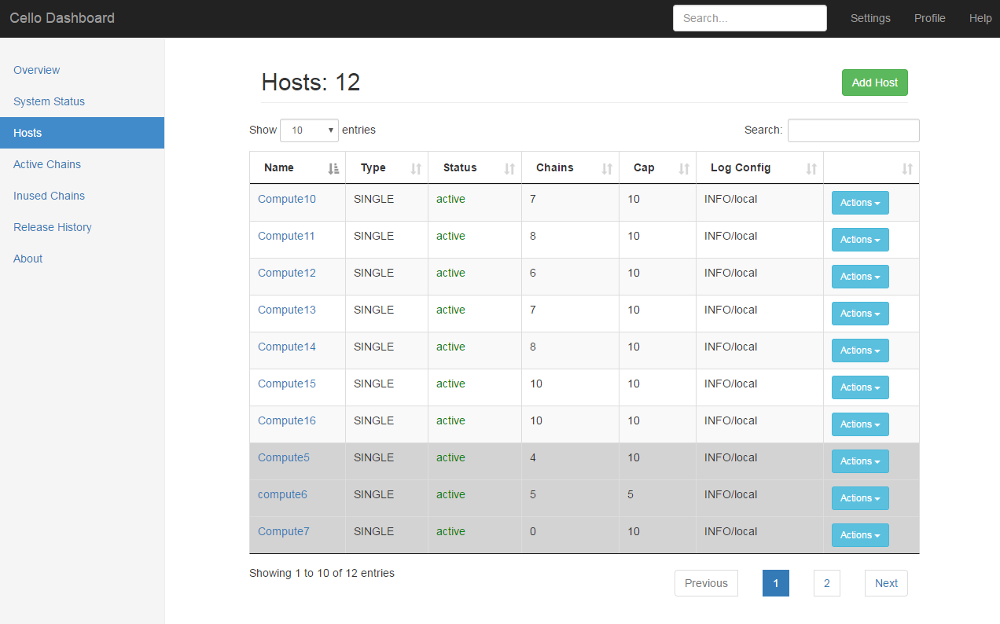

点击一个主机的 Action 下拉菜单，有如下选项可供操作该主机。

* Fillup：将主机运行的区块链数添加至上限。
* Clean：清理主机中所有未被用户占用的链。
* Config：更改主机配置，如名称和链数量上限。
* Reset：重置该主机，只有当该主机没有用户占用的链时可以使用。
* Delete：从资源池中删除该主机。

点击 Hosts 页面的 Add Host 按钮，可以向资源池中添加主机。需要设定该主机的名称、Daemon URL 地址（例如，Worker 节点的 docker daemon 监听地址和端口）、链数量上限、日志配置、是否启动区块链至数量上限、是否可向用户自动分配，如下图所示。

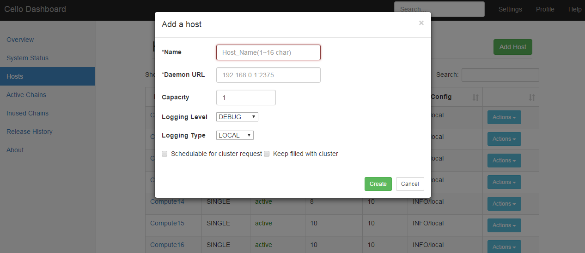

#### Active Chains 页面

Active Chains 页面会显示所有正在运行的链，包括链的名称、类型、状态、健康状况、规模、所属主机等信息。正在被用户占用的链会用灰色背景标识，如下图所示。

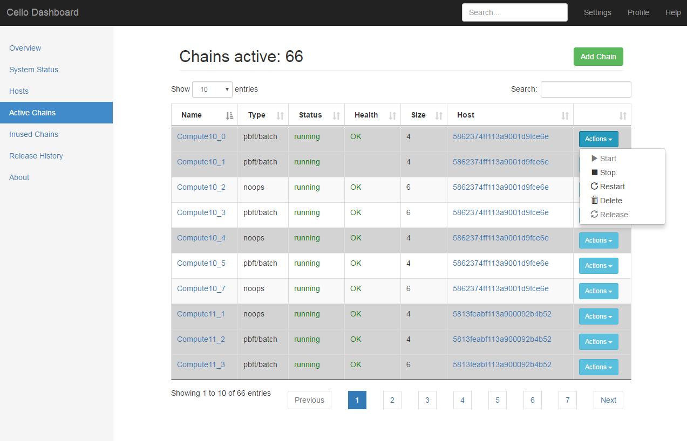

点击一条链的 Actions 下拉菜单，有如下选项可供操作该链。

* Start：如果这条链处于停止状态，则启动。
* Stop：停止运行中的链。
* Restart：重新启动这条链。
* Delete：删除这条链。
* Release：将占用的链释放，随后会被删除。

点击 Active Chains 页面的 Add Chain 按钮，可以向资源池中添加更多链（如果还有未被占满的主机），如下图所示。

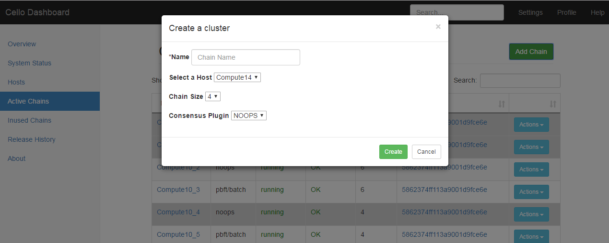

### 用户控制台，申请使用 Chain

用户可以登录 User Dashboard 来申请和使用 Chain

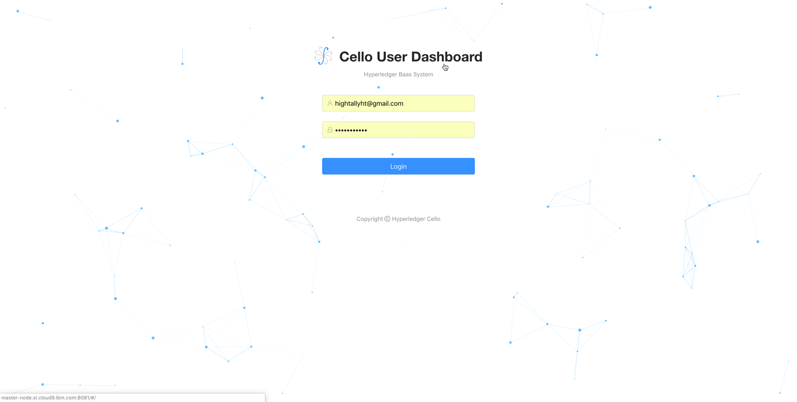

#### Chain 列表页面

Chain 列表页面显示所有用户已经申请的链。

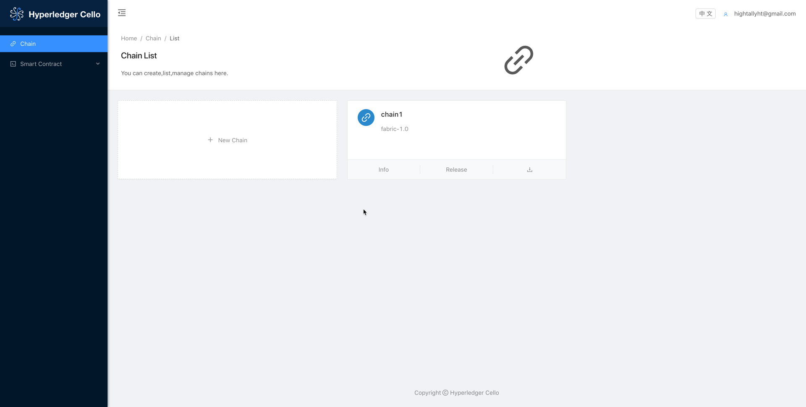

#### Chain 详情页面

Chain 详情页面可以查看链的基本信息（链高度，channel 数，链码安装/实例化个数，最近的 block/transaction），操作历史记录。

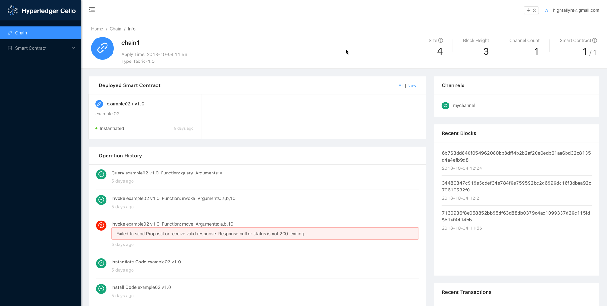

#### 智能合约模板列表页面

这个页面列出用户自己上传的智能合约代码模板，支持多个版本管理。

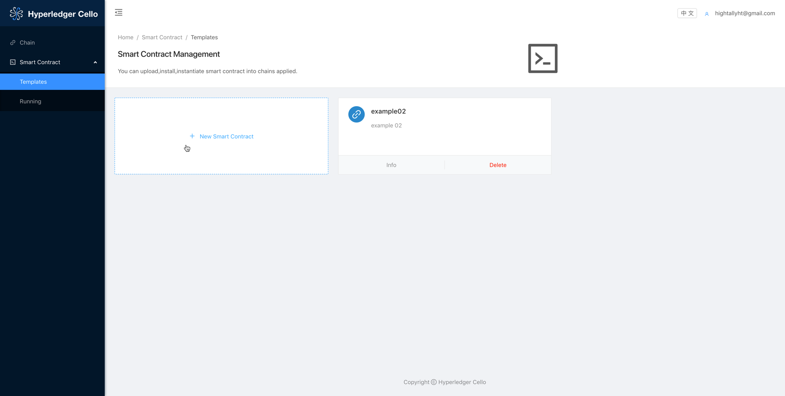

#### 智能合约模板详情页面

在合约模板详情页面可以查看智能合约模板的详情，包括合约多版本列表，部署列表，部署合约。

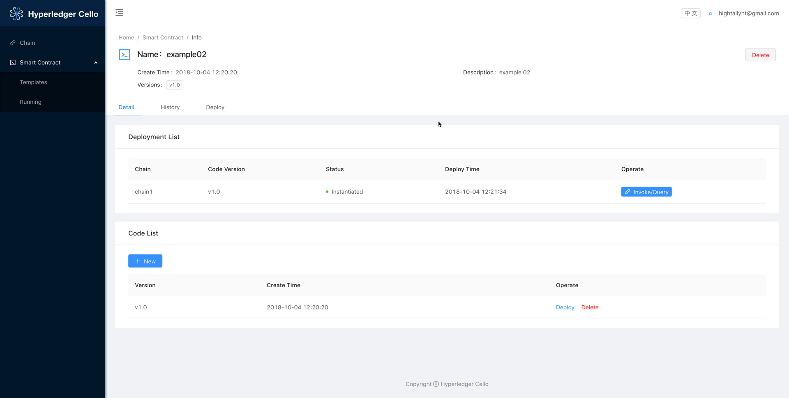

#### 智能合约操作页面

在这个页面可以 invoke/query 已经部署好的智能合约。

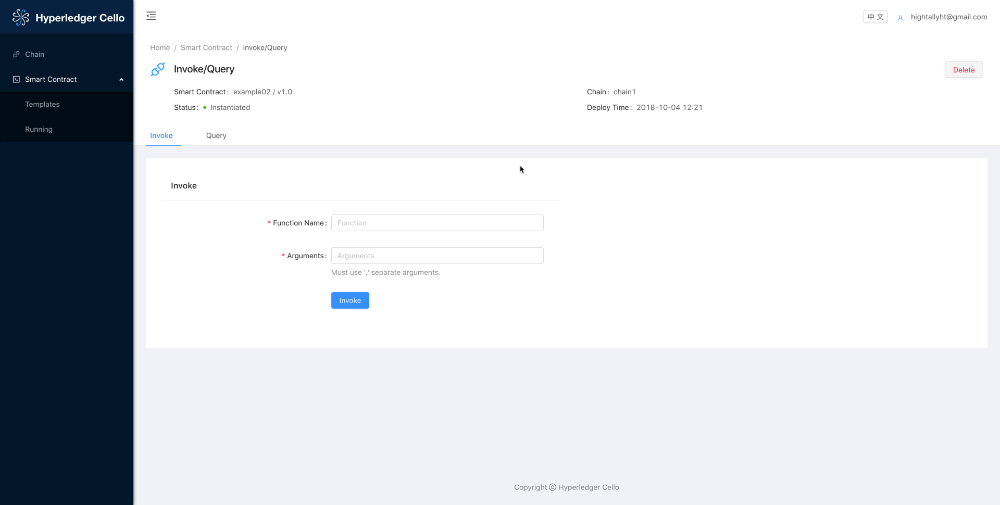

#### 智能合约运行列表页面

这个页面可以查看所有已经部署，包括成功和失败的智能合约的列表。

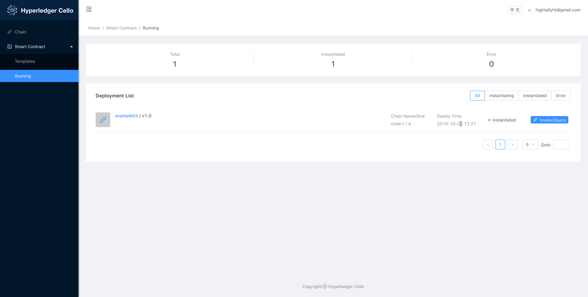

### 基于 Cello 进行功能扩展

Cello 已经提供了完整的区块链管理功能，并提供了图形界面和 API。

用户可以通过向 Cello 的 Master 节点（默认为 8080 端口）发送 RESTful API 来申请、释放区块链，或查看区块链相关信息，如其对外开放的接口，可供用户进行远程交互。RESTful API 的说明可在 Cello 的文档中查阅。

对于区块链服务提供者，可以利用这些 API 为用户呈现友好的区块链申请和操作界面，在 Cello 的基础之上构建和实现更多功能。
