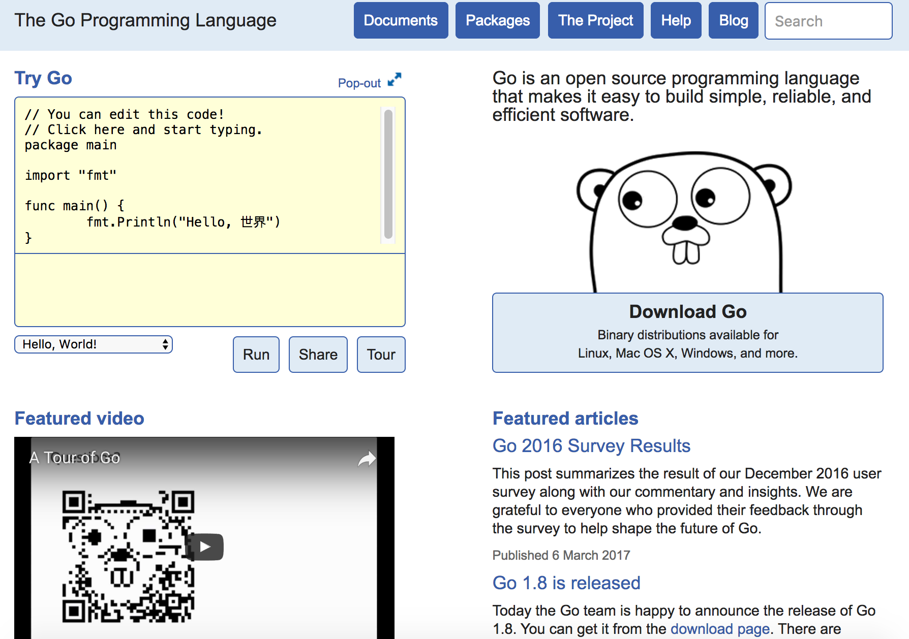
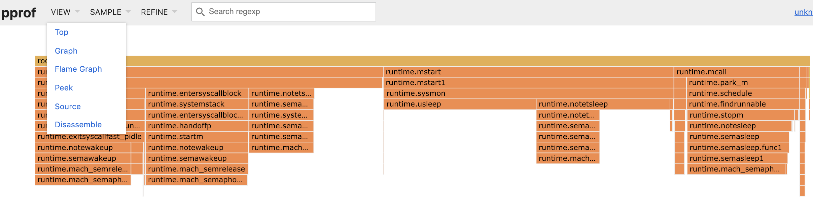

# 第十六章 附录

本附录汇总了区块链技术相关的参考资源，包括术语表、常见问题解答以及推荐阅读材料，供读者在学习过程中查阅参考。

## 术语

### 通用术语

* Blockchain（区块链）：基于密码学的可实现信任的信息存储和处理的结构和技术；
* Byzantine Failure（拜占庭错误）：指系统中存在除了消息延迟或不可送达的故障以外的错误，包括消息被篡改、节点不按照协议进行处理等，潜在地会对系统造成针对性的破坏；
* CDN：Content Delivery Network，内容分发网络。利用在多个地理位置预先配置的缓存服务器，自动从距离近的缓存服务器进行对请求的响应，以实现资源的快速分发；
* Consensus（共识）：分布式系统中多个参与方对某个信息达成一致，多数情况下为对发生事件的顺序达成一致；
* Decentralization（去中心化）：无需一个独立第三方的中心机构存在，有时候也叫多中心化；
* Distributed（分布式）：非单个节点的实现，通常由多个个体通过某种组织形式联合在一起，对外呈现统一的服务形式；
* Distributed Ledger（分布式账本）：由多家联合维护的去中心化（或多中心化）的账本记录平台；
* DLT：Distributed Ledger Technology，分布式账本技术。包括区块链、权限管理等在内的实现分布式账本的技术；
* DTCC：Depository Trust and Clearing Corporation，存托和结算公司。全球最大的金融交易后台服务机构；
* Fintech：Financial Technology，跟金融相关的（信息）技术；
* Gossip：一种 P2P 网络中多个节点之间进行数据同步的协议，如随机选择邻居进行转发；
* LDAP：Lightweight Directory Access Protocol，轻量级目录访问协议，是一种为查询、搜索业务而设计的分布式数据库协议，一般具有优秀的读性能，但写性能往往较差；
* Market Depth（市场深度）：衡量市场承受大额交易后汇率的稳定能力，例如证券交易市场出现大额交易后价格不出现大幅波动；
* MTBF：Mean Time Between Failures，平均故障间隔时间，即系统可以无故障运行的预期时间；
* MTTR：Mean Time to Repair，平均修复时间，即发生故障后，系统可以恢复到正常运行的预期时间；
* MVCC：Multi-Version Concurrency Control，多版本并发控制。数据库领域的技术，通过引入版本来实现并发更新请求的乐观处理，当更新处理时数据版本跟请求中注明版本不一致时则拒绝更新。发生更新成功则将数据的版本递增；
* Non-validating Peer（非验证节点）：Fabric 0.6 时代的历史术语。不参与账本维护，仅作为交易代理响应客户端的请求，并对交易进行一些基本的有效性检查，之后转发给验证节点。现行架构中已不再使用；
* P2P：点到点的通信网络，网络中所有节点地位均等，不存在中心化的控制机制；
* SLA/SLI/SLO：Service Level Agreement/Indicator/Objective，分别描述服务可用性对用户的承诺，功能指标和目标值；
* SWIFT：Society for Worldwide Interbank Financial Telecommunication，环球同业银行金融电讯协会，运营世界金融电文网络，服务银行和金融机构；
* Turing-complete（图灵完备）：指一个机器或装置能用来模拟图灵机（现代通用计算机的雏形）的功能，图灵完备的机器在可计算性上等价；
* Validating Peer（验证节点）：Fabric 0.6 时代的历史术语。维护账本的核心节点，参与一致性维护、对交易的验证和执行。现行架构中已由 Endorser、Committer 等角色取代。

### 密码学与安全相关

* ASN.1：Abstract Syntax Notation One，定义了描述数据的表示、编码、传输、解码的一套标准，被广泛应用在计算机、通信和安全领域；
* CA：Certification Authority，负责证书的创建、颁发，在 PKI 体系中最为核心的角色；
* CBDC：Central Bank Digital Currency，央行数字货币，由中央银行发行的数字货币，多与已有法币体系挂钩；
* CRL：Certificate Revocation List，证书吊销列表，包含所撤销的证书列表；
* CSR：Certificate Signing Request，证书签名申请，包括通用名、名称、主机、生成私钥算法和大小、CA 配置和序列号等信息，用来发给 CA 服务以颁发签名的证书；
* DER：Distinguished Encoding Rules，ASN.1 中定义的一种二进制编码格式，可以用来保存证书或密钥内容；
* Genesis Block：创世区块，区块链的第一个区块，一般用于初始化，不含用户交易（但通常带有 coinbase 交易或配置交易，如比特币创世区块中的 50 BTC 与泰晤士报标题）；
* Hash：Hash 算法，任意长度的二进制值映射为较短的固定长度的二进制值的算法；
* IES：Integrated Encryption Scheme，集成加密机制，一种混合加密机制，可以应对选择明文攻击（可以获知任意明文和对应密文）情况下的攻击。包括 DLIES（基于离散对数）和 ECIES（基于椭圆曲线）两种实现；
* Nonce：密码学术语，表示一个临时的值，多为随机字符串；
* OCSP：Online Certificate Status Protocol，在线证书状态协议，通过查询服务来在线确认证书的状态（如是否撤销）。RFC 2560 中定义；
* PEM：Privacy Enhanced Mail，用来保存证书和密钥的一种编码格式，RFC 1421-1424 中定义；
* PKCS：Public-Key Cryptography Standards，公钥密码标准，由 RSA 实验室提出，定义了利用 RSA 算法和相关密码学技术来实现安全的系列规范，编号从 PKCS #1 到 PKCS #15。最早的版本在 1991 年提出，此后各子规范独立演进，部分已交由其他组织维护，例如 PKCS #1 停留在 2012 年的 2.2 版，而密码令牌接口 PKCS #11 由 OASIS 接手后已发布到 3.2 版；
* PKI：Public Key Infrastructure，基于公钥体系的安全基础架构；
* SM：ShangMi，国家商用密码算法，2010 年以来陆续由国家密码管理局发布的相关标准和规范，主要包括：SM2（基于椭圆曲线密码的公钥密码算法标准）、SM3（Hash 算法标准）、SM4（基于分组加密的对称密码算法标准）、SM9（基于身份的数字证书体系）。2017 年 10 月 30 日，SM2 与 SM9 的数字签名算法在第 55 次 ISO/IEC 信息安全分技术委员会（SC27）上被正式接纳，成为国际标准之一；
* ZKP：Zero-knowledge proof，零知识证明。在不泄露无关信息的前提下证实某个论断。

### 比特币、以太坊相关术语

* Account Abstraction（账户抽象）：通过 ERC-4337 等标准，允许智能合约作为用户账户，支持社交恢复、Gas 代付等功能；
* Bitcoin（比特币）：最早由中本聪提出和实现的基于区块链思想的数字货币技术；
* BLS：Boneh-Lynn-Shacham 签名，支持签名聚合的密码学方案，广泛用于 PoS 共识中的验证者签名；
* DAO：Decentralized Autonomous Organization，分布式自治组织，基于区块链的按照智能合约联系起来的松散自治群体；
* DApp：Decentralized Application，去中心化应用。部署在区块链中的智能合约；
* DeFi：Decentralized Finance，去中心化金融。利用智能合约构建的无需许可的金融应用；
* DePIN：Decentralized Physical Infrastructure Network，去中心化物理基础设施网络，通过代币激励来建设和维护现实世界的物理设施；
* EIP-4844（Proto-Danksharding）：以太坊 Dencun 升级引入的 Blob 数据类型，大幅降低 Layer 2 交易成本；
* Flash Loan（闪电贷）：DeFi 中无需抵押的即时贷款，必须在同一交易内完成借还；
* Layer 2（二层网络）：构建在 Layer 1（主链）之上的扩展协议，旨在提高交易速度并降低成本，如 Rollup；
* Lightning Network（闪电网络）：通过链外的微支付通道来增大交易吞吐量的技术；
* MEV：Maximal Extractable Value，最大可提取价值，验证者通过重排交易获取的额外利润；
* Miner（矿工）：参与挖矿的人或组织；
* Mining（挖矿）：通过暴力尝试来找到一个字符串，使得它加上一组交易信息后的 Hash 值符合特定规则（例如前缀包括若干个 0），找到的人可以宣称新区块被发现，并获得系统奖励的数字货币；
* Mining Machine（矿机）：专门为数字货币挖矿而设计的设备，包括基于软件、GPU、FPGA、专用芯片等多种实现；
* Mining Pool（矿池）：采用团队协作方式来集中算力进行挖矿，对产出的数字货币进行分配；
* NFT：Non-Fungible Token，非同质化代币。用于表示独一无二的数字资产的所有权；
* PoS：Proof of Stake，权益证明，验证者按质押权益和协议规则参与出块、证明或投票，不再依赖 PoW 式算力挖矿；
* PoW：Proof of Work，工作量证明，在一定难题前提下求解一个 SHA256 的 Hash 问题；
* Rollup（汇总）：一种 Layer 2 方案，将大量交易在链下执行并压缩，然后提交到主链进行验证；
* RWA：Real World Assets，现实世界资产代币化，将传统金融资产（如债券、房地产）映射到区块链上；
* SBT：Soulbound Token，灵魂绑定代币，不可转让的 NFT，用于表示身份、资质等；
* Smart Contract（智能合约）：运行在区块链上的提前约定的合同；
* Sybil Attack（女巫攻击）：少数节点通过伪造或盗用身份伪装成大量节点，进而对分布式系统进行破坏；
* TVL：Total Value Locked，总锁定价值，衡量 DeFi 协议中锁定资产规模的指标；
* VRF：Verifiable Random Function，可验证随机函数，可以生成可验证的伪随机输出的密码学工具；
* Web3：基于区块链的下一代互联网，强调用户对数据和资产的拥有权；
* ZKML：Zero-Knowledge Machine Learning，零知识机器学习，利用 ZKP 验证 ML 模型推理的正确性。

### 超级账本相关术语

* Anchor（锚定）：某个组织内的节点暴露出来给其他组织看到，作为协助沟通不同组织之间的节点组成 Gossip 的渠道；
* Auditability（审计性）：在一定权限和许可下，可以对链上的交易进行审计和检查；
* Block（区块）：代表一批得到确认的交易信息的整体，准备被共识加入到区块链中；
* Blockchain（区块链）：由多个区块链接而成的链表结构，除了初始区块，每个区块头部都包括前继区块内容的 Hash 值；
* Bootstrap（启动）：刚启动的节点可以连接到启动节点列表以获取网络中其他节点信息。启动节点必须为同一组织内节点；
* Chaincode（链码）：区块链上的应用代码，扩展自“智能合约”概念，支持 Golang、Node.js 等语言，多为图灵完备；
* Channel（通道）：Fabric 网络上的私有隔离机制。通道中的链码和交易只有加入该通道的节点可见。同一个节点可以加入多个通道，并为每个通道内容维护一个账本；
* Commitment（提交）：提交节点完成对排序后交易的验证，将交易内容写到区块，并更新世界状态的过程；
* Committer（提交节点）：一种 Peer 节点角色，负责对 Orderer 排序后的交易进行背书策略、读写集版本和 MVCC 等验证，将有效交易提交到账本并更新世界状态；它不重新执行链码，也不是在排序后“选择交易执行”；
* Confidentiality（保密）：只有交易相关方可以看到交易内容，其他人未经授权则无法看到；
* Consenter Set（共识组）：在 Raft 共识机制中，每个通道可以由指定的若干排序节点来进行维护，这些排序节点构成通道的共识组。特别的，系统通道的共识组包括所有的排序节点；
* Endorsement：背书过程。按照链码部署时候的背书策略，相关 Peer 对交易提案进行模拟和检查，决策是否为之背书。如果交易提案获得了足够多的背书，则可以构造正式交易进行进一步的共识；
* Endorser（推荐节点或背书节点）：一种 Peer 节点角色，负责检验某个交易是否合法，是否愿意为之背书、签名；
* Invoke（调用）：一种交易类型，对链码中的某个方法进行调用，一般需要包括调用方法和调用参数；
* Ledger（账本）：包括区块链结构（带有所有的交易信息）和当前的世界状态（world state）；
* Member（成员）：代表某个具体的实体身份，在网络中拥有自己的根证书。节点和应用都必须属于某个成员身份。同一个成员可以在同一个通道中拥有多个 Peer 节点，其中一个为 Leader 节点，代表成员与排序节点进行交互，并分发排序后的区块给属于同一成员的其他节点；
* MSP（Member Service Provider，成员服务提供者）：抽象的实现成员服务（身份验证，证书管理等）的组件，实现对不同类型的成员服务的可拔插支持；
* Orderer（排序节点）：共识服务角色，负责排序看到的交易，提供全局确认的顺序，有时又叫 Ordering Service Node（OSN）；
* Permissioned Ledger（带权限的账本）：网络中所有节点必须是经过许可的，非许可过的节点则无法加入网络；
* Privacy（隐私保护）：交易员可以隐藏交易的身份，其他成员在无特殊权限的情况下，只能对交易进行验证，而无法获知身份信息；
* Private Data（私密数据）：通道内只有部分成员组织可以看到原文的数据，可以避免交易数据泄露给其他无关组织或排序节点；
* System Chain（系统链）：由对网络中配置进行变更的配置区块组成，一般可以用来作为组成网络成员们形成的联盟约定；注意 Fabric 3.0 起已移除系统通道机制，应用通道改由通道参与（Channel Participation）API 管理；
* Transaction（交易）：执行账本上的某个函数调用或者部署、更新链码。调用的具体函数在链码中实现；
* Transactor（交易者）：发起交易调用的客户端；
* World State（世界状态）：即最新的全局账本状态。Fabric 用它来存储历史交易发生后产生的最新的状态，可以用键值或文档数据库实现。

## 常见问题

### 通用问题

**问：区块链是谁发明的，有什么特点？**

答：区块链相关的思想最早由比特币的发明者-中本聪（化名）在白皮书中提出，将其作为比特币网络的核心支持技术。自那以后，区块链技术逐渐脱离比特币项目，成为一种通用的可以支持分布式记账能力的底层技术，具有去中心化和加密安全等特点。

**问：区块链和比特币是什么关系？**

答：比特币是基于区块链技术的一种数字现金（cash）应用；区块链技术最早在比特币网络中得到应用和验证。比特币系统在 2009 年上线后面向全球提供服务，在无中心化管理的情况下运转至今。

**问：区块链和分布式数据库是什么关系？**

答：两者定位完全不同。分布式数据库是解决高可用和可扩展场景下的数据管理问题；区块链则是在多方（无须中心化中介角色存在）之间提供一套可信的记账和合约履行机制。可见，两者完全可以配合使用。

**问：区块链有哪些种类？**

答：根据部署场景公开程度，可以分为公有链（Public Chain）、联盟链（Consortium Chain）和私有链（Private Chain）；从功能上看，可以分为以支持数字货币为主的数字货币区块链（如比特币网络）、支持智能合约的通用区块链（如以太坊网络）、面向复杂商业应用场景的分布式账本平台（如超级账本）。

**问：区块链是如何保证没有人作恶的？**

答：恰恰相反，区块链并没有试图保证每一个人都不作恶。以比特币区块链为例，通过经济博弈手段来容忍部分参与者作恶。参与者默认在最长的链（唯一合法链）上进行扩展。当作恶者尝试延续一个非法链的时候，实际上在跟所有的合作者们进行投票竞争。因此，当作恶者占比不高（如不超过一半）时，概率意义上无法造成破坏。而作恶代价是所付出的资源（例如算力）都将浪费掉。

**问：区块链的智能合约应该怎么设计？**

答：智能合约也是一种应用程序，在架构上既可以采取单体（monolithic）的方式（一个合约针对一个具体商业应用，功能完善而复杂），也可以采取微服务（microservice）的方式（每个合约功能单一，多个合约可相互调用共同构建应用）。 选择哪种模式根本上取决于其上商业应用的特点。从灵活性角度，推荐适当对应用代码进行切分，划分到若干个智能合约，尽量保持智能合约的可复用性。

**问：如何查看 PEM 格式证书内容？**

答：可以通过如下命令转换证书内容进行输出：`openssl x509 -noout -text -in <ca_file>`；此外，还可以通过如下命令来快速从证书文件中提取所证明的公钥内容：`openssl x509 -noout -pubkey -in <ca_file>`。

**问：已知私钥，如何生成公钥？**

答：取决于加密算法。对于椭圆曲线加密算法，可以通过如下命令生成公钥：`openssl ec -pubout -outform PEM -in <private_key>`。

**问：如何校验某证书是否被根证书签名？**

答：已知根证书文件 <root_cafile> 和待验证证书文件 <ca_to_verify> 情况下，可以使用如下命令进行验证：`openssl verify -CAfile <root_cafile> <ca_to_verify>`。

**问：为何 Hash 函数将任意长的文本映射到定长的摘要，很少会发生冲突？**

答：像 SHA-1 这样的 Hash 函数可以将任意长的文本映射到相对很短的定长摘要。从理论上讲，从大的集合映射到小的集合上必然存在冲突，这是鸽笼原理的结果，与输入数据的分布无关。

之所以在实践中几乎遇不到冲突，原因有两点：一是输出空间极大，SHA-1 有 2^160 种取值，SHA-256 有 2^256 种；二是设计良好的 Hash 函数会把输入尽量均匀地散布到整个输出空间，因此按生日界估算，随机撞上一次冲突大约需要 2^(n/2) 量级的尝试（SHA-256 约为 2^128 次），远超现实可用的算力。

需要区分“随机碰上”和“被人为构造”。一旦算法本身出现弱点，攻击者就能以远低于生日界的代价构造出冲突：SHA-1 的实际碰撞已由 SHAttered 项目在 2017 年以约 2^63.1 的复杂度做出（详见「Hash 算法与数字摘要」一节），因此它已不适合再用于需要抗碰撞的场景。

### 比特币、以太坊相关

**问：比特币区块链为何要设计为每 10 分钟才出来一个块，快一些不可以吗？**

答：这个主要是从公平的角度，当某一个新块被计算出来后，需要在全球比特币网络内公布。临近的矿工将最先拿到消息并开始新一轮的计算，较远的矿工则较晚得到通知。最坏情况下，可能造成数十秒的延迟。为尽量确保矿工们都处在同一起跑线上，这个时间不能太短。但出块时间太长又会导致交易的“最终”确认时间过长。目前看，10 分钟左右是一个相对合适的折中。另外，也是从存储代价的角度，让拥有不太大存储的普通节点可以参与到网络的维护。

**问：比特币区块链为何要限制区块容量，大一些不可以吗？**

答：这个也是折中的结果。区块产生的平均时间间隔是固定的 10 分钟，容量大一些意味着交易吞吐量可以增加，但节点进行验证的成本会提高，同时存储整个区块链的成本会快速上升。以早期的 1 MB 上限计算，每秒可以记录 `1 MB/(10*60)=1.7 KB` 的交易数据，而一般的交易数据大小在 `0.2 ~ 1 KB`。

需要注意，“每个区块 1 MB”是 SegWit 之前的说法。2017 年 8 月 SegWit 激活后，共识规则改用区块重量（block weight）来限制容量，上限为 4,000,000 weight units，其中基础大小（不含 witness 数据）仍受约 1 MB 约束，因此实际区块可以超过 1 MB（详见「基本原理和设计」一节）。

历史上比特币社区围绕扩容有过长期争论：若干直接调大区块的提案未能达成共识，部分设计者选择了分叉；而 SegWit 这种通过隔离见证间接提升容量的方案最终被接受并激活。

**问：以太坊网络跟比特币网络有何关系？**

答：以太坊网络所采用的区块链结构，源于比特币网络，基于同样设计原理。此外，以太坊提出了许多改善设计，包括支持更灵活的智能合约。需要注意的是，以太坊已经在 2022 年 9 月 15 日通过 The Merge 从 PoW 转向 PoS，不再依赖工作量证明挖矿出块。

### 超级账本项目

**问：超级账本项目与传统公有区块链有何不同？**

答：超级账本是目前全球最大的联盟链开源项目。在联盟场景下，参与多方可以容易达成一定的信任前提。另外，企业十分看重对接入账本各方的权限管理、审计功能、传输数据的安全可靠等特性。超级账本在考虑了商业网络的这些复杂需求后，提出了创新的架构和设计，成为首个在企业应用场景中得到大规模部署和验证的开源项目。

**问：区块链最早是公有链形式，为何现在联盟链在很多场景下得到更多应用？**

答：区块链技术出现以前，人们往往通过中心化的信任机制来实现协作，但一旦中心机制出现故障，则无法进行。区块链技术可以提供无中介化情况下的信任保障。公有链情况下，任何人都可以参与监督，可以实现信任的最大化，但随之而来带来包括性能低下、可扩展性差等问题，特别扩大到互联网尺度时存在许多目前很难解决的技术难题。

联盟链在两者之间取得了平衡。多方共识模型中，系统整体可信任度随独立参与方的增多而提升；同时，联盟的信任前提，可以选用更高性能的共识机制，并支持权限管理。这些对企业场景来说都是迫切的需求。

**问：采用 BFT 类共识算法时，节点掉线后重新加入网络，出现无法同步情况？**

答：这是某些算法设计导致的情况。掉线后的节点重新加入到网络中，其视图（View）会领先于其他节点。其他节点正常情况下不会发生视图的变更，发生的交易和区块内容不会同步到掉线节点。出现这种情况，可以有两种解决方案：一个是强迫其他节点出现视图变更，例如也发生掉线或者在一段时间内强制变更；另一种情况是等待再次产生足够多的区块后触发状态追赶。

**问：超级账本 Fabric 里的安全性和隐私性是如何保证的？**

答：首先，Fabric 1.0 及往后的版本提供了对多通道的支持，不同通道之间的链码和交易是不可见的，即交易只会发送到该通道内的 Peer 节点。此外，在进行背书阶段，客户端可以根据背书策略来选择性的发送交易到通道内的某些特定 Peer 节点。更进一步的，用户可以对交易的内容进行加密（基于证书的权限管理）或使用私密数据，同时，只有得到授权的节点或用户才能访问到私密数据。另外，排序节点无须访问到交易内容，因此，可以选择不将完整交易（对交易输入数据进行隐藏，或者干脆进行加密或 Hash 处理）发送到排序节点。最后，所有数据在传输过程中可以通过 TLS 来进行安全保护。许多层级的保护需要配合使用来获得不同层级的安全性。

实践过程中，也需要对节点自身进行安全保护，通过防火墙、IDS 等防护对节点自身的攻击；另外可以通过审计和分析系统对可疑行为进行探测和响应。

## 相关企业和组织

排名不分先后，大部分信息来自互联网，不保证信息准确性，如有修改意见，欢迎联系。

### 国际

#### 企业

* [IBM](https://www.ibm.com): 早期向 Hyperledger 项目贡献企业区块链相关代码，并参与多家银行和企业区块链项目；IBM Blockchain Platform 已结束原产品支持路径。
* [DTCC](https://www.dtcc.com/): 参与过 Hyperledger 等企业区块链生态合作。
* [Circle](https://www.circle.com/)：稳定币和区块链支付基础设施公司，核心产品包括 USDC 等数字美元服务。Circle 2026 年一季度公告显示，季末 USDC 流通量为 770 亿美元，Q1'26 链上交易量为 21.5 万亿美元。
* [ConsenSys](https://consensys.io/)：区块链创业团队，试图打造区块链平台技术和应用支撑，获得多家投资。

#### 组织

* [R3 / Corda](https://r3.com/get-corda/)：R3 成立于 2014 年，其银行联盟（R3 CEV）于 2015 年 9 月启动；当前重点产品是面向受监管数字市场的 Corda 分布式账本平台。早期 R3 CEV 联盟与 Hyperledger 相关的新闻应作为历史背景阅读。
* [Hyperledger 社区](https://www.lfdecentralizedtrust.org/projects)：创立于 2015 年 12 月，现属于 Linux Foundation Decentralized Trust 生态，聚焦面向企业和公共部门场景的分布式账本、身份、互操作和相关基础设施项目。
* [Ethereum 社区](https://ethereum.org): 围绕以太坊区块链平台的开放社区。
* [DAO](https://ethereum.org/dao/)：Decentralized Autonomous Organization，指由成员共同拥有、通过链上规则和治理流程协作的组织形态。“The DAO” 曾是以太坊早期众筹案例，不应把单一历史事件等同于 DAO 的通用定义。

### 国内

#### 学术界

* 清华大学
* 中科院
* 上海交通大学

#### 企业

* [中国电信](https://www.chinatelecom.com.cn/)：研究区块链相关技术，包括去中心化共享经济平台等。
* [世纪互联](https://www.vnet.com/)：投资区块链技术团队，牵头成立“中关村区块链产业联盟”。
* [银联](https://cn.unionpay.com/)：关注区块链相关技术，尝试引入基于区块链的银行业积分系统。
* 能链：早期关注能源产品相关区块链应用的创业项目，原公开站点已不可稳定访问，适合作为历史案例而非当前活跃项目引用。
* [恒生电子](https://www.hundsun.com/)：2016 年牵头成立“金链盟”，希望通过区块链技术为金融行业提供更简单的产品。
* [布比](https://bubi.cn)：主要关注数字资产管理的技术型创业企业，区块链相关平台和产品。
* [小蚁](https://neo.org/)：主要关注对资产和权益进行数字化，2014 年于上海组建成立。
* [HTX（原火币）](https://www.htx.com/)：火币于 2023 年宣布品牌更新为 HTX。需注意中国人民银行等部门 2021 年通知已明确虚拟货币相关业务活动在中国大陆的监管红线，境外交易所面向境内居民提供服务同样属于非法金融活动。
* BeLink：关注保险行业积分系统，主要产品为数贝荷包。
* BitSe：主要产品为唯链（Vechain），面向物品防伪追踪、数字版权管理相关。
* [万向集团](https://www.wxblockchain.com/)：投资多家区块链创业团队，致力于推动产业发展。

#### 组织

* 中关村区块链产业联盟：2016 年 2 月 3 日成立于北京，由世纪互联联合清华大学、北京邮电大学等高校、中国通信学会、中国联通研究院等运营商，及集佳、布比网络等公司发起；
* ChinaLedger：2016 年 4 月成立于上海，成员包括中证机构间报价系统股份有限公司、中钞信用卡产业发展有限公司北京智能卡技术研究院、万向区块链实验室、浙江股权交易中心、深圳招银前海金融资产交易中心、厦门国际金融资产交易中心、大连飞创信息技术有限公司、通联支付网络服务股份有限公司、上海矩真金融信息服务有限公司、深圳瀚德创客金融投资有限公司、乐视金融等；
* 金融区块链合作联盟（金链盟）：2016 年 5 月 31 日成立于深圳，包括平安银行、恒生电子、京东金融、腾讯微众银行、华为、南方基金、国信证券、安信证券、招商证券、博时基金等 25 家公司与机构。

## Go 语言开发相关

Go 是一门年轻的语言。它在设计上借鉴了传统 C 语言的高性能特性，以及多种现代系统语言的优点，被认为是具有很大潜力的系统开发语言。要使用好 Go 语言，首先要掌握好相关的开发工具。

这里介绍如何快速安装和配置 Go 语言环境、选用合适的编辑器和 IDE，以及如何配合使用 Go 的配套开发工具来提高开发效率。

### 安装与配置 Golang 环境

Go 语言环境安装十分简单，可以通过包管理器或自行下载方式进行。为了使用最新版本的 Go 环境，推荐通过官方网站下载安装包。

#### 1. 下载安装包

访问 Go 语言官方下载页面 [https://go.dev/dl/](https://go.dev/dl/)，根据你的操作系统（Linux, macOS, Windows）选择对应的安装包。

以 Linux 为例，下载最新的 `tar.gz` 包。文件名通常类似 `go1.xx.y.linux-amd64.tar.gz`，具体版本号请以官网最新发布页为准。

#### 2. 安装

**Linux (Tarball):**

删除旧的安装（如果存在）并将新包解压到 `/usr/local/go`。先把下面变量替换成你实际下载的 Linux tarball 文件名和 Go 下载页提供的 SHA256：

```bash
$ GO_TARBALL=go1.xx.y.linux-amd64.tar.gz
$ GO_SHA256=<从 go.dev/dl 复制的 SHA256>
$ test -f "$GO_TARBALL"
$ printf '%s  %s\n' "$GO_SHA256" "$GO_TARBALL" | sha256sum -c -
$ sudo rm -rf /usr/local/go
$ sudo tar -C /usr/local -xzf "$GO_TARBALL"
```

**macOS (PKG):**
直接双击下载的 `.pkg` 文件，按照向导完成安装。

**Windows (MSI):**
直接双击下载的 `.msi` 文件，按照向导完成安装。

#### 3. 配置环境变量

你需要将 Go 的二进制文件路径添加到系统的 `PATH` 环境变量中，以便在终端中直接运行 `go` 命令。

编辑你的 Shell 配置文件（如 `$HOME/.bashrc`, `$HOME/.zshrc` 或 `/etc/profile`），添加以下行：

```bash
export PATH=$PATH:/usr/local/go/bin
```

保存文件并使配置生效（例如 `source ~/.bashrc`）。

**验证安装：**

在终端运行以下命令，如果能看到版本号，说明安装成功。输出会类似：

```bash
$ go version
go version go1.xx.y linux/amd64
```

#### 4. 关于项目工作区 （Workspace）

在早期的 Go 版本中，我们需要配置 `GOPATH` 环境变量，并将所有项目代码都放在 `$GOPATH/src` 目录下。

**自 Go 1.11 引入 Go Modules 以来，这已不再是必须的。**

现在的最佳实践是使用 **Go Modules** 进行依赖管理。你可以在文件系统的**任意位置**创建 Go 项目。

创建一个新项目只需：

```bash
mkdir my-project
cd my-project
go mod init example.com/my-project
```

这不仅简化了配置，还避免了版本冲突问题。

有关更多安装详情，请参考官方文档：[https://go.dev/doc/install](https://go.dev/doc/install)。

### 编辑器与 IDE

使用传统编辑器如 VIM，可以安装相应的 Golang 支持插件，如 [vim-go](https://github.com/fatih/vim-go)。

Go 语言的编辑器和 IDE（Integrated Development Environment）生态已经相当成熟。最常用的是 JetBrains 出品的 GoLand 和微软开发的 Visual Studio Code（配合官方 Go 扩展），两者都基于 gopls 语言服务器提供补全、跳转和重构能力。

GoLand 是专门针对 Go 语言设计的 IDE，在代码的补全、分析等方面性能更优越。可以从 [https://www.jetbrains.com/go/](https://www.jetbrains.com/go/) 下载获取。

Visual Studio Code 是一个通用的 IDE，可以通过安装支持 Go 的插件来进行开发。下载地址为 https://code.visualstudio.com/download。

此外，简单的代码逻辑验证也可以通过官方的在线 Playground 平台，地址为 https://go.dev/play/。

### 高效开发工具

Go 语言自带了不少高效的工具和命令，使用好这些工具和命令，可以很方便地进行程序的维护、编译和调试。

#### go doc 和 godoc

go doc 可以快速显示指定软件包的帮助文档。

godoc 是一个类似的命令，功能更强大，它以 web 服务的形式提供文档，即允许用户通过浏览器查看软件包的文档。

可以通过如下命令进行快速安装。

```bash
$ go install golang.org/x/tools/cmd/godoc@latest
```

godoc 命令使用格式如下。

```bash
$ godoc package [name ...]
```

比较有用的命令行参数包括：

* `-http=:PORT`：指定监听的地址，默认是 `:6060`。
* `-index`：支持关键词索引。
* `-play`：支持 Go 语言的 playground，用户可以在浏览器里面对 Go 语言进行测试。

例如，下面的命令将在本地快速启动一个类似 [https://go.dev/](https://go.dev/) 的网站，包括本地软件包的文档和 playground 等。

```bash
$ godoc -http=:6060 -index -play
```



#### go build

编译软件包，例如编辑当前软件包内容。

```sh
$ go build .
```

支持如下参数：

* `-x` 参数：可以打印出执行过程的详细信息，辅助调试。
* `-gcflags`：指定编译器参数。
* `-ldflags`：指定链接器参数，常见的可以通过 -X 来动态指定包变量值。

#### go clean

清理项目，删除编译生成的二进制文件和临时文件。使用格式如下

```sh
$ go clean
```

支持如下参数：

* `-i` 参数：删除 go install 安装的文件。
* `-n` 参数：打印删除命令，而不执行，方便进行测试检查。
* `-r` 参数：递归清除，对依赖包也执行清理工作。
* `-x` 参数：执行清除过程同时打印执行的删除命令，方便进行测试检查。

#### go env

打印与 go 相关的环境变量，命令使用格式如下。

```bash
$ go env [var ...]
```

例如，通过如下命令查看所有跟 go 相关的环境变量。

```bash
$ go env

GOARCH="amd64"
GOBIN=""
GOEXE=""
GOHOSTARCH="amd64"
GOHOSTOS="darwin"
GOOS="darwin"
GOPATH="/opt/Go"
GORACE=""
GOROOT="/usr/local/go/1.23.5/libexec"
GOTOOLDIR="/usr/local/go/1.23.5/libexec/pkg/tool/darwin_amd64"
GCCGO="gccgo"
CC="clang"
GOGCCFLAGS="-fPIC -m64 -pthread -fno-caret-diagnostics -Qunused-arguments -fmessage-length=0 -fdebug-prefix-map=/var/folders/d8/3h28zg552853gpp7ymrxl2r80000gn/T/go-build128111214=/tmp/go-build -gno-record-gcc-switches -fno-common"
CXX="clang++"
CGO_ENABLED="1"
PKG_CONFIG="pkg-config"
CGO_CFLAGS="-g -O2"
CGO_CPPFLAGS=""
CGO_CXXFLAGS="-g -O2"
CGO_FFLAGS="-g -O2"
CGO_LDFLAGS="-g -O2"
```

#### go fmt 和 gofmt

两者都是对代码进行格式化检查和修正。

go fmt 命令实际上是对 gofmt 工具进行了封装，默认调用 `gofmt -l -w` 命令。

gofmt 命令的使用格式如下。

```sh
$ gofmt [flags] [path ...]
```

支持如下参数：

* `-d` 参数：仅显示不符合格式规定的地方，不进行修正。
* `-e` 参数：打印完整错误内容，默认是只打印 10 行。
* `-l` 参数：列出不符合格式规定的文件路径。
* `-r` 参数：重写的规则。
* `-s` 参数：对代码尝试进行简化。
* `-w` 参数：对不符合默认风格的代码进行修正。

#### go get

在 Go modules 时代，`go get` 主要用于向当前模块添加或更新依赖，例如

```sh
$ go get google.golang.org/grpc@latest
```

支持如下参数：

* `-u` 参数：可以强制更新到最新版。

注意：早期用于“只下载不安装”的 `-d` 参数自 Go 1.18 起恒为默认行为并已弃用，当前版本执行时会提示 `-d flag is deprecated`。

注意：若要安装命令行工具，应改用 `go install` 命令并指定版本（例如 `go install google.golang.org/protobuf/cmd/protoc-gen-go@latest`），以避免污染项目的依赖管理。

#### go install

对本地软件包执行编译，并将编译好的二进制文件安装到 $GOPATH/bin。

等价于先执行 `go build` 命令，之后执行复制命令。

#### go list

列出本地包中的所有的导入依赖。

命令格式为

```sh
$ go list [-e] [-f format] [-json] [build flags] [packages]
```

其中，-e 可以指定忽略出错的包。

#### go run

编译并直接运行某个主程序包。

需要注意，可以执行 `go run` 的程序包必须是主包，意味着包内必须有入口的主函数：main。

#### go test

执行软件包内带的测试用例（`*_test.go` 文件），例如递归执行当前包内所有的测试案例。

```sh
$ go test ./...
```

支持如下参数：

* `-v` 参数：可以参数来打开详细测试日志，辅助调试。

#### golangci-lint

对代码进行格式风格检查，打印出不符合 Go 语言推荐风格的代码。

注意：golint 已被废弃并归档。推荐使用 golangci-lint 作为其替代品，它提供了更全面的代码检查功能。

安装该工具十分简单，通过如下命令即可快速安装。

```bash
$ go install github.com/golangci/golangci-lint/v2/cmd/golangci-lint@latest
```

使用时，指定软件包路径即可，如对超级账本 Fabric 项目所有代码进行风格检查。

```bash
$ golangci-lint run ./...
```

注意后面的 `...` 代表递归检查所有子目录下内容。

#### goimports

也是代码风格检查工具，重点在于对 imports 相关格式进行检查，比较强大的是能自动修正。

安装该工具十分简单，通过如下命令即可快速安装。

```bash
$ go install golang.org/x/tools/cmd/goimports@latest
```

使用时，也是指定软件包路径即可。

另外，goimports 支持几个很有用的参数。

`-d`：仅显示修订，不实际写入文件。
`-e`：显示所有的错误。
`-l`：列出含有错误的文件路径。
`-w`：将修订直接写入文件，不显示出来。
`-srcdir`：指定对软件包进行查找的相对路径。

#### go vet

go vet 对代码的准确性进行基本检查，如函数调用参数缺失、不可达代码，或调用格式不匹配等。使用也十分简单，指定要检查的软件包路径作为参数即可。

#### go tool

`go tool` 命令中包括许多有用的工具子命令，包括 addr2line、api、asm、cgo、compile、cover、dist、doc、fix、link、nm、objdump、pack、pprof、trace。

其中，比较常用的包括 fix、trace 等。

fix 命令可以对自动对旧版本的代码进行升级修复，替换为使用新版本的特性。

trace 命令可以通过分析 trace 文件来追踪程序运行过程中的事件（包括 goroutine 的创建、使用和结束，以及系统调用和网络 IO 等底层事件），并提供图形化界面展示。例如如下命令会打开网页提供图形界面，展示程序执行情况。

```bash
$ go test -bench=. -trace trace.out
$ go tool trace trace.out
```

可以通过 `go tool cmd -h` 命令查看子目录具体支持的相关参数，在此不再赘述。

#### pprof 工具包

Go 语言自带了方便的性能分析工具，可以查看程序的 CPU、内存等在运行时的使用情况。

目前支持两种性能分析工具包。如果希望在程序执行过程中通过 Web 网页实时查看运行信息（go routine、堆栈等），可以导入 `net/http/pprof` 工具包，并在代码中启动 Web 服务，如下所示：

```go
import (
	"net/http"
	_ "net/http/pprof"
)

func main() {
	// 提供 profiling web 界面 localhost:6060/debug/pprof
	go func() {
		http.ListenAndServe("localhost:6060", nil)
	}()

	// 应用程序代码
}
```

程序运行后，可以通过访问 localhost:6060/debug/pprof 路径来查看 go routine、thread、堆栈使用等实时信息。

如果是希望执行完毕后统一进行分析，可以使用 `runtime/pprof` 包，并在代码中启动性能分析功能。

例如，编写 main.go 文件，通过 go routine 来启动若干计时器，但并没有进行释放。

```go
package main

import (
    "flag"
    "fmt"
    "log"
    "os"
    "runtime"
    "runtime/pprof"
    "time"
    "github.com/pkg/errors"
)

func testTimeout() error{
    incChan := make(chan int, 1)
    errChan := make(chan error, 1)
    timeout := 10 * time.Millisecond

    go func() {
        incChan <- 1
    }()

    select {
    case <-time.NewTicker(timeout).C:
        fmt.Println("Ticker")
        return errors.Errorf("Timed out waiting for connection message")
    case m := <-incChan:
        fmt.Printf("incChan: %d\n", m)
        return nil
    case err := <-errChan:
        fmt.Println("errChan")
        return errors.WithStack(err)
    }
}

var cpuprofile = flag.String("cpuprofile", "cpu.prof", "write cpu profile to `file`")
var memprofile = flag.String("memprofile", "mem.prof", "write memory profile to `file`")

func main() {
    // 启用 CPU profiling
    flag.Parse()
    if *cpuprofile != "" {
        f, err := os.Create(*cpuprofile)
        if err != nil {
            log.Fatal("could not create CPU profile: ", err)
        }
        if err := pprof.StartCPUProfile(f); err != nil {
            log.Fatal("could not start CPU profile: ", err)
        }
        defer pprof.StopCPUProfile()
    }

    // 应用代码
    i := 1
    for i = 1; i <= 100; i++ {
        fmt.Println(i)
        go testTimeout()
        time.Sleep(time.Duration(1) * time.Second)
    }

    // 导出内存统计
    if *memprofile != "" {
        f, err := os.Create(*memprofile)
        if err != nil {
            log.Fatal("could not create memory profile: ", err)
        }
        runtime.GC() // get up-to-date statistics
        if err := pprof.WriteHeapProfile(f); err != nil {
            log.Fatal("could not write memory profile: ", err)
        }
        f.Close()
    }
}
```

执行 `go build -o main .` 编译后运行 `./main`，观察到 CPU 使用率会逐步上升（后面 pprof 需要读取该二进制的符号表，因此这里不用 `go run`）。

程序运行完成后，同一路径下会生成 cpu.prof 和 mem.prof 文件。其中记录了运行过程中的调用信息，之后可以通过 pprof 工具或较新版本的 `go tool pprof` 对其进行分析。这里以分析 CPU 使用为例。

*说明：如果没有安装 pprof 工具，可以通过 `go install github.com/google/pprof@latest` 快速安装。*

pprof 工具最常见的功能是提供一个 Web 交互界面，供用户查看调用图、火焰图、CPU 消耗，可以通过如下命令打开 Web 操作界面。

```bash
$ pprof -http=localhost:6060 main cpu.prof
```

用户可以根据需要从不同角度查看运行信息，并分析程序消耗资源较多的环节。如下图所示。



另外，runtime 包中也提供了如 `runtime/trace` 等工具包，可以生成 trace 文件供进行事件追踪分析，使用方法与 `runtime/pprof` 包类似，在此不再赘述。

### 依赖管理：Go Modules

在 Go 1.11 之前，Go 语言缺乏官方统一的依赖管理机制，社区涌现了如 `dep`, `govendor`, `glide` 等第三方工具。自 Go 1.11 引入并在 Go 1.13 默认开启 **Go Modules** 以来，它已成为 Go 语言管理依赖的事实标准。

#### 什么是 Go Modules

Module（模块）是相关 Go 包（Package）的集合。Modules 是源代码交换和版本控制的单元。`go` 命令直接支持使用 Modules，包括记录和解析对其他模块的依赖性。

一个 Module 由根目录下的 `go.mod` 文件定义。

#### 核心命令

Go Modules 的日常使用非常简单，主要依赖 `go` 命令行工具。

**1. 初始化模块**

在项目根目录下运行：

```bash
$ go mod init <module-name>

## 例如：go mod init github.com/myuser/myproject
```

这会创建一个 `go.mod` 文件，其中包含模块名称和 Go 版本。

**2. 添加/更新依赖**

当你在代码中 `import` 一个包并运行 `go build` 或 `go test` 时，Go 会自动查找并下载该依赖的最新稳定版本，并将其添加到 `go.mod` 和 `go.sum` 文件中。

你也可以手动添加或升级依赖：

```bash
$ go get example.com/pkg
```

这会下载最新版本。如果需要特定版本：

```bash
$ go get example.com/pkg@v1.2.3
```

**3. 整理依赖**

在开发过程中，`go.mod` 可能会包含一些不再使用的依赖（例如删除了某些 import）。使用 `tidy` 命令可以自动清理：

```bash
$ go mod tidy
```

这个命令会添加缺失的模块并移除未使用的模块，确保 `go.mod` 与源代码保持一致。

#### 配置文件

*   **go.mod**: 定义模块路径、Go 版本以及项目直接依赖的模块版本。
*   **go.sum**: 记录所有依赖模块（包括间接依赖）的加密 Hash 值，用于确保下载的模块未被篡改，保证构建的一致性和安全性。这两个文件都应提交到版本控制系统（Git）中。

#### 代理配置 （GOPROXY）

在中国大陆地区访问 Go 官方源可能较慢。可以通过设置 `GOPROXY` 环境变量来使用国内的代理服务加速下载。

**七牛云代理：**

```bash
go env -w GOPROXY=https://goproxy.cn,direct
```

**阿里云代理：**

```bash
go env -w GOPROXY=https://mirrors.aliyun.com/goproxy/,direct
```

设置后，`go get` 将通过代理服务器高速下载依赖。

### 总结

现在，你在进行 Go 语言开发时，**不再需要**关注 `vendor` 目录（除非有特殊离线编译需求），也**不再需要**学习 `dep` 或 `glide` 等旧工具。只需掌握 `go mod` 系列命令即可轻松管理项目依赖。

## ProtoBuf 与 gRPC

[ProtoBuf](https://github.com/protocolbuffers/protobuf) 是一套接口描述语言（[Interface Definition Language，IDL](https://en.wikipedia.org/wiki/Interface_description_language)），类似 Apache 的 [Thrift](https://thrift.apache.org/)。

相关处理工具主要是 [protoc](https://github.com/protocolbuffers/protobuf)，基于 C++ 语言实现。

用户写好 `.proto` 描述文件，之后便可以使用 protoc 自动编译生成众多计算机语言（C++、Java、Python、C#、Go 等）的接口代码。这些代码可以支持 gRPC，也可以不支持。

[gRPC](https://github.com/grpc/grpc) 是 Google 开源的 RPC 框架和库，已支持主流计算机语言。底层通信采用 HTTP2 协议，比较适合互联网场景。gRPC 在设计上考虑了跟 ProtoBuf 的配合使用。

两者分别解决不同问题，可以配合使用，也可以分开单独使用。

典型的配合使用场景是，写好 `.proto` 描述文件定义 RPC 的接口，然后用 protoc（带 gRPC 插件）基于 `.proto` 模板自动生成客户端和服务端的接口代码。

### ProtoBuf

需要工具主要包括：

* 编译工具：[protoc](https://github.com/protocolbuffers/protobuf)，以及一些官方没有带的语言插件；
* 运行环境：各种语言的 protobuf 库，不同语言有不同的安装来源；

语法类似 C++ 语言，可以参考 ProtoBuf 语言规范：https://protobuf.dev/programming-guides/proto3/。

比较核心的，`message` 是代表数据结构（里面可以包括不同类型的成员变量，包括字符串、数字、数组、字典……），`service` 代表 RPC 接口。变量后面的数字是代表进行二进制编码时候的提示信息，1~15 表示热变量，会用较少的字节来编码。另外，支持导入。

默认所有变量都是可选的（optional），repeated 则表示数组。主要 service rpc 接口接受单个 message 参数，返回单个 message。

参考官方给出示例，如下所示：

```protobuf
syntax = "proto3";

package helloworld;

option go_package = "./helloworld";

// The greeting service definition.
service Greeter {
  // Sends a greeting
  rpc SayHello (HelloRequest) returns (HelloReply) {}
}

// The request message containing the user's name.
message HelloRequest {
  string name = 1;
}

// The response message containing the greetings
message HelloReply {
  string message = 1;
}
```

编译最关键的参数是输出语言格式参数，例如，python 为 `--python_out=OUT_DIR`。

一些还没有官方支持的语言，可以通过安装 protoc 对应的 plugin 来支持。例如，对于 Go 语言，可以安装

```sh
$ go install google.golang.org/protobuf/cmd/protoc-gen-go@latest
$ go install google.golang.org/grpc/cmd/protoc-gen-go-grpc@latest
```

*注：旧版导入路径 `github.com/golang/protobuf` 已迁移至 `google.golang.org/protobuf`。新项目应使用新路径。*

之后，正常使用 `protoc --go_out=./ ./hello.proto` 命令调用 `protoc-gen-go` 插件来生成 hello.pb.go。

ProtoBuf 提供了 `Marshal/Unmarshal` 方法来将数据结构进行序列化操作。相比 XML 等文本格式，ProtoBuf 的二进制编码通常更紧凑、解析也更快，具体倍数取决于数据结构和实现，应以自己场景下的实测为准。

### gRPC

相关工具主要包括：

* 运行时库：各种不同语言有不同的安装方法，可参考 [gRPC 官方文档](https://grpc.io/docs/) 和对应语言的 quickstart，例如 [Go quickstart](https://grpc.io/docs/languages/go/quickstart/)；主流语言的包管理器都已支持。
* protoc，以及 gRPC 插件和其他插件：采用 ProtoBuf 作为 IDL 时，对 .proto 文件进行编译处理。

类似其他 RPC 框架，gRPC 的库在服务端提供一个 gRPC Server，客户端的库是 gRPC Stub。典型的场景是客户端发送请求，同步或异步调用服务端的接口。客户端和服务端之间的通信协议是基于 HTTP2 的 [gRPC](https://github.com/grpc/grpc/blob/master/doc/PROTOCOL-HTTP2.md) 协议，支持双工的流式保序消息，性能比较好，同时也很轻。

采用 ProtoBuf 作为 IDL，则需要定义 service 类型。生成客户端和服务端代码。用户自行实现服务端代码中的调用接口，并且利用客户端代码来发起请求到服务端。一个完整的例子可以参考 [https://github.com/grpc/grpc-go/blob/master/examples/helloworld](https://github.com/grpc/grpc-go/blob/master/examples/helloworld/)。

以上面 proto 文件为例，需要执行时添加 gRPC 的 plugin：

```sh
$ protoc --go_out=. --go-grpc_out=. hello.proto
```

*注：旧版命令 `--go_out=plugins=grpc` 已弃用。新版使用独立的 `protoc-gen-go-grpc` 插件，需分别指定 `--go_out` 和 `--go-grpc_out` 参数。*

执行后会生成对应的 .pb.go 和 _grpc.pb.go 文件，分别包含消息结构定义和 gRPC 服务接口代码。

gRPC 更多原理可以参考[官方文档：https://grpc.io/docs/](https://grpc.io/docs/)。

#### 实现服务端代码

生成的 .pb.go 文件中，服务端相关的核心代码如下，主要定义了 GreeterServer 接口，用户可以自行修改或编写实现代码。

```go
type GreeterServer interface {
    SayHello(context.Context, *HelloRequest) (*HelloReply, error)
}

func RegisterGreeterServer(s *grpc.Server, srv GreeterServer) {
    s.RegisterService(&_Greeter_serviceDesc, srv)
}
```

用户需要自行实现服务端接口，代码如下。

比较重要的，创建并启动一个 gRPC 服务的过程：

* 创建监听套接字：`lis, err := net.Listen("tcp", port)`；
* 创建服务端：`grpc.NewServer()`；
* 注册服务：`pb.RegisterGreeterServer()`；
* 启动服务端：`s.Serve(lis)`。

```go
package main

import (
    "context"
    "fmt"
    "log"
    "net"

    "google.golang.org/grpc"
    pb "hello/hello"
    )

const (
    port = ":50051"
)

type server struct{ }

// 这里实现服务端接口中的方法。
func (s *server) SayHello(ctx context.Context, in *pb.HelloRequest) (*pb.HelloReply, error) {
    log.Printf("Received: %v\n", in.GetName())
    return &pb.HelloReply{Message: "Hello " + in.GetName()}, nil
}

// 创建并启动一个 gRPC 服务的过程：创建监听套接字、创建服务端、注册服务、启动服务端。
func main() {
    lis, err := net.Listen("tcp", port)
    if err != nil {
            log.Fatalf("failed to listen: %v", err)
    }
    s := grpc.NewServer()
    pb.RegisterGreeterServer(s, &server{})
    fmt.Printf("Starting listen on port: %s", port)
    if err := s.Serve(lis); err != nil {
            log.Fatalf("failed to serve: %v", err)
    }
}
```

编译并启动服务端。

```bash
$ go run server/server.go
Starting listen on port: :50051
```

#### 生成客户端代码

生成的 Go 文件中客户端相关代码如下，主要定义和实现了 GreeterClient 接口。用户可以通过 gRPC 来直接调用这个接口。

```go
type GreeterClient interface {
    // Sends a greeting
    SayHello(ctx context.Context, in *HelloRequest, opts ...grpc.CallOption) (*HelloReply, error)
}

type greeterClient struct {
    cc *grpc.ClientConn
}

func NewGreeterClient(cc *grpc.ClientConn) GreeterClient {
    return &greeterClient{cc}
}

func (c *greeterClient) SayHello(ctx context.Context, in *HelloRequest, opts ...grpc.CallOption) (*HelloReply, error) {
    out := new(HelloReply)
    err := c.cc.Invoke(ctx, "/helloworld.Greeter/SayHello", in, out, opts...)
    if err != nil {
        return nil, err
    }
    return out, nil
}
```

用户直接调用接口方法：创建连接、创建客户端、调用接口。

```go
package main

import (
    "context"
    "log"
    "os"
    "time"

    "google.golang.org/grpc"
    "google.golang.org/grpc/credentials/insecure"
    pb "hello/hello"
)

const (
    address     = "localhost:50051"
    defaultName = "world"
)

func main() {
    // Create a client connection. RPC calls use the context deadline below.
    conn, err := grpc.NewClient(address, grpc.WithTransportCredentials(insecure.NewCredentials()))
    if err != nil {
            log.Fatalf("did not connect: %v", err)
    }
    defer conn.Close()
    c := pb.NewGreeterClient(conn)

    // Contact the server and print out its response.
    name := defaultName
    if len(os.Args) > 1 {
            name = os.Args[1]
    }
    ctx, cancel := context.WithTimeout(context.Background(), time.Second)
    defer cancel()
    r, err := c.SayHello(ctx, &pb.HelloRequest{Name: name})
    if err != nil {
            log.Fatalf("could not greet: %v", err)
    }
    log.Printf("Greeting: %s", r.GetMessage())
}
```

编译并启动客户端，可以查看到服务端返回的消息。

```bash
$ go run client/client.go
Greeting: Hello world
```

## 参考资源链接

### 论文

* L. Lamport, “Time, Clocks, and the Ordering of Events in a Distributed System,” Commun. ACM, vol. 21, no. 7, pp. 558–565, 1978.
* M Pease, R Shostak, L Lamport. Reaching Agreement in the Presence of Faults. Journal of the ACM, 1980, 27(2): 228-234.
* M. J. Fischer, N. A. Lynch, and M. S. Paterson, “Impossibility of Distributed Consensus with One Faulty Process,” J. ACM, vol. 32, no. 2, pp. 374–382, 1985.
* L. Lamport, “The Part-Time Parliament,” ACM Trans. Comput. Systems, vol. 16, no. 2, pp. 133–169, 1998.
* M. Castro and B. Liskov, “Practical Byzantine Fault Tolerance,” Proc. Symp. Oper. Syst. Des. Implement., no. February, pp. 1–14, 1999.
* Satoshi Nakamoto, "Bitcoin: A Peer-to-Peer Electronic Cash System", https://bitcoin.org/bitcoin.pdf, 2008.
* A. Back, M. Corallo, L. Dashjr, M. Friedenbach, G. Maxwell, A. Miller, A. Poelstra, J. Timón, and P. Wuille, “Enabling Blockchain Innovations with Pegged Sidechains,” pp. 1–25, 2014.
* T. D. Joseph Poon, “The Bitcoin Lightning Network: Scalable Off-Chain Payments,” https://lightning.network/lightning-network-paper.pdf, pp. 1–59, 2016.
* Gentry C., Halevi S., “Implementing Gentry’s Fully-Homomorphic Encryption Scheme”. In: Paterson K.G. (eds) Advances in Cryptology – EUROCRYPT 2011. EUROCRYPT 2011. Lecture Notes in Computer Science, vol 6632. Springer, Berlin, Heidelberg.
* van Dijk M., Gentry C., Halevi S., Vaikuntanathan V., "Fully Homomorphic Encryption over the Integers". In: Gilbert H. (eds) Advances in Cryptology – EUROCRYPT 2010. EUROCRYPT 2010. Lecture Notes in Computer Science, vol 6110. Springer, Berlin, Heidelberg.
* López-Alt, Adriana, Eran Tromer, and Vinod Vaikuntanathan. "On-the-Fly Multiparty Computation on the Cloud via Multikey Fully Homomorphic Encryption.". Proceeding STOC '12 Proceedings of the forty-fourth annual ACM symposium on Theory of computing, Pages 1219-1234.
* I. Miers, C. Garman, M. Green, and A. D. Rubin, “Zerocoin: Anonymous distributed e-cash from bitcoin,” Proc. - IEEE Symp. Secur. Priv., pp. 397–411, 2013.
* F. Reid and M. Harrigan, “An analysis of anonymity in the bitcoin system,” Secur. Priv. Soc. Networks, pp. 197–223, 2013.
* K. Bhargavan, A. Delignat-Lavaud, C. Fournet, A. Gollamudi, G. Gonthier, N. Kobeissi, A. Rastogi, T. Sibut-Pinote, N. Swamy, and S. Zanella-Béguelin, “Formal Verification of Smart Contracts,” 2016.
* Y. Sompolinsky and A. Zohar, “Secure high-rate transaction processing in bitcoin,” Lect. Notes Comput. Sci. (including Subser. Lect. Notes Artif. Intell. Lect. Notes Bioinformatics), vol. 8975, pp. 507–527, 2015.
* C. Li, P. Li, D. Zhou, W. Xu, F. Long, and A. Yao, “Scaling Nakamoto Consensus to Thousands of Transactions per Second,” 2018.

### 开源项目

* 比特币项目：https://bitcoin.org/
* [blockchain.com](https://www.blockchain.com)：比特币信息统计网站。
* [bitcoin.it](https://en.bitcoin.it)：比特币 wiki，相关知识介绍。
* 以太坊项目：https://ethereum.org/
* [Etherscan](https://etherscan.io/)：以太坊区块浏览器，查询交易和合约。
* [DefiLlama](https://defillama.com/)：DeFi TVL 和数据分析平台。
* 超级账本项目：https://www.lfdecentralizedtrust.org/
* 超级账本 Docker 镜像：https://hub.docker.com/u/hyperledger/

### 培训课程

* [Bitcoin and Cryptocurrency Technologies](https://www.coursera.org/learn/cryptocurrency)：https://www.coursera.org/learn/cryptocurrency, Princeton University；
* Blockchain: Understanding Its Uses and Implications：https://www.edx.org/learn/blockchain/the-linux-foundation-blockchain-understanding-its-uses-and-implications, Linux Foundation。

### 区块链服务平台

* [IBM Blockchain Platform 停止支持公告](https://www.ibm.com/support/pages/ibm-blockchain-platform-software-reaches-end-support-april-30-2023)：IBM Blockchain Platform 原产品支持已于 2023 年 4 月 30 日结束；
* [Oracle Blockchain Platform](https://www.oracle.com/cloud/blockchain/)：https://www.oracle.com/cloud/blockchain；
* [腾讯云区块链](https://cloud.tencent.com/product/tbaas)：https://cloud.tencent.com/product/tbaas；
* [阿里云区块链](https://www.aliyun.com/product/baas)：https://www.aliyun.com/product/baas；
* [百度云区块链](https://cloud.baidu.com/solution/blockchain.html)：https://cloud.baidu.com/solution/blockchain.html；
