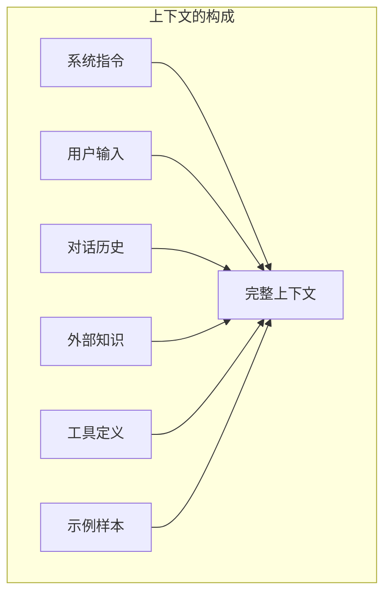
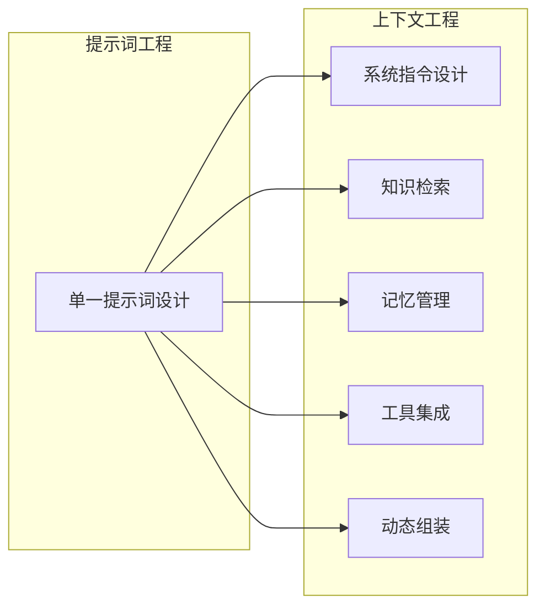
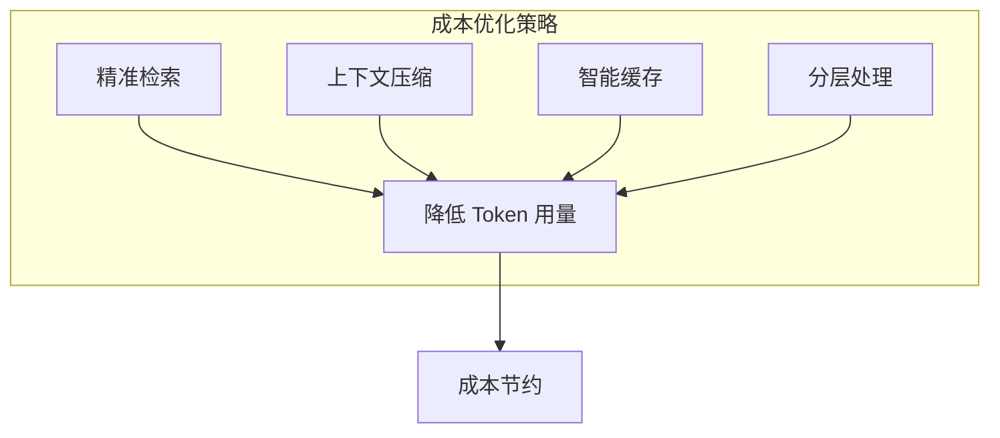
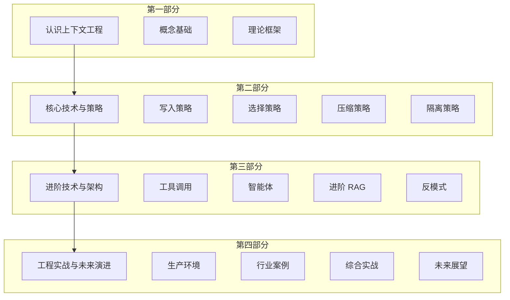

# 第一章 上下文工程概述

在人工智能快速发展的今天，大语言模型已经从实验室走向千家万户。然而，当我们试图将这些强大的模型应用于复杂的实际场景时，一个关键问题逐渐浮出水面：**如何让模型获得正确的信息，以产生可靠的输出？**

这正是上下文工程要解决的核心问题。

本章将带领读者认识上下文工程这一新兴学科，理解它的定义、起源、价值，以及它与传统提示词工程的本质区别。无论是刚接触 AI 应用开发的新手，还是希望提升系统可靠性的资深工程师，本章都将为后续学习奠定坚实的基础。

## 1. 什么是上下文工程

### 1.1 定义与内涵

**上下文工程**（Context Engineering）是一门系统性的工程学科，它研究如何设计、组织、优化和管理大语言模型所需的全部信息环境，以确保模型能够在正确的时间获得正确的信息，从而产生准确、可靠、符合预期的输出。

这个定义包含几个关键要素：

1. **系统性**：上下文工程不是孤立的技巧集合，而是一套完整的方法论体系
2. **信息环境**：关注的不仅是输入给模型的文本，还包括所有可能影响模型行为的信息
3. **时机与形式**：强调在正确的时间、以正确的格式提供信息
4. **目标导向**：最终目的是实现可靠、可预测的模型输出

### 1.2 上下文的多维构成

在大模型应用中，“上下文”是一个多层次的概念，它包括：

图 1-1：上下文的多维构成

- **系统指令**：定义模型角色、行为准则和输出格式的基础设定
- **用户输入**：当前任务的具体请求和参数
- **对话历史**：多轮对话中的历史交互记录
- **外部知识**：通过检索或其他方式引入的领域知识、事实信息
- **工具定义**：模型可调用的外部工具、API 的描述
- **示例样本**：用于引导模型行为的少样本示例

### 1.3 上下文工程的核心挑战

上下文工程面临三大核心挑战：

**挑战一：有限的上下文窗口**

尽管现代大模型的上下文窗口已经扩展到数十万甚至百万 Token，但它仍然是有限的资源。当需要处理的信息超出窗口容量时，如何选择最相关的内容成为关键问题。

**挑战二：信息质量与密度**

模型的输出质量高度依赖于输入信息的质量。冗余、噪声或不相关的信息不仅浪费上下文空间，还可能干扰模型的判断。在不少评测与线上实践中，过度填充上下文（Context Stuffing）常会带来性能波动、成本上升和延迟增加。

**挑战三：动态与实时性**

许多应用场景需要实时更新的信息，如最新的市场数据、用户状态或系统配置。如何构建动态的上下文管理系统，确保信息的时效性，是一个持续的技术挑战。

### 1.4 与驭具工程的关系

在智能体工程的完整版图中，上下文工程并非孤立存在。业界提出的**驭具工程（Harness Engineering）** 涵盖了让智能体在生产环境中可靠运行的全部工程实践，包括工具与权限编排、上下文动态管理、反馈纠错闭环、安全守卫四大职能。上下文工程正是其中“上下文动态管理”这一核心支柱——决定在什么时间节点、把哪些记忆和背景信息注入模型的上下文窗口。

换言之，上下文工程关注“模型看到什么”，驭具工程关注“模型如何安全可靠地执行”。两者互为补充：即使上下文管理做得再精准，如果缺少权限控制、错误恢复和安全守卫，智能体仍然无法在真实业务中稳定运行。

### 1.5 上下文工程的重要性

为什么上下文工程如此重要？原因在于：

1. **模型能力的放大器**：相同的模型，配合精心设计的上下文，可以展现出截然不同的能力水平
2. **可靠性的保障**：系统化的上下文管理能显著降低幻觉、错误和不一致行为的发生
3. **成本效率的关键**：优化的上下文策略直接影响 Token 使用量和 API 调用成本
4. **可扩展性的基础**：良好的上下文架构是构建复杂 AI 应用的技术基石

随着大模型从简单的问答助手演进为能够完成复杂任务的智能体，上下文工程的重要性还将持续提升。在智能体时代，上下文不仅是静态的输入，更是动态演化的工作空间。掌握上下文工程，就是掌握了驾驭 AI 能力的核心技术。

这一判断正在获得政策层面的印证。2026 年 7 月印发的[《北京市加快智能体引领发展若干措施》](../appendix/references.md)把智能体底层共性技术攻关列为重点，明确支持创新主体实施驾驭层工程（Harness Engineering，即本书 1.1.4 节所称“驭具工程”，同指一门学科），并把“上下文工程优化”置于夯实智能体共性底座的诸项共性技术之首。上下文工程由此从一线团队的经验技巧，上升为被写入地方发展政策的基础性技术优先项——这也从侧面印证了它作为驭具工程“上下文动态管理”核心支柱的地位。

## 2. 从提示词工程到上下文工程

### 2.1 提示词工程的起源与局限

**提示词工程**（Prompt Engineering）是指通过精心设计输入给模型的文本指令，来引导模型产生期望输出的技术。自 GPT-3 等大模型问世以来，提示词工程迅速成为 AI 应用开发的核心技能。

提示词工程的典型技巧包括：

- **角色设定**：如“你是一位专业的法律顾问”
- **任务描述**：清晰说明期望模型完成的任务
- **输出格式**：指定 JSON、Markdown 等结构化输出
- **少样本学习**：提供几个示例引导模型行为
- **思维链提示**：要求模型逐步推理

这些技巧在许多场景下效果显著，但随着应用场景的复杂化，提示词工程的局限也逐渐显现：

| 局限性   | 具体表现                      |
| ----- | ------------------------- |
| 静态性   | 提示词通常是预定义的，难以适应动态变化的需求    |
| 孤立性   | 聚焦于单次交互，缺乏对对话历史和外部信息的系统管理 |
| 可扩展性差 | 随着任务复杂度增加，提示词变得冗长且难以维护    |
| 缺乏工程化 | 更多依赖直觉和试错，缺乏系统化的方法论       |

### 2.2 上下文工程的演进

上下文工程是提示词工程的自然演进和扩展。如果说提示词工程关注的是“写什么指令”，那么上下文工程关注的是“如何构建完整的信息环境”。

图 1-2：上下文工程的演进

Anthropic 在其工程博客 [《Effective context engineering for AI agents》](https://www.anthropic.com/engineering/effective-context-engineering-for-ai-agents)（2025-09-29 发布）中明确把上下文工程定义为“在推理过程中策划与维护最优 token 集合的一整套策略”，并把上下文工程称为提示词工程的「自然演进」（natural progression）——「子集」是本书为便于理解采用的说法，原文并未使用该措辞。文章引入了 context rot（上下文随窗口增大而衰减）、just-in-time retrieval（按需取回）、compaction / structured note-taking / sub-agent 这三类长任务策略等关键概念，与本章观点一致——提示词工程仍然重要，但它只是上下文工程这个更大画卷中的一部分。

### 2.3 核心差异对比

| 维度        | 提示词工程      | 上下文工程          |
| --------- | ---------- | -------------- |
| **关注点**   | 单次指令的措辞和格式 | 完整信息环境的设计      |
| **范围**    | 提示词文本      | 指令、数据、工具、记忆、策略 |
| **时间维度**  | 静态、一次性     | 动态、跨会话         |
| **信息来源**  | 手工编写       | 多源融合、自动检索      |
| **工程化程度** | 技巧驱动、经验依赖  | 系统化、可量化、可测试    |
| **应用场景**  | 简单任务、单轮对话  | 复杂任务、多轮交互、智能体  |

### 2.4 为什么需要这种演进

这种从提示词工程到上下文工程的演进，是由几个关键因素驱动的：

**因素一：任务复杂度的提升**

早期的 LLM 应用主要是简单的问答和文本生成，一个精心设计的提示词就足够了。如今的应用场景包括代码编写、数据分析、复杂推理、多步骤任务执行等，这些都需要更丰富的上下文支持。

**因素二：智能体的兴起**

AI 智能体需要在长时间跨度内持续工作，处理多个子任务，协调多个工具，维护工作状态。这种场景下，静态的提示词远远不够，需要系统化的记忆管理和上下文编排。

**因素三：生产环境的要求**

从原型到生产，AI 应用需要面对可靠性、一致性、可观测性、成本控制等一系列工程化要求。上下文工程提供了应对这些挑战的系统方法。

**因素四：模型能力的提升**

随着模型能力增强，上下文窗口扩大，模型能够利用更丰富的信息。如何高效利用这些能力，需要更高层次的工程方法。

**因素五：从“无状态”到“有状态”的飞跃（记忆工程）**

单靠扩大参数或无限制拉长上下文窗口会遇到收益递减、计算成本高昂、首 Token 延迟过长等硬性瓶颈。“记忆”正在成为继 MCP（模型上下文协议）和上下文工程之后的下一个核心。构建具备长期留存与动态调度能力的“有记忆的 AI”，是解决短时遗忘、知识碎片化、跨任务信息无法留存的关键。（关于记忆工程的系统论述，请参考[第四章](../04_write/README.md)的写入策略和[第九章](../09_agents/README.md)的智能体记忆管理。）

### 2.5 一个类比

可以用建筑来类比这种演进：

- **提示词工程** 如同为一座房子设计入口大门——门的设计很重要，但它只是整个建筑的一部分
- **上下文工程** 如同建筑设计——需要考虑整体结构、空间布局、采光通风、管道电路等所有要素的协调配合

单凭一道漂亮的大门无法成就一座优秀的建筑；同样，单凭精巧的提示词也无法构建可靠的 AI 系统。从提示词工程升级到上下文工程，是 AI 应用开发走向成熟的必由之路。

## 3. 上下文工程的核心价值

上下文工程为 AI 应用开发带来多维度的价值，这些价值从技术层面延伸到商业层面，最终影响用户体验和产品成功。

### 3.1 提升模型输出质量

上下文工程的首要价值是显著提升模型输出的质量。这种提升体现在多个方面：

- **准确性提升**：通过精准的知识检索和上下文构建，模型获得执行任务所需的事实依据，大幅降低幻觉和错误的发生概率。在一些公开研究与工程实践中，引入高质量上下文的 [RAG](../05_select/5.1_rag_principles.md) 流程常能带来显著的事实一致性改进，但提升幅度会受到任务类型、检索质量、重排序与评测口径等因素影响。
- **相关性增强**：动态上下文管理确保模型获得与当前任务高度相关的信息，避免被无关内容干扰。相关性是决定用户满意度的关键因素之一。
- **一致性保障**：系统化的上下文策略能够保证模型在不同会话、不同用户、不同时间点产生一致的行为，这对于企业级应用至关重要。

### 3.2 优化成本效率

在大模型应用中，Token 使用量直接关联成本。上下文工程通过多种策略优化成本：

图 1-3：成本优化策略

- **精准检索**：只检索和传递真正需要的信息，避免上下文冗余
- **上下文压缩**：通过摘要等技术压缩信息，保留关键内容
- **智能缓存**：复用频繁使用的上下文片段，减少重复计算
- **分层处理**：对不同复杂度的任务使用不同规模的模型或策略

在一些高并发、重复上下文比例较高的场景中，结合精准检索、压缩与缓存，往往可以观察到明显的 Token 消耗下降；实际节约比例取决于请求分布、缓存命中率、上下文组织方式与模型定价。

### 3.3 增强系统可靠性

生产环境对可靠性有严格要求，上下文工程从多个角度增强系统可靠性：

| 可靠性维度 | 上下文工程的作用             |
| ----- | -------------------- |
| 错误预防  | 通过上下文约束降低模型产生不当输出的概率 |
| 边界控制  | 明确定义模型的能力边界和行为约束     |
| 故障隔离  | 模块化的上下文设计便于定位和隔离问题   |
| 降级策略  | 当部分上下文源不可用时提供优雅降级    |
| 可审计性  | 完整的上下文记录支持事后分析和审计    |

### 3.4 支撑复杂应用场景

上下文工程使得构建复杂 AI 应用成为可能：

- **多轮对话系统**: 通过对话历史管理和上下文累积，支持真正具有“记忆”的多轮对话，让交互更加自然流畅。
- **智能体系统**: 为智能体提供工作记忆、长期记忆和工具访问能力，使其能够执行跨越多个步骤的复杂任务。
- **多模态应用**: 统一管理文本、图像、代码等不同模态的上下文信息，支持多模态理解和生成。
- **垂直领域应用**: 通过专业知识库的集成和领域特定的上下文策略，打造深度垂直的 AI 解决方案。

### 3.5 加速开发迭代

上下文工程带来的工程化方法显著提升开发效率：

- **模块化设计**:将上下文管理分解为可复用的模块（检索器、压缩器、记忆管理器等），便于组合和替换。
- **可测试性**:上下文构建过程可测试、可度量，支持自动化测试和持续优化。
- **可观测性**: 完善的上下文日志和监控，便于理解系统行为、诊断问题、迭代改进。
- **团队协作**: 标准化的上下文工程实践便于团队协作，降低知识壁垒。

### 3.6 创造竞争优势

从商业角度看，上下文工程能力是 AI 应用的核心竞争力之一：

- **差异化**：在相同基础模型上，通过卓越的上下文工程实现差异化的用户体验
- **护城河**：积累的上下文策略、领域知识库、优化经验形成技术壁垒
- **持续进化**：上下文工程框架支持系统持续学习和改进
- **适应性**：灵活的上下文管理能力使系统能够快速适应新需求、新场景

在 AI 能力逐渐商品化的趋势下，上下文工程能力将成为区分优秀产品与平庸产品的关键因素。那些能够精准理解用户需求、高效利用模型能力、提供可靠一致体验的产品，将在竞争中脱颖而出。

## 4. 本书结构与学习路径

### 4.1 全书架构

本书按照“从入门到精通”的逻辑组织，共分为四个部分：

图 1-4：学习路线架构图

**第一部分：认识上下文工程**

这一部分建立对上下文工程的整体认知。[第一章](../01_overview/README.md)介绍上下文工程的定义、起源和价值；[第二章](../02_llm_basics/README.md)深入大模型基础，理解上下文窗口的工作机制；[第三章](../03_framework/README.md)构建理论框架，介绍四大核心策略和评估方法。

**第二部分：核心技术与策略**

这是本书的技术核心，详细讲解上下文工程的四大策略：

- [第四章](../04_write/README.md)：写入策略——如何构建和管理外部记忆
- [第五章](../05_select/README.md)：选择策略——如何通过检索获取相关信息
- [第六章](../06_compress/README.md)：压缩策略——如何优化信息密度
- [第七章](../07_isolate/README.md)：隔离策略——如何结构化组织上下文

**第三部分：进阶技术与架构**

这一部分聚焦进阶技术和架构设计。[第八章](../08_tools/README.md)讲解工具调用与 MCP 协议；[第九章](../09_agents/README.md)专注智能体系统的上下文管理；[第十章](../10_advanced/README.md)探讨 Agentic RAG 等进阶 RAG 技术；[第十一章](../11_antipatterns/README.md)总结常见的上下文工程陷阱。

**第四部分：工程实战与未来演进**

这一部分关注落地应用。[第十二章](../12_production/README.md)汇总生产环境的最佳实践；[第十三章](../13_cases/README.md)展示各行业的实战案例；[第十四章](../14_practice/README.md)带领读者构建企业级问答系统；[第十五章](../15_future/README.md)展望未来发展趋势。

### 4.2 各部分学习目标

| 部分   | 章节      | 学习目标                       |
| ---- | ------- | -------------------------- |
| 第一部分 | 1-3 章   | 理解概念、掌握理论、建立认知框架           |
| 第二部分 | 4-7 章   | 掌握核心技术、理解策略原理              |
| 第三部分 | 8-11 章  | 掌握工具调用、智能体及进阶 RAG 技术，识别反模式 |
| 第四部分 | 12-15 章 | 学习生产实践、行业案例及系统构建，展望未来      |

### 4.3 学习建议

**对于初学者**

建议按顺序完整阅读，不要跳过基础章节。每章的概念都建立在前一章的基础上，扎实的基础将使后续学习事半功倍。每章末尾的“本章小结”是复习巩固的好资源。

**对于有经验的开发者**

可以先快速浏览第一部分，然后深入阅读第二部分的核心技术。根据实际工作需求，有选择地深入第三部分的相关章节。第四部分的进阶内容值得仔细研读。

**对于架构师和技术负责人**

建议重点关注[第三章](../03_framework/README.md)的理论框架、[第十二章](../12_production/README.md)的生产实践，以及[第十章](../10_advanced/README.md)的进阶架构。这些内容对于系统设计和技术决策最有价值。

### 4.4 实践建议

上下文工程是一门实践性很强的学科，纯粹的阅读远远不够。建议：

1. **动手实验**：在阅读每一技术章节时，尝试用代码实现其中的关键概念
2. **项目驱动**：选择一个实际项目，将学到的技术逐步应用到项目中
3. **对比分析**：在引入新策略时，对比优化前后的效果差异
4. **持续迭代**：上下文工程是一个持续优化的过程，不断观察、分析、改进

### 4.5 附录资源

本书附录提供五个重要资源：

- **附录 A 术语表**：快速查阅专业术语的定义
- **附录 B 工具与技术生态**：主流工具的介绍和选型建议
- **附录 C 参考资源**：延伸阅读的推荐资料
- **附录 D 参考文献**：书中引用的论文与技术报告索引
- **附录 E 快变事实核验表**：集中维护模型、价格、协议和运行时等高波动信息的核验入口

这些资源可在学习过程中随时查阅，也是学习结束后持续提升的重要参考。

现在，让我们正式开始上下文工程的学习之旅。
