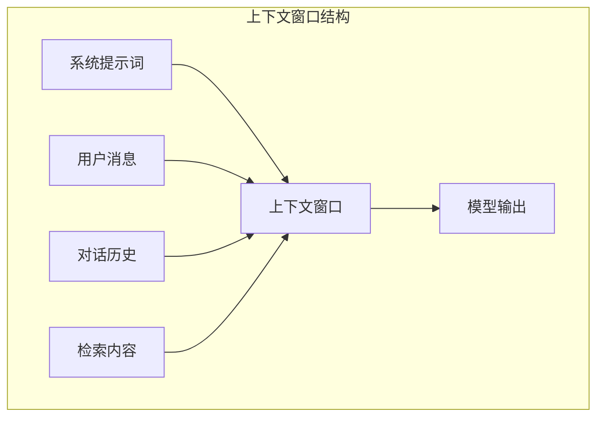
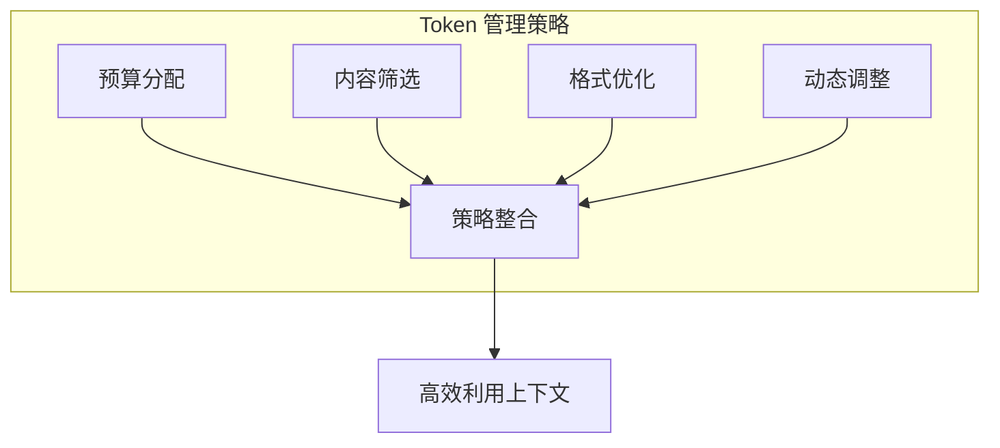
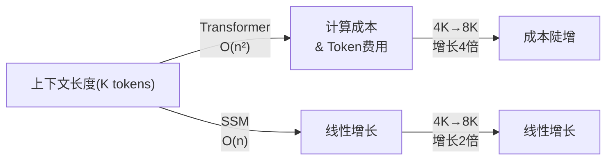
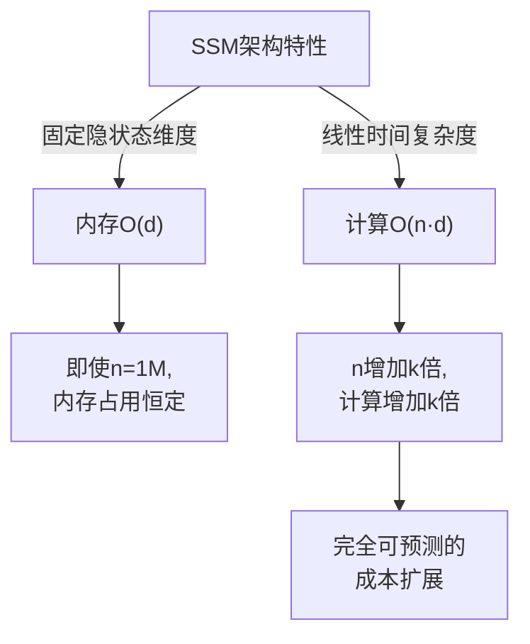
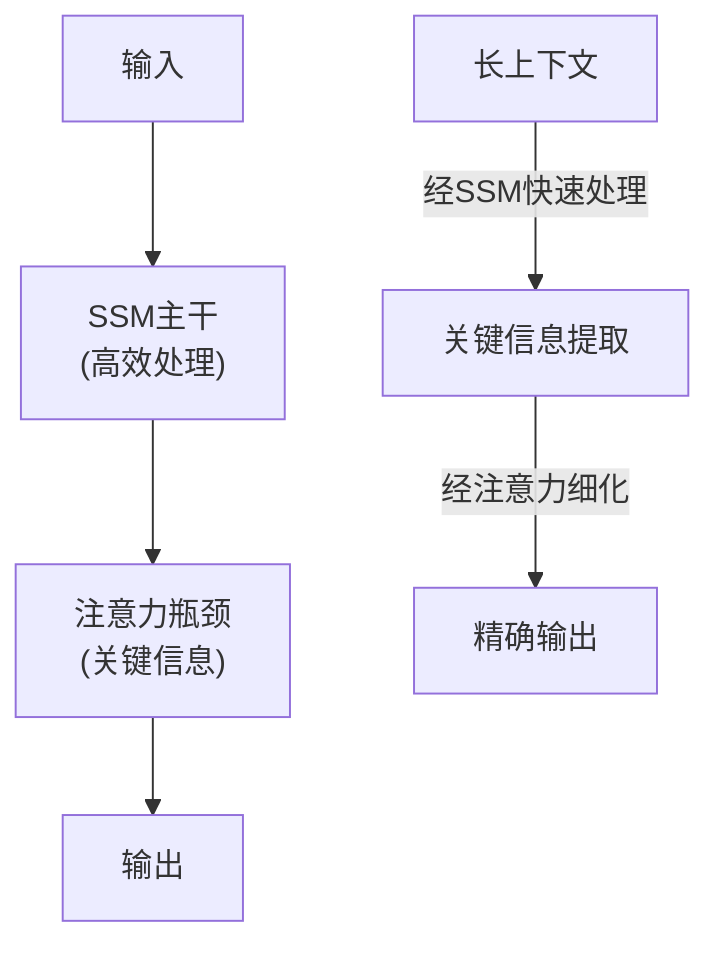
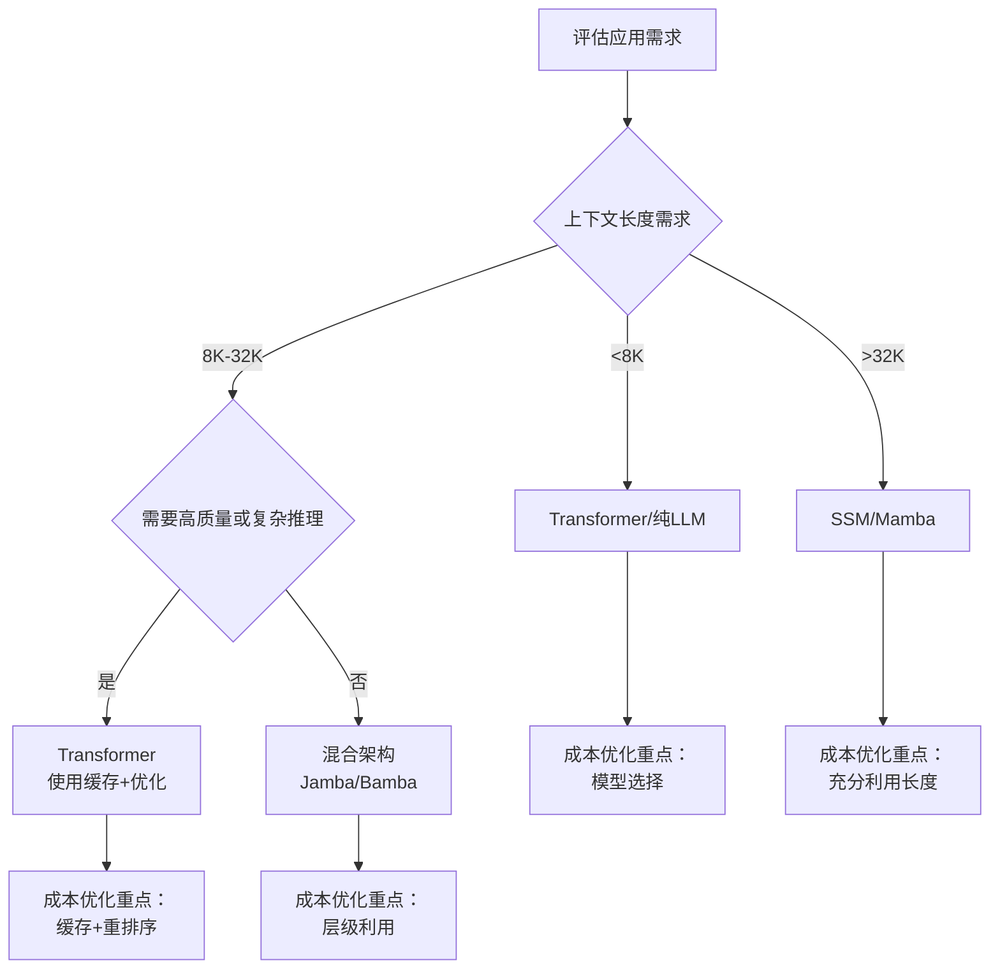

# 第二章：大模型基础与上下文窗口

要精通上下文工程，首先必须深入理解大语言模型的工作机制，特别是上下文窗口的本质。上下文窗口既是大模型的核心能力所在，也是上下文工程需要优化和管理的关键资源。

本章将从技术原理层面解析大模型如何处理上下文，Token 的概念与计算方式，以及不同模型在上下文处理能力上的差异。这些知识是理解后续技术策略的必要基础。

## 1. 大语言模型工作原理

> 💡 关于大语言模型基础原理（Transformer 架构、自注意力机制、自回归生成）的详细介绍，请参阅[《零基础学 AI》](https://yeasy.gitbook.io/ai_beginner_guide)或[《大模型原理与架构》](https://yeasy.gitbook.io/llm_internals)。

本章重点讨论与上下文工程相关的进阶技术：注意力机制的计算复杂度、优化技术，以及这些如何影响上下文窗口的设计。

### 1.1 注意力机制与上下文

自注意力机制的计算过程决定了模型如何利用上下文：

1. **Query、Key、Value**：每个 Token 被转换为三个向量
2. **注意力分数计算**：Query 与所有 Key 计算相似度
3. **加权求和**：根据注意力分数对 Value 加权求和
4. **输出表示**：得到融合了上下文信息的 Token 表示

关键点在于：每个 Token 的最终表示都包含了对整个上下文的“感知”。位置靠后的 Token 可以“看到”之前的所有 Token，这就是上下文窗口的技术基础。

### 1.2 计算复杂度

标准自注意力的计算复杂度是 $O(n^2)$，其中 $n$ 是序列长度。这意味着：
- 序列长度翻倍，计算量增加 4 倍
- 这是限制上下文窗口大小的主要技术瓶颈

为解决这一问题，研究者提出了多种优化技术：

| 技术 | 原理 | 代表模型 |
|------|------|----------|
| 稀疏注意力 | 只计算部分位置对的注意力 | Longformer, BigBird |
| 线性注意力 | 近似自注意力，降低复杂度 | Linear Transformer |
| 滑动窗口 | 限制每个位置只关注局部 | Mistral |
| 分组查询注意力 | 减少 Key-Value 头数量 | LLaMA 2 70B、多数现代大模型 |

### 1.3 预训练与涌现能力

大语言模型通过在海量文本上预训练，学习语言的统计规律和世界知识。随着模型规模、训练数据、后训练方法和工具接口共同演进，模型会逐步表现出更强的 **涌现能力**（Emergent Abilities）：

- 少样本学习：通过几个示例就能理解新任务
- 逻辑推理：执行多步推理
- 代码生成：根据自然语言描述生成代码
- 工具使用：理解和调用外部工具

需要注意的是，把能力简单归因于某个固定参数门槛往往过于粗糙。许多较小模型在经过高质量训练、蒸馏、工具增强或专门后训练后，也能表现出其中一部分能力；而更大的模型通常只是在鲁棒性、泛化范围和组合能力上更强。

这些能力使得大模型能够胜任复杂任务，但前提仍是提供合适的上下文来激活和引导它们。这正是上下文工程的意义所在。

### 1.4 模型架构的演进

大模型的发展经历了多个重要阶段，呈现加速演进的特点：

**OpenAI GPT 系列**：从 GPT-3（2020 年，175B 参数，2K 上下文）→ GPT-3.5（2022 年，改进推理与指令遵循）→ GPT-4（2023 年 3 月，多模态能力，8K/32K 上下文）→ GPT-4 Turbo（2023 年 11 月，128K 上下文）→ GPT-5 系列（2025–2026 年迭代，上下文规模进入百万级）→ GPT-6 Astra（2026-09-03，官方模型页列在首位并标为 Default，1.05M 上下文、128K 输出；其下的 GPT-5.6 Sol/Terra/Luna 同为 1.05M 上下文与 128K 输出，仍在目录中）→ GPT-6 Luna（2026-09-22）与 GPT-6.1 Sol（2026-09-29），与 Astra 组成官方首推的三档。

**Meta LLaMA 系列**：从 LLaMA（2023 年，开源基座）→ LLaMA 2（2023 年 7 月，70B 增强）→ LLaMA 3（2024 年，改进指令遵循）→ Llama 4 Scout（2025 年 4 月，官方模型卡列为 10M 上下文）与 Llama 4 Maverick（2025 年 4 月，官方模型卡列为 1M 上下文高性能）。

**Anthropic Claude 系列**：从 Claude 1/2（2023 年，基础能力）→ Claude 3 系列（2024 年 3 月，包括 Opus/Sonnet/Haiku，200K 上下文）→ Claude Opus 4.6（2026 年 2 月，1M 上下文）与 Claude Sonnet 4.6（2026 年 2 月，1M 上下文）以及 Claude Haiku 4.5（2025 年 10 月，200K 轻量版）→ Claude Opus 4.7（2026 年 4 月，加强 SWE 与视觉、新 tokenizer）→ Claude Opus 4.8（2026 年 5 月，1M 上下文、128K 输出、Adaptive Thinking）→ Claude Fable 5 / Mythos 5（2026 年 6 月 9 日，新一代命名体系；Fable 5 在当时是能力最强的广泛发布模型，$10/$50、1M 上下文、Adaptive Thinking 常开，现已随 5.1 发布移入 legacy；Mythos 5 非普遍可用，仅通过 Project Glasswing 向获批客户受限开放；两者曾于 6 月 12 日 被短暂暂停访问，Fable 5 于 7 月 1 日 恢复全球访问，Mythos 5 同日先恢复给一组美国机构后维持上述受限范围）→ Claude Sonnet 5（已面向所有 Claude 套餐和 API 发布，1M 上下文、128K 输出）与 Claude Opus 5（2026 年 7 月 24 日，1M 上下文、128K 输出）→ Claude Fable 5.1 / Mythos 5.1（2026 年 9 月 1 日）→ Claude Opus 5.5（2026 年 9 月 22 日）与 Claude Sonnet 5.5（2026 年 9 月 28 日），Opus 5 与 Sonnet 5 随之移入 legacy。

这条链条只用来说明演进节奏，**末端节点会随发布不断变化，不要把它当成「最新」或「该选哪个」**。其中 Fable 5、Opus 4.5/4.6/4.7/4.8 与 Sonnet 4.5/4.6 已被官方模型页移入 legacy 区间（仍可用，但建议迁移），Haiku 4.5 不在其中。当前在售型号、旗舰归属、价格与访问状态一律以 [附录 E：快变事实核验表](../appendix/volatile_facts.md) 和官方模型页为准，生产选型还需核对实际账号可用区。

这些演进在以下核心维度持续推进：

- **参数规模**：从千亿级向万亿级发展
- **上下文窗口**：从 2K/4K → 8K/32K → 128K → 200K/1M → 10M
- **多模态能力**：从纯文本扩展到图像、音频、视频
- **效率优化**：推理速度提升，成本降低，稀疏注意力等技术应用

理解这些演进趋势，有助于把握上下文工程的未来发展方向。

## 2. 上下文窗口的本质

### 2.1 什么是上下文窗口

**上下文窗口**（Context Window）是大语言模型一次能够处理的最大 Token 序列长度。它包括输入的提示词、对话历史、检索到的文档等所有信息，以及模型生成的输出。

可以将上下文窗口类比为模型的“工作记忆”：
- 它有固定的容量上限
- 超出容量的内容无法被处理
- 窗口内的所有信息相互可见、相互影响



图 2-1：上下文窗口结构

### 2.2 输入与输出的关系

上下文窗口容量需要同时容纳输入和输出：

$$上下文窗口容量 = 输入 Token 数 + 输出 Token 数$$

例如，一个 8K 窗口的模型：
- 如果输入占用 6K Token
- 则输出最多只剩 2K Token 的空间

这意味着在实际应用中，需要谨慎规划输入内容的规模，为输出留出足够空间。

### 2.3 上下文窗口的技术实现

从技术角度看，上下文窗口的限制来自多个层面：

- **位置编码**：Transformer 使用位置编码（Positional Encoding）让模型感知 Token 的位置。传统的绝对位置编码难以泛化到训练时未见过的长度。现代模型采用改进方案如 **RoPE**（旋转位置编码）和 **ALiBi**（注意力线性偏置）
- **KV 缓存**：在生成过程中，模型需要缓存之前所有 Token 的 Key 和 Value 向量。KV 缓存大小与上下文长度成正比——一个 70B 参数模型的 128K 上下文可能需要数十 GB 显存
- **注意力计算**：自注意力的 $O(n^2)$ 复杂度使得超长上下文的计算成本极高，虽然有各种优化技术但基本瓶颈依然存在

### 2.4 长上下文的挑战

随着上下文窗口不断扩大，新的挑战也随之出现：

- **“中段迷失”（Lost in the Middle）问题**：一些模型在长上下文中可能出现位置偏置，即对开头和结尾的信息更敏感，而对中间部分的关键信息利用不足（注意与下文用于评测的“大海捞针”测试相区分）。新一代模型与评测方法在持续改进这一现象，但在极端长度、强干扰噪声或复杂检索任务下仍需通过结构化、检索与显式提示来降低风险。

  ```mermaid
  graph TB
      subgraph "U型注意力分布 (Lost in the Middle)"
      direction LR
      S[开头: 关注度高] --- M[中间: 关注度低] --- E[结尾: 关注度高]
      style S fill:#d4f1f4,stroke:#333
      style M fill:#f8d7da,stroke:#333,stroke-dasharray: 5 5
      style E fill:#d4f1f4,stroke:#333
      end
  ```

  图 2-2：U 型注意力分布 (Lost in the Middle)

- **注意力稀释**：上下文越长，噪声、冲突证据和位置偏置的暴露面越大，重要信息更可能被干扰；这是一种工程风险描述，不是平均注意力必然按长度线性下降。
- **成本与延迟**：更长的上下文意味着更高的计算成本和更长的响应延迟，直接影响用户体验。
- **质量与长度的权衡**：精心筛选的短上下文往往比冗长的长上下文效果更好，信息质量比数量更重要。

### 2.5 有效上下文长度

需要区分两个概念：
- **声称上下文长度**：模型官方宣称支持的最大长度
- **有效上下文长度**：模型能够真正有效利用的长度

许多模型在接近最大上下文长度时，性能会显著下降。一个声称支持 128K 的模型，有效长度可能只有 64K 甚至更短。

评估有效上下文长度的常用方法是“大海捞针”测试（Needle in a Haystack）：将一条关键信息放置在上下文的不同位置，测试模型能否准确检索。

### 2.6 上下文窗口的发展趋势

上下文窗口正在快速扩展：

| 阶段 | 常见量级（示意） | 备注 |
|------|------------------|------|
| 早期商用阶段 | 2K–8K | 适合短对话与简单问答 |
| 中等上下文阶段 | 16K–128K | 适合文档问答、代码片段审阅 |
| 长上下文阶段 | 200K–1M | 适合长文档、跨多文档汇总 |
| 超长上下文探索 | 多百万级 | 对成本、延迟与信息组织提出更高要求 |

然而，更大的上下文窗口并不意味着可以忽视上下文工程。事实上，超大上下文窗口让上下文管理变得更加重要——如何在巨大的可用空间中高效组织信息、避免噪声干扰、确保关键信息被正确利用，这些都是上下文工程需要解决的问题。

## 3. Token 与上下文限制

### 3.1 什么是 Token

**Token** 是大语言模型处理文本的基本单位。模型不直接处理字符或单词，而是将文本先转换为 Token 序列，再进行处理。

Token 可以是：
- 一个完整的单词（如 “hello”）
- 单词的一部分（如 “understanding” 可能被分为 “under” + “stand” + “ing”）
- 单个字符或标点符号
- 特殊符号（如空格、换行符）

对于中文，由于没有天然的单词分隔，分词方式有所不同：
- 一个常见汉字通常是 1-2 个 Token
- 生僻字可能需要更多 Token

### 3.2 分词算法

主流的分词算法包括：

- **BPE（Byte Pair Encoding）**：OpenAI 的 GPT 系列采用，从单字符开始迭代合并最频繁出现的字符对，直到达到预设的词表大小
- **WordPiece**：Google 的 BERT 采用，与 BPE 类似但使用不同的合并策略
- **SentencePiece**：处理多语言文本的通用方案，不依赖于预先的空格分词，特别适合中文、日文等语言

不同模型使用不同的分词器，因此相同文本在不同模型中的 Token 数量可能不同。

### 3.3 Token 计数的重要性

精确的 Token 计数在上下文工程中至关重要：

**1. 容量规划**

确保总 Token 数不超过上下文窗口限制。无论是 8K 还是 128K，上下文窗口总是有限的。在构建 Prompt 之前精确计算 System Prompt、历史记录、检索内容的总和，可以避免请求因超长被截断或拒绝，保证应用的稳定性。

**2. 成本估算**

API 调用按 Token 计费。商业模型的计费精确到每百万 Token。不准确的计数会导致成本预算严重偏差。对于高并发应用，哪怕每个请求多出几十个无用 Token，累积起来也是巨大的浪费。

**3. 性能优化**

减少不必要的 Token 以降低延迟。LLM 的推理延迟（尤其是首 Token 时间和总生成时间）与输入和输出的 Token 数正相关。精简 Input Token 不仅省钱，还能显著提升用户感知的响应速度。

### 3.4 Token 计数实践

以下是常见模型的 Token 估算规则：

| 内容类型 | 英文估算 | 中文估算 |
|----------|----------|----------|
| 普通文本 | 约 1 Token/4 字符 | 约 1-2 Token/汉字 |
| 代码 | 变化较大，取决于语言 | - |
| JSON | 结构符号增加 Token | - |
| Markdown | 格式符号增加 Token | - |

实际应用中，建议使用官方提供的分词器进行精确计数，而非依赖估算。主要模型平台都提供了分词器工具：

- OpenAI：tiktoken 库
- Anthropic：Claude 分词器
- Google：Gemini tokenizer

### 3.5 上下文限制的管理策略

面对有限的上下文窗口，需要采取系统性策略：



图 2-3：Token 管理策略

**预算分配**

为不同组成部分分配 Token 预算：
- 系统提示词：保持精简，通常 500-2000 Token
- 检索内容：根据任务复杂度分配，可能占 30%-50%
- 对话历史：保留最相关的轮次
- 输出预留：确保输出空间充足

**内容筛选**

只包含与当前任务真正相关的信息：
- 精准检索而非全量加载
- 移除冗余和重复内容
- 过滤噪声信息

**格式优化**

优化信息的表达方式以节省 Token：
- 使用简洁的表达
- 避免不必要的格式修饰
- 结构化而非散文式表述

**动态调整**

根据任务需求动态调整：
- 简单任务使用更小的上下文
- 复杂任务扩展必要信息
- 实时监控 Token 使用情况

### 3.6 Token 与成本

在商业模型中，Token 直接关联费用。各平台的定价策略通常包含以下特点：

| 计费维度 | 说明 |
|----------|------|
| 输入 Token | 按输入的上下文 Token 数量计费 |
| 输出 Token | 按生成的 Token 数量计费，明显贵于输入；当前主流商用模型的输出/输入倍率多在 5-8 倍之间 |
| 缓存 Token | Prompt Caching 的折扣取决于平台价格、缓存写入/读取规则和命中率 |
| 模型层级 | 同系列中更强的模型价格更高 |

> **注意**：Token 价格和上面的倍率都变化频繁，建议查阅各平台的 API 定价页核对：
> - [OpenAI API Pricing](https://developers.openai.com/api/docs/pricing)
> - [Anthropic Pricing](https://platform.claude.com/docs/en/about-claude/pricing)
> - [Google Gemini API Pricing](https://ai.google.dev/gemini-api/docs/pricing)

**成本优化策略**：
- 压缩输入以减少输入 Token
- 控制输出长度，设置 `max_tokens` 参数
- 充分利用 Prompt Caching 机制复用公共内容
- 简单任务使用小模型，复杂任务再用大模型
- 批量请求可能有折扣

精细的 Token 管理不仅关乎技术性能，也直接影响项目的经济可行性。在大规模部署场景下，结合缓存、压缩、检索裁剪与输出控制，往往可以获得可观的成本优化；具体节约幅度取决于业务请求分布、缓存命中率以及模型定价。

## 4. 主流模型的上下文能力对比

### 4.1 主流模型概览

模型参数和可用性变化非常快。具体型号、窗口与访问状态统一维护在 [附录 E：快变事实核验表](../appendix/volatile_facts.md)，并由 30 天 TTL 检查阻止过期快照继续发布。本节只保留选型所需的稳定解释；生产决策还必须核对官方模型页、价格页和实际账号可用区。

| 模型系列 | 官方快照中的代表能力 | 典型优势 | 典型取舍 |
|------|--------|------------|------------|
| OpenAI GPT 系列 | 当前快照中官方目录首推 GPT-6 Astra（标为 Default，已全量可用）、GPT-6.1 Sol（兼顾能力与成本）与 GPT-6 Luna（成本敏感的大批量负载）；上一代 GPT-5.6 Sol、GPT-5.6 Terra、GPT-5.6 Luna 仍在目录中；面向编码智能体的 GPT-5.3-Codex 已宣布弃用 | 通用推理、代码与工具生态成熟 | 按 Astra、Sol、Luna 的能力与成本边界分层评估；价格和可用性按模型 ID、账号层级、缓存、区域与服务层级核验 |
| Anthropic Claude 系列 | 当前快照的阵容是 Claude Fable 5.1、Claude Opus 5.5、Claude Sonnet 5.5 与 Claude Haiku 4.5（Mythos 5.1 与 Mythos 5 非普遍可用，仅通过 Project Glasswing 向获批客户受限开放）；Claude Fable 5、Claude Opus 5 与 Claude Sonnet 5 已移入 legacy（官方模型页的 legacy 区间现含 Fable 5、Opus 5、Opus 4.8/4.7/4.6/4.5、Sonnet 5 与 Sonnet 4.6） | 长文理解、代码与写作稳定性 | 同时核验能力规格、访问状态、区域路由、缓存、批处理和实际账号可用区 |
| Google Gemini 系列 | 当前快照中稳定 Flash 序列的最新一档是 Gemini 3.8 Flash，此前的 Gemini 3.5 Flash 仍在目录中；具体 token limits 由附录引用的官方模型页维护 | 多模态与长上下文任务 | 区分 stable 与 preview，并在部署前确认模型字符串、弃用计划和区域可用性 |
| Meta Llama 系列 | Meta 官方模型卡显示 Llama 4 Scout 为 10M context、Llama 4 Maverick 为 1M context；实际托管服务可能给出更低上限 | 私有化与可定制能力 | 需要自行评估部署、显存、量化和服务商限制 |
| Qwen / DeepSeek 等开源或开放 API 系列 | 上下文窗口、价格和工具能力随具体模型、服务商和部署方式变化 | 中文、多语言或推理性价比突出 | 需结合官方文档、模型卡和本地压测确认 |

*注：价格、上下文窗口、工具能力、区域可用性和弃用状态都属于高波动信息。方案文档应记录“查询日期 + 具体模型 ID + 模型页/价格页链接”，并在上线或迁移前重新核验；本书快照以附录 E 为准。*


图 2-4：模型选型象限图

这张图不是替代表格，而是把选型时最常见的两类张力显式化：一类是任务复杂度与质量要求，另一类是成本和延迟约束；真正落地时还要把上下文窗口、工具能力和部署方式一起纳入判断。

### 4.2 选择模型的考量因素

选择模型时需要综合考虑多个因素：

**上下文需求**

根据应用场景的上下文需求选择：
- 简单对话：8K-32K 通常足够
- 文档问答：64K-128K 较为适合
- 大规模代码库分析：需要 200K 以上
- 超长文档处理：考虑 1M 级别模型

**任务类型**

不同模型在不同任务上表现各异：
- 代码生成：优先看代码基准、工具调用稳定性和长代码编辑能力
- 中文处理：优先看中文任务集、专业术语覆盖和事实一致性
- 推理任务：优先看复杂推理基准与失败样例分析
- 多模态：优先看图文/语音端到端效果和延迟

**成本因素**

上下文长度直接影响成本：
- 更长的上下文意味着更高的 Token 费用
- 需要权衡上下文丰富度与成本效益
- 考虑是否有批量折扣、缓存机制、区域处理溢价或长上下文溢价

**延迟要求**

上下文长度影响响应速度：
- 长上下文增加首 Token 延迟
- 实时应用可能需要限制上下文规模
- Flash 系列模型在延迟上有优势

### 4.3 长上下文性能评测

评估模型长上下文能力的常用基准：

- **Needle in a Haystack (NIAH)**：在长文档中插入特定信息，测试模型能否准确检索。现代长上下文模型在简单单针任务上可能接近饱和，因此还应结合多针、聚合、多跳和干扰证据任务
- **RULER**：更全面的长上下文评测基准，包含多种任务类型：检索、聚合、跟踪等
- **LongBench**：中英文双语长上下文基准，覆盖问答、摘要、代码等多种场景

### 4.4 实际应用建议

**分层策略**

为不同场景配置不同模型：
- 简单查询：使用小规模快速模型
- 复杂任务：调用大规模高能力模型
- 超长文档：选择长上下文专用模型

**混合架构**

组合使用多个模型：
- 用小模型做初步筛选和分类
- 用大模型处理复杂推理
- 用专业模型处理特定任务

**上下文优化优先**

无论选择哪个模型，都应该先优化上下文：
- 减少冗余信息
- 提高信息密度
- 结构化组织内容

单纯依赖更大的上下文窗口并非最佳策略。研究表明，经过优化的短上下文往往比未优化的长上下文效果更好。上下文工程的核心价值正在于此。

### 4.5 未来趋势

上下文窗口将继续扩大，但更值得关注的是：

**1. 有效利用率提升**

让模型更好地利用长上下文。当前模型在超长上下文中的信息利用效率仍有提升空间，尤其是中间位置的信息容易被“遗忘”。未来的架构改进可能缓解这一问题，但生产系统仍需要通过任务级评测确认模型是否真的利用了关键证据。

**2. 成本效率改善**

长上下文的计算成本降低。稀疏注意力、线性注意力、KV cache 优化和分块预填充等技术会持续改善成本曲线，但实际经济性仍取决于显存、内存带宽、批处理、缓存命中率和延迟目标。

**3. 动态上下文技术**

按需加载和卸载上下文。未来模型可能支持在推理过程中动态管理上下文，不再是一次性全部加载。这类似于操作系统的虚拟内存，只有需要的部分才占用计算资源。

**4. 上下文缓存**

复用公共上下文，减少重复计算。系统提示、知识库等固定内容可以预先计算并缓存其表示，多次请求之间复用。这将大幅降低延迟和成本，尤其适合高频调用场景。

这些技术进展将与上下文工程紧密结合，共同推动 AI 应用能力的提升。

### 4.6 官方信息入口（用于参数核验）

- [OpenAI Models](https://developers.openai.com/api/docs/models)
- [OpenAI GPT-6 Astra](https://developers.openai.com/api/docs/models/gpt-6-astra)
- [OpenAI GPT-6.1 Sol](https://developers.openai.com/api/docs/models/gpt-6.1-sol)
- [OpenAI GPT-6 Luna](https://developers.openai.com/api/docs/models/gpt-6-luna)
- [OpenAI GPT-5.6 Sol](https://developers.openai.com/api/docs/models/gpt-5.6-sol)
- [OpenAI GPT-5.6 Terra](https://developers.openai.com/api/docs/models/gpt-5.6-terra)
- [OpenAI GPT-5.6 Luna](https://developers.openai.com/api/docs/models/gpt-5.6-luna)
- [OpenAI API changelog](https://developers.openai.com/api/docs/changelog)
- [OpenAI GPT-5.3-Codex](https://developers.openai.com/api/docs/models/gpt-5.3-codex)
- [OpenAI Pricing](https://developers.openai.com/api/docs/pricing)
- [Anthropic Claude Models](https://platform.claude.com/docs/en/models/overview)
- [Anthropic Pricing](https://platform.claude.com/docs/en/about-claude/pricing)
- [Anthropic Claude context windows](https://platform.claude.com/docs/en/build-with-claude/context-windows)
- [Google Gemini Models](https://ai.google.dev/gemini-api/docs/models)
- [Google Gemini 3.8 Flash](https://ai.google.dev/gemini-api/docs/models/gemini-3.8-flash)
- [Google Gemini 3.5 Flash](https://ai.google.dev/gemini-api/docs/models/gemini-3.5-flash)
- [Meta Llama 4 模型卡](https://developer.meta.com/ai/docs/model-cards-and-prompt-formats/llama4/)
- [Qwen](https://qwenlm.github.io/)
- [DeepSeek API 文档](https://api-docs.deepseek.com/)

## 5. SSM vs Transformer 在上下文工程中的对比

### 5.1 引言：架构之战如何影响上下文策略

2024 年以来，大模型架构出现了显著的分化。Transformer 凭借其自注意力机制长期统治，但一类新兴架构——**状态空间模型（SSM, State Space Models）**——开始对 LLM 领域产生深远影响。这不仅仅是学术讨论，更直接改变了我们设计上下文工程策略的方式。

不同架构在处理上下文时具有根本性差异：

- **自注意力复杂度**：Transformer 为 O(n²)，SSM 为 O(n)
- **上下文长度成本**：长上下文下，Transformer 费用陡增，SSM 线性增长
- **信息流向**：Transformer 全局互注，SSM 线性扫描
- **检索策略**：需要不同的优化方向

本节将深入分析这两类架构在上下文工程中的实际影响，帮助您为不同架构设计合适的上下文策略。

### 5.2 Transformer 自注意力机制与上下文成本

#### 自注意力的计算本质

Transformer 的核心是自注意力（Self-Attention）机制。对于长度为 n 的上下文序列，注意力的计算方式为：

```text
Attention(Q, K, V) = softmax(Q·K^T / √d_k)·V
```

关键的成本特征：

- **时间复杂度**：O(n²)，其中 n 是上下文长度
- **空间复杂度**：朴素训练实现会产生 O(n²) 注意力中间状态；现代推理通常通过内核优化避免长期保存完整注意力矩阵，但 KV Cache 仍随上下文长度线性增长
- **每个 Token 成本随上下文线性增长**：第 i 个 Token 需要计算与所有(i-1)个前序 Token 的注意力

#### 上下文长度与成本的非线性关系



实际例子：假设使用按 Token 计费的 API（如输入价格 $0.003/1K token）。**这里要分清两个概念**：API 账单通常只看输入 Token 数，而模型内部的计算压力则取决于架构复杂度。

| 上下文长度 | Token 数 | API 输入成本 | Transformer 理论计算量（相对 4K） | SSM 理论计算量（相对 4K） | 工程含义 |
|-----------|--------|-------------|-------------------------------|------------------------|--------|
| 4K | 4000 | $0.012 | 1x | 1x | 基线 |
| 8K | 8000 | $0.024 | 4x | 2x | Transformer 的延迟和显存压力开始明显上升 |
| 32K | 32000 | $0.096 | 64x | 8x | 更依赖检索裁剪、压缩与重排序 |
| 128K | 128000 | $0.384 | 1024x | 32x | Transformer 侧的注意力与 KV Cache 压力会急剧放大 |
| 256K | 256000 | $0.768 | 4096x | 64x | 长上下文下更需要架构和系统级优化 |

注：虽然 API 账单相同，**关键差异在内部计算与系统开销**。同样的上下文长度下：
- **Transformer**：随着上下文长度增加，注意力计算、显存占用和端到端延迟通常会更快恶化
- **SSM**：理论复杂度更平滑，但真实吞吐量仍受实现、硬件、批大小和算子优化影响，不能简单理解为“长序列一定线性提速”

此外，**内存占用** 也显著不同：
- 朴素 Transformer 训练需要处理注意力矩阵（O(n²)计算/中间状态压力）；现代推理内核通常不会长期保存完整注意力矩阵，但 KV Cache 仍会随上下文长度线性增长
- SSM 推理的递推状态可以是固定或近似固定规模，但训练、批处理和混合注意力层仍会引入额外内存；不要把理论 O(d) 状态直接等同为固定 MB 数

这使得 SSM 在 **相同 Token 账单** 下，往往更有机会把预算转化为更稳定的延迟、更高的并发容量或更长的可承载上下文，但具体收益仍取决于实现细节和部署方式。

#### Attention 中的上下文丢失问题

Transformer 的自注意力虽然强大，但面临一个悖论性的上下文工程问题：**“注意力分散”**（attention dilution）

```python
# 简化示意：当上下文过长时的问题
context_length = 128000
position_bias = {
    "beginning": "often easier to retrieve",
    "middle": "often easier to miss",
    "end": "often easier to retrieve",
}

# 结果：
# - 注意力不是平均分配给每个 Token
# - 长上下文会放大位置偏置、检索噪声和证据排序问题
# - 需要重排序、摘要、分块引用和显式证据检查来缓解
```

这导致一个现象：**虽然 Transformer 理论上可以看到所有上下文，但在实际应用中，过长上下文会导致“关键信息注意力不足”**。研究表明，Transformer 经常只关注开头和结尾的信息（Lost-in-the-Middle 问题）。

### 5.3 SSM 与线性复杂度的上下文处理

#### 状态空间模型的数学基础

SSM 将序列处理建模为状态演化过程：

```text
h_t = A·h_{t-1} + B·x_t  （状态更新）
y_t = C·h_t + D·x_t      （输出生成）
```

其中：
- **h_t**：隐状态（固定维度，如 1024 或 4096）
- **A, B, C, D**：可学习矩阵
- **x_t**：输入 Token

关键特性：

1. **固定内存占用**：无论上下文多长，隐状态维度固定
2. **线性时间复杂度**：每个 Token 的处理时间恒定
3. **因果结构**：天然支持流式处理，h_t 只依赖 h_{t-1}

#### Mamba 与选择性状态空间

2023 年 Mamba 的发布引入了 **选择性状态空间（Selective State Space）**，解决了基础 SSM 的一个关键问题：**固定的参数矩阵 A 无法根据输入动态调整**。

```text
# Mamba的核心创新：动态选择（Dynamic Selection）
Δ_t = softplus(W_Δ·x_t)  # 根据当前输入动态确定时间尺度（softplus 保证 Δ 为正且无上界）
A_t = exp(-Δ_t·A)        # 动态衰减矩阵
h_t = A_t * h_{t-1} + B_t * x_t
```

这使 Mamba 能够：
- **动态遗忘**：根据输入重要性调整隐状态更新
- **选择性记忆**：只在必要时候保留信息
- **上下文感知**：隐状态的演化取决于输入序列的内容

#### 上下文长度的线性扩展

对于 SSM 模型（如 Mamba-2），理论上的序列扫描成本更接近线性，但真实部署还受混合层、批处理、硬件和服务实现影响：



文献与工程报告中，SSM/混合架构在长上下文场景下通常会展现出以下量级优势：

| 指标 | 纯 Transformer（长上下文） | SSM / 混合架构（长上下文） | 常见差异 |
|-----|--------|-----------|------|
| 吞吐量 | 更易随序列变长而下滑 | 更容易保持稳定 | 中到高 |
| 内存占用 | 注意力矩阵与缓存压力更大 | 通常更可控 | 高 |
| 推理延迟 | 更易受长序列拖累 | 更容易平滑扩展 | 中到高 |
| 长上下文扩展成本 | 上升更快 | 更可预测 | 高 |

### 5.4 混合架构的兴起

鉴于纯 Transformer 和纯 SSM 各有优缺点，业界推出了 **混合架构**：

#### Jamba

结构：**交错的 SSM 层和注意力层**

```text
Layer 1: SSM
Layer 2: Attention (全局)
Layer 3: SSM
Layer 4: Attention (全局)
...
```

优势：
- SSM 层处理大规模上下文，成本低
- Attention 层在关键位置提供全局视角
- 官方口径：长上下文吞吐量约为同级 Transformer 的 3 倍，KV 缓存约缩小 8 倍（单张 80GB GPU 可容纳 140K 上下文）
- 支持 256K 上下文窗口，其中约 140K 可在单张 80GB GPU 上部署

#### Bamba

结构：**层级混合 + Bottleneck 机制**



特点：
- 大部分层为 SSM（低成本）
- 仅在必要位置使用 Attention
- 特别适合长序列处理

#### Titans + MIRAS

最新方向：**门控线性注意力 + Mamba 融合**

```python
# 伪代码示意
class TitansMIRAS(nn.Module):
    def __init__(self):
        self.mamba_layer = MambaBlock()
        self.gated_linear_attn = GatedLinearAttention()

    def forward(self, x):
        # SSM处理
        mamba_out = self.mamba_layer(x)  # O(n)

        # 门控线性注意力（比标准Attention更高效）
        attn_out = self.gated_linear_attn(x)  # O(n)

        # 融合
        return self.gate(mamba_out, attn_out)
```

优势：
- 两路都是线性复杂度
- 保留了全局信息流
- 100K+上下文下性能接近短上下文

### 5.5 架构选择对上下文工程的实际影响

#### Transformer 模型的检索优化

```python
# Transformer模型：长上下文成本高，需要优化检索
class TransformerRetrievalStrategy:
    def __init__(self):
        # 1. 严格控制检索数量
        self.max_context_tokens = 4000  # 保持在4K以内
        self.target_chunks = 5  # 少量高质量chunk

        # 2. 重排序至关重要
        self.use_reranker = True
        self.rerank_top_k = 50  # 从50个候选中选5个

        # 3. 压缩策略
        self.use_compression = True
        self.compression_ratio = 0.5  # 压缩一半

    def retrieve_and_prepare(self, query, documents):
        # 密集检索 -> 重排序 -> 压缩
        candidates = self.dense_retrieve(query, top_k=50)
        reranked = self.rerank(query, candidates, k=5)
        compressed = self.compress(reranked)
        return compressed  # ≈ 2K tokens
```

#### SSM/Mamba 模型的检索优化

```python
# SSM模型：可以容纳更多上下文，检索策略不同
class SSMRetrievalStrategy:
    def __init__(self):
        # 1. 放宽上下文限制，但仍需实测延迟和质量
        self.max_context_tokens = 64000
        self.target_chunks = 50  # 获取更多内容

        # 2. 重排序可选
        self.use_reranker = False  # 也可选择性使用

        # 3. 压缩可选
        self.use_compression = False

    def retrieve_and_prepare(self, query, documents):
        # 密集检索 -> 直接使用
        candidates = self.dense_retrieve(query, top_k=50)
        return candidates  # ≈ 50K tokens, 成本仍可接受
```

#### Token 成本与架构成本的边界

商业 API 通常按输入/输出 Token、缓存、工具调用或服务层级计费，而不是按底层架构单独定价。SSM 或混合架构的优势更多体现在供应商侧的吞吐、显存和延迟，未必直接表现为更低的 API 单价。以下仅是教学测算，使用示例单价说明上下文长度如何影响账单；实际项目应以部署当天的官方价格页、缓存命中率和账号服务层级重新计算。假设一个 QA 系统，平均查询返回 50 个检索结果：

**Transformer 架构（代表性 API 模型）**
- 每 query 成本：50×256 字/chunk×0.75 token/字×$0.0025/1K = $0.024
- 月成本（10000 queries）：$240

**SSM / 混合架构假设（同一 Token 单价）**
- 每 query 成本：同样 50 chunks，账单不会因为架构本身自动下降
- 每 query 成本：$0.024
- **但可以提高质量**：如增加到 200 chunks
- 新成本：$0.096，月成本$960
- **质量提升**：只有在离线评测证明更多上下文确实提高答案质量时才成立

### 5.6 上下文工程策略针对不同架构的优化建议

#### 对于 Transformer 模型

1. **上下文控制**
   ```text
   成本敏感路径：优先控制在任务必需范围内
   长上下文路径：按模型官方窗口、延迟和预算上限决定
   超过阈值：用实测质量收益与额外成本判断
   ```

2. **检索优化优先级**
   - 最高：重排序器（相关性精准）
   - 次高：压缩（减少 token）
   - 可选：知识图谱（提升结构化查询）

3. **缓存策略**
   - 启用 Prompt Caching
   - 系统提示词固定 → 重复使用 → 缓存命中率高
   - 预缓存常见的长上下文片段

4. **成本优化杠杆**
   ```text
   # 成本优化的优先级
   优化1：减少检索chunk数（影响最大）
   优化2：启用缓存（收益取决于供应商价格与命中率）
   优化3：压缩上下文（收益取决于压缩率与质量损失）
   优化4：使用更便宜模型（需同步验证质量）
   ```

#### 对于 SSM/Mamba 模型

1. **上下文充分利用**
   ```text
   可尝试窗口：32K-128K tokens
   更长窗口：取决于具体模型、服务配额和质量评测
   成本增长：理论计算更接近线性，API 账单仍按供应商定价
   ```

2. **检索优化优先级**
   - 优先：检索数量增加（成本仍可控）
   - 次要：重排序（可选，用于极高精度）
   - 可选：压缩（牺牲质量无必要）

3. **上下文设计**
   ```text
   # SSM友好的上下文设计
   - 长系统提示词：可详细规范指令
   - 长对话历史：保留完整上下文
   - 多文档检索：一次性处理数十篇文档
   - 知识库融合：检索+知识图谱可并用
   ```

4. **架构利用策略**
   - 利用线性复杂度处理 **超长上下文任务**
   - 特别是：长文档分析、多轮对话、知识库问答
   - 单次请求可以包含整个会话历史

#### 混合架构的策略

利用两者优势：

```python
class HybridArchitectureStrategy:
    """
    混合架构同时拥有Transformer和SSM特性
    策略：
    1. 短上下文（<4K）：SSM层足以处理，性能优异
    2. 中等上下文（4K-32K）：发挥混合优势，既有质量又有效率
    3. 长上下文（32K+）：SSM主要处理，Attention瓶颈提高关键信息
    """

    def optimize_for_hybrid(self, query_complexity, context_size):
        if context_size < 4000:
            # SSM层会处理充分，低成本高效
            use_reranking = False  # 不必要
            compression_ratio = 0.0  # 无需压缩
        elif context_size < 32000:
            # 混合发挥最大作用
            use_reranking = True  # 优化Attention层的输入
            compression_ratio = 0.0  # 无需压缩
        else:
            # 长上下文，SSM主处理；复杂查询才值得为重排付出额外开销
            use_reranking = query_complexity >= 0.7
            compression_ratio = 0.5  # 超长上下文需要压缩，见 6.x

        return {
            "use_reranking": use_reranking,
            "compression_ratio": compression_ratio,
        }
```

### 5.7 实践案例：同一任务在不同架构下的上下文工程

**任务**：法律合同审查系统，需要分析用户的合同并对标行业模板

**输入**：
- 用户合同：50KB（~35K tokens）
- 行业模板库：10 份典型合同模板（~200K tokens）
- 审查指南：10 个审查维度（~5K tokens）
- 用户历史问题上下文：（~5K tokens）

**总需求上下文：~245K tokens**

#### Transformer 架构方案（代表性 API 模型）

```text
实际可用上下文：128K（最大）
限制：无法同时加载所有内容

分解策略：
1. 固定内容（系统提示+审查指南）：5K → 启用缓存
2. 用户合同：35K
3. 相关模板检索：只检索最相关3份（~60K tokens）
4. 总计：≈100K tokens

成本计算：
- 系统提示（缓存）：5K×$0.00025/K = $0.00125（首次写入 5K×$0.003125/K = $0.015625，后续按读取价）
- 用户合同+模板：95K×$0.0025/K = $0.2375
- 输出：~2K tokens×$0.015/K = $0.03
- 总成本/请求：$0.269（缓存命中后）

质量折衷：无法同时引用所有模板，可能遗漏重要参照
```

#### SSM/Mamba 架构方案

```text
可用上下文：需选择能容纳全部 245K tokens 的模型与部署配置
完整使用：可同时加载所有内容

完整策略：
1. 系统提示+审查指南：5K
2. 用户合同：35K
3. 所有行业模板库：200K
4. 用户历史：5K
5. 总计：245K tokens

成本计算（沿用上文示例单价，非实时价格）：
- 245K tokens×$0.0025/K = $0.6125
- 输出：~2K tokens×$0.015/K = $0.03
- 总成本/请求：$0.6425

质量优势：
- 模型可参考所有模板
- 更准确的对标分析
- 更全面的风险识别
- 一次完整分析，无遗漏

价值评估（需项目实测）：
成本增加：$0.6425 - $0.269 = $0.3735（139%）
价值增加：更全面的法律风险识别，可避免潜在法律风险
只有在真实评测证明额外上下文能稳定发现高价值风险时，增加的推理成本才可能成立。
```

### 5.8 如何选择最适合的架构

建立决策框架：



关键指标表：

| 架构 | 最优上下文 | 推理速度 | 成本效率 | 复杂推理 | 生产成熟度 |
|-----|----------|--------|--------|--------|----------|
| Transformer | 成本敏感路径可控制在 4K-32K；长上下文模型可扩展到更大窗口 | 中等 | 取决于缓存与窗口使用 | 优 | 最成熟 |
| SSM/Mamba | 32K-128K | 快 | 优 | 中等 | 快速成熟 |
| 混合(Jamba) | 8K-32K | 快 | 优 | 优 | 初期 |
| 混合(Bamba) | 8K-32K | 快 | 优 | 优 | 初期 |
| Titans+MIRAS | 64K-256K | 很快 | 优 | 优 | 研究阶段 |

### 5.9 小结

| 维度 | Transformer | SSM/Mamba | 混合架构 |
|-----|-----------|----------|--------|
| 上下文成本 | 注意力计算压力上升快；API 账单通常按 Token | 理论计算更平滑；API 账单看供应商 | 介于两者之间 |
| 推荐窗口 | 以任务必要信息量、延迟和预算决定 | 可更积极测试长上下文 | 适合中长上下文试点 |
| 检索重点 | 精准→压缩 | 充分→多样 | 平衡两端 |
| 缓存策略 | 启用优先 | 可选 | 启用优先 |
| 长上下文应用 | 可用，但要按质量、延迟和成本评测 | 优先测试 | 适中支持 |
| 成熟度 | 生产级 | 快速上升 | 初期 |

选择合适的架构并采用相应的上下文工程策略，可以在保持或提升质量的同时，将成本降低 30-70%。
