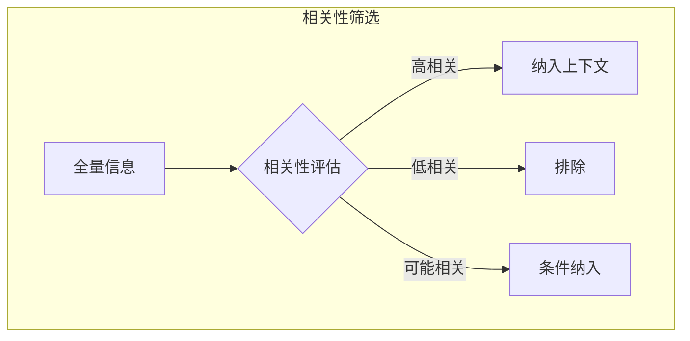
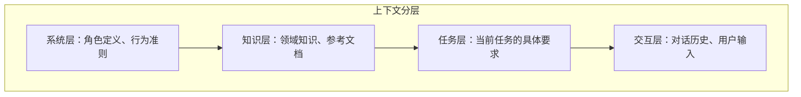
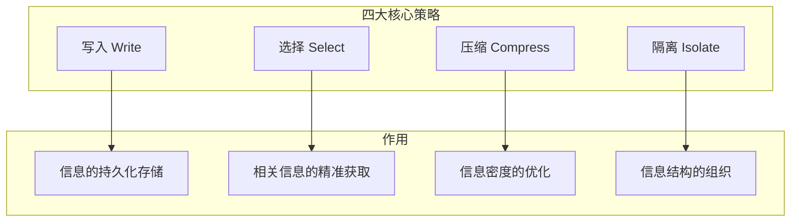
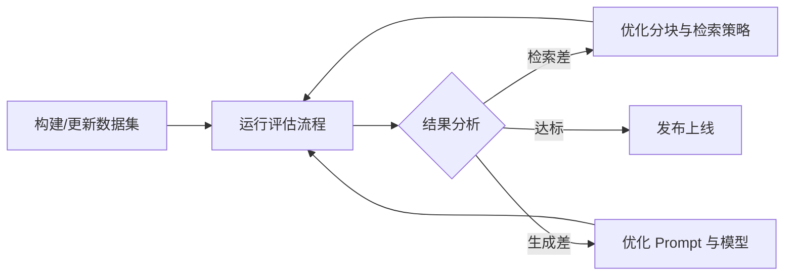

# 第三章：上下文工程的理论框架

在掌握大模型基础知识后，本章会建立上下文工程的理论框架。这一框架包括信息环境设计的基本原则、四大核心策略的系统化概览，以及评估上下文质量的方法论。

理论框架是连接基础知识与实践技术的桥梁。后续章节将在这一框架下展开具体技术的详细讨论。

## 1. 信息环境设计原则

### 1.1 信息环境的概念

**信息环境**（Information Environment）是指模型在执行任务时可获取的全部信息的集合与组织方式。上下文工程的本质就是设计和管理这个信息环境。

一个优秀的信息环境应该满足以下特性：
- 包含任务所需的充分信息
- 排除无关的噪声信息
- 以模型易于理解的方式组织
- 能够动态适应任务需求

### 1.2 注意力预算与上下文腐烂

在深入设计原则之前，我们先引入两个在业界实践中常用的隐喻性概念，用来帮助理解“为什么上下文需要被当作稀缺资源来设计”。

**注意力预算（Attention Budget）**

这一概念源自对 Transformer 自注意力机制的工程观察：上下文越长，模型需要在更多 Token、位置和噪声之间做选择，关键信息更容易被无关内容干扰。注意力权重不是简单的 `1 / token_count` 平均分配，因此“注意力预算”应理解为工程隐喻，而不是严格公式。

与人类有限的工作记忆类似，大语言模型也有一个“注意力预算”，用于处理上下文中的大量信息。每引入一个新的 Token，都会消耗一定的注意力预算。这意味着：

- 上下文必须被当作 **有限资源** 来管理
- 边际效用递减：更多的 Token 不一定带来更好的结果
- 需要在上下文大小和注意力集中度之间权衡

**上下文腐烂（Context Rot）**

在一些长上下文评测与工程观察中（如“Lost in the Middle”等研究），人们发现：随着上下文窗口中 Token 数量增加，模型对关键信息的提取与回忆稳定性可能下降。本书将这种“有效利用率随长度下降”的现象归纳为“上下文腐烂”（Context Rot），作为一种工程直觉来指导上下文容量的决策。

造成这一现象的原因：
- 长上下文会增加位置偏置、无关证据和指令冲突的暴露面
- 检索或拼接顺序不佳时，关键证据可能被放在模型不稳定利用的位置
- 模型、训练方式和推理系统差异很大，必须用任务级评测验证有效上下文长度

> **核心指导原则**：优秀的上下文工程意味着找到 **最小可能的高信号 Token 集**，以最大化实现期望结果的可能性。

### 1.3 设计原则一：相关性优先

**核心理念**：只包含与当前任务直接相关的信息。

相关性是上下文质量的首要指标。经验上，无关信息不仅浪费上下文空间，还可能干扰模型判断，导致输出质量下降。



图 3-1：相关性筛选流程

实践要点：
- 建立任务-信息的映射关系
- 使用语义相似度评估相关性
- 设置相关性阈值，过滤低分内容
- 对于边界情况，宁缺毋滥

### 1.4 设计原则二：信息密度优化

**核心理念**：用最少的 Token 传达最多的有效信息。

信息密度定义为：有效信息量与 Token 数量的比值。高密度的上下文意味着：
- 更高的空间利用效率
- 更低的计算成本
- 更快的响应速度

提升信息密度的方法：
- 删除冗余词汇和重复内容
- 使用结构化格式替代散文
- 压缩长文本为摘要
- 提取关键事实而非全文

### 1.5 设计原则三：结构化组织

**核心理念**：用清晰的结构组织信息，便于模型理解和定位。

结构化组织的优势：
- 帮助模型快速定位相关信息
- 明确不同信息块的角色和关系
- 减少歧义和误解
- 支持模块化更新和维护

常用的结构化方法：

| 方法 | 适用场景 | 示例 |
|------|----------|------|
| XML 标签 | 区分不同类型内容 | `<instructions>...</instructions>` |
| Markdown | 层级化文档 | 标题、列表、代码块 |
| JSON | 结构化数据 | 配置、元数据 |
| 分隔符 | 简单内容分隔 | `---`、`===` |

### 1.6 设计原则四：上下文分层

**核心理念**：根据信息的重要性和稳定性，分层组织上下文。

典型的分层结构：



图 3-2：上下文分层结构

- **系统层**：最稳定，定义模型的基本角色和行为边界
- **知识层**：相对稳定，提供任务所需的背景知识
- **任务层**：随任务变化，描述当前的具体目标
- **交互层**：最动态，反映即时的用户输入和对话状态

分层的好处：
- 稳定层可以缓存复用
- 动态层独立更新
- 便于调试和维护

### 1.7 设计原则五：显式优于隐式

**核心理念**：明确说明期望，而非依赖模型推测。

模型擅长遵循明确的指令，但对隐含期望的推测可能不可靠。因此：

- 明确输出格式要求
- 显式说明限制条件
- 清楚定义术语含义
- 提供具体的正例和反例

### 1.8 设计原则六：渐进式提供

**核心理念**：按需提供信息，避免一次性加载全部内容。

这一原则在智能体系统中尤为重要。渐进式提供的方式：

- **即时加载**：在需要时通过工具获取信息
- **分步展开**：随着任务进展逐步添加细节
- **条件触发**：基于特定条件加载相关内容

渐进式方法的优势：
- 避免上下文过载
- 确保信息的时效性
- 降低初始延迟

### 1.9 设计原则七：系统提示词的高度校准

系统提示词是上下文的基础，它定义了模型的基本角色和行为。Anthropic 的实践表明，系统提示词的设计存在一个临界的高度校准（Altitude Calibration）问题。

**两个常见失败模式**：

1. **过低的高度（Brittle Logic）**：系统提示词中硬编码复杂的 if-else 逻辑，试图通过冗长的条件语句精确指定每种情况下的行为。这种方法：
   - 导致提示词脆弱且难以维护
   - 增加了系统复杂度
   - 在面对未预见的情况时易于失败
   - 例：`“如果用户说 X，回答 Y；如果用户说 A，回答 B；...”`（包含大量嵌套条件）

2. **过高的高度（Vague Assumptions）**：系统提示词过于宽泛或依赖隐含理解，导致模型无法获得足够的具体信号。这种方法：
   - 假设了过多的上下文共享
   - 给予过少的具体指导
   - 可能导致行为不可控
   - 例：`“你是一个友好的助手”`（太笼统，缺乏任务具体性）

**恰到好处的区间（Goldilocks Zone）**：

最优的系统提示词应当：
- **足够具体**：给出清晰的行为信号和决策准则
- **足够灵活**：提供启发式原则而非硬规则，允许模型在框架内灵活推理
- **足够简洁**：使用最少的高信号 Token，避免冗余

```xml
<!-- 示例：不同高度的对比 -->

<!-- ❌ 过低：硬编码逻辑 -->
<system_prompt_too_low>
如果用户问价格，说"我们的价格从 $99 开始"。
如果用户问退货，说"7 天内无条件退货"。
如果用户问发货，说"免运费"。
...（数十条规则）
</system_prompt_too_low>

<!-- ❌ 过高：含糊其辞 -->
<system_prompt_too_high>
你是一个有帮助的客服。回答用户的问题。
</system_prompt_too_high>

<!-- ✅ 恰当高度 -->
<system_prompt_optimal>
角色：电商客服代理
目的：帮助用户了解产品和服务，处理常见询问
原则：
- 提供准确的信息（如有不确定，说"我来为你查询"）
- 遵循退货政策（标准 7 天，特殊情况需升级）
- 优先用户满意度，必要时可提供额外折扣
约束：不做出超出权限的承诺
</system_prompt_optimal>
```

**校准方法**：

1. 从最小提示词开始，测试模型在你的目标任务上的表现
2. 识别失败模式，添加明确的指导原则（不是规则）
3. 测试新版本，迭代改进
4. 定期审视，移除不必要的条件和过度说明
5. 优先使用示例和启发式原则，而非 if-then 条件

关于系统提示词的详细策略，参见[第 7.3 节](../07_isolate/7.3_system_prompts.md)的相关内容。

### 1.10 原则的综合应用

这七项原则并非孤立，而是需要综合应用。一个良好的上下文设计应该：

1. 从相关性筛选开始，确定需要包含的信息
2. 对选中的信息进行密度优化
3. 使用合适的结构组织内容
4. 按层级安排信息的位置
5. 显式表达所有重要要求
6. 设计动态加载机制处理变化需求
7. 在系统提示词中校准正确的高度

在实际项目中，可能需要在这些原则之间做出权衡。理解每项原则的目的，有助于在具体场景下做出正确的决策。

## 2. 四大核心策略概览

上下文工程的实践可以归纳为四大核心策略：**写入**（Write）、**选择**（Select）、**压缩**（Compress）、**隔离**（Isolate）。这四大策略相互配合，共同构成上下文管理的完整方法论。

### 2.1 策略框架总览



图 3-3：四大核心策略总览

### 2.2 写入策略

**要回答的问题**：如何在上下文窗口之外存储和管理信息？

上下文窗口是有限的，但许多应用需要处理远超窗口容量的信息。写入策略解决的是信息的持久化存储问题。

**主要技术**：
- **外部记忆系统**：将信息存储到外部存储中供后续检索
- **知识库构建**：组织结构化的领域知识
- **向量数据库**：将文本转换为向量进行存储和检索
- **记忆架构**：设计多层次的记忆结构

**应用场景**：
- 构建企业知识库
- 实现跨会话的长期记忆
- 存储用户偏好和历史

详细技术将在[第四章](../04_write/README.md)展开。

### 2.3 选择策略

**要回答的问题**：如何从海量信息中获取与当前任务最相关的内容？

当信息存储在外部时，需要在执行任务时选择性地加载相关内容。选择策略是 [RAG](../05_select/5.1_rag_principles.md)（[检索增强生成](../05_select/5.1_rag_principles.md)）的核心。

**主要技术**：
- **语义检索**：基于语义相似度搜索相关内容
- **关键词检索**：基于关键词匹配的精确搜索
- **混合检索**：结合语义和关键词的优势
- **重排序**：对检索结果进行二次排序优化

**应用场景**：
- 文档问答系统
- 知识库查询
- 代码检索

详细技术将在[第五章](../05_select/README.md)展开。

### 2.4 压缩策略

**要回答的问题**：如何在有限的上下文空间中容纳更多有效信息？

即使经过筛选，需要放入上下文的信息仍可能超出限制，或占用过多空间导致成本上升。压缩策略旨在提高信息密度。

**主要技术**：
- **文本摘要**：将长文档压缩为精练摘要
- **信息提取**：提取关键事实和实体
- **对话压缩**：压缩冗长的对话历史
- **递进式摘要**：分层次逐步压缩

**应用场景**：
- 长文档处理
- 对话历史管理
- 成本优化

详细技术将在[第六章](../06_compress/README.md)展开。

### 2.5 隔离策略

**要回答的问题**：如何组织和结构化上下文中的不同信息？

即使信息已经精选和压缩，如何组织这些信息同样重要。隔离策略关注上下文的结构化设计。

**主要技术**：
- **XML/标签标记**：用标签区分不同类型内容
- **指令分层**：分层组织系统指令
- **任务隔离**：为不同任务创建独立上下文
- **多智能体编排**：在多智能体间分配上下文

**应用场景**：
- 复杂提示词设计
- 多任务系统
- 智能体协作

详细技术将在[第七章](../07_isolate/README.md)展开。

### 2.6 策略之间的关系

四大策略不是孤立的，而是形成一个协作的工作流：


图 3-4：策略协作工作流

1. **写入**：将信息存储到外部系统
2. **选择**：检索相关信息
3. **压缩**：优化信息密度
4. **隔离**：结构化组织

在实际应用中，这些策略可能需要迭代执行。例如：
- 检索后发现信息不足，触发新的写入
- 压缩后发现关键信息丢失，调整压缩策略
- 隔离过程中发现结构不合理，重新组织

同时要警惕 **边界泄漏**：写入层存储的外部内容、选择层召回的文档、压缩层生成的摘要都可能混入看似“指令”的文本。进入隔离层前应保留来源、权限、时间戳和可信等级；进入最终上下文后，也要明确把外部内容标记为“数据”而不是“系统指令”。否则四种策略会在边界处相互污染，导致提示注入、旧事实覆盖新事实或跨用户数据串扰。

### 2.7 策略选择指南

不同场景对策略的侧重不同：

| 场景 | 重点策略 | 原因 |
|------|----------|------|
| 知识密集型问答 | 选择 | 准确检索是关键 |
| 长期助手 | 写入 | 需要持久记忆 |
| 成本敏感应用 | 压缩 | 控制 Token 用量 |
| 复杂指令系统 | 隔离 | 清晰的结构很重要 |

大多数生产级应用需要综合应用所有四个策略，关键是找到适合具体场景的平衡点。

## 3. 上下文质量评估

### 3.1 为什么需要评估

上下文质量直接影响模型输出质量。没有系统化的评估，优化工作就像在黑暗中摸索。

评估的难点在于：
- **主观性**：什么是“好”的上下文，往往取决于具体任务。
- **多维性**：需要同时考虑相关性、完整性、噪声比等多个维度。
- **动态性**：随着知识库的更新，评估结果也会发生变化。

### 3.2 检索质量评估

在 RAG 系统中，检索是第一道关卡。如果检索结果质量差，后续的模型生成再强也无济于事（Garbage In, Garbage Out）。

常用的检索评估指标包括：

#### 召回率指标

常用写法：Recall@K。
**定义**：在前 K 个检索结果中，包含了多少个相关文档。
$$ \text{Recall@K} = \frac{\text{前 K 个结果中的相关文档数}}{\text{总相关文档数}} $$
- **意义**：衡量检索系统“找全”的能力。
- **适用场景**：当需要确保关键信息不遗漏时（如法律合规检查）。

#### 平均倒数排名指标

常用写法：MRR（Mean Reciprocal Rank）。
**定义**：第一个相关文档出现位置的倒数的平均值（即如果相关文档排在第 1 位，倒数得分为 1/1=1；排在第 2 位，倒数为 1/2=0.5，依次类推）。
$$ \text{MRR} = \frac{1}{|Q|} \sum_{i=1}^{|Q|} \frac{1}{\text{rank}_i} $$
- **意义**：衡量检索系统“首中”的能力。模型通常对靠前的信息关注度最高。
- **适用场景**：问答系统，用户通常只看最上面的结果。

#### 归一化折损累计增益指标

常用写法：NDCG（Normalized Discounted Cumulative Gain）。
**定义**：考虑了所有相关文档的排名位置，排名越靠前权重越高。
- **意义**：最全面的排序质量指标，不仅看“有没有”，还看“排得对不对”。
- **适用场景**：复杂的检索任务，需要对多个相关文档进行优先级排序。

### 3.3 生成质量评估

有了好的上下文，还需要评估模型生成的答案质量。

#### 传统指标

- **BLEU / ROUGE**：基于 n-gram 重叠度的字面匹配指标。
- **局限性**：对语义理解能力弱，LLM 的回答可能字面不同但意思完全正确，因此在 LLM 评估中权重逐渐降低。

#### 基于模型的评估

利用更强的 LLM（如 GPT-4）作为裁判（LLM-as-a-Judge）。

- **G-Eval**：让 LLM 基于明确的评分标准对输出进行打分（如 1-5 分）。
- **BERTScore**（基于嵌入而非 LLM 裁判）：用上下文嵌入的 token 级余弦相似度计算生成文本与参考文本的语义相似度，输出 P/R/F1 标量分数。

#### 评估框架指标

[Ragas](https://github.com/vibrantlabsai/ragas) 是目前流行的 RAG 评估框架之一，常用指标包括：

1.  **信实度 (Faithfulness)**：
    - 答案是否完全基于上下文生成？
    - 用于检测幻觉（Hallucinations）。
2.  **答案相关性 (Answer Relevance)**：
    - 答案是否直接回答了用户的问题？
    - 用于检测答非所问。
3.  **上下文精确度 (Context Precision)**：
    - 检索到的上下文中有多少是真正有用的？
    - 用于评估信噪比。
4.  **上下文召回率 (Context Recall)**：
    - 黄金答案所需证据是否被检索到？
    - 用于定位“没找全”而不是“找太多”的问题。

LLM-as-a-Judge 和自动指标都需要校准。关键发布前应与人工黄金集、反例集和线上反馈交叉验证，避免只优化指标而忽略真实用户问题。

### 3.4 端到端系统评估

除了评估各个组件，还需要看系统的整体表现。

- **人工评估 (Human Evaluation)**：
    - **Likert Scale**：1-5 分打分。
    - **Pairwise Comparison**：A/B 两个答案选更好的。
    - **优点**：最准确。**缺点**：贵，慢，不可扩展。
- **A/B 测试**：
    - 在生产环境中分流，比较不同策略下的用户反馈（点击率、点赞/点踩、后续追问率）。

### 3.5 构建评估数据集

没有数据就无法评估。构建高质量的评估集（Golden Dataset）是上下文工程的重要一环。

#### 数据集结构

一个标准的评估样本通常包含：
```jsonc
{
  "question": "如何配置 Redis 缓存？",
  "ground_truth": "需要在配置文件中设置...",
  "contexts": ["doc_id_1", "doc_id_2"],  // 期望检索到的文档ID
  "answer": "配置 Redis 缓存的步骤如下..." // 期望的标准答案
}
```

#### 构建方法

1.  **人工构建 (Human Curated)**
    - 挑选真实的用户高频问题。
    - 由领域专家撰写标准答案和标注相关文档。
    - 质量最高，但成本昂贵。

2.  **合成数据生成 (Synthetic Data Generation)**
    - 利用 LLM “逆向”生成数据。
    - **Doc2Query**：给一段文档，让 LLM 生成“用户可能会问的问题”。
    - 流程：
        1.  分块文档。
        2.  Prompt: “请针对这段文字生成 3 个相关的问题和标准答案”。
        3.  人工抽检生成的质量。
    - 这种方法可以快速低成本地构建数千个 QA 对。

### 3.6 评估与迭代闭环



图 3-5：评估与迭代闭环

**建议**：在 CI/CD 流程中集成自动化评估（如使用 Ragas 或自研脚本），每次修改 Prompt 或 检索策略后自动运行，防止效果回退。

## 4. 上下文工程方法论

### 4.1 方法论的必要性

上下文工程不应是随机试错，而应遵循系统化的方法论。方法论提供：
- 可重复的工作流程
- 清晰的决策框架
- 持续改进的机制

### 4.2 上下文工程生命周期


图 3-6：上下文工程生命周期

#### 阶段一：需求分析

明确上下文工程需要解决的问题：

**任务分析**
- 任务类型：问答、生成、推理、执行
- 任务复杂度：单步还是多步
- 领域特性：通用还是专业领域

**信息分析**
- 信息来源：有哪些可用的信息源
- 信息规模：总量和单次需求量
- 信息动态性：更新频率和时效要求

**约束分析**
- 上下文窗口限制
- 延迟要求
- 成本预算

#### 阶段二：设计

基于需求设计上下文架构：

**架构设计**
- 确定上下文的分层结构
- 设计各层的内容和格式
- 规划动态加载机制

**策略选择**
- 确定需要应用的核心策略
- 设计策略的具体实现方式
- 规划策略之间的协作

**工具选型**
- 选择检索方案
- 选择向量数据库
- 选择压缩方法

#### 阶段三：实现

将设计落地为具体实现：

**基础设施**
- 搭建向量数据库
- 配置嵌入模型
- 建立数据处理流水线

**上下文构建**
- 实现各策略模块
- 开发上下文组装逻辑
- 构建工具调用机制

**集成测试**
- 端到端功能验证
- 性能基准测试
- 边界情况处理

#### 阶段四：评估

对实现效果进行系统评估：

**质量评估**
- 按 3.3 节方法评估上下文质量
- 评估端到端任务效果
- 收集用户反馈

**性能评估**
- Token 使用效率
- 响应延迟
- 系统吞吐量

**成本评估**
- API 调用成本
- 基础设施成本
- 维护成本

#### 阶段五：优化

基于评估结果持续改进：

**识别瓶颈**
- 分析评估数据
- 定位主要问题
- 确定优化优先级

**迭代改进**
- 调整策略参数
- 优化实现细节
- 尝试新技术方案

**持续监控**
- 建立监控仪表盘
- 设置告警阈值
- 跟踪长期趋势

### 4.3 决策框架

面对具体问题时，可以使用以下决策框架：

| 问题 | 对应策略 | 关键决策 |
|------|----------|----------|
| 信息太多放不下 | 选择 + 压缩 | 检索 vs 摘要的权衡 |
| 模型缺乏知识 | 写入 + 选择 | 知识库构建方案 |
| 输出不够准确 | 相关性优化 | 检索策略调整 |
| 响应太慢 | 压缩 + 缓存 | 预处理 vs 实时 |
| 成本太高 | 压缩 + 模型选择 | 质量 vs 成本权衡 |
| 结构混乱 | 隔离 | 结构化方案设计 |

### 4.4 最佳实践原则

**1. 从简单开始**

先实现基础版本，再逐步优化。不要一开始就追求完美的上下文架构，而是先用最简单的方案验证核心功能。简单方案更容易调试，能快速暴露真实问题。过早优化往往导致对错误问题的过度工程化。

**2. 数据驱动**

基于数据和评估做决策，而非直觉。建立评估基准，记录每次改动的效果。很多“看起来更好”的改进实际上没有提升甚至适得其反。只有数据才能告诉你真相。定期回顾指标，用 A/B 测试验证假设。

**3. 模块化设计**

各策略独立实现，便于替换和升级。检索、压缩、结构化等模块应该解耦，通过清晰的接口交互。这样可以独立测试、独立优化，也方便在技术迭代时替换单个组件而不影响整体系统。

**4. 持续迭代**

上下文工程是持续优化的过程。用户需求会变化，业务数据会增长，模型能力会升级。定期审视现有方案，识别新的优化机会。建立反馈闭环，将生产环境的问题和用户反馈转化为改进行动。

**5. 关注端到端**

最终指标是用户体验，而非中间指标。检索召回率很高但用户不满意，说明某个环节有问题。不要沉迷于优化某个子指标而忘记最终目标。建立端到端评估机制，确保各环节的优化最终转化为用户价值。

### 4.5 团队协作

上下文工程通常涉及多个角色：

- **AI 工程师**：实现核心策略和系统
- **数据工程师**：处理数据流水线和存储
- **产品经理**：定义需求和评估标准
- **领域专家**：提供专业知识支持

### 4.6 实战案例库

以下案例展示了上述方法论在真实场景中的应用：

#### 案例一：企业级知识库检索系统

**背景**：某大型制造企业拥有海量内部文档（Wiki、技术手册、维修记录），员工需要快速查找解决生产线问题的方案。

**挑战**：
- 信息孤岛：数据分散在 SharePoint、Confluence 和文件服务器。
- 专业术语多：通用模型难以理解内部缩写（如 “ABC-123 故障”）。
- 权限复杂：不同层级员工可见内容不同。

**上下文工程方案**：
1. **需求分析**：确认为“检索密集型”任务，准确性优先于创造性。
2. **设计**：采用 RAG 架构，配合混合检索（Hybrid Search）。
   - **分层**：
     - 系统层：固定的企业安全规范和输出格式。
     - 知识层：动态检索的文档片段（Top-5 chunk）。
     - 任务层：用户当前的查询和元数据（部门、设备 ID）。
3. **关键实现**：
   - **术语增强**：在写入阶段，利用 LLM 将内部缩写扩展为全称，建立同义词库。
   - **权限过滤**：在检索阶段（Pre-retrieval），根据用户 ID 过滤索引，确保不越权访问。
4. **评估指标**（示例口径）：
   - Recall@5、MRR、NDCG 等检索指标的变化趋势。
   - 用户满意度（CSAT）与后续追问率等体验指标。

#### 案例二：多智能体协作编程

**背景**：一个致力于自动化代码生成的开源项目，使用多个智能体协同完成从需求分析到代码实现的流程。

**挑战**：
- 上下文传递丢失：产品经理智能体的详细需求，传到开发者智能体时变得模糊。
- 幻觉累积：早期的错误理解在后续环节被放大。
- 上下文超限：多轮协作后，完整的对话历史迅速撑爆窗口。

**上下文工程方案**：
1. **隔离与结构化**：
   - 使用标准化的 JSON schema 定义 Agent 间的通信协议。
   - 每个 Agent 只接收与其职责相关的上下文片段（Context Slicing）。
2. **压缩与检查点**：
   - 在交接点（Hand-off）引入“总结者 Agent”，将上一步的输出压缩为“已确认的决策点”。
   - 必须包含的锚点信息（如技术栈版本、核心 API 签名）始终保留，不被压缩。
3. **效果**（常见观察）：
   - 复杂任务的一次通过率与返工率可被明显改善。
   - 通过压缩、切片与缓存，Token 消耗在高重复场景下可显著下降。

建立清晰的协作机制和责任分工，是大规模上下文工程项目成功的关键。

## 5. 上下文管理的量化评估方法

### 5.1 引言：为什么需要量化评估

在上下文工程实践中，“这个优化是否有效”这样的问题常常被用定性的方式回答（“看起来好多了”）。但这种方式无法支撑工程决策：

- 无法判断何时停止优化（边际收益递减点在哪里？）
- 无法对比不同方案的优劣（方案 A 和 B 哪个更好？）
- 无法持续追踪系统是否在退化（性能是否降低了？）
- 无法向管理层证明 ROI（优化是否值得投资？）

**本节介绍一套系统的量化评估框架**，包括相关性指标、检索质量指标、效率指标，以及如何在实践中组合使用这些指标。

### 5.2 相关性评分指标

```python
from typing import List, Tuple, Set
import numpy as np

class RelevanceScorer:
    """相关性评分工具"""

    @staticmethod
    def mean_reciprocal_rank(
        retrieved_items: List[bool],  # True表示相关
        threshold_position: int = 10
    ) -> float:
        """
        平均倒数排名 (Mean Reciprocal Rank, MRR)

        衡量第一个相关项目出现的位置。
        越靠前，分数越高。

        公式: MRR = (1/position of first relevant item)

        示例:
        - [True, False, False] -> 1/1 = 1.0 (最优)
        - [False, True, False] -> 1/2 = 0.5
        - [False, False, False] -> 0.0 (无相关项)
        """

        for i, is_relevant in enumerate(retrieved_items[:threshold_position]):
            if is_relevant:
                return 1.0 / (i + 1)

        return 0.0

    @staticmethod
    def recall_at_k(
        retrieved_items: List[bool],
        relevant_item_count: int,
        k: int = 10
    ) -> float:
        """
        召回率 (Recall@k)

        在前k个结果中，找到了多少个相关项。

        公式: Recall@k = (前k个结果中的相关数) / 总相关数

        示例:
        - 总共10个相关项，前20个结果中找到8个 -> 8/10 = 0.8
        - 总共5个相关项，前10个结果中找到3个 -> 3/5 = 0.6
        """

        if relevant_item_count == 0:
            return 0.0

        relevant_in_top_k = sum(retrieved_items[:k])
        return relevant_in_top_k / relevant_item_count

    @staticmethod
    def precision_at_k(
        retrieved_items: List[bool],
        k: int = 10
    ) -> float:
        """
        精确度 (Precision@k)

        前k个结果中有多少比例是相关的。

        公式: Precision@k = (前k个中的相关数) / k

        示例:
        - 前10个结果中有8个相关 -> 8/10 = 0.8
        - 前5个结果中有1个相关 -> 1/5 = 0.2
        """

        if k == 0:
            return 0.0

        relevant_in_top_k = sum(retrieved_items[:k])
        return relevant_in_top_k / k

    @staticmethod
    def f1_score(
        retrieved_items: List[bool],
        relevant_item_count: int,
        k: int = 10
    ) -> float:
        """
        F1分数 (F1 Score)

        Precision和Recall的调和平均。
        在精确度和召回率之间找到平衡。

        公式: F1 = 2 * (Precision * Recall) / (Precision + Recall)
        """

        precision = RelevanceScorer.precision_at_k(retrieved_items, k)
        recall = RelevanceScorer.recall_at_k(retrieved_items, relevant_item_count, k)

        if precision + recall == 0:
            return 0.0

        return 2 * (precision * recall) / (precision + recall)

    @staticmethod
    def ndcg(
        relevance_scores: List[float],
        k: int = 10,
        ideal_dcg: float = None
    ) -> float:
        """
        归一化折损累计增益 (Normalized Discounted Cumulative Gain, NDCG)

        考虑相关性的"程度"（不只是相关/不相关）。
        排名靠前的相关项贡献更大。

        公式:
        DCG@k = sum(relevance[i] / log2(i+2)) for i in 0..k-1
        NDCG@k = DCG@k / IDCG@k

        其中IDCG是完美排序下的DCG。

        示例:
        relevance_scores = [0.9, 0.7, 0.0, 0.5, 0.8]
        DCG@5 = 0.9/1 + 0.7/log2(3) + 0/log2(4) + 0.5/log2(5) + 0.8/log2(6)
        """

        if not relevance_scores or k == 0:
            return 0.0

        # 计算实际的DCG
        dcg = 0.0
        for i, score in enumerate(relevance_scores[:k]):
            # 注意：log2(i+2)表示从位置1开始计数
            dcg += score / np.log2(i + 2)

        # 计算理想的DCG（如果没有给出，则用排序后的最优值）
        if ideal_dcg is None:
            sorted_scores = sorted(relevance_scores, reverse=True)
            ideal_dcg = 0.0
            for i, score in enumerate(sorted_scores[:k]):
                ideal_dcg += score / np.log2(i + 2)

        if ideal_dcg == 0:
            return 0.0

        return dcg / ideal_dcg


# 使用示例
if __name__ == "__main__":
    # 场景：搜索"Python教程"，返回了10个结果
    # 其中标注的相关性：
    retrieved = [
        True,   # 位置1: 很相关
        False,  # 位置2: 不相关
        True,   # 位置3: 相关
        False,  # 位置4: 不相关
        False,  # 位置5: 不相关
        True,   # 位置6: 相关
        False,  # 位置7: 不相关
        False,  # 位置8: 不相关
        True,   # 位置9: 相关
        False,  # 位置10: 不相关
    ]

    total_relevant_count = 6  # 来自黄金标注：语料库中共有6个相关项

    scorer = RelevanceScorer()

    mrr = scorer.mean_reciprocal_rank(retrieved)
    recall = scorer.recall_at_k(retrieved, total_relevant_count, k=10)
    precision = scorer.precision_at_k(retrieved, k=10)
    f1 = scorer.f1_score(retrieved, total_relevant_count, k=10)

    print(f"MRR: {mrr:.2f}")        # 应该是1.0（第1个位置）
    print(f"Recall@10: {recall:.2f}")  # 应该是0.67（找到6个相关项中的4个）
    print(f"Precision@10: {precision:.2f}")  # 应该是0.4（4/10）
    print(f"F1: {f1:.2f}")
```

#### 分级相关性指标

实际场景中，相关性常常不是二元的（相关/不相关），而是有多个等级：

```python
class GradedRelevanceScorer:
    """处理分级相关性的评估工具"""

    # 常见的相关性等级
    RELEVANCE_GRADES = {
        0: "完全不相关",
        1: "部分相关",
        2: "相关",
        3: "高度相关",
    }

    @staticmethod
    def dcg_with_grades(
        relevance_grades: List[int],  # [3, 2, 0, 1, 3, ...]
        k: int = 10
    ) -> float:
        """
        使用分级相关性计算DCG。
        """

        dcg = 0.0
        for i, grade in enumerate(relevance_grades[:k]):
            # 标准NDCG使用 (2^grade - 1) 作为相关性权重
            weight = (2 ** grade) - 1
            dcg += weight / np.log2(i + 2)

        return dcg

    @staticmethod
    def ndcg_with_grades(
        relevance_grades: List[int],
        k: int = 10
    ) -> float:
        """
        使用分级相关性计算NDCG。
        """

        dcg = GradedRelevanceScorer.dcg_with_grades(relevance_grades, k)

        # 理想的DCG：把同一批候选的人工相关性等级按从高到低排序
        ideal_grades = sorted(relevance_grades, reverse=True)[:k]
        ideal_dcg = GradedRelevanceScorer.dcg_with_grades(ideal_grades, k)

        if ideal_dcg == 0:
            return 0.0

        return dcg / ideal_dcg

    @staticmethod
    def metric_at_each_level(
        relevance_grades: List[int],
        k: int = 10
    ) -> dict:
        """
        计算每个相关性等级的指标分布。
        """

        grade_counts = {grade: 0 for grade in range(4)}

        for grade in relevance_grades[:k]:
            grade_counts[grade] += 1

        return {
            'not_relevant': grade_counts[0],
            'partially_relevant': grade_counts[1],
            'relevant': grade_counts[2],
            'highly_relevant': grade_counts[3],
        }
```

### 5.3 检索质量度量

```python
class RetrievalQualityEvaluator:
    """综合的检索质量评估"""

    def __init__(self):
        self.scorer = RelevanceScorer()

    def evaluate_retrieval(
        self,
        query: str,
        retrieved_results: List[dict],  # [{'id': '...', 'is_relevant': True/False, 'relevance_score': 0.8}]
        total_relevant_count: int,
        top_k_values: List[int] = None
    ) -> dict:
        """
        对单个查询的检索结果进行多维度评估。

        total_relevant_count 必须来自黄金标注或完整候选集，不能从 retrieved_results 推断。
        """

        if top_k_values is None:
            top_k_values = [1, 5, 10]

        # 提取相关性标签
        is_relevant = [r.get('is_relevant', False) for r in retrieved_results]
        relevance_scores = [r.get('relevance_score', 0.0) for r in retrieved_results]

        evaluation = {
            'query': query,
            'total_retrieved': len(retrieved_results),
            'total_relevant': total_relevant_count,
        }

        # 计算多个k值下的指标
        for k in top_k_values:
            k_metrics = {
                'mrr': self.scorer.mean_reciprocal_rank(is_relevant, k),
                'recall': self.scorer.recall_at_k(is_relevant, total_relevant_count, k),
                'precision': self.scorer.precision_at_k(is_relevant, k),
                'f1': self.scorer.f1_score(is_relevant, total_relevant_count, k),
            }

            evaluation[f'metrics@{k}'] = k_metrics

        return evaluation

    def evaluate_retrieval_batch(
        self,
        queries: List[str],
        retrieved_results_batch: List[List[dict]],
        total_relevant_counts: List[int],
        top_k_values: List[int] = None
    ) -> dict:
        """
        对多个查询的检索结果进行批量评估，并计算平均指标。
        """

        if top_k_values is None:
            top_k_values = [5, 10]

        individual_results = []
        aggregated_metrics = {f'@{k}': {} for k in top_k_values}

        for query, results, total_relevant_count in zip(queries, retrieved_results_batch, total_relevant_counts):
            indiv = self.evaluate_retrieval(query, results, total_relevant_count, top_k_values)
            individual_results.append(indiv)

            # 累积指标
            for k in top_k_values:
                k_str = f'@{k}'
                k_metrics = indiv[f'metrics@{k}']

                for metric_name, metric_value in k_metrics.items():
                    if metric_name not in aggregated_metrics[k_str]:
                        aggregated_metrics[k_str][metric_name] = []

                    aggregated_metrics[k_str][metric_name].append(metric_value)

        # 计算平均值
        for k_str in aggregated_metrics:
            for metric_name in aggregated_metrics[k_str]:
                values = aggregated_metrics[k_str][metric_name]
                aggregated_metrics[k_str][metric_name] = {
                    'mean': np.mean(values),
                    'std': np.std(values),
                    'min': np.min(values),
                    'max': np.max(values),
                }

        return {
            'individual_results': individual_results,
            'aggregated_metrics': aggregated_metrics,
            'total_queries': len(queries),
            'average_retrieval_count': np.mean([r['total_retrieved'] for r in individual_results]),
        }
```

### 5.4 上下文效率指标

```python
class ContextEfficiencyAnalyzer:
    """分析上下文的使用效率"""

    @staticmethod
    def information_density(
        context: str,
        relevant_spans: List[str]
    ) -> float:
        """
        信息密度 = 相关信息量 / 总信息量

        衡量上下文中"有用信息"的比例。

        relevant_spans 是上下文中被判定为“与当前任务相关”的片段原文，
        来自人工标注或评估模型。密度必须由两侧的实际规模算出：只传入一个
        现成的 relevance_score 再乘回总量，分子分母会约掉，得到的永远是
        传进来的那个分数本身，与 context 无关。
        """

        total_tokens = len(context) // 4  # 粗略估计
        if total_tokens <= 0:
            return 0.0

        useful_tokens = sum(len(span) // 4 for span in relevant_spans)

        return min(1.0, useful_tokens / total_tokens)

    @staticmethod
    def redundancy_ratio(
        context: str
    ) -> float:
        """
        冗余度 = 重复内容的比例

        通过n-gram重复频率估计冗余度。
        """

        # 简化：提取所有5-gram并统计重复
        words = context.split()

        if len(words) < 5:
            return 0.0

        ngrams = []
        for i in range(len(words) - 4):
            ngram = ' '.join(words[i:i+5])
            ngrams.append(ngram)

        unique_ngrams = len(set(ngrams))
        total_ngrams = len(ngrams)

        # 冗余度 = 1 - (unique / total)
        redundancy = 1 - (unique_ngrams / total_ngrams) if total_ngrams > 0 else 0

        return redundancy

    @staticmethod
    def context_coverage_ratio(
        context: str,
        query: str
    ) -> float:
        """
        覆盖率 = 查询中被上下文覆盖的关键词比例

        衡量上下文对查询的覆盖程度。
        """

        query_keywords = set(query.lower().split())
        context_lower = context.lower()

        covered = sum(1 for kw in query_keywords if kw in context_lower)
        total = len(query_keywords)

        return covered / total if total > 0 else 0

    @staticmethod
    def efficiency_score(
        context: str,
        query: str,
        relevant_spans: List[str],
        max_tokens: int = 2000
    ) -> float:
        """
        综合效率分数 (0-100)

        综合考虑：
        - 信息密度（越高越好）
        - 冗余度（越低越好）
        - 覆盖率（越高越好）
        - Token利用率（在预算内）

        四项里只有信息密度需要外部标注（relevant_spans），其余三项都能
        从 context 和 query 直接算出。权重是可调的工程约定，不是通用常数。
        """

        density = ContextEfficiencyAnalyzer.information_density(context, relevant_spans)
        redundancy = ContextEfficiencyAnalyzer.redundancy_ratio(context)
        coverage = ContextEfficiencyAnalyzer.context_coverage_ratio(context, query)

        # Token利用率
        context_tokens = len(context) // 4
        token_utilization = min(1.0, context_tokens / max_tokens)

        # 加权综合
        efficiency = (
            density * 0.35 +           # 信息密度权重35%
            (1 - redundancy) * 0.25 +  # 非冗余度权重25%
            coverage * 0.25 +           # 覆盖率权重25%
            token_utilization * 0.15   # Token利用率权重15%
        )

        # 规范化到0-100
        return efficiency * 100


# 使用示例
if __name__ == "__main__":
    evaluator = RetrievalQualityEvaluator()

    # 评估单个查询
    query = "Python教程"
    results = [
        {'id': '1', 'is_relevant': True, 'relevance_score': 0.95},
        {'id': '2', 'is_relevant': False, 'relevance_score': 0.2},
        {'id': '3', 'is_relevant': True, 'relevance_score': 0.85},
        {'id': '4', 'is_relevant': False, 'relevance_score': 0.15},
        {'id': '5', 'is_relevant': True, 'relevance_score': 0.8},
    ]

    total_relevant_count = 4  # 来自黄金标注：语料库中共有4个相关文档
    evaluation = evaluator.evaluate_retrieval(query, results, total_relevant_count)

    print("单个查询评估:")
    print(f"  总相关: {evaluation['total_relevant']}")
    print(f"  Recall@5: {evaluation['metrics@5']['recall']:.2f}")
    print(f"  Precision@5: {evaluation['metrics@5']['precision']:.2f}")

    # 评估效率
    context = """
    Python是一种高级编程语言，以其简洁易读的语法而闻名。
    Python支持多种编程范式，包括过程式、面向对象和函数式编程。
    Python广泛用于数据科学、机器学习和Web开发。
    Python有一个庞大的标准库和第三方库生态系统。
    """

    # 标注出上下文里真正回答了"Python教程"的片段
    relevant_spans = [
        "Python是一种高级编程语言，以其简洁易读的语法而闻名。",
        "Python支持多种编程范式，包括过程式、面向对象和函数式编程。",
    ]

    efficiency = ContextEfficiencyAnalyzer.efficiency_score(context, query, relevant_spans)
    print(f"\n上下文效率分数: {efficiency:.1f}/100")
```

### 5.5 A/B 测试框架在上下文优化中的应用

```python
from scipy import stats

class ABTestFramework:
    """
    A/B测试框架
    用于统计显著性验证
    """

    @staticmethod
    def paired_ttest(
        control_group: List[float],
        treatment_group: List[float],
        alpha: float = 0.05
    ) -> dict:
        """
        配对t检验

        同一批查询分别跑 control 和 treatment 时，应该比较逐查询差值。
        """

        t_stat, p_value = stats.ttest_rel(control_group, treatment_group)

        is_significant = p_value < alpha

        return {
            't_statistic': t_stat,
            'p_value': p_value,
            'is_significant': is_significant,
            'control_mean': np.mean(control_group),
            'treatment_mean': np.mean(treatment_group),
            'improvement': (
                (np.mean(treatment_group) - np.mean(control_group)) /
                np.mean(control_group) * 100
                if np.mean(control_group) != 0 else 0
            ),
        }

    @staticmethod
    def cohen_d(
        control_group: List[float],
        treatment_group: List[float]
    ) -> float:
        """
        计算效果量 (Effect Size)

        衡量两组差异的实际大小（不只是统计显著性）。
        """

        deltas = np.array(treatment_group) - np.array(control_group)
        mean_diff = np.mean(deltas)

        pooled_std = np.std(deltas)

        if pooled_std == 0:
            return 0

        return mean_diff / pooled_std

    @staticmethod
    def calculate_sample_size(
        effect_size: float = 0.5,  # Cohen's d
        alpha: float = 0.05,
        power: float = 0.8
    ) -> int:
        """
        计算所需样本量

        为了达到统计显著性，需要多少样本？
        """

        # 简化公式
        z_alpha = stats.norm.ppf(1 - alpha / 2)
        z_beta = stats.norm.ppf(power)

        sample_size = int(
            2 * ((z_alpha + z_beta) / effect_size) ** 2
        )

        return sample_size


class ContextOptimizationABTest:
    """上下文优化的A/B测试设计"""

    def __init__(self, control_strategy: str, treatment_strategy: str):
        self.control_strategy = control_strategy
        self.treatment_strategy = treatment_strategy
        self.control_results = []
        self.treatment_results = []

    def run_test(
        self,
        queries: List[str],
        ground_truth_answers: List[str],
        llm_generate_func
    ) -> dict:
        """
        执行A/B测试。

        control_strategy: 原始的上下文工程方案
        treatment_strategy: 新的上下文工程方案
        """

        print(f"Running A/B Test: {self.control_strategy} vs {self.treatment_strategy}")

        # 测试Control组
        for query, ground_truth in zip(queries, ground_truth_answers):
            context = self._prepare_context(query, strategy=self.control_strategy)
            answer = llm_generate_func(context, query)
            similarity = self._similarity(answer, ground_truth)
            self.control_results.append(similarity)

        # 测试Treatment组
        for query, ground_truth in zip(queries, ground_truth_answers):
            context = self._prepare_context(query, strategy=self.treatment_strategy)
            answer = llm_generate_func(context, query)
            similarity = self._similarity(answer, ground_truth)
            self.treatment_results.append(similarity)

        # 统计分析
        test_results = ABTestFramework.paired_ttest(
            self.control_results,
            self.treatment_results
        )

        effect_size = ABTestFramework.cohen_d(
            self.control_results,
            self.treatment_results
        )

        test_results['effect_size'] = effect_size

        return test_results

    def _prepare_context(self, query: str, strategy: str) -> str:
        """准备上下文（这里是简化实现）"""
        # 实际应该调用不同的上下文处理流程
        return f"Using {strategy}: {query}"

    def _similarity(self, text1: str, text2: str) -> float:
        """计算两个文本的相似度"""
        # 简化：基于词重叠。生产评估应换成经过校准的语义指标、
        # LLM-as-a-judge 量表或人工黄金标注，避免把复述当成正确性。
        words1 = set(text1.lower().split())
        words2 = set(text2.lower().split())

        if not words1 or not words2:
            return 0.0

        overlap = len(words1 & words2)
        union = len(words1 | words2)

        return overlap / union
```

本章节提供了一套完整的量化评估框架，使团队能够科学地衡量上下文工程的效果，而不是依赖主观判断。建议在每个优化周期中定期进行这些评估，以确保持续改进。
