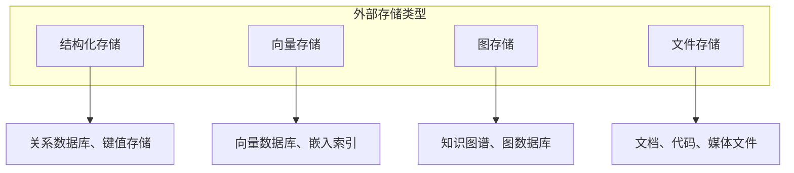
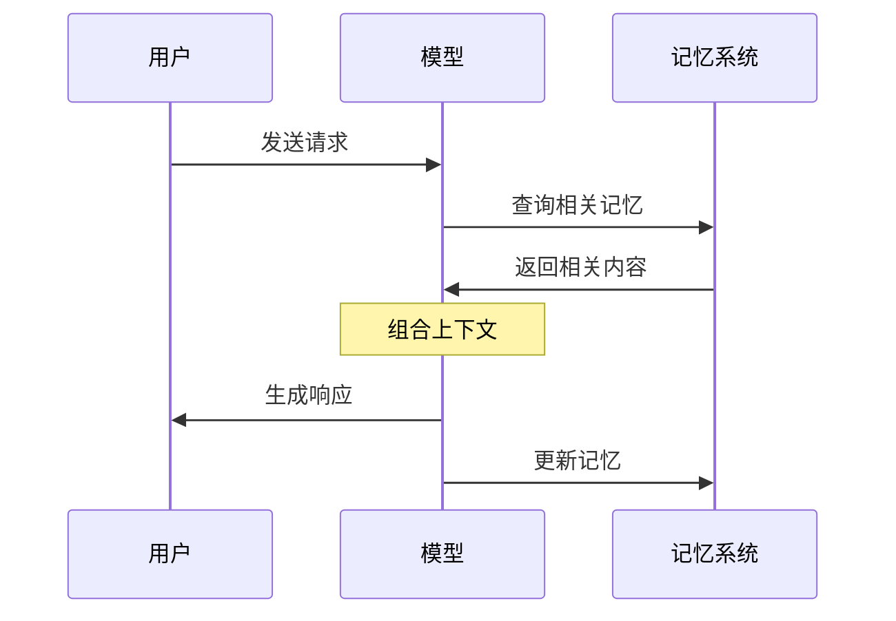
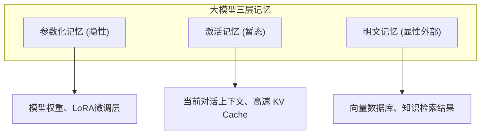
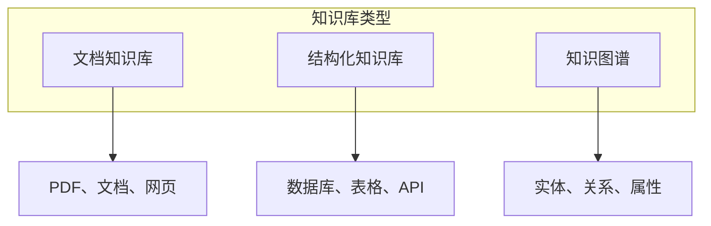
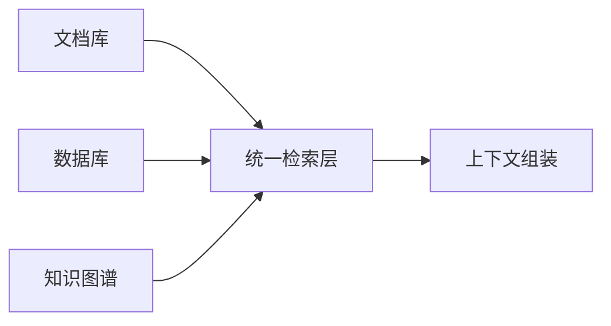

# 第四章：上下文写入与存储

上下文窗口是有限的，但应用往往需要处理的信息远超窗口容量。**写入策略** 解决的核心问题是：如何在上下文窗口之外持久化存储信息，并在需要时加载到上下文中？

本章会深入探讨外部记忆系统、多层次记忆架构、知识库构建方法，以及向量数据库的实践应用。这些是构建长期记忆和大规模知识管理系统的基础技术。

## 1. 外部存储与记忆系统

### 1.1 为什么需要外部存储

大语言模型本身没有持久记忆能力。每次交互，模型都是从零开始，仅能依赖当前上下文中的信息。这带来几个根本问题：

1. **会话隔离**：不同会话之间无法共享信息
2. **容量限制**：大量信息无法同时放入上下文窗口
3. **时效性**：模型训练数据有截止日期，缺乏最新知识

外部存储系统让模型能够“记住”超出上下文窗口的信息，并在需要时检索使用。

**人脑记忆机制的工程启示**

大语言模型的外部存储设计，很大程度上可以从人脑的记忆形成机制中汲取灵感：人脑处理信息的闭环是 **“刺激 → 筛选 → 巩固 → 遗忘 → 再学习”**。
1. **刺激与筛选**：并非所有感官信息都会留下痕迹。在大模型应用中，意味着需要在“写入”阶段进行选择性过滤，仅提取与当前场景真正有价值的信息（降低冗余）。
2. **短期与激活记忆**：筛选后的信息进入短期记忆，追求极高的读写速度。
3. **长期记忆（外显与内隐）**：复述后进入长期记忆。外显记忆如同外部大容量知识库；内隐记忆如同固化在模型权重中的参数（读取快，写入慢）。
4. **遗忘机制**：长期不被调用的记忆会被主动遗忘（淘汰），以维持系统效率。

借鉴这一闭环，现代 AI 的外部记忆不再是简单的静态数据库，而是具备动态调度与生命周期管理的系统。

### 1.2 外部存储的类型



图 4-1：外部存储体系

**结构化存储**

适合存储结构化数据：用户信息、配置、元数据等。
- 关系数据库：PostgreSQL、MySQL
- 键值存储：Redis、DynamoDB
- 文档数据库：MongoDB

**向量存储**

适合存储和检索语义内容，是 [RAG](../05_select/5.1_rag_principles.md) 系统的核心。
- 专用向量数据库：Pinecone、Weaviate、Milvus、Qdrant
- 通用数据库支持：PostgreSQL（如 pgvector 扩展）、部分企业数据库的向量能力、以及 Elasticsearch 等（具体能力与版本以各产品文档为准）

**图存储**

适合存储实体关系和知识网络。
- 图数据库：Neo4j、Amazon Neptune
- 知识图谱平台：专用知识图谱系统

**文件存储**

适合存储原始文档和非结构化内容。
- 对象存储：S3、GCS、Azure Blob
- 文件系统：本地或网络文件系统

### 1.3 记忆系统的设计模式

**模式一：全量加载**

将所有相关信息加载到上下文。简单但受限于窗口容量。

适用场景：信息量小、任务简单

**模式二：按需检索**

只检索当前任务需要的信息。高效但需要精准的检索能力。

适用场景：信息量大、查询明确

**模式三：层级缓存**

热数据缓存在快速存储，冷数据存储在持久层。平衡效率和容量。

适用场景：高频查询、大规模系统

**模式四：流式更新**

持续更新存储中的信息，保持数据新鲜。适合实时应用。

适用场景：动态信息、实时系统

### 1.4 记忆与上下文的协作

外部存储不是对上下文的替代，而是补充。典型的协作模式：



图 4-2：记忆与上下文的协作模式

关键设计决策：
- **何时读取**：请求处理前还是过程中
- **读取什么**：基于什么条件选择记忆
- **何时写入**：响应后、会话结束时、还是实时
- **写入什么**：全部内容还是提取的关键信息
- **能否写入**：是否有用户同意、来源可信度、租户/权限范围、可回滚版本和中毒记忆隔离策略

### 1.5 记忆更新策略

记忆并非一成不变，需要适当的更新策略：

| 策略 | 描述 | 适用场景 |
|------|------|----------|
| 追加式 | 新信息不断追加，旧信息保留 | 日志、历史记录 |
| 覆盖式 | 新信息替换旧信息 | 状态信息、配置 |
| 合并式 | 新旧信息智能合并 | 知识累积 |
| 淘汰式 | 按规则删除旧信息 | 容量管理 |

具体来说，在复杂的记忆更新场景（如淘汰式和合并式）中，系统通常会引入更细化的算法和机制：

**1. 记忆淘汰算法 (Eviction Algorithms)**

当存储空间受限时，决定哪些记忆应该被移除：

*   **LRU (Least Recently Used)**
    *   **原理**：维护一个链表，最近访问的移动到表头。当容量满时，淘汰表尾（最久未访问）的记忆。
    *   **适用**：假设最近使用的信息在未来最可能被再次使用。
    *   **缺陷**：可能淘汰掉低频但非常关键（如用户过敏原）的信息。

*   **时间衰减 (Time-Decay)**
    *   **原理**：为每条记忆分配一个初始权重，随时间推移按指数衰减。$$ Weight_t = Weight_0 \times e^{-\lambda t} $$。当权重低于阈值时淘汰。
    *   **优化**：每次访问时重置权重，模拟人类的“复习”巩固机制。
    *   **适用**：模拟人类遗忘曲线，保留新鲜记忆。

*   **重要性评估 (Importance Scoring)**
    *   **原理**：利用 LLM 对每条新记忆进行评分（1-10 分）。淘汰时优先保留高分记忆。
    *   **示例**：“我想吃披萨”（2 分） vs “我对花生过敏”（10 分）。
    *   **适用**：确保关键事实不被错误淘汰。

**2. 记忆整合机制 (Consolidation Mechanisms)**

将零散的短期记忆转化为结构化的长期记忆：

*   **摘要 (Summarization)**
    *   **过程**：定期（如每晚或每积累 N 条对话）触发 Summarization Agent。
    *   **操作**：读取最近的对话记录，生成一段精炼的摘要，存入长期记忆，然后清空原始对话。
    *   **效果**：极大压缩存储空间，同时保留核心上下文。

*   **合成 (Synthesis)**
    *   **过程**：检测到新信息与旧记忆相关但不完全一致时触发。
    *   **操作**：Retrieve 相关旧记忆 -> 让 LLM 分析冲突或增量 -> 生成新的综合性记忆 -> 覆盖旧记忆。
    *   **效果**：解决信息冲突，维持知识库的一致性。

### 1.6 实现考量

构建记忆系统时需要考虑：

**一致性**
- 多个请求并发访问时如何保证一致性
- 记忆更新的原子性保证

**可靠性**
- 存储系统的持久性保证
- 故障恢复机制

**性能**
- 读写延迟对响应时间的影响
- 大规模数据下的检索效率

**成本**
- 存储成本
- 计算成本（特别是嵌入计算）

## 2. 记忆架构设计

### 2.1 认知科学的启发

人类的记忆系统是多层次的：工作记忆负责当前任务，长期记忆存储持久知识。AI 系统的记忆架构可以借鉴这一模型。

人类记忆的主要分类：
- **工作记忆**：容量有限，持续时间短，支持当前思维
- **长期记忆**：容量大，持续时间长，存储知识和经验
  - **语义记忆**：事实和概念（“巴黎是法国首都”）
  - **情景记忆**：具体经历和事件（“昨天我去了巴黎”）
  - **程序记忆**：技能和方法（“如何骑自行车”）

### 2.2 大模型三层记忆建模

突破以往只分“长期”与“短期”的粗粒度，从基础模型理论出发，记忆应当被系统性地划分为三层：

1. **参数化记忆（隐性记忆）**：通过训练或微调固化在模型权重中的知识。读取极快，但写入成本极高（类似人类的肌肉记忆）。可以进一步分为“内置参数记忆”（出厂权重）和“外置参数记忆”（随用户交互动态低秩更新的偏好与事实）。
2. **激活记忆（暂态记忆）**：例如推理过程中产生的高速 KV Cache。它暂存在显存中，读写速度居中，用于维持当前对话的极速响应，随时可丢弃或常驻。（按 MemOS 论文的口径，KV Cache 与隐藏状态同属**隐式**记忆。）
3. **明文记忆（显性外部记忆）**：可显式读取的外部存储（如知识库）。按常规检索逻辑维护，容量大、更新灵活，但需要重新编码和上下文拼接计算。



图 4-3：大模型三层记忆建模

#### 短期记忆：对话历史

短期记忆主要用于维持当前会话（Session）的连贯性，最典型的形态就是 **对话历史**（Conversation History）。
在多轮对话中，如果模型不了解前几轮的语境，就无法正确解析“它能做到吗？”这类包含代词的后续问题。

- **存储介质**：通常存储在 Redis 等内存数据库中，以 Session ID 为键隔离。
- **生命周期**：随会话开始而建立，随会话超时（如 30 分钟无交互）或显式结束而销毁/持久化。
- **上下文注入**：短期记忆通常采用先进先出（FIFO）或滑动窗口的形式注入上下文，这是最简单也最必须的上下文机制。

*（注：对话历史不断膨胀会很快耗尽上下文窗口，具体的压缩与截断算法将在 第 6 章：[6.3 对话历史管理](../06_compress/6.3_conversation_history.md) 详细探讨。本章主要关注其架构定位。）*

#### 长期记忆与类操作系统管理

最新的研究（如 MemGPT）提出了类操作系统的长期记忆管理隐喻，将上下文窗口视为 **主内存**，将外部存储视为 **磁盘**。

- **显式分页**：系统在主存和磁盘之间主动交换数据
- **中断机制**：当上下文占满时触发“内存管理中断”，决定哪些信息换出到磁盘
- **读写接口**：模型通过特定的工具调用（API）来读写外部记忆，而非被动接收检索结果

这种架构允许智能体处理看似“无限”的上下文任务，只要当前活跃集（Working Set）不超过窗口限制。

### 2.3 语义记忆与情景记忆

借鉴认知科学，长期记忆可进一步细分：

**语义记忆**

存储抽象的事实和概念，不依附于特定事件。

应用示例：
- 用户偏好：用户喜欢简洁的回复风格
- 领域知识：公司产品的技术规格
- 规则约束：业务的合规要求

实现方式：
- 结构化存储中的事实表
- 向量数据库中的知识片段
- 知识图谱中的实体和关系

**情景记忆**

存储具体的事件和经历，包含时间、地点等上下文。

应用示例：
- 历史对话：用户上周询问过产品 A 的价格
- 操作记录：用户在某日完成了某项配置
- 问题解决：过去类似问题的解决方案

实现方式：
- 时序数据库中的事件记录
- 带时间戳的向量存储
- 检索时考虑时间相关性

### 2.4 工程落地的五层记忆架构

为了让复杂的记忆操作对应用开发者透明，我们借鉴 MemOS 等前沿记忆工程实践，将其归纳为从底层存储到上层应用的五层架构（注：MemOS 论文原文采用接口层、操作层、基础设施层的三层划分，此处的五层是本书为便于讲解而做的工程视角拆分）：

1. **存储层（Storage）**：为各类记忆量身定制存储媒介（如图+向量混合存储），解决高效共享与持久化。
2. **治理层（Governance）**：保障记忆的安全与一致性。包括全生命周期管理、幻觉评估、版本控制、权限与隐私隔离等。
3. **调度层（Scheduling）**：记忆系统的内核。通过动态行为预测与预加载，将所需记忆在任务前就置于“就绪（Ready）”状态，确保最佳读写效率。
4. **应用层（Application）**：把复杂的记忆操作流程对开发者完全屏蔽，提供标准 API 服务（如 Memory-as-a-Service）。
5. **解码层（Decoding）**：大模型结合已调度的记忆上下文进行最终的推理生成。

### 2.5 记忆架构设计实践

**设计原则**

1. **分层分离**：不同类型记忆使用不同存储策略
2. **访问效率**：热数据快速访问，冷数据按需加载
3. **一致性保证**：确保记忆内容不相互矛盾
4. **隐私保护**：敏感信息需要特殊处理

**典型架构示例**

| 层次 | 存储技术 | 更新策略 | 访问模式 |
|------|----------|----------|----------|
| 工作记忆 | 内存/上下文 | 每次请求 | 全量加载 |
| 短期记忆 | Redis | 会话结束 | 最近 N 条 |
| 语义记忆 | 向量数据库 | 增量更新 | 语义检索 |
| 情景记忆 | 时序数据库 | 追加写入 | 时间+语义 |

### 2.6 记忆管理机制

**记忆提取**

决定从长期记忆中提取什么内容到工作记忆：
- 基于语义相似度（Retrieve）
- 基于时间相关性（Recency）
- 基于重要性评分（Importance）- *重要信息优先保留*
- 组合多种条件

**记忆巩固**

决定将工作记忆中的什么内容写入长期记忆：
- 显式保存：用户明确要求记住
- 重要性判断：自动识别重要信息（如 Reflection 机制）
- 摘要压缩：提取关键内容存储
- 定期回顾：对已有记忆进行整理

**记忆遗忘**

管理长期记忆的容量和时效：
- **遗忘曲线**：模拟人类遗忘规律，随时间降低记忆权重
- **使用频率（LRU）**：不常用的记忆优先淘汰
- **主动清理**：按策略删除过时信息

### 2.7 记忆架构的挑战

**一致性问题**

当信息更新时，如何确保所有相关记忆保持一致？例如用户名称变更后，历史记录中的引用如何处理。

**相关性问题**

如何判断过去的记忆与当前任务的相关性？语义相似不等于真正相关。

**规模问题**

随着记忆量增加，检索效率和存储成本如何控制？

**安全问题**

如何保护敏感记忆不被不当访问或泄露？

这些挑战没有万能解法，需要根据具体应用场景权衡取舍。

### 2.8 案例：从“记忆存储”到“持续状态维护”

上述挑战在近期的开源项目中开始出现系统性的工程解法。以 Supermemory 为代表的新一代记忆框架，将记忆问题从 **信息检索** 重新定义为 **持续状态维护**，在架构层面回应了一致性、相关性和规模三大挑战。

#### 三层架构设计

Supermemory 的架构可以映射为三个协作层：

| 层次 | 职责 | 对应本节概念 |
|------|------|-------------|
| **记忆引擎** | 从对话中抽取事实，处理时间变化、矛盾和自动遗忘 | 记忆巩固 + 记忆遗忘 |
| **用户画像** | 维护 `static`（长期稳定事实）和 `dynamic`（近期上下文）两层画像 | 语义记忆 + 情景记忆 |
| **外部连接器** | 实时同步 Google Drive、Notion、GitHub 等外部源 | 记忆提取的扩展 |

这种分层的关键洞察在于：**个性化任务中最常见的错误不是“检索不到”，而是系统不区分长期偏好与临时状态**。将 `static` 和 `dynamic` 拆开，既提升命中率，也减少注入上下文窗口的噪声。

#### 状态维护 vs 文本存储

传统做法是将对话原文存入向量数据库，依赖语义相似度召回。这种方式在处理时间维度的事实冲突时存在结构性缺陷——旧事实和新事实的嵌入向量语义相似度几乎相同，系统无法自动判断哪个应该失效。

Supermemory 的做法是：**不存原文，而是抽取事实并管理状态**。当用户说“我刚搬到旧金山”时，系统不是简单地新增一条记录，而是识别出这与“我住在纽约”存在冲突，自动执行覆盖。这种机制直接回应了 4.2.7 中提到的一致性问题。

#### 混合检索：知识与记忆的统一查询

另一个值得借鉴的设计是将记忆检索与文档检索合并为单次混合查询。传统架构中，用户记忆和知识库是两套独立系统，导致“能找到技术文档但不知道用户偏好哪种方案”的割裂。混合检索让每次回答都能同时基于外部知识和用户上下文，是上下文完整度的显著提升。

#### 统一语义层

Supermemory 通过多模态抽取器（PDF 解析、图片 OCR、视频转写、代码 AST 感知分块）将异构来源统一进入同一个记忆结构和本体。这解决了许多系统中“来源异构导致跨源召回错配”的问题——聊天、文件、代码、邮件各存各的，检索时上下文不统一。

> **设计启示**：记忆系统的效果上限，往往不取决于检索算法的优劣，而取决于 **目标函数是否准确**。多数系统默认优化语义相似度，但长期记忆场景真正需要优化的是更新正确性、时间正确性、冲突消解和噪声抑制。

## 3. 知识库构建与管理

### 3.1 知识库的定义与价值

**知识库** 是组织化的信息集合，专门用于为 AI 系统提供领域知识支持。与通用存储不同，知识库经过精心设计和优化，以支持高效的知识检索和利用。

知识库的核心价值：
- **弥补模型知识空白**：提供模型训练数据中没有的信息
- **保证信息时效性**：包含最新的事实和数据
- **实现领域深度**：提供特定领域的专业知识
- **确保信息权威性**：使用经过验证的可靠来源

### 3.2 知识库的类型



图 4-4：知识库类型

**文档知识库**

存储非结构化文档内容，是最常见的知识库形式。
- 内容：产品文档、技术手册、FAQ、博客文章
- 处理：文档解析 → 分块 → 向量化 → 索引
- 检索：基于语义相似度检索相关片段

**结构化知识库**

存储结构化数据，支持精确查询。
- 内容：产品数据库、用户信息、配置数据
- 处理：数据建模 → Schema 设计 → 索引优化
- 检索：SQL 查询或结构化 API

**知识图谱**

存储实体及其关系，支持关系推理。
- 内容：实体、属性、关系的三元组
- 处理：实体提取 → 关系抽取 → 图构建
- 检索：图遍历、路径查询

### 3.3 知识库构建流程

#### 阶段一：数据收集

收集构建知识库的原始数据：
- 内部文档：产品文档、技术规范、内部知识库
- 外部资源：公开文档、API 文档、行业标准
- 生成内容：FAQ 整理、知识提炼

数据收集注意事项：
- 确保数据来源可靠
- 清晰的版权和使用授权
- 记录数据来源和更新时间

#### 阶段二：数据处理

将原始数据转换为可用格式：

**文档解析**
- PDF 提取：表格、图片、文本
- 网页清洗：移除广告和导航
- 格式标准化：统一为 Markdown 或纯文本

**文本分块 (Text Chunking)**

分块策略直接决定了检索的粒度和质量（关于分块策略的详细讨论请参见 [5.2 文档分块策略](../05_select/5.2_chunking.md)）。常用的三种分块策略包括：

1.  **固定大小分块 (Fixed-size Chunking)**：设定固定的 Token 数量切分，简单快速但可能破坏语义。
2.  **递归字符分块 (Recursive Character Chunking)**：使用一组分隔符按优先级递归切分，较好保持段落和句子完整性，是大多数场景的首选。
3.  **语义分块 (Semantic Chunking)**：利用嵌入模型计算语义相似度进行话题转换切分，精度高但计算成本大。

**元数据标注**
- 来源标记
- 时间戳
- 分类标签
- 重要性权重

#### 阶段三：向量化与索引

将处理后的内容转换为可检索形式：

**嵌入生成**
- 选择合适的嵌入模型
- 批量处理提高效率
- 考虑多语言支持

**索引构建**
- 向量索引：HNSW、IVF 等算法
- 倒排索引：支持关键词检索
- 混合索引：结合多种方法

#### 阶段四：质量验证

验证知识库的质量：
- 检索测试：验证典型查询的检索效果
- 覆盖测试：确认关键知识都被包含
- 准确性测试：抽样验证内容正确性

### 3.4 知识库维护

知识库不是一次性工程，需要持续维护：

| 维护任务 | 频率 | 目的 |
|----------|------|------|
| 内容更新 | 按需/定期 | 保持信息时效性 |
| 索引重建 | 定期 | 优化检索性能 |
| 质量审核 | 定期 | 发现和修复问题 |
| 反馈整合 | 持续 | 基于使用改进 |

### 3.5 多源知识整合

实际系统通常需要整合多个知识源：



图 4-5：多源知识整合

整合挑战：
- **格式统一**：不同来源的内容格式不同
- **优先级管理**：来源之间可能有冲突
- **一致性维护**：保持信息的一致性

整合策略：
- 建立统一的检索接口
- 定义清晰的优先级规则
- 实现冲突检测和处理机制

### 3.6 知识库最佳实践

**1. 从核心开始**

先覆盖最常用、最重要的知识。不要试图一开始就构建一个包罗万象的知识库，而是识别用户最频繁查询的问题和场景，优先确保这些核心内容的质量和覆盖度。核心知识往往只占全部内容的一小部分，却能覆盖大部分高频查询需求。

**2. 质量优先**

高质量的小知识库胜过低质量的大知识库。每一条进入知识库的内容都应经过审核：信息是否准确？表述是否清晰？是否有歧义？低质量内容不仅无法帮助用户，还会降低整个系统的可信度，导致模型生成错误或矛盾的回答。

**3. 持续迭代**

基于实际使用反馈不断改进。知识库构建不是一次性项目，而是持续演进的过程。收集用户的查询日志，分析哪些问题检索失败或答案不满意，针对性地补充和优化内容。每一次用户交互都是改进知识库的机会。

**4. 版本管理**

维护知识库的版本历史。与代码库一样，知识库也需要版本控制。这样可以追踪内容变更、回滚错误更新、对比不同版本的效果。对于企业知识库，版本管理还有助于合规审计和问题追溯。

**5. 监控使用**

跟踪知识库的使用情况和效果。建立关键指标：检索成功率、用户满意度、知识覆盖度等。定期分析这些指标，发现知识空白和质量问题。数据驱动的优化比主观判断更有效。

## 4. 向量数据库实践

### 4.1 向量数据库概述

**向量数据库** 是专门优化用于存储和检索高维向量的数据库系统。在上下文工程中，向量数据库是实现语义检索的核心基础设施。

工作原理：
1. 将文本通过嵌入模型转换为向量（详见 [5.3 嵌入模型与语义搜索](../05_select/5.3_embeddings.md)）
2. 将向量存储到向量数据库
3. 查询时，将查询文本也转换为向量
4. 在数据库中搜索最相似的向量
5. 返回对应的原始文本

### 4.2 主流向量数据库对比

| 产品 | 类型 | 特点 | 适用场景 |
|------|------|------|----------|
| Pinecone | 云服务 | serverless、易用 | 快速启动、中小规模 |
| Weaviate | 开源/云 | 模块化、GraphQL | 复杂查询需求 |
| Milvus | 开源 | 高性能、云原生 | 大规模生产环境 |
| Qdrant | 开源 | Rust 实现、高性能 | 性能敏感场景 |
| Chroma | 开源/云 | 本地体验简单、面向 RAG 原型 | 快速原型与中小规模应用 |
| LanceDB | 开源/云 | 列式存储、向量/全文/混合检索 | 多模态数据与湖仓场景 |
| PostgreSQL | 融合数据库 | pgvector、生态成熟 | 业务数据与向量共存 |
| Elasticsearch / OpenSearch | 搜索引擎 | 向量检索、全文检索与过滤聚合共存 | 已有搜索基础设施 |
| Redis | 内存数据库/云 | 低延迟向量搜索、缓存一体化 | 在线推荐与实时检索 |
| Oracle 23ai | 融合数据库 | 原生向量、企业级 | 核心业务系统 |
| MySQL | 融合数据库 | HeatWave、普及度高 | 现有 MySQL 用户 |

### 4.3 向量索引算法

向量搜索因为数据量大、维度高，无法像传统数据库那样通过简单的比较来查找。其核心是 **近似最近邻搜索（Approximate Nearest Neighbor, ANN）**，即在牺牲极小精度的情况下，换取检索速度的指数级提升。

以下是三种最主流的算法原理详解：

#### 1. HNSW

HNSW（Hierarchical Navigable Small World，分层可导航小世界图）是目前综合性能最强的近似最近邻索引之一，结合了“小世界网络”和“分层结构”的思想。

**原理机制：**
想象一个多层的交通网络：
*   **顶层（高速公路）**：节点稀疏，连接跨度大，用于快速逼近目标区域。
*   **中间层（主干道）**：节点较多，连接跨度适中，用于缩小搜索范围。
*   **底层（街道）**：包含所有节点，连接密集，用于精确定位目标。

**搜索过程：**
1.  从顶层的一个入口节点开始。
2.  在当前层贪婪地寻找距离目标最近的节点。
3.  找到该层最近点后，“降落”到下一层对应的节点。
4.  重复步骤 2-3，直到到达底层（第 0 层）。
5.  在底层进行最终的精细搜索，找到最近邻。

**特点：**
-   **优点**：检索速度极快，查全率（Recall）高，对高维数据适应性好。
-   **缺点**：构建索引慢，且需要将整个图结构加载到内存，内存消耗大。
-   **关键参数**：
    -   `M`：每个节点的最大连接数（邻居数）。M 越大图越密，搜索质量越高但内存消耗越大。
    -   `efConstruction`：构建索引时的搜索深度。值越大索引质量越好，但构建越慢。
    -   `efSearch`：查询时的搜索深度。值越大召回率越高，但查询延迟增加。

#### 2. IVF

IVF（Inverted File Index，倒排文件索引）是一种基于聚类的倒排索引方法，类似于将数据分桶存储。

**原理机制：**
1.  **训练阶段**：使用聚类算法（如 K-means）将向量空间划分为 `nlist` 个聚类中心（Voronoi 单元）。
2.  **索引阶段**：将每个向量分配到距离其最近的聚类中心，归入对应的倒排链中。
3.  **查询阶段**：
    -   **粗搜（Coarse Quantizer）**：先计算查询向量与所有聚类中心的距离，找到最近的 `nprobe` 个聚类中心。
    -   **精搜**：仅在选中的这几个聚类对应的倒排链中进行遍历搜索，忽略其他无关数据。

**特点：**
-   **优点**：大大减少了搜索范围，支持增量更新，内存占用相对较低。
-   **缺点**：位于边界处的点可能被漏掉（通过增加 `nprobe` 缓解）。
-   **关键参数**：
    -   `nlist`：聚类中心的数量。
    -   `nprobe`：查询时扫描的聚类数量。nprobe 越大，精度越高，速度越慢。

#### 3. PQ

PQ（Product Quantization，乘积量化）是一种有损压缩技术，主要用于解决内存占用问题。

**原理机制：**
1.  **切分**：将高维向量（如 128 维）切分为 $M$ 个子向量（如 8 个 16 维的子向量）。
2.  **聚类**：对每个子空间分别进行 K-means 聚类（例如每个子空间聚成 256 类）。
3.  **量化**：将每个子向量替换为它所属聚类中心的 ID（只需 1 byte）。
4.  **压缩**：原始 128 浮点数向量（512 bytes）被压缩为 8 个 ID（8 bytes），压缩比高达 64x。
5.  **查询**：查询时，预先计算查询向量各子段与各聚类中心的距离表，通过查表快速计算近似距离。

**特点：**
-   **优点**：极大地降低内存占用（通常可达几十倍压缩），使得单机可处理十亿级数据。
-   **缺点**：距离计算是近似值，存在精度损失。通常与 IVF 结合使用（IVF-PQ）以从海量数据中快速筛选。

### 4.4 向量数据库使用实践

#### 嵌入模型选择

嵌入模型决定语义搜索的质量：

| 模型（示例） | 维度（示意） | 特点 |
|------|------|------|
| 商用通用嵌入模型 | 常见为千级维度 | 成本/效果平衡，生态成熟 |
| 商用高精度嵌入模型 | 常见为更高维度 | 精度更高，成本与延迟更高 |
| 领域嵌入模型 | 变化 | 在特定领域可能更稳健 |
| 开源多语言嵌入模型 | 变化 | 便于本地部署与可控性 |
| sentence-transformers 系列 | 变化 | 本地部署与快速实验 |

选择考虑：
- 质量需求
- 成本预算
- 是否需要本地部署
- 语言支持

#### 文档分块策略

良好的分块策略直接影响检索效果：


图 4-6：文档分块与索引构建流程

分块要点：
- 语义完整性：尽量保持语义单元完整
- 大小适中：通常 200-1000 Token
- 适当重叠：防止信息断裂
- 保留元数据：来源、章节、时间等

#### 检索优化

提升检索效果的实用技术：

**混合检索**

结合向量搜索和关键词搜索：
```text
最终得分 = α × 语义得分 + (1-α) × 关键词得分
```

**元数据过滤**

先按元数据过滤，再在子集中向量搜索：
- 按时间范围过滤
- 按类别过滤
- 按来源过滤

**重排序**

对初步检索结果进行二次排序：
- 使用专门的重排序模型
- 考虑更多上下文因素

### 4.5 实际部署考量

#### 性能优化

- **批量操作**：批量写入和批量查询
- **缓存策略**：缓存热点查询结果
- **索引预热**：提前加载索引到内存

#### 扩展性

- **分片策略**：数据量大时的分片方案
- **副本配置**：高可用和读扩展
- **容量规划**：预估存储和计算需求

#### 成本控制

- **向量维度**：较小的维度降低存储和计算成本
- **压缩技术**：使用量化减少存储
- **冷热分离**：不常用数据使用低成本存储

### 4.6 常见问题处理

**1. 检索结果不相关**

通常是由于语义偏差或分块不当导致。
- **解决方案**：
    - 检查嵌入模型是否适合当前领域的专有名词。
    - 优化分块策略，增加块之间的重叠，或尝试父子文档索引。
    - 引入混合检索（Hybrid Search），结合关键词匹配来纠正语义漂移。
    - 添加重排序（Reranking）步骤，使用高精度模型对召回结果进行二次筛选。

**2. 检索延迟过高**

随着数据量增长，暴力搜索变得不可接受。
- **解决方案**：
    - 调整索引参数，如 HNSW 的 `efSearch`，在精度和速度间寻找平衡。
    - 使用更高效的索引算法，或者开启量化（如 SQ8, PQ）以减少内存占用和计算量。
    - 考虑硬件升级，使用 GPU 加速索引或查询。
    - 实现分片（Sharding），将数据分布到多台机器并行查询。

**3. 更新导致不一致**

向量更新滞后于源数据更新。
- **解决方案**：
    - 实现实时增量更新机制，源数据变更立即触发嵌入更新。
    - 设计合理的版本控制策略，在重建索引期间保留旧版本查询。
    - 定期全量重建索引，以消除增量更新产生的碎片，优化索引结构。
