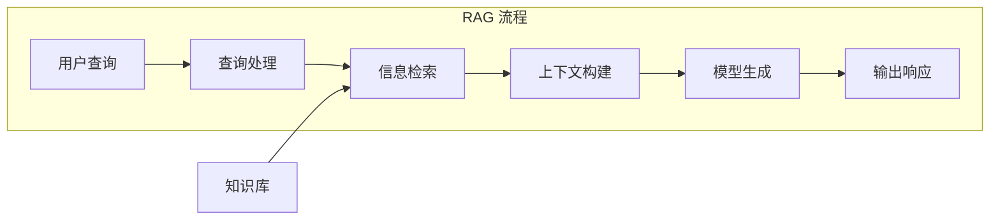
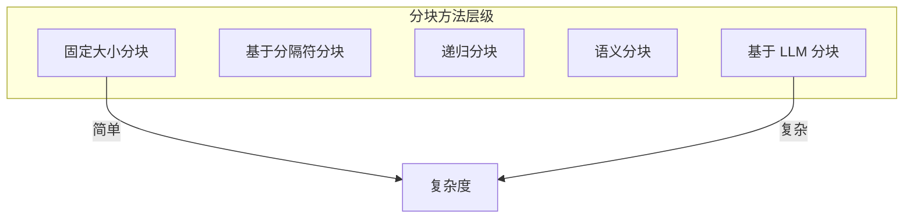
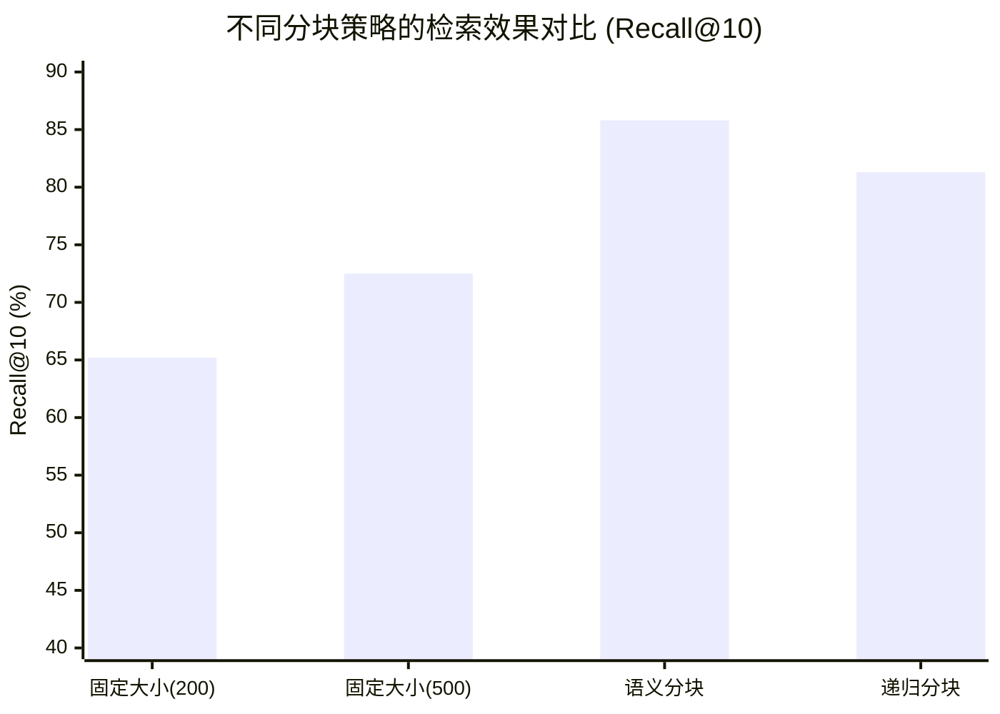
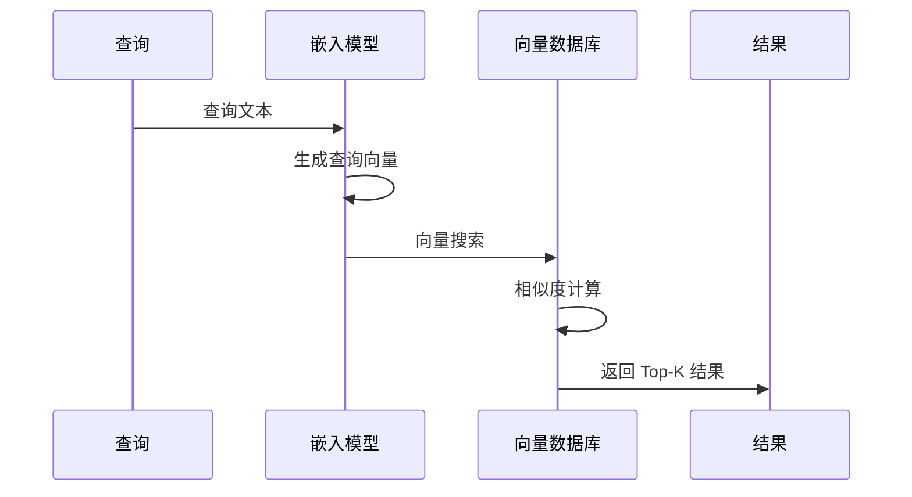
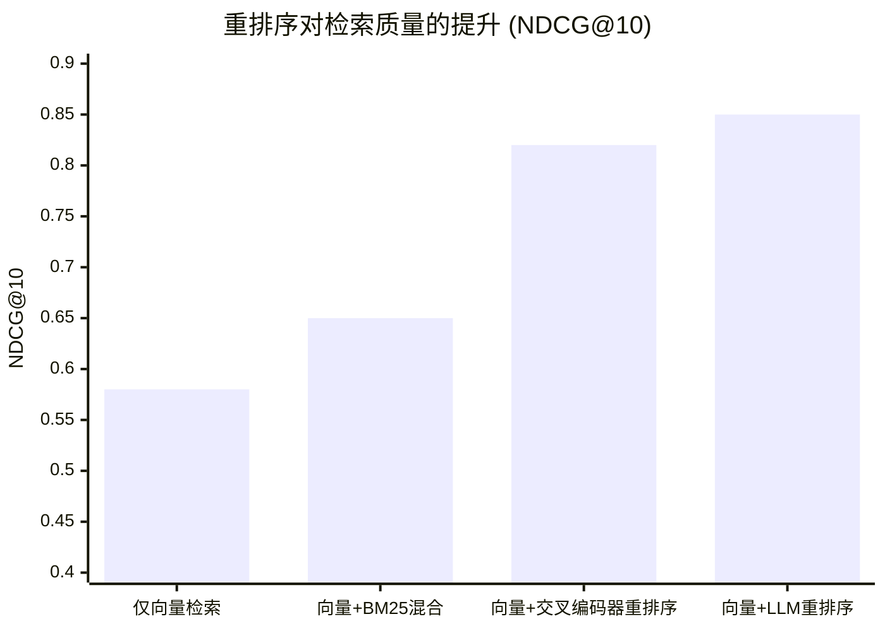
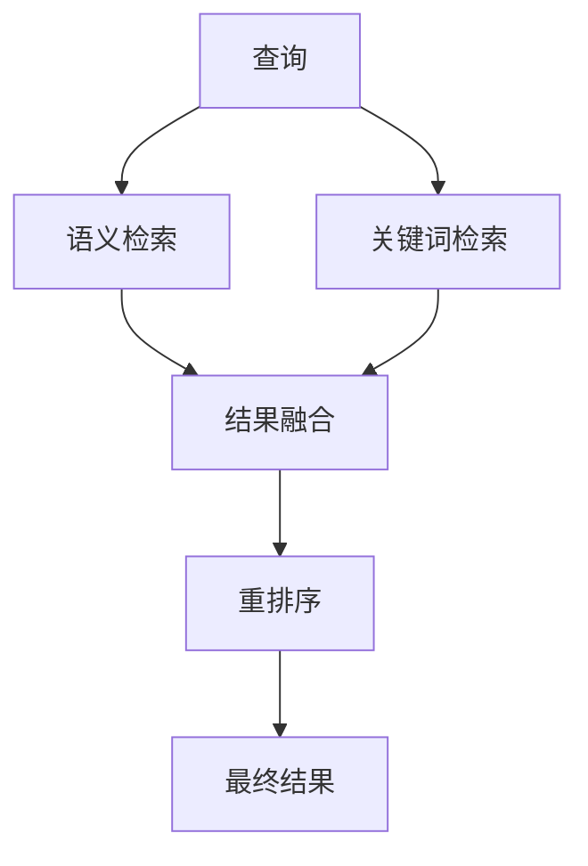

# 第五章 上下文选择与检索

当信息存储在外部系统后，下一个关键问题是：如何从海量信息中精准获取当前任务所需的内容？**选择策略** 正是解决这一问题的核心方法，而[检索增强生成](5.1_rag_principles.md)（[RAG](5.1_rag_principles.md)）是其最重要的实现形式。

本章将深入探讨 RAG 的基本原理、文档分块策略、嵌入模型与语义搜索、重排序技术，以及混合检索等高级 RAG 技术。

## 1. 检索增强生成原理

### 1.1 检索增强生成的定义与动机

**检索增强生成**（Retrieval-Augmented Generation，RAG）是一种将信息检索与语言模型生成相结合的技术。它允许模型在生成答案时参考外部知识源，从而克服模型知识的局限性。

RAG 解决的核心问题：
- **知识时效性**：模型训练数据有截止日期，无法获知最新信息
- **知识准确性**：模型可能产生幻觉，检索提供事实依据
- **知识专业性**：通用模型可能缺乏特定领域的深度知识
- **知识可控性**：可以精确控制模型能够访问的知识范围

### 1.2 检索增强生成的基本架构



图 5-1：RAG 流程

**标准 RAG 流程**：

1. **查询处理**：理解和转换用户查询
2. **信息检索**：从知识库检索相关内容
3. **上下文构建**：将检索内容组装到提示词中
4. **模型生成**：模型基于增强的上下文生成答案
5. **输出响应**：返回生成的答案

### 1.3 检索增强生成的技术组件

一个完整的 RAG 系统包含以下核心组件：

| 组件 | 功能 | 关键技术 |
|------|------|----------|
| 文档处理器 | 解析和分块文档 | 分块算法、元数据提取 |
| 嵌入模型 | 将文本转换为向量 | 语义嵌入模型 |
| 向量存储 | 存储和索引向量 | 向量数据库 |
| 检索器 | 执行相似性搜索 | ANN 算法 |
| 重排序器 | 优化检索结果排序 | 交叉编码器 |
| 上下文组装器 | 构建最终提示词 | 模板、格式化 |

### 1.4 检索增强生成与模型能力的关系

RAG 不是替代模型能力，而是增强模型能力：

- **模型提供**：语言理解、推理、生成能力
- **RAG 提供**：事实依据、专业知识、最新信息

实践表明，RAG 配合高能力模型效果最好。模型需要足够的理解和推理能力，才能有效利用检索到的信息。

### 1.5 检索增强生成的优势与局限

**优势**：
- 显著减少幻觉，提高事实准确性
- 支持知识的实时更新
- 知识来源可追溯，增强可信度
- 无需重新训练模型

**局限**：
- 检索质量直接影响最终效果
- 增加了系统复杂度和延迟
- 对于需要深度推理的问题效果有限
- **阻断式延迟瓶颈**：传统的 RAG 呈现“被动式阻断检索”——用户提问 -> 检索 -> 拼接 -> 推理。这种串行流程极大拉长了首 Token 延迟，尤其是大并发下，算力浪费与响应等待尤为明显。

### 1.6 从“被动阻断”到“主动式全时调度”

面对传统 RAG 的串行阻断式延迟，前沿工程探索出一种突破性策略：**异步预加载（如 Memory Cube 机制）**。

与其让用户思考、打字、阅读的“碎片空档时间”白白流逝，不如将记忆管理、调度与预热工作化整为零，嵌入每一个空隙。通过预测用户意图，系统在后台并行地提前完成记忆检索和组合操作。当用户真正发出查询时，所需的增强上下文已经处于“就绪（Ready）”状态，只需一次轻量调用即可极速交付。

这标志着 RAG 系统从“请求即时检索”向“全时异步调度”的重大演进。

### 1.7 检索增强生成的发展阶段

RAG 技术正在快速演进：

**第一代：朴素 RAG**
- 简单的向量相似性检索
- 固定的分块和检索策略
- 直接拼接检索结果

**第二代：高级 RAG**
- 引入重排序和混合检索
- 优化的分块和嵌入策略
- 查询增强和结果后处理

**第三代：模块化 RAG**
- 灵活组合各种 RAG 技术
- 自适应检索策略
- 与智能体系统集成

当前实践中，高级 RAG 技术已经成为标准配置，而模块化 RAG 正在成为新的发展方向。后续章节将详细介绍这些关键技术。

## 2. 文档分块策略

### 2.1 分块的重要性

**分块**（Chunking）是将大文档切分为小片段的过程，是 [RAG](5.1_rag_principles.md) 系统的关键步骤。分块质量直接影响：
- 检索精度：能否找到最相关的内容
- 上下文完整性：检索到的内容是否包含完整语义
- Token 效率：是否高效利用上下文空间

### 2.2 分块的基本原则

**原则一：语义完整性**

每个块应该是一个语义完整的单元，能够独立表达完整的含义。

**原则二：大小适中**

块不能太大（占用过多上下文空间），也不能太小（缺失必要上下文）。

**原则三：信息自包含**

块应该包含理解其内容所需的必要背景信息。

### 2.3 常见分块方法



图 5-2：分块方法层级

#### 固定大小分块

按固定的字符数或 Token 数切分。

```text
优点：实现简单、结果可预测
缺点：可能破坏语义完整性
适用：快速原型、对质量要求不高
```

参数：块大小（通常 500-2000 字符）、重叠大小（10-20%）

#### 基于分隔符分块

按自然分隔符（段落、句子、换行）切分。

```text
优点：保持自然边界
缺点：块大小不一致
适用：结构清晰的文档
```

常用分隔符：`\n\n`、`\n`、`.`、`。`

#### 递归分块

尝试按多级分隔符切分，自动适应文档结构。

```text
优点：平衡完整性和一致性
缺点：实现较复杂
适用：大多数文档类型
```

典型分隔符序列：`["\n\n", "\n", " ", ""]`

#### 语义分块

基于语义相似度切分，保持语义单元完整。

```text
优点：语义完整性最好
缺点：计算成本高
适用：对质量要求高的场景
```

实现方式：计算相邻句子的嵌入相似度，在相似度低谷处切分。

#### 基于 LLM 分块

使用语言模型理解内容结构进行切分。

```text
优点：理解能力最强
缺点：成本高、延迟大
适用：高价值内容、复杂文档
```

### 2.4 分块策略对比实验（示意）

为了说明不同分块策略可能带来的差异，下面给出一个 **示意性的对比图**（不同数据集、检索器、嵌入模型与评测口径会导致结果差异很大）：



图 5-3：不同分块策略检索效果示意

*注：数值仅用于说明趋势，不应被视为可复现的通用结论。*

- **语义分块** 通常能获得最佳的检索效果，因为其保持了语义单元的完整性。
- **递归分块** 在效果与成本之间取得了较好的平衡。
- **过小的固定分块** 容易破坏语义，导致召回率下降。

### 2.5 分块参数调优

**块大小选择**

| 场景 | 推荐大小 | 理由 |
|------|----------|------|
| 精确问答 | 200-500 Token | 聚焦单一信息点 |
| 综合理解 | 500-1000 Token | 更多上下文 |
| 长文档摘要 | 1000-2000 Token | 涵盖更多内容 |

**重叠设置**

重叠可以防止信息被切断在边界处，典型设置为块大小的 10-20%。

**元数据保留**

为每个块附加元数据：
- 来源文档
- 位置信息（第几章、第几节）
- 标题层级
- 时间戳

### 2.6 特殊文档类型处理

**代码文档**

按函数、类等逻辑结构切分，而非按行数。

**表格数据**

保持行完整性，必要时将表头附加到每个块。

**对话记录**

按对话轮次切分，保持问答对完整。

**技术文档**

尊重标题层级结构，将标题作为块的上下文前缀。

### 2.7 分块质量评估

评估分块效果的方法：

1. **边界检查**：人工检查切分边界是否合理
2. **检索测试**：测试典型查询能否检索到相关块
3. **下游效果**：观察最终任务效果

### 2.8 最佳实践

1. **从递归分块开始**：适用于大多数场景
2. **根据内容调整**：不同类型文档使用不同策略
3. **保留结构信息**：将标题等信息附加到块中
4. **测试和迭代**：持续评估和优化分块效果

### 2.9 实战案例：三种场景的分块对比

以下是三种典型场景的分块策略对比，展示如何根据内容特点选择合适的方法。

#### 案例一：产品规格表

**场景**：用户问“这款手机支持 5G 吗？”需要从产品说明书中检索答案。

**错误做法**：
```text
# 按 500 字符固定分块

第一块: "...4800万像素主摄像头，支持光学防抖。5G 网络..."  ← 5G信息被切断
第二块: "...支持 SA/NSA 双模。电池容量 5000mAh..."
```

**正确做法**：
```text
# 按产品规格表的属性分块

块-网络: "网络制式: 5G SA/NSA 双模，支持 n1/n28/n41/n78 频段"
块-相机: "摄像头: 4800万像素主摄，支持光学防抖"
块-电池: "电池: 5000mAh，支持 67W 快充"
```

**踩坑经验**：规格表按固定字符数分块会把相关属性切断，导致模型无法完整回答。应按语义属性分块，每个块对应一个完整的产品特性。

---

#### 案例二：法律合同

**场景**：找出合同中的“不可抗力”免责条款。

**错误做法**：
```text
# 按段落分块，但切断了条款

第一块: "...第八条 不可抗力 如因战争、地震、洪水等不可..."
第二块: "...抗力事件导致合同无法履行，双方均不承担违约责任。"
```

**正确做法**：
```text
# 按条款层级分块，保持完整

块-第八条: "第八条 不可抗力
如因战争、地震、洪水等不可抗力事件导致合同无法履行，双方均不承担违约责任。
不可抗力事件发生后，受影响方应在 7 日内书面通知对方。"
```

**踩坑经验**：法律文本的完整性至关重要。曾因分块切断句子导致法律含义改变（“不承担”变成“承担”）。必须按条款结构分块，宁可块大一点也不能破坏语义完整性。

---

#### 案例三：代码库

**场景**：开发者问“这个函数是怎么实现的？”

**错误做法**：
```text
# 按 50 行固定分块

第一块: "def calculate_price(items):
    total = 0
    for item in items:
        if item.discount:"  ← 函数被切断

第二块: "            price = item.price * 0.8
        else:
            price = item.price
        total += price
    return total"  ← 缺少函数开头
```

**正确做法**：
```text
# 按函数/类为单位分块

块-calculate_price: "# 位置: pricing.py:45-62
def calculate_price(items):
    '''计算购物车总价，支持折扣'''
    total = 0
    for item in items:
        if item.discount:
            price = item.price * 0.8
        else:
            price = item.price
        total += price
    return total

调用方: checkout.py:process_order()"

```

**踩坑经验**：代码按行数分块会切断函数逻辑，模型无法理解完整实现。应按 AST（抽象语法树）提取函数/类为单位，并附带调用关系元数据。

## 3. 嵌入模型与语义搜索

### 3.1 嵌入的基本概念

**嵌入**（Embedding）是将文本转换为数值向量的过程。语义相近的文本在向量空间中距离也相近，这是语义搜索的数学基础。

嵌入模型的核心任务：将任意长度的文本映射到固定维度的向量空间，保持语义相似性。

### 3.2 嵌入模型的工作原理


图 5-4：嵌入模型工作原理

主要步骤：
1. **分词**：将文本切分为 Token
2. **编码**：通过 Transformer 编码器获取上下文表示
3. **池化**：将多个 Token 表示合并为单一向量
4. **归一化**：可选，将向量归一化为单位长度

### 3.3 嵌入模型类型对比（示意）

嵌入模型与参数迭代很快，下面按“类型”给出对比视角，便于做选型决策（具体模型名、维度与最大长度以各厂商/开源项目文档为准）。

| 类型 | 维度（常见量级） | 最大长度（常见量级） | 特点 |
|------|------------------|----------------------|------|
| 商用通用嵌入模型 | 千级 | 千到万级 Token | 综合表现稳定，生态与工具链成熟 |
| 商用高精度嵌入模型 | 更高维度 | 千到万级 Token | 更高质量，成本与延迟更高 |
| 可裁剪维度嵌入模型 | 千级，可按维度截断 | 千到万级 Token | 通过 Matryoshka 表示学习或类似训练，让同一向量支持不同存储成本 |
| 多向量/晚交互检索模型 | 每个 Token 或片段多向量 | 依实现而定 | ColBERT 类 late interaction 保留细粒度匹配，召回质量高但索引和计算更重 |
| 开源中文/多语言嵌入模型 | 千级 | 百到千级 Token（不等） | 便于本地部署与可控性，需自建评测 |
| 指令式/任务特化嵌入模型 | 千级 | 百到千级 Token（不等） | 在特定检索范式（如 query/doc 前缀）下更稳健 |

### 3.4 嵌入模型选择因素

**质量需求**

- 高质量场景：选择能力更强的模型
- 一般场景：平衡模型可能足够

**语言支持**

- 纯中文：BGE 系列表现突出
- 多语言：BGE-M3、Cohere、Voyage、Gemini 等

**上下文长度**

- 长文档检索：需要支持更长输入的模型
- 短查询：大多数模型都能胜任
- 长上下文嵌入：可结合 late chunking，先编码较长文档再对片段池化，减少切块前丢失的上下文

**成本与性能**

- 云服务：按调用计费，需要考虑成本
- 本地部署：需要考虑硬件资源
- 维度裁剪：OpenAI 与 Gemini 等模型支持或采用 Matryoshka 式维度控制，可在召回质量、存储和延迟之间做实测权衡

### 3.5 语义搜索实现

**相似度度量**

常用的相似度计算方法：

| 方法 | 公式 | 特点 |
|------|------|------|
| 余弦相似度 | $\cos(\mathbf{A}, \mathbf{B})$ | 最常用，忽略向量长度 |
| 点积 | A · B | 快速计算 |
| 欧氏距离 | \|\|A - B\|\| | 考虑绝对位置 |

余弦相似度最为常用，因为它专注于方向而非长度。

**检索流程**



图 5-5：语义搜索流程

### 3.6 嵌入质量优化

**查询增强**

增强查询以提高检索效果：
- 查询扩展：添加同义词或相关术语
- 查询改写：使用 LLM 改写为更好的搜索形式
- 假设文档：生成假设的理想答案，用于检索

**文档增强**

优化文档嵌入：
- 添加标题前缀：将标题拼接到内容前
- 摘要增强：为每个块生成摘要，用摘要嵌入
- 多向量表示：同一内容生成多个嵌入
- late chunking：对长文档先编码、后按块池化，适合指代关系和跨段上下文较强的材料
- late interaction：保存查询和文档的细粒度 Token 表示，在检索或重排阶段计算更细的相似度

### 3.7 嵌入的局限与对策

**语义鸿沟**

嵌入基于字面语义，可能忽略领域特定含义。

对策：使用领域微调的嵌入模型，或结合关键词搜索。

**跨语言差异**

不同语言的嵌入质量可能不一致。

对策：选择多语言优化的模型，或翻译后检索。

**长尾查询**

罕见表达可能嵌入效果差。

对策：查询扩展，或结合多种检索方式。

### 3.8 嵌入模型更新

嵌入模型更新时需要注意：
- 重新生成全部文档嵌入
- 保持查询与文档使用相同模型
- 考虑过渡期的兼容性

## 4. 重排序与相关性优化

### 4.1 为什么需要重排序

向量检索虽然高效，但存在局限：
- 嵌入是预计算的，无法考虑查询特定的语义
- 向量相似不等于真正的相关性
- 检索时只考虑局部匹配，缺乏全局视角

**重排序**（Reranking）是对初步检索结果进行二次排序的技术，能够显著提升最终结果的相关性。

### 4.2 两阶段检索架构


图 5-6：两阶段检索架构

- **第一阶段**：快速召回大量候选（如 Top-100）
- **第二阶段**：精细排序，选出最相关结果（如 Top-5）

这种架构在效率和精度之间取得平衡。

### 4.3 重排序技术

#### 交叉编码器

**原理**：将查询和文档拼接输入模型，直接输出相关性得分。

```text
输入：[CLS] 查询 [SEP] 文档 [SEP]
输出：相关性分数 (0-1)
```

**优点**：精度最高，能够捕捉查询-文档交互
**缺点**：计算成本高，无法预计算

**常用模型**：
- BGE-Reranker
- Cohere Rerank
- ms-marco 系列

#### 大语言模型重排序

**原理**：使用语言模型判断相关性或排序。

方式一：逐对比较
```text
"以下两段内容哪个与查询更相关？
查询：...
内容A：...
内容B：..."
```

方式二：直接评分
```text
"评估以下内容与查询的相关性（1-10分）：
查询：...
内容：..."
```

**优点**：灵活，可使用任何 LLM
**缺点**：成本高，延迟大

### 4.4 重排序性能对比实验（示意）

引入重排序步骤通常会增加延迟，但往往能提升检索质量（如 NDCG@10）。下面给出一个 **示意性的对比图**（不同数据集、候选集规模、模型与标注口径会导致结果差异很大）：



图 5-7：重排序对检索质量的提升示意

可以看到，交叉编码器类重排序通常能带来明显的边际收益；LLM 重排序可能进一步提升效果，但往往伴随着更高的延迟与成本。

### 4.5 混合打分

结合多个信号进行打分：

```text
最终分数 = α × 语义分数 + β × 重排序分数 + γ × 其他信号
```

其他信号可以包括：
- 关键词匹配得分
- 文档权威性
- 时间新鲜度
- 用户行为数据

### 4.6 重排序实践

**召回候选数量**

- 太少：可能遗漏相关结果
- 太多：增加重排序成本

通常召回 20-100 条供重排序。

**重排序结果数量**

根据后续使用确定：
- 问答场景：通常 3-5 条
- 综合分析：可能需要 10+ 条

**性能优化**

- 批量处理减少调用次数
- 使用轻量级重排序模型
- 缓存频繁查询的结果

### 4.7 相关性优化的其他技术

**查询优化**

在检索前优化查询：
- 语义扩展：添加同义词
- 意图识别：理解查询真实意图
- 子查询分解：复杂查询拆分

**结果多样化**

避免返回重复或相似的结果：
- MMR（最大边际相关性）
- 聚类去重

**反馈学习**

利用用户反馈改进排序：
- 点击数据
- 满意度评分
- A/B 测试结果

### 4.8 重排序效果评估

常用评估指标：

| 指标 | 含义 |
|------|------|
| MRR | 平均倒数排名，关注第一个相关结果位置 |
| NDCG | 归一化折扣累积增益，考虑排名位置 |
| Recall@K | Top-K 结果中的召回率 |
| Precision@K | Top-K 结果中的精确率 |

实践中应选择与业务目标相关的指标进行优化。

## 5. 混合检索与高级检索增强生成

### 5.1 混合检索

**混合检索**（Hybrid Search）结合多种检索方法的优势，是当前 [RAG](5.1_rag_principles.md) 实践的标准配置。

#### 语义检索与关键词检索对比

| 特性 | 语义检索 | 关键词检索 |
|------|----------|------------|
| 优势 | 理解语义、处理同义词 | 精确匹配、高速 |
| 劣势 | 可能忽略关键词 | 无法处理语义 |
| 典型场景 | 开放式问题 | 专有名词、代码 |

#### 混合检索实现



图 5-8：混合检索流程

**分数融合策略**：

**简单加权**
```text
融合分数 = α × 语义分数 + (1-α) × 关键词分数
```

**倒数排名融合（RRF）**
```text
RRF(d) = Σ 1/(k + rank_i(d))
```

RRF 不依赖原始分数，只使用排名，更加鲁棒。

### 5.2 高级检索增强生成技术

#### 查询转换

在检索前对查询进行增强：

**查询扩展**

扩大查询覆盖范围：
- 同义词扩展
- 相关术语添加
- 多语言翻译

**查询分解**

将复杂查询拆分：
```text
原始查询：比较 A 产品和 B 产品在性能和价格方面的差异
分解为：
- A 产品的性能
- B 产品的性能
- A 产品的价格
- B 产品的价格
```

**假设文档生成（HyDE）**

生成假设的答案，用其嵌入进行检索：
1. 让 LLM 生成假设答案
2. 将假设答案转换为嵌入
3. 用假设答案的嵌入检索

#### 多跳检索

对于需要多步推理的问题，迭代检索：


图 5-9：多跳检索流程

应用场景：
- 需要背景知识支持的问题
- 涉及多个实体关系的问题

#### 自适应检索

根据查询特点动态调整策略：

**路由机制**

根据查询类型选择不同检索路径：
- 事实查询 → 精确检索
- 概念查询 → 语义检索
- 对比查询 → 多路检索

**无需检索的识别**

并非所有查询都需要检索：
- 常识问题：模型本身知识足够
- 创意任务：不需要外部事实

#### 上下文增强

丰富检索结果的上下文：

**父子块策略**

- 使用小块检索：precision
- 返回大块内容：context

```text
小块（检索用）: 约 200 Token
大块（返回用）: 约 1000 Token
```

**滑动窗口扩展**

检索到某块后，自动包含相邻块。

**元数据增强**

将来源、章节等元数据附加到结果中。

### 5.3 检索增强生成评估框架

#### 组件级评估

分别评估 RAG 各组件：

| 组件 | 评估指标 |
|------|----------|
| 检索 | Recall、MRR、NDCG |
| 生成 | 准确性、完整性、一致性 |
| 端到端 | 用户满意度、任务成功率 |

#### 常用评估工具

- **RAGAS**：自动化 RAG 评估框架
- **TruLens**：RAG 质量监控
- **人工评估**：复杂场景仍需人工判断

### 5.4 检索增强生成调优策略

**问题诊断**

常见问题及对策：
- 检索不到相关内容 → 优化分块/嵌入
- 检索质量低 → 添加重排序
- 生成答案错误 → 优化提示词，加入约束

**迭代优化**

1. 收集失败案例
2. 分析失败原因
3. 针对性优化
4. 验证效果
5. 持续监控
