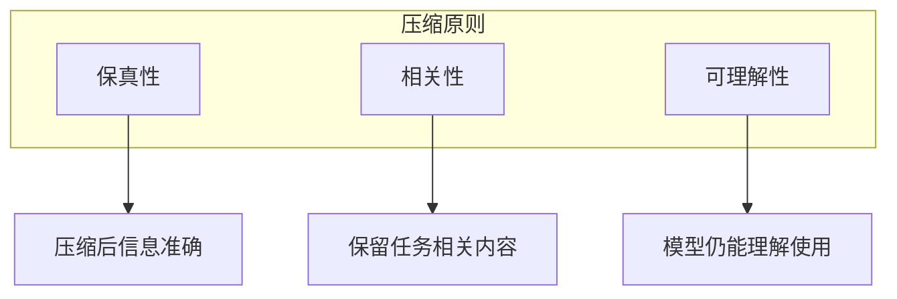
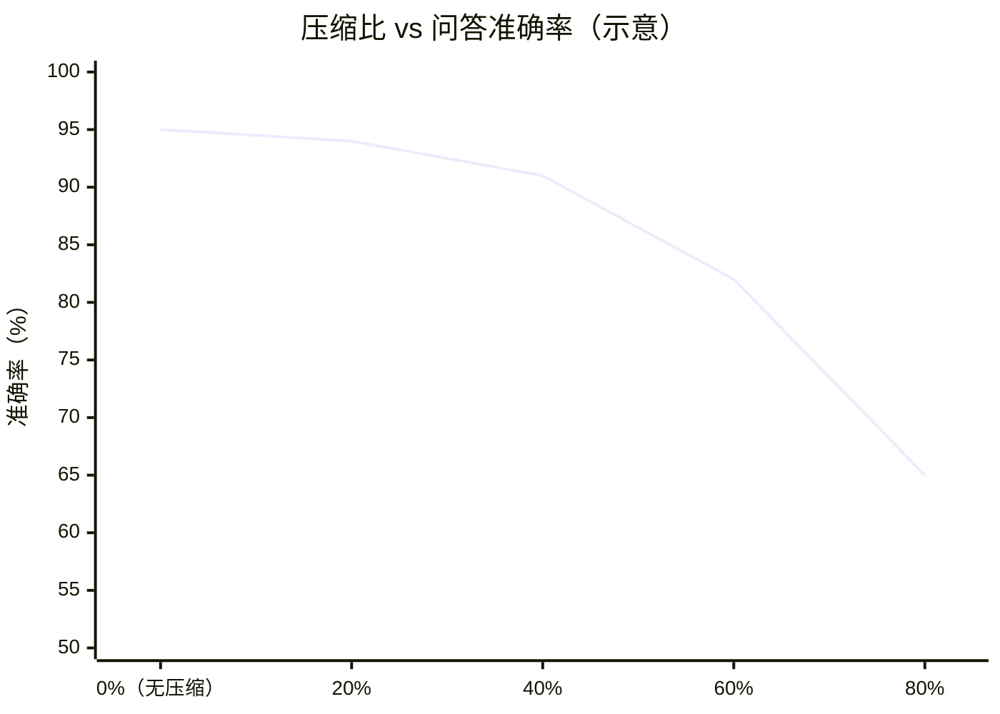
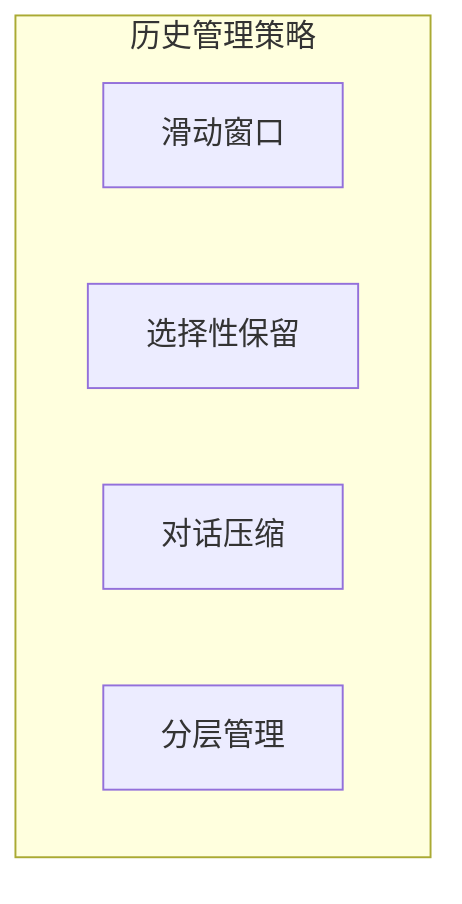
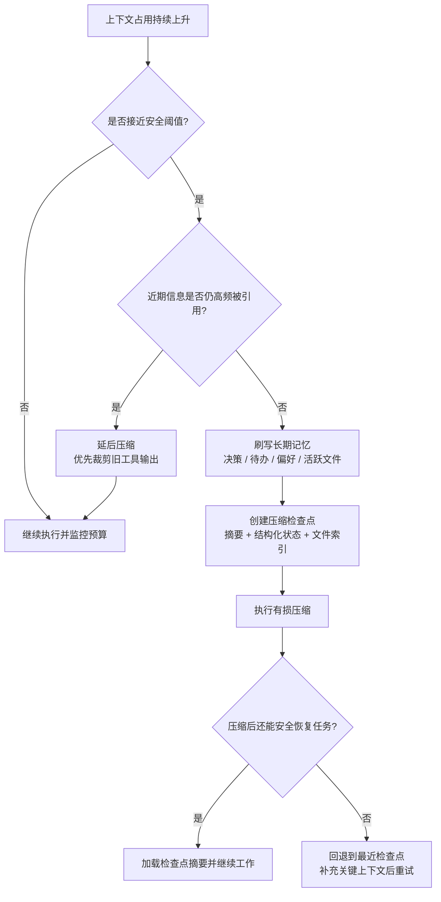

# 第六章：上下文压缩与优化

即使经过精选和检索，需要放入上下文的信息量仍可能很大。**压缩策略** 旨在提高信息密度，用更少的 Token 传达更多的有效内容。

本章将介绍信息压缩的基本原理、摘要与提取技术、对话历史管理，以及上下文窗口优化的系统策略。这些技术对于控制成本、降低延迟、提高模型处理效率都至关重要。

## 1. 信息密度与压缩原理

### 1.1 信息密度的概念

**信息密度** 是指单位 Token 中包含的有效信息量。高密度意味着用更少的 Token 传达更多有价值的内容。

```text
信息密度 = 有效信息量 / Token 数量
```

信息密度对上下文工程的影响：
- **容量利用**：高密度上下文能在有限窗口中容纳更多内容
- **成本效率**：更少的 Token 意味着更低的 API 费用
- **处理效率**：更短的上下文带来更快的响应

### 1.2 信息的冗余与噪声

上下文中的低效内容主要来自两方面：

**冗余信息**

- 重复表达相同含义
- 过渡性词汇和填充语
- 不必要的修饰和解释

**噪声信息**

- 与任务无关的背景内容
- 过时或错误的信息
- 格式化符号和无意义标记

### 1.3 压缩的基本原则



图 6-1：压缩基本原则

**原则一：信息保真**

压缩不应该损失关键信息。压缩是提炼精华，而非简单截断。

**原则二：任务导向**

根据当前任务决定保留什么。对某个任务重要的信息对另一个可能不重要。

**原则三：可理解性**

压缩结果应该保持连贯，让模型能够正确理解和使用。

### 1.4 压缩技术分类

| 类型 | 方法 | 特点 |
|------|------|------|
| 抽取式 | 选择原文中的关键句段 | 保持原文表述 |
| 生成式 | 生成新的精简表述 | 更灵活、更精炼 |
| 结构化 | 转换为结构化格式 | 格式紧凑、易解析 |
| 层次化 | 分级别保留细节 | 按需展开 |

### 1.5 压缩与质量的权衡

压缩必然涉及信息的取舍，需要在多个维度上做权衡：

**压缩率 vs 信息完整性**

- 高压缩率：节省空间但可能丢失细节
- 低压缩率：保留更多但占用更多上下文

**通用性 vs 针对性**

- 通用压缩：一次压缩多处复用
- 针对性压缩：针对具体任务定制

**成本 vs 效果**

- 简单压缩（如截断）：成本低但效果有限
- 高级压缩（如 LLM 摘要）：效果好但需要额外成本

### 1.6 何时需要压缩

以下场景应考虑压缩：

**1. 上下文接近容量上限**

需要为新内容腾出空间。当任务进展到一定程度，历史信息堆积，接近模型的最大上下文窗口时，必须进行压缩。否则，新的输入将被截断，或者模型性能急剧下降。这是一个硬性技术约束。

**2. 成本敏感场景**

Token 费用是主要顾虑。对于高频调用的生产级应用，Token 消耗直接决定了商业模式的盈利能力。通过压缩输入，可以在不显著牺牲效果的前提下，大幅降低每次调用的成本。长期来看，哪怕 20% 的压缩率也能带来显著的节省。

**3. 延迟敏感场景**

需要快速响应。上下文越长，Time to First Token (TTFT) 越长，总生成时间也可能增加。在实时对话、语音交互等对延迟高度敏感的场景中，保持精简的上下文是低延迟的关键。

**4. 对话历史过长**

多轮对话积累了大量历史。在长会话中，早期的闲聊或已解决的任务细节往往不再重要。保留这些冗余信息不仅浪费 Token，还可能对现在的任务产生噪声干扰。

**5. 检索结果过多**

检索返回了过多内容。RAG 系统检索到的相关文档片段可能很多，如果全部塞入上下文，可能会淹没关键信息。早期研究将这种位置利用不稳定称为 **“Lost in the Middle”** 现象[^1]；现代长上下文模型在简单单针查找上已有明显改进，但多证据聚合、冲突证据和噪声干扰仍会让过多检索结果降低质量。此时需要对检索结果进行摘要或提取，只保留最核心的证据。

[^1]: Liu, N. F., Lin, K., Hewitt, J., Paranjape, A., Bevilacqua, M., Petroni, F., & Liang, P. (2023). Lost in the Middle: How Language Models Use Long Contexts. arXiv preprint arXiv:2307.03172.

### 1.7 压缩比与质量损失对比

压缩率越高，信息损失风险越大。下图展示了不同压缩比对问答准确率影响的 **示意趋势**（实际曲线强烈依赖任务类型、压缩方法、评测集与提示词设计）：



图 6-2：压缩比与准确率曲线示意

*数据说明：示意趋势，并非任何公开基准的实测结论。*

一种常见的经验现象是：在中等压缩率区间，去除冗余可能带来一定“去噪效应”；但当压缩过度时，关键信息更容易丢失，从而导致性能下降。具体拐点需要通过评估集与线上数据验证。

### 1.8 压缩效果评估

评估压缩效果需要考虑：

**直接指标**
- 压缩率：1 − 压缩后大小 / 原始大小，即**削减掉的比例**（压缩率越高＝压得越狠）。注意不要写成「压缩后/原始」，那是保留率，方向相反
- Token 减少量：压缩前后 Token 数量差异

**间接指标**
- 任务效果：压缩后任务完成质量
- 信息保留率：关键信息的覆盖程度

理想的压缩应该在显著降低 Token 数量的同时，保持或只轻微影响任务效果。

## 2. 摘要与信息提取

### 2.1 抽取式方法

抽取式方法从原文中选择重要句子或段落，保持原文表述。

#### 关键句提取

基于句子重要性评分选择关键句：

**TextRank 算法**

借鉴 PageRank 思想，根据句子之间的相似度构建图，计算每个句子的中心性分数。

**基于嵌入的方法**

1. 计算每个句子的嵌入向量
2. 计算句子与文档整体的相似度
3. 选择相似度最高的句子

#### 关键片段提取

提取包含关键信息的文本片段：
- 包含实体的句子
- 包含数字和日期的句子
- 定义性语句

#### 抽取式方法的优缺点

```text
优点：
- 保持原文表述，准确性高
- 计算成本相对较低
- 可追溯到原文

缺点：
- 可能不够连贯
- 无法重组或精简表达
- 受限于原文的表述质量
```

### 2.2 生成式方法

使用语言模型生成新的精简表述。

#### 大语言模型摘要

直接使用 LLM 生成摘要：

```text
请将以下内容总结为不超过 200 字的摘要，保留关键信息：
[原始内容]
```

技巧：
- 明确指定输出长度
- 指明需要保留的信息类型
- 提供输出格式要求

#### 递进式摘要

对于超长文档，采用递进压缩：


图 6-3：递进式摘要流程

1. 将文档分成多个段落
2. 分别生成段落摘要
3. 合并段落摘要
4. 可选：对合并结果再次摘要

#### 多级摘要

生成不同详细程度的摘要，按需使用：

| 级别 | 长度 | 用途 |
|------|------|------|
| 标题 | 10-20 词 | 快速索引 |
| 简述 | 50-100 词 | 概览 |
| 详情 | 200-500 词 | 深入了解 |

#### 生成式方法的优缺点

```text
优点：
- 表述更连贯流畅
- 能够重组和精简
- 可按需定制输出

缺点：
- 可能引入新的错误
- 需要额外的 LLM 调用成本
- 可追溯性较弱
```

### 2.3 信息提取

从文本中提取结构化信息，是另一种压缩形式。

#### 实体提取

提取关键实体：人名、地名、时间、数值等。

```text
输入：2026年3月，张三在北京发布了新产品，售价1999元。
输出：
- 人物：张三
- 地点：北京
- 时间：2026年3月
- 价格：1999元
```

#### 关系提取

提取实体之间的关系：

```text
输入：李四是A公司的CEO，该公司总部位于上海。
输出：
- (李四, 职位, A公司CEO)
- (A公司, 总部, 上海)
```

#### 事实提取

提取关键事实点：

```text
输入：[长篇报告...]
输出：
1. 2025年营收增长15%
2. 新增用户100万
3. 计划明年进入欧洲市场
```

### 2.4 最佳实践

**1. 根据场景选择方法**

不同的压缩方法适合不同场景，选错方法会导致效果大打折扣。需要精确引用原文（如法律、医疗场景）时使用抽取式，保证信息准确；需要流畅表达（如给用户的摘要）时使用生成式；需要结构化处理（如数据分析）时使用信息提取。常见错误是不加区分地使用同一种方法，导致需要引用时找不到原文，需要连贯时读起来支离破碎。

**2. 组合使用多种方法**

单一方法往往难以兼顾多个目标，组合使用能发挥各自优势。典型模式是：先用抽取式选出关键段落，再用生成式整合为连贯摘要；或者生成摘要的同时，附上结构化的关键事实列表。这样既保证信息的可追溯性，又提供流畅的阅读体验。组合时注意控制总长度，避免压缩后反而变长。

**3. 保留元信息以便追溯**

压缩后的内容应该能追溯到原始来源。记录摘要来自哪份文档、第几页或第几段；标注使用的压缩方法（抽取/生成/提取）和生成时间。这些元信息在调试问题时非常有价值——当输出不准确时，可以快速定位是原始数据问题还是压缩过程引入的偏差。元信息的存储成本很低，但排查问题时能节省大量时间。

**4. 建立质量验证机制**

压缩必然带来信息损失，需要验证损失是否在可接受范围内。建立定期抽样检查机制，人工对比压缩前后的内容，评估关键信息是否保留。更重要的是对比压缩前后的任务效果——如果压缩后模型的回答质量明显下降，说明压缩过度或方法不当。用 A/B 测试量化压缩对最终效果的影响，找到压缩率与质量的最佳平衡点。

**5. 多智能体场景下的上下文压缩与持久化执行**

在企业级多智能体系统中，上下文累积特别容易超出限制。实践中常见的模式是 **两部分编排**（Two-Part Orchestration）：

- **初始化智能体（Initializer Agent）**：接收用户的原始需求，进行查询理解、计划分解，并生成对下游智能体的结构化指令和压缩后的上下文
- **编码智能体（Coding/Execution Agent）**：专注于具体任务执行，工作上下文已被精心构建和压缩，避免冗余信息导致的上下文爆炸

**持久化执行与状态恢复**（Durable Execution Pattern）：

为了在长时间运行的智能体流程中提高可靠性，应该采取：

1. **步骤化执行**：将长任务分解为原子性的步骤，每步生成可持久化的输出（Step Artifacts）
2. **检查点保存**：在完成关键步骤后保存完整的执行状态，包括输入、中间结果、输出和元数据
3. **失败恢复**：如果执行中断（网络问题、模型超时等），可以从最后一个成功的检查点重新开始，而不需要重新计算前面的步骤
4. **可重放验证**：使用保存的工件重新执行同样的操作，验证结果的确定性和一致性

这种模式特别适合批量处理、数据管道或需要跨多个 API 调用的复杂工作流，既提高了成功率，也降低了因重复计算导致的成本浪费。

## 3. 对话历史管理

### 3.1 对话历史的挑战

多轮对话场景中，对话历史会持续增长，带来以下挑战：

- **上下文膨胀**：历史越长，占用上下文越多
- **信息稀释**：早期内容的相关性往往下降
- **成本累积**：每轮对话都包含完整历史，成本快速增加
- **性能下降**：过长上下文可能影响模型效果

### 3.2 对话历史管理策略



图 6-4：历史管理策略

#### 滑动窗口

只保留最近 N 轮对话：

```text
保留最近 5 轮：
[轮次 N-4] [轮次 N-3] [轮次 N-2] [轮次 N-1] [轮次 N]
```

**优点**：简单直接，实现容易
**缺点**：可能丢失重要的早期信息

**参数调优**：
- 窗口大小取决于任务特性
- 简单问答：2-5 轮
- 复杂任务：5-10 轮

#### 选择性保留

根据重要性选择保留哪些历史：

**重要性判断依据**：
- 包含任务关键信息
- 用户明确要求记住的内容
- 定义了重要约束或偏好
- 最近的交互

**实现方式**：
- 规则标记：基于关键词或模式
- 模型判断：让 LLM 评估重要性

#### 对话压缩

将冗长的对话历史压缩为摘要：

**即时压缩**

每轮对话后立即压缩：
```text
[用户问]: 详细问题内容...
[助手答]: 详细回答内容...
→ 压缩为：用户询问了X，助手回答了Y的关键点
```

**批量压缩**

达到阈值后批量压缩较早的历史：
```text
[早期10轮对话] → [压缩摘要]
[最近5轮对话] → [保持原文]
```

**递进压缩**

按时间距离采用不同压缩级别：
- 最近（1-3 轮）：完整保留
- 近期（4-10 轮）：轻度压缩
- 早期（10 轮以上）：重度压缩

#### 分层管理

将对话信息分到不同层次存储：

| 层次 | 内容 | 存储位置 |
|------|------|----------|
| 工作层 | 当前对话上下文 | 上下文窗口 |
| 摘要层 | 对话历史摘要 | 上下文窗口 |
| 事实层 | 提取的关键事实 | 外部记忆 |
| 完整层 | 完整对话历史 | 持久存储 |

### 3.3 对话压缩的实现

#### 压缩提示词示例

```text
请将以下对话历史压缩为简洁的摘要，保留：
1. 用户的主要需求和约束
2. 重要的决策和结论
3. 需要记住的上下文信息

原始对话：
[对话内容]

请生成不超过 200 字的摘要：
```

#### 信息提取式压缩

将对话转换为结构化信息：

```text
从对话中提取：
- 用户目标：...
- 已确定的偏好：...
- 待解决的问题：...
- 当前状态：...
```

### 3.4 上下文拼接策略

整合不同来源的历史信息：

```text
[系统提示词]
[用户画像/偏好]（从长期记忆）
[会话摘要]（早期历史的压缩）
[最近对话]（保留原文）
[当前问题]
```

### 3.5 最佳实践

**1. 结合多种策略构建历史管理体系**

单一策略难以应对复杂场景，推荐组合使用：滑动窗口保留最近的完整对话；压缩技术处理较早的历史；重要信息提取确保关键约束不丢失。例如：保留最近 5 轮原文 + 早期历史压缩摘要 + 提取的用户偏好列表。这种分层策略在控制上下文长度的同时，最大化保留有价值的信息。根据任务特点调整各层的比例。

**2. 始终保留关键锚点信息**

用户明确表达的约束和要求是“锚点”，必须始终保留在上下文中。例如：“请用简体中文回复”、“预算不超过 5000 元”、“不要推荐海鲜”。这些信息一旦丢失，模型会给出违背用户意愿的回答，严重影响体验。实现时可以用特殊标记标识锚点信息，确保压缩过程不会删除它们。宁可多保留一些锚点，也不要冒丢失关键约束的风险。

**3. 确保压缩后内容的自然过渡**

压缩后的摘要应该与当前对话自然衔接，避免风格突兀。使用第一人称还是第三人称？是口语化还是正式表达？压缩摘要的风格应与原始对话保持一致。突兀的风格切换会让模型“困惑”，影响后续生成质量。在压缩提示词中明确要求保持风格一致，必要时提供示例。

**4. 保持完整历史的可恢复性**

虽然在上下文中使用压缩版本，但完整的对话历史应该保存在持久化存储中。这样在需要时可以回溯——例如用户投诉某次回答不当，需要完整上下文来分析原因；或者用户要求“回到之前讨论的那个方案”，需要恢复详细信息。将完整历史与压缩版本关联存储，建立索引便于快速检索。

**5. 持续监控压缩对对话质量的影响**

压缩策略不是设置后就不管的“一次性配置”，需要持续监控效果。观察指标包括：用户是否需要重复说过的信息？模型是否遗忘了早期约束？对话连贯性如何？建立反馈机制，当检测到质量下降时自动调整压缩参数。定期审查压缩效果，随着对话模式变化优化策略。

### 3.6 实战案例：电商客服对话管理（示意）

以下示例用于说明一种对话历史管理的实现思路，生产环境需根据并发、权限、合规与成本要求进行改造。

#### 场景描述

用户咨询退换货，对话可能持续 20+ 轮，涉及订单查询、问题确认、方案协商等多个阶段。

#### 完整实现

```python
from dataclasses import dataclass, asdict
from typing import List, Optional
import json
import sqlite3

@dataclass
class Message:
    role: str  # "user" 或 "assistant"
    content: str
    is_anchor: bool = False  # 是否为锚点信息

    def to_dict(self):
        return asdict(self)

    @staticmethod
    def from_dict(data):
        return Message(**data)

class ConversationManager:
    def __init__(self, session_id: str, db_path="chat.db", max_recent=5):
        self.session_id = session_id
        self.db_path = db_path
        self.messages: List[Message] = []
        self.anchors: List[str] = []
        self.summary: str = ""
        self.max_recent = max_recent
        self._init_db()
        self.load_history()

    def _init_db(self):
        """初始化 SQLite 数据库表结构"""
        with sqlite3.connect(self.db_path) as conn:
            conn.execute("""
                CREATE TABLE IF NOT EXISTS sessions (
                    session_id TEXT PRIMARY KEY,
                    summary TEXT,
                    anchors TEXT,
                    updated_at TIMESTAMP DEFAULT CURRENT_TIMESTAMP
                )
            """)
            conn.execute("""
                CREATE TABLE IF NOT EXISTS messages (
                    id INTEGER PRIMARY KEY AUTOINCREMENT,
                    session_id TEXT,
                    role TEXT,
                    content TEXT,
                    is_anchor BOOLEAN,
                    created_at TIMESTAMP DEFAULT CURRENT_TIMESTAMP,
                    FOREIGN KEY(session_id) REFERENCES sessions(session_id)
                )
            """)

    def load_history(self):
        """从数据库加载历史"""
        with sqlite3.connect(self.db_path) as conn:
            # 加载会话元数据（摘要和锚点）
            cursor = conn.execute(
                "SELECT summary, anchors FROM sessions WHERE session_id = ?",
                (self.session_id,)
            )
            row = cursor.fetchone()
            if row:
                self.summary = row[0]
                self.anchors = json.loads(row[1]) if row[1] else []

            # 加载最近的消息
            # 注意：实际生产中可能只需要加载最近 N 条，早期的已压缩
            cursor = conn.execute(
                """
                SELECT role, content, is_anchor FROM messages
                WHERE session_id = ?
                ORDER BY id ASC
                """,
                (self.session_id,)
            )
            self.messages = [Message(*r) for r in cursor.fetchall()]

    def save_snapshot(self):
        """保存当前状态到数据库"""
        with sqlite3.connect(self.db_path) as conn:
            # 更新会话元数据
            conn.execute(
                """
                INSERT OR REPLACE INTO sessions (session_id, summary, anchors)
                VALUES (?, ?, ?)
                """,
                (self.session_id, self.summary, json.dumps(self.anchors))
            )

            # 简单的全量保存（生产环境应改为增量保存）
            conn.execute("DELETE FROM messages WHERE session_id = ?", (self.session_id,))
            for msg in self.messages:
                conn.execute(
                    """
                    INSERT INTO messages (session_id, role, content, is_anchor)
                    VALUES (?, ?, ?, ?)
                    """,
                    (self.session_id, msg.role, msg.content, msg.is_anchor)
                )

    def add_message(self, role: str, content: str):
        is_anchor = self._detect_anchor(content)
        msg = Message(role, content, is_anchor)
        self.messages.append(msg)

        if is_anchor:
            self.anchors.append(content)

        # 实时保存（或采用异步批量保存）
        self.save_snapshot()

        # 触发压缩检查
        if len(self.messages) > self.max_recent * 2:
            self._compress_history()
            self.save_snapshot() # 压缩后再次保存更新状态

    def _detect_anchor(self, content: str) -> bool:
        anchor_patterns = ["订单号", "手机号", "必须", "预算"]
        return any(p in content for p in anchor_patterns)

    def _compress_history(self):
        """将较早的非锚点消息折叠进摘要，只保留最近消息"""
        old, recent = self.messages[:-self.max_recent], self.messages[-self.max_recent:]
        if not old:
            return
        # 教学示例用截断拼接；生产中应调用 LLM 生成语义摘要，
        # 并将旧消息归档到冷存储而非直接丢弃
        digest = "；".join(f"{m.role}: {m.content[:40]}" for m in old if not m.is_anchor)
        if digest:
            self.summary = f"{self.summary}\n{digest}" if self.summary else digest
        self.messages = recent

    def build_context(self) -> str:
        parts = []
        if self.anchors: parts.append("【关键约束】\n" + "\n".join(f"- {a}" for a in self.anchors))
        if self.summary: parts.append(f"【历史摘要】\n{self.summary}")
        recent = "\n".join([f"{m.role}: {m.content}" for m in self.messages[-self.max_recent:]])
        parts.append(f"【最近对话】\n{recent}")
        return "\n\n".join(parts)
```

#### 实际效果

**20 轮对话后的上下文示例**：

```text
【关键约束】
- 订单号：2024010512345
- 不接受换货，只要退款
- 必须今天处理完

【历史摘要】
用户购买的蓝牙耳机存在左耳无声问题，已确认在保修期内。
用户尝试过重置配对但未解决。客服已记录问题，准备发起退款。

【最近对话】
user: 退款多久到账？
assistant: 审核通过后3-5个工作日到账。
user: 太慢了，能加快吗？
assistant: 我帮您申请加急处理，预计1-2个工作日。
user: 好的，那就这样吧。
```

#### 踩坑经验

1. **订单号必须作为锚点** — 曾因压缩丢失订单号，导致后续无法查询，用户需要重复提供
2. **用户情绪需要记录** — “用户表达了不满”这类信息应保留，影响后续安抚策略
3. **压缩时机要对** — 不要在用户等待回复时压缩，会增加延迟；应在对话间隙异步执行
4. **保留否定约束** — “不要推荐 X”比“推荐 Y”更容易被压缩丢失，需特殊标记

## 4. 上下文窗口优化策略

### 4.1 Token 估计与上下文预算管理

精准的 Token 估计是上下文预算管理的基础。

#### Token 计数策略

在实际应用中，Token 计数通常采用混合策略：
- **精确计数**：使用上次 API 调用返回的 `input_tokens` 值作为基准
- **粗估计**：对于新增文本，可先用“字符数 / 经验系数”做粗估，但中文、代码、JSON 和不同 tokenizer 的差异很大；图像、音频、PDF 等多模态输入应以供应商 token counting API 或模型文档为准
- **输出预留**：按任务期望输出、模型 `max_tokens` 和上下文窗口保留缓冲，避免填满窗口导致截断或停止
- **跨版本迁移注意**：Anthropic 官方价格页说明 **Claude 4.7 及之后的模型**（含 Opus 4.8、Opus 5、Opus 5.5、Sonnet 5、Sonnet 5.5、Fable 5.x）与 Claude Mythos Preview 使用新 tokenizer，同一固定文本约多消耗 **30%** tokens——官方用的是「approximately」，并说明实际增幅取决于内容与负载形态，因此这是典型值而非上界，实测可能高于此数。Sonnet 4.6 及更早模型仍用旧 tokenizer。从旧版本切换到新 tokenizer 时，需重新校准估算、`max_tokens` 与压缩触发阈值。

#### 上下文窗口分辨率优先级

当需要动态确定模型上下文窗口大小时，系统通常采用优先级链：
1. **模型能力查询**：优先读取供应商模型元数据、token counting API、本地模型卡或部署平台配置
2. **显式应用配置**：按模型 ID、区域、账号层级和 beta flag 固化允许的上下文上限
3. **请求/响应能力信号**：某些 API 会通过 beta header、错误码或响应元数据暴露可用窗口
4. **模型名称标记**：只作为辅助提示，不能把后缀当成权威来源
5. **保守默认值**：无法确认时应 fail closed，要求显式配置，而不是假设 200K 或 1M

#### 预算分配

为不同组成部分预先分配 Token 预算：

| 组成部分 | 典型预算占比 | 说明 |
|----------|--------------|------|
| 系统提示词 | 5-15% | 尽量精简 |
| 知识/检索内容 | 30-50% | 核心信息区 |
| 对话历史 | 20-30% | 动态调整 |
| 输出预留 | 15-25% | 确保足够空间 |

*注：以上占比为常见起点，实际分配需结合任务类型、模型上下文长度、工具调用开销与期望输出长度进行调整。*


图 6-5：Token 预算堆叠图

#### 动态调整

根据任务特点动态调整分配：
- 知识密集任务：增加检索内容预算
- 多轮对话任务：增加历史预算
- 长文生成任务：增加输出预留

### 4.2 系统提示词优化

系统提示词是最稳定的上下文部分，应该优化到最精简。

#### 精简策略

**删除冗余**
- 移除重复说明
- 合并相似指令
- 使用简洁表达

**结构化表达**
- 使用列表替代段落
- 使用表格组织规则
- 采用编号便于引用

**模板复用**
- 将通用部分模板化
- 动态部分参数化
- 条件加载可选内容

#### 提示词压缩技术

**人工精简**

最直接有效，逐字审查每句话的必要性。

**LLM 辅助压缩**

让模型帮助精简：
```text
请将以下系统提示词压缩到 500 Token 以内，保持所有关键指令：
[原始提示词]
```

**符号化表达**

用简洁符号替代冗长说明：
```text
原文：如果用户没有明确指定格式，请使用 Markdown 格式输出
精简：默认格式=Markdown
```

### 4.3 检索内容优化

检索内容往往占用大量上下文，是优化重点。

#### 精准检索

- 提高检索精度，减少无关结果
- 使用重排序过滤低相关内容
- 根据置信度阈值截断结果

#### 检索后压缩

对检索结果进行二次压缩：
- 提取与查询相关的片段
- 生成针对性摘要
- 合并重复信息

#### 渐进式检索

按需检索，而非一次全部加载：
1. 先用少量关键信息回答
2. 如果需要更多细节再补充检索
3. 避免预防性的大量检索

### 4.4 格式优化

格式选择影响 Token 效率。

#### 结构化格式对比

| 格式 | Token 效率 | 可读性 | 适用场景 |
|------|------------|--------|----------|
| 纯文本 | 高 | 一般 | 连续内容 |
| Markdown | 中 | 好 | 结构化文档 |
| JSON | 低 | 中 | 数据交换 |
| XML | 最低 | 高 | 明确边界 |

#### 格式优化建议

- 非必要不使用嵌套结构
- 属性名尽量简短
- 避免冗长的 key 名称
- 考虑自定义简洁格式

### 4.5 KV 缓存压缩技术

在不减少模型能力的前提下，压缩 KV 缓存体积是实现更长上下文的关键路径。

#### 多头隐式注意力（MLA）

DeepSeek-V2/V3 采用的 **多头隐式注意力（Multi-head Latent Attention）** 将 KV 缓存压缩到极致：
- 原始 KV 缓存占用：以 Llama-3.1-405B 为例，单个 Token 需要约 516KB 的 KV 缓存
- MLA 压缩后：每个 Token 的 KV 缓存仅需约 70KB，压缩比约 7 倍
- **实现原理**：将 KV 映射到低维隐向量，再按需扩展到多个查询头，既保留了多头注意力的表达能力，又大幅降低显存需求

#### 分组查询注意力（GQA/MQA）

**GQA（Grouped Query Attention）** 和 **MQA（Multi-Query Attention）**：多个查询头共享一个或几个 KV 头组，线性降低 KV 缓存体积。
- GQA：8 个查询头共享 1 个 KV 头，KV 缓存减少约 8 倍
- MQA（极端情况）：所有查询头共享单个 KV 头，缓存最小化但精度可能下降
- **权衡**：在精度损失与缓存收益间找到最优点，通常 GQA 是最佳选择

#### KV 缓存量化

将 KV 缓存从 FP32 或 BF16 量化到 INT4 或 FP8：
- **INT4 量化**：降低位宽同时保留关键信息，从 BF16/FP16 量化到 INT4 理论上可将 KV 缓存显存需求降至约 1/4，有效上下文长度可放大约 4 倍
- **实现策略**：对 KV 进行分段量化，采用动态范围缩放，降低量化误差
- **成本**：推理时需额外的反量化开销，但总体 Token 吞吐仍能提升

### 4.6 缓存与复用

减少重复内容的传输和计算。

#### 提示词缓存与基础设施级缓存

许多模型支持 Prompt 缓存机制，这是优化成本和延迟的最有效手段之一。此外，基础设施层面的 KV 缓存共享技术为系统级优化提供了新机遇。

**经济学原理**：
- **存活时间（TTL）**：缓存通常有较短的生命周期，每次缓存命中都会刷新该计时；Anthropic 当前提供 5 分钟（默认）与 1 小时（extended，在 `cache_control` 中显式设置 `"ttl": "1h"` 字符串）两档，长时程 Agent 会话推荐使用 1 小时档。
- **成本不对称性**：写入缓存（计算 KV Cache 并存入高速显存）通常比常规输入 Token 更贵（可能有 25% 溢价（5 分钟默认 TTL 写入约 1.25x 基价；1 小时 extended TTL 写入约 2x 基价）），但在随后的请求中读取缓存却能获得极大的折扣（如高达 90% 的降价）。频繁且连续的交互能够极大地放大这种收益。

**基础设施级缓存：Radix Attention（SGLang）**

**Radix Attention** 在系统级别实现全局 KV 缓存共享，超越单个会话的限制：
- **全局基数树**：维护所有历史 KV 缓存的全局 Radix 树，每个节点代表一个 Token 序列的 KV 缓存切片
- **前缀匹配与重用**：新请求到达时，系统自动检测其前缀是否在树中存在。若存在完全匹配的前缀（如相同的系统提示词 + RAG 文档），新请求可跳过**该前缀部分**的 Prefill 计算；新增的后缀（本轮用户输入）仍需 Prefill，之后才进入 Decode 阶段
- **应用场景**：系统提示词和 RAG 文档在多个请求间高度重复时，收益最大。客服、内部知识库等场景可能获得较高命中率，但具体比例必须用线上流量验证。

**KV 缓存感知路由（KV-Cache-Aware Affinity Routing）**

API 网关在接收请求时计算请求前缀的哈希，将其路由到缓存该前缀的 GPU 节点，避免冷启动：
- **哈希映射**：对请求的系统提示词 + 前 k 个用户消息计算哈希
- **节点亲和性**：根据哈希值选择已缓存该前缀的节点，若无则选择最近空闲的节点
- **成本效益**：对于高重复的前缀（RAG 文档、系统提示词），可显著降低 Prefill 计算；具体节省比例取决于请求重复度、缓存生命周期和调度实现。

**架构级最佳实践**：

为最大化缓存命中率，系统设计需要严格保持“前缀一致性”。
- **使用消息，而非修改系统提示词**：绝对不要将会变化的上下文（如当前时间、随时更新的文件状态）写入系统提示词（System Prompt）。正确的做法是保持系统提示词绝对冻结，并使用特定的标记形式将动态数据放入最新的用户消息中。
- **延迟加载工具**：不要在中途动态添加或删除可用工具，这会改变前缀并使得迄今为止的全部缓存由于错位而失效。最佳做法是：始终将所有可用工具的轻量级“存根（Stubs，只包含名称和基础描述）”组装给模型，当模型尝试并确实需要调用时，再通过主动的检索工具获取该工具的完整参数要求，并将其作为附加消息传入。
- **跨模式保持工具稳定**：如果系统拥有诸如“计划模式”与“执行模式”，不要在模式切换时尝试通过增删工具列表来加以限制。应保持全量的工具定义始终不变，仅仅通过添加一条普通的前置消息来指示模型改变其行为（如“你现在进入了计划模式，请只读而不要使用修改源代码的任何动作”）。

#### 各场景的缓存收益分析

不同应用场景中，前缀缓存的收益差异显著：

- **复杂系统提示词**：智能体、客服机器人和 RAG 管道通常携带数千 Token 的系统提示词，每次请求完全一致。前缀缓存可跳过这些 Token 的 Prefill 计算，TTFT 降幅需通过压测确认
- **代码补全与生成**：需要将当前文件的数千行代码作为共享上下文，前缀缓存可避免对未修改的代码行重复计算
- **文档摘要与问答**：文档内容在多次提问中保持不变，仅用户问题变化。将文档放在提示词前部、问题放在末尾，即可最大化缓存复用
- **多轮对话**：聊天模板在每轮中回传所有历史消息，前缀缓存的收益随对话轮次递增——第 N 轮对话可复用前 N-1 轮的所有 KV 缓存

设计上下文时应始终考虑缓存特性：将频繁变化的内容（如用户输入、最新检索结果）放在提示词末尾，将稳定内容（如系统提示词、工具定义）放在前部。这一原则不仅适用于单轮请求，在多轮对话和智能体工作流中同样关键。

#### 预计算

对于频繁使用的内容预先计算：
- 预生成摘要并存储
- 检索结果预处理
- 通用模板预填充

### 4.7 监控与调优

#### 监控指标

- Token 使用分布：各部分占比
- 使用效率：有效信息/总 Token
- 边界情况：接近上限的频率
- 成本追踪：Token 费用趋势

#### 持续优化

1. 建立基准线
2. 识别最大消耗点
3. 针对性优化
4. 验证效果
5. 持续监控

上下文优化是一个持续的过程，需要在效果和效率之间找到最佳平衡点。

### 4.8 长任务场景的高级压缩策略

对于执行跨越数十分钟到数小时的长期任务（如大规模代码迁移或全面的研究项目），需要专门的技术来解决上下文窗口限制。以下介绍两种核心技术：

#### 紧凑化技术

Compaction 是一种在上下文接近窗口限制时，将对话内容进行摘要，并以摘要重新初始化新上下文窗口的实践。

**核心思路**：高保真地提炼上下文窗口的内容，使智能体能够以最小的性能损失继续工作。

**实现要点**：
- 将消息历史传递给模型进行总结和压缩
- 保留架构决策、未解决的问题和实现细节
- 丢弃冗余的工具输出或消息
- 用压缩后的上下文加上最近访问的文件继续工作

**分叉操作与缓存复用**：
在执行压缩任务本身时，一个关键的优化设计是将压缩请求作为当前会话的“分叉（Fork 操作）”。即在压缩请求中尽量复用原会话稳定的系统提示词、知识库和工具定义作为前缀，仅将对话消息部分替换为原消息副本以及“请总结上述对话”的指令消息。缓存命中取决于供应商规则、最小 token 阈值、TTL、路由、cache control 位置以及前缀是否逐字节一致；因此工程上应监控 cache hit/miss 指标，而不能把分叉请求默认视为必然命中。

**压缩的艺术**：关键在于选择保留什么与丢弃什么。过于激进的压缩可能导致丢失细微但关键的上下文信息。

> **最佳实践**：从最大化召回（recall）开始，确保压缩提示词捕获了跟踪中的每一条相关信息，然后迭代改进精度以消除多余内容。

#### 结构化笔记

结构化笔记是一种 Agent 定期将笔记持久化到上下文窗口外部存储的技术。这些笔记在后续需要时被拉回上下文窗口。

**工作方式**：
- 智能体创建待办事项列表或维护 `NOTES.md` 文件
- 用于跟踪复杂任务的进展
- 保持关键上下文和依赖关系，否则这些信息会在大量工具调用中丢失

**实际案例（思路说明）**：在长时间交互任务中，智能体可以通过持续维护结构化笔记来跟踪关键状态（例如计数器、已完成步骤与下一步目标）。当上下文被重置后，读取笔记即可恢复工作状态并继续执行。

**选择策略的指南**：

| 技术 | 适用场景 |
|------|----------|
| Compaction | 需要大量来回交互的任务 |
| Structured Note-taking | 有明确里程碑的迭代开发 |
| 子智能体架构 | 需要并行探索的复杂研究分析 |

### 4.9 压缩前的记忆刷写与检查点

在长时程智能体任务中，压缩是不可避免的有损操作。为降低信息损失，生产级系统通常在压缩前执行 **记忆刷写（Memory Flush）**，并建立 **压缩检查点（Compaction Checkpoint）** 以支持任务恢复。

#### 记忆刷写

当上下文占用接近窗口限制的某个阈值（如 75%）时，系统在执行压缩前先触发一次记忆刷写：将需要长期保留的关键信息（决策、偏好、待办事项）写入外部持久化存储（如本地 Markdown 文件或数据库），确保这些信息不会在压缩过程中丢失。

```text
上下文接近阈值 → 刷写关键记忆到外部存储 → 执行有损压缩 → 继续工作
```

这种“先存后压”的策略已被多个生产级智能体采用。其核心配置通常包括：刷写触发阈值、写入目标路径、以及哪些类型的信息需要优先保留。

将这三者串起来看，核心不是“上下文满了就压缩”，而是先判断能否继续保留原窗口，再决定是否先刷写记忆并建立检查点：



图 6-6：压缩、记忆刷写与检查点决策流

#### 压缩检查点

对于可能运行数小时的任务，仅靠压缩摘要可能不足以恢复完整的工作状态。压缩检查点在每次压缩时额外保存：

- **压缩摘要**：对话历史的精简版本
- **结构化状态**：当前的任务进度、待办清单、已完成步骤
- **活跃文件列表**：最近读写的文件路径和关键片段

当任务需要恢复时（如会话中断后重启），系统可以从最近的检查点加载状态，而不是从零开始。这种机制对于跨越多次压缩的超长任务尤为关键。

#### 工具输出的分层裁剪

长时程任务中，工具执行结果（如编译日志、API 响应）会随时间大量积累。分层裁剪策略按时间衰减处理这些输出：

| 时间距离 | 裁剪策略 | 示例 |
|---------|---------|------|
| 最近 3 轮 | 完整保留 | 最新的命令输出全文 |
| 4-10 轮前 | 软裁剪（保留首尾） | 前 1500 字符 + 后 1500 字符 |
| 10 轮以前 | 硬清空 | `[旧工具结果已清空]` 占位符 |

这种裁剪只作用于传递给模型的上下文，磁盘上的完整执行结果不受影响，后续仍可通过检索访问。结合提示词缓存的 TTL 机制，系统还可以在缓存过期后自动触发裁剪，降低重新缓存的成本。

### 4.10 智能体上下文缩减策略（案例思路）

在一些生产级智能体的开发中，为了应对超长任务和复杂工具调用，常会演化出一些专门的上下文缩减策略。

（关于相关思路的进一步讨论，请参见 13.5 案例分析：全自主智能体架构（示意））

#### 1. 双重工具结果

将工具执行结果分为“完整版”和“紧凑版”两种形式...

#### 2. 陈旧结果压缩

随着对话进行，早期结果被替换为摘要...

#### 3. 基于结构的轨迹摘要

即便使用摘要，也强制使用结构化 Schema...

## 5. 压缩策略案例分析

本节通过具体案例展示压缩策略的实际应用，帮助读者深入理解不同压缩技术的适用场景和效果。

### 5.1 案例一：长文档会议纪要生成

#### 场景描述：长文档会议纪要

用户上传一份长达 5 万字的行业研报，希望生成一份结构化的摘要，包含关键数据、主要观点和未来趋势。

#### 挑战：长文档会议纪要

- **长度限制**：5 万字远超大多数模型的上下文窗口。
- **信息分散**：关键数据散落在文档各处。
- **结构要求**：输出需要严格遵循特定格式。

#### 解决方案：递进式压缩 + 对话历史管理

1.  **分块（Chunking）**：将 5 万字按章节切分为 10 个部分，每部分约 5000 字。
2.  **并行摘要（Map）**：对每个部分并行调用 LLM，要求提取关键数据和观点。
    *   *提示词策略*：明确要求输出 JSON 格式，包含 `key_points`, `data`, `trends` 字段。
3.  **聚合（Reduce）**：将 10 个部分的摘要合并，再次调用 LLM 进行整合与去重。
4.  **最终生成**：基于整合后的信息，生成符合用户要求的结构化报告。

#### 效果对比

| 指标 | 直接输入（截断） | 递进式压缩 |
| :--- | :--- | :--- |
| **信息覆盖率** | 低（仅覆盖截断范围） | 高（覆盖范围更完整） |
| **幻觉率** | 较高风险（因信息缺失） | 较低风险（基于提取的事实） |
| **处理时间** | 快（单次调用） | 中（多次调用，可并行） |

### 5.2 案例二：多轮对话中的长期记忆

#### 场景描述：多轮对话记忆

一个陪伴型 AI 角色，需要记住用户几天前提到喜欢的电影，并在后续对话中自然引用。

#### 挑战：多轮对话记忆

- **上下文膨胀**：随着对话进行，历史记录越来越长，迅速消耗 Token。
- **遗忘**：简单的滑动窗口会丢弃早期的重要信息（如用户喜好）。

#### 解决方案：关键信息提取 + 摘要总结

1.  **短期记忆（Short-term Memory）**：保留最近 10 轮对话的完整内容。
2.  **长期记忆（Long-term Memory）**：
    *   **实体提取**：每天结束时，使用专门的 Prompt 扫描当天对话，提取用户画像信息（如“喜欢《星际穿越》”）。
    *   **摘要归档**：将当天的非关键闲聊压缩为一句话摘要（“周二聊了关于电影的话题”）。
3.  **检索增强**：当用户再次聊到电影时，检索长期记忆中的相关实体。

#### 代码实现示意（伪代码）

```python
def compress_history(history):
    # 提取实体
    user_profile_updates = extract_entities(history)
    update_user_profile(user_profile_updates)

    # 生成摘要
    summary = summarize_conversation(history)

    # 存入长期记忆库
    save_to_long_term(summary)

    return [] # 清空当前历史（或保留最后几轮）

# 在每轮对话前
context = get_recent_history() + retrieve_relevant_long_term_memory(current_query)
```

### 5.3 案例三：代码库理解与问答

#### 场景描述：代码库理解

开发者询问关于整个项目架构的问题，项目包含数百个文件。

#### 挑战：代码库理解

- **代码量巨大**：无法将所有代码放入 Context。
- **依赖关系复杂**：文件之间存在引用关系，单看一个文件难以理解全局。

#### 解决方案：结构化压缩（骨架提取）

1.  **生成骨架（Skeleton）**：为每个源代码文件生成“骨架”版本。
    *   保留：Class 定义、函数签名、关键注释、Import 语句。
    *   移除：函数体具体实现、内部逻辑。
2.  **构建全景图**：将所有文件的骨架拼接，形成项目的“高层地图”。
3.  **按需展开**：
    *   LLM 先阅读骨架，定位到具体负责相关逻辑的文件。
    *   工具调用读取这些具体文件的完整内容。

#### 压缩效果（示意）

- **原始大小**：可能达到 MB 级源码
- **骨架大小**：通常可显著缩小到原来的一个小比例（取决于代码风格与注释量）
- **效果**：更易让模型先建立项目结构，再按需展开细节，避免一次性加载全量代码。

### 5.4 案例四：长时程编程助手的渐进式上下文管理（示意）

#### 场景描述：长时程编程助手

以 Claude Code 这类长时程编程助手为例，系统需要支持用户进行数小时甚至数天的开发任务，包括代码编写、文件修改、工具调用等。同时要在有限的上下文窗口内维持任务连续性，并控制成本。

#### 挑战：长时程编程助手

- **任务跨度长**：一个任务可能涉及数十个 API 调用和文件操作
- **信息多层级**：既需要即时的工具结果，也需要跨会话的长期记忆
- **成本敏感**：每次 API 调用都有成本，频繁的上下文扩展会迅速积累
- **无缝体验**：用户期望在新会话中无缝继续工作，无需重新提供上下文

#### 解决方案：递进式上下文策略

下面是教学示意，不代表任何特定产品的完整官方实现细节。设计哲学是“预防胜于治疗”，每一层设计目标都是减少下一层被触发的频率：

| 层级 | 技术 | 成本 | TTL | 用途 |
|------|------|------|-----|------|
| 1 | 工具结果持久化 | 最低 | 永久 | 冷存储，2KB 预览 |
| 2 | 微压缩（Micro-compaction） | 极低 | 60 分钟 | 清理临时工具输出 |
| 3 | 会话记忆（Session Notes） | 零 API 成本 | 永久 | 结构化摘要，预构建 |
| 4 | 完全压缩（Full Compaction） | 低 | 永久 | 9 部分总结，删除思考 |

**第 1 层：工具结果持久化（Disk + 2KB Preview，冻结状态缓存命中）**

每次工具执行（如 grep、read file）的结果不仅回传给模型，也同时写入磁盘。当上下文接近限制时，工具结果从上下文中移除，仅保留 2KB 的摘要预览。若模型在后续步骤中需要再次引用该结果，系统检测缓存命中情况：
- **缓存命中**：直接返回之前的完整结果，无需重新执行
- **缓存未命中**：重新执行工具并缓存

**第 2 层：微压缩（Micro-compaction，60 分钟 TTL）**

与提示词缓存 TTL 对齐，每 60 分钟自动对旧的工具输出进行一次轻量级压缩。不调用 LLM，而是采用启发式规则：
- 删除重复的执行结果
- 保留首次和最后一次执行的完整结果
- 中间结果聚合为一句话摘要

**第 3 层：会话记忆（Session Memory，结构化笔记，零 API 成本）**

在每个关键里程碑（如完成一个功能、解决一个问题），系统引导用户（或自动）生成结构化笔记 `MEMORY.md`：
- **容量限制**：最多 200 行或 25KB
- **条目格式**：每条约 150 字符，包含类别标签（项目模式、用户偏好、工具配置、领域知识）
- **成本**：零 API 调用，完全本地存储
- **效果**：新会话加载时，这份预构建的摘要能快速恢复关键上下文

**第 4 层：完全压缩（Full Compaction，9 部分总结）**

当会话记忆仍不足以处理新的查询时，触发完全压缩。调用 LLM 对整个会话进行总结，生成 9 个部分：
1. 任务目标与原始需求
2. 整体架构与设计决策
3. 已完成的步骤
4. 当前进度与活跃文件
5. 遇到的问题与解决方案
6. 用户偏好与特殊约束
7. 待解决的问题
8. 下一步计划
9. 关键代码片段与路径

- **处理**：去除详细的思考过程、冗余工具输出，保留结构化信息
- **存储**：压缩摘要保存为 COMPACTION.md，成为新会话的起点

#### 工作流示意

```text
会话开始
  ↓
加载 MEMORY.md（如存在）
  ↓
执行任务，记录工具结果到磁盘
  ↓
上下文接近 75%？
  ├─ 否：继续执行
  └─ 是：
      ├─ 距离上次压缩 < 60 分钟？
      │   ├─ 是：执行第 2 层微压缩
      │   └─ 否：检查 MEMORY.md 是否需要更新
      └─ 上下文仍接近限制？
          ├─ 是：执行第 4 层完全压缩，生成 COMPACTION.md
          └─ 否：继续工作
```

#### 效果评估

- **成本削减**：需要用真实任务日志对比“无压缩”和“递进式压缩”的 token 使用量，不能直接套用固定节省比例
- **用户体验**：通过结构化记忆和缓存命中，新会话可更快恢复上下文；具体首 Token 延迟取决于模型、网络、缓存和检索实现
- **信息保留**：压缩质量应通过回放测试验证，重点观察关键决策、未解决问题和用户约束是否丢失

### 5.5 经验总结

1.  **压缩不是目的，保留价值才是**：不仅要看压缩后省了多少 Token，更要看任务完成率是否下降。
2.  **结构化优于非结构化**：在压缩代码或数据时，保留结构（如 JSON, XML, 代码签名）比纯文本摘要更有效。
3.  **动态调整**：根据当前任务的复杂度动态调整压缩率。简单问答可以高压缩，复杂推理需要保留更多细节。
4.  **分层设计**：采用递进式多层策略，每层预防下一层触发，可显著降低成本与延迟
