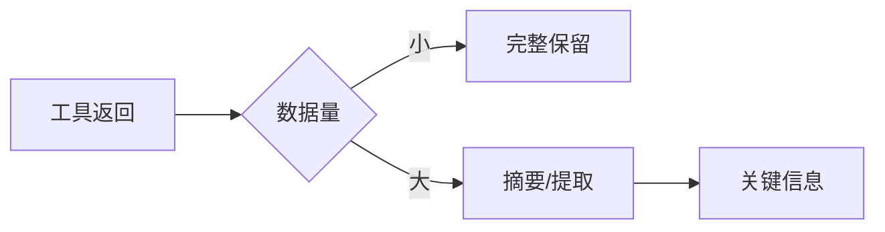
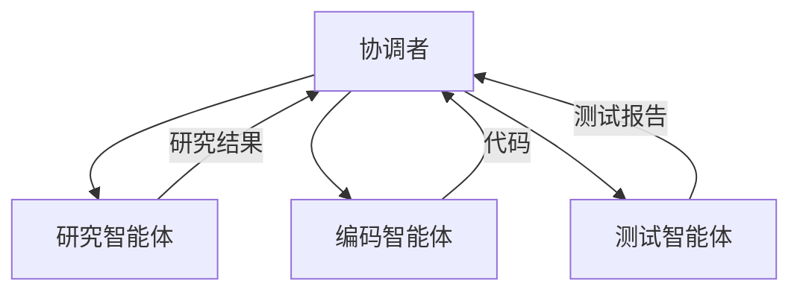
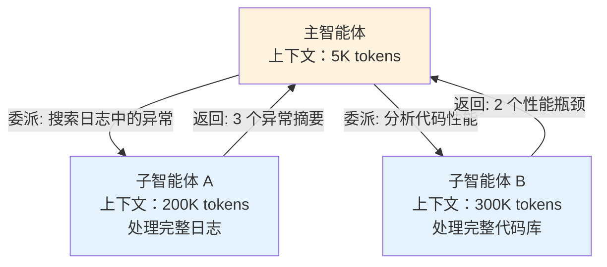
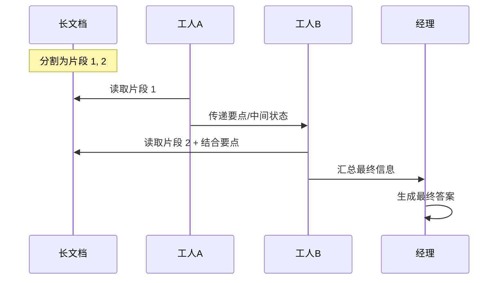
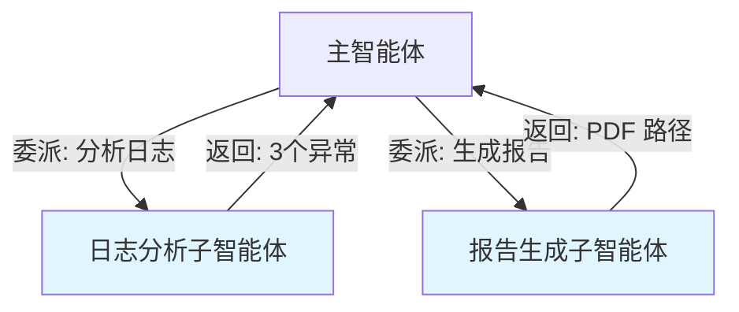
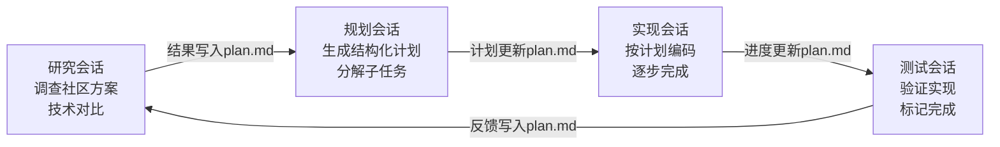
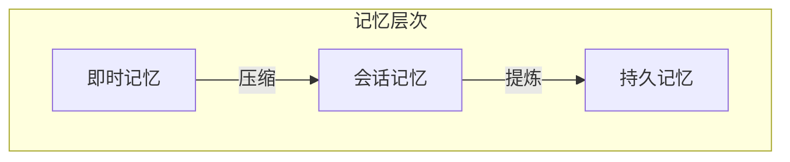

# 第九章 智能体上下文管理

**AI 智能体**（Agent）是能够自主规划和执行多步骤任务的系统。与简单的问答不同，智能体需要在较长时间跨度内持续工作，这对上下文管理提出了更高要求。

本章将探讨智能体架构中的上下文角色、单智能体和多智能体的上下文管理策略，以及智能体的记忆与学习机制。

## 1. 智能体架构与上下文

> 💡 关于智能体的完整介绍，请参阅《智能体 AI 权威指南》。

### 1.1 智能体的核心特征

**AI 智能体** 是一个能够感知环境、做出决策并采取行动以实现特定目标的自主系统。与单次对话的 LLM 应用相比，智能体的关键差异在于：

- **自主规划**：不是被动响应，而是独立拆解任务并制定执行策略
- **工具协作**：通过 API、文件系统、代码执行等工具扩展能力，与现实世界交互
- **循环执行**：遵循“思考-行动-观察-反思”的循环，而不是单轮交互
- **上下文依赖**：每一步的决策都依赖于之前的执行历史和当前的环境状态

### 1.2 为什么上下文是智能体的核心

不同于一次性的聊天应用，智能体需要在 **多步执行** 中维持一致的上下文：

- 早期步骤的决策可能影响后期的规划
- 环境观察需要被记录和回顾
- 执行历史需要被压缩或组织，否则会快速耗尽 token 预算
- 不同的任务阶段需要不同的上下文关注点

一个 agent 失败往往不是因为推理能力不足，而是因为：
1. 关键信息在执行过程中被遗忘（上下文管理不当）
2. 环境状态变化，但智能体仍基于过时信息决策（上下文不同步）
3. 历史积累过长，导致 token 溢出（上下文压缩不当）

这正是本章的关注点。

### 1.3 智能体上下文的特殊挑战

相较于普通对话，智能体面临更复杂的上下文管理问题：

| 挑战 | 表现 | 影响 |
|------|------|------|
| **长程依赖** | 任务跨越数十甚至数百轮交互 | 早期信息容易被遗忘或稀释 |
| **状态爆炸** | 需要同时追踪任务进度、环境变化、中间结果 | 上下文快速膨胀，token 成本急剧上升 |
| **信息来源多元** | 用户输入、工具返回、环境观察、历史回顾 | 难以区分哪些信息是关键、哪些是噪声 |
| **动态重规划** | 计划可能需要实时调整 | 需要频繁修改上下文，但频繁修改易引入错误 |
| **可观性不足** | Agent 的思考过程被隐藏在 token 流中 | 难以调试失败原因，难以审计决策过程 |

这些挑战无法通过简单的“塞更多信息进去”来解决。需要 **结构化的上下文工程策略**。

### 1.4 智能体上下文的典型层级

为了应对上述挑战，上下文应该按以下原则分层：

```text
┌─────────────────────────────────────────────┐
│  系统层：Agent 定义、角色、约束             │  稳定，不变
├─────────────────────────────────────────────┤
│  任务层：当前目标、成功标准、约束           │  任务级，变化频率低
├─────────────────────────────────────────────┤
│  状态层：进度、环境观察、动态计划           │  需要频繁更新
├─────────────────────────────────────────────┤
│  历史层：执行轨迹、观察、决策（可压缩）    │  可能很长，需要管理
├─────────────────────────────────────────────┤
│  交互层：当前步骤、即时输入、观察           │  最新、最关键
└─────────────────────────────────────────────┘
```

**分层的好处**：
- 不同层级有不同的更新频率，避免无谓的重复
- 支持选择性压缩：可以摘要历史层，但保留状态层的完整性
- 清晰的结构让模型快速定位需要的信息

### 1.5 ReAct 与 Reflexion 的上下文含义

智能体运行模式决定了上下文的结构和更新策略。两种常见模式各有对上下文的不同需求：

**ReAct 循环**（思考 → 行动 → 观察）：
- 上下文需要记录每一步的 Thought、Action、Observation
- 频繁更新，但每个循环的上下文是相对独立的
- 适合需要即时反馈调整的任务

**Reflexion 模式**（执行 → 整体反思 → 调整策略）：
- 上下文需要累积所有执行轨迹，然后进行整体评估
- 更新频率低，但单次更新涉及更多信息
- 适合需要从失败中学习的复杂任务

**上下文工程的启示**：选择错误的运行模式，会导致上下文管理困难。例如，如果用 Reflexion 模式处理频繁交互的任务，历史会快速膨胀而无法得到及时压缩。

### 1.6 上下文管理的核心原则

**1. 信息分层**

按重要性和时效性分层管理。智能体的上下文应该有清晰的层级结构：系统级定义最稳定、任务级目标相对固定、状态信息需要持续更新、历史记录可以压缩或淘汰。不同层级采用不同的保留策略和更新频率。

**2. 动态更新**

随任务进展更新状态信息。智能体执行过程中，环境在变化、进度在推进、计划可能调整。上下文必须反映这些变化，否则智能体将基于过时信息做出错误决策。建立清晰的状态更新机制，确保关键信息及时同步。

**3. 选择性保留**

保留关键信息，压缩或丢弃冗余。长程任务会产生大量历史信息，不可能全部保留。需要智能地选择：哪些是关键结论必须保留？哪些是过程细节可以压缩？哪些是临时信息可以丢弃？这需要根据任务类型设计合理的淘汰策略。

**4. 结构化组织**

清晰的结构便于规划和推理。杂乱的上下文会让模型迷失方向。使用明确的标签和分区组织不同类型的信息，让模型能快速定位需要的内容。良好的结构不仅提高效率，也减少模型的理解错误。

### 1.7 上下文工程的四大模式

上下文工程（Context Engineering）不仅仅是编写提示词，而是对智能体“操作系统”的 RAM（上下文窗口）进行系统化管理。我们可以将上下文管理策略归纳为四大模式，分别对应本书的第二部分核心章节：

1.  **Write Context（写入/卸载）**：对应 第四章 写入策略。
2.  **Select Context（选择/加载）**：对应 第五章 选择策略。
3.  **Compress Context（压缩/提炼）**：对应 第六章 压缩策略。
4.  **Isolate Context（隔离/分治）**：对应 第七章 隔离策略。

在智能体架构中，这四大模式协同工作以解决不同的挑战：

| 模式 | 解决的核心问题 | 典型技术 |
| :--- | :--- | :--- |
| **Write** | 窗口容量限制 | Scratchpad，外部笔记，长期记忆 |
| **Select** | 注意力分散 / 成本 | Just-in-time 检索，RAG |
| **Compress** | 历史累积过长 | Compaction，摘要，轨迹剪枝 |
| **Isolate** | 任务复杂度过高 | 多智能体协作，VM 环境卸载 |

### 1.8 生产级智能体的上下文架构（案例思路）

在一些生产级 Agent 的实现中，上述上下文模式会被系统性地组合使用，以构建更健壮的“环境上下文”架构。

（关于相关案例思路的进一步讨论，请参见 13.5 案例分析：全自主智能体架构（示意））

### 1.9 Agent Harness 的上下文平面（Context-Plane）

**背景与动机**

在大规模生产环境中，智能体系统需要在多个不同的“平面”上进行协调工作。Agent Harness 框架将这些关注点分解为五个正交的平面，其中 **上下文平面（Context-Plane）** 是最核心的一个。

**上下文平面的四个维度**

上下文平面负责管理智能体执行过程中的以下四个关键维度：

1. **会话状态（Session State）**
   - 追踪智能体执行到哪一步
   - 记录每一步的中间结果和输出
   - 在中断后支持从检查点恢复
   - 例如：OpenAI Responses 的 Step 管理，Azure Durable Functions 的 Orchestration State

2. **记忆管理（Memory）**
   - 短期工作记忆：当前对话和任务的即时信息
   - 长期持久记忆：跨会话的用户偏好、领域知识、解决方案模板
   - 记忆的检索、更新和遗忘机制
   - 例如：Google Agent Runtime（原 Vertex Agent Engine）的 Agent Platform Sessions（会话内存）vs Memory Bank（跨会话记忆）

3. **上下文压缩与整理（Compaction/Summarization）**
   - 历史信息的摘要与精简
   - 对话历史的管理和截断
   - 多轮交互中的冗余消除
   - 支持 Token 成本优化和性能提升

4. **工件日志（Artifact Logs）**
   - 每一步的执行结果都被记录为有类型的工件
   - 支持完整的追踪（Tracing）和重放（Replay）
   - 便于调试、审计和合规验证
   - 与可观测性系统（如 OpenTelemetry）集成

**上下文平面的核心原则**

```text
推理过程 → 有类型的行动 → 可重放的工件 → 可观测的追踪
```

上下文平面的本质是将智能体的“思维过程”转化为“可审计、可验证、可恢复”的执行流。每一个推理步骤都对应一个明确的行动（Action），该行动产生的结果都被记录为结构化的工件，这些工件通过追踪系统被串联起来，形成完整的执行链路。

**设计示例**

```text
┌─ 智能体执行 ──────────────────────────────────────┐
│                                                      │
│  [思考] → [决策工具] → [执行工具] → [观察结果]     │
│    ↓         ↓           ↓          ↓               │
│  会话状态   行动日志    结果工件    状态更新       │
│                                                      │
└──────────────────────────────────────────────────────┘
           ↓
    [上下文平面]
    ├─ Session State: 步骤3/10, 等待工具返回
    ├─ Memory: 提取相关历史经验
    ├─ Compaction: 压缩早期步骤历史
    └─ Artifacts: 记录所有工具调用和结果
           ↓
    [可观测性系统]
    ├─ Traces: 完整的执行链
    ├─ Metrics: 延迟、成本、成功率
    └─ Logs: 结构化的事件日志
```

**与其他平面的关系**

Agent Harness 框架的五个平面协同工作：

| 平面 | 职责 | 与上下文平面的关系 |
|------|------|----------|
| **工具平面** | 外部工具和 API 的集成 | 工具执行的输出被记录为工件 |
| **上下文平面** | 状态、记忆、压缩、工件 | 核心，管理所有中间信息 |
| **推理平面** | LLM 的推理策略和提示优化 | 消费上下文平面的记忆和状态 |
| **协调平面** | 多智能体间的通信和同步 | 通过工件交换信息，状态同步 |
| **可观测平面** | 追踪、监控、告警 | 消费上下文平面的工件和日志 |

这种分离使得各平面可以独立演进，同时保持良好的接口契约。

## 2. 单智能体上下文管理

### 2.1 工作记忆管理

智能体的工作记忆对应上下文窗口，需要精心管理：

#### 信息优先级

不同信息的保留优先级不同：

| 优先级 | 内容类型 | 处理方式 |
|--------|----------|----------|
| 最高 | 任务目标、核心约束 | 始终保留 |
| 高 | 当前计划、即时状态 | 完整保留 |
| 中 | 近期执行记录 | 根据窗口压缩 |
| 低 | 早期历史 | 摘要或外存 |

#### 滑动窗口策略

只保留最近 N 步的详细记录：

```text
[步骤 1-10: 摘要]
[步骤 11: 完整记录]
[步骤 12: 完整记录]
[步骤 13: 完整记录] ← 当前
```

### 2.1.1 Agent SDK 的上下文收集方式

在实际的智能体框架（如 Anthropic 的 Agent SDK）中，智能体收集上下文的方式可以归纳为 **四种主要策略**。理解这些策略及其权衡有助于优化单智能体的上下文管理。

#### 1. 主动搜索（Agentic Search）

智能体使用 bash 命令（`grep`、`find`、`head`、`tail` 等）在文件系统中主动探索和检索相关内容。

**特点**：
- **优势**：准确性高、灵活性强、不依赖预构建的索引
- **劣势**：延迟较高（需要多次 API 调用）、可能探索低效
- **适用场景**：对动态信息、边界情况的精确查询

**示例流程**：
```text
问题：「代码中哪些地方处理了错误日志？」

智能体执行：
1. grep -r "error_log" /src --include="*.py"  (找出包含关键词的文件)
2. 浏览找到的 3 个文件
3. 使用 grep -n "error_log" file.py 定位具体行号
4. 用 head -n 50 file.py | tail -n 20 查看关键部分

结果：精准获取所需上下文
```

#### 2. 语义搜索（Semantic Search）

使用向量嵌入技术检索内容。代码或文档先被分块、向量化，然后根据语义相似度排序。

**特点**：
- **优势**：速度快（一次调用）、概念性查询能力强
- **劣势**：精度依赖于分块策略和嵌入模型、需要维护索引
- **适用场景**：概念级别的查询，如「找出所有关于用户认证的代码」

**权衡建议**：
- 从 **agentic search 开始**，只在需要更快响应时才加入 semantic search
- 两种方式可以 **互补**：agentic search 精准验证，semantic search 快速初筛

#### 3. 子智能体（Subagents）

为特定的查询任务创建专用的子智能体，让其独立探索，只返回摘要结果。

**特点**：
- **优势**：上下文隔离、并行处理多个查询、子智能体可专业化
- **劣势**：增加系统复杂度、有额外延迟
- **适用场景**：需要深度探索大量信息的任务

**示例**：
```text
主智能体：「分析这个代码库的性能瓶颈」

触发两个子智能体并行：
- 子智能体 A：探索所有使用数据库的代码路径
  返回：「发现 3 个 N+1 查询问题」(而非全部代码细节)

- 子智能体 B：分析内存使用模式
  返回：「内存泄漏点在缓存模块」(而非完整内存跟踪)

主智能体接收两个摘要，综合分析，保持上下文清晰
```

#### 4. 压缩（Compaction）

当上下文接近限制时，自动对之前的消息历史进行高保真压缩，参见 10.8。

**特点**：
- **用途**：处理超长任务时的上下文溢出
- **机制**：模型总结关键信息、保留关键代码、丢弃冗余工具输出

**四种方式的对比和选择**：

| 方式 | 实时性 | 精准度 | 成本 | 最佳用途 |
|------|--------|--------|------|---------|
| Agentic Search | 中 | 高 | 低 | 精确查询、验证假设 |
| Semantic Search | 高 | 中 | 中 | 快速初筛、概念搜索 |
| Subagents | 低 | 高 | 中 | 并行深度探索 |
| Compaction | - | 中 | 低 | 长时间任务的上下文管理 |

**推荐策略**：
- 优先从 agentic search 开始，评估是否满足需求
- 只在性能不足时加入 semantic search（如需要大量前期检索）
- 在需要并行处理和隔离上下文时使用 subagents
- 为长时间任务预留 compaction 机制

### 2.2 状态追踪

#### 显式状态块

在上下文中维护显式的状态信息：

```xml
<current_state>
  <task>处理用户退款请求</task>
  <progress>3/5 步骤已完成</progress>
  <current_step>等待退款审批</current_step>
  <blockers>需要财务部门确认</blockers>
</current_state>
```

#### 状态更新

每次行动后更新状态：

```python
def update_state(old_state, action, result):
    new_state = old_state.copy()
    new_state["last_action"] = action
    new_state["last_result"] = result
    new_state["step_count"] += 1

    if is_completed(result):
        new_state["progress"] = update_progress(...)

    return new_state
```

### 2.3 计划管理

#### 计划表示

在上下文中维护当前计划：

```xml
<plan>
  <step n="1" status="completed">收集用户信息</step>
  <step n="2" status="completed">验证订单状态</step>
  <step n="3" status="in_progress">发起退款申请</step>
  <step n="4" status="pending">通知用户结果</step>
</plan>
```

#### 计划调整

根据执行情况调整计划：

```text
Thought: 原计划第3步失败，需要调整策略
Revised Plan:
- 3a. 联系客服主管获取特殊授权
- 3b. 重新发起退款申请
- 4. 通知用户结果
```

### 2.4 执行历史压缩

长时间运行的智能体需要压缩执行历史：

#### 成功操作压缩

成功的操作可以简化记录：

```text
原始：
Action: search_products(query="蓝牙耳机", limit=10)
Observation: [10个产品的详细信息...]

压缩后：
✓ 搜索"蓝牙耳机"，找到10个结果
```

#### 失败操作保留

失败的操作保留更多细节，防止重复错误：

```text
✗ 尝试 API_A 失败（超时）- 应使用 API_B
```

### 2.5 工具结果处理

工具返回大量数据时的处理：



图 9-1：工具结果处理策略

### 2.6 上下文窗口监控

监控上下文使用情况：

```python
def check_context_usage(context):
    token_count = count_tokens(context)
    if token_count > 0.8 * MAX_CONTEXT:
        trigger_compression()
    if token_count > 0.95 * MAX_CONTEXT:
        trigger_emergency_cleanup()
```

### 2.7 错误恢复

当智能体遇到问题时的上下文处理：

1. **记录错误状态**：保存错误详情
2. **回溯检查点**：可能需要回到之前的状态
3. **调整计划**：更新后续步骤
4. **清理无效信息**：移除失败操作的中间结果

### 2.8 持久化执行与工件管理

对于长时间运行或涉及多个工具调用的智能体任务，建议采用 **持久化执行模式**（Durable Execution Pattern）：

#### 工件（Artifact）的定义与作用

工件是指智能体执行过程中的每一步输出，包括：

| 类型 | 内容 | 用途 |
|------|------|------|
| 步骤输出 | 工具调用结果、模型生成文本 | 下一步的输入 |
| 执行状态 | 当前进度、已完成步骤、待执行计划 | 中断恢复 |
| 决策记录 | 为什么选择某个操作 | 事后分析和审计 |
| 元数据 | 时间戳、成本、延迟等 | 性能监控 |

#### 检查点与恢复机制

```python
def step_1_query_analysis(user_input):
    """第1步：查询分析，并保存工件"""
    parsed = parse_query(user_input)
    checkpoint_save({
        "step": 1,
        "status": "completed",
        "output": parsed,
        "timestamp": now()
    })
    return parsed

def step_2_knowledge_retrieval(parsed_query):
    """第2步：知识检索，依赖第1步的工件"""
    try:
        docs = retrieve_documents(parsed_query)
        checkpoint_save({
            "step": 2,
            "status": "completed",
            "output": docs
        })
        return docs
    except Exception as e:
        # 记录失败，可以从这里重试
        checkpoint_save({
            "step": 2,
            "status": "failed",
            "error": str(e)
        })
        raise

# 恢复执行：检查最后成功的检查点
last_checkpoint = load_last_checkpoint()
if last_checkpoint["step"] >= 2:
    # 从第2步的输出继续
    docs = last_checkpoint["output"]
else:
    # 从第1步重新开始
    parsed = step_1_query_analysis(user_input)
    docs = step_2_knowledge_retrieval(parsed)
```

#### 工件的持久化与可重放

- **存储位置**：使用结构化存储（如 PostgreSQL + JSON 字段，或 DuckDB）而不是仅日志文件
- **版本控制**：为每个工件记录版本号和生成时间，便于追溯
- **内容哈希**：记录工件内容的 SHA-256 哈希值，确保重放时的一致性验证
- **重放验证**：在恢复后，可选择性地重新执行某些步骤，对比输出与保存的工件是否一致，检测非确定性问题

这种模式特别适合以下场景：

- **长流程任务**：需要调用多个工具、跨越数十个推理步骤的任务
- **高成本操作**：避免因中间失败而重复执行昂贵的 LLM 调用或 API 请求
- **合规要求**：需要完整的审计日志和决策追踪
- **多智能体协作**：下游智能体需要准确了解上游智能体的执行结果和状态

### 2.9 计划文件作为上下文持久化机制

在 AI 辅助开发实践中，plan.md 文件已成为跨会话上下文持久化的核心机制。与工件管理（9.2.8）不同，计划文件不仅记录执行状态，更承载了问题定义、方案选择和验收标准等高层语义信息。

#### 跨会话上下文恢复

当会话上下文丢失（如窗口关闭或上下文膨胀触发压缩）时，计划文件充当检查点。开启新会话时只需指向已有计划文件，即可从断点继续，无需重建上下文。这本质上是将上下文从易失的会话内存“外化”到持久化的文件系统。

#### 结构化设计

高质量的计划文件包含问题描述、方案选择、需修改的文件列表、验收标准（复选框形式）等结构化字段。这种结构化设计确保了上下文在跨会话传递时保持完整性和可操作性。

#### 与检查点机制的关系

计划文件与 9.2.8 节讨论的检查点机制形成互补——检查点保存执行状态的快照，计划文件则保存任务的完整语义描述。两者结合实现了从“做什么”到“做到哪了”的完整恢复。

#### 计划文件结构示例

```markdown
# 任务计划：功能 X 实现

## 问题描述

用户需要在仪表板中添加实时数据更新功能。当数据源更新时，前端自动刷新，无需手动重载。

## 方案选择

选择 WebSocket 方案而非轮询，理由：
- 减少服务器负载
- 降低延迟至 200ms 以内
- 便于扩展多个数据源

## 需修改的文件

- [ ] backend/websocket_handler.py - 实现 WebSocket 服务
- [ ] frontend/dashboard.js - 连接 WebSocket 并更新 UI
- [ ] tests/test_websocket.py - 单元测试
- [ ] docs/ARCHITECTURE.md - 更新文档

## 验收标准

- [ ] WebSocket 连接成功建立
- [ ] 数据更新延迟 < 500ms
- [ ] 单个连接内存占用 < 10MB
- [ ] 全部单元测试通过
- [ ] 文档已更新

## 执行进度

### 已完成

- 完成 backend/websocket_handler.py 的基础实现
- 编写了连接管理和消息广播的核心逻辑

### 当前进行

- 正在调试 frontend/dashboard.js 的数据绑定

### 待执行

- 完成单元测试编写
- 性能测试和优化
- 文档更新
```

计划文件通过这种结构化形式，让中断的工作能够快速恢复，新会话的 AI 无需重新理解整个项目背景，只需对准计划继续推进。

## 3. 多智能体上下文传递

### 3.1 多智能体系统概述

**多智能体系统** 由多个协作的智能体组成，每个智能体专注于特定能力或任务。



图 9-2：多智能体协作架构

### 3.1.1 Agent SDK 中的子智能体上下文隔离

在 Agent SDK 中，子智能体（Subagents）不仅是任务分解工具，更重要的是 **上下文隔离机制**。每个子智能体有自己的独立上下文窗口，只有必要的信息会返回给父智能体。

**上下文隔离的核心机制**：



**关键特性**：

1. **独立上下文窗口**：子智能体的处理细节完全隔离，不污染主智能体的上下文
2. **摘要返回**：子智能体只返回精选的摘要结果（通常 1-2K tokens），而非全部处理过程
3. **并行执行**：多个子智能体可以同时工作，加快总体速度

**隔离如何降低上下文成本**：

示例：处理一份 100 页的 PDF 文档

```text
❌ 不使用子智能体（单智能体方案）：
- 将 100 页 PDF 加载到上下文：50K tokens
- 模型逐页分析：产生大量中间输出（日志、临时结论等）
- 总体上下文膨胀至 150K+ tokens
- 注意力分散，效率低

✅ 使用子智能体（隔离方案）：
- 主智能体：定义分析任务（1K tokens）
- 启动子智能体：处理 100 页 PDF（子智能体内部上下文 50K）
- 子智能体内部进行详细分析、生成中间输出（子智能体内消化）
- 子智能体返回摘要：5 个关键发现（返回 2K tokens）
- 主智能体接收摘要：总上下文仅 3K tokens
- 成本：原方案 150K vs 隔离方案 50K + 2K + 1K = 53K（下降约 65%）
```

**何时创建子智能体**：

创建子智能体有成本（额外的 API 调用、延迟增加），只在以下情况使用：

| 场景 | 决策 | 理由 |
|------|------|------|
| 并行处理多个独立任务 | ✅ 创建 | 充分利用并行加速 |
| 子任务产生大量中间数据 | ✅ 创建 | 隔离数据污染 |
| 需要专用的工具或提示词 | ✅ 创建 | 专业化处理 |
| 简单的信息查询 | ❌ 不需要 | 延迟得不偿失 |
| 顺序依赖的任务 | ❌ 不需要 | 并行无益 |

### 3.2 上下文传递的挑战

- **上下文膨胀**：如果每个智能体都接收完整上下文，Token 消耗会快速增长
- **信息干扰**：无关智能体的信息可能干扰当前智能体的判断
- **一致性维护**：多个智能体需要对共享信息有一致的理解

### 3.3 上下文共享机制

#### 1. 共享黑板模式

引入一个共享记忆库或“黑板”，所有智能体都可以读取和写入这个公共空间。

- **工作方式**：智能体 A 将发现的证据写入黑板，智能体 B 读取并推理。
- **一致性**：通过访问控制和版本管理维护一致性。
- **优点**：信息同步快，避免点对点通信的复杂度。
- **缺点**：需要处理并发写入冲突。

#### 2. 通信对话模式

智能体之间直接发送消息交换上下文。

- **工作方式**：智能体 A 发送消息给智能体 B：“请根据这些数据生成图表”。
- **优点**：明确的责任链，点对点隔离。
- **缺点**：通信链路可能复杂，长链条导致信息衰减。

### 3.4 高级协作模式：链式智能体协作

一种常见的思路是使用“链式协作”（Chain-of-Agents, CoA）：让多个智能体以“接力”的方式分段阅读和处理长上下文任务。



图 9-3：链式智能体协作

这种模式让上下文在智能体链中逐步传递和累积，而非一次性填满单个智能体的窗口，有效突破了单模型上下文限制。

### 3.5 上下文传递策略

#### 最小必要原则

只传递智能体完成任务所需的最小信息：

```python
def prepare_context_for_agent(agent, task, full_context):
    relevant = extract_relevant(full_context, agent.expertise)
    task_specific = format_task(task)
    tools = agent.available_tools

    return compose(relevant, task_specific, tools)
```

#### 角色专属记忆

为每个智能体维护结构化的角色专属记忆。

- **私有记忆**：只保存与自身角色相关的对话和结论。
- **视角隔离**：智能体 A 看到的上下文强调数据分析视角，智能体 B 强调代码实现视角。
- **优势**：减少干扰，保持角色一致性。

#### 接口抽象

定义清晰的信息传递接口：

```jsonc
{
  "from": "researcher",
  "to": "coder",
  "message_type": "task_handoff",
  "content": {
    "summary": "用户需要一个日历功能",
    "requirements": ["添加事件", "提醒功能"],
    "constraints": ["使用 Python", "无需数据库"]
  }
}
```

### 3.6 共享状态管理

多智能体需要共享的状态：

```jsonc
{
  "global_state": {
    "task_id": "task_123",
    "overall_progress": "50%",
    "key_decisions": [...],
    "artifacts": [...],
    "blocking_issues": []
  }
}
```

### 3.7 调试与追踪

多智能体系统交互复杂，需要完善的追踪机制：

**1. 消息日志**

记录所有智能体间的通信。每一个消息的发送者、接收者、时间戳、内容类型和 Payload 都应被完整记录。这不仅用于排查错误，也是分析智能体协作模式和效率的重要数据源。

**2. 上下文快照**

关键节点的上下文状态。在任务的关键转折点（如子任务完成、决策变更时），保存各个智能体的上下文快照。这允许开发者“时光倒流”，查看系统在特定时刻的全局状态，复现 Bug。

**3. 决策追踪**

每个智能体的决策依据。智能体为什么采取这个行动？是基于哪条上下文信息？使用了哪个 Prompt？记录 ReAct 循环中的 “Thought” 过程，使智能体的行为透明可解释。

**4. 性能指标**

上下文大小、传递延迟。监控上下文在传递过程中的膨胀情况，以及智能体之间的通信延迟。通过可视化图表识别瓶颈：是某个智能体处理太慢，还是上下文过大导致传输耗时。

### 3.8 主流多智能体框架

现代多智能体开发通常基于成熟的框架：

| 框架 | 核心特点 | 适用场景 | 上下文管理 |
|------|----------|----------|------------|
| **LangGraph** | 基于图的控制流，强大的状态管理 | 企业级工作流 | 显式状态机，支持检查点 |
| **CrewAI** | 角色驱动，极易上手 | 快速原型，团队协作 | 角色专属记忆 |
| **AutoGen** | 对话驱动，代码执行能力强 | 复杂问题解决 | 会话历史管理 |
| **Swarm** | 轻量级，Handoff 模式 | 探索性实验 | 最小化手动管理 |

**选择建议**：
- 需要精细控制 → LangGraph
- 快速构建 → CrewAI
- 代码密集型任务 → AutoGen
- 简单探索 → Swarm

> 注：OpenAI Swarm 现已不再积极维护，仅作为教学参考；其生产级继任者是 OpenAI Agents SDK（2025 年 3 月发布，沿用 Handoff 模型并补充护栏、追踪、会话等能力）。

### 3.8.1 MCP 服务器与上下文开销优化

**Model Context Protocol (MCP)** 是一个标准化的协议，用于智能体与外部服务（如 Slack、GitHub、Asana 等）的集成。从上下文工程的角度，MCP 具有重要意义。

**MCP 的上下文优势**：

传统的智能体集成方式：
- 手动编写每个 API 集成代码
- 处理认证、错误处理、结果格式化等细节
- 这些细节会占用上下文空间，或增加工具定义的复杂度

MCP 方式：
- 预构建的 MCP 服务器可以封装服务侧 API 调用和常见认证适配，但受保护的 HTTP MCP 服务仍需按规范配置授权服务器发现、token 传递、scope 与权限边界
- 智能体只需调用高级工具（如 `search_slack_messages`、`get_asana_tasks`）
- 减少上下文中的工具定义和说明文本

**上下文成本对比**：

```text
❌ 手动集成（假设 10 个集成）：
- 每个 API 的认证逻辑：200-500 tokens
- 每个 API 的错误处理：200-300 tokens
- 每个 API 的结果解析：150-250 tokens
- 总计：4000-8000 tokens 仅用于集成代码和说明

✅ MCP 方式（同样 10 个集成）：
- MCP 服务器处理所有细节（不占用上下文）
- 工具定义：`tool: search_slack_messages`, `tool: get_asana_tasks` 等
- 总计：500-1000 tokens 仅用于工具列表

示例结果：工具定义与认证细节越标准化，上下文开销越低；具体节省比例需按工具 schema 长度实测
```

**MCP 在多智能体中的应用**：

当构建多智能体系统时，MCP 服务器特别有价值：

```text
场景：构建一个团队协作系统

主智能体
├─ 能力 1：规划任务（不需要外部API）
├─ 能力 2：分配给 Asana（通过 MCP）
├─ 能力 3：发送 Slack 通知（通过 MCP）
└─ 能力 4：查阅 GitHub（通过 MCP）

无需在上下文中重复编写这些集成代码。
每个集成通过标准的 MCP 工具接口暴露。

子智能体
├─ 搜索子智能体：可访问 Google Drive MCP（搜索文档）
├─ 代码子智能体：可访问 GitHub MCP（分析代码）
└─ 研究子智能体：可访问 Web Search MCP（网络搜索）

每个子智能体只加载相关的 MCP 工具，进一步细化上下文。
```

**MCP 生态的发展意义**：

从上下文工程的角度，MCP 服务器的标准化是一个重要的基础设施发展：

1. **可重用性**：一个 MCP 服务器可以被多个智能体和框架使用
2. **上下文节省**：集成逻辑不再占用智能体的上下文
3. **快速扩展**：添加新的 API 集成无需修改智能体提示词
4. **社区驱动**：GitHub 上的 MCP 服务器生态不断增长，降低自定义成本

**使用 MCP 的最佳实践**：

1. **优先使用现有的 MCP 服务器**，而非自定义集成
2. **为 MCP 工具提供清晰的描述**，即使在 MCP 层已定义
3. **监控 MCP 工具的实际使用**，移除不必要的工具以保持上下文精简
4. **在多智能体中分配工具**，让每个智能体只访问相关的 MCP 工具

### 3.9 子智能体架构与上下文隔离

子智能体架构不仅是任务分解工具，更是 **上下文管理策略**。

#### 上下文隔离的价值

**问题**：单一智能体执行复杂任务时，上下文会被多个子任务的细节污染，导致：
- 上下文腐烂（Context Rot）
- 注意力分散
- 决策质量下降

**解决方案**：将独立子任务委派给专用子智能体，每个子智能体有自己的上下文窗口。



图 9-4：子智能体隔离架构

**关键洞察**：主智能体只接收子任务的 **摘要结果**，而非全部细节。

#### 多智能体研究系统案例（示意）

一种常见的多智能体研究系统会包含主智能体与若干专用子智能体，以展示这一架构的实际应用：

**系统组成**：
- **主智能体（Lead）**：规划研究方向、综合结果、撰写最终报告
- **搜索子智能体**：执行网络搜索，返回关键发现
- **阅读子智能体**：深度阅读文档，提取相关段落

**上下文隔离效果**：
- 搜索智能体处理数百个搜索结果 → 只返回 10 个最相关的
- 阅读智能体处理 100 页 PDF → 只返回 3 段关键内容
- 主智能体上下文保持清晰，专注于高层决策

**数据对比（示意）**：

| 场景 | 单智能体上下文 | 多智能体架构 |
|------|---------------|-------------|
| 研究 10 个网站 | 更易膨胀 | 更易控制 |
| 分析 5 份报告 | 更易膨胀 | 更易控制 |
| 综合生成报告 | 上下文溢出风险 | 轻松完成 |

#### 何时使用子智能体

- **并行探索**：需要同时调研多个方向
- **专门技能**：特定子任务需要专用工具或提示词
- **上下文隔离**：子任务产生大量中间数据
- **风险控制**：子任务失败不应影响主任务

> **重要提示**：子智能体增加了系统复杂度和延迟。只在上下文污染成为问题时使用，避免过度设计。

### 3.10 并行智能体的上下文编排实践

在 Claude Code 等 AI 编程工具中，开发者通过同时运行 4-6 个并行会话来最大化效率。每个会话对应一个独立的智能体实例，拥有各自隔离的上下文窗口。

#### 上下文隔离策略

并行会话的上下文天然隔离——一个在执行代码实现、一个在做技术调研、一个在规划新特性、一个在修复 Bug。这种隔离避免了单一超长会话中多任务上下文相互干扰的问题。

相比于在单一会话中顺序处理多个任务，并行智能体架构带来了质的改变：

| 维度 | 单会话顺序处理 | 并行智能体架构 |
|------|--------------|--------------|
| 上下文膨胀 | 任务堆积，急速增长 | 各会话独立控制 |
| 注意力分散 | 需要在多任务间频繁切换 | 每个智能体专注单个目标 |
| 恢复成本 | 一处中断影响全局 | 中断隔离在单个会话 |
| 总耗时 | 顺序累积 | 并行大幅缩短 |

#### 共享计划文件作为协调机制

多个并行会话通过文件系统中的计划文件（plan.md）进行协调。一个会话的调研结果写入计划文件，另一个会话基于该计划执行实现。这是 9.3.3 节讨论的共享黑板模式（Blackboard Pattern）在实际开发工作流中的自然应用。

例如：
- **调研会话**：调查最新的框架最佳实践，将发现整理到 plan.md 的“技术选型”部分
- **规划会话**：读取调研成果，生成详细的实现计划
- **实现会话**：按照计划逐步编码
- **测试会话**：验证实现是否符合验收标准

#### Research → Plan → Build 循环

高效的并行协作遵循一个明确的工作流循环：



这个循环展示了多智能体上下文传递的完整链路：从开放式调研收集事实，到结构化计划明确方向，再到具体实现和验证。

#### 多源上下文融合

实际工作流中，计划文件通常融合了多个上下文源——社区调研数据、代码库结构、历史战略决策、会议记录等。这种上下文的累积和融合使得每一份新计划都比上一份更丰富。

例如，一份成熟的 plan.md 可能包含：

```markdown
# plan.md - 性能优化项目

## 调研会话的贡献

研究了 4 篇最新论文，对比了 3 个开源方案...
（来自 Research 会话）

## 规划会话的贡献

基于调研成果，选择方案 A，理由：...
分解为 5 个子任务：Task 1, Task 2, ...
（来自 Planning 会话）

## 实现会话的贡献

已完成 Task 1, Task 2，遇到 Bug X，已解决...
当前进度：60%
（来自 Build 会话）

## 历史决策

2026-03-15：选择了 Python 而非 Go（参考会议记录）
2026-03-18：改用异步架构以提升吞吐量（参考代码审查）
```

这对应了本章讨论的上下文共享机制在真实场景中的表现——通过结构化的中间文件，让多个智能体的贡献有机融合，形成逐步精化的任务描述和执行状态，最大化了并行工作的协同效率。

## 4. 智能体记忆与学习

### 4.0 状态（State）与记忆（Memory）的语义区分

在智能体工程实践中，需要清晰区分 **状态** 和 **记忆** 两个概念，尽管它们都涉及信息存储：

**状态（State）**

状态是工作流执行的可持久化进度记录。它包括：
- 当前执行步骤的输出（Step Outputs）
- 工作流的完成进度
- 中间计算结果与检查点（Checkpoints）
- 可被重放（Replay）和调试的执行轨迹

状态是 **面向计算过程** 的，主要目的是：
1. **可靠性**：在中断后能从检查点恢复，而不需要重新计算前面的步骤
2. **可观测性**：记录“系统做了什么”，便于调试和审计
3. **可重放性**：完整的输入和输出序列可以被重新执行，用于验证和测试

实现方式（如 OpenAI Responses、Azure State Persistence）通常将状态存储在专用的状态管理系统中，支持版本控制和原子性操作。

**记忆（Memory）**

记忆是为智能体学习和决策而保留的、经过精心整理的长期或短期的人类可理解的信息。包括：
- 用户偏好和背景知识
- 解决问题的经验教训
- 领域特定知识
- 对话摘要与关键决策点

记忆是 **面向推理和个性化** 的，主要目的是：
1. **个性化**：根据用户或领域的特征调整行为
2. **学习**：从过往经验中提取可复用的知识
3. **上下文连续性**：跨会话保持对话和交互的连贯性

实现方式（如 Google Agent Runtime 的 Sessions vs Memory Bank）将记忆存储在语义数据库或向量库中，支持检索和更新。

**两者在智能体中的配合**

状态保证了工作流的 **容错与可恢复性**，是工程健壮性的基础；记忆支撑了智能体的 **进化与个性化**，是智能体质量提升的动力。现代智能体平台（如 Azure Durable Functions 配合 Agent Memory）同时维护两个系统：状态管理器追踪执行进度，记忆管理器积累可复用知识。

### 4.1 智能体记忆的层次

智能体需要多层次的记忆系统：



图 9-5：智能体记忆层次

- **即时记忆**：当前任务的工作记忆，对应上下文窗口中的即时信息
- **会话记忆**：单次会话的完整历史，可压缩后保留要点
- **持久记忆**：跨会话保留的长期知识，存储在外部数据库中

### 4.2 记忆与状态信息类型

| 类型 | 示例 | 存储位置 |
|------|------|----------|
| 事实 | 用户偏好、配置 | 持久记忆 |
| 经验 | 成功/失败的操作 | 持久记忆 |
| 技能 | 学到的解决方案 | 持久记忆 |
| 执行状态 | 当前任务进度、待恢复检查点 | 会话状态或检查点存储 |
| 细节 | 操作的具体参数 | 即时记忆 |

### 4.3 记忆更新机制

#### 显式记忆

用户明确要求记住：
```text
用户：请记住我喜欢简洁的回答风格
智能体：好的，我已记录您的偏好。
```

#### 隐式记忆

从交互中自动学习：
```python
def analyze_interaction(history):
    patterns = extract_patterns(history)
    preferences = infer_preferences(history)
    corrections = find_corrections(history)

    update_memory(patterns, preferences, corrections)
```

#### 反思记忆模式

反思是将短期经历转化为长期乃至“智慧”的关键。基于 **Reflexion** 框架的自我改进循环：

1.  **Actor（执行者）**：尝试执行任务，生成轨迹。
2.  **Evaluator（评估者）**：评估执行结果的质量（如测试通过率、准确性）。
3.  **Self-Reflection（反思者）**：分析失败原因，生成“自我反思”，总结教训。
4.  **Memory（记忆）**：将反思结果存入长期记忆。

**示例循环**：
```text
--- 第一次尝试 ---
Actor: 尝试使用 requests 库抓取网页。
Evaluator: 失败，返回 403 Forbidden。
Self-Reflection: 目标网站有反爬策略，需要设置 User-Agent。

--- 第二次尝试 ---
Actor: (检索到上次的反思) 设置 User-Agent 伪装成浏览器重试。
Evaluator: 成功。
Memory Update: "抓取该网站时必须设置 User-Agent 头" -> 存入知识库。
```
这种机制让智能体不再重犯相同的错误。

### 4.4 从经验中学习

智能体可以从历史经验中学习：

#### 成功经验复用

```text
过去经验：处理类似问题时，方法 A 比方法 B 更有效

当前任务：遇到类似问题
决策：优先尝试方法 A
```

#### 失败经验规避

```text
过去经验：直接调用 API_X 会超时

当前任务：需要调用 API_X
决策：先检查连接状态，设置较长超时，或使用备用方案
```

### 4.5 知识积累

#### 领域知识

随着使用积累领域知识：

```text
初始：通用助手
↓ 多次医疗咨询后
积累：常见症状、推荐检查、就医建议
```

#### 用户知识

了解特定用户：

```text
用户画像：
- 技术背景：高级
- 沟通风格：喜欢详细解释
- 常见需求：代码审查、架构设计
```

### 4.6 记忆检索

在适当时机检索相关记忆：

```python
def retrieve_relevant_memory(current_context):
    # 1. 多路召回
    semantic_results = vector_search(current_context)  # 语义匹配
    keyword_results = keyword_search(current_context)  # 关键词匹配
    time_results = get_recent_ad_hoc(current_context)  # 时间相关

    # 2. 混合排序 (Retrieval Fusion)
    return reciprocal_rank_fusion([semantic_results, keyword_results, time_results])
```

**混合检索的核心：RRF (Reciprocal Rank Fusion)**

单一的检索方式往往有盲点（如向量搜索对专有名词不敏感），RRF 是一种无需训练的鲁棒排序算法，用于融合多个检索结果。

**算法原理**：
对于每一项文档 $d$，计算其融合得分：
$$ \text{Score}(d) = \sum_{r \in R} \frac{1}{k + \text{rank}(r, d)} $$
*   $R$：不同的检索器集合（如语义、关键词、时间）。
*   $rank(r, d)$：文档 $d$ 在检索器 $r$ 结果中的排名（1, 2, 3...）。
*   $k$：平滑常数（通常取 60），用于防止高排名文档主导分数。

**优势**：
*   **零样本**：不需要任何训练数据，直接利用排名信息。
*   **鲁棒性**：即使某个检索源效果很差，只要其他源可靠，最终结果依然准确。
*   **公平性**：平衡了不同检索源的得分尺度差异。

### 4.7 记忆管理挑战

- **容量管理**：记忆不能无限增长，需按重要性排序、定期清理过时信息、压缩低频信息
- **一致性维护**：记忆可能过时或矛盾，需要版本追踪、冲突检测、定期验证
- **隐私保护**：敏感信息需要保护，包括访问控制、数据加密、保留策略

### 4.8 全时异步主动调度

传统的智能体记忆检索往往是“被动阻断式”的：接收用户指令 -> 检索关联记忆 -> 组合上下文 -> LLM 生成。这会导致明显的延迟，特别是当需要跨多个会话、多个 Agent 去检索深层记忆时，首 Token 时延经常无法满足实时业务要求。

前沿的智能体记忆架构（如 MemOS 提出的 Memory Cube）引入了 **全时异步主动调度** 的核心机制：
1. **碎片时间利用**：将用户阅读答案、思考、输入（打字）的每一秒“空档时间”充分利用起来。
2. **主动行为预测**：系统在后台部署轻量级意图预测模型，预判 Agent 下一步可能需要的领域知识与偏好。
3. **状态“就绪（Ready）”**：在用户的查询真正触发前，系统已在后台并行地将各类记忆（文档、会话、偏好）抽取、组合并预热加载到高速缓存中。当 Prompt 最终到达时，所需的增强上下文便已如构建好的“魔方（Cube）”般瞬间就位，仅需几毫秒即可完成轻量读取。

这种将“单轮串行检索”拆解分解为“多轮全时异步预读”的调度架构，将是未来高性能 Agent 系统的标准动力引擎。

### 4.9 跨会话记忆持久化

对于需要跨越多个会话的长期任务，记忆持久化是关键。Claude Code 等生产级系统采用的最佳实践包括：

#### MEMORY.md 索引文件

维护一个结构化的 `MEMORY.md` 文件作为跨会话记忆的入口：

**容量与结构**：
- **大小限制**：最多 200 行或 25KB，确保可快速加载
- **每条记忆**：约 150 字符，包含标签和简要描述
- **四种记忆类型**：
  - **项目模式**（Project Patterns）：架构决策、代码风格、模块依赖关系
  - **用户偏好**（User Preferences）：代码格式、沟通风格、优先级偏好
  - **工具配置**（Tool Configs）：常用命令别名、环境变量名、密钥名称、权限范围和配置位置
  - **领域知识**（Domain Knowledge）：业务规则、技术约束、常见陷阱

记忆文件不得保存真实 secret、token、密码、Cookie、登录状态、生产连接串或个人敏感信息。需要记录凭据依赖时，只记录占位变量名、用途、权限范围和批准的配置位置。

**加载策略**：新会话启动时，系统首先加载 MEMORY.md，使用其内容增强初始上下文。由于体积小，加载时间 < 100ms，不会影响 TTFT。

#### 记忆“做梦”（Dreaming）机制

当跨越多个会话进行长期项目时，智能体定期执行“做梦”操作来清理和整合记忆：

**执行时机**：
- 项目完成时
- 每次大型功能交付后
- 当 MEMORY.md 接近容量上限时

**处理流程**：
1. **回顾**（Review）：扫描过去会话的日志，识别对当前项目的影响
2. **合并**（Merge）：当发现相同主题的多条旧记忆时，合并它们
3. **去重**（Deduplicate）：消除矛盾的记忆，保留最新信息
4. **时间归一化**：将相对日期（“上周”）转换为绝对日期（“2026-04-15”），便于长期追踪

**示例**：
```text
旧记忆 A（第 1 周）："用户倾向快速迭代，不需要长文档"
旧记忆 B（第 3 周）："用户要求详细的架构文档"
做梦结果：合并为"第 1 周偏好快速迭代，第 3 周转向重视架构文档，目前优先级：架构 > 速度"
```

**真实案例**：OpenAI 公开的 [Dreaming 记忆系统](https://openai.com/index/chatgpt-memory-dreaming/) 即是这一模式的产品级实现——用后台进程从历史会话中自动综合记忆，并随时间修订（例如行程结束后，把“将去新加坡”改写为“已于 2026 年 7 月去过新加坡”）。它从依赖显式的“保存的记忆”演进到后台自动综合，正对应本节 §9.4.3 的显式记忆 → 隐式记忆；完整出处见附录 D。

这类系统的关键不只是“记住更多”，而是把长期记忆质量拆成三个可评估目标：能把有用背景带到后续对话中，能持续遵循用户偏好与约束，能随时间更新过期事实。OpenAI 的公开说明还强调，后台综合出的记忆应通过可见摘要让用户审阅、补充、纠正或限制使用范围。换言之，长期记忆不应成为不可见黑箱；它需要可回看、可改写、可撤销，才能在个性化和用户控制之间取得平衡。

### 4.10 记忆与上下文的协作

记忆系统与上下文工程密切配合：

**1. 记忆提供长期信息**

将持久记忆检索到当前上下文。这是最基础的协作模式。当用户提问涉及到之前的会话或特定知识时，系统从记忆模块中检索相关内容，并将其注入到当前的 Prompt 上下文中。这解决了 LLM 固有上下文窗口有限和无记忆的问题。

**2. 上下文产生新记忆**

从当前交互中提取值得记忆的内容。在对话过程中，上下文窗口中不断产生新的信息。系统需要实时或定期分析上下文，提取出有价值的信息（如用户偏好、新事实、关键决策），并将其写入到记忆模块中。这是智能体不断学习和进化的基础。

**3. 记忆优化上下文**

了解用户后可以简化上下文。随着对用户记忆的加深，智能体可以更精准地理解用户意图，从而不需要在上下文中反复包含冗长的说明或背景信息。例如，如果记忆中已经知道用户是 Python 专家，上下文中的代码解释就可以更加精简，节省 Token 并提升沟通效率。

## 5. 智能体上下文管理的高级主题

本章节深化对智能体系统中复杂上下文问题的讨论，涵盖多智能体协作、长期任务、工具结果管理和记忆系统等实战主题。

### 5.1 多智能体上下文冲突与协调

#### 问题场景

在多智能体系统中，不同的智能体可能有以下冲突：

```text
场景：电商订单处理系统

Agent A (客服助手)的上下文：
  - 目标：快速回复用户
  - 信息：用户想要退货
  - 权限：只能提供政策信息

Agent B (订单管理)的上下文：
  - 目标：防止滥用退货
  - 信息：该用户频繁退货
  - 权限：可以拒绝退货请求

冲突：两个Agent看到的用户信息不同，可能导致：
  1. 重复处理（都试图处理同一个订单）
  2. 决策冲突（一个同意，一个拒绝）
  3. 循环依赖（Agent A 等待Agent B ，反之亦然）
```

#### 冲突解决机制

```python
from enum import Enum
from dataclasses import dataclass
from typing import Any, Dict, List, Set, Optional
from datetime import datetime
import threading

class ConflictType(Enum):
    """多智能体冲突类型"""
    RESOURCE_CONFLICT = "resource_conflict"      # 竞争同一资源
    DECISION_CONFLICT = "decision_conflict"      # 相互矛盾的决策
    INFORMATION_CONFLICT = "information_conflict" # 掌握的信息不一致
    AUTHORITY_CONFLICT = "authority_conflict"     # 权限冲突
    ORDERING_CONFLICT = "ordering_conflict"       # 执行顺序冲突

@dataclass
class ConflictEvent:
    """冲突事件记录"""
    agent_a: str
    agent_b: str
    conflict_type: ConflictType
    resource: str  # 冲突涉及的资源
    timestamp: str
    resolved: bool = False
    resolution_strategy: Optional[str] = None
    resolution_details: Optional[Dict] = None

class ContextConflictResolver:
    """
    多智能体上下文冲突解决器。
    使用仲裁、顺序化和优先级来解决冲突。
    """

    def __init__(self):
        self.conflict_log: List[ConflictEvent] = []
        self.resource_locks: Dict[str, str] = {}  # 资源ID -> 持有者Agent
        self.priority_matrix: Dict[str, int] = {}  # Agent -> 优先级（1-10）
        self.conflict_mutex = threading.Lock()

    def detect_potential_conflict(
        self,
        agent_a_context: Dict,
        agent_b_context: Dict,
        shared_resource: str
    ) -> Optional[ConflictType]:
        """
        检测两个Agent的上下文是否可能产生冲突。

        检查：
        1. 是否竞争同一资源
        2. 信息视图是否矛盾
        3. 目标是否相反
        """

        # 检查资源冲突
        resources_a = set(agent_a_context.get('accessible_resources', []))
        resources_b = set(agent_b_context.get('accessible_resources', []))

        if shared_resource in (resources_a & resources_b):
            # 都能访问这个资源，可能产生竞争
            return ConflictType.RESOURCE_CONFLICT

        # 检查信息冲突
        info_a = agent_a_context.get('knowledge_base', {})
        info_b = agent_b_context.get('knowledge_base', {})

        # 简化：检查关于同一对象的信息是否矛盾
        for key in set(info_a.keys()) & set(info_b.keys()):
            if info_a[key] != info_b[key]:
                return ConflictType.INFORMATION_CONFLICT

        # 检查权限冲突
        perms_a = set(agent_a_context.get('permissions', []))
        perms_b = set(agent_b_context.get('permissions', []))

        if 'can_approve' in perms_a and 'can_reject' in perms_b:
            # 一个能批准，一个能拒绝同一事项
            return ConflictType.AUTHORITY_CONFLICT

        return None

    def resolve_resource_conflict(
        self,
        agent_a: str,
        agent_b: str,
        resource: str
    ) -> str:
        """
        解决资源竞争冲突。
        使用加锁机制确保同时只有一个Agent访问。
        """

        with self.conflict_mutex:
            # 检查资源是否已被锁定
            if resource in self.resource_locks:
                current_holder = self.resource_locks[resource]
                if current_holder != agent_a and current_holder != agent_b:
                    # 资源被第三方持有
                    return f"WAITING"

            # 根据优先级分配资源
            priority_a = self.priority_matrix.get(agent_a, 5)
            priority_b = self.priority_matrix.get(agent_b, 5)

            if priority_a > priority_b:
                winner = agent_a
            elif priority_b > priority_a:
                winner = agent_b
            else:
                # 优先级相同，按时间顺序（先请求先得）
                winner = agent_a

            # 锁定资源
            self.resource_locks[resource] = winner

            # 记录冲突
            conflict = ConflictEvent(
                agent_a=agent_a,
                agent_b=agent_b,
                conflict_type=ConflictType.RESOURCE_CONFLICT,
                resource=resource,
                timestamp=datetime.now().isoformat(),
                resolved=True,
                resolution_strategy="priority_based_locking",
                resolution_details={'winner': winner, 'priority_a': priority_a, 'priority_b': priority_b}
            )

            self.conflict_log.append(conflict)

            return winner

    def resolve_information_conflict(
        self,
        agent_a: str,
        agent_b: str,
        attribute: str,
        value_a: Any,
        value_b: Any
    ) -> Any:
        """
        解决信息冲突。
        优先使用更新的或更权威的信息源。
        """

        # 策略1：时间戳（更新的信息优先）
        if hasattr(value_a, 'timestamp') and hasattr(value_b, 'timestamp'):
            newer = value_a if value_a.timestamp > value_b.timestamp else value_b
            return newer

        # 策略2：权威性（某些Agent对某些信息更权威）
        authority_a = self._get_authority_score(agent_a, attribute)
        authority_b = self._get_authority_score(agent_b, attribute)

        if authority_a > authority_b:
            return value_a
        elif authority_b > authority_a:
            return value_b

        # 策略3：共识（需要询问两个Agent，取一致的答案）
        # 这里简化为取value_a，实际应该是复杂的协商过程
        return value_a

    def synchronize_contexts(
        self,
        agents: List[str],
        shared_attributes: Dict[str, str]  # {属性名: 真实值}
    ) -> Dict[str, Dict]:
        """
        同步多个Agent的上下文到一致状态。

        当冲突无法自动解决时，需要显式同步。
        """

        synchronized_contexts = {}

        for agent in agents:
            # 为每个Agent准备同步后的上下文
            sync_context = {
                'agent': agent,
                'synchronized_attributes': shared_attributes.copy(),
                'last_sync_time': datetime.now().isoformat(),
            }

            synchronized_contexts[agent] = sync_context

        return synchronized_contexts

    def _get_authority_score(self, agent: str, attribute: str) -> float:
        """
        计算Agent对某个属性的权威性评分。
        0 - 1 之间，1表示完全权威。
        """
        # 这是一个简化的实现，实际应该基于：
        # - Agent的特化程度
        # - 过往准确性记录
        # - 数据源的可信度

        authority_matrix = {
            ('customer_service', 'customer_preference'): 0.9,
            ('customer_service', 'fraud_detection'): 0.3,
            ('fraud_detection', 'fraud_detection'): 0.95,
            ('fraud_detection', 'customer_preference'): 0.1,
        }

        return authority_matrix.get((agent, attribute), 0.5)
```

### 5.2 长期任务中的上下文漂移问题

#### 问题分析

在长期任务（如跨多天的项目管理或持续监控）中，上下文可能发生“漂移”：

```text
初始任务："为CEO准备季度业绩报告"

第 1 小时: 上下文精准，聚焦于财务数据收集
第 4 小时: 开始包含细枝末节（某个部门的招聘计划）
第 8 小时: 出现明显偏离（讨论员工食堂菜单）
第 16 小时: 完全偏离主题（生成无关的营销文案）

原因：
1. 每一轮交互都添加新信息，久而久之上下文变得嘈杂
2. 早期重要的约束条件逐渐被遗忘
3. 中间步骤的输出可能包含错误，这些错误被纳入后续上下文
4. Token预算压力导致关键信息被压缩或删除
```

#### 缓解策略

```python
from datetime import datetime, timedelta
from typing import Dict, List, Optional, Tuple
import json

class ContextDriftDetector:
    """检测和防止上下文漂移"""

    def __init__(self, drift_threshold: float = 0.3):
        """
        drift_threshold: 漂移程度的阈值
        - 0: 完全不漂移
        - 1: 完全漂移
        """
        self.drift_threshold = drift_threshold
        self.initial_goal: Optional[str] = None
        self.context_history: List[Dict] = []

    def set_initial_goal(self, goal: str) -> None:
        """设置任务初始目标"""
        self.initial_goal = goal

    def measure_context_drift(
        self,
        current_context: str,
        step_number: int
    ) -> Tuple[float, str]:
        """
        测量当前上下文与初始目标的偏离程度。

        使用简化的关键词匹配：
        - 提取初始目标的关键词
        - 计算当前上下文中这些关键词的覆盖率
        """

        if not self.initial_goal:
            return 0.0, "No initial goal set"

        initial_keywords = set(self.initial_goal.lower().split())
        current_keywords = set(current_context.lower().split())

        # 计算漂移度：初始关键词在当前上下文中的缺失比例
        missing_keywords = initial_keywords - current_keywords
        drift_score = len(missing_keywords) / max(len(initial_keywords), 1)

        # 记录历史
        self.context_history.append({
            'step': step_number,
            'drift_score': drift_score,
            'timestamp': datetime.now().isoformat(),
        })

        return drift_score, f"Drift score: {drift_score:.2f}"

    def detect_drift_alert(
        self,
        current_context: str,
        step_number: int
    ) -> Tuple[bool, Optional[str]]:
        """
        检测是否需要发出漂移告警。
        """

        drift_score, _ = self.measure_context_drift(current_context, step_number)

        if drift_score > self.drift_threshold:
            alert_msg = (
                f"Warning: Context drift detected at step {step_number}. "
                f"Drift score: {drift_score:.2f}. "
                f"Consider refocusing the context."
            )
            return True, alert_msg

        return False, None

    def get_drift_trend(self) -> Dict:
        """获取漂移的趋势"""

        if len(self.context_history) < 2:
            return {'trend': 'insufficient_data'}

        recent_drifts = [h['drift_score'] for h in self.context_history[-5:]]

        # 简单的趋势判断
        if all(d < 0.2 for d in recent_drifts):
            trend = 'stable'
        elif recent_drifts[-1] > recent_drifts[0]:
            trend = 'drifting'
        else:
            trend = 'improving'

        return {
            'trend': trend,
            'current_drift': recent_drifts[-1],
            'max_drift': max(recent_drifts),
            'avg_drift': sum(recent_drifts) / len(recent_drifts),
        }


class ContextRefocuser:
    """当检测到漂移时，重新聚焦上下文"""

    def __init__(self):
        self.refocus_history = []

    def refocus_context(
        self,
        original_goal: str,
        current_context: str,
        step_number: int
    ) -> str:
        """
        重新生成一个聚焦于原始目标的上下文。

        策略：
        1. 提取原始目标的关键信息
        2. 从当前上下文中保留相关部分
        3. 删除无关信息
        4. 添加进度检查点
        """

        refocused = f"""
【任务重新聚焦 - 第{step_number}步】

【原始目标】
{original_goal}

【当前进度检查点】
- 当前步骤: {step_number}
- 近期完成的关键任务: [待填充]
- 下一步目标: [待填充]

【相关上下文】（已过滤无关信息）
"""

        # 简化：保留前500个字符（实际应该更智能的过滤）
        relevant_context = current_context[:500]
        refocused += relevant_context

        refocused += """

【对齐检查】
请确认：
1. 你仍在追求上述原始目标吗？
2. 你做的每一步都在帮助实现这个目标吗？
3. 是否有信息偏离了主题线？
"""

        # 记录重新聚焦
        self.refocus_history.append({
            'step': step_number,
            'timestamp': datetime.now().isoformat(),
        })

        return refocused
```

### 5.3 工具调用结果的上下文管理策略

```python
# 场景：智能体需要调用多个工具

agents_task = """
任务：查找用户John Doe在2024 年 3 月的所有订单

步骤：
1. 调用 search_user API -> 返回用户ID: U12345
2. 调用 get_orders API(U12345, 2024-03) -> 返回订单列表
3. 对每个订单，调用 get_order_details API
4. 生成总结报告
"""

# 挑战：
# - 中间结果可能很大（如1000个订单的列表）
# - 如果全部纳入上下文，会导致Token爆炸
# - 但删除某些结果可能导致后续步骤失败
# - 需要智能的结果摘要和聚合
```

#### 解决方案

```python
from dataclasses import dataclass
from datetime import datetime
from enum import Enum
from typing import Any, Dict, List, Optional
import json

class ToolResultProcessingStrategy(Enum):
    """工具结果处理策略"""
    KEEP_ALL = "keep_all"                           # 保留所有结果
    SUMMARIZE = "summarize"                         # 摘要
    SAMPLE = "sample"                               # 采样
    AGGREGATE = "aggregate"                         # 聚合
    FILTER_BY_RELEVANCE = "filter_by_relevance"    # 按相关性过滤

@dataclass
class ToolResult:
    """工具调用结果"""
    tool_name: str
    parameters: Dict
    result: Any
    execution_time_ms: float
    success: bool
    error: Optional[str] = None
    timestamp: str = None

    def __post_init__(self):
        if not self.timestamp:
            self.timestamp = datetime.now().isoformat()

    def size_bytes(self) -> int:
        """估计结果的大小（字节）"""
        return len(json.dumps(self.result, default=str).encode())

class ToolResultContextManager:
    """管理工具结果在上下文中的大小和相关性"""

    def __init__(self, max_context_size_tokens: int = 4000):
        self.max_context_size_tokens = max_context_size_tokens
        self.tool_results: List[ToolResult] = []

    def process_tool_result(
        self,
        tool_result: ToolResult,
        strategy: ToolResultProcessingStrategy = ToolResultProcessingStrategy.SUMMARIZE,
        relevance_query: Optional[str] = None
    ) -> Dict:
        """
        处理工具结果，根据策略进行优化。
        """

        processed = {
            'tool_name': tool_result.tool_name,
            'original_size_bytes': tool_result.size_bytes(),
            'processed_size_bytes': 0,
            'strategy_used': strategy.value,
            'content': None,
        }

        if strategy == ToolResultProcessingStrategy.KEEP_ALL:
            processed['content'] = tool_result.result
            processed['processed_size_bytes'] = tool_result.size_bytes()

        elif strategy == ToolResultProcessingStrategy.SUMMARIZE:
            processed['content'] = self._summarize_result(tool_result.result)
            processed['processed_size_bytes'] = len(str(processed['content']).encode())

        elif strategy == ToolResultProcessingStrategy.SAMPLE:
            processed['content'] = self._sample_result(tool_result.result)
            processed['processed_size_bytes'] = len(str(processed['content']).encode())

        elif strategy == ToolResultProcessingStrategy.AGGREGATE:
            processed['content'] = self._aggregate_result(tool_result.result)
            processed['processed_size_bytes'] = len(str(processed['content']).encode())

        elif strategy == ToolResultProcessingStrategy.FILTER_BY_RELEVANCE:
            if relevance_query:
                processed['content'] = self._filter_by_relevance(
                    tool_result.result,
                    relevance_query
                )
            else:
                processed['content'] = tool_result.result

        # 计算压缩比
        if processed['original_size_bytes'] > 0:
            compression_ratio = (
                1 - processed['processed_size_bytes'] / processed['original_size_bytes']
            )
            processed['compression_ratio'] = compression_ratio

        self.tool_results.append(tool_result)

        return processed

    def _summarize_result(self, result: Any) -> Dict:
        """生成结果的摘要"""

        if isinstance(result, list):
            return {
                'type': 'list_summary',
                'total_count': len(result),
                'first_item': result[0] if result else None,
                'last_item': result[-1] if result else None,
                'sample_count': min(3, len(result)),
                'sample_items': result[:3],
            }
        elif isinstance(result, dict):
            return {
                'type': 'dict_summary',
                'keys': list(result.keys()),
                'value_types': {k: type(v).__name__ for k, v in result.items()},
            }
        else:
            return {'type': 'scalar', 'value': result}

    def _sample_result(self, result: Any, sample_size: int = 5) -> Any:
        """从结果中采样"""

        if isinstance(result, list):
            if len(result) <= sample_size:
                return result

            # 采样策略：头尾各取一些，中间均匀分布
            sampled = []
            sampled.append(result[0])  # 第一个

            if len(result) > 2:
                sampled.append(result[-1])  # 最后一个

            # 中间均匀分布
            if len(result) > sample_size:
                step = len(result) // (sample_size - 2)
                for i in range(1, len(result) - 1, step):
                    sampled.append(result[i])

            return sampled[:sample_size]

        return result

    def _aggregate_result(self, result: Any) -> Dict:
        """聚合结果统计信息"""

        if isinstance(result, list) and all(isinstance(item, (int, float)) for item in result):
            return {
                'type': 'numeric_aggregate',
                'count': len(result),
                'sum': sum(result),
                'mean': sum(result) / len(result) if result else 0,
                'min': min(result) if result else None,
                'max': max(result) if result else None,
            }

        elif isinstance(result, list) and all(isinstance(item, dict) for item in result):
            # 对于字典列表，汇总每个键的值
            aggregated = {}
            for key in result[0].keys() if result else []:
                values = [item[key] for item in result if key in item]

                if all(isinstance(v, (int, float)) for v in values):
                    aggregated[key] = {
                        'sum': sum(values),
                        'mean': sum(values) / len(values),
                        'count': len(values),
                    }
                else:
                    aggregated[key] = {
                        'unique_count': len(set(str(v) for v in values)),
                        'sample': str(values[0]) if values else None,
                    }

            return {'type': 'dict_list_aggregate', 'aggregates': aggregated}

        return {'type': 'non_aggregatable', 'message': 'Cannot aggregate this result type'}

    def _filter_by_relevance(self, result: Any, query: str) -> Any:
        """按相关性过滤结果"""

        if not isinstance(result, list):
            return result

        query_terms = set(query.lower().split())

        def relevance_score(item: Any) -> float:
            """计算项目与查询的相关性"""
            item_str = json.dumps(item, default=str).lower()
            matching_terms = sum(1 for term in query_terms if term in item_str)
            return matching_terms / len(query_terms) if query_terms else 0

        # 过滤：只保留相关性>0的项目
        filtered = [item for item in result if relevance_score(item) > 0]

        # 按相关性排序
        filtered.sort(key=relevance_score, reverse=True)

        return filtered

    def build_context_from_results(self) -> str:
        """从所有工具结果构建上下文"""

        context = "【工具执行结果】\n"

        current_size_tokens = 0

        for result in self.tool_results:
            result_text = f"\n【{result.tool_name}】\n"
            result_text += f"参数: {result.parameters}\n"
            result_text += f"结果: {str(result.result)[:200]}...\n"  # 限制长度
            result_text += f"执行时间: {result.execution_time_ms}ms\n"

            result_size_tokens = len(result_text) // 4

            if current_size_tokens + result_size_tokens <= self.max_context_size_tokens:
                context += result_text
                current_size_tokens += result_size_tokens
            else:
                break

        return context
```

### 5.4 智能体记忆的持久化与恢复

```python
import sqlite3
import json
import re
from datetime import datetime, timedelta
from pathlib import Path
from typing import Any, Dict, List, Optional

class AgentMemoryPersistence:
    """智能体记忆的持久化管理"""

    def __init__(self, db_path: str = "./agent_memory.db"):
        self.db_path = Path(db_path)
        self._init_db()

    def _init_db(self):
        """初始化数据库"""
        with sqlite3.connect(self.db_path) as conn:
            cursor = conn.cursor()

            # 创建记忆表
            cursor.execute("""
                CREATE TABLE IF NOT EXISTS memories (
                    id TEXT PRIMARY KEY,
                    agent_id TEXT NOT NULL,
                    content TEXT NOT NULL,
                    memory_type TEXT NOT NULL,
                    importance REAL,
                    created_at TEXT NOT NULL,
                    last_updated TEXT NOT NULL,
                    access_count INTEGER DEFAULT 0,
                    data_json TEXT
                )
            """)

            # 创建会话表
            cursor.execute("""
                CREATE TABLE IF NOT EXISTS sessions (
                    session_id TEXT PRIMARY KEY,
                    agent_id TEXT NOT NULL,
                    created_at TEXT NOT NULL,
                    ended_at TEXT,
                    context_size_tokens INTEGER,
                    final_status TEXT
                )
            """)

            conn.commit()

    def save_memory(
        self,
        agent_id: str,
        memory_id: str,
        content: str,
        memory_type: str,
        importance: float = 0.5,
        data: Optional[Dict[str, Any]] = None
    ) -> None:
        """保存单条记忆"""

        with sqlite3.connect(self.db_path) as conn:
            cursor = conn.cursor()

            data_json = json.dumps(data, ensure_ascii=False) if data else None

            cursor.execute("""
                INSERT OR REPLACE INTO memories
                (id, agent_id, content, memory_type, importance, created_at, last_updated, data_json)
                VALUES (?, ?, ?, ?, ?, ?, ?, ?)
            """, (
                memory_id,
                agent_id,
                content,
                memory_type,
                importance,
                datetime.now().isoformat(),
                datetime.now().isoformat(),
                data_json
            ))

            conn.commit()

    def load_memories(
        self,
        agent_id: str,
        memory_type: Optional[str] = None,
        min_importance: float = 0.0
    ) -> List[Dict]:
        """加载记忆"""

        with sqlite3.connect(self.db_path) as conn:
            cursor = conn.cursor()

            query = "SELECT * FROM memories WHERE agent_id = ? AND importance >= ?"
            params = [agent_id, min_importance]

            if memory_type:
                query += " AND memory_type = ?"
                params.append(memory_type)

            cursor.execute(query, params)
            rows = cursor.fetchall()

            memories = []
            for row in rows:
                memory = {
                    'id': row[0],
                    'agent_id': row[1],
                    'content': row[2],
                    'memory_type': row[3],
                    'importance': row[4],
                    'created_at': row[5],
                    'access_count': row[7],
                }

                if row[8]:  # JSON 扩展字段，禁止用 pickle 反序列化不可信记忆
                    try:
                        memory['data'] = json.loads(row[8])
                    except json.JSONDecodeError:
                        pass

                memories.append(memory)

            return memories

    def save_session_context(
        self,
        agent_id: str,
        session_id: str,
        context_snapshot: Dict
    ) -> None:
        """
        保存整个会话的上下文快照。
        用于长期任务的中断和恢复。
        """

        # 序列化快照
        snapshot_json = json.dumps(context_snapshot, default=str)

        with sqlite3.connect(self.db_path) as conn:
            cursor = conn.cursor()

            cursor.execute("""
                INSERT INTO sessions
                (session_id, agent_id, created_at, context_size_tokens, final_status)
                VALUES (?, ?, ?, ?, ?)
            """, (
                session_id,
                agent_id,
                datetime.now().isoformat(),
                len(snapshot_json) // 4,  # Token估计
                'in_progress'
            ))

            conn.commit()

            # 保存详细的上下文为文件（避免BLOB过大）
            safe_session_id = re.sub(r"[^A-Za-z0-9_.-]", "_", session_id)
            context_file = self.db_path.parent / f"context_{safe_session_id}.json"
            with open(context_file, 'w', encoding='utf-8') as f:
                f.write(snapshot_json)

    def load_session_context(self, session_id: str) -> Optional[Dict]:
        """加载保存的会话上下文"""

        safe_session_id = re.sub(r"[^A-Za-z0-9_.-]", "_", session_id)
        context_file = self.db_path.parent / f"context_{safe_session_id}.json"

        if context_file.exists():
            with open(context_file, 'r', encoding='utf-8') as f:
                return json.load(f)

        return None

    def cleanup_old_sessions(self, days_to_keep: int = 30) -> int:
        """清理过期的会话记录"""

        cutoff_date = (datetime.now() - timedelta(days=days_to_keep)).isoformat()

        with sqlite3.connect(self.db_path) as conn:
            cursor = conn.cursor()

            cursor.execute(
                "DELETE FROM sessions WHERE created_at < ? AND final_status = 'completed'",
                (cutoff_date,)
            )

            deleted_count = cursor.rowcount
            conn.commit()

            return deleted_count
```

### 5.5 智能体推理中的上下文工程视角

Wei 等人在 2026 年的综述 *Agentic Reasoning for Large Language Models*（arXiv: 2601.12538）中提出了智能体推理的三层分类体系：基础推理、自我进化推理和集体多智能体推理。每一层对上下文工程都提出了不同的需求。

#### 上下文内推理与训练后推理

论文区分了两种实现推理能力的路径，这一区分对上下文工程实践有直接影响：

- **上下文内推理**（In-Context Reasoning）：通过精心编排的提示词、工具描述和检索结果，在推理时激活模型的推理能力。ReAct、CoT、ToT 等技术均属此类。**上下文工程的核心价值正体现于此**——推理质量高度依赖上下文的信息密度、结构化程度和噪声水平。本书前面章节讨论的 写入、选择、压缩 和 隔离 四大策略，本质上都是为上下文内推理服务的。

- **训练后推理**（Post-Training Reasoning）：通过强化学习或监督微调将推理模式固化到模型权重中。这类推理对上下文的依赖相对较低，但仍需要高质量的上下文来触发正确的推理路径。

**工程启示**：对于同一个智能体系统，应根据任务特征混合使用两种路径——高频标准任务使用训练后推理以降低上下文工程复杂度；长尾复杂任务使用上下文内推理以保持灵活性。

#### 自我进化与上下文的动态演进

论文的“自我进化推理”层强调智能体通过反馈和记忆持续改进。从上下文工程角度看，这意味着上下文不再是静态的输入，而是一个随智能体经验积累而动态演进的系统：

1. **经验到上下文的转化**：成功的推理轨迹应被提炼为可复用的上下文模板（如 Few-Shot 示例），失败的轨迹则转化为约束规则注入系统提示词。这与 9.4 节 讨论的记忆机制形成闭环。

2. **上下文质量的反馈信号**：推理成功率本身就是衡量上下文质量的指标。当智能体在某类任务上频繁失败时，应触发上下文管道的自动审查——可能是检索召回率不足、压缩过度丢失了关键信息，或是工具描述不够精确。

#### 多智能体推理的上下文协调

论文将多智能体协作纳入“推理”范畴，认为协调本身是一种分布式推理过程。这与本节 9.5.1「多智能体上下文冲突与协调」讨论的冲突解决机制相呼应，并进一步引出：

- **共享上下文层**：参与协作推理的智能体需要一个共享的“事实基础”（Shared Grounding）。上下文工程的挑战在于——既要保证共享信息的一致性，又要为每个智能体保留其专属的角色上下文，防止角色混淆。

- **推理链的上下文开销**：多智能体推理中，每一轮协调都会产生新的中间状态需要注入上下文。随着推理轮次增加，上下文膨胀问题比单智能体场景更为严峻，第六章 讨论的压缩策略在此场景下尤为关键。

这一章节深化了对智能体系统中复杂上下文管理的理解，为生产环境中的多智能体协作提供了实用的解决方案。

### 5.6 案例研究：Claude Code 的上下文管理架构

Claude Code 是 Anthropic 官方的命令行工具，其公开文档展示了现代智能体系统中上下文工程的若干实践。以下分析只把公开文档明确描述的 CLAUDE.md、MCP、工具和记忆机制作为事实；涉及内部函数名、比例和成本数字的内容均为工程化推断，不代表官方实现细节。


图 9-6：Claude Code 上下文架构图

从工程视角看，Claude Code 的关键不是把所有信息一次性塞进上下文，而是把“可缓存前缀”“项目记忆层级”“按需工具细节”和“压缩恢复回路”拆成不同责任层。


一种可借鉴的系统提示词架构是模块化和可缓存性。可以把系统提示词分解为若干个可独立管理的片段，并用内部边界标记分为两部分：

- **静态部分**：包含通用的智能体行为准则、工具使用规范、安全边界等，这部分在整个组织内保持一致，可以跨会话复用。利用供应商提供的 prompt caching 机制，这部分的 cache 创建成本可被多个会话摊销。
- **动态部分**：包含用户特定的约束、会话参数、项目配置等。这部分不能缓存，但占比较小。

在自建系统中，可以把“不可缓存片段”封装成显式函数，并在代码审查中要求说明为什么必须破坏缓存。这样能迫使开发者意识到 cache read 与 cache write 的价格差异；具体倍率应按当前 Anthropic pricing page 和目标模型重算。

```python
# 伪代码：系统提示词架构
def build_system_prompt(user_context, session_config):
    static_part = SYSTEM_PROMPT_STATIC  # 可缓存的稳定前缀

    # 缓存标记
    prompt = static_part + "\n\n[SYSTEM_PROMPT_DYNAMIC_BOUNDARY]\n\n"

    # 动态部分，不缓存
    dynamic_part = assemble_dynamic_context(user_context, session_config)
    prompt += dynamic_part

    return prompt

def add_uncached_constraint(prompt, constraint):
    """添加会破坏缓存的内容"""
    DANGEROUS_uncachedSystemPromptSection()  # 显式警告
    return prompt + f"\nCRITICAL: {constraint}"
```

#### 上下文组装的两层策略

公开文档中的项目说明、记忆和工具机制可以抽象为两层上下文组装策略：

**第一层：系统上下文**
- 收集 Git 仓库状态（当前分支、未提交改动、最近提交信息）
- 提取仓库元数据（语言、框架、构建工具、依赖项）
- 扫描项目结构和关键文件清单

这一层的结果在每个会话内进行 memoize，避免重复收集同样的静态元数据。

**第二层：用户上下文**
- 发现并加载 CLAUDE.md 文件（见下文）
- 加载记忆文件和日期上下文
- 整合用户提供的额外信息

#### CLAUDE.md 文件的优先级链发现机制

Claude Code 文档显示，CLAUDE.md 相关说明支持组织级、用户级、项目级和本地级别的上下文管理：

1. **托管策略（Managed Policy）**：组织统一管理的指令
2. **用户级说明（~/.claude/CLAUDE.md）**：用户主目录下的个人默认上下文
3. **项目级说明**：项目根目录或 `.claude/` 目录下的 CLAUDE.md
4. **本地级说明（CLAUDE.local.md）**：不提交到版本库的本地上下文

加载时需要区分“策略优先级”和“拼接顺序”：官方文档说明 Claude Code 会沿目录树读取 CLAUDE.md / CLAUDE.local.md，并按从外层目录到当前工作目录的顺序拼接；同一目录中本地说明会追加在项目说明之后。也就是说，靠近启动目录的说明更晚进入上下文，但不应假设它们会像配置字典一样覆盖父级内容。

```python
# 伪代码：CLAUDE.md 发现优先级链
def discover_claude_md(start_path):
    priority_files = [
        ("managed", get_org_mdm_memory()),  # 最高优先级
        ("user", Path.home() / ".claude" / "CLAUDE.md"),
        ("project", find_in_git_tree([
            "CLAUDE.md",
            ".claude/CLAUDE.md",
            ".claude/rules/*.md"
        ])),
        ("local", Path.cwd() / "CLAUDE.local.md"),  # 最低优先级
    ]

    loaded_context = []
    # 拼接顺序与官方文档一致：managed → user → project → local，
    # 即越靠近启动目录的说明越晚进入上下文（出现在更后面）
    for level, path in priority_files:
        if path.exists():
            loaded_context.append(load_markdown(path))

    return "\n\n".join(loaded_context)
```

#### @include 指令与可组合上下文

Claude Code 支持在 CLAUDE.md 文件中使用 `@path/to/import` 形式组合多个外部文件，支持相对路径、绝对路径和用户主目录路径：

- `@path/to/file`：相对路径，相对于**包含该导入指令的文件**所在目录解析（而非项目根目录或工作目录）
- `@./relative`：同上，显式写出当前目录前缀
- `@~/home`：相对于用户主目录
- `@/absolute`：绝对路径

该机制通过维护一个“已处理文件追踪集合”（processed-file tracking set）和最大包含深度来防止循环包含。当处理导入指令时，系统会：

1. 解析目标文件路径
2. 检查该文件是否已在当前包含链中处理过
3. 如果是，抛出循环依赖错误；否则加载并递归处理
4. 将处理结果合并到当前上下文中

这种设计允许团队构建可复用的上下文库（如通用的编码标准、API 规范等），各项目通过轻量级的 @include 语句组合使用。

#### 令牌预算的精确管理

生产级智能体可以采用精确的令牌预算跟踪。对于并行工具调用（如同一步骤内多个文件操作），系统记录每个工具调用的标识，并在接收结果时根据实际消费的令牌调整预算。

**自动压缩阈值**应按模型窗口、估算误差、工具结果波动和成本预算配置，并保留足够安全余量，确保即使估计略有偏差也不会超出窗口限制。

系统可以实现一个**断路器（circuit breaker）机制**：当连续压缩失败超过预算时（通常表明上下文中存在不可压缩的大型工具结果），系统停止重试，转而采用更激进的策略（如删除较早的工具结果）。这样做的目的是避免每次失败都再次发送完整上下文，造成成本意外放大。

#### 延迟工具加载（Deferred Tool Loading）

为了节省系统提示词中的令牌开销，Claude Code 文档描述了 MCP Tool Search 和 `alwaysLoad` 等机制：常用工具可以预先加载，不常用工具则通过搜索或按需展开减少上下文占用。

例如，代码分析工具可以在初始上下文中只保留短描述，当用户请求代码分析时再加载其完整的参数定义和用法示例。具体节省比例取决于工具数量、schema 大小和触发频率，需要通过线上 token 指标验证。

这类优化体现了现代智能体系统的一个重要方向：把能力、上下文成本和工具可见性作为同一个工程问题来管理，而不是把所有说明和工具 schema 一次性塞进提示词。
