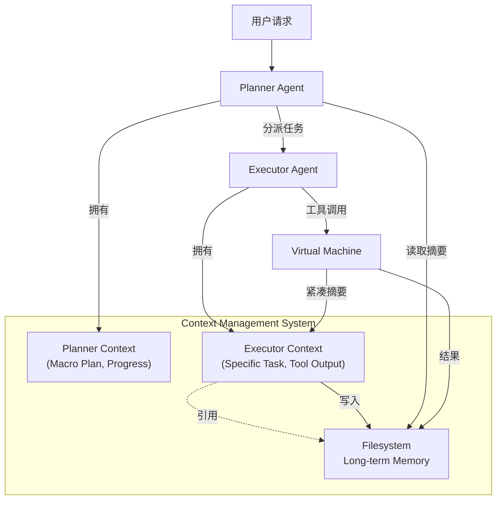

# 第十三章 行业应用与架构案例

上下文工程在垂直领域的应用往往需要结合具体的行业知识（Domain Knowledge）。本章前四节精选医疗、金融、法律、教育四个典型行业的实战案例，最后再补充一个跨行业的全自主智能体架构示意，展示如何将上下文工程策略与行业需求、系统形态深度融合。

## 1. 医疗：电子病历问答系统

### 1.1 场景背景

医生在诊疗过程中，需要快速从患者厚厚的历史病历中查阅既往史、用药情况和检查报告。传统的关键词搜索难以处理“患者最近一次血糖异常是什么时候？”这类语义查询。

### 1.2 上下文设计挑战

1.  **准确性要求极高**：医疗场景容错率极低，绝对不能出现幻觉。
2.  **术语复杂**：包含大量缩写、同义词和专业术语。
3.  **时序敏感**：病情的演变与时间高度相关，必须严格区分“现在”和“过去”。

### 1.3 解决方案

#### 结构化病历重组（写入策略）

原始病历通常是非结构化的文本。在写入向量库之前，先进行结构化处理：

```json
{
  "date": "2025-10-12",
  "type": "检查报告",
  "content": "空腹血糖 7.8 mmol/L",
  "entities": ["空腹血糖", "7.8"],
  "standardized_code": "GLU"
}
```

**关键点**：引入医学知识图谱（KG），将自然语言映射到标准术语代码（如 ICD-10, LOINC）。

#### 混合检索策略（选择策略）

采用 **关键词检索 + 向量检索 + SQL 查询** 的三路召回：

*   **关键词**：精确匹配药物名（“二甲双胍”）。
*   **向量**：匹配语义描述（“降糖药”）。
*   **SQL**：处理时间查询（“最近三个月” -> `date > NOW() - 90d`）。

#### 说明书式上下文（隔离策略）

System Prompt 采用严格的“说明书”风格：

```markdown
你是一个严肃的医疗助手。遵循以下原则：
1. 只能依据 <context> 标签中的内容回答。
2. 如果上下文中没有提及，必须回答"未在病历中找到相关记录"，严禁编造。
3. 引用每一条结论的来源（如：[2025-10-12 门诊记录]）。
```

### 1.4 效果评估

通过构建覆盖典型问答场景的黄金数据集，对比优化前后效果（示意口径）：

*   **准确性与一致性**：相较基线有明显提升。
*   **幻觉风险**：在“仅依据病历回答”的约束下显著降低。

## 2. 金融：风控知识库构建

### 2.1 场景背景

金融机构需要对企业客户进行尽职调查（Due Diligence）。分析师需要综合查看新闻、财报、法律诉讼、股权结构等多源异构数据，识别潜在风险。

### 2.2 上下文设计挑战

1.  **多源异构**：数据包含 PDF 表格、新闻网页、股权关系图。
2.  **时效性**：昨天的安全企业今天可能就爆雷，Context 必须包含最新信息。
3.  **冲突消解**：不同来源的信息可能矛盾（如财报与新闻报道不一致）。

### 2.3 解决方案

#### 多模态上下文解析

*   **PDF 解析**：使用专门的 Parser 提取财报中的表格，转化为 Markdown 格式，保留行列表头结构。
*   **图片 OCR**：提取扫描件中的文字。

#### 动态知识切片

根据风险维度将知识库切分为不同“切片”：

*   `Slice_Legal`: 诉讼、仲裁记录。
*   `Slice_Financial`: 财务报表、审计报告。
*   `Slice_News`: 舆情新闻。

当 Agent 分析“财务风险”时，优先加载 `Slice_Financial` 和 `Slice_News`，减少无关噪音。

#### 矛盾仲裁机制

在 System Prompt 中植入仲裁逻辑：

```markdown
当发现数据冲突时：
1. 优先采信官方披露文件（如审计报告）。
2. 其次采信主流媒体报道。
3. 列出冲突点，提示分析师注意。
```

### 2.4 效果

系统能够自动生成尽调初稿，显著缩短分析师的资料整理与初稿撰写时间，并能及时提示隐藏在海量新闻中的关联风险。

## 3. 法律：合同审查智能体

### 3.1 场景背景

法务部门每天需要审查大量商业合同，检查是否包含高风险条款（如无限连带责任、不合理的管辖地）。

### 3.2 上下文设计挑战

1.  **超长文本**：合同动辄几十页，甚至上百页。
2.  **逻辑依赖**：条款之间存在引用关系（“见第 5.1 条”），切片容易打断逻辑。
3.  **严谨推理**：需要进行复杂的逻辑判断，而非简单的文本匹配。

### 3.3 解决方案

#### 条款级切片

不按字符数切分，而是按合同条款结构切分。保留条款编号（Article 1.2）作为元数据。

#### 引用展开

在预处理阶段，识别文本中的引用关系。如果第 10 条引用了第 5 条，将第 5 条的摘要附在第 10 条的 Chunk 中，使每个 Chunk 逻辑自洽。

#### 思维链上下文引导

在 Prompt 中提供审查清单（Checklist）和推理范例：

```markdown
审查目标：寻找是否有"单方面解约权"条款。
思考步骤：
1. 遍历所有包含"解除"、"终止"关键词的条款。
2. 分析触发条件是双方协商还是单方主张。
3. 若为单方，是否仅限于违约情况？若无条件单方解约，标记为高风险。
```

### 3.4 效果

在教学示例中，智能体适合承担初筛和证据整理：按预设风险清单定位条款、标注引用位置、提示需要律师复核的交叉条款。真实覆盖率必须基于具体法域、合同类型、风险 taxonomy、黄金标注和人工复核结果评估，不能把示例结果当成法律意见或效果承诺。

## 4. 教育：个性化学习助手

### 4.1 场景背景

为每个学生提供 24/7 的 AI 辅导老师，不仅能解答错题，还能根据学生的掌握程度推荐练习，制定学习计划。

### 4.2 上下文设计挑战

1.  **长期记忆**：需要记住学生整个学期的学习轨迹。
2.  **个性化适应**：对基础差的学生解释得更详细，对优等生则点到为止。
3.  **知识追踪**：需要维护一个动态的“知识状态模型”。

### 4.3 解决方案

#### 动态用户画像

在 Context 头部始终维持一个压缩的画像：

```markdown
[Student Profile]
- Grade: 5
- Strong Subjects: Math (Geometry)
- Weak Subjects: Math (Algebra), English
- Current Learning Style: Visual learner (prefers diagrams)
```

#### 知识点掌握度矩阵

后台维护一个 JSON 结构的掌握度矩阵：

```jsonc
{
  "linear_equation": 0.3, // 掌握度低
  "triangle_area": 0.9    // 掌握度高
}
```

当学生提问 “一元一次方程” 时，系统读取到 mastery=0.3，自动在 Context 中注入更基础的引导性提示（Scaffolding），分步解释；而针对三角形面积问题，则直接给出进阶挑战。

#### 错题本

专门维护一个“错题本” Context。在复习模式下，优先检索之前的错题作为上下文，要求学生举一反三。

### 4.4 效果

实现了更接近“因材施教”的交互体验。学生参与度与薄弱知识点的练习效率通常会得到改善；具体效果取决于课程设计、题库质量与评测口径。

## 5. 案例分析：全自主智能体架构（示意）

本节以“通用全自主智能体”的架构思路为例，说明在长程任务中如何通过上下文工程策略应对上下文窗口有限、Token 成本与记忆连续性等挑战。

### 5.1 核心挑战

在构建全自主智能体时，团队通常会面临三个主要挑战：

1.  **上下文爆炸 (Context Explosion)**：长时间任务会产生海量的工具调用日志、网页内容和代码文件，迅速耗尽上下文窗口（即使上下文很长，塞满后的推理成本也可能无法接受）。
2.  **注意力稀释 (Attention Dilution)**：随着上下文长度增加，噪声、冲突证据和位置偏置的暴露面扩大，模型对关键指令和证据的利用可能变得不稳定。
3.  **成本与延迟 (Cost & Latency)**：每次全量输入历史记录进行推理，不仅昂贵，而且首字延迟 (TTFT) 极高，严重影响用户体验。

### 5.2 解决方案：三位一体的上下文策略

一种常见的组合拳策略可以总结为 ROI 模型：Reduction（缩减）、Offloading（卸载）和 Isolation（隔离）。

#### 1. 上下文缩减

系统需要克制地使用 Context Window，将 Token 视为昂贵的稀缺资源。

-   **双重工具结果 (Dual-form Tool Results)**：
    *   对于 `browse` 或 `read_file` 等产生大量数据的工具，系统将 **完整内容** 存储在沙箱文件系统中，只向 Context Window 返回一个 **紧凑的摘要对象**（包含 URL、标题、摘要和文件路径引用）。
    *   只有当 Agent 明确表示需要查看某段具体细节时，才会通过 `read_file_chunk` 等工具按需加载。

-   **轨迹压缩 (Trajectory Compaction)**：
    *   不仅是对结果压缩，对交互历史也进行压缩。当一轮对话结束或任务告一段落，系统会自动将之前的 Thought-Action-Observation 链条压缩为结构化的 `StepSummary`。
    *   例如，将多轮的“尝试调试-失败-再尝试-成功”过程，压缩为一条结构化记录，保留关键结论与后续行动建议。

#### 2. 上下文卸载

系统将“记忆”的职责从 LLM 的 Context 转移到外部环境（Environment）。

-   **文件系统即记忆 (Filesystem as Memory)**：
    *   智能体运行在一个可持久化的执行环境中。它生成的代码、下载的资料、整理的笔记，都直接保存在文件系统中。
    *   Context Window 中只需要保留“索引”（即文件路径）。只要文件在磁盘上，Agent 就认为自己“记得”这件事，需要时用工具去查。这模仿了人类的工作方式——我们不需要背诵整本书，只需要知道书架在哪。

-   **状态持久化**：
    *   Agent 的状态不仅存在于对话历史中，更存在于它改变的环境中（安装的包、修改的配置、创建的文件夹）。这种环境副作用（Side Effects）构成了隐式的、无限的上下文。

#### 3. 上下文隔离

为了防止不同子任务之间的干扰，系统会采用严格的隔离机制。

-   **Planner-Executor 架构**：
    *   **Planner** 负责高层规划，它的上下文包含用户意图和宏观进度，但不包含具体的代码实现细节或网页爬取日志。
    *   **Executor** 负责具体执行，它被唤起时是一个全新的、干净的上下文环境，只接收 Planner 传来的明确指令和必要的背景资料。这一方面节省了 Token，另一方面避免了 Executor 被之前的无关历史干扰。

-   **子智能体沙箱**：
    *   不同的子任务（如“撰写文档”和“编写代码”）可以由不同的子智能体并行执行，互不干扰。它们通过共享的文件系统交换成果，而不是通过共享巨大的 Context Window。

### 5.3 架构图示



图 13-1：全自主智能体内存架构示意图

### 5.4 给开发者的启示

这类案例说明，优秀的上下文工程不仅仅是写好 Prompt，更重要的是 **设计好系统架构**。

1.  **不要把 Context Window 当作数据库**：它是 CPU 的 L1/L2 缓存，昂贵且易失。真正的数据库应该是文件系统或向量库。
2.  **拥抱环境**：给 Agent 一个可以交互、持久化的 OS 环境，比单纯增加 Context 长度更有效。
3.  **分而治之**：通过 Agent 拆分来物理隔离上下文，是解决“迷失在中间”问题的最彻底方法。
