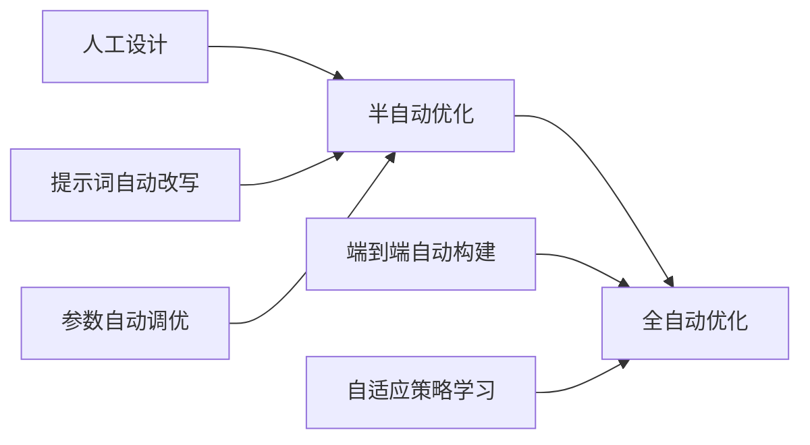

# 第十五章 未来展望与发展趋势

作为本书的最后一章，我们将放眼未来，探讨上下文工程的发展方向、行业趋势、面临的挑战与机遇，并为读者提供成为上下文工程专家的建议。

## 1. 上下文工程的技术演进

### 1.1 历史回顾

上下文工程的演进与大模型发展紧密相关：

| 阶段 | 时期 | 特点 | 主要技术 |
|------|------|------|----------|
| 萌芽期 | 2020-2022 | 提示词工程兴起 | Few-Shot, CoT |
| 成长期 | 2023-2026 | RAG 技术成熟与普及 | 向量检索，分块优化，Graph RAG |
| 爆发期 | 近年及未来 | 上下文操作系统化 | Context OS，通用记忆层，自动优化 |

### 1.2 核心演进方向

#### 1. 上下文优先级调度系统

未来的上下文管理将越来越像 **操作系统内核** 的资源调度器。

- **资源**：有限的 Token 窗口
- **进程**：不同的任务和信息流
- **调度算法**：根据信息的重要性（Priority）、时效性（Recency）和任务相关性（Relevance）计算分数。
- **机制**：动态地将低分信息“换出”（Swap Out）到外部存储，将高分信息“调入”（Page In）到上下文窗口。

#### 2. 通用记忆抽象层与可移植经验资产

打破“应用孤岛”，建立跨任务、跨会话的通用记忆标准，并催生全新的“记忆体”生态。

- **记忆即服务 (Memory-as-a-Service)**：定义记忆读写、更新的标准化 API 与服务协议，开发者只需关心业务，即可获得完整的云端记忆管理与协同推理服务。
- **抽象混合存储**：记忆不再是简单的文本片段，而是向量、图谱和结构化数据的低延迟混合体。
- **可移植经验资产 (Memory Apps/Asset)**：未来，用户经验和企业业务逻辑可能从零散笔记演进为可迁移、可审计、可撤销的经验资产。它们能在不同智能体系统之间复用，但前提是解决来源证明、权限边界、隐私保护和错误记忆回滚。

#### 3. 上下文优化器

引入 **自动优化闭环**，将上下文管理变为一个可学习的问题。

- **损失函数**：定义“上下文质量损失”，包含生成准确率、Token 消耗、响应延迟等指标。
- **优化过程**：使用强化学习或梯度下降思想，自动搜索最优的分块大小、检索阈值和排序策略。
- **结果**：不再依赖人工拍脑袋定参数，而是数据驱动的自动调优。

### 1.3 检索技术的智能化

从简单向量搜索到智能检索：
- **多模态检索**：图文音视频的统一语义空间
- **推理式检索**：在检索过程中进行多跳推理 (Graph RAG)
- **主动检索**：模型在生成过程中主动发起检索请求

### 1.4 与模型能力的协同进化

上下文工程与模型能力相互促进：

模型能力越强，上下文工程的作用越重要——因为需要更复杂的信息管理来发挥这些能力。未来的 AI 系统将是 **强模型核心 + 强上下文外脑** 的结合体。

## 2. 行业应用趋势

上下文工程正在各行业深度渗透，从最初的技术实验走向规模化商业应用。本节分析主要行业的应用趋势和特点。

### 2.1 垂直领域深化

不同行业对上下文工程有不同的需求特点：

| 行业 | 典型应用场景 | 采用程度（示意） | 核心挑战 |
|------|--------------|---------------|----------|
| 金融 | 投研分析、智能客服、风控 | 高 | 合规要求高、时效性强 |
| 医疗 | 辅助诊断、知识查询、病历分析 | 中 | 责任边界、错误容忍度低 |
| 法律 | 案例检索、文书生成、合同审查 | 中-高 | 司法解释、法规更新 |
| 教育 | 个性化辅导、作业批改 | 中 | 知识体系构建、个性化 |
| 软件开发 | 代码助手、文档生成、调试 | 高 | 大规模代码库、安全 |
| 客服 | 智能问答、工单处理 | 高 | 准确率、用户体验 |

*注：上表为趋势示意，具体采用率随地区、企业规模与统计口径差异很大。*

#### 监管新动态：2025-2026

随着应用深入，各国监管政策正从“原则倡议”走向更细化的合规要求：
- 不同地区对高风险 AI 系统的评估、审计与数据治理要求存在差异。
- 对知识库数据来源、更新流程与污染防护的要求在加强。
- 隐私保护与最小化数据留存依然是常见监管关注点。

#### 金融行业案例

某投资银行的研究助手系统：
- **上下文架构**：实时市场数据 + 研报知识库 + 合规约束
- **技术要点**：时效性检索（分钟级更新）、来源追溯、审计日志
- **效果（常见观察）**：研究员效率与报告生成速度通常会提升，具体幅度取决于数据质量与流程集成程度。

#### 医疗健康案例

某三甲医院的临床决策支持系统：
- **上下文架构**：患者病历 + 医学知识库 + 用药指南
- **技术要点**：隐私保护（数据脱敏）、严格的回答边界、多重验证
- **效果（常见观察）**：可提升资料检索与决策支持效率；临床结论需严格遵循医疗合规与责任边界。

#### 法律服务案例

某律所的合同审查助手：
- **上下文架构**：合同文本 + 法规库 + 案例库 + 审查标准
- **技术要点**：Graph RAG 关联法规和案例、条款级别的精准定位
- **效果（常见观察）**：可缩短合同初筛时间并提升风险点覆盖，但最终结论仍需法务复核。

### 2.2 企业应用成熟

企业级应用对上下文工程提出了更高要求：

**与企业知识库深度集成**
- 接入内部文档系统、Wiki、知识库
- 权限与现有 IAM 系统打通
- 增量更新而非全量重建

**严格的安全和权限控制**
- 基于角色的上下文访问控制
- 敏感信息自动脱敏
- 传输和存储加密

**可审计和可追溯要求**
- 完整的上下文构建日志
- 答案来源可追溯
- 支持合规审计

**成本效益考量**
- 部门级别的成本核算
- ROI 量化评估
- 持续的成本优化

### 2.3 人工智能原生应用

新一代 AI 原生应用从设计之初就将上下文工程作为核心：

**上下文驱动的产品设计**
- 不再是“功能 + AI 辅助”，而是“AI 原生 + 功能支撑”
- 上下文管理作为核心能力而非附加特性
- 用户交互围绕上下文积累展开

**记忆和个性化作为核心功能**
- 长期用户偏好学习
- 跨会话的任务连续性
- 个人知识库积累

**多智能体协作架构**
- 专业化智能体分工
- 上下文在智能体间流转
- 协调者智能体编排

### 2.4 开发者生态

上下文工程的工具链日益完善，降低了入门门槛：

**专业框架成熟**
- LangChain、LlamaIndex 等框架功能丰富
- 开箱即用的 RAG 模板
- 活跃的社区和丰富的教程

**评估工具标准化**
- RAGAS、TruLens 等自动评估工具
- 标准化的评估指标和基准
- 持续监控和告警能力

**低代码/无代码方案涌现**
- 可视化的 RAG 管道构建
- 拖拽式的知识库管理
- 无需编程的提示词调优

### 2.5 人才需求

上下文工程相关角色需求快速增长：

| 角色 | 核心技能 | 需求趋势 |
|------|----------|----------|
| 提示词工程师 | 提示词设计、评估 | 高速增长 |
| RAG 系统架构师 | 检索系统设计、优化 | 紧缺 |
| AI 应用工程师 | 全栈 AI 应用开发 | 高需求 |
| 知识工程师 | 知识库构建、维护 | 稳定增长 |
| AI 产品经理 | AI 产品规划、评估 | 高需求 |

**技能要求的演变**
- 从单一的提示词技巧 → 系统化的工程能力
- 从理论理解 → 实践落地经验
- 从技术能力 → 业务理解 + 技术能力

### 2.6 数据语境的商品化与动态采购

在代理经济（Agentic Economy）中，智能体的决策质量极端依赖于其在运行时能够获取的实时数据与环境上下文。这推动了“自治数据代理”（DataAgents）的崛起——它们利用 LLM 的推理能力，自主解析数据任务、分解子任务、调用工具进行数据收集与清洗，将非结构化数据提炼为可直接驱动行动的高质量知识。

信息提供商不再仅将数据出售给人类分析师，而是通过知识扩展平台，以结构化、语义化的形式向企业内部的 AI 智能体实时出售“知识补丁”与专有数据流。中间件平台充当“数据经纪人”角色，提供动态定价、防篡改溯源验证、版权追踪和智能体微支付结算等服务，确保内容创造者在数据被智能体摄取用于推理时获得公平报酬。

这对上下文工程师意味着：未来的上下文管道不仅是一个技术系统，还是一个具有经济属性的“知识供应链”。上下文的选择（参见 第五章）需要同时考虑信息质量、获取成本和版权合规三个维度。

### 2.7 未来展望

行业应用的发展趋势：

1. **垂直深化**：通用方案向行业专用方案演进
2. **标准化**：行业级的上下文工程标准和规范
3. **自动化**：更多自动化的优化和调参工具
4. **协作化**：跨团队、跨企业的知识共享机制
5. **普及化**：从技术专家到普通用户的工具普及
6. **商品化**：上下文数据从内部资产演变为可交易的外部服务

## 3. 挑战与机遇

上下文工程作为一个快速发展的领域，面临着诸多挑战，同时也蕴含着巨大的机遇。理解这些挑战和机遇，有助于把握行业发展方向。

### 3.1 当前挑战

#### 技术挑战

**评估困难**

如何客观评估上下文质量仍是一个开放性难题：

| 挑战 | 具体表现 | 当前应对 |
|------|----------|----------|
| 缺乏统一标准 | 不同任务的评估指标不统一 | 建立任务特定的评估体系 |
| 间接评估的局限 | 上下文质量只能通过下游效果间接评估 | 结合多维度指标综合判断 |
| 评估成本高 | 人工评估耗时，自动评估不够准确 | LLM 辅助评估 + 人工抽检 |
| 主观性强 | “好的上下文”定义因场景而异 | 建立场景化的评估基准 |

**动态优化**

如何在运行时动态调整上下文策略：
- 实时决策的复杂性：需要快速判断最优策略
- 效果预测的不确定性：无法准确预测调整效果
- 成本与效果的平衡：优化本身也有代价
- 探索与利用的权衡：尝试新策略 vs 使用已知有效策略

**可解释性**

理解上下文如何影响模型输出：
- 归因问题：无法精确知道输出受哪部分上下文影响
- 调试复杂度：问题定位困难
- 透明度要求：某些场景（如医疗、法律）需要解释决策依据
- 可追溯性：需要追踪答案来源

**跨模态上下文**

随着多模态模型的发展：
- 如何统一管理文本、图像、音频、视频上下文
- 不同模态的有效表示和检索
- 跨模态的相关性判断

#### 工程挑战

**复杂性管理**

大规模系统的上下文管理复杂度高：
- 多组件协调：检索、压缩、缓存等模块的协作
- 版本和配置管理：提示词、策略、参数的版本控制
- 测试覆盖：难以覆盖所有边界情况
- 故障排查：分布式系统的问题定位

**成本控制**

在效果和成本间找到平衡：
- Token 成本持续增长：随着使用量增加
- 计算资源管理：嵌入计算、向量检索的资源需求
- ROI 量化：难以精确量化上下文优化的投入产出

**规模化**

从 PoC 到大规模生产的鸿沟：
- 性能在高并发下的退化
- 知识库规模增长带来的检索性能问题
- 多租户架构的复杂性

#### 组织挑战

**专业人才稀缺**

上下文工程人才相对稀缺：
- 跨领域技能要求：需要同时理解 LLM、检索、工程
- 经验积累需要时间：实践经验尤为重要
- 培训体系不完善：缺乏系统化的培养路径
- 快速变化的技术：持续学习压力大

**组织协作**

跨团队协作的复杂性：
- AI 团队与业务团队的沟通
- 知识库维护的责任归属
- 效果评估标准的对齐

### 3.2 未来机遇

#### 技术机遇

**自动化优化**

AI 辅助的上下文工程自动化：

图 15-1：自动化优化发展路径

具体方向：
- 自动提示词优化：DSPy 等框架的发展
- 智能分块策略：根据内容自动选择
- 自适应检索：根据查询动态调整策略
- 上下文自动编码：ICAE 等压缩技术

**标准化红利**

标准化带来的效率提升：
- 可复用组件：标准化的模块可跨项目复用
- 更好的工具支持：标准化促进工具生态发展
- 知识共享：最佳实践的传播和复用
- 互操作性：不同系统间的集成更容易

**模型能力提升**

模型能力持续增强带来的机遇：
- 更长的上下文窗口：信息管理方式的变革
- 更好的指令遵循：上下文设计更简单
- 多模态能力：统一的跨模态上下文管理
- 推理能力增强：更复杂的上下文利用

#### 商业机遇

**差异化竞争力**

上下文工程能力成为核心竞争优势：
- 更好的用户体验：通过记忆和个性化
- 更高的准确性：通过精准的知识检索
- 更低的成本：通过优化的上下文策略
- 更快的迭代：通过系统化的评估和优化

**新产品形态**

基于上下文工程的创新产品：
- 具有真正记忆的个人助手
- 领域专家级别的 AI 系统
- 智能协作工作平台
- 知识管理和增强系统

**服务化机会**

上下文工程服务的市场空间：
- 知识库构建和维护服务
- 上下文系统咨询和优化
- 评估和监控平台
- 行业解决方案

#### 职业机遇

上下文工程师将成为重要的新兴职业：

| 机遇维度 | 具体表现 |
|----------|----------|
| 需求增长 | 企业 AI 应用的普及推动需求 |
| 跨行业适用 | 各行业都需要上下文工程能力 |
| 高价值定位 | 影响 AI 应用的核心效果 |
| 发展空间 | 从工程师到架构师到 AI 技术负责人 |

### 3.3 应对策略

面对挑战，把握机遇的建议：

1. **投资技术深度**：深入理解原理，而非只停留在工具使用层面
2. **关注评估能力**：建立系统化的评估体系
3. **保持学习敏锐**：紧跟领域发展，拥抱新技术
4. **积累领域知识**：结合具体行业场景积累经验
5. **构建可复用能力**：形成自己的方法论和工具库

## 4. 成为上下文工程专家

上下文工程专家的标志，不是会背更多框架名称，而是能在真实系统里回答四个问题：什么信息应该进入模型窗口，什么信息应该留在外部系统，什么信息必须被隔离或压缩，以及如何证明这些选择没有让系统退化。

本节把全书的方法收束成可检验的成长路线。读者可以把它当成自我评估表，也可以把它用作团队培养上下文工程能力的标准。

### 4.1 能力雷达

上下文工程能力应围绕可交付产物来判断，而不是围绕抽象标签来判断。

| 能力 | 能回答的问题 | 可验证产物 |
|------|--------------|------------|
| 任务建模 | 这个任务真正需要模型看到什么？ | 用例边界、失败样例、拒答条件 |
| 信息治理 | 信息从哪里来，谁能看，何时失效？ | 来源清单、权限矩阵、更新策略 |
| 窗口预算 | 哪些内容进入窗口，哪些内容检索、摘要或丢弃？ | Token 预算、分层上下文结构、压缩策略 |
| 检索与记忆 | 如何找到正确材料，并避免错误记忆污染？ | 分块方案、索引版本、召回和重排序评估 |
| 工具边界 | 模型能调用什么，副作用如何受控？ | 工具 allowlist、参数校验、人工确认和审计日志 |
| 质量评估 | 改动是否真的提升了答案质量？ | 评估集、回归门槛、失败样例库 |
| 生产运维 | 系统退化时如何发现、止损和回滚？ | SLO、告警规则、灰度和回滚清单 |

初级工程师通常先关注“怎么把材料塞进提示词”；成熟的上下文工程师会先问“哪些材料不该进入提示词”。后一个问题决定了系统的安全边界、成本边界和可维护性。

### 4.2 三阶段成长路线

#### 第一阶段：能跑通

目标不是追求复杂架构，而是完整经历一次最小闭环。

1. 选择一个真实但低风险的问题。
2. 整理 10-30 条带来源的知识材料。
3. 建立最小检索、组装、回答和引用流程。
4. 写出 5-10 条评估样例，至少覆盖命中、无证据、越权和相似误召回。
5. 记录每次失败的原因：检索失败、上下文污染、提示不清、权限缺失、模型误判或评估样例不足。

这一阶段的验收标准很简单：别人能在你的说明下复现实验，看到同样的输入、上下文、答案、引用和评估结果。

#### 第二阶段：能诊断

当系统可以跑通后，真正的能力来自定位问题。

| 失败现象 | 优先排查 |
|----------|----------|
| 答案看似正确但无来源 | 引用链、检索结果、答案后处理 |
| 找不到明明存在的材料 | 分块、嵌入、查询改写、同义词和元数据过滤 |
| 引用了相似但错误的材料 | 重排序、领域术语、时间版本、冲突来源 |
| 多轮对话逐渐跑偏 | 会话摘要、状态覆盖、历史截断、角色边界 |
| 成本或延迟突然升高 | 上下文膨胀、重试循环、工具调用、缓存命中率 |
| 低权限用户看到敏感信息 | ACL 过滤、索引元数据、日志脱敏、工具返回值 |

这一阶段的验收标准是：你不仅能修复单个坏例子，还能把它沉淀为评估样例、监控指标或发布门禁。

#### 第三阶段：能取舍

专家级能力体现在取舍，而不是堆技术。

- 当任务只需要稳定格式转换时，优先选择短提示词和规则校验，不急着引入 RAG。
- 当知识库小而更新慢时，优先做好来源管理和版本标记，不急着上复杂图谱。
- 当问题需要最新事实时，优先设计实时检索和来源时间戳，而不是依赖长期记忆。
- 当工具有副作用时，优先做权限、沙箱、确认和回滚，而不是扩大模型自主权。
- 当评估集还很弱时，优先补失败样例和人工复核，不急着自动调参。

这一阶段的验收标准是：你能解释为什么没有采用某个热门方案，并能用成本、风险、验证证据和用户价值支撑这个决定。

### 4.3 上下文架构评审卡

大型项目启动前，可以用下面的评审卡判断设计是否具备出版级、生产级的完整性。它也可以作为读完本书后的复盘清单。

| 评审项 | 核心问题 | 不合格信号 |
|--------|----------|------------|
| 任务边界 | 系统承诺回答什么，不回答什么？ | 所有问题都尝试回答，没有拒答策略 |
| 信息来源 | 每类上下文来自哪里，可信度如何？ | 文档、日志、记忆和工具结果混在一起 |
| 写入策略 | 哪些信息需要持久化？ | 把临时状态写进长期记忆 |
| 选择策略 | 如何从候选材料中选出当前任务需要的内容？ | 只靠向量相似度，没有元数据和版本约束 |
| 压缩策略 | 压缩后保留了哪些事实和不确定性？ | 摘要丢失来源、时间和责任边界 |
| 隔离策略 | 不同任务、租户、角色和工具结果如何隔离？ | 靠提示词提醒模型“不要泄露” |
| 权限与来源 | 答案是否能追溯到可访问来源？ | 检索时过滤权限，生成时又拼入未过滤上下文 |
| 预算与性能 | Token、延迟、缓存和工具调用成本是否可控？ | 只有平均延迟，没有长尾和预算告警 |
| 失败模式 | 无证据、冲突证据、越权、工具失败时怎么办？ | 只设计 happy path |
| 回归评估 | 每次改动如何证明没有退化？ | 没有固定评估集和发布阻断条件 |

如果一张设计图无法回答这些问题，它就还不是上下文工程架构，只是把若干 AI 组件串在了一起。

### 4.4 实践作品集

成为专家需要作品集，而不是只读更多资料。一个有说服力的作品集至少包含以下四类产物：

1. **最小可运行系统**：能本地运行，能展示检索、引用、权限过滤和评估结果。
2. **失败样例库**：记录误召回、幻觉、越权、冲突来源、上下文污染和压缩丢失。
3. **评估与门禁**：说明哪些指标会阻断发布，哪些指标只触发观察。
4. **架构复盘**：解释一次取舍，例如为什么不用长上下文、为什么不微调、为什么把某类记忆设为短期。

这些产物比证书和工具清单更能说明能力。它们展示的是工程判断：能否把不确定的模型能力变成可观察、可回滚、可持续改进的系统。

### 4.5 学习输入系统

学习上下文工程时，不要把注意力平均分配给所有新框架。更有效的做法是建立稳定的信息输入系统：

- **官方文档**：用于确认 API、模型能力、协议字段、价格和安全约束。
- **论文与技术报告**：用于理解新方法的适用前提、评估集和失败条件。
- **开源实现**：用于观察工程边界，例如缓存、重试、权限、日志和配置管理。
- **事故与复盘**：用于学习哪些风险不会出现在教程里。
- **自己的实验记录**：用于沉淀可复用的参数、坏例子和判断标准。

阅读资料时，始终追问三个问题：这个方法解决了哪个具体失败模式，它引入了什么新的成本或风险，我如何用一个小实验判断它是否适合自己的系统。

### 4.6 结语

上下文工程的长期价值，不在于把更多内容交给模型，而在于让模型只看到当前任务真正需要、被授权、可追溯、可评估的信息。

当你能持续设计这种信息环境，并能用证据解释每一次写入、选择、压缩、隔离和回滚决策时，你就已经从“会使用大模型的人”进入了“能构建可靠 AI 系统的人”的行列。
