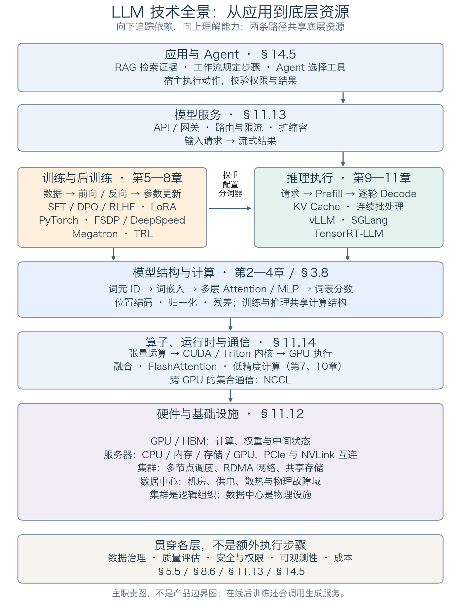
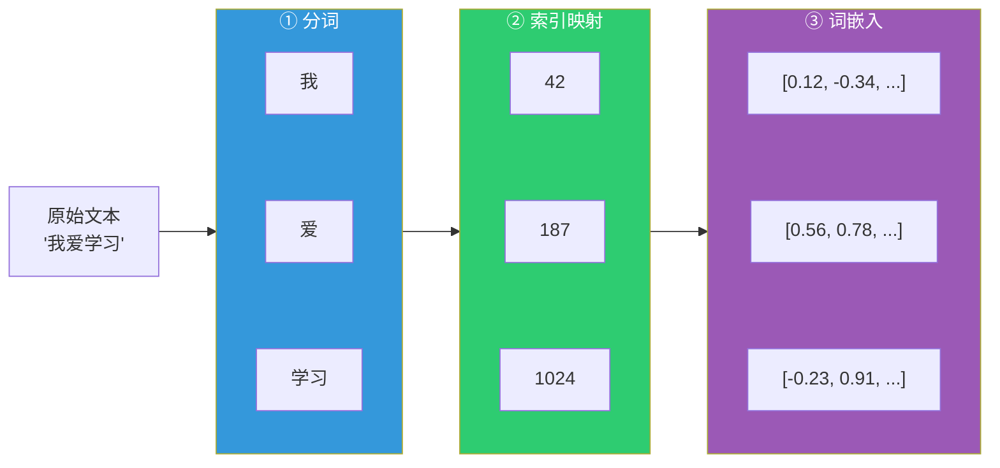
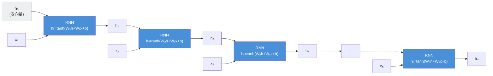
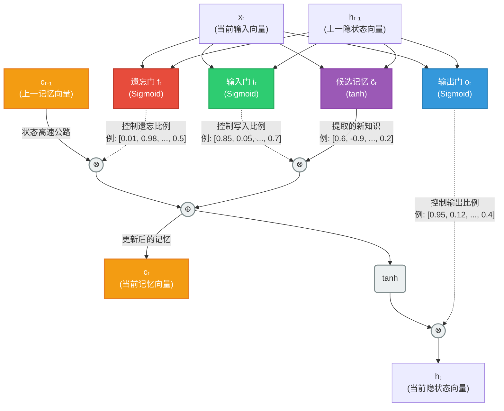
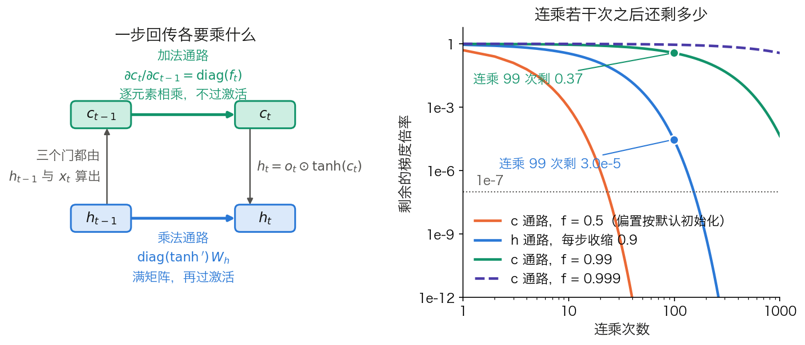
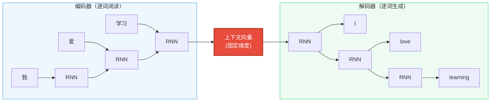
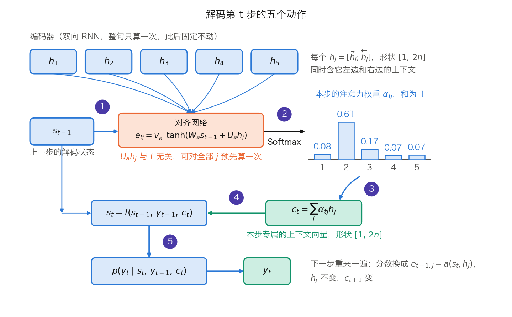
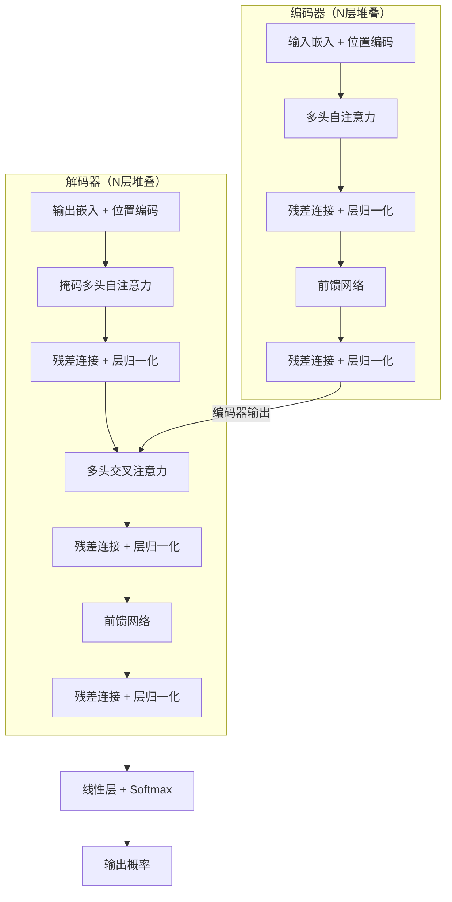
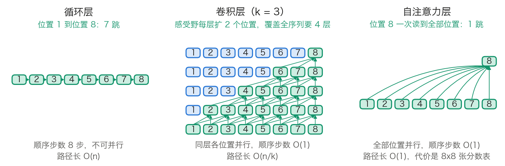
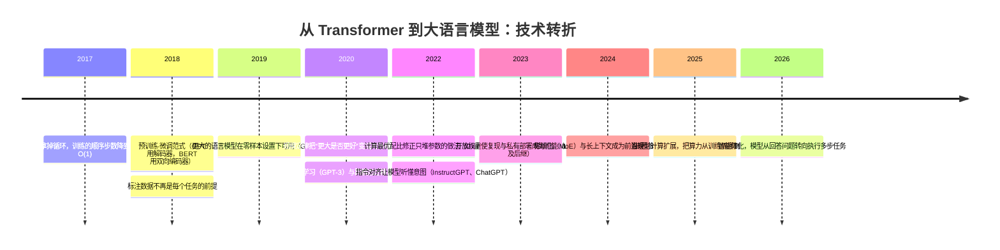

# 第一章：从序列建模到 Transformer

先读 1.0 技术全景，定位 GPU、集群、训练框架、推理引擎与 Agent 的关系，再进入本章的模型原理。全景图附有各层核心技术的正文入口，可在后续阅读时随时回查。

自然语言是变长的符号序列，词与词的顺序本身承载意义。让机器处理这种输入，要同时解决三件事：吃下任意长度的输入、在任意距离上建立依赖、并且算得起。本章先把这三条做成一把尺子，再拿 RNN、CNN、注意力与 Transformer 逐个称量。

Transformer 的每一处设计都对应前一代方案的某条具体不足，因此本章按时间顺序走，沿着五个问题展开：

- 1.1 节：序列建模究竟在算什么？用什么口径判断一个序列模型的好坏？
- 1.2 节：RNN 与 CNN 在这三条轴上各差在哪？“梯度消失”与“感受野有限”能落成多大的数？
- 1.3 节：注意力把长距离依赖的路径压到 1，代价是什么？解码一步内部的动作按什么顺序发生？
- 1.4 节：循环结构被整个拿掉之后，“完全并行”在什么范围内成立？
- 1.5 节：从 6500 万参数的翻译模型长到今天这套系统，每一次转折解决了什么、又留下什么新代价？

本章只建立判据与脉络，自注意力本身怎么算留给第二章。

## 0. 技术全景：从 GPU 到 Agent

理解大模型系统，需要同时回答两个问题：一次计算怎样执行，一项任务怎样完成。前者涉及模型、算子和硬件；后者还需要数据、服务、工具与治理。图 1-0 将这些技术放在同一张地图中，后文再逐层展开。

### 0.1 先看层次，再看两条工作路径

图 1-0：从应用需求向下追踪依赖。纵向箭头表示“依赖”，不是一次请求的执行顺序；横向箭头表示训练制品交给推理系统加载。基础设施框内表示组织关系，不是软件调用链。[绘图源文件](https://github.com/yeasy/llm_internals/blob/main/tools/figures/llm_technology_map.py)

基础设施：GPU · 集群 · 数据中心。

计算与框架：CUDA／Triton · 融合／CUDA Graph · NCCL · 模型计算 · 分布式训练框架 · vLLM · SGLang · TensorRT-LLM。

服务与应用：服务治理 · RAG／工作流 · Agent 工具调用。优化技术与讲解深度见下表。

**自下而上看能力。** GPU 执行计算，显存保存权重与中间状态；服务器组合计算、主机内存和输入输出设备；集群把多台服务器组织成可调度的资源；数据中心提供机房、供电和散热。集群是逻辑资源组织，数据中心是物理设施，二者并非一一对应。软件在这些资源之上实现算子、模型执行、在线服务与应用。

**沿两条路径看工作。** 训练读取样本，通过前向、损失、反向和参数更新产生模型。推理加载模型，先由 Prefill 处理整段输入并预测首个新词元，再由 Decode 逐轮处理已生成的词元、预测下一个。两侧共享算子与硬件，但管理的状态不同：训练还需梯度、优化器与恢复状态，推理重点管理请求队列和 KV 缓存。RLHF 等在线后训练会反复调用生成服务，图中的两条路径并不隔绝。

**区分模型与框架。** Transformer 定义计算结构，PyTorch 等框架组织计算，vLLM 等引擎组织高效生成，Agent 宿主组织工具与任务。它们不是相互替代的产品。图按主要职责定位，实际软件可跨层：例如 vLLM 同时提供 API 服务入口、调度与模型执行，不能理解成只包含一个方框。其实现分工可对照 [vLLM 架构说明](https://docs.vllm.ai/en/latest/design/arch_overview/)。

### 0.2 图中的技术，到哪里学

下表按职责指向正文。概念简介解释用途与边界，机制详解展开计算与设计，实践配方说明输入、执行、输出与排障；三者不等同于完整的框架使用手册。

| 地图位置 | 核心技术与解决的问题 | 机制与实践入口 |
| --- | --- | --- |
| 硬件与基础设施 | GPU／HBM 提供计算和显存；PCIe／NVLink 连接设备；RDMA 网络与存储连接节点；数据中心提供运行条件 | 机制详解：硬件；概念简介：集群、数据中心 |
| 算子与运行时 | CUDA 管理 GPU 编程与执行；Triton 编写分块内核；融合减少中间读写；NCCL 实现跨 GPU 通信 | 机制与算例：内核执行、融合与 Graph、NCCL、7.1 集合通信 |
| 模型计算 | Attention、MLP、归一化、残差和位置编码共同把词元变成预测 | 3.8 完整推理过程、第四章 位置编码 |
| 预训练与分布式执行 | 数据流水线、损失与优化器决定学什么；DDP、FSDP／ZeRO、张量／流水线并行决定如何分摊计算与状态 | 机制详解：5.5 数据、第六章 优化、第七章 分布式；实践配方：DDP／FSDP2、Megatron-Core／DeepSpeed |
| 后训练 | SFT 用示范监督，DPO 用偏好对，RLHF／GRPO 用奖励反馈；LoRA 是可与这些方法组合的参数更新方式 | 第八章 对齐、A.6 核心计算实验、A.7 框架配方 |
| 推理执行 | GQA／MQA 减少 KV 头数，KV Cache 避免重复计算；FlashAttention 减少注意力访存；FP8 等量化降低表示开销；投机解码尝试减少串行等待 | GQA／MQA、KV Cache、FlashAttention、FP8 与量化、投机解码 |
| 推理引擎 | PagedAttention 管理分页 KV 的访问，Continuous Batching 动态组织请求；vLLM、SGLang、TensorRT-LLM 集成执行机制 | 机制详解：连续批处理、KV 管理、vLLM、SGLang；执行路径与选型：TensorRT-LLM；实践配方：A.7 |
| 模型服务 | API、网关、词元感知路由、限流和扩缩容，将引擎能力变成可用服务 | 11.13 服务最佳实践 |
| 应用与 Agent | RAG 把外部证据带入上下文；工作流规定步骤；Agent 在约束下选择工具与下一步，由宿主执行 | 机制与算例：检索与重排、RAG 闭环、工具调用 |
| 贯穿各层 | 数据治理、质量评估、安全、可观测性和成本决定系统能否持续使用，不是最后才增加的一层 | 5.5 数据治理、8.6 评估、11.13 运行治理、14.5 工具权限 |

PyTorch、FSDP、DeepSpeed、Megatron 和 TRL 的职责及组合方式集中在 A.7，不要求每个项目都使用整套工具。先选需要的机制，再选能支持该机制、模型与硬件的实现。

### 0.3 用一个问题串起整张地图

假设用户询问“公司的差旅住宿上限是多少”。模型已在服务启动时加载，本次请求按以下顺序执行：

1. **应用整理任务。** RAG 检索当前用户有权读取的制度片段，将来源与问题放入上下文；固定的检索问答流程不一定需要 Agent。
2. **服务接收请求。** 网关校验身份和配额，路由到可用模型实例。这里处理的是请求，不是矩阵。
3. **Prefill：处理整段输入。** 引擎安排批次与 KV 空间，将问题和制度片段送入模型；模型计算各层表示、建立 KV 缓存，利用最后位置的输出预测首个新词元。
4. **Decode：继续生成。** 每轮输入上一轮生成的词元，读取并更新 KV 缓存，完成模型前向并预测下一个词元；结果可立即流式返回，不必等待完整答案。重复直到满足停止条件，随后回收请求状态；可复用的前缀缓存可按引擎策略保留。
5. **应用检查并交付。** 应用展示答案与引用；若需要执行报销等动作，则另行校验参数、权限与授权，不能把模型生成的调用当作执行许可。

步骤 3、4 每次都包含同一条计算链：**模型张量运算 → GPU 内核与必要的跨卡通信 → 计算结果**。GPU 从显存读取权重与状态，网络在跨节点计算时传输数据；这些工作发生在 Prefill／Decode 内部，不是生成结束后的另两个阶段。输入与输出矩阵的维度、具体计算和 KV 缓存更新见 3.8 节。

模型权重在上线前由训练路径产生；这次问答通常不更新权重。检索到新制度、复用 KV 缓存和把知识训练进模型，是三个不同过程。

排障也沿这张地图定位：答案依据错误，先检查检索与生成；首词元慢，拆开排队与 Prefill；逐词元输出慢，检查 Decode、访存和通信；扩卡不增吞吐，检查切分与互连。不要用同一种优化解决所有层的问题，具体判据见 11.13 节。

## 1. 序列建模的根本挑战

本节回答两个问题：序列建模到底要算什么，以及用什么口径衡量一个序列模型的好坏。前者给出全书的训练目标——概率的链式分解与它的两个读数（交叉熵、困惑度）；后者立起三条评判轴（变长输入、长距离依赖、计算效率），1.2 到 1.4 节会拿同样三条轴逐个考察 RNN、CNN、注意力与 Transformer。本节不讲任何具体架构，只把尺子做出来。

### 1.1 什么是序列建模

序列建模（Sequence Modeling）是指让计算机处理有序数据的任务。自然语言是最典型的序列数据：词的排列顺序直接决定语义。“猫追狗”和“狗追猫”用词完全相同，含义相反。

序列建模涵盖 NLP 的多数核心任务：

- **语言建模**：给定前文，预测下一个词
- **机器翻译**：将一种语言的句子转换为另一种语言
- **文本分类**：判断一段文字的情感、主题或意图
- **序列标注**：为每个词标注词性、实体类型等标签
- **文本生成**：根据提示生成连贯的段落

这些任务的共同点是，模型必须同时利用元素的顺序和元素之间的依赖。

**语言模型的形式化。** 上面第一项值得单独写清楚，因为全书的训练目标、解码策略和评测指标都建立在它上面。一个语言模型给整条序列 $x_1 \ldots x_T$ 赋一个概率，按条件概率的链式法则拆成 $T$ 个一步预测：

$$
P(x_1,\ldots,x_T)=\prod_{t=1}^{T} P(x_t \mid x_{<t})
$$

这条恒等式本身不含任何假设，它只是把“给一整句话打分”换成“反复预测下一个词元”。训练时把它取对数再取负、除以长度，得到每词元平均交叉熵：

$$
L = -\frac{1}{T}\sum_{t=1}^{T}\log P(x_t \mid x_{<t})
$$

对数底取自然对数时，$L$ 的单位是 nat。这个量的指数就是**困惑度**（Perplexity，PPL）$= e^{L}$，可以读作“模型平均在多少个等概率候选之间犹豫”。

**一格算术。** 设某条 4 个词元的序列，模型给正确词元的概率依次是 0.5、0.25、0.4、0.1。联合概率是 $0.5 \times 0.25 \times 0.4 \times 0.1 = 0.005$，即 $1/200$。四个 $-\ln p$ 依次是 0.693、1.386、0.916、2.303，平均得 $L = 1.325$ nat，于是 $\mathrm{PPL} = e^{1.325} = 3.76$。换个算法结果相同：$200^{1/4} = 3.76$，困惑度就是逐步概率几何平均的倒数。联合概率随长度指数衰减，长短不同的句子无法比较；困惑度做了长度归一，因此可比。那个 0.1 的低概率步代价明显：只看前三步，困惑度是 2.71；把它算进来就升到 3.76。

困惑度依赖分词方式，不同词表的模型不能直接比。这条限制与交叉熵的另外两种读法（压缩视角、与真实分布的 KL 距离）放在 5.1 节和 6.1 节展开，本章只需要记住：序列建模的目标函数就是这条链式分解。

### 1.2 三条评判轴

任何序列模型都要同时应付三件事，它们也是后四节反复对照的三条轴。

**第一，变长输入。** 句子长度从一个词到数千词不等，模型必须接受任意长度。全连接网络要求输入维度固定，无法直接处理变长序列。解法是让同一组参数在所有位置上复用。

**第二，长距离依赖。** 依赖关系可以跨越很远。“那个昨天在公园里遇到的穿红色外套的女孩，今天又来了”，主语和谓语之间隔了十几个词。衡量这一项的量是**信息路径长度**：两个位置之间的信息要经过多少次变换才能相遇。路径越长，信号在正向传播中被稀释、在反向传播中被衰减得越厉害。

**第三，计算效率。** 这一项必须拆成两个互不相同的量，否则后面的对比会失真。

- **总计算量**：处理一条长度 $n$ 的序列共需多少次浮点运算。
- **顺序步数**：这些运算里有多少步必须严格排队，不能同时做。

两者可以背道而驰。循环网络的总计算量随 $n$ 线性增长，已经相当省；但它的顺序步数也是 $n$，每一步都要等上一步算完。自注意力的打分与读取随 $n$ 平方增长，长序列上比循环网络更贵；可它的顺序步数是常数，整条序列能一次算完。GPU 上决定训练速度的往往是后者：顺序步数多意味着每步只有一小批数据，数千个计算核心大部分时间在空转。表 1-2 与表 1-5 分列的正是这两个量。

三条轴上，RNN 先解决了变长输入，LSTM 显著改善了长距离依赖，Transformer 则把顺序步数降到常数，同时把路径长度也降到常数。

### 1.3 从统计方法到神经网络

深度学习之前，序列建模主要依赖统计方法。

**N-gram 语言模型**用前 $N-1$ 个词预测第 $N$ 个词，把链式分解里的条件截断到固定窗口，再用语料中的频次直接估计每一项：

$$
P(w_t \mid w_{<t}) \approx P(w_t \mid w_{t-N+1},\ldots,w_{t-1})
= \frac{\mathrm{count}(w_{t-N+1},\ldots,w_t)}{\mathrm{count}(w_{t-N+1},\ldots,w_{t-1})}
$$

它的麻烦在分子上。**一格算术**：词表 $V = 10^5$ 时，三元组的可能取值有 $V^3 = 10^{15}$ 种；一份 $10^{10}$ 词的语料最多只含 $10^{10}$ 个三元组实例，其中还有大量重复。即便每个实例都互不相同，被见过的三元组也不超过所有可能取值的 $10^{10}/10^{15} = 10^{-5}$。窗口每加宽一个词，分母再乘 $10^5$，覆盖率再掉五个数量级。绝大多数组合的计数是 0，对应的概率估计也是 0——这就是**数据稀疏**。[Bengio 等 2003 的开篇](https://www.jmlr.org/papers/volume3/bengio03a/bengio03a.pdf)用的是同一笔账的极端版本：$V = 10^5$、建模 10 个连续词，自由参数多达 $10^{50}-1$ 个。平滑与回退能缓解 0 概率，但改变不了这个量级，因此 N-gram 实际能用的窗口通常停在 5 到 6 个词。

**隐马尔可夫模型**（Hidden Markov Model，HMM）和**条件随机场**（Conditional Random Field，CRF）提供了更强的建模能力。两者都对状态（标签）序列施加马尔可夫假设，但对观测的处理不同：HMM 假设每个观测只由当前状态生成，线性链 CRF 的特征函数则可以读取整条观测序列。受限的是标签之间的依赖距离，不是能看到多少输入。

神经语言模型换了一条路：不再为每个组合单独存一个计数，而是把每个词映射成一个低维向量，让相似的词共享统计强度。参数量因此从随窗口指数增长变成随窗口线性增长。以 Bengio 等 2003 在 AP News 上的配置为例，词表 $|V| = 17{,}964$、隐层 $h = 60$、阶数 $n = 6$、词向量维度 $m = 100$，参数量为 $|V|(1+nm+h) + h(1+(n-1)m)$，即 $17{,}964 \times 661 + 60 \times 501 = 11{,}904{,}264$，约 1,190 万个。同阶的计数表则有 $17{,}964^6 \approx 3.4 \times 10^{25}$ 项，相差 18 个数量级。从这一步起，“表示”成了可学习的参数。

### 1.4 从文字到向量：模型看到的是什么

神经网络只处理数值。一段文本要经过三步才能进入计算，这条管线对 RNN 和 Transformer 是同一条。

**第一步，分词（Tokenization）。** 把原始文本切成基本单元，称为**词元**（Token）。词元可以是完整的词、子词片段或单个字符。“我爱学习”可能被切为“我”“爱”“学习”；英文的 tokenization 可能被切为 token 与 ization 两个子词。**子词分词**是当代大语言模型的通行做法，它在两个极端之间取折中：词级切分的词表要覆盖所有词形，未登录词无法表示；字符级切分的词表极小，但同一句话的词元数会翻好几倍，而计算量与词元数直接挂钩。子词切分让常见词保持一个词元，罕见词拆成若干已知片段，任何字符串都能被表示。细节见 3.1 节。

**第二步，索引映射。** 每个词元在预先构建的**词汇表**（Vocabulary）里有唯一的整数索引，分词器据此把词元序列转成整数序列。

**第三步，词嵌入（Embedding）。** 模型持有一个**嵌入矩阵** $E$，每一行是一个词元的向量。查表就是按索引取行。写成形状：$E$ 的形状是 $[V, d]$，一条长度 $T$ 的 ID 序列 `ids[T]` 查表后得到 $X$，形状 $[T, d]$。框架里对应 `torch.nn.Embedding(num_embeddings, embedding_dim)`，两个参数分别是 $V$ 和 $d$。

| 模型 | 词表 $V$ | 宽度 $d$ | 嵌入表 $E$ 的形状 | 参数量 |
| --- | ---: | ---: | --- | ---: |
| GPT-3 Small | 50,257 | 768 | `[50257, 768]` | 38,597,376 |
| GPT-3 175B | 50,257 | 12,288 | `[50257, 12288]` | 617,558,016 |
| Llama 3 8B | 128,256 | 4,096 | `[128256, 4096]` | 525,336,576 |

表 1-1：三个公开模型的嵌入表。$d$ 与 3.8.7 节的表 3-27 同一口径；$V$ 在 GPT-3 两行上也相同，Llama 3 一行取的是发布权重的 128,256 行（表 3-27 的单元格写 128,000，那是论文口径，两者相差 256 个特殊词元）。参数量由 $V \times d$ 算出，例如 Llama 3 8B 是 $128{,}256 \times 4{,}096 = 525{,}336{,}576$。一个 80 亿参数的模型，光查表这一步就占掉约 5.25 亿个参数。

下图展示这条管线：

图 1-1：从原始文本到向量表示的三步管线

嵌入矩阵初始化时是随机的，取出的向量彼此之间没有任何关系。“语义相近的词向量也相近”是训练之后才出现的经验性质，不是查表这个操作的定义；而且它在 Word2Vec 一类静态词向量上最明显，在大语言模型的输入嵌入上要弱得多，因为那里的语义区分主要由后续各层的上下文计算完成（见 3.2 节）。

“用向量表示词义”这一思路可上溯到 Hinton 等 1986 年提出的**分布式表示**（Distributed Representation）：用一组连续数值而非单一符号承载语义。2003 年 Bengio 等把词嵌入做成语言模型里的可学习参数。2013 年的 **Word2Vec** 去掉隐层、改用层次 Softmax，把训练成本压到“一天之内吃完 16 亿词语料”（[论文摘要的原话](https://arxiv.org/abs/1301.3781)），并展示了向量类比关系（如 $\vec{\text{king}} - \vec{\text{man}} + \vec{\text{woman}} \approx \vec{\text{queen}}$）。2018 年的 **ELMo** 与 **BERT** 带来了性质上的变化：同一个词在不同上下文里得到不同的向量，即**上下文化嵌入**（Contextualized Embedding）。这条线索的训练目标与几何性质留给 3.2 节，本章只用到“查表得到向量”这一步。

有了输入表示，接下来的问题是怎样处理这串向量。第一个真正突破固定窗口限制的方案是循环神经网络。

## 2. RNN 与 CNN：成就与瓶颈

上一节立起了三条评判轴：变长输入、长距离依赖、计算效率（拆成总计算量与顺序步数）。本节把循环网络与一维卷积放到这三条轴上逐项称量，并把“梯度消失”“串行瓶颈”“感受野有限”这三句常见结论换成可复核的数字。Transformer 的每一个核心设计决策，都能追溯到本节的某一条具体不足。

### 2.1 循环神经网络：用“记忆”处理序列

循环神经网络（Recurrent Neural Network，RNN）为序列数据而设计，核心思想是逐个处理序列元素，并维护一个**隐藏状态**（Hidden State）来积累已看过的信息。

在每个时间步 $t$，RNN 接收当前输入 $x_t$ 和上一步的隐藏状态 $h_{t-1}$，算出新的隐藏状态：

$$h_t = \tanh(W_h h_{t-1} + W_x x_t + b)$$

隐藏状态是一个向量，浓缩了到当前位置为止的历史。形状上，若输入宽 $d_x$、隐藏宽 $d_{\text{hid}}$，则 $W_x$ 是 $[d_x, d_{\text{hid}}]$、$W_h$ 是 $[d_{\text{hid}}, d_{\text{hid}}]$，$x_t[1, d_x] \times W_x[d_x, d_{\text{hid}}] \to [1, d_{\text{hid}}]$。关键在于所有时间步共享同一组 $W_h$、$W_x$、$b$：参数量与序列长度无关，任意长度的序列都能处理，第一条轴就此解决。

下图将 RNN 沿时间展开（$h_0$ 初始化为零向量）：

图 1-2：RNN 沿时间展开示意图，每个时间步共享同一组参数 $(W_h, W_x, b)$

$h_t$ 在理论上编码了从序列开头到当前位置的全部信息。序列结束时的末状态可用于分类；每一步的隐藏状态可用于序列标注或生成下一个输出。RNN 在 2010 年代初把语言建模、语音识别、机器翻译的性能都推上了一个台阶。问题出现在序列变长、模型变大之后。

### 2.2 单向视野：无法“预知未来”

从左到右逐词处理时，位置 $i$ 的隐藏状态只汇总了位置 1 到 $i$ 的输入，对右边一无所知。这对**逐位置表示**是硬伤：给“I arrived in London yesterday”做序列标注时，编码到 arrived 的那一步还不知道后面是地点还是时间。Seq2Seq 中的编码器要读完整句才开始解码，末状态已含全句，所以单向的代价不在“看不到全句”，而在每个位置交出的那份表示是残缺的——1.3 节的注意力恰好要逐个读取这些位置表示。

**双向 RNN**（Bidirectional RNN）的做法是同时跑一个正向和一个逆向的 RNN，把两个方向的隐藏状态拼接：$\vec{h}_i = \text{RNN}_\text{fwd}(x_1, \ldots, x_i)$，$\overleftarrow{h}_i = \text{RNN}_\text{bwd}(x_n, \ldots, x_i)$，位置 $i$ 的表示取 $[\vec{h}_i; \overleftarrow{h}_i]$，宽度翻倍为 $2d_{\text{hid}}$。

这一改进有一条不可逾越的前提：逆向那一路必须先看到完整输入。因此双向结构只能用于理解类任务（序列标注、句子分类、作为 Seq2Seq 的编码器），不能用于逐词生成——生成第 $t$ 个词时，第 $t+1$ 个词还不存在。这条前提在第三章会以另一种面貌重现：BERT 是双向编码器因而不能直接做生成，GPT 用因果掩码换取了生成能力（见 3.7 节）。此外，双向不解决梯度消失，两个方向上都存在；也不解决串行，两条链各自仍要走 $n$ 步。

### 2.3 梯度消失：连乘的必然结果

RNN 的训练依赖**时间反向传播**（Backpropagation Through Time，BPTT）：把网络沿时间展开成一个很深的前馈网络，再跑标准反向传播。

梯度从时间步 $T$ 回传到时间步 1，要连乘 $T-1$ 个一步雅可比：

$$
\frac{\partial h_T}{\partial h_1} = \prod_{t=2}^{T} \frac{\partial h_t}{\partial h_{t-1}}
= \prod_{t=2}^{T} \operatorname{diag}(\tanh'(z_t))\,W_h^{\top}
$$

其中 $z_t = W_h h_{t-1} + W_x x_t + b$。每一项都是“一个对角矩阵乘一个固定矩阵”，连乘 $T-1$ 次之后，整体倍率大体按几何级数走：若每一项的范数稳定在 $\rho$ 附近，剩下的倍率约为 $\rho^{T-1}$。

**一格算术。** 取 $\rho = 0.9$，回传 100 步剩 $0.9^{99} = 3.0 \times 10^{-5}$，回传 1000 步剩 $1.9 \times 10^{-46}$。梯度并非“变小”，而是被抹平到与数值噪声同级：优化器看到的几乎只有近处几十步的信号，远处的依赖学不到。反方向同样成立，$\rho = 1.1$ 时 100 步后放大到 $1.3 \times 10^{4}$，参数一次更新就被打飞。

[Pascanu 等 2013](https://arxiv.org/abs/1211.5063) 给出了准确的条件，值得照抄清楚，因为二手转述常把充分与必要说反。设激活函数导数的绝对值上界为 $\gamma$（tanh 取 1，Sigmoid 取 1/4），$\lambda_1$ 为 $W_h$ 最大特征值的模：$\lambda_1 < 1/\gamma$ 是梯度消失的**充分**条件；$\lambda_1 > 1/\gamma$ 是梯度爆炸的**必要**条件。也就是说，谱半径大于 1 只是爆炸的前提，并不保证爆炸——tanh 在饱和区的导数远小于 1，实际倍率可能仍然收缩。该文的证明用雅可比的 2-范数（最大奇异值）作上界；谱半径不超过谱范数，所以按谱范数判定更保守。

该文同时给出了爆炸一侧的工程对策：**梯度范数裁剪**（gradient norm clipping）。梯度的范数超过阈值就整体缩放回阈值，方向不变。框架里对应 `torch.nn.utils.clip_grad_norm_`，至今仍是大模型训练的标配之一（见 6.1 节）。裁剪治得了爆炸，治不了消失：把一个 $10^{-5}$ 的梯度放大回来，放大的是噪声。Bengio 等 1994 年的论文已指出，这不是工程细节，而是这类架构的内在数学性质。

### 2.4 LSTM 与 GRU：给梯度另开一条通路

**长短期记忆网络**（Long Short-Term Memory，LSTM）由 Hochreiter 和 Schmidhuber 于 1997 年提出，做法是在隐藏状态之外再开一条**记忆单元通路**（Cell State）$c_t$，让它以近似线性的方式沿时间传递。

[1997 年的原文](https://www.bioinf.jku.at/publications/older/2604.pdf)只有两个门——输入门与输出门，$c_t$ 的自环权重被**固定**为 1.0，论文称之为 constant error carousel（CEC）。这是“梯度一点不衰减”的最纯形态，代价是记忆永远无法重置。**遗忘门**由 Gers、Schmidhuber 和 Cummins 加入（ICANN 1999，扩充版载于 *Neural Computation* 2000，题为 Learning to Forget: Continual Prediction with LSTM），它把恒为 1 的自环换成一个可学习的 $f_t$：用可控的衰减换来可重置。当代教科书里的三门 LSTM 指的是这个 2000 年的版本。

三个门结构相同：各自接收 $x_t$ 与 $h_{t-1}$，做仿射变换后过 Sigmoid，输出与 $c_t$ 同维、取值在 0 到 1 之间的向量。

$$f_t = \sigma(W_{fx} x_t + W_{fh} h_{t-1} + b_f)$$
$$i_t = \sigma(W_{ix} x_t + W_{ih} h_{t-1} + b_i)$$
$$o_t = \sigma(W_{ox} x_t + W_{oh} h_{t-1} + b_o)$$

候选记忆走的是 tanh 而非 Sigmoid，因为它提供的是内容而不是开关，取值需要有正有负：

$$\tilde{c}_t = \tanh(W_{cx} x_t + W_{ch} h_{t-1} + b_c)$$

主干道上的两条更新式（$\odot$ 表示逐元素相乘）：

$$c_t = f_t \odot c_{t-1} + i_t \odot \tilde{c}_t$$
$$h_t = o_t \odot \tanh(c_t)$$

> [!TIP]
> **门控的值到底长什么样？**
>
> $f_t$、$i_t$、$o_t$ 经过 Sigmoid 挤压后都不是单个数字，而是与 $c_t$ 同维的向量（例如 512 维），每个分量都落在 0 到 1 之间，如 `[0.01, 0.98, 0.5, ...]`。与记忆单元逐元素相乘时：接近 0 的分量把该维信息挡住，接近 1 的放行，0.5 通过一半。

下图展示 LSTM 单元的内部结构：

图 1-3：LSTM 单元结构，记忆单元 $c_t$ 通过线性通路传递信息

**为什么这条通路有用：两行推导。** 把 $c_t = f_t \odot c_{t-1} + i_t \odot \tilde{c}_t$ 对 $c_{t-1}$ 求偏导，直接通路上的项是

$$
\frac{\partial c_t}{\partial c_{t-1}} = \operatorname{diag}(f_t)
$$

与 1.2.3 的 $\operatorname{diag}(\tanh')W_h^{\top}$ 对比，区别有两处：没有权重矩阵，也没有激活函数的导数。连乘 $T$ 步之后的倍率是 $\prod_t f_t$，由门自己决定，与 $W_h$ 的谱无关。图 1-4 把两条通路并排画出。

图 1-4：一步回传各要乘什么，以及连乘若干次之后还剩多少（[生成脚本](https://github.com/yeasy/llm_internals/blob/main/tools/figures/ch01_gradient_paths.py)）。左幅蓝色是 h 通路、青绿是 c 通路；右幅只有蓝色一条是 h 通路，其余三条是 c 通路在 $f$ 取 0.5、0.99、0.999 时的衰减，横纵轴均为对数刻度。

**一格算术。** 步数口径与 1.2.3 一致，回传 $T$ 步连乘 $T-1$ 次。$f = 0.99$ 时，回传 100 步剩 $0.99^{99} = 0.37$；$f = 0.999$ 时，回传 1000 步剩 $0.999^{999} = 0.37$。与 $\rho = 0.9$ 的 $3.0 \times 10^{-5}$ 相比，差了四个数量级。这条“高速公路”的前提写得很清楚：$f_t$ 必须贴近 1。一旦 $f = 0.9$，连乘的就是同一个 $0.9^{99} = 3.0 \times 10^{-5}$，与普通 RNN 没有区别。

这条前提有一个直接的工程后果。按常规的小随机数初始化，Sigmoid 的输出在 0.5 附近，相当于每步衰减一半：$0.5^{99} = 1.6 \times 10^{-30}$。[Jozefowicz 等 2015](https://proceedings.mlr.press/v37/jozefowicz15.pdf) 指出这一点，并建议把遗忘门偏置 $b_f$ 初始化为 1 或 2，让门的初值靠近 1；该文也说明这个做法源自 Gers 等 2000。

> [!NOTE]
> **为什么既有记忆单元 $c_t$ 又有隐藏状态 $h_t$？**
>
> 在普通 RNN 中，唯一的 $h_t$ 要同时承担“沿时间搬运历史”和“对外提供当前表示”两件事，每次更新都会被新输入冲刷。LSTM 把这两种职能拆开：
>
> 1. **内部长期状态 $c_t$**：以加法为主更新，为梯度提供一条低衰减通路。
> 2. **对外表示 $h_t$**：$c_t$ 经 tanh 整流、再由输出门筛选后交出，只暴露与当前预测相关的那部分。
>
> **那为什么不直接拿 $c_t$ 当输出？** 两条理由。其一，$c_t$ 之所以能缓解梯度消失，正因为它在时间线上几乎只做加法；一旦强迫它直接承担每一步的输出任务，为适应输出的非线性边界，它的数值分布会被扭曲，这条通路也就废了。其二，$c_t$ 是累加量，数值无界，直接送入下一层不稳定；$h_t = o_t \odot \tanh(c_t)$ 把它压回 $[-1, 1]$ 并滤掉无关波动。
>
> 这条“加法旁路”的思路与 2015 年的 Highway Networks 和残差网络（ResNet）同源，但不同型：ResNet 的旁路是恒等映射，系数恒为 1；LSTM 的旁路带门 $f_t$，与 Highway Networks 更接近（见 3.5 节）。

**代价：四倍参数。** 三个门加一个候选记忆，共四组权重，每组都是“输入一份、隐状态一份、偏置一份”。单层参数量为

$$
4\left(d_{\text{hid}}(d_x + d_{\text{hid}}) + d_{\text{hid}}\right)
$$

取 $d_x = d_{\text{hid}} = 1000$，得 $4 \times (1000 \times 2000 + 1000) = 8{,}004{,}000$，约 800 万；同宽的普通 RNN 只有 2,001,000，正好是四分之一。对到实现：PyTorch 的 `nn.LSTM` 把四组权重打包成两个矩阵，`weight_ih_l0` 形状 `[4*hidden_size, input_size]`、`weight_hh_l0` 形状 `[4*hidden_size, hidden_size]`，行按 $i, f, g, o$ 的顺序切成四段（$g$ 即本节的 $\tilde{c}$）；偏置为兼容 cuDNN 存了两份 `bias_ih_l0` 与 `bias_hh_l0`，因此框架报出的参数量是 8,008,000，比数学口径多出一份 $4d_{\text{hid}}$。

2014 年的**门控循环单元**（Gated Recurrent Unit，GRU）把遗忘门与输入门合并为一个更新门，去掉独立的 $c_t$，参数量降到三组，性能相近。

LSTM 与 GRU 在 2014 至 2017 年间主导了几乎所有 NLP 任务，也进了生产系统：Google 的 GNMT 用 8 层编码器加 8 层解码器、每层 1024 个 LSTM 单元上线翻译服务，其中编码器最底层是双向的，正对应 1.2.2 的用法。它们没有解决的是下一小节的问题——[GNMT 论文自报](https://arxiv.org/abs/1609.08144)，WMT 英法模型用 96 块 K80 GPU 训练约 6 天。这限制的不是能不能用，而是模型与数据规模还能不能继续放大。

### 2.5 串行计算：顺序步数卡住了吞吐

无论基础 RNN、LSTM 还是 GRU，$h_t$ 的计算都必须等 $h_{t-1}$ 完成。按 1.1.2 的两个量看，问题不在总计算量。

对长度 $n = 1000$、宽度 $d$ 的一条序列，RNN 训练一步要发射 1000 次小矩阵乘 $[B, d] \times [d, d]$；Transformer 的同一步把它们合成一次 $[B \cdot n, d] \times [d, d]$。两者的乘加次数同阶，差别在于前者是 1000 个依次排队的内核、每个只有 $B$ 行数据，后者是一个内核、$B \times 1000$ 行数据。矩阵越瘦长，每读一个权重字节能摊到的运算次数越少，GPU 的算力就越闲（这条判据在 10.1 节展开为 Roofline 分析）。顺序步数 $O(n)$ 因此不只是延迟问题，它同时压低了每一步的算术强度。

| 特性 | RNN/LSTM | 理想方案 |
|------|----------|----------|
| 每层总计算量 | $O(n \cdot d^2)$ | 越低越好 |
| 顺序步数 | $O(n)$ | $O(1)$ |
| 并行度 | 低（串行） | 高（全并行） |
| 长距离依赖路径 | $O(n)$ 步 | $O(1)$ 步 |
| GPU 利用率 | 低 | 高 |
| 推理时每步的状态大小 | $O(d)$，不随已读长度增长 | 越小越好 |

表 1-2：RNN/LSTM 与“理想方案”在六个量上的对照

最后一行是 RNN 唯一一项至今仍占优的指标，值得单独说明。推理时，RNN 只需携带一个固定大小的 $h_t$（LSTM 再加一个 $c_t$），每生成一个词元的计算量是 $O(d^2)$，与已读长度无关。Transformer 为避免重算历史，要保存随长度线性增长的 KV 缓存（见 3.8.6 节与 10.2 节）。这笔取舍正是线性注意力与状态空间模型近年回潮的出发点（见 14.3 节）：它们想拿回 RNN 的恒定状态，同时保住 Transformer 的并行训练。

对并行的渴望推动了两个方向：把 CNN 引入序列建模，以及注意力机制的诞生。

### 2.6 CNN 在序列建模中的尝试

一维卷积用固定宽度的核在序列上滑动提取局部特征，不同位置的卷积互不依赖，顺序步数是 $O(1)$。2017 年 Facebook 的 ConvS2S 证明纯卷积架构也能胜任机器翻译，训练速度远快于 RNN。

代价是**感受野**（Receptive Field）有限。核宽 $k$ 的普通卷积每叠一层，感受野扩大 $k-1$，堆 $L$ 层后为 $1 + L(k-1)$。**一格算术**：$k = 3$ 时感受野是 $2L+1$，要让相距 1000 的两个位置相互覆盖，需要 $L = 500$ 层。若改用扩张率按 $k$ 倍增长的空洞卷积，$L$ 层的覆盖是 $k^L$，$\log_3 1000 = 6.29$，7 层即可（$3^7 = 2187$）。[Vaswani 等 2017 的表 1 下方](https://arxiv.org/abs/1706.03762)把这两种情形分开写：连续核需要 $O(n/k)$ 层，空洞卷积需要 $O(\log_k n)$ 层。两个数字相差近两个数量级，引用时必须说明用的是哪一种。

多出来的层不是白来的。ConvS2S 每层都带残差连接，所以深度本身并不必然带回梯度消失；真正的代价是两个位置之间的信息路径变长，每多一层就多一次有损的压缩与混合。

还有一点常被忽略：卷积核在各个位置提取的是同一种模式，本身不带绝对位置信息。[ConvS2S 论文](https://arxiv.org/abs/1705.03122)因此显式加了可学习的位置嵌入，与词嵌入逐元素相加，并在表 4 里做了消融——同时去掉源端与目标端的位置嵌入，验证 BLEU 从 21.7 降到 21.2。该文也点明了对照：循环模型通常不需要显式位置嵌入，因为隐藏状态的递推过程本身就带着“走到第几步”。同一条约束在 1.4 节会再次出现，自注意力的处境比卷积更极端。

RNN 的串行瓶颈与 CNN 的局部视野指向同一个需求：能否有一种机制，既让顺序步数降到常数，又让任意两个位置之间的路径长度降到常数。答案是注意力机制。

## 3. 注意力的诞生：让模型学会“看哪里”

上一节留下的缺口是：RNN 把任意长度的输入压进一个固定大小的状态，长距离依赖的路径长度仍是 $O(n)$。本节讲注意力如何把这条路径压到 1，代价是什么，以及一个解码步内部的动作顺序——这个顺序是两篇奠基论文最容易混淆之处，也是第二章 Q/K/V 的直接前身。本节的注意力仍嫁接在 RNN 之上，串行瓶颈要到 1.4 节才被拆掉。

### 3.1 编码器-解码器：理解与生成的分离

2014 年，[Sutskever 等提出的**序列到序列**](https://arxiv.org/abs/1409.3215)（Sequence-to-Sequence，Seq2Seq）模型把机器翻译拆成两个阶段，分别交由**编码器**（Encoder）和**解码器**（Decoder）负责。

#### 为什么要分离

翻译的输入与输出是两种语言，词汇、语法和表达方式都不同。让同一个模块同时负责“读懂源语言”和“写出目标语言”，等于把两套统计规律塞进一组参数。分开之后，编码器只需把输入变成一种与语言无关的中间表示，解码器只需从这种表示出发生成目标语言，各自的参数不再互相牵制。

#### 编码器的本质

编码器把离散、变长的输入序列转成连续的内部表示。在 Seq2Seq 中它是一个 RNN，逐词阅读并更新隐藏状态；读到序列末尾时，末状态被当作整句的语义摘要，称为**上下文向量**（Context Vector）。它的价值在于把“不同长度的符号序列”统一成“固定形状的数值表示”，让后续的生成有一个可操作的起点。

#### 解码器的本质

解码器在给定这份表示的条件下逐步构建输出。它同样是一个 RNN，以上下文向量作为初始状态，每一步生成一个词元，并把这个词元作为下一步的输入。因此每一步的输出同时依赖两种信息：编码器给的“对输入的理解”，以及自己已经写出的部分。

训练与推理在这里并不对称。训练时用的是**教师强制**（Teacher Forcing）：第 $t$ 步的输入取自真实目标句的第 $t-1$ 个词，而不是模型自己上一步的输出，因此整条目标句的监督信号可以一次算出。推理时没有真实答案，只能把模型自己的输出接回输入，一步接一步。这条不对称贯穿全书，Transformer 也没有改变它（见 1.4.3 与 9.1 节）。

#### 协作与信息瓶颈

下图展示 Seq2Seq 的结构。注意中间那个固定大小的上下文向量：编码器的全部“理解”都要压进它，解码器对输入的全部了解也只来自它。

图 1-5：Seq2Seq 编码器-解码器架构，所有信息必须通过中间的固定维度向量

这个向量有多大？[Sutskever 等 2014 的原文](https://arxiv.org/abs/1409.3215)写得很具体：4 层 LSTM、每层 1000 个单元、1000 维词嵌入，于是“the deep LSTM uses 8000 real numbers to represent a sentence”。8000 这个数来自 $4 \text{ 层} \times 2 \text{ 份}(c \text{ 与 } h) \times 1000$。

**一格算术，以及一个常见论证的失效。** 把 8000 个 float32 数一数比特：$8000 \times 32 = 256{,}000$ bit，合 31 KiB。再按该文自己的词表给句子的信息量估一个上界：源端取最高频的 160,000 词，每个词最多 $\log_2 160{,}000 = 17.3$ bit，50 个词的句子不超过 $50 \times 17.3 = 865$ bit，只占 256,000 bit 的 0.34%。自然语言每词的实际熵远低于这个上界，差距只会更大。所以“比特装不下”这个论证不成立，瓶颈另有来源。

真正的约束有两条。其一，编码器必须在**不知道解码器将要问什么**的前提下完成压缩：同一个向量要同时支持“第一个目标词该译什么”“第十个目标词该译什么”等所有询问，只能编码一份折中的摘要。其二，这份摘要必须以一个 RNN 能逐步解出的形式存在，而 RNN 的末状态天然偏向最近读到的输入——Sutskever 等正是因此把源句倒序输入，让源句开头与目标句开头靠近，测试困惑度从 5.8 降到 4.7，BLEU 从 25.9 升到 30.6。一个靠调整输入顺序就能多拿 4.7 个 BLEU 点的架构，说明问题出在“什么时候决定读哪里”，而不是“能存多少比特”。

实证也指向同一处。[Cho 等 2014](https://arxiv.org/abs/1409.1259) 报告这类模型在短句上表现尚可，但性能随句长与未登录词数量迅速下滑，该文把这一现象命名为 the curse of sentence length。[Bahdanau 等 2015 的图 2](https://arxiv.org/abs/1409.0473) 给出了直接对照：固定向量的 RNNencdec 随句长明显下滑，带注意力的 RNNsearch-50 按该文 5.1 节的说法，在 50 词及以上的句子上也没有出现性能退化。

> 编码器-解码器的分离是一个影响深远的架构思想。Seq2Seq 的信息瓶颈很快被注意力机制解决（见 1.3.2），但“理解与生成分离”延续到了 Transformer 时代。Transformer 的原始架构仍是编码器-解码器，后续的 BERT（仅编码器）、GPT（仅解码器）和 T5（编码器-解码器）分别发展了这一思想的不同侧面，系统对比见第三章。

### 3.2 Bahdanau 注意力：把“读哪里”推迟到解码时

2015 年，Bahdanau 等给出的解法是：解码每个词时不再只看那一个固定向量，而是回头读编码器在每个位置留下的隐藏状态，并自动决定各读多少。

> 为什么读隐藏状态而不是原始词向量？因为 $h_j$ 不只编码了位置 $j$ 的词，还融合了上下文。原始词向量里，“苹果”在“吃苹果”和“苹果公司”中完全一样；隐藏状态则已经带上了区分二者的信息。更关键的是，该文的编码器是**双向 RNN**，$h_j = [\vec{h}_j; \overleftarrow{h}_j]$ 同时含左右两侧的上下文，宽度是单向的两倍。这正好接上 1.2.2 留下的线索：双向结构不能用于生成，但可以用于编码。

**解码一步的五个动作，以及它们的顺序。** 这是全节最要紧的地方。按[该论文第 3.1 节](https://arxiv.org/abs/1409.0473)，第 $i$ 步依次做：

1. 用**上一步**的解码状态 $s_{i-1}$ 与每个 $h_j$ 算对齐分数 $e_{ij} = a(s_{i-1}, h_j)$
2. 对 $j$ 归一化得到权重 $\alpha_{ij} = \dfrac{\exp(e_{ij})}{\sum_{k=1}^{T_x}\exp(e_{ik})}$
3. 加权求和得到本步专属的上下文向量 $c_i = \sum_j \alpha_{ij} h_j$
4. 更新解码状态 $s_i = f(s_{i-1},\, y_{i-1},\, c_i)$
5. 输出分布 $p(y_i \mid y_{<i}, x) = g(y_{i-1},\, s_i,\, c_i)$

原文对第 1 步的措辞很明确：分数基于“即将发出 $y_i$ 之前”的那个隐藏状态，也就是 $s_{i-1}$。顺序不能颠倒：$c_i$ 是算 $s_i$ 的输入之一，因此打分只能用 $s_{i-1}$。用当前状态打分的是下一小节的 Luong。

图 1-6：解码第 $t$ 步的五个动作（[生成脚本](https://github.com/yeasy/llm_internals/blob/main/tools/figures/ch01_bahdanau_step.py)）。蓝色是随输入变化的数据，橙色是权重，青绿是本步新产生的量；柱状图里的权重由脚本中的五个分数经 Softmax 算出。图中用 $t$ 记解码步，与正文的 $i$ 同义。

注意力权重本身不决定输出哪个词，它决定的是本步该参考源句的哪些部分；最终由第 5 步综合 $s_i$、$y_{i-1}$ 和 $c_i$ 做出预测。与 Seq2Seq 的根本区别在下标：那里的上下文向量只有一个，对所有解码步完全相同；这里每一步都重算一个 $c_i$，相当于每次带着不同的问题重新翻阅原文。

**形状与真实配置。** 该文用的加性打分函数是

$$
e_{ij} = v_a^{\top} \tanh(W_a s_{i-1} + U_a h_j)
$$

[该论文](https://arxiv.org/abs/1409.0473)附录 A.2.2 与 A.2.3 给出的形状与配置是：隐层宽度 $n = 1000$、词嵌入维度 $m = 620$、深度输出的 maxout 隐层 $l = 500$、对齐网络隐层 $n' = 1000$。据此三个权重的形状是 $W_a[n', n]$、$U_a[n', 2n]$、$v_a[n']$，即 `[1000, 1000]`、`[1000, 2000]`、`[1000]`；$h_j$ 的 $2n$ 来自双向拼接。论文还点出了一个实现要点：$U_a h_j$ 不依赖 $i$，可以对全部 $j$ 预先算一次，每个解码步只需重算 $W_a s_{i-1}$ 并做 $T_x$ 次加法与 tanh。

**一格算术：三个源位置。** 为看清每一步的算术，把维度缩到 2。设 $s = [1, 2]$，三个源位置的表示为 $h_1 = [2, 0]$、$h_2 = [0, 2]$、$h_3 = [1, 1]$，打分改用最简单的点积 $e_j = s \cdot h_j$：

- 分数：$e_1 = 1 \times 2 + 2 \times 0 = 2$，$e_2 = 1 \times 0 + 2 \times 2 = 4$，$e_3 = 1 \times 1 + 2 \times 1 = 3$
- 取指数：$e^2 = 7.389$，$e^4 = 54.598$，$e^3 = 20.086$，行和 $= 82.073$
- 权重：$7.389/82.073 = 0.090$，$54.598/82.073 = 0.665$，$20.086/82.073 = 0.245$
- 加权求和：第 1 个分量 $(0.090 \times 2 + 0.665 \times 0 + 0.245 \times 1) = 0.425$，第 2 个分量 $(0 + 0.665 \times 2 + 0.245 \times 1) = 1.575$，即 $c = [0.425,\ 1.575]$

分数只差 1 和 2，权重却拉开到 0.090 与 0.665，这是指数放大的结果。这条性质在下一小节会变成一个需要处理的问题。第二章的 Q/K/V 做的就是同一套算术，只是把 $s$ 换成 Query、把 $h_j$ 同时当作 Key 和 Value（见 2.1 节）。

注意力还附带一个产物：把 $\alpha_{ij}$ 排成矩阵可视化，就能看到翻译每个目标词时模型读了源句的哪些位置。这是一种诊断工具而非解释：权重说明信息从哪里被取走，不说明模型为何做出该预测。

### 3.3 从加性注意力到点积注意力

Bahdanau 之后不久，[Luong 等 2015](https://arxiv.org/abs/1508.04025) 提出了更简洁的打分方式，并把三种形式并列写出（$h_t$ 是目标端状态，$\bar{h}_s$ 是源端状态）：

$$
\operatorname{score}(h_t, \bar{h}_s) =
\begin{cases}
h_t^{\top} \bar{h}_s & \textit{dot} \\
h_t^{\top} W_a \bar{h}_s & \textit{general} \\
v_a^{\top} \tanh(W_a [h_t; \bar{h}_s]) & \textit{concat}
\end{cases}
$$

该文还区分了 global 与 local 两类：前者对所有源位置打分，后者先预测一个对齐位置 $p_t$，只在它周围的窗口内打分。

**两种打分的取舍。**

- 点积（dot）没有可学习参数，且能写成一次矩阵乘法，在 GPU 上由高度优化的内核完成。前提是 $h_t$ 与 $\bar{h}_s$ 维度相同；维度不同时要退回 general 形式，靠 $W_a$ 转接。
- 加性（concat）多一组参数和一次 tanh，但对两端维度没有要求，且在高维下更稳。

第二条优势有具体来源。[Vaswani 等 2017 的 3.2.1 节](https://arxiv.org/abs/1706.03762)写道，两者在 $d_k$ 较小时表现相近，$d_k$ 较大时不做缩放的点积会输给加性；该文脚注给出了原因：设 $q$、$k$ 的各分量独立、均值 0、方差 1，则 $q \cdot k$ 的方差是 $d_k$。方差随维度线性增长，分数被拉开，Softmax 落进梯度极小的饱和区。上一小节的算例正是这一现象的缩影：把那三个分数同乘 2，权重从 0.090/0.665/0.245 变成 0.016/0.867/0.117；同乘 4 则变成 0.0003/0.982/0.018，几乎成了 one-hot，反传回去的梯度也随之趋零。Transformer 的对策是给点积除以 $\sqrt{d_k}$，把方差拉回 1（见 2.2 节）。

另一条常见的说法需要收窄：点积不等于方向相似度。$q \cdot k = \|q\|\|k\|\cos\theta$ 同时取决于两个模长，只有先归一化才只剩夹角。上面“同乘一个倍数”的演示就是模长在起作用，而不是方向变了。

两篇论文的差别不止打分函数，还有解码一步的时序，这一点常被混为一谈。Luong 论文在与 Bahdanau 的对比中直接写出了两条计算路径：自己是 $h_t \to a_t \to c_t \to \tilde{h}_t$，Bahdanau 是 $h_{t-1} \to a_t \to c_t \to h_t$。表 1-3 把两者并列。

| 对照项 | Bahdanau 2015 | Luong 2015 |
| --- | --- | --- |
| 打分用的解码状态 | 上一步的 $s_{i-1}$ | 当前步的 $h_t$ |
| 计算路径 | $s_{i-1} \to \alpha_i \to c_i \to s_i \to y_i$ | $h_t \to a_t \to c_t \to \tilde{h}_t \to y_t$ |
| 上下文向量的去向 | 作为输入参与算出 $s_i$ | 与 $h_t$ 拼接后过一层 tanh 得 $\tilde{h}_t$ |
| 打分函数 | 只试了加性（concat） | dot、general、concat 三种 |
| 编码器 | 双向 RNN，$h_j$ 宽 $2n$ | 堆叠 LSTM 的顶层状态 |
| 关注范围 | 全部源位置 | global 与 local 两种 |

表 1-3：两篇注意力奠基论文的时序与打分对照。各行取自两文正文，Luong 论文在 3.1 节末尾明确对比了两条计算路径。

从加性到点积这一步看似微小，却决定了此后的走向：注意力的全部计算都能落在矩阵乘法上，而矩阵乘法正是 GPU 最擅长的算子。

### 3.4 注意力带来的变化与它的代价

回到 1.1.2 的三条轴，注意力改变了其中两条。

**第一，固定向量不再是唯一通道。** 解码器可以访问编码器每个位置的完整表示，能取多少信息不再受一个向量的宽度限制。

**第二，路径长度从 $O(n)$ 降到 $O(1)$。** 在 Seq2Seq 中，源句第一个词的信息要依次经过所有编码时间步、再经过解码时间步才能影响当前输出；有了注意力，解码器一跳就能读到任意源位置。

代价出现在第三条轴上，而且是两笔实打实的开销。

**存储。** 编码器的全部注释都要保留。源句 50 个词、$n = 1000$ 的双向编码器，注释矩阵形状是 $[50, 2000]$，共 100,000 个实数，是那 8000 个数的 12.5 倍，并且随源句长度线性增长。Seq2Seq 的 $O(1)$ 存储换成了 $O(n)$。

**计算。** 每个解码步要对全部 $n$ 个源位置各打一次分，生成 $m$ 个目标词共 $n \times m$ 次打分；源 50 词、目标 60 词即 3000 次。加性打分的每一次还含一次 $[1, n']$ 规模的向量运算。

这笔“用随长度增长的存储与计算，换路径长度降到 1”的账，与后文 KV 缓存的账是同一笔（见 10.2 节）：只要允许任意位置被直接读取，就得把可被读取的东西全部留着。

还有一处细节值得先记下，它是下一节的直接引子：$h_j$ 在这里身兼两职——既是算分数的依据（决定读多少），又是被取走的内容（决定读到什么）。两种角色用同一个向量承担，意味着“容易被找到”和“携带有用内容”这两件事必须妥协在同一组数里。

这一阶段的注意力仍嫁接在 RNN 之上，编码器和解码器依旧是 LSTM 或 GRU，顺序步数仍是 $O(n)$。于是问题自然浮现：既然注意力已能直接连接任意两个位置，还需要 RNN 吗？

## 4. Transformer 的提出与核心思想

上一节结束时，注意力还只是嫁接在 RNN 之上的一个部件：它把源位置到解码器的路径缩短到了 $O(1)$，可编码器和解码器本身仍要走完 $O(n)$ 个时间步。2017 年 6 月，[Vaswani 等的《Attention Is All You Need》](https://arxiv.org/abs/1706.03762)把剩下的循环结构整个拿掉。本节讲这一决策改变了什么、原论文的配置与实验数字是多少，以及“完全并行”这句话在什么范围内成立。自注意力本身怎么算，留给第二章。

### 4.1 “完全基于注意力”的设计理念

Transformer 的核心创新不在于发明了新的数学工具，而在于一个**架构决策**：不用循环也不用卷积，只用注意力和逐位置前馈网络搭出整个模型。

这个决策直接对应前两节的三条不足：

- **消除串行瓶颈**：去掉循环后，编码器与训练时的解码器中，所有位置的计算可以一次完成，顺序步数从 $O(n)$ 降到 $O(1)$。
- **建立直接连接**：自注意力让每个位置直接读取序列中的任意位置，路径长度为 $O(1)$。
- **统一的计算模式**：整个模型由同构的层堆叠而成，每层只有注意力子层与前馈子层两种部件。

拿掉循环之后有两笔账要补：顺序信息没有了，必须显式注入；深层堆叠的训练稳定性要靠残差与归一化撑住。这两件事才是论文里真正精巧的部分。

### 4.2 自注意力：从“看别人”到“看自己”

1.3 节的注意力发生在解码器与编码器之间，称为**交叉注意力**（Cross-Attention）。**自注意力**（Self-Attention）让序列中的每个位置去看同一个序列中的所有位置（包括自己）。

自注意力并非该论文的发明。论文第 2 节自己交代，自注意力又称 intra-attention，此前已被用于阅读理解、抽象摘要、文本蕴含和句子表示等任务；该文的原话是，据其所知 Transformer 是**第一个完全依赖自注意力**、不使用序列对齐 RNN 或卷积来计算输入与输出表示的转导模型。贡献在“只用”，不在“引入”。

为什么需要自注意力？考虑句子 “The animal didn't cross the street because it was too tired” 中的代词 it。要判断它指向 animal 还是 street，必须在同一个句子内部建立词与词的关系。自注意力让每个词向其余所有词发问，并按相关性更新自己的表示。

**一身两职被拆成三个投影。** 1.3.4 结尾指出，Bahdanau 的 $h_j$ 同时充当打分依据与被取走的内容。改成自注意力时，序列里的每个位置既要向别人发问、又要被别人匹配、还要提供内容，三种角色全落在同一个向量上，矛盾比原来更尖锐。解法是给同一个向量乘三个不同的矩阵，分别得到 Query、Key、Value：发问用 Query，被匹配用 Key，被取走的内容用 Value。$h_j$ 的两职因此拆成 Key 与 Value 两个独立投影，模型可以学出“容易被找到”与“携带有用内容”两套不同的表示。这三个投影的形状与算法见 2.1 节与 3.8.3 节。

多层堆叠之后，不同层的表示确实呈现出分工。探针研究报告较低层更多反映词法与句法、较高层更多反映语义与篇章（[Tenney 等 2019](https://arxiv.org/abs/1905.05950) 的说法是 BERT 按传统 NLP 流水线的顺序分布这些信息）。但这是统计倾向而非严格分层，具体划分随模型与探针任务变化，不宜当成设计规则（见 14.8 节）。

### 4.3 整体架构与两种运行模式

Transformer 采用编码器-解码器结构，内部完全由注意力与前馈网络构成：

图 1-7：Transformer 编码器-解码器整体架构

每个编码器层含两个子层：多头自注意力，逐位置前馈网络。每个解码器层含三个：掩码多头自注意力（只看自己和左边），多头交叉注意力（读编码器输出），逐位置前馈网络。每个子层都套上残差连接与层归一化，原论文写作 $\text{LayerNorm}(x + \text{Sublayer}(x))$，即归一化在子层之后，称为 Post-Norm。

编码器与解码器的输入都要加上**位置编码**（Positional Encoding）。原因是自注意力对位置是置换等变的：把输入位置重排，输出只会跟着重排，模型本身分不出谁在第几位。这比 1.2.6 里卷积的处境更极端——卷积核至少还携带局部的相对顺序，自注意力连这一点都没有。设计方案见第四章。

**训练时并行，生成时仍然串行。** “完全并行”只对编码器和**训练时**的解码器成立，这一点必须说在前面，否则后半本书的出发点会被误解。训练时用教师强制：解码器的输入是真实目标句右移一位的结果，因果掩码保证位置 $i$ 只能看到位置 $1$ 到 $i$，于是一次前向就能同时算出所有位置的预测。推理时没有真实答案，第 $i$ 个词元必须等第 $i-1$ 个选出来才能作为输入，因此生成 $m$ 个词元仍需 $m$ 次顺序前向。Transformer 消掉的是**训练**的顺序步数，没有消掉**生成**的。整条推理轨迹见 3.8 节，围绕它展开的优化占了第十、十一两章。

原论文给出了两组配置：

| 超参数 | base | big |
| --- | ---: | ---: |
| 层数 $N$（编码器与解码器各） | 6 | 6 |
| $d_{\text{model}}$ | 512 | 1,024 |
| 前馈中间层 $d_{\text{ff}}$ | 2,048 | 4,096 |
| 头数 $h$ | 8 | 16 |
| 每头宽度 $d_k = d_v$ | 64 | 64 |
| Dropout $P_{drop}$ | 0.1 | 0.3 |
| 标签平滑 $\epsilon_{ls}$ | 0.1 | 0.1 |
| 训练步数 | 100K | 300K |
| 训练时长（8 块 P100） | 12 小时 | 3.5 天 |
| 参数量 | 65M | 213M |
| newstest2013 开发集 BLEU | 25.8 | 26.4 |

表 1-4：原论文 base 与 big 的配置。层数至参数量各行取自论文表 3 的首行与末行，表注写明“Unlisted values are identical to those of the base model”，故 big 的 $d_k$ 仍为 64，$16 \times 64 = 1024 = d_{\text{model}}$；训练步数与时长取自 5.2 节。注意 $h \times d_k = d_{\text{model}}$ 这条关系在两组配置上都成立，头不是额外加出来的宽度，而是把 $d_{\text{model}}$ 分给各个头（见 3.8.7 的表 3-27）。

### 4.4 参数都在哪里：把 65M 拆开

有了配置就能自己把参数量算出来，这比记住“65M”有用得多。按“只数矩阵乘、不计偏置与 LayerNorm”的粗口径：

- 编码器层：自注意力的 Q、K、V、O 四个投影各 $d^2$，共 $4d^2$；前馈的两个矩阵各 $d \cdot d_{\text{ff}}$，共 $2 d\, d_{\text{ff}}$。
- 解码器层：多一个交叉注意力子层，注意力部分翻倍为 $8d^2$；前馈同上。
- 词嵌入：EN-DE 用的是源目标共享的 BPE 词表，论文 5.1 节写明约 37,000 个词元，故为 $37{,}000 \times d$。

代入 base（$N = 6$，$d = 512$，$d_{\text{ff}} = 2048$），先算一格：单个编码器层的注意力部分是 $4 \times 512^2 = 1{,}048{,}576$，前馈部分是 $2 \times 512 \times 2048 = 2{,}097{,}152$，合计约 314 万，其中前馈占三分之二。整体：

$$
\underbrace{6(4d^2 + 2d\,d_{\text{ff}})}_{18{,}874{,}368}
+ \underbrace{6(8d^2 + 2d\,d_{\text{ff}})}_{25{,}165{,}824}
+ \underbrace{37{,}000 \times 512}_{18{,}944{,}000}
= 62{,}984{,}192
$$

约 63M，与论文表 3 的 65M 相差不到 4%，差额来自偏置、LayerNorm 参数与词表大小的取整。同一套算法代入 big（$d = 1024$，$d_{\text{ff}} = 4096$）得 $75{,}497{,}472 + 100{,}663{,}296 + 37{,}888{,}000 = 214{,}048{,}768$，约 214M，论文记 213M。

这个拆分暴露了两件事。其一，base 有 $18{,}944{,}000 / 62{,}984{,}192 = 30\%$ 的参数在词嵌入上，模型越窄这一块的占比越高（对照表 1-1）。其二，抛开嵌入，前馈网络比注意力更吃参数：编码器层里是 $8d^2$ 对 $4d^2$，正好两倍；解码器层多一个交叉注意力子层，两者持平；整个 base 模型合计 $96d^2$ 对 $72d^2$，比值 4 比 3。仅解码器模型没有交叉注意力，比值回到 2 比 1，这正是 3.8.8 节里“$24Td^2$ 中 MLP 占三分之二”的由来，也是 MoE 选择稀疏化前馈而不是注意力的原因（见 3.4 节与 14.2 节）。

### 4.5 三种架构的对照，以及交叉点在哪

图 1-8 把同一段长度为 8 的序列放在三种层下，看首尾两个位置要几跳才能相遇。

图 1-8：同一段长度 $n = 8$ 的序列，循环层、卷积层（$k = 3$）与自注意力层各自的信息路径（[生成脚本](https://github.com/yeasy/llm_internals/blob/main/tools/figures/ch01_path_and_steps.py)）。青绿标出信息实际走过的位置；卷积层的层数由 $\lceil (n-1)/(k-1) \rceil$ 算出。

| 指标 | 循环层 | 卷积层 | 自注意力层 |
|------|-----|-----|-------------|
| 单层计算复杂度 | $O(n \cdot d^2)$ | $O(k \cdot n \cdot d^2)$ | $O(n^2 \cdot d)$ |
| 顺序依赖步数 | $O(n)$ | $O(1)$ | $O(1)$ |
| 任意两位置的最长路径 | $O(n)$ | 连续核 $O(n/k)$；空洞卷积 $O(\log_k n)$ | $O(1)$ |

表 1-5：三种层的对照（$n$：序列长度，$d$：模型维度，$k$：卷积核大小）。各行取自 Vaswani 等 2017 的表 1；卷积一行按该表下方正文拆成两种情形，与 1.2.6 的算例口径一致。第一行只数了该层的核心算子（循环单元、卷积、注意力打分与读取），不含 Q/K/V/O 投影与前馈网络，下面的交叉点分析要把它们补回来。

**交叉点在哪：两格算术。** 按表 1-5 的口径直接比较，$n = 512$、$d = 768$ 时 $n^2 d = 2.01 \times 10^8$、$n d^2 = 3.02 \times 10^8$，注意力那一项确实更小。但一个真实的 Transformer 层里，Q/K/V/O 四个投影与前馈网络都是 $O(n d^2)$，它们的总量远大于表中的核心算子。按 3.8.8 节的口径，一层的前向计算量约为

$$
\underbrace{24\,n d^2}_{\text{与权重相乘}} + \underbrace{2\,n^2 d}_{\text{打分与读取}}
$$

其中 $24nd^2$ 拆开是：Q/K/V 投影 $6nd^2$、输出投影 $2nd^2$、前馈两个矩阵 $16nd^2$。$2n^2d$ 来自两边都是数据的那两步：打分 $QK^{\top}$ 与读取 $AV$ 各约 $2n^2d$，因果掩码下各只需算下三角那一半，折半后合计仍是 $2n^2d$。两项之比因此是 $n/(12d)$，在 $n = 12d$ 时持平；编码器自注意力不带掩码，二次项加倍为 $4n^2d$，持平点降到 $n = 6d$。代入几个数：

- base 的 $d = 512$，持平点是 $n = 6{,}144$（编码器 3,072），而 WMT 的句子普遍在百词以内。
- $n = 512$、$d = 768$ 正是 BERT-base 的规模。它是双向编码器，适用的是无掩码口径，二次项占线性项的 11.1%；同样尺寸换成因果掩码则减半为 5.6%。
- $n = 8192$、$d = 4096$ 时按因果口径占 16.7%，要到 $n = 32{,}768$ 才升到 66.7%。

结论因此要改写：在常见长度下，Transformer 的总计算量并不比同宽的循环网络少，它快在别处——顺序步数是 $O(1)$，而且所有位置合成一次大矩阵乘，算术强度高、GPU 利用率高。真正被 $O(n^2)$ 卡住的是超长上下文，那时二次项才成为主角（见 2.5 节与第十四章）。

**边界与失效情形。** 三条挑战没有一条被彻底解决。

- **“任意长度”有前提。** 计算逻辑与长度无关，效果却不是。原始正弦位置编码的外推能力有限，超出训练长度后质量下降；长上下文需要专门的位置编码设计与训练（见第四章与 14.7 节）。
- **$n \times n$ 的分数矩阵要占显存。** $n = 8192$ 时单头 FP16 就是 $8192^2 \times 2$ 字节 = 128 MiB，乘上头数与批大小迅速失控。这正是 FlashAttention 不把这张矩阵写回显存的动机（见 10.3 节）。
- **弱归纳偏置要用数据补。** 循环与卷积自带“邻近位置更相关”的先验，自注意力没有。数据不足时，Transformer 未必胜过 LSTM 或 CNN，1.5 节的 ViT 是这条规律最直接的证据。
- **Post-Norm 在深层不好训。** 原论文的写法需要学习率预热才能稳住，层数继续加深时容易发散；当代大模型普遍改用 Pre-Norm（预归一化，把归一化移到子层之前，见 3.6 节）。

### 4.6 原始论文的实验数字

论文在 WMT 2014 英德与英法翻译上验证。表 2 的口径是同时报告 BLEU 与训练所用的浮点运算总量，这比“训练了多久”更可比。

| 模型 | EN-DE BLEU | EN-FR BLEU | EN-DE 训练成本（FLOPs） |
| --- | ---: | ---: | ---: |
| GNMT + RL | 24.6 | 39.92 | $2.3 \times 10^{19}$ |
| ConvS2S | 25.16 | 40.46 | $9.6 \times 10^{18}$ |
| GNMT + RL 集成 | 26.30 | 41.16 | $1.8 \times 10^{20}$ |
| Transformer (base) | 27.3 | 38.1 | $3.3 \times 10^{18}$ |
| Transformer (big) | 28.4 | 41.8 | $2.3 \times 10^{19}$ |

表 1-6：论文表 2 中的五行。原表的成本部分与 BLEU 一样分 EN-DE 与 EN-FR 两列，这里只取 EN-DE，末列不可与 EN-FR BLEU 配读；EN-FR 的成本另计，GNMT + RL 是 $1.4 \times 10^{20}$、ConvS2S 是 $1.5 \times 10^{20}$、GNMT + RL 集成是 $1.1 \times 10^{21}$，均比 EN-DE 高一个数量级左右。Transformer 两行的成本在原表中跨两列合并，只报一个值。EN-DE 一列上，base 比 GNMT + RL 高 2.7 BLEU，训练成本只有它的 $3.3 \times 10^{18} / 2.3 \times 10^{19} = 1/7$；big 以与 GNMT + RL 相同的 $2.3 \times 10^{19}$ 拿到 28.4，超过当时包括集成模型在内的全部已发表结果。该文估算成本的方法是训练时长乘 GPU 数乘单卡持续单精度算力，是个粗估。

消融实验（论文表 3）给出了几条具体结论，数字都在该表内：

- 头数存在最优点。该组实验令 $h \times d_k = d_{\text{model}}$ 恒定，总计算量不变：$h = 1$（$d_k = 512$）时 BLEU 24.9，比 base 的 $h = 8$、25.8 低 0.9；$h = 16$（$d_k = 32$）同为 25.8，$h = 32$（$d_k = 16$）反而降到 25.4。
- 减小 $d_k$ 有害。$d_k = 16$ 时 BLEU 25.1、困惑度 5.16，均差于 base 的 25.8 与 4.92。论文由此推测点积可能不足以刻画匹配程度。
- 位置编码的两种方案差别很小。把正弦编码换成可学习的位置嵌入，困惑度同为 4.92、BLEU 25.7 对 25.8。论文选正弦的理由是它或许能外推到训练时未见过的长度——这一预期后来被证明相当乐观（见 4.1 节）。
- 模型更大更好、Dropout 有用，这两条在行 (C)(D) 里，但都是在同一数据集与同一训练预算下得到的，不能直接外推。

这些数字都来自 2014 年的翻译任务，规模比当代大模型小三到四个数量级。下一节要看的，正是同一套架构在规模扩大之后发生了什么。

## 5. 里程碑时刻：从学术论文到产业变革

上一节的 Transformer 还是一个 6 层、6500 万参数的翻译模型。本节回答它是怎样长成今天这套系统的，重点不在“哪一年出了哪个模型”，而在每一次技术转折解决了上一步的什么问题、又留下什么新代价。具体型号与日期是易变事实，本节只保留少数作为量级锚点的公开配置，其余交给第十三章与附录 A.5。

图 1-9：从 Transformer 到大语言模型的技术转折。每一栏写的是该阶段解决了什么问题，对应的代表模型、发布日期与规格见第十三章与附录 A.5。

### 5.1 预训练革命：把最贵的一步只做一次

Transformer 发表后的第一年，两项工作改变了 NLP 的研究范式。

在此之前，每个任务各自从零训练一个模型。这有两个瓶颈：高质量标注稀缺且不能跨任务复用；单个任务的数据量不足以让模型学到语法、语义与常识。GPT 和 BERT 的共同发现是，文本本身就带着免费的监督信号。

**GPT（[2018 年 6 月](https://openai.com/index/language-unsupervised/)）** 用多层 Transformer 解码器做语言模型预训练，再在下游任务上微调。预训练目标就是 1.1.1 的链式分解：给定前文预测下一个词。这个任务迫使模型习得语法、语义乃至世界知识，而训练数据（普通文本）近乎无限。

**BERT（2018 年 10 月）** 走了相反方向：用 Transformer 编码器，通过**掩码语言模型**（Masked Language Model，MLM）做双向预训练。随机遮住一部分词元，让模型根据左右上下文还原。双向性让每个位置都能同时利用两侧信息，该文在 11 项基准上刷新了最佳结果。

两者的配置都很小，放在一起看能建立量级感。[GPT-1 论文](https://cdn.openai.com/research-covers/language-unsupervised/language_understanding_paper.pdf)写明 12 层、768 维、12 个头、前馈中间层 3072、序列长度 512；[BERT 论文](https://arxiv.org/abs/1810.04805)的 base 是 $L=12$、$H=768$、$A=12$、1.10 亿参数，large 是 $L=24$、$H=1024$、$A=16$、3.40 亿参数，前馈中间层固定为 $4H$，词表是 30,000 个 WordPiece 词元。GPT-1 与 BERT-base 的层数与宽度完全相同，差别在训练目标与注意力掩码。

**一格算术：两种目标的信号密度。** 自回归目标下，一条长 512 的序列每个位置都产生一次损失，一次前向得到 512 个监督信号。BERT 的 MLM 只在被选中的 15% 位置上计损：$\lfloor 512 \times 0.15 \rfloor = 76$ 个，信号密度只有前者的 15%，相差 $1/0.15 = 6.7$ 倍。该论文自己也提到，MLM 每批只在 15% 的词元上做预测，因此收敛可能需要更多步数。被选中的位置还要再分三路：80% 换成 `[MASK]`、10% 换成随机词、10% 保持原样，目的是缩小预训练与微调之间的分布差异——微调时输入里没有 `[MASK]`。折算到全部词元，真正被替换成 `[MASK]` 的只有 12%。两种目标的完整对比见 5.1 节与 5.2 节。

2019 年涌现了一批后续工作：

- **Transformer-XL**：引入片段级循环与相对位置编码，扩展可用上下文
- **XLNet**：用全排列语言模型兼顾双向表征，同时避开 `[MASK]` 带来的不一致
- **RoBERTa**：只改训练策略（更大批量、更长训练、去掉下一句预测）就显著超过 BERT
- **ALBERT**：跨层参数共享与嵌入矩阵分解，大幅压缩参数量
- **T5** 与 **BART**：编码器-解码器预训练。T5 的主张是把所有 NLP 任务统一成文本到文本的格式；BART 的贡献是系统比较各种去噪目标下的 Seq2Seq 预训练（两者 arXiv 首发均在 2019 年 10 月，正式发表在 2020 年，设计选择见 13.4 节）

### 5.2 规模定律：把“更大是否更好”变成可外推的公式

2020 年前后的核心发现是**规模定律**（Scaling Laws）：损失与参数量、数据量、算力之间存在可预测的幂律关系。这把“再大一点会怎样”从经验直觉变成了可以先算后练的工程问题。

[Kaplan 等 2020](https://arxiv.org/abs/2001.08361) 给出的形式是，当性能只受参数量限制时

$$
L(N) = \left(\frac{N_c}{N}\right)^{\alpha_N},\quad \alpha_N \approx 0.076,\ N_c \approx 8.8 \times 10^{13}
$$

其中 $N$ 是非嵌入参数量。指数很小，意味着收益缓慢但稳定：参数翻倍，损失乘 $2^{-0.076} = 0.95$，即降低约 5%。该文对数据量给出同型的式子（$\alpha_D \approx 0.095$），并指出这些关系跨越 $N$ 的六个数量级、算力的八个数量级，且对深度、宽度、头数这些形状参数不敏感。$N_c$ 这类常数依赖词表与分词方式，换一套分词就要重新拟合，不具有普适含义；有普适性的是指数。

同一篇论文给出了算力的估算式，它是后文一切成本估算的基础：

$$
C \approx 6ND
$$

$N$ 是非嵌入参数量，$D$ 是训练词元数，系数 6 的来源是每个参数每个词元前向约 2 次浮点运算、反向约为前向的两倍。

**一格算术：GPT-3 训练用了多少算力。** [GPT-3 论文](https://arxiv.org/abs/2005.14165)的表 D.1 给出 175B 模型的参数量 174,600M、训练词元 300B、每参数每词元 6 次运算。代入：

$$
6 \times 1.746 \times 10^{11} \times 3 \times 10^{11} = 3.14 \times 10^{23}\ \text{FLOPs}
$$

与该表报告的 $3.14 \times 10^{23}$ 一致。换成论文常用的 petaflop/s-day（每个为 $8.64 \times 10^{19}$ FLOPs）是 $3.64 \times 10^3$，同样对得上。作为对照，1.4.6 里 Transformer big 的训练成本是 $2.3 \times 10^{19}$，三年之间差了四个数量级。

参数量也能自己估。非嵌入参数约为 $12 L d^2$（每层 $4d^2$ 的注意力投影加 $8d^2$ 的前馈，前馈中间层取 $4d$），代入 GPT-3 175B 的 $L = 96$、$d = 12288$ 得 $1.74 \times 10^{11}$，与 1746 亿吻合。

| 模型 | 层数 | $d_{\text{model}}$ | 头数 | 参数量 | 上下文长度 | 训练词元 |
| --- | ---: | ---: | ---: | ---: | ---: | ---: |
| GPT-1 | 12 | 768 | 12 | 117M | 512 | — |
| GPT-2 XL | 48 | 1,600 | — | 1,542M | 1,024 | — |
| GPT-3 Small | 12 | 768 | 12 | 125M | 2,048 | 300B |
| GPT-3 175B | 96 | 12,288 | 96 | 174,600M | 2,048 | 300B |
| BERT-base | 12 | 768 | 12 | 110M | 512 | — |
| BERT-large | 24 | 1,024 | 16 | 340M | 512 | — |

表 1-7：四年之间的规模变化。GPT-1 各列取自其论文的 Model specifications 一段，117M 取自 GPT-2 论文表 2，该文第 3 节说明这一档等同于原始 GPT；GPT-2 XL 的层数与宽度取自同一张表，该表未列头数。GPT-3 两行的层数、宽度、头数与上下文取自其论文表 2.1，174,600M 这个精确值取自附录表 D.1（表 2.1 该行的参数量只写作 175.0B）；该文全部 8 个规模都训练 300B 词元、上下文 2048。BERT 两行取自其论文 3.1 节。横向比较时注意词表不同：GPT-2 与 GPT-3 是 50,257，BERT 是 30,000。

**Chinchilla 的修正。** Kaplan 的结论被普遍读成“算力优先给参数”，GPT-3 的 175B 配 300B 词元正是这种配比。[Hoffmann 等 2022](https://arxiv.org/abs/2203.15556) 训练了 400 多个模型重新拟合，结论是计算最优时参数量与词元数应当**等比例**放大：模型大一倍，数据也要大一倍。他们按同样的算力预算训练了 700 亿参数、1.4 万亿词元的 Chinchilla，在大量下游任务上超过 2800 亿参数的 Gopher。推论很直接：GPT-3 这一代模型是训练不足的。两种拟合的差异、后续的复现争议与推理成本视角下的再修正，见 5.4 节。

**Transformer 跨出 NLP，以及它的数据前提。** [ViT](https://arxiv.org/abs/2010.11929) 把图像切成补丁序列，直接送进 Transformer 编码器。它的结论常被简化成“打败了 CNN”，论文自己的表述要严格得多：在 ImageNet 这类中等规模数据上不加强正则地训练，ViT 的准确率比同等规模的 ResNet 低几个百分点；原因是它缺少 CNN 自带的平移等变性与局部性等归纳偏置，数据不足时泛化不好。只有先在 ImageNet-21k 或 JFT-300M（3.03 亿张图）上预训练，它才追平或超过当时最好的卷积网络。论文把这条经验总结为“large scale training trumps inductive bias”。这正好印证 1.4.5 列出的一条边界：弱先验要用大数据来补。

### 5.3 六次技术转折：每一步解决了上一步的什么问题

2022 年之后，架构本身的变化远小于用法与系统的变化。按“解决了什么、代价是什么”排，有六次转折。

**一、指令对齐：把“会续写”变成“会照做”。** 预训练模型的目标函数是续写文本，不是满足意图；提示里稍有歧义，它就可能续写出一段格式正确但答非所问的内容。[InstructGPT](https://arxiv.org/abs/2203.02155) 的做法是先用人工示范做监督微调，再用人类对输出排序训练奖励模型、以强化学习优化。效果的量级由该文摘要给出：人类评测中，13 亿参数的 InstructGPT 的输出比 1750 亿参数的 GPT-3 更受偏好，参数少 100 倍。代价是引入了一条依赖人工标注的新流水线，以及奖励模型被过度优化的风险（见 8.2 节）。ChatGPT（2022 年 11 月）是这条路线的产品化，它带来的第二个变化是把对话历史当作输入的一部分，上下文长度从此成为硬指标。

**二、开放权重：把复现权从少数机构手里拿出来。** 前沿模型只提供 API 时，学术界无法研究其内部，企业也无法私有部署。[LLaMA](https://arxiv.org/abs/2302.13971)（2023 年 2 月）给出了两个结论：只用公开数据集也能训出有竞争力的模型；130 亿参数的 LLaMA-13B 在多数基准上超过 1750 亿的 GPT-3。开放权重生态由此起步，微调、量化、本地部署的整套工具链都建立在它之上（见 13.2 节）。代价是安全与滥用的控制手段从“服务端拒绝”退化为“训练时对齐”，后者可被下游微调抹掉（见 8.5 节）。

**三、稀疏化：让参数量与每词元计算量脱钩。** 稠密模型每处理一个词元都要用上全部参数，$C \approx 6ND$ 里的 $N$ 既是容量也是成本。**混合专家**（Mixture of Experts，MoE）把前馈子层换成一组专家，路由器为每个词元只激活其中少数几个，于是总参数（容量）可以远大于激活参数（成本）。这不是换掉了 Transformer，而是把它的前馈子层稀疏化——1.4.4 的拆分已说明仅解码器模型的前馈占非嵌入参数的三分之二，稀疏化选它而不是注意力正是因为这个比例。代价是显存要装下全部专家、路由要做负载均衡、通信模式从规整变得不规整（见 14.2 节与 11.8 节）。

**四、长上下文：把外部信息搬进输入。** 上下文从 GPT-3 的 2,048 扩到百万级，改变的是使用方式：整个代码库、整份合同可以直接放进提示。三处必须同时动：位置编码要能外推（见第四章），注意力的 $O(n^2)$ 要设法回避（见 14.1 节），KV 缓存随长度线性增长的显存要管起来（见 11.4 节）。代价不止成本：窗口写着百万，不等于模型能可靠用到窗口中部的信息（见 14.7 节）。

**五、推理时计算扩展：把算力从训练侧挪到生成侧。** 规模定律描述的是训练算力与损失的关系，前提是每个问题只做一次前向。让模型先生成一段推理过程、或生成多条候选再择优，等于在**生成时**追加算力。这条路线用强化学习训练出稳定的长推理行为，在数学与编程类任务上收益明显。代价直接体现在账单与延迟上：输出词元数可能增加一个数量级，而 Decode 恰恰是显存带宽受限的那一段（见 3.8.8 节、9.5 节与 14.6 节）。

**六、智能体化：从生成文本到执行动作。** 模型调用工具、读取返回结果、再决定下一步，把单轮生成变成多步循环。这让它能接触训练数据之外的实时信息，也能改变外部状态。代价是错误会沿步数累乘：单步成功率 0.95 时，十步全对的概率是 $0.95^{10} = 0.60$；同时新增了提示注入等安全面（见 14.5 节）。服务侧的影响同样具体——请求变成长度差异极大的多轮，调度与前缀复用的重要性随之上升（见 11.3 节与 11.5 节）。

这六条互相咬合：稀疏化降低了长上下文的单词元成本，长上下文使智能体能携带更多中间状态，推理时扩展又把这些中间状态变成了主要的输出量。当前各家前沿模型的具体型号、上下文与输出上限属于快变事实，以附录 A.5 登记的权威入口为准。

### 5.4 为什么是 Transformer

同期并非没有并行方案。ByteNet 与 ConvS2S 也把顺序步数降到了 $O(1)$，最终胜出的是 Transformer，原因可以拆成三条，其中两条有直接证据。

**第一，它在规模上的表现更好，而且有实测对照。** Kaplan 等 2020 在同样的数据与上下文长度下训练了 LSTM 与 Transformer，结论写在 3.2.1 节：LSTM 在上下文靠前的词元上与 Transformer 打平，但在靠后的词元上追不上。这不是“Transformer 更强”的笼统说法，而是指出差距出现在需要长距离信息的位置上——正是 1.2.3 那条连乘衰减所预言的地方。

**第二，它的计算形态与硬件对路。** 拿掉循环之后，一层里的主要开销是几个大矩阵乘（1.4.4 的 $24nd^2$），它们的算术强度高、能把 GPU 的运算单元喂饱；而 RNN 的 $O(n)$ 个瘦长矩阵乘做不到这一点（见 1.2.5 与 10.1 节）。这不是架构自带的魔力，而是它恰好与当时最快的硬件原语吻合。若主流硬件的强项不是稠密矩阵乘，这笔账会得出不同的结论。

**第三，结构简洁，变体成本低。** 同构层的堆叠让深度、宽度、头数成为三个可独立调节的旋钮；编码器、解码器或两者组合可以适配理解、生成、翻译等不同任务。这一条更多是工程便利，缺少像前两条那样的实证。

代价同样清楚，本章已逐条算过：注意力的 $O(n^2)$（1.4.5）、KV 缓存随长度线性增长（1.2.5）、弱归纳偏置需要大数据补偿（1.5.2 的 ViT）。把参数量推到数千亿并不轻松，第七章的分布式训练整章都在处理这件事。

这些代价也正是后续各章的题目：第二、三章拆开注意力与各个组件，第四章处理位置，第五到八章讲怎样训练与对齐，第九到十一章讲怎样把它跑快、跑省。
