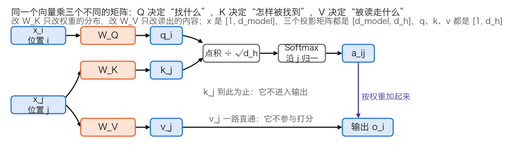
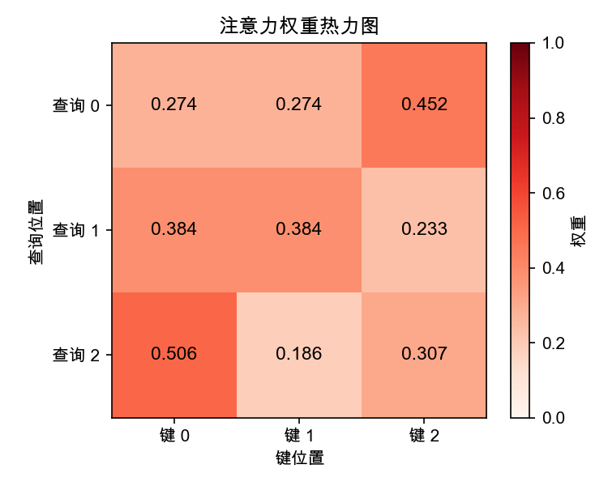
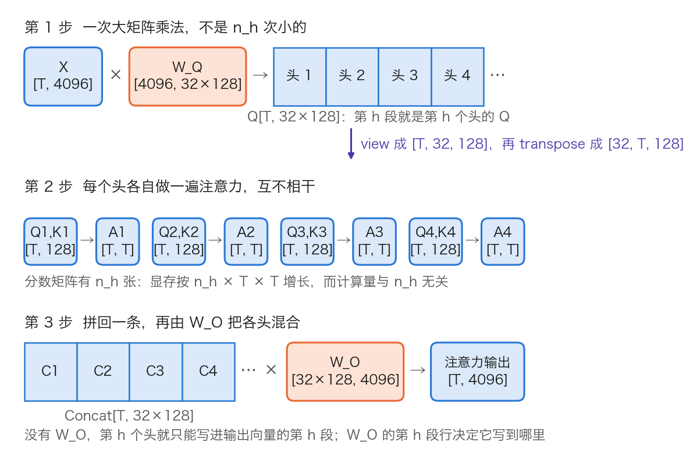
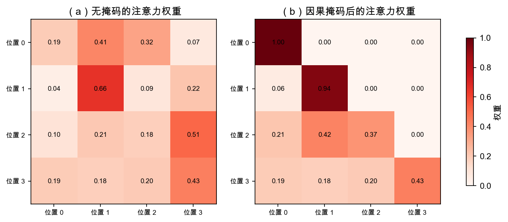
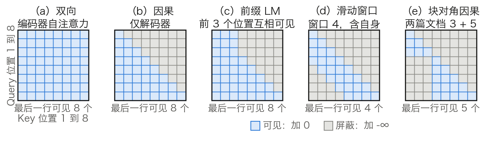
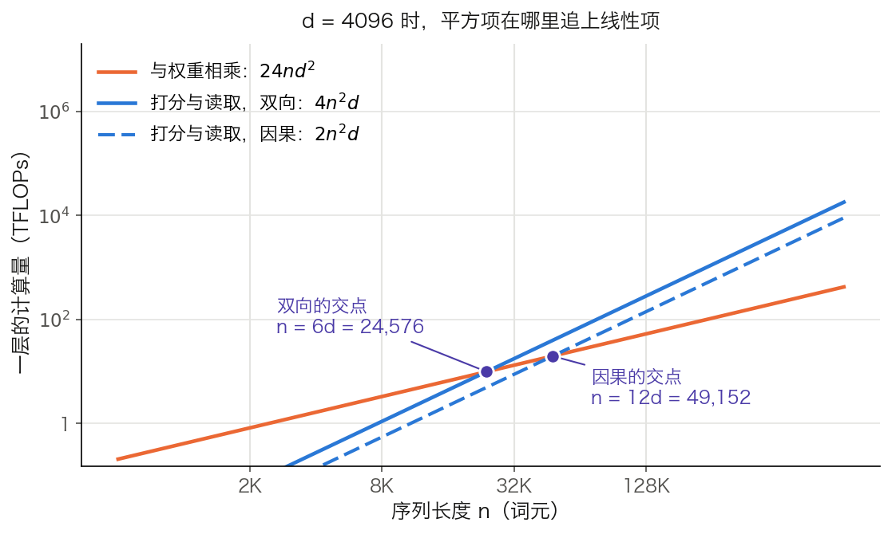

# 第二章：注意力机制：为什么它是核心

注意力机制是 Transformer 架构的灵魂。如果说 Transformer 是一座建筑，那么注意力机制就是支撑整个结构的钢筋骨架——理解它的每一个设计细节，是真正掌握 Transformer 的基础。

上一章介绍了注意力机制的诞生背景，本章将深入其内部运作原理。不仅会给出数学公式，更重要的是解释每一个设计选择背后的直觉与动机：查询-键-值的三元组为什么这样设计？缩放因子 $\sqrt{d_k}$ 解决了什么数学问题？多头注意力为什么比单头更强大？因果掩码为什么是生成任务的必需品？注意力的 $O(n^2)$ 复杂度意味着什么、又如何应对？

## 1. 查询-键-值：一种信息检索的直觉

[1.3 节](../01_introduction/1.3_attention_birth.md)里的注意力只有两个角色：解码器状态 $s_t$ 负责发问，编码器隐藏状态 $h_j$ 既是算分时的比对依据，又是加权求和时被取走的内容。本节回答三个问题：为什么要把 $h_j$ 的这两个身份拆开，为什么发问的一方也要单独投影，以及这三套投影在参数量和框架源码里各对应什么。

本节只讲一个头内部的三路投影。多个头怎样切分与拼接见 [2.3 节](2.3_multi_head.md)，完整的两头数值手算见 [3.8.3 节](../03_components/3.8_gpt_inference_flow.md)，本节不重复做。

### 1.1 三种角色，三套投影

**查询**（Query）、**键**（Key）、**值**（Value）这套术语来自信息检索：用搜索词去比对每个网页的关键词，命中后取回网页的内容。注意力沿用了这个分工，但做的是软匹配：不是只返回最匹配的一项，而是按匹配程度对所有项加权混合。权重连续可导，梯度因此能穿过整个检索过程，让匹配标准随训练一起被学出来。

一层注意力对位置 $i$ 做的事可以写成三步：把 $x_i$ 投影成查询向量，与各位置的键向量逐一打分，再按分数加权取走各位置的值向量。三种角色由三个矩阵产生：

$$Q = XW^Q, \quad K = XW^K, \quad V = XW^V$$

其中 $X \in \mathbb{R}^{n \times d_{\text{model}}}$ 是输入矩阵（$n$ 个位置，每个位置 $d_{\text{model}}$ 维），$W^Q, W^K \in \mathbb{R}^{d_{\text{model}} \times d_k}$，$W^V \in \mathbb{R}^{d_{\text{model}} \times d_v}$。形状写法与 [3.8.3 节](../03_components/3.8_gpt_inference_flow.md)一致：`X[n, d_model] × W_Q[d_model, d_k] → Q[n, d_k]`。

图 2-1 把三条路径分开画。要记住的是它们并不对称：键只参与打分，从不进入输出；值只进入输出，从不参与打分。



图 2-1：三路投影各自流向哪里（[生成脚本](https://github.com/yeasy/llm_internals/blob/main/tools/figures/ch02_qkv_roles.py)）。蓝色是随输入变化的数据，橙色是训练好就固定的权重，与 3.8 节各图的配色一致。

这条不对称性有一个直接推论：改动 $W^K$ 只改变权重的分布，改动 $W^V$ 只改变被读出的内容，两者互不干扰。后面几节反复用到它。

### 1.2 不投影会怎样：一个 3×3 的反例

“分开投影更灵活”只是说法，代价与收益要用数字看。先看不投影时会发生什么：直接用输入向量打分，即 $s_{ij} = x_i x_j^\top$。

取三个二维的单位向量作为三个位置的表示：

$$X = \begin{bmatrix} 1 & 0 \\ 0.8 & 0.6 \\ 0 & 1 \end{bmatrix}$$

一格的算术是逐分量相乘再相加，例如位置 1 对位置 2 的分数 $s_{12} = 1 \times 0.8 + 0 \times 0.6 = 0.8$。对九个位置对重复，得到

$$XX^\top = \begin{bmatrix} 1 & 0.8 & 0 \\ 0.8 & 1 & 0.6 \\ 0 & 0.6 & 1 \end{bmatrix}$$

这张表有两处病症，都与具体取值无关。

第一，矩阵必然对称：$x_i x_j^\top = x_j x_i^\top$。于是“位置 1 关注位置 2 的强度”被迫等于“位置 2 关注位置 1 的强度”。语言里的依赖关系很少对称，代词指向先行词，先行词并不同等地指向代词。

第二，各位置范数相同时，对角线必然是每行最大：由柯西-施瓦茨不等式 $x_i x_j^\top \leq \|x_i\|\|x_j\| = \|x_i\|^2 = x_i x_i^\top$，“看自己”总是排第一。除以 $\sqrt{d_k} = \sqrt{2}$ 再取 Softmax，三行权重分别是 `[0.424, 0.368, 0.209]`、`[0.331, 0.381, 0.288]`、`[0.220, 0.335, 0.445]`，每一行的最大值都落在对角线上。

加上投影，两处病症同时消失。取

$$W^Q = \begin{bmatrix} 0 & 1 \\ 0 & 0 \end{bmatrix}, \quad W^K = \begin{bmatrix} 1 & 0 \\ 0 & 1 \end{bmatrix}$$

位置 1 的查询是 $x_1 W^Q = [0, 1]$，位置 2 的键是 $x_2 W^K = [0.8, 0.6]$，分数 $s_{12} = 0 \times 0.8 + 1 \times 0.6 = 0.6$；反过来，位置 2 的查询是 $[0, 0.8]$，位置 1 的键是 $[1, 0]$，分数 $s_{21} = 0$。同一对位置，两个方向的分数不再相等：

$$XW^Q (XW^K)^\top = \begin{bmatrix} 0 & 0.6 & 1 \\ 0 & 0.48 & 0.8 \\ 0 & 0 & 0 \end{bmatrix}$$

除以 $\sqrt{2}$ 再 Softmax，第一行是 `[0.220, 0.335, 0.445]`：位置 1 把最大的权重给了位置 3，而不是自己。投影换来的正是这两样东西，不是笼统的“灵活”。

### 1.3 查询与键的投影只以乘积出现

把两个投影代回分数式，可以看出它们从不单独起作用：

$$s_{ij} = (x_i W^Q)(x_j W^K)^\top = x_i \underbrace{W^Q (W^K)^\top}_{d_{\text{model}} \times d_{\text{model}}} x_j^\top$$

分数是关于 $x_i$ 与 $x_j$ 的**双线性型**（bilinear form），中间那个矩阵才是真正被学到的东西。它有两个性质。

其一，秩不超过 $d_k$。乘积 $W^Q (W^K)^\top$ 由 `[d_model, d_k] × [d_k, d_model]` 得到，中间那一维是瓶颈。以 GPT-3 6.7B 的配置（`d_model = 4096`、`d_k = 128`，见 [3.8.7 节](../03_components/3.8_gpt_inference_flow.md)的表 3-25）为例，它是一个 `4096 × 4096` 的矩阵，秩至多 128。单头能表达的打分方式因此受限，这一点在 [2.3.5 节](2.3_multi_head.md)还要用来解释头宽度的取值。

其二，单个 Q/K 维度没有固定含义。对任意可逆矩阵 $R$，把 $W^Q$ 换成 $W^Q R$、把 $W^K$ 换成 $W^K (R^{-1})^\top$，乘积不变，分数也不变。因此“第 3 个 Query 维度代表什么”这类问题没有答案，能被解释的是乘积。

同样的道理适用于 $W^V$ 与输出投影 $W^O$：值向量算出后立刻被 $W^O$ 读走，两者也只以乘积 $W^V W^O$ 出现。[Transformer 电路框架](https://transformer-circuits.pub/2021/framework/index.html)把这两个乘积分别称作 QK 回路与 OV 回路，并指出 Q、K、V 向量可以看作计算这两个低秩矩阵过程中的中间结果。该文用列向量约定，故写作 $W_Q^\top W_K$ 与 $W_O W_V$，与本书的行向量写法互为转置。

### 1.4 键与值为什么分开

键与值可以共用一套投影，只是要付出代价。把四种绑定方案并排看，取舍就清楚了（每层每头的参数以 `d_model × d_k` 为单位计）。

| 绑定方案 | 每个头的投影参数 | 换来了什么 | 失去了什么 | 谁在用 |
| --- | ---: | --- | --- | --- |
| Q、K、V 全独立 | 3 份 | 三种角色各自优化 | 参数最多 | 标准 Transformer |
| K = V（共用一套） | 2 份 | 省一份投影 | “怎样被找到”与“提供什么内容”被迫同向 | 少见 |
| Q = K（共享 QK） | 2 份 | 省一份投影，键可复用为查询 | 分数近乎对称（归一化后不严格对称），且需专门禁止位置读取自身 | [Reformer](https://arxiv.org/abs/2001.04451) |
| K、V 由同一隐向量上投影 | 低秩的 2 份 | 缓存只存一份压缩隐向量 | 多一次上投影，结构更复杂 | MLA，见 [10.2.7 节](../10_inference_optimization/10.2_kv_cache.md) |

表 2-1：键与值的四种绑定方案。Reformer 为使局部敏感哈希能把查询和键放进同一空间，令 $k_j = q_j / \|q_j\|$；由于共享后每个位置与自身的分数总是最高，它必须把“读取自身”单独屏蔽掉。MLA 并不是让 K 与 V 相等，而是让两者从同一个压缩隐向量各自上投影，目的是压缩 KV 缓存而非省参数。

由此可以给 2.1.1 的不对称性补上边界：$W^K$ 与 $W^V$ 分开是标准做法，因为耦合会把“如何被找到”与“提供什么内容”压进同一组参数；但这不是不可违反的约束，为推理时的显存而做出的让步（如 MLA）就是反例。

在交叉注意力中，这种分离另有一层用处：键帮助解码器定位源序列中的相关位置，值提供这些位置的内容，两者的最佳表示空间通常不同（见 [2.4.4 节](2.4_self_cross_causal.md)）。

### 1.5 形状、参数量与实现里的名字

形状上只有一条硬约束：查询与键必须同维，因为两者要做点积；值的维度 $d_v$ 在数学上可以不同，输出 $AV \in \mathbb{R}^{n \times d_v}$ 照样成立。实践中取 $d_k = d_v$，便于拼接后由 $W^O$ 投回 $d_{\text{model}}$。

**记号。** 下面的参数账起，多头相关的量按全书形状清单的写法记：$n_h$ 是 Query 头数，$d_h$ 是每头宽度，$n_{kv}$ 是 K/V 头数，`T` 是词元数。标准多头注意力中 $n_{kv} = n_h$，GQA 下 $n_{kv}$ 更小（见 [2.3.7 节](2.3_multi_head.md)）。本章的数学推导则沿用原论文的写法，序列长度记作 $n$、每头宽度记作 $d_k$，值的一侧记作 $d_v$。两套写法指同一批量：$n$ 即 `T`，按上面 $d_k = d_v$ 的常规取法，两者即 $d_h$。汇总见 [3.8.7 节](../03_components/3.8_gpt_inference_flow.md)的表 3-28。

**参数账。** 一层注意力有四个矩阵：$W^Q$、$W^K$、$W^V$ 各把 $d_{\text{model}}$ 投到 $n_h \times d_h = d_{\text{model}}$，$W^O$ 再投回来。不计偏置，一层共 $4d_{\text{model}}^2$ 个参数，与头数无关。以 GPT-3 6.7B（`d_model = 4096`、32 层、MLP 中间层 16,384）为例：

- 一层注意力：`4 × 4096² = 67,108,864`。
- 一层 MLP：`2 × 4096 × 16,384 = 134,217,728`。
- 一层合计 201,326,592，注意力占 `67,108,864 ÷ 201,326,592 = 33.3%`。
- 32 层的注意力参数 `67,108,864 × 32 = 2,147,483,648`，注意力与 MLP 合计 `201,326,592 × 32 = 6,442,450,944`；再加词嵌入 `50,257 × 4096 = 205,852,672`，约 66.5 亿，与“6.7B”这个标称值对得上。

计算量按同一口径：每个词元在一层注意力里与权重相乘约 $8d_{\text{model}}^2$ 次浮点运算，其中 Q/K/V 三个投影占 $6d_{\text{model}}^2$，输出投影占 $2d_{\text{model}}^2$。加上 MLP 的 $16d_{\text{model}}^2$，一层合计约 $24d_{\text{model}}^2$。这部分随词元数线性增长，与序列长度无关；随长度平方增长的是打分与读取，见 [2.5.1 节](2.5_complexity_limits.md)。

**每头宽度不一定是 $d_{\text{model}} / n_h$。** 多数模型确实平分，但 `head_dim` 可以单独设定。Qwen3-4B 的公开配置是 `hidden_size` 2560、`num_attention_heads` 32、`head_dim` 128，此时 `32 × 128 = 4096` 并不等于 2560，$W^O$ 负责把 4096 投回 2560。Hugging Face 的实现正是按这个优先级取值：先读配置里的 `head_dim`，没有才退回 `hidden_size // num_attention_heads`。

**框架里的名字。** 读源码时，本节的四个矩阵会以下面这些名字出现。

| 实现 | 模块名 | 权重形状 | 偏置 |
| --- | --- | --- | --- |
| Hugging Face Llama | `q_proj`、`k_proj`、`v_proj`、`o_proj`（`nn.Linear`） | `q_proj` 为 `[n_h × d_h, d_model]`，`k_proj`、`v_proj` 为 `[n_kv × d_h, d_model]` | 由 `config.attention_bias` 决定，Llama 系列为 `False` |
| Hugging Face GPT-2 | `c_attn`、`c_proj`（`Conv1D`） | `c_attn` 把 Q/K/V 融合成一个 `[768, 3 × 768]`，前向后按 `split` 拆成三份 | 有 |

表 2-2：两种常见实现里的注意力权重。两点容易看错：`nn.Linear` 按“输出 × 输入”存放权重，与正文 $XW$ 的 `[输入, 输出]` 互为转置；GPT-2 用的 `Conv1D` 则按 `[输入, 输出]` 存放，且把三个投影融合成一个矩阵，一次矩阵乘法算出 Q、K、V。GQA 下 `k_proj` 与 `v_proj` 的输出宽度按 `n_kv` 而非 `n_h` 计算（见 [2.3.7 节](2.3_multi_head.md)）。

头数与每头宽度如何取值、多个头怎样切分同一个大矩阵，都留给 [2.3 节](2.3_multi_head.md)。下一节先把打分这一步补完：点积算出来之后，为什么要除以 $\sqrt{d_k}$。

## 2. 缩放点积注意力：为什么要除以根号 d

上一节把打分写成查询与键的点积，还没有解释分母。选点积而不选别的打分函数，理由是工程性的；分母 $\sqrt{d_k}$ 修正的则是一个具体的统计现象，而且这个修正只管到训练开始的那一刻。下面按这个顺序推导，最后把四步计算对到真实实现里的参数与数值处理。

### 2.1 完整公式与计算流程

缩放点积注意力（Scaled Dot-Product Attention）的计算公式为：

$$\text{Attention}(Q, K, V) = \text{softmax}\left(\frac{QK^T}{\sqrt{d_k}}\right)V$$

整个计算分为四步，形状按 [3.8.3 节](../03_components/3.8_gpt_inference_flow.md)的写法给出：

1. **打分**：$S = QK^T$，即 `Q[n, d_k] × Kᵀ[d_k, n] → S[n, n]`。$S_{ij}$ 是第 $i$ 个查询与第 $j$ 个键的点积。
2. **缩放**：$S' = S / \sqrt{d_k}$，逐格除以同一个数。在 2.2.3 给出的初始化假设下，这一步把点积的方差拉回 1。
3. **归一化**：$A = \text{softmax}(S')$，逐行归一，`S'[n, n] → A[n, n]`，每行之和为 1。
4. **读取**：$\text{Output} = AV$，即 `A[n, n] × V[n, d_v] → Output[n, d_v]`。

> [!NOTE]
> **行向量与矩阵打包**：按照《Attention Is All You Need》原论文的设定与深度学习的实现惯例，单个词的查询向量 $\vec{q}$ 被视作**行向量**（维度为 $1 \times d_k$）。序列中 $n$ 个词的查询向量被逐行“打包”（packed together）拼接成完整的查询矩阵 $Q \in \mathbb{R}^{n \times d_k}$。这使得矩阵乘法 $QK^T$ 可以一次性并行计算出所有词对之间的点积分数。

四步中只有第 1、4 步是矩阵乘法，第 2 步是逐格除法，第 3 步是逐行归一。两次矩阵乘法的两个操作数都是数据而非权重，这一点决定了它们的代价随序列长度平方增长（见 [2.5 节](2.5_complexity_limits.md)）。

### 2.2 点积为什么能衡量相关性

点积 $q \cdot k = \sum_{i=1}^{d_k} q_i k_i$ 衡量的是两个向量的方向一致性：

$$q \cdot k = \|q\| \|k\| \cos\theta$$

方向一致时（$\theta = 0$）点积最大，正交时为零，相反时最小。经过投影后，语义上该被读取的键会被学得与查询方向接近，从而得到较大的分数。

选点积而不是 [1.3 节](../01_introduction/1.3_attention_birth.md)的加性注意力，原论文给的理由是工程性的：两者理论复杂度相近，但点积可以用高度优化的矩阵乘法实现，实践中更快、更省空间。它同时指出了点积的短板：$d_k$ 较小时两者表现相当，$d_k$ 较大时，不加缩放的点积注意力不如加性注意力。缩放因子正是为了补上这个短板。

### 2.3 为什么必须缩放：Softmax 的饱和

**点积的方差随 $d_k$ 线性增长。** 设 $q$ 与 $k$ 的各分量相互独立、均值为 0、方差为 1（原论文脚注即用这一组假设，并不要求正态分布），则

- 均值：$E[q \cdot k] = \sum_{i=1}^{d_k} E[q_i]E[k_i] = 0$。
- 方差：$\text{Var}(q \cdot k) = \sum_{i=1}^{d_k} \text{Var}(q_i k_i) = d_k$，因为每一项的方差为 1，共 $d_k$ 项且相互独立。

标准差因此是 $\sqrt{d_k}$。表 2-3 给出几个常见取值。

| $d_k$ | 点积方差 | 点积标准差 | 典型点积范围（$\approx \pm 2\sigma$） | 除以 $\sqrt{d_k}$ 后的方差 |
|-----:|------:|------:|------:|------:|
| 16 | 16 | 4.0 | $\pm 8$ | 1 |
| 64 | 64 | 8.0 | $\pm 16$ | 1 |
| 128 | 128 | 11.3 | $\pm 22.6$ | 1 |
| 512 | 512 | 22.6 | $\pm 45.2$ | 1 |

表 2-3：未缩放点积的方差随 $d_k$ 线性增长，缩放后回到 1。$d_k = 128$ 是当代大模型最常见的每头宽度，对应的未缩放分数典型幅度约 $\pm 23$。

**幅度变大为什么有害。** Softmax 对输入尺度敏感：分数拉开后，最大项的权重趋近 1，其余趋近 0。此时梯度几乎为零，这一层学不到东西。要看清这一点，需要 Softmax 的雅可比矩阵：

$$\frac{\partial a_i}{\partial z_j} = a_i(\delta_{ij} - a_j)$$

其中 $\delta_{ij}$ 在 $i = j$ 时为 1、否则为 0。对角元 $a_i(1 - a_i)$ 在 $a_i \to 1$ 或 $a_i \to 0$ 时都趋于 0，非对角元 $-a_i a_j$ 同理。分布越接近 one-hot，整个雅可比越接近零矩阵，回传到 $Q$、$K$ 的梯度也随之消失。

代入数字。取同一组方向，使缩放后的三个分数为 `[1, 0, −1]`；若 $d_k = 64$ 且不缩放，同样的方向会给出 8 倍大的分数 `[8, 0, −8]`。

| 分数 | Softmax 权重 | 最大项的 $a_1(1 - a_1)$ |
| --- | --- | ---: |
| `[1, 0, −1]`（已缩放） | `[0.665, 0.245, 0.090]` | 0.223 |
| `[8, 0, −8]`（$d_k = 64$，未缩放） | `[0.99966, 0.00034, ≈0]` | 0.000335 |

表 2-4：同一组方向在缩放前后的 Softmax 与梯度尺度。后者的雅可比对角元只有前者的约 1/664，回传的梯度小了两个多数量级。三位小数的权重可用计算器复核：`e⁸ = 2981`，`e⁰ = 1`，`e⁻⁸ = 0.000335`，`2981 ÷ (2981 + 1 + 0.000335) = 0.99966`。

> [!NOTE]
> **减最大值与除以 $\sqrt{d_k}$ 解决的是两个问题。** Softmax 对输入整体平移不变（$\text{softmax}(z) = \text{softmax}(z - c)$），实现时先按行减去最大值再取指数，防的是 $e^{z_i}$ **数值上溢**；除以 $\sqrt{d_k}$ 防的是**梯度消失**。前者是恒等变形，不改变结果；后者改变结果，是模型定义的一部分。

**这个修正只管到初始化。** 上面的推导用的是“各分量独立、零均值、单位方差”，这只在随机初始化时成立。训练开始后，$Q$ 与 $K$ 由同一份输入经两个正在学习的矩阵得到，分量既不独立也不再是单位方差；实测中注意力 logits 会随训练持续增长，大模型上尤其明显。因此 $1/\sqrt{d_k}$ 是一个静态修正，管住的是训练第一步的尺度，管不住其后的漂移。全程性的约束要靠别的手段：QK-Norm 在打分前对 $q$、$k$ 做归一化，logit soft-cap 用 $\tanh$ 把分数压进固定区间，QK-clip 在优化器更新之后回缩 $W^Q$、$W^K$。另有 z-loss 约束最终 Softmax 的配分函数，与注意力内部这个 Softmax 不是一回事。四者都见 [6.3.6 节](../06_training_techniques/6.3_regularization.md)。

**换别的缩放行不行。** 三种替代方案各有取舍：

- 不除以 $\sqrt{d_k}$，改为把 $W^Q$、$W^K$ 的初始化方差按 $1/\sqrt{d_k}$ 缩小。初始时刻等价，但缩放因子被藏进了参数尺度，学习率与初始化从此耦合，调参更难。
- μP（最大更新参数化）用 $1/d_k$ 而非 $1/\sqrt{d_k}$，目的是让超参数在宽度变化时可迁移；代价是它与标准实现的分数尺度不同，整套初始化和学习率都要一起改。
- 余弦注意力与 QK-Norm 先把 $q$、$k$ 归一化，再乘一个可学习的温度。分数尺度不再依赖 $d_k$，但多了一个待学参数和一次归一化开销。

### 2.4 Softmax：指数放大与长度稀释

Softmax 在这里做两件事。一是归一化，把任意实数分数变成非负且和为 1 的权重。二是按指数放大差距：两个位置的分数差 $\Delta$ 对应的权重比恰好是 $e^{\Delta}$，与其他位置无关。分数差 1 对应 2.72 倍，差 5 对应 148 倍。

放大不等于通吃。五个分数 `[2.0, 1.0, 0.1, −0.5, −1.0]` 的 Softmax 是：

| 位置 | 原始分数 | Softmax 权重 |
|------|---------|-------------|
| 1    | 2.0     | 0.606       |
| 2    | 1.0     | 0.223       |
| 3    | 0.1     | 0.091       |
| 4    | -0.5    | 0.050       |
| 5    | -1.0    | 0.030       |

表 2-5：五个分数经 Softmax 后的权重。最高分拿到 60.6%，其余四项合计仍有 39.4%，最低的一项也有 3%，并非只剩一个赢家。

**候选一多，同样的优势会被稀释。** 设某个位置的分数比其余所有位置都高出 5，其余位置彼此相同，则它的权重是 $e^5 / (e^5 + n - 1)$：

- $n = 512$ 时为 0.225；
- $n = 8{,}192$ 时为 0.018；
- $n = 131{,}072$ 时为 0.001。

分数优势没变，权重却掉了两百倍。这不是训练不好，而是行和为 1 这条约束在长序列上的必然结果，[2.5.5 节](2.5_complexity_limits.md)会把它与注意力汇放在一起讨论。

### 2.5 完整的计算示例

以一个简化的例子完整展示缩放点积注意力的计算过程。假设序列长度 $n=3$，维度 $d_k = 4$：

$$Q = \begin{bmatrix} 1 & 0 & 1 & 0 \\ 0 & 1 & 0 & 1 \\ 1 & 1 & 0 & 0 \end{bmatrix}, \quad K = \begin{bmatrix} 1 & 1 & 0 & 0 \\ 0 & 0 & 1 & 1 \\ 1 & 0 & 1 & 0 \end{bmatrix}, \quad V = \begin{bmatrix} 1 & 0 & 0 & 1 \\ 0 & 1 & 1 & 0 \\ 1 & 1 & 0 & 0 \end{bmatrix}$$

1. **计算点积** $S = QK^T$。第 1 行第 3 列由 $Q$ 的第 1 行与 $K$ 的第 3 行逐项相乘再相加：$1\times1 + 0\times0 + 1\times1 + 0\times0 = 2$。
   $$S = \begin{bmatrix} 1 & 1 & 2 \\ 1 & 1 & 0 \\ 2 & 0 & 1 \end{bmatrix}$$
2. **缩放**（除以 $\sqrt{d_k} = \sqrt{4} = 2$）：
   $$S' = \begin{bmatrix} 0.5 & 0.5 & 1.0 \\ 0.5 & 0.5 & 0 \\ 1.0 & 0 & 0.5 \end{bmatrix}$$
3. **Softmax 归一化**（按行操作）。第 1 行取指数得 `[1.649, 1.649, 2.718]`，行和 6.016，各项除以行和即得该行权重：
   $$A = \text{softmax}(S') \approx \begin{bmatrix} 0.274 & 0.274 & 0.452 \\ 0.384 & 0.384 & 0.233 \\ 0.506 & 0.186 & 0.307 \end{bmatrix}$$
4. **加权求和**计算输出 $\text{Output} = AV$：
   $$\text{Output} \approx \begin{bmatrix} 0.726 & 0.726 & 0.274 & 0.274 \\ 0.616 & 0.616 & 0.384 & 0.384 \\ 0.814 & 0.494 & 0.186 & 0.506 \end{bmatrix}$$

每个输出位置的向量是所有位置值向量的加权组合，权重由查询和键的匹配度决定。输出维度是 $d_v$；多头拼接后再由输出投影回到 $d_{\text{model}}$，因此可以直接传给下一层。

下面用 PyTorch 完整实现上述计算，矩阵与正文相同，可直接运行核对每一步：

```python
import torch
import torch.nn.functional as F
import math

# 与正文 §2.2.5 相同的矩阵 (n=3, d_k=4)
Q = torch.tensor([[1, 0, 1, 0],
                  [0, 1, 0, 1],
                  [1, 1, 0, 0]], dtype=torch.float32)

K = torch.tensor([[1, 1, 0, 0],
                  [0, 0, 1, 1],
                  [1, 0, 1, 0]], dtype=torch.float32)

V = torch.tensor([[1, 0, 0, 1],
                  [0, 1, 1, 0],
                  [1, 1, 0, 0]], dtype=torch.float32)

d_k = Q.size(-1)  # 4

# 第1步：计算注意力分数 S = Q @ K^T
scores = torch.matmul(Q, K.transpose(-2, -1))
print("注意力分数 QK^T:\n", scores)

# 第2步：缩放 S' = S / sqrt(d_k)
scaled_scores = scores / math.sqrt(d_k)
print("缩放后分数 (÷√4):\n", scaled_scores)

# 第3步：Softmax 归一化（每行之和为 1）
attn_weights = F.softmax(scaled_scores, dim=-1)
print("注意力权重 (softmax):\n", attn_weights)
print("每行之和:", attn_weights.sum(dim=-1))

# 第4步：加权求和 Output = A @ V
output = torch.matmul(attn_weights, V)
print("最终输出:\n", output)
print("输出形状:", output.shape, " （与输入相同: n×d_v）")
```

运行上述代码后，可以得到如下结果。

```text
注意力分数 QK^T:
 tensor([[1., 1., 2.],
        [1., 1., 0.],
        [2., 0., 1.]])
缩放后分数 (÷√4):
 tensor([[0.5000, 0.5000, 1.0000],
        [0.5000, 0.5000, 0.0000],
        [1.0000, 0.0000, 0.5000]])
注意力权重 (softmax):
 tensor([[0.2741, 0.2741, 0.4519],
        [0.3837, 0.3837, 0.2327],
        [0.5065, 0.1863, 0.3072]])
每行之和: tensor([1., 1., 1.])
最终输出:
 tensor([[0.7259, 0.7259, 0.2741, 0.2741],
        [0.6163, 0.6163, 0.3837, 0.3837],
        [0.8137, 0.4935, 0.1863, 0.5065]])
输出形状: torch.Size([3, 4])  （与输入相同: n×d_v）
```

把权重矩阵绘成热力图，颜色深浅即权重高低。



图 2-2：缩放点积注意力权重热力图（[生成脚本](https://github.com/yeasy/llm_internals/blob/main/tools/figures/attention_heatmap.py)）。颜色越深权重越高；每一行之和为 1。图中行列下标从 0 起，正文从 1 起，「查询 0」即上式中的第 1 行。

### 2.6 对到真实实现

生产代码里很少手写这四步，而是调用融合内核。PyTorch 的入口是 `torch.nn.functional.scaled_dot_product_attention`，签名为 `(query, key, value, attn_mask=None, dropout_p=0.0, is_causal=False, scale=None, enable_gqa=False)`。表 2-6 把正文的四步逐一对上去。

| 正文的步骤 | 接口里的对应物 | 要点 |
| --- | --- | --- |
| 输入的 Q、K、V | `query` 形状 `[..., Hq, L, E]`，`key` 形状 `[..., H, S, E]`，`value` 形状 `[..., H, S, Ev]` | 常见布局是 `[B, n_h, T, d_h]`，与 3.8.7 的表 3-26 一致；`L` 是查询数，`S` 是键值数，两者不必相等；`E` 即正文的 $d_k$，`Ev` 即 $d_v$ |
| 第 2 步的 $1/\sqrt{d_k}$ | `scale` | 默认即 $1/\sqrt{E}$，$E$ 取 `query` 的最后一维；传入非默认值可实现 μP 那类缩放 |
| 第 3 步之前加掩码 | `attn_mask` 或 `is_causal=True` | 布尔掩码中 `True` 表示**参与**注意力，与 `masked_fill` 的约定相反；浮点掩码则直接加到分数上；两者不能与 `is_causal` 同时使用 |
| 第 3 步之后的 dropout | `dropout_p` | 作用在注意力权重上，即 Softmax 之后、乘 $V$ 之前 |
| K/V 头数少于 Q 头数 | `enable_gqa=True` | 见 [2.3.7 节](2.3_multi_head.md) |

表 2-6：缩放点积注意力的四步与 PyTorch 接口的对应关系。该函数会在多个后端之间选择，包括不把 `[L, S]` 分数矩阵写回显存的融合实现（见 [10.3 节](../10_inference_optimization/10.3_flash_attention.md)）与朴素的数学实现；后者在半精度输入下会把中间结果保持为 FP32。手写版本可见[附录 A.2](../appendix/a2_pytorch_examples.md)。

三处数值细节值得单独记住。

**Softmax 常被升到 FP32。** FP16 能表示的最大值是 65,504，超出即为 `inf`。未缩放的 $QK^T$ 在长序列或大 $d_k$ 下有溢出风险，指数运算更是把风险放大。Hugging Face 的 Llama 朴素实现把这一步写成 `softmax(attn_weights, dim=-1, dtype=torch.float32).to(query.dtype)`：以 FP32 计算，再转回原精度。BF16 的指数范围与 FP32 相同，溢出风险小得多，但尾数更短。

**注意力 dropout 的位置容易记错。** 它丢弃的是注意力权重，不是值向量，丢弃后行和不再为 1。GPT-2 的配置里 `attn_pdrop` 为 0.1；现代大模型的预训练多把它设为 0，微调时才可能启用。

**分数矩阵是数据，不是权重。** 它随输入变化，每层每个头各一张，训练时还要留到反向传播（见 [2.5.1 节](2.5_complexity_limits.md)）。这是长上下文显存开销的主要来源，也是 FlashAttention 要绕开的东西。

## 3. 多头注意力：为什么多个子空间更好

前两节的公式里只有一组 Q、K、V。多头注意力从同一个输入分别投影出 $n_h$ 组 Q、K、V，各组独立计算，再拼接输出；实现时可把各头的投影合成大矩阵乘法。本节先说明一组为什么不够，再说明投影与切分的形状，最后讨论头数、宽度及训练后的分工。

### 3.1 单头只能给出一个加权平均

考虑句子“小明在北京的大学里学习计算机科学”。对“学习”这个位置，至少要建立三种关系：主语是“小明”，地点是“北京的大学”，宾语是“计算机科学”。

单头注意力对这个位置只输出**一个**加权平均。三处内容被同一组权重读出后相加成一个向量，之后再也分不开：后续层拿到的是混合结果，无法知道其中哪部分来自主语、哪部分来自宾语。原论文对此的表述是，多头让模型能同时关注来自不同表示子空间的信息，而单头的平均会妨碍这一点。

这里的障碍不是“注意力总量只有 1 不够分”。多头之下每个头的权重同样和为 1，总量并没有变多。真正的差别是输出的份数：$n_h$ 个头给出 $n_h$ 个独立的加权平均，各自占据输出向量的一段，再由 $W^O$ 决定怎样组合。一个平均变成 $n_h$ 个平均，这才是多头换来的东西。

### 3.2 实现里的多头：一次投影，两次变形

以自注意力为例，输入为 $X \in \mathbb{R}^{T \times d_{\text{model}}}$，其中 $T$ 是词元数，$d_{\text{model}}$ 是每个词元的表示维度，省略批大小维。**多头注意力**（Multi-Head Attention，MHA）写为：

$$\text{MultiHead}(X) = \text{Concat}(\text{head}_1, \dots, \text{head}_{n_h})W^O$$

第 $i$ 个头使用自己的投影矩阵，独立计算注意力：

$$\text{head}_i = \text{Attention}(XW_i^Q, XW_i^K, XW_i^V)$$

各投影矩阵的维度为 $W_i^Q, W_i^K \in \mathbb{R}^{d_{\text{model}} \times d_k}$，$W_i^V \in \mathbb{R}^{d_{\text{model}} \times d_v}$。因此一个头的 Q、K 为 `[T, d_k]`，V 与该头输出为 `[T, d_v]`；拼接后为 `[T, n_h × d_v]`，再乘 $W^O \in \mathbb{R}^{n_h d_v \times d_{\text{model}}}$，回到 `[T, d_model]`。下文取常见的 $d_k = d_v = d_h$。

这里始终由输入 $X$ 做投影，不对 2.1 节已经得到的 Q、K、V 再投影一次。[原论文](https://arxiv.org/abs/1706.03762)的多头公式用 Q、K、V 指代模块的三路输入，本节改用 $X$，避免与单头投影结果混淆；交叉注意力的两种输入来源见 [2.4 节](2.4_self_cross_causal.md)。原论文把头数记作 $h$，本书统一记作 $n_h$。

公式写成 $n_h$ 个独立的头，常见实现则把各头的权重沿列拼接，对 Q、K、V 各做一次大投影，也可进一步合并为一次 QKV 投影。图 2-3 以其中一路为例：一次大投影，两次变形。



图 2-3：多头在实现里是“一次大投影，两次变形”（[生成脚本](https://github.com/yeasy/llm_internals/blob/main/tools/figures/ch02_multihead_reshape.py)）。形状按 GPT-3 6.7B 的配置标注，省略 batch 维；图上画 4 个头只为画得下。

形状变化分四步：前三步以 Q 为例，K、V 同理；最后合并各头的注意力输出。

- **一次投影**：`X[T, d_model] × W_Q[d_model, n_h × d_h] → Q[T, n_h × d_h]`。所谓“第 $i$ 个头的 $W_i^Q$”，就是这个大矩阵的第 $i$ 段列。
- **第一次变形**：`view` 成 `[T, n_h, d_h]`，把最后一维按头切开。这一步只改变下标的解释方式，不搬数据。
- **第二次变形**：`transpose` 成 `[n_h, T, d_h]`，每个头对应一个 `[T, d_h]` 视图。交换维度不搬动数据，也不保证该视图在内存中连续（见 [PyTorch 文档](https://docs.pytorch.org/docs/stable/tensor_view.html)）。实际实现还带着 batch 维，即 `[B, n_h, T, d_h]`（见 3.8.7 的表 3-26）。
- **拼回去**：各头算出 `[T, d_h]` 的 context，`transpose` 回来再 `reshape` 成 `[T, n_h × d_h]`，最后 `× W_O[n_h × d_h, d_model]`。

取 `d_model = 4`、`n_h = 2`、`d_h = 2`，切分与拼接的下标是：投影结果每一行有 4 个数，第 1、2 个数归头 1，第 3、4 个数归头 2；头 1 交出的 2 个数写回第 1、2 位，头 2 的写回第 3、4 位。完整的两头数值手算见 [3.8.3 节](../03_components/3.8_gpt_inference_flow.md)，本节不重复。

$W^O$ 不是可有可无的收尾。拼接只是把数字排在一起，前 $d_h$ 个分量仍只含头 1 的信息。没有 $W^O$，第 $i$ 个头就永远只能写进输出向量的第 $i$ 段；有了它，每个头的结果可以写到输出的任何方向上，也可以互相抵消。$W^O$ 的第 $i$ 段行正是头 $i$ 的“写入地址”。

### 3.3 三笔账：参数、计算与显存

“多头不增加计算量”是常被引用的结论，但它只对其中两笔账成立。取 $d_{\text{model}} = n_h \times d_h = d$，序列长 $n$：

- **参数**：$4d^2$，与 $n_h$ 无关。头多头少，切的都是同样大的四个矩阵。
- **打分与读取的计算量**：每个头两次矩阵乘法，各约 $2n^2 d_h$ 次浮点运算，$n_h$ 个头合计 $n_h \times 4n^2 d_h = 4n^2 d$，同样与 $n_h$ 无关（因果掩码下只需算下三角，减半为 $2n^2d$）。
- **分数矩阵的显存**：每个头一张 `[n, n]`，合计 $n_h \times n^2$ 个数，**随 $n_h$ 线性增长**。

第三笔账常被漏掉。取 $d = 4096$、$n = 4096$、FP16、批大小 1，一层里所有头的分数矩阵合计：

- $n_h = 8$（$d_h = 512$）：`8 × 4096² × 2 = 268,435,456` 字节，即 0.25 GiB。
- $n_h = 32$（$d_h = 128$）：1 GiB。
- $n_h = 128$（$d_h = 32$）：4 GiB。

三种配置的参数量和 FLOPs 一模一样，峰值显存却差 16 倍。头数因此不是“反正不要钱”的旋钮，[2.5.1 节](2.5_complexity_limits.md)会把这笔账推广到整个模型。

### 3.4 训练后的头学到了什么

对训练好的模型做头级分析，可以把头的行为归类。[对翻译模型编码器各头的分析](https://arxiv.org/abs/1905.09418)在英俄、英德、英法三个方向上识别出三种可解释的功能：位置头指向相邻位置，句法头指向特定句法关系的词，稀有词头指向句中频率最低的词。这些功能是训练中自发形成的，没有人为指定。

自发分工是否优于人工指派，该文献没有做过对照实验。一种解释是目标函数只要求降低预测误差，不要求分工方式可被人类命名。各类语言关系所需的表示容量差别很大，把“头 1 只看标点”这类规则固定下来，既可能与子空间容量错配，又压缩了表示学习的自由度。

可解释的头只是少数，比例见 2.3.6；把注意力权重直接当作模型的解释，也已被证明站不住脚。

### 3.5 头数与每头宽度怎么定

原论文在保持总计算量不变的前提下做过消融，改变头数的同时反向调整每头宽度。表 2-7 是原文表 3 的 (A) 组。

| $h$ | $d_k = d_v$ | PPL（dev） | BLEU（dev） |
| ---: | ---: | ---: | ---: |
| 1 | 512 | 5.29 | 24.9 |
| 4 | 128 | 5.00 | 25.5 |
| 8（base） | 64 | 4.92 | 25.8 |
| 16 | 32 | 4.91 | 25.8 |
| 32 | 16 | 5.01 | 25.4 |

表 2-7：头数消融，数据取自[原论文](https://arxiv.org/abs/1706.03762)表 3 的 (A) 组，任务为英德翻译，评测集 newstest2013。表头沿用原文记号，$h$ 即本书的 $n_h$，$d_k = d_v$ 即 $d_h$。原文的结论是单头比最好的配置低 0.9 BLEU，头太多时质量也会下降。

照数字读，这是一段平缓的最优区间而非一个最优点：16 头与 8 头的 BLEU 同为 25.8，PPL 还略低；32 头回落 0.4 BLEU，谈不上“严重不足”；只有 1 头明显落后。换言之，头数在相当宽的范围内都可接受，真正吃亏的是极端值。

**为什么每头不能太窄，有理论依据。** 单头的分数矩阵 $QK^\top$ 由 `[n, d_k] × [d_k, n]` 得到，秩不超过 $d_k$。当 $d_k < n$ 时，这个头无法表达任意的 `n × n` 注意力模式。[对低秩瓶颈的分析](https://arxiv.org/abs/2002.07028)据此论证：把每头宽度压到低于输入序列长度，会限制单个头的表示能力，并提出把头宽度直接设为序列长度、与头数解耦。这为“先定每头宽度、再反推头数”提供了论据，也解释了 2.1.3 中那个秩不超过 $d_k$ 的双线性矩阵为什么重要。

实践中的做法正是先定宽度：把 $d_h$ 固定在 64 到 128，再由 $n_h = d_{\text{model}} / d_h$ 反推。GPT-3 Small 是 `768 / 64 = 12` 个头，GPT-3 175B 是 `12288 / 128 = 96` 个头，Llama 3 8B 是 `4096 / 128 = 32` 个头（见 3.8.7 的表 3-25）。模型变大，主要是头数和层数一起增加，每头宽度几乎不动。少数模型单独设定 `head_dim`，此时 $n_h \times d_h \neq d_{\text{model}}$，由 $W^O$ 投回（例子见 [2.1.5 节](2.1_qkv_intuition.md)）。

### 3.6 头并不都有用

切出来的头不是每个都在干活，这一点有可复核的实验结论。

**多数头可以在推理时直接去掉。** [一项逐头消融实验](https://arxiv.org/abs/1905.10650)对训练好的翻译模型与 BERT 逐个屏蔽注意力头，按重要性从低到高依次剪除，分别剪掉 20% 与 40% 的头时性能没有明显下降；多数层甚至可以只保留一个头。继续剪则性能陡降，说明两个模型都不能在不重训的情况下退化为纯单头。

**用带惩罚的剪枝可以剪得更狠。** 同一篇头级分析对英俄翻译模型剪掉 48 个编码器头中的 38 个，BLEU 只下降 0.15；而且被最后剪掉的正是 2.3.4 中那些有明确功能的专门化头。

**注意力权重不等于解释。** 把权重高的位置说成“模型据此做出判断”是一种流行的误读。[一项跨任务的检验](https://arxiv.org/abs/1902.10186)发现：学到的注意力权重常与基于梯度的重要性度量不相关，而且可以构造出与原权重差别很大、却给出几乎相同预测的注意力分布。权重说明的是信息从哪里被读出，不等于结论由哪里决定。

这三条合起来给出本节的边界：多头是有效的设计，但“头数越多分工越细致”“权重图就是模型的推理过程”都不成立。

### 3.7 Q 头与 K/V 头可以不一样多

到这里，Q、K、V 的头数始终相等。推理时这三者的地位并不对称：Q 每轮只用一次就丢，K 和 V 却要存进 KV 缓存，被后面每一轮反复读取（见 [3.8.6 节](../03_components/3.8_gpt_inference_flow.md)）。于是有了同一条轴上的三种配置：

| 配置 | K/V 头数 $n_{kv}$ | 每词元 KV 缓存 | 代表模型 |
| --- | --- | --- | --- |
| MHA（多头） | $n_{kv} = n_h$ | 最大 | GPT-3 各规模 |
| GQA（分组查询） | $1 < n_{kv} < n_h$，每组 Q 头共用一套 K/V | 按 $n_{kv} / n_h$ 缩小 | Llama 3 各规模，$n_{kv} = 8$ |
| MQA（多查询） | $n_{kv} = 1$ | 最小 | 见 [3.7.5 节](../03_components/3.7_full_architecture.md) |

表 2-8：Q 头数与 K/V 头数的三种关系。Q 的头数不变，变的只是 K/V 被共享的程度。

一个词元要存的 K/V 个数是“K 与 V 两份 × K/V 头数 × 每头宽度 × 层数”，四项里只有 K/V 头数随这条轴变化。Llama 3 8B 把 $n_{kv}$ 从 32 降到 8，缓存就降到四分之一，同样的显存因而能多服务四倍的上下文；代价是每组 Q 头共用一套 K/V，匹配依据的多样性下降。逐项代入的字节算例见 [3.7.5 节](../03_components/3.7_full_architecture.md)，缓存的完整账与分页管理见 [10.2 节](../10_inference_optimization/10.2_kv_cache.md)，更激进的压缩见 10.2.7 的 MLA。

下一节换另一条坐标轴：Q 与 K、V 可以来自不同的序列，而哪些位置允许被看见，则由掩码决定。

## 4. 自注意力、交叉注意力与因果掩码

2.1 到 2.3 节里的 Q、K、V 始终由同一个输入矩阵 $X$ 投影而来，多头切分的也只是 $d_{\text{model}}$ 这一个维度；至于键值取自哪个序列、哪些位置允许被看见，此前一直默认“同一个序列、全部可见”。本节换的正是这另一条坐标轴，并说明因果掩码换来的两样东西：训练时的并行，和推理时的可缓存。

### 4.1 自注意力：序列内部的信息交互

**自注意力**（Self-Attention）指 Q、K、V 全部来自同一个序列。每个位置既提问，也提供用于匹配的键和被读走的内容。

它的核心能力是建立序列内部的任意距离依赖。以“猫坐在垫子上，因为它很软”为例，“它”的查询向量与“猫”“垫子”的键向量各自打分，指代关系由分数决定，与两者相隔多远无关。

在 Transformer 编码器中，自注意力是全双向的：每个位置可以关注任意其他位置。这使编码器能用完整上下文构建每个位置的表示。

有一点要先记下：不加掩码的自注意力对输入顺序是置换等变的，打乱输入的行序，输出只是跟着换行（推导见 [3.3.1 节](../03_components/3.3_position_encoding.md)）。顺序信息靠位置编码带入（见[第四章](../04_position_encoding/README.md)），可见范围靠掩码规定，两者是不同的机制。下一小节的因果掩码正是打破置换等变的那个例外。

### 4.2 因果掩码：遮住未来换来了什么

自回归生成中，第 $t$ 个词元只能依据前 $t-1$ 个词元预测。但自注意力默认是全连接的：训练时若不加限制，预测第 $t$ 个词元的位置会直接读到第 $t$ 个词元本身，任务退化为复制。

**因果掩码**（Causal Mask）把分数矩阵的上三角置为 $-\infty$：

$$\text{Mask}_{ij} = \begin{cases} 0 & \text{if } j \leq i \\ -\infty & \text{if } j > i \end{cases}$$

加到缩放后的分数上，再做 Softmax：

$$A = \text{softmax}\left(\frac{QK^T}{\sqrt{d_k}} + \text{Mask}\right)$$

由于 $e^{-\infty} = 0$，被屏蔽的位置权重为零，既不进入行和，也读不到任何内容。训练时解码器输入整体右移一位，位置 $i$ 读到的是已给定的前缀，预测目标是下一个词元。

遮住未来不只是为了不作弊，它还换来两样东西，仅解码器架构能胜出主要靠这两条。

**收益一：一次前向产生 $n$ 个训练信号。** 一条长 $n$ 的序列送进模型，每个位置都算出“下一个词元”的分布，于是一次前向同时得到 $n$ 个预测的损失。这等价于用 $n$ 个前缀各做一次预测，计算却只做一遍。没有掩码则只有两条路：要么泄漏答案，要么真的跑 $n$ 次。

**收益二：旧位置的 K、V 永不改变。** 位置 $i$ 的键和值只由位置 $1$ 到 $i$ 的内容算出，追加新词元不会改变它们，因此可以存下来复用，这就是 KV 缓存（见 [3.8.6 节](../03_components/3.8_gpt_inference_flow.md)与 [10.2 节](../10_inference_optimization/10.2_kv_cache.md)）。双向注意力没有这个性质：新词元会改变所有旧位置的表示，缓存无从谈起。

下面的代码展示因果掩码的实现，`torch.triu` 造出上三角，`masked_fill` 把它填成 $-\infty$：

```python
import torch
import torch.nn.functional as F
import math

seq_len, d_k = 4, 8
torch.manual_seed(42)
Q = torch.randn(seq_len, d_k)
K = torch.randn(seq_len, d_k)
V = torch.randn(seq_len, d_k)

# 计算原始注意力分数并缩放
scores = torch.matmul(Q, K.transpose(-2, -1)) / math.sqrt(d_k)
print("缩放后注意力分数:\n", scores.round(decimals=3))

# 生成因果掩码：上三角部分填充 -inf
mask = torch.triu(torch.ones(seq_len, seq_len), diagonal=1).bool()
scores_masked = scores.masked_fill(mask, float('-inf'))
print("应用因果掩码后:\n", scores_masked.round(decimals=3))

# Softmax 后，-inf 位置的权重变为 0
attn_weights = F.softmax(scores_masked, dim=-1)
print("注意力权重（未来位置权重为 0）:\n", attn_weights.round(decimals=3))

# 验证：位置 0 只关注自己，位置 3 关注所有位置
print("位置 0 的非零权重数:", (attn_weights[0] > 0).sum().item())  # 1
print("位置 3 的非零权重数:", (attn_weights[3] > 0).sum().item())  # 4
```

上述代码的输出结果如下：

```text
缩放后注意力分数:
 tensor([[-2.0540, -1.3070, -1.5420, -3.0560],
        [-1.2510,  1.5270, -0.5000,  0.4230],
        [-1.0700, -0.3880, -0.5080,  0.5160],
        [-0.5580, -0.6240, -0.5440,  0.2480]])
应用因果掩码后:
 tensor([[-2.0540,    -inf,    -inf,    -inf],
        [-1.2510,  1.5270,    -inf,    -inf],
        [-1.0700, -0.3880, -0.5080,    -inf],
        [-0.5580, -0.6240, -0.5440,  0.2480]])
注意力权重（未来位置权重为 0）:
 tensor([[1.0000, 0.0000, 0.0000, 0.0000],
        [0.0590, 0.9410, 0.0000, 0.0000],
        [0.2110, 0.4180, 0.3710, 0.0000],
        [0.1930, 0.1800, 0.1950, 0.4320]])
位置 0 的非零权重数: 1
位置 3 的非零权重数: 4
```

**用这组数字验证收益二。** 第 3 行（即上面代码输出里的位置 2）的权重是 `[0.211, 0.418, 0.371, 0]`。它只由 $q_3$ 与 $k_1$ 到 $k_3$ 决定：对 `[-1.070, -0.388, -0.508]` 取指数得 `[0.343, 0.678, 0.602]`，行和 1.623，逐项相除即得这三个数。如果只把前 3 个词元送进模型，算出来的最后一行一模一样。Decode 每轮只算一行，结果与把整条序列重算一遍完全相同，依据就在这里。

把掩码前后的权重并排画成热力图，下三角结构一目可见。



图 2-4：因果掩码前后的注意力权重热力图对比（[生成脚本](https://github.com/yeasy/llm_internals/blob/main/tools/figures/causal_mask_heatmap.py)）。左图每一行的权重分布在全部 4 个位置上；右图右上角全为零，位置 0 的权重全部集中在自身。

### 4.3 掩码的实现细节与两个陷阱

掩码是**加**在分数上，不是乘在权重上。先做 Softmax 再把未来位置乘 0，行和就不再是 1，等于悄悄改变了各位置的相对权重；加 $-\infty$ 则让被屏蔽的项从指数和里彻底消失，剩下各项仍然归一。

两个实际陷阱值得记住。

**半精度下常用 `finfo(dtype).min` 代替 $-\infty$。** Hugging Face 的掩码工具就是把布尔掩码转成“可见处为 0.0、屏蔽处为 `torch.finfo(dtype).min`”的浮点掩码再相加。用有限的极小值而非 $-\infty$，是为了避免后续算子在半精度下遇到 `inf` 时产生 `NaN`。

**整行被遮住会得到 NaN。** 一行分数若全是 $-\infty$，指数全为 0，行和为 0，Softmax 变成 0 除以 0。左填充序列里填充位置自己的那一行正是这种情形：它前面没有任何可见位置。这是批量推理里“损失突然变成 NaN”的常见原因，对策要么保证每行至少一个可见位置，要么用有限极小值让分数仍可归一。

还有一笔浪费值得知道。朴素实现先算满 `[n, n]` 再遮掉上三角，被丢弃的有 $n(n-1)/2$ 格，$n = 1024$ 时占 49.95%，接近一半的乘法白做。融合内核不这样做：给定 `is_causal=True`，它直接跳过整块被遮住的分块。因此 3.8.8 与 [2.5.1 节](2.5_complexity_limits.md)在数因果注意力的 FLOPs 时都已折半。传入显式下三角掩码与设置 `is_causal=True` 在数学上等价，但能否走到跳块的快路径可能不同。

### 4.4 交叉注意力：两个序列之间的桥梁

**交叉注意力**（Cross-Attention）中，Q 来自目标序列，K、V 来自另一个序列（通常是编码器最后一层的输出）。它是编码器-解码器架构的连接点。

形状是它与自注意力最明显的区别。设目标序列长 $m$、源序列长 $n$：`Q[m, d_k] × Kᵀ[d_k, n] → 分数[m, n]`，再 `[m, n] × V[n, d_v] → [m, d_v]`。分数矩阵不是方阵，代价为 $O(mnd)$，而且通常不加因果掩码——源序列是已知的完整输入，目标位置读取它的任何部分都不算偷看。

实现上有一条重要性质：源序列的 K、V 在整个生成过程中不变，可以只算一次并一直缓存。自注意力的 KV 缓存每轮追加一行，交叉注意力的缓存则是一次写入、只读到底。

今天它的主要去处是编码器-解码器模型，以及把非文本模态编码后交给语言模型的多模态结构（见 [14.4 节](../14_future_trends/14.4_multimodal.md)）。仅解码器模型不需要它：源内容被直接拼进同一条序列，由同一套自注意力读取，代价是源内容也占用上下文长度。

### 4.5 三种注意力在 Transformer 中的位置

| 注意力类型 | 所在位置 | Q 来源 | K/V 来源 | 掩码 |
|-----------|---------|-------|---------|------|
| 自注意力 | 编码器 | 编码器输入 | 编码器输入 | 无（或填充掩码） |
| 掩码自注意力 | 解码器每层的第一个子层 | 解码器输入 | 解码器输入 | 因果掩码 |
| 交叉注意力 | 解码器每层的第二个子层 | 解码器状态 | 编码器输出 | 无（或填充掩码） |

表 2-9：三种注意力的位置、来源与掩码。仅解码器模型（如 GPT 系列）只用掩码自注意力，仅编码器模型（如 BERT）只用全双向自注意力；三种架构变体的取舍见 [3.7.4 节](../03_components/3.7_full_architecture.md)与 [5.3.3 节](../05_pretraining/5.3_encoder_decoder.md)。

### 4.6 填充掩码：遮的是列，不是行

批处理要求同批序列等长，较短的序列用填充词元补齐。**填充掩码**（Padding Mask）把指向填充位置的分数设为 $-\infty$，使真实位置读不到填充内容。

要点是它遮的是**列**：不让别人读填充位。填充位自己那一行照常计算，输出是垃圾，靠损失掩码丢弃即可，不必也不该整行屏蔽——整行屏蔽正是上面 NaN 的来源。

实现上，`attention_mask` 通常是 `[B, T]` 的 0/1 张量，广播成 `[B, 1, T, T]` 后与因果掩码相加。两张掩码是逻辑与的关系：一个位置要可见，必须既在因果范围内，又不是填充位。

生成时还有一条容易踩的坑：仅解码器模型批量生成必须**左填充**。右填充会把填充词元排在真实内容之后，于是“最后一个位置”不再是真实的最后一个词元，位置索引也整体错位。Hugging Face 的分词器用 `padding_side="left"` 设置，细节与图示见 [9.1 节](../09_decoding/9.1_autoregressive_decode.md)。

### 4.7 序列打包与文档掩码

预训练几乎不会让一条序列只装一篇短文档，那样填充会浪费大量算力。常见做法是把多篇文档首尾相接，拼满固定长度。纯因果掩码此时有漏洞：后一篇文档的位置可以读到前一篇的内容，而两者毫无关系。

对策是块对角因果掩码：在因果条件之外再加一条“同属一篇文档”。Llama 3 明确采用了这一做法，[其论文](https://arxiv.org/abs/2407.21783)写明使用一种掩码来阻止同一条序列内不同文档之间的自注意力。论文同时指出，该改动在标准预训练中影响有限，在超长序列的继续预训练中则很重要。

只重置 `position_ids` 是不够的。重置位置索引只改变位置编码，不改变可见性；注意力分数仍会在文档之间产生非零权重。真正阻断依赖的是掩码本身。

实现上，变长打包通常不显式构造这张 `[n, n]` 矩阵。FlashAttention 的变长接口 `flash_attn_varlen_func` 用 `cu_seqlens` 表达边界：把各条序列长度的前缀和传进去，内核按段处理，天然不会跨段打分。这样既省掉掩码矩阵的显存，也省掉被遮住那些块的计算。相关训练细节见 [6.4 节](../06_training_techniques/6.4_batch_sequence.md)。

### 4.8 掩码家族一览

因果、双向、前缀 LM、滑动窗口、块对角，本质是同一张 `[T, T]` 的 0/$-\infty$ 矩阵，区别只在哪些格子被置为 $-\infty$。图 2-5 把五种并排画出。



图 2-5：五种掩码都是同一张 `[T, T]` 矩阵（[生成脚本](https://github.com/yeasy/llm_internals/blob/main/tools/figures/ch02_mask_family.py)）。行是 Query 位置，列是 Key 位置，深色格表示被屏蔽。

| 掩码 | 规则 | 最后一行可见数（$T = 8$） | 典型使用者 |
| --- | --- | ---: | --- |
| 双向 | 全部可见 | 8 | BERT 等仅编码器模型（见 [12.1 节](../12_encoder_models/12.1_bert.md)） |
| 因果 | $j \leq i$ | 8 | GPT 等仅解码器模型 |
| 前缀 LM | 前缀内部互相可见，前缀之后按因果 | 8 | [UniLM](https://arxiv.org/abs/1905.03197) 的序列到序列目标等（见 [5.3.5 节](../05_pretraining/5.3_encoder_decoder.md)） |
| 滑动窗口 | $i - w < j \leq i$ | 4（$w = 4$） | Longformer（见 [12.3 节](../12_encoder_models/12.3_longformer_bigbird.md)）、Mistral、长上下文混合结构（见 [14.7 节](../14_future_trends/14.7_long_context.md)） |
| 块对角因果 | 因果且同属一段 | 5（第二段长 5） | 打包预训练、多请求拼批 |

表 2-10：掩码家族的规则与使用者。滑动窗口把每行的可见数从 $O(n)$ 压到常数 $w$，计算量随之从 $O(n^2)$ 降到 $O(nw)$，代价是超出窗口的依赖要靠层数堆叠或少量全局位置来补。前缀 LM 一行容易与编码器-解码器混淆：T5 论文把两者并列为不同的架构变体做对照，T5 自身是编码器-解码器。它的编码器用双向掩码、解码器用因果掩码，两者由交叉注意力相连，不是这里的单张 `[T, T]` 矩阵。

下一节把这些形状换算成时间和显存，看长上下文究竟贵在哪里。

## 5. 注意力的代价：复杂度与局限

前四节讲的是注意力怎样工作、为什么这样设计。本节算它的账：一层要做多少次运算、显存里存了什么、长上下文从多长开始变贵，以及除复杂度之外，Softmax 注意力还有哪些绕不开的固有局限。

### 5.1 一层要算多少、存多少

注意力里只有两次矩阵乘法的两个操作数都是数据：打分 $QK^\top$ 和读取 $AV$。

- **打分**：`Q[n, d_k] × Kᵀ[d_k, n] → S[n, n]`，约 $2n^2 d_k$ 次浮点运算。
- **读取**：`A[n, n] × V[n, d_v] → [n, d_v]`，约 $2n^2 d_v$ 次。

按 [3.7.7 节](../03_components/3.7_full_architecture.md)与 [3.8.8 节](../03_components/3.8_gpt_inference_flow.md)的惯例，一次 `[a, b] × [b, c]` 的矩阵乘法记作约 $2abc$ 次运算。把各个头合起来（$n_h \times d_h = d$），这两步合计约 $4n^2 d$；因果掩码下只需算下三角，折半为 $2n^2 d$。

同一层里与权重相乘的部分是另一笔账：Q/K/V 投影 $6nd^2$、输出投影 $2nd^2$、MLP 的两个矩阵 $16nd^2$，合计约 $24nd^2$，随词元数线性增长。于是一层的总账是

$$\underbrace{24nd^2}_{\text{与权重相乘}} + \underbrace{2n^2d}_{\text{打分与读取，因果}}$$

两项在 $n = 12d$ 时相等（双向注意力为 $n = 6d$），与 3.7.7 和 3.8.8 给出的门槛一致。

**显存里存的是分数矩阵，而且训练时必须留着。** 前向算出的 $A = \text{softmax}(S')$ 有 $n^2$ 个数，每层每个头各一张。反向传播绕不开它：记这一步的输出为 $C = AV$，则值的梯度是 $\partial L/\partial V = A^\top \, \partial L / \partial C$，直接用到 $A$；分数的梯度经过 Softmax 的雅可比（见 [2.2.3 节](2.2_scaled_dot_product.md)），写成逐行形式 $\partial L/\partial S' = A \odot \left(\partial L/\partial A - \text{rowsum}(\partial L/\partial A \odot A)\right)$，同样只用 $A$ 和上游梯度。拿到 $\partial L/\partial S'$ 之后，查询与键的梯度各是一次矩阵乘法：`∂S'[n, n] × K[n, d_k] → ∂Q[n, d_k]`，`∂S'ᵀ[n, n] × Q[n, d_k] → ∂K[n, d_k]`，都再除以 $\sqrt{d_k}$。四个梯度里有两个直接含 $A$，另两个经 $\partial L/\partial S'$ 间接依赖它，所以朴素实现在前向时把这张 `[n, n]` 矩阵写进显存，反向时再读回来。

代入一个真实规模：GPT-3 6.7B 的配置（32 层、32 个头），序列长 4,096，FP16，批大小 1。

- 一层所有头的分数矩阵：`32 × 4096² × 2 = 1,073,741,824` 字节，正好 1 GiB。
- 32 层合计 32 GiB。

这还只是一条序列。批大小翻倍，这笔显存也翻倍，而模型权重不变。FlashAttention 针对的正是这一项：它不保存 `[n, n]`，反向时按块重算，用计算换显存和访存（见 [10.3 节](../10_inference_optimization/10.3_flash_attention.md)）；同样的“存还是重算”取舍在 [7.5 节](../07_distributed_training/7.5_activation_checkpointing.md)有系统的讨论。

### 5.2 与其他架构的复杂度对比

表 2-11 沿用原论文表 1 的口径。$n$ 是序列长度，$d$ 是表示维度，$k$ 是卷积核宽度，$r$ 是受限自注意力的邻域大小。

| 架构 | 单层计算量 | 顺序操作数 | 最长路径 |
|------|-----------|-----------|-------------|
| 自注意力 | $O(n^2 \cdot d)$ | $O(1)$ | $O(1)$ |
| 循环层 | $O(n \cdot d^2)$ | $O(n)$ | $O(n)$ |
| 卷积层 | $O(k \cdot n \cdot d^2)$ | $O(1)$ | $O(\log_k n)$ |
| 受限自注意力 | $O(r \cdot n \cdot d)$ | $O(1)$ | $O(n/r)$ |

表 2-11：四种层的复杂度对比，取自[原论文](https://arxiv.org/abs/1706.03762)表 1。“最长路径”指任意两个位置之间信息传递所经过的最短路径的上界，前向与反向都适用：路径越短，长距离依赖越容易学。最后一行的受限自注意力就是今天滑动窗口注意力的源头，它用 $O(n/r)$ 的路径长度换来了对 $n$ 的线性复杂度。

真正的取舍在前三行：自注意力用平方的计算量买到了 $O(1)$ 的路径和完全并行；循环层计算省、但顺序依赖使它无法在序列维度上并行。Transformer 比 RNN 快，主因是顺序操作数从 $O(n)$ 降到 $O(1)$，不是单层 FLOPs 更少。

原论文确实提过“当 $n < d$ 时自注意力比循环层更快”，但它给的限定是机器翻译中的句子级表示，即几十个词元配 $d = 512$。这个前提今天不成立：上下文动辄 8K 到 128K 以上，而 $d$ 仍在 4,096 到 16,384 之间，$n$ 远大于 $d$。

### 5.3 平方项从多长开始主导

把 2.5.1 的两项相除，就得到“平方项占线性项的比例”，它只取决于 $n / d$。取 $d = 4096$：

| 序列长度 $n$ | 单头分数矩阵元素数 | 单头 FP16 显存 | 平方项占比（双向） | 平方项占比（因果） |
|---------:|---------:|---------:|---------:|---------:|
| 512 | 262,144 | 0.5 MiB | 2.1% | 1.0% |
| 2,048 | 4,194,304 | 8 MiB | 8.3% | 4.2% |
| 8,192 | 67,108,864 | 128 MiB | 33.3% | 16.7% |
| 32,768 | 1,073,741,824 | 2 GiB | 133.3% | 66.7% |
| 131,072 | 17,179,869,184 | 32 GiB | 533.3% | 266.7% |

表 2-12：$d = 4096$ 时，注意力的平方项相对一层线性项的比例，以及单个头的分数矩阵显存。占比按 $4n^2d \div 24nd^2 = n / (6d)$ 算出，因果掩码下再折半。显存列是单层单头的数值，整层整模型要再乘头数和层数（见 2.5.1）。[3.7.7 节](../03_components/3.7_full_architecture.md)的表 3-15 用的是另一个分母（注意力项占一层总计算量），同一长度下数值略小，$n = 8{,}192$ 时为 14.3%。

这张表比“计算量增长 65,536 倍”更有用。从 512 增长到 131,072 确实是 65,536 倍，但那只是平方项自己的倍数；决定实际耗时的是它与线性项的相对大小。在 2K 上下文上，注意力的打分与读取只占一层的百分之几，瓶颈在 MLP 和投影；到 32K 以上，它才成为主导项。图 2-6 把两条线画在一起。



图 2-6：$d = 4096$ 时，一层中线性项与平方项的交点（[生成脚本](https://github.com/yeasy/llm_internals/blob/main/tools/figures/ch02_flops_crossover.py)）。橙色是与权重相乘的部分，蓝色是打分与读取；双向注意力在 $n = 6d = 24{,}576$ 处交叉，因果注意力在 $n = 12d = 49{,}152$ 处交叉。

顺带纠正一个常见说法：早期模型把长度限制在 512 或 1024，主因是训练成本和学习式绝对位置嵌入的固定表长，不是硬件上算不动。$n = 1024$、$d = 768$ 时，单头分数矩阵在 FP16 下只有 2 MiB。

### 5.4 推理时的另一笔账

上面都是训练与 Prefill 的视角。有了 KV 缓存，Decode 的每一轮只有新位置这一行 Query，账完全不同：

- 没有 `[n, n]` 矩阵，只有 `[1, s]` 的一行分数，$s$ 是当前总长度。
- 打分与读取每层约 $4sd$ 次运算，对 $s$ 是线性的。
- 与权重相乘的部分退化为每层 $24d^2$，与 $s$ 无关。

代入 $d = 4096$：$s = 1000$ 时，每层打分与读取约 $1.6 \times 10^7$ 次，只有权重部分 $4.0 \times 10^8$ 次的 4%；$s = 131{,}072$ 时前者升到 $2.1 \times 10^9$ 次，反超后者 5 倍。

但 Decode 的真正约束不是这些运算，而是把 KV 缓存从显存搬出来的带宽，以及它占掉的容量。按 [3.7.5 节](../03_components/3.7_full_architecture.md)的缓存账，Llama 3 8B 每个词元要存 128 KiB；128K 的上下文即 `131,072 个词元 × 128 KiB = 16 GiB`，一个请求就吃掉一张卡的大半显存。这条线索由 [10.1 节](../10_inference_optimization/10.1_bottleneck.md)和 [10.2 节](../10_inference_optimization/10.2_kv_cache.md)接手。

### 5.5 复杂度之外的四条局限

平方复杂度是工程问题，下面四条是 Softmax 注意力的结构性质，换硬件解决不了。

**其一，不含顺序。** 不加掩码时自注意力置换等变，顺序必须由位置编码补上（见 [3.3.1 节](../03_components/3.3_position_encoding.md)）。这既是代价，也给了位置编码可替换的空间，第四章整章都在这条缝隙上展开。

**其二，行和必须为 1，没有“谁都不看”的选项。** Softmax 强制每一行权重加起来等于 1。某个头在当前这一步确实无事可看时，它仍必须把这份权重倒到某处。模型学到的解法是倒给位置固定、语义无害的地方，通常是序列开头的几个词元，这就是**注意力汇**（attention sink）。[StreamingLLM](https://arxiv.org/abs/2309.17453) 据此提出：流式推理时保留最靠前的少量词元的 KV（实验中 4 个即够），再配上最近的窗口，困惑度就能稳住；只留最近窗口则会突然退化。这条线索详见 [14.7 节](../14_future_trends/14.7_long_context.md)。

**其三，长度稀释。** 同样的分数优势，候选越多权重越小。按 [2.2.4 节](2.2_scaled_dot_product.md)的算例，领先 5 个单位的位置在 $n = 512$ 时权重 0.225，在 $n = 131{,}072$ 时只剩 0.001。长上下文里注意力分布天然变平，这是“大海捞针”类任务变难的机制来源之一。

**其四，纯注意力堆叠会秩坍缩。** [一项理论分析](https://arxiv.org/abs/2103.03404)证明：去掉残差连接与 MLP 的纯自注意力网络，其输出随深度以双指数速度收敛到秩 1 的矩阵，各行趋同；而残差连接与 MLP 恰好阻止了这种退化。这说明残差和 MLP 不是可有可无的配件，而是让深层注意力网络仍有表达力的必要条件（见 [3.5 节](../03_components/3.5_residual.md)）。

此外，[2.3.6 节](2.3_multi_head.md)已经给出两条与头有关的局限：多数头可剪，以及注意力权重不能直接当作解释。

### 5.6 应对平方复杂度的四类思路

| 思路 | 代表 | 是否精确 | 计算复杂度 | 显存 | 主要代价 |
| --- | --- | --- | --- | --- | --- |
| 稀疏注意力 | Longformer、BigBird | 否 | $O(n \cdot w)$ | $O(n \cdot w)$ | 窗口外的依赖要靠全局词元或层数补 |
| 线性注意力 | Performer、Linear Transformer | 否 | $O(n)$ | $O(n)$ | 精确检索能力弱于 Softmax 注意力，详见 [14.1 节](../14_future_trends/14.1_efficient_attention.md) |
| IO 感知 | FlashAttention | **是** | 仍是 $O(n^2)$ | $O(n)$ | 只省显存与访存，不省运算 |
| 替代架构 | Mamba 等状态空间模型 | 否 | $O(n)$ | 推理时状态固定 | 状态容量固定，长程精确回忆受限 |

表 2-13：四类思路的取舍。最需要分清的是第三行：FlashAttention 不改变注意力的数学定义，也不降低计算复杂度，它避免的是把 `[n, n]` 矩阵写回显存再读回来。把它说成“解决了平方复杂度”是常见误读。Longformer 的复杂度写作 $O(n)$ 时省略了窗口宽度 $w$，严格说是 $O(n \cdot w)$。

这四类方向在[第十章](../10_inference_optimization/README.md)和[第十四章](../14_future_trends/README.md)展开。值得留意的是它们的分工：稀疏与线性改的是注意力的定义，IO 感知改的是实现，替代架构则换掉整个算子。
