# 第三章：Transformer 核心组件解析

注意力机制赋予了 Transformer 建立全局依赖关系的能力，但一个完整的 Transformer 层远不止注意力。分词作为第一步将原始文本切分为离散词元，词嵌入将其转化为连续向量，位置编码注入了序列表达顺序信息，前馈网络提供了非线性变换能力，残差连接确保梯度能流过深层网络，层归一化稳定了训练过程。

这些组件看起来各自独立，但它们的协同作用构成了 Transformer 的完整计算管道。每一个组件的存在都不是偶然的——它解决了特定的技术问题，缺少任何一个，架构的能力都会显著受损。

本章将逐一解析这些组件的原理和设计动机，并在最后展示它们如何组装成完整架构。沿途要回答的是这样几个问题：注意力公式起点的 $X$，行数与每行内容从哪来（[3.1 节](3.1_tokenization.md)、[3.2 节](3.2_embedding.md)）？位置信息为什么必须显式注入（[3.3 节](3.3_position_encoding.md)）？注意力已打通位置间交互，每层为什么还要逐位置的前馈网络（[3.4 节](3.4_feedforward.md)）？梯度为什么能流过上百层（[3.5 节](3.5_residual.md)）？为什么选 LayerNorm 而非 BatchNorm（[3.6 节](3.6_layer_norm.md)）？原始的编码器-解码器架构怎样协同（[3.7 节](3.7_full_architecture.md)）？GPT 式仅解码器又怎样从一个 Prompt 逐词元生成回答（[3.8 节](3.8_gpt_inference_flow.md)）？

## 1. 分词：从文本到词元

上一章介绍了注意力机制如何对向量序列进行全局信息交互。但在注意力能够发挥作用之前，文本必须先被转化为数值向量。这个过程的第一步不是词嵌入，而是**分词**（Tokenization）：将原始文本切分为模型可以处理的基本单元，即**词元**（Token）。

说得更具体些：第二章所有公式的起点都是 $Q = XW^Q$ 里的 $X \in \mathbb{R}^{n \times d_{\text{model}}}$，而 $n$ 由谁决定、$X$ 的每一行从哪里来，第二章始终没有交代。本节回答前半个问题：$n$ 是分词器切出的词元个数，它同时决定了序列长度、上下文占用与计费单位。

本节按四步展开：先说明为什么落在子词这一层，再手算一遍 BPE 的训练与编码，然后交代字节级与预分词这两个工程细节，最后算清词表大小的账并列出分词的典型失效情形。

### 1.1 为什么是子词

神经网络只能处理数值，因此需要一个从文本到整数的映射。两种朴素方案各有明确的代价。

**字符级分词**把每个字符当作一个词元。词表小，但序列极长；要覆盖全部 Unicode，基础词表本身也不小：[GPT-2 论文](https://cdn.openai.com/better-language-models/language_models_are_unsupervised_multitask_learners.pdf)指出，按码点建表会得到“a base vocabulary of over 130,000”，比常用的 32,000 到 64,000 大得多。

**词级分词**以空格切分，语义清晰，但词表庞大，且无法处理**未登录词**（Out-of-Vocabulary，OOV）：训练时未见过的词只能用 `[UNK]` 替代，信息丢失。中文、日文没有空格分隔，这一方案还需要额外的分词工具。

**子词分词**（Subword Tokenization）在两者之间取平衡：常见词保持完整，罕见词拆成已知片段（如 `tokenization` 切成 `token` 与 `ization`）。这一思路由 [Sennrich 等人 2015 年的工作](https://arxiv.org/abs/1508.07909)引入机器翻译，现已成为主流 LLM 的默认选择。

衡量分词好坏的第一个量是**压缩率**，即平均每个词元覆盖多少个字符。用 tiktoken 的 `cl100k_base` 实测一句 69 个字符的英文，得到 12 个词元，压缩率 5.75 字符/词元；同一句话的中文译文 24 个字符切出 28 个词元，压缩率只有 0.86。压缩率直接决定序列长度，而序列长度决定注意力的开销（见 [2.5 节](../02_attention/2.5_complexity_limits.md)）。

### 1.2 BPE 训练：一个可手算的三轮例子

**字节对编码**（Byte Pair Encoding，BPE）是最广泛使用的子词算法。训练过程只有一条规则：反复把语料中出现最频繁的相邻符号对合并成一个新符号。

用一份四个词的迷你语料演示，括号里是词频：`low`（5）、`lower`（2）、`newest`（6）、`widest`（3）。先把每个词拆成字符，并在词尾追加一个词尾标记 `</w>`，用来区分词内片段与词末片段。初始基础符号共 11 个：`</w> d e i l n o r s t w`。

第 1 轮统计全部相邻对。语料里共 14 种相邻对，计数之和 79，逐项如表 3-1。

| 相邻对 | 计数 | 来源 |
| --- | ---: | --- |
| `e`+`s` | 9 | newest 6 + widest 3 |
| `s`+`t` | 9 | newest 6 + widest 3 |
| `t`+`</w>` | 9 | newest 6 + widest 3 |
| `w`+`e` | 8 | lower 2 + newest 6 |
| `l`+`o` | 7 | low 5 + lower 2 |
| `o`+`w` | 7 | low 5 + lower 2 |
| `e`+`w` | 6 | newest 6 |
| `n`+`e` | 6 | newest 6 |
| `w`+`</w>` | 5 | low 5 |
| `d`+`e` | 3 | widest 3 |
| `i`+`d` | 3 | widest 3 |
| `w`+`i` | 3 | widest 3 |
| `e`+`r` | 2 | lower 2 |
| `r`+`</w>` | 2 | lower 2 |

表 3-1：迷你语料第 1 轮的全部相邻对计数。每一项等于包含该相邻对的词的词频之和：`e`+`s` 只出现在 `newest` 与 `widest` 中，故为 `6 + 3 = 9`。三对并列第一，取哪一对由实现的平局规则决定。

最高计数是 9，有三对并列。真实实现按一个固定次序打破平局，结果因实现而异；这里取 `e`+`s`。合并后语料变成 `l o w </w>`、`l o w e r </w>`、`n e w es t </w>`、`w i d es t </w>`。

第 2 轮重新计数。`es`+`t` 的计数是 9，与 `t`+`</w>` 并列第一，取前者，得到 `est`。第 3 轮 `est`+`</w>` 计数 9，独占第一，得到 `est</w>`。

三轮结束，**合并表**（merge table）按学到的先后顺序记为：`(e, s)`、`(es, t)`、`(est, </w>)`。词表则是 11 个基础符号加上这 3 个新符号。训练到此为止，模型此后再也不改这张表。

一个常被忽略的性质：合并表是**有序**的。同一份语料、不同的平局规则，会得到不同的表；表不同，同一个字符串的切分就不同。分词器与模型因此不可分离，见 3.1.8。

### 1.3 BPE 编码：合并表怎样切开一个新词

推理时给定一个新词，编码不是在词表里找最长匹配，而是**按合并表中的先后次序（rank）反复合并**。

用上表切 `lowest`。初始符号序列是 `l o w e s t </w>`。

1. 扫描全部相邻对，找出出现在合并表里、rank 最小的一对。`(e, s)` 的 rank 为 0，命中，合并为 `l o w es t </w>`。
2. 重新扫描。`(es, t)` 的 rank 为 1，命中，得到 `l o w est </w>`。
3. 再扫描。`(est, </w>)` 的 rank 为 2，命中，得到 `l o w est</w>`。
4. 剩余相邻对 `(l, o)`、`(o, w)`、`(w, est</w>)` 都不在表里，停止。

结果是 4 个词元：`l`、`o`、`w`、`est</w>`。注意 `l o w` 没有被合并成 `low`，尽管语料里 `low` 出现 5 次：那需要更多轮训练，而这里只训了 3 轮。

再切 `newer`。初始序列 `n e w e r </w>` 里，`(e, r)` 与 `(r, </w>)` 都不在合并表中，其余相邻对也不在，一次合并都做不了，结果是 6 个词元。同一份语料训出的表，对 `lowest` 压得很紧，对 `newer` 完全无效。

这解释了**词表更大 ≠ 每个词都更短**：合并表只压它见过的高频组合。

### 1.4 字节级与预分词：从 UTF-8 字节到词元

真实 GPT 类分词器在上述算法外加了两层工程处理。

**字节级：基础词表固定为 256。** BPE 的基础符号不取 Unicode 字符，而取 UTF-8 字节。GPT-2 论文的原话是“a byte-level version of BPE only requires a base vocabulary of size 256”。代价是非拉丁文字要先拆成多个字节：`模型` 是 2 个字符、6 个 UTF-8 字节；`大模型原理` 是 5 个字符、15 个字节。好处是任何输入都能表示，`[UNK]` 从根本上不再需要。

字节序列里有不可打印的值，直接放进词表文件不便阅读与处理。GPT-2 的分词器用一个 `bytes_to_unicode` 映射，把 256 个字节一一映射到 256 个可打印的 Unicode 字符，再在映射后的字符上跑 BPE。词表文件因此看起来全是可见字符，实质仍是字节。

**预分词：先用正则切片，再在片内合并。** 不做这一步，BPE 会把标点和空格一起合进词里。GPT-2 论文说明了动机：直接在字节上跑 BPE 会学出 `dog.`、`dog!`、`dog?` 等同一个词的多种变体，“This results in a sub-optimal allocation of limited vocabulary slots and model capacity”，因此“we prevent BPE from merging across character categories”。tiktoken 仓库的 `tiktoken_ext/openai_public.py` 收录了 GPT-2 原始发布所用的模式：

```text
's|'t|'re|'ve|'m|'ll|'d| ?[\p{L}]+| ?[\p{N}]+| ?[^\s\p{L}\p{N}]+|\s+(?!\S)|\s+
```

读法是：常见缩写单独成片；字母串、数字串、其他符号串各自成片；前导的一个空格归属**后面**那个片段。这就是 GPT 系列词元前常带一个空格的原因。

`cl100k_base` 起，数字一项改成了 `\p{N}{1,3}`：一个片段最多 3 位数字。这限制了合并能学出的数字词元，也直接影响算术表现，见 3.1.8。

图 3-1 把这条流水线走了一遍，片段与 ID 由 tiktoken 的 `gpt2` 编码实测。

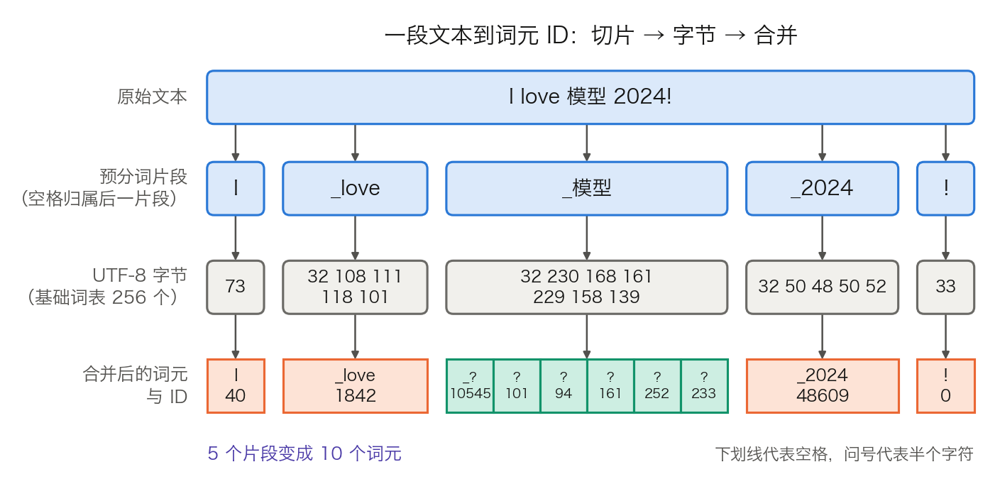

图 3-1：一段文本怎样经预分词、字节化与合并变成词元 ID（[生成脚本](https://github.com/yeasy/llm_internals/blob/main/tools/figures/ch03_bpe_pipeline.py)）。蓝色是数据，橙色表示片段与词元一一对应，青绿色表示一个片段裂成了多个词元。图中 ID 取自 `gpt2` 编码：` 2024` 是一个词元（ID 48609），而 ` 模型` 的 7 个字节要 6 个词元。

**另一条路线：SentencePiece 的字节回退。** SentencePiece 在 Unicode 字符上建表，遇到词表外的字符时按 `byte_fallback` 退回字节，写成 `<0xE6>` 这样的词元。Llama 1/2 的词表里可以直接看到这 256 个字节词元。两条路线的效果接近，区别在于字节是基础单元还是兜底方案。

### 1.5 算法与库：不要混为一谈

“BPE、WordPiece、Unigram”是**算法**，“SentencePiece、tiktoken、HF tokenizers”是**库**。一个库可以实现多种算法，同一个算法也有多种实现。表 3-2 把两层分开。

| 名称 | 属于 | 关键做法 | 使用者 |
| --- | --- | --- | --- |
| BPE | 算法 | 每轮合并计数最高的相邻对 | GPT 系列、Llama 系列 |
| WordPiece | 算法 | 每轮合并使语言模型似然增加最多的一对；非词首片段加 `##` 前缀 | BERT |
| Unigram | 算法 | 从大词表出发，迭代删去对似然影响最小的词元；可给出多种切分及其概率 | T5 |
| SentencePiece | 库 | 直接在原始文本上训练，把空格编码为 `▁`，可无损还原；同时支持 BPE 与 Unigram | Llama 1/2 用其 BPE，T5 用其 Unigram |
| tiktoken | 库 | 字节级 BPE，Rust 实现，只做编码不做训练 | GPT 系列 |
| HF tokenizers | 库 | 把预分词、模型、后处理组织成流水线，产物是一个 `tokenizer.json` | 大量开源模型 |

表 3-2：分词的算法层与库层。SentencePiece 不是一种算法，把它与 WordPiece 并列会造成误解：Llama 1/2 用的是 SentencePiece 库里的 **BPE**，T5 用的是同一个库里的 **Unigram**。tiktoken 官方 README 的口径是“between 3-6x faster than a comparable open source tokeniser”，并非泛泛的“快数十倍”。

读一个真实分词器，核心是 `tokenizer.json` 里的四项：`model.vocab` 是词元到 ID 的映射；`model.merges` 是有序合并表，即 3.1.3 里的 rank 来源；`pre_tokenizer` 是 3.1.4 里的正则；`added_tokens` 是特殊词元及其 ID。tiktoken 一侧则按编码名组织，常见的有 `gpt2`、`cl100k_base`、`o200k_base`，其 `n_vocab` 实测分别为 50,257、100,277、200,019。

### 1.6 词表大小怎么算账

词表大小是一个可以两边都量化的取舍。

**代价一侧：参数。** 词表矩阵的形状是 `[V, d_model]`，与层数无关，但与词表大小成正比。Llama 3 8B 的 `vocab_size = 128256`、`hidden_size = 4096`，一份是 `128,256 × 4,096 = 525,336,576`；它的 `tie_word_embeddings` 为 `false`，输入与输出各一份，共 1,050,673,152 个参数。该模型总参数为 8,030,261,248（逐项账见 3.7.7），词表矩阵占 13.1%。Llama 2 7B 的词表只有 32,000，两份合计 262,144,000，占其 6,738,415,616 的 3.9%。

**代价二侧：LM head 的计算量。** 每生成一个词元，LM head 要做一次 `x[1, d] × W_vocab[d, V]`，约 `2 × d × V` 次浮点运算；整个前向约 `2N` 次（见 3.7.7）。两者之比：Llama 3 8B 为 6.54%，Llama 3 405B 只有 0.52%，而 GPT-2 small 高达 31.02%。词表在小模型上既吃参数也吃计算，在大模型上两项都可忽略。

**收益一侧：序列变短。** [Llama 3 论文](https://arxiv.org/abs/2407.21783)在介绍架构改动时写道，新分词器把英文样本上的压缩率“from 3.17 to 3.94 characters per token”，同时指出“This enables the model to 'read' more text for the same amount of training compute”。序列缩短约 20%，注意力的 `O(T²)` 项与 KV 缓存同比缩小。

结论是一条随规模变化的曲线：模型越小，大词表越不划算；模型越大，扩词表几乎白送。这也正是 3.7.6 里“小模型绑定权重、大模型不绑定”的量化依据。

### 1.7 特殊词元与聊天模板

分词器还要定义一组**特殊词元**（Special Tokens）标记序列结构。两套体系不要混用。

掩码语言模型一侧（BERT）：`[CLS]` 置于序列首，其输出用于分类；`[SEP]` 分隔句对；`[MASK]` 标记被掩盖的位置；`[PAD]` 补齐长度。

自回归一侧（GPT、Llama）：序列开始标记写作 `<s>` 或 `<|begin_of_text|>`；序列结束标记写作 `</s>`、`<|endoftext|>` 或 `<|eot_id|>`，模型选中它即停止解码。GPT-2 把开始与结束合用一个 ID 50256。

对话模型还要把角色写进词元序列，这就是**聊天模板**（chat template）：系统提示、用户消息、助手回复各有自己的起止标记。模板由分词器配置携带，而不是模型权重的一部分；模板错了，模型看到的是训练时没见过的格式。[3.8.2 节](3.8_gpt_inference_flow.md)给出了一条消息变成词元序列的完整例子。

停止词元还有一处工程含义：约束解码时的掩码必须覆盖 logits 的每一列，漏掉停止词元，模型就能在半截输出上结束（见 [11.7 节](../11_serving/11.7_constrained_decoding.md)）。

### 1.8 分词会在哪里出错

分词器训练与模型训练是两件分开做的事，接缝处会漏。

**故障词元。** 词表里存在、模型训练中几乎没见过的词元，其嵌入行停留在初始化附近，喂给模型会引出异常输出。[Land 等人 2024 年的工作](https://arxiv.org/abs/2405.05417)把这类词元称作 glitch token，原文把成因归结为“the disconnect between tokenizer creation and model training”，并给出了基于词表分析与权重指标的自动检测方法。低频词元的嵌入行为见 3.2.7。

**数字切分不固定。** 同一数值在不同上下文里切法不同。用 `cl100k_base` 实测：`1000` 切成 `100`/`0`，`1000000` 切成 `100`/`000`/`0`，`2024` 切成 `202`/`4`。`gpt2` 编码下 `10000` 是一个词元，而 `100000` 是 `100`/`000` 两个。模型要做加法，得先在这些不对齐的片段上把位值恢复出来，这是 3.8 节“教学模型不会算加法”之外、真实模型也常算错的上游原因之一。

**多语言词元税。** 同一句话在不同语言下的词元数相差数倍，直接换算成上下文占用与 API 计费。表 3-3 是同一句话的四种语言版本在三种编码下的实测结果。

| 语言 | 字符数 | UTF-8 字节 | `gpt2` | `cl100k_base` | `o200k_base` |
| --- | ---: | ---: | ---: | ---: | ---: |
| 英语 | 69 | 69 | 13 | 12 | 12 |
| 法语 | 86 | 88 | 31 | 23 | 21 |
| 日语 | 35 | 105 | 38 | 37 | 27 |
| 中文 | 24 | 72 | 52 | 28 | 18 |

表 3-3：同一句话的四种语言版本在三种 tiktoken 编码下的词元数，数值由 tiktoken 0.14.0 实测。中文从 `gpt2` 的 52 个词元降到 `o200k_base` 的 18 个，正是扩词表换来的收益；但即便如此，24 个汉字仍占 18 个词元，而 69 个英文字符只占 12 个。

**尾随空格。** Prompt 以空格结尾，会迫使模型从一个训练中罕见的切分点续写。实测 `The capital of France is` 的末词元是 ` is`，而 `The capital of France is ` 的末两个词元是 ` is` 与一个单独的空格词元。后者在训练语料里几乎不会紧跟一个实词，模型的续写分布因此偏移。

**分词器与模型不可分离。** 换分词器等于换词表，嵌入矩阵与 LM head 同时作废。给已有模型扩词表（如为中文补充词元）必须新增嵌入行并继续预训练，新行否则一直停在初始化值上，与故障词元同理。

分词完成后，每个词元成为一个整数 ID。下一节把这些 ID 换成向量。

## 2. 词嵌入：从离散符号到连续向量

上一节把文本变成了一串整数 ID。Transformer 处理的却是连续向量，**词嵌入**（Word Embedding）就是这两个世界之间的那张表。

[3.1 节](3.1_tokenization.md)比较 32K 与 128K 词表时，判据一直是“嵌入层参数少”还是“嵌入层参数膨胀”；那个会膨胀的矩阵正是本节要拆开看的东西。本节回答四个问题：查表在形状上做了什么，谁在训练中改写这张表，它到底占多少参数，以及同一张表在输出端怎样第二次出现。

### 2.1 为什么需要词嵌入

将词转化为数字最简单的方式是**独热编码**（One-Hot Encoding）：为词表中的每个词元分配一个索引，用一个在该索引处为 1、其余为 0 的向量表示。

独热编码有两个缺陷。其一是维度：向量长度等于词表大小，Llama 3 的一个词元就要 128,256 维，且绝大部分为零。其二是语义：所有词元两两正交，“猫”和“狗”的距离与“猫”和“飞机”完全相同。

词嵌入把每个词元映射为一个低维稠密向量，让语义相近的词元在向量空间中也靠近。维度从 128,256 降到 4,096，同时腾出了表达相似度的空间。

### 2.2 思想溯源与一处限定

用向量表示词义的思想早于 Transformer。2013 年的 **Word2Vec** 用预测上下文（Skip-gram）或由上下文预测中心词（CBOW）的方式学词向量，并展示了向量空间中的线性关系，如 $\vec{\text{king}} - \vec{\text{man}} + \vec{\text{woman}} \approx \vec{\text{queen}}$。随后 **GloVe**（2014 年）改用全局共现矩阵分解，**FastText**（2016 年）把子词信息引入词嵌入。

这条线性关系需要一个限定。标准评测在检索最近邻时会排除三个输入词本身，否则返回的往往是 $\vec{\text{king}}$ 或 $\vec{\text{woman}}$ 而不是 $\vec{\text{queen}}$。它是一个在特定评测约定下成立的经验现象，不是向量空间的严格代数性质。

与早期方法的关键区别在于：早期词嵌入是**静态**的，一个词无论出现在什么上下文里向量都相同；Transformer 的嵌入层只给出**初始表示**，经过多层注意力与前馈网络后，同一个词元在不同上下文中的表示会分开，这就是**上下文化嵌入**（Contextualized Embedding）。

### 2.3 查表的形状与梯度：谁读、谁写

嵌入层是一个**查找表**（Lookup Table）。设词表大小为 $V$、嵌入维度为 $d_{\text{model}}$，则嵌入矩阵 $E \in \mathbb{R}^{V \times d_{\text{model}}}$ 每行对应一个词元。

**形状流。** 分词器交出的是整数张量，嵌入层交出的是浮点张量：

- 输入：`ids[B, T]`，元素是 `0` 到 `V - 1` 的整数。
- 查表：`E[V, d]` 的第 `ids[b, t]` 行。
- 输出：`X[B, T, d]`。

取第 $i$ 行写作 $\text{embed}(i) = E[i, :]$。这在数学上等价于用独热行向量左乘 $E$，即 `onehot[1, V] × E[V, d] → x[1, d]`；实现上直接索引，省掉了一次 `V` 维的乘加。

**谁写这张表。** 嵌入矩阵是可学习参数，但它的梯度结构与其他权重不同：一次前向只读了本批出现过的那些行，反向传播也只给这些行非零梯度。这是**稀疏行梯度**：词表有 12.8 万行，一个批次可能只碰到几万行，低频词元要很多个批次才被更新一次。PyTorch 的 `nn.Embedding` 因此提供 `sparse=True` 选项。

绑定权重时情况不同。输入端与输出端共用同一张矩阵，输出端的 LM head 每一步对**全部** `V` 行都有梯度，稀疏性消失，见 3.2.5。

图 3-2 展示查表过程：每个词元索引直接对应嵌入矩阵中的一行。

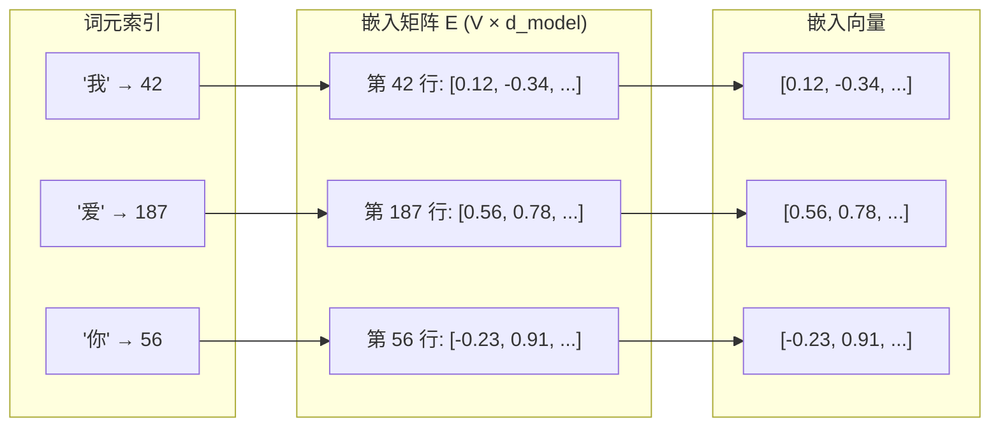

图 3-2：嵌入层通过查找表将词元索引映射为稠密向量。三个索引各取一行，行与行之间互不影响。

### 2.4 嵌入矩阵有多大

嵌入矩阵的参数量是 `V × d_model`，与层数无关。这条简单事实决定了它在不同规模上的地位完全不同。表 3-4 按公开配置逐项算出。

| 模型 | 词表 `V` | `d_model` | 一份词表矩阵 | 绑定 | 总参数 | 词表占比 |
| --- | ---: | ---: | ---: | --- | ---: | ---: |
| GPT-2 small | 50,257 | 768 | 38,597,376 | 是 | 124,439,808 | 31.0% |
| Llama 2 7B | 32,000 | 4,096 | 131,072,000 | 否 | 6,738,415,616 | 3.9% |
| Llama 3 8B | 128,256 | 4,096 | 525,336,576 | 否 | 8,030,261,248 | 13.1% |
| Llama 3 70B | 128,256 | 8,192 | 1,050,673,152 | 否 | 70,553,706,496 | 3.0% |
| Llama 3 405B | 128,256 | 16,384 | 2,101,346,304 | 否 | 405,853,388,800 | 1.0% |

表 3-4：五个公开模型的词表矩阵参数账。不绑定时词表占比按输入、输出两份合计；GPT-2 small 绑定，只有一份。`V`、`d_model` 与绑定与否取自各模型的 `config.json`（405B 的层数与宽度取自 [Llama 3 论文](https://arxiv.org/abs/2407.21783)表 3，见 3.8.7 的表 3-25），总参数由逐项相加得到，算法见 3.7.7。

三条读法。第一，GPT-2 small 有 31.0% 的参数在词表里，这是它当年必须绑定权重的直接原因。第二，Llama 3 8B 的词表比 Llama 2 7B 大 4 倍，占比从 3.9% 跳到 13.1%；同一张 12.8 万行的表放到 405B 上只占 1.0%。第三，占比大致等于 `kV / (kV + 12Ld)`（`k` 为词表矩阵份数），只由词表、层数与宽度三者的比例决定。

GPT-2 small 的“117M”是论文初版口径；按公开权重逐项相加为 124,439,808，OpenAI 后来的模型卡也用 124M。本书统一用逐项相加的口径。

每层参数随 `d_model` 平方增长（3.7.7 给出 `12d²`），词表参数只随 `d_model` 线性增长。模型变大时，分母涨得比分子快，词表占比必然下降。

### 2.5 输入端与输出端：同一张表的两种用法

嵌入矩阵的另一半故事在模型末端。最后一层输出经末端归一化后，要换算成词表上的分数：

`h[T, d] × W_vocab[d, V] → logits[T, V]`

这一步称为 **LM head**（unembedding）。它与嵌入矩阵形状互为转置，因此可以共用同一份权重，即**权重绑定**（Weight Tying）。[Transformer 原论文](https://arxiv.org/abs/1706.03762) 3.4 节写明“we share the same weight matrix between the two embedding layers and the pre-softmax linear transformation”。

绑定与否的判据就是 3.2.4 的占比：词表占比高就绑定，占比低就放开，让输入表示与输出预测各自优化。取舍的完整讨论在 3.7.6。

输出端还带来一项显存开销，训练时尤其明显：logits 的形状是 `[B, T, V]`。Llama 3 8B 在 `B = 4`、`T = 8192` 下，仅这一个张量在 BF16 下就是 `4 × 8192 × 128256 × 2 = 8,405,385,216` 字节，约 7.8 GiB。这是训练框架把损失分块计算、推理时只对最后一行算 logits 的原因（见 [3.8.5 节](3.8_gpt_inference_flow.md)）。词表并行则把 `V` 维切开分到多卡（见 [11.8 节](../11_serving/11.8_multi_gpu_inference.md)）。

### 2.6 嵌入缩放：一个量级算例

Transformer 原论文在同一小节里还交代了一件事：“In the embedding layers, we multiply those weights by $\sqrt{d_{\text{model}}}$”。

$$\text{ScaledEmbed}(x) = E[x] \times \sqrt{d_{\text{model}}}$$

原文只给了做法，没有给动机，也没有消融。通行的解释是量级匹配，可以算一笔账验证其合理性。取 $d_{\text{model}} = 512$：

- 正弦位置向量的每一对分量是同一角度的 $\sin$ 与 $\cos$，平方和恰为 1；共 $d/2$ 对，故 L2 范数恒为 $\sqrt{d/2} = \sqrt{256} = 16$。
- 嵌入若按标准差 0.02 初始化，每个分量的平方期望是 $0.02^2$，范数约 $0.02 \times \sqrt{512} = 0.4525$。
- 乘以 $\sqrt{512} = 22.627$ 后，范数约 10.24，与 16 同量级。
- 若改按标准差 $d^{-1/2} = 0.0442$ 初始化，范数约 1，缩放后约 22.63，同样是同一量级。

不缩放时，嵌入的范数比位置向量小一个半数量级，位置信息会盖过词义。这一解释与算术相符，但它是后人的解释，不是原论文的论证。

缩放还与权重绑定有关。同一张矩阵在输出端要产生 logits，尺度过大会让 Softmax 过尖；在输入端又要与位置编码可比，尺度不能太小。乘 $\sqrt{d_{\text{model}}}$ 只作用于输入端，正好调和这一对要求。这同样是通行理解，原文未明说。

**这个乘法不是普适的。** 现代仅解码器模型各不相同：Llama 系列的 `LlamaModel` 直接用 `embed_tokens` 的输出进入第一层，没有任何缩放，位置信息由每层内部的 RoPE 带入；Gemma 2 在 HF 实现中保留了缩放，把嵌入乘以 `config.hidden_size ** 0.5`。判据不是“原论文怎么做”，而是嵌入、位置机制与残差流三者的量级是否协调。

### 2.7 边界：低频词元与各向异性

**低频词元的嵌入行训练不足。** 3.2.3 说明梯度只落在本批出现过的行上。词表里排在尾部的词元可能在整个预训练中只出现几十次，其嵌入行基本停在初始化值附近，还要承受权重衰减，范数偏小。这正是 [3.1.8 节](3.1_tokenization.md)故障词元的直接成因：分词器语料与模型训练语料不一致时，一批词元会系统性地落入这种状态。

**上下文化表示不是各向同性的。** [Ethayarajh 2019 年的工作](https://arxiv.org/abs/1909.00512)测量了 ELMo、BERT 与 GPT-2 的表示几何，结论是“the contextualized representations of all words are not isotropic in any layer”：向量挤在一个窄锥里，任意两个词的余弦相似度都偏高。该文还指出，在这三个模型的所有层上，平均“less than 5% of the variance in a word's contextualized representations can be explained by a static embedding for that word”。

两个推论。其一，不能把余弦值直接当语义距离用，需要先做中心化或白化。其二，“嵌入层学到了词义”这句话对静态嵌入成立，对深层表示只成立一部分：绝大部分方差来自上下文，而不是词元本身。

**实现对照。** PyTorch 的 `nn.Embedding(num_embeddings, embedding_dim)` 权重形状是 `[V, d]`。HF 的 Llama 实现里，输入端是 `model.embed_tokens`，输出端是 `lm_head`，末端归一化是 `model.norm`；相关配置字段是 `vocab_size`、`hidden_size`、`tie_word_embeddings`。GPT-2 实现里对应的名字是 `wte`（词嵌入）、`wpe`（位置嵌入）与 `ln_f`。张量并行下，嵌入表按行切分 `V`，每卡只持有自己那段，越界 ID 的结果置零后做一次 all-reduce（见 [7.3 节](../07_distributed_training/7.3_model_tensor_parallel.md)）；词表大小常被补齐到某个倍数，正是为了让这一步切得整齐。

下一节交代那个被拿来做量级对照的东西：位置编码。

## 3. 位置编码：为什么顺序信息必须显式注入

上一节解释嵌入为何要乘 $\sqrt{d_{\text{model}}}$ 时，先借用了一个尚未交代的东西：那个值域在 $[-1, 1]$、随后会被加到嵌入向量上的位置编码。本节交代它从哪里来。

本节只做引子，回答三个问题：不加位置信息时注意力到底丢了什么，为什么是相加而不是拼接，以及位置信息在现代模型中从哪个口子进来。正弦编码的完整频率分析与外推性质留给[第四章](../04_position_encoding/README.md)。

### 3.1 置换等变：三行推导与一个数值验证

**无掩码的自注意力对输入顺序是置换等变的**（Permutation Equivariant）：打乱输入的行序，输出也只是跟着换行，每一行的内容不变。

三行推导。设 $P$ 是置换矩阵，输入变成 $X' = PX$。三个投影是逐行做的，因此 $Q' = PQ$、$K' = PK$、$V' = PV$。于是

$$Q'K'^\top = PQ(PK)^\top = P\,(QK^\top)\,P^\top$$

行列被同一个置换重排。逐行 Softmax 与“行列同时置换”可交换，所以 $A' = PAP^\top$，进而

$$A'V' = PAP^\top PV = PAV$$

最后一步用了 $P^\top P = I$。结论：$\text{Attention}(PX) = P \cdot \text{Attention}(X)$。

一个 2 个词元、$d = 2$ 的数值验证。取 $X = \begin{bmatrix}1 & 0\\ 0 & 2\end{bmatrix}$，令 $W_Q = W_K = W_V = I$，缩放因子 $\sqrt{2}$。

- 分数 $XX^\top = \begin{bmatrix}1 & 0\\ 0 & 4\end{bmatrix}$，除以 $\sqrt{2}$ 得 $\begin{bmatrix}0.7071 & 0\\ 0 & 2.8284\end{bmatrix}$。
- 第 1 行 Softmax：$e^{0.7071} = 2.028$，$e^{0} = 1$，权重 $[0.6698,\ 0.3302]$。
- 第 1 行输出：$0.6698 \times [1, 0] + 0.3302 \times [0, 2] = [0.6698,\ 0.6605]$。
- 第 2 行同理得 $[0.0558,\ 1.8884]$。

把两行输入对调，输出恰好是上面两行对调，逐位相同。模型看不出“第 1 行在前”这件事。

这与 RNN、CNN 形成对比。RNN 顺序处理，位置天然由时间步携带。CNN 的卷积核本身是平移等变的，单看卷积并不区分绝对位置；它感知的是局部邻接顺序，绝对位置信息主要由填充边界带入。

### 3.2 因果掩码是例外

上面的推导有一个前提：注意力没有掩码。带因果掩码时结论不成立。

掩码 $M$ 是一个固定的下三角模式，它并不随输入置换，即 $PMP^\top \neq M$。位置 $i$ 只能看到 $\{1, \dots, i\}$，能看到的集合大小本身就携带位置信息。

沿用 3.3.1 的数值例子加上因果掩码：第 1 行只能看自己，输出是 $[1, 0]$；第 2 行不变，仍是 $[0.0558,\ 1.8884]$。把两行对调后重算，得到第 1 行 $[0, 2]$、第 2 行 $[0.6698,\ 0.6605]$，与“输出对调”不同。

所以“Transformer 必须显式注入位置信息，否则无法区分不同顺序的序列”只对**无掩码的双向自注意力**成立。仅解码器模型即使完全不加位置编码也能学到顺序，这条路线称为 NoPE，详见 [4.4 节](../04_position_encoding/4.4_alibi_others.md)。显式位置编码在解码器上仍被普遍采用，原因是收敛更快、外推行为更可控，而不是没有它就不工作。

### 3.3 相加还是拼接：把分数展开成四项

最直接的注入方式是给每个位置一个向量，与词嵌入**相加**：

$$\text{Input}_i = \text{Embed}(x_i) + \text{PE}(i)$$

相加为什么可行，把注意力分数展开就看得见。记内容向量 $e_i$、位置向量 $p_i$，则

$$(e_i + p_i)^\top W_Q^\top W_K (e_j + p_j) = e_i^\top W_Q^\top W_K e_j + e_i^\top W_Q^\top W_K p_j + p_i^\top W_Q^\top W_K e_j + p_i^\top W_Q^\top W_K p_j$$

四项分别是内容对内容、内容对位置、位置对内容、位置对位置。模型可以通过 $W_Q$、$W_K$ 让不同的子空间承担不同的项，因此无须把两种信息分开存放。

代价也在这个展开式里：四项混在同一个分数中，无法单独调节。后续工作正是从这里切入，TUPE 与 DeBERTa 把这几项拆成独立的可学习分量。

拼接的代价则是维度。把 $d_p$ 维位置向量拼到嵌入后面，$d_{\text{model}}$ 随之变大，而每层参数约为 $12 d_{\text{model}}^2$（见 3.7.7），开销按平方增长。相加把这笔开销降为零。

### 3.4 正弦编码速览：一个 4 维算例

原始 Transformer 用**正弦位置编码**（Sinusoidal Positional Encoding）：

$$\text{PE}(pos, 2i) = \sin\left(\frac{pos}{10000^{2i/d_{\text{model}}}}\right)$$

$$\text{PE}(pos, 2i+1) = \cos\left(\frac{pos}{10000^{2i/d_{\text{model}}}}\right)$$

取 $d_{\text{model}} = 4$ 代入。此时 $i$ 只有 0 和 1 两个取值，对应角频率 $\omega_0 = 1/10000^{0} = 1$ 与 $\omega_1 = 1/10000^{0.5} = 0.01$。位置每加一，前两维转过 1 弧度（约 57.3 度），后两维只转过 0.01 弧度（约 0.57 度）：从 $pos = 1$ 的 $[0.8415,\ 0.5403,\ 0.0100,\ 1.0000]$ 到 $pos = 2$，前两维跳到 $[0.9093,\ -0.4161]$，后两维只挪到 $[0.0200,\ 0.9998]$。

这就是“低维转得快、高维转得慢”：每一对维度是一个转速不同的指针，低维分辨相邻位置，高维分辨远距离。前四个位置的完整编码矩阵见 [4.1 节](../04_position_encoding/4.1_sinusoidal.md)的表 4-1，本节不重复。

波长 $2\pi/\omega$ 的跨度取决于 $d_{\text{model}}$。本例只有两档，$2\pi \approx 6.28$ 与 $200\pi \approx 628$；$d_{\text{model}}$ 取到几百以上时，跨度才接近原论文所写的 $2\pi$ 到 $10000 \cdot 2\pi$，其中后者是一个近似值，精确值见 [4.1.2 节](../04_position_encoding/4.1_sinusoidal.md)。

正弦编码还有一条常被引用的性质：$\text{PE}(pos + k)$ 可以写成 $\text{PE}(pos)$ 的线性函数，系数只与 $k$ 有关。它为什么成立、能不能真的换来相对位置感知，在 [4.1 节](../04_position_encoding/4.1_sinusoidal.md)推导。

### 3.5 位置信息在现代模型中的入口

“位置编码加在输入上”这个说法，对今天的主流模型已经不准确。表 3-5 给出三种入口。

| 模型 | 位置机制 | 进入计算的位置 | 实现线索 |
| --- | --- | --- | --- |
| 原始 Transformer | 正弦编码，不可学习 | 输入端与嵌入相加 | 由公式现算，无参数 |
| GPT-2 | 可学习的绝对位置嵌入 | 输入端与词嵌入相加 | `wpe`，形状 `[1024, 768]`，与 `wte` 逐位相加 |
| Llama 系列 | RoPE，旋转 | 每层注意力内部，旋转 Q 与 K | 输入端不加任何东西；`config.json` 里是 `rope_theta` |

表 3-5：三种位置信息入口。GPT-2 的 `wpe` 行数等于 `n_positions`（1,024），这也是它上下文长度的硬上限；Llama 的 RoPE 不占嵌入端参数，扩上下文只需改旋转的底数与缩放策略（见 [14.7 节](../14_future_trends/14.7_long_context.md)）。

共同点只有一条：无论在哪个口子进来，位置信息都必须在注意力打分之前进入计算，否则 3.3.1 的置换等变依然成立。[3.8.2 节](3.8_gpt_inference_flow.md)在走完整流程时，用的是最便于手算的“输入端相加”方案。

## 4. 前馈网络：Transformer 的“记忆层”

前三节交代的都是进入第一层之前的事：$\text{Input}_i = \text{Embed}(x_i) + \text{PE}(i)$ 一旦备齐，词元、语义和位置就全都装进了同一个向量。从本节起，讨论转入层的内部。

每层有两个子层，注意力负责跨位置搬运信息（第二章），**逐位置前馈网络**（Position-wise Feed-Forward Network，FFN）负责在每个位置上就地加工。代码和不少文献把它叫作 MLP（多层感知机），HF 的 Llama 实现里就是 `LlamaMLP`；3.8 节沿用 MLP 这个名字，两者指同一个子层。它占了一层参数的三分之二以上，却常被当成配角。本节给出它的形状、参数账、宽度取舍、激活函数的演进，以及它在推理上的特殊性质。

### 4.1 结构与形状：从两矩阵到三矩阵

原始 FFN 是两层全连接，中间夹一个逐元素激活：

$$\text{FFN}(x) = \sigma(x W_1 + b_1) W_2 + b_2$$

把单个位置的表示 $x$ 视为行向量，则 $W_1 \in \mathbb{R}^{d_{\text{model}} \times d_{ff}}$、$W_2 \in \mathbb{R}^{d_{ff} \times d_{\text{model}}}$。原始 Transformer base 取 $\sigma = \text{ReLU}$、$d_{ff} = 2048$，是 $d_{\text{model}} = 512$ 的 4 倍。

按 3.8 节的记法写出形状，`T` 是词元数：

- `X[T, d] × W_1[d, d_ff] → H[T, d_ff]`
- `H[T, d_ff] → σ(H)[T, d_ff]`（逐元素，不改形状）
- `σ(H)[T, d_ff] × W_2[d_ff, d] → Y[T, d]`

现代开源模型多数改用 **SwiGLU**（各模型的实际选择见 3.4.5 的表 3-9），把升维那一步拆成两路并行投影，一路过激活当作门，另一路直通：

$$\text{FFN}_{\text{SwiGLU}}(x) = \left(\text{SiLU}(x W_{\text{gate}}) \odot x W_{\text{up}}\right) W_{\text{down}}$$

其中 $\odot$ 是逐元素乘，$W_{\text{gate}}, W_{\text{up}} \in \mathbb{R}^{d \times d_{ff}}$，$W_{\text{down}} \in \mathbb{R}^{d_{ff} \times d}$。两个激活函数的定义各一行：

$$\text{SiLU}(z) = z \cdot \sigma(z), \qquad \sigma(z) = \frac{1}{1 + e^{-z}}$$

$$\text{GELU}(z) = z \cdot \Phi(z)$$

$\Phi$ 是标准正态的累积分布函数。GPT-2 等模型用的是它的 tanh 近似，实现里叫 `gelu_new`。

SwiGLU 的形状流多一路，但输入输出仍是 `[T, d]`：

- `X[T, d] × W_gate[d, d_ff] → G[T, d_ff]`，同时 `X[T, d] × W_up[d, d_ff] → U[T, d_ff]`
- `SiLU(G) ⊙ U → H[T, d_ff]`
- `H[T, d_ff] × W_down[d_ff, d] → Y[T, d]`

现代模型通常去掉 $b_1$、$b_2$。HF 的 Llama 实现里，三个投影的 `bias` 由 `config.mlp_bias` 控制，Llama 系列的 `config.json` 中该字段缺省为假。

图 3-3 把两种结构并排画出，标出各矩阵的真实形状。

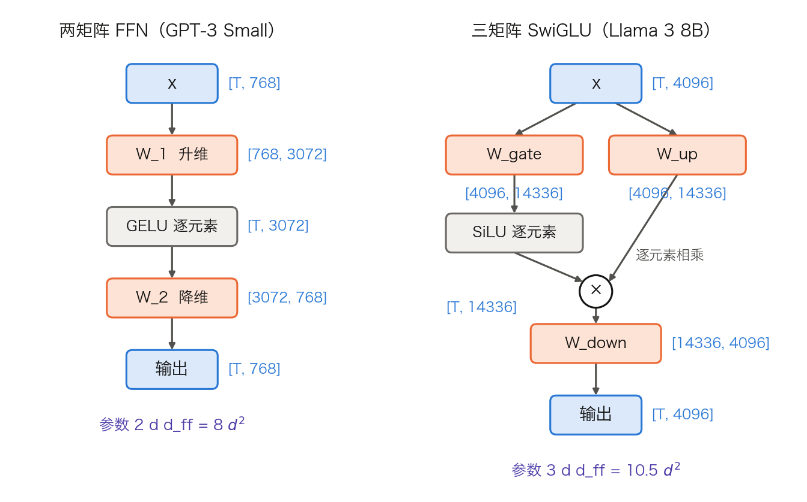

图 3-3：两矩阵 FFN 与三矩阵 SwiGLU 的形状对照（[生成脚本](https://github.com/yeasy/llm_internals/blob/main/tools/figures/ch03_ffn_shapes.py)）。橙色是权重，蓝色是数据。左边取 GPT-3 Small 的配置，右边取 Llama 3 8B 的配置；两者的输入与输出都回到 `[T, d_model]`，差别只在中间那一段。

“逐位置”意味着同一组权重独立地作用于每个位置，位置之间不交换信息。这是与注意力互补的一半：注意力跨位置路由，FFN 就地变换。

**手算一次，看它做了什么。** 取 `d = 2`、`d_ff = 4` 的两矩阵 FFN，激活用 ReLU，不设偏置。输入是一个位置的向量 `x = [1, 2]`，权重是

$$
W_1 = \begin{bmatrix} 1 & 0 & 1 & -1 \\ 0 & 1 & -1 & 1 \end{bmatrix},\qquad
W_2 = \begin{bmatrix} 1 & 0 \\ 0 & 1 \\ 2 & 2 \\ -1 & 1 \end{bmatrix}
$$

$W_1$ 有 4 列，对应 4 个中间单元；$W_2$ 有 4 行，也对应这 4 个单元。计算分三步，图 3-4 上半幅按矩阵画出，表 3-6 逐单元列出：

1. **匹配。** `x` 与 $W_1$ 的每一列做点积，得到 4 个分数 `h = xW_1 = [1, 2, −1, 1]`。每一列相当于一个“探测方向”，分数越大，说明 `x` 越像它。
2. **筛选。** ReLU 把负分置 0，得到 `[1, 2, 0, 1]`。单元 3 与 `x` 方向相反，被关掉。
3. **写回。** 用这 4 个数给 $W_2$ 的 4 行加权求和：`y = 1·[1, 0] + 2·[0, 1] + 0·[2, 2] + 1·[−1, 1] = [0, 3]`。

| 单元 j | $W_1$ 第 j 列 | 分数 $h_j$ | ReLU 后 | $W_2$ 第 j 行 | 写回的量 |
| :---: | --- | ---: | ---: | --- | --- |
| 1 | `[1, 0]` | 1 | 1 | `[1, 0]` | `[1, 0]` |
| 2 | `[0, 1]` | 2 | 2 | `[0, 1]` | `[0, 2]` |
| 3 | `[1, −1]` | −1 | 0 | `[2, 2]` | `[0, 0]` |
| 4 | `[−1, 1]` | 1 | 1 | `[−1, 1]` | `[−1, 1]` |
| 合计 | | | | | `[0, 3]` |

表 3-6：两矩阵 FFN 对 `x = [1, 2]` 的逐单元计算。每一行彼此独立：先用 $W_1$ 的一列打分，再按分数写回 $W_2$ 的一行，最后把四行相加，合计即输出 `y`。

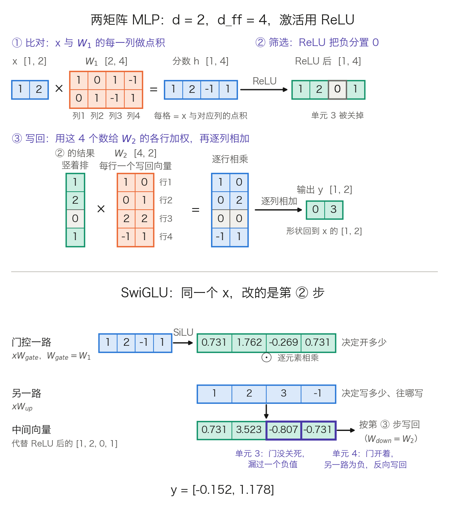

图 3-4：两矩阵 MLP 与 SwiGLU 对同一个 `x = [1, 2]` 的逐步计算（[生成脚本](https://github.com/yeasy/llm_internals/blob/main/tools/figures/ch03_ffn_walkthrough.py)）。蓝色是随输入变化的数据，橙色是权重，青绿是激活后的中间结果，灰格是被 ReLU 关掉的单元。上半幅是比对、筛选、写回三步；下半幅是 SwiGLU，它只替换第 ② 步，写回一步不变。

所以 FFN 做的事可以一句话说完：**拿 `d_ff` 个方向去比对当前向量，被激活的那些各自写回一个向量，加总后交给残差流。** `d_ff` 就是这样的“比对—写回”对的个数，GPT-3 Small 有 3,072 对，Llama 3 8B 有 14,336 对。3.4.3 的键值记忆视角说的正是这个结构。

ReLU 这一步让结果不再是线性的。把输入取反为 `[−1, −2]`，分数变成 `[−1, −2, 1, −1]`，只有单元 3 通过，输出是 `[2, 2]`；若 FFN 是线性的，输入取反，输出只会跟着取反，得到 `[0, −3]`。去掉激活函数，$W_1 W_2$ 就合并成一个 `[2, 2]` 矩阵，四个单元的分工随之消失。

**SwiGLU 改的是第 2 步**（图 3-4 下半幅）。 两矩阵版本里，开多少和写多少都由同一个分数决定；SwiGLU 把两者拆开，门控一路 `SiLU(xW_gate)` 决定开多少，另一路 `xW_up` 决定写多少、朝哪个方向写。沿用上例，令 `W_gate = W_1`，再取

$$
W_{\text{up}} = \begin{bmatrix} 1 & 0 & 1 & -1 \\ 0 & 1 & 1 & 0 \end{bmatrix},\qquad W_{\text{down}} = W_2
$$

则门控一路是 `SiLU([1, 2, −1, 1]) = [0.731, 1.762, −0.269, 0.731]`，另一路是 `xW_up = [1, 2, 3, −1]`，逐元素相乘得中间向量 `[0.731, 3.523, −0.807, −0.731]`。与 ReLU 版本 `[1, 2, 0, 1]` 对比，有两处不同：单元 3 的门没有完全关死，漏过一个小负值；单元 4 门是开的，但另一路是 −1，于是反向写回。第 3 步照旧，按这四个数给 $W_{\text{down}}$ 的行加权求和，得 `y ≈ [−0.152, 1.178]`。

### 4.2 为什么注意力之外还要 FFN

一个常见的说法是“没有 FFN，多层注意力会塌缩成一层线性变换”。这句话不成立：注意力权重由 $QK^\top$ 经 Softmax 得到，本身既非线性又依赖输入，多层堆叠并不等价于单个线性映射。

FFN 的真实作用要具体些说。其一是**通道混合**：注意力的输出是 Value 的加权和，权重对所有通道相同，通道之间从未被重新组合；$W_1$ 与 $W_2$（或 gate/up/down 三者）正是做这件事。其二是**逐位置非线性**：把表示升到 $d_{ff}$ 维，在高维空间做一次选择性响应，再压回 $d_{\text{model}}$ 维。

分工可以这样对照：注意力决定“从哪里取信息”，FFN 决定“取到之后怎么算”。两者都在残差流上读写（见 [3.5 节](3.5_residual.md)），互不替代。

### 4.3 键值记忆视角：依据与限度

把 FFN 看作一张查询表，是一个有实证依据的视角。[Geva 等人 2021 年的工作](https://arxiv.org/abs/2012.14913)给出了这一命题：feed-forward layers “operate as key-value memories, where each key correlates with textual patterns in the training examples, and each value induces a distribution over the output vocabulary”。在本节的右乘记法下，$W_1$ 的每一列是一个“键”，与它匹配的输入会让对应的中间单元激活；$W_2$ 的对应行是“值”，被加权后写回残差流。该文还观察到“lower layers tend to capture shallow patterns, while upper layers learn more semantic ones”，并在摘要开头指出 FFN “constitute two-thirds of a transformer model's parameters”。

**编辑权重能改事实，是另一篇工作的结论。** [ROME](https://arxiv.org/abs/2202.05262)（Meng 等人 2022 年）用因果干预定位出“a distinct set of steps in middle-layer feed-forward modules that mediate factual predictions while processing subject tokens”，再用一次秩一更新改写这些权重，把某个主语的属性换成另一个值。原文的结论措辞是“confirm an important role for mid-layer feed-forward modules in storing factual associations”，用的是“an important role”，不是“事实只存在这里”。

**限度同样有实证。** [Hase 等人 2023 年的工作](https://arxiv.org/abs/2301.04213)发现，基于因果追踪的定位结论“do not provide any insight into which model MLP layer would be best to edit”，并指出“which layer we edit is a far better predictor of performance”。换言之，“定位到哪一层”与“编辑哪一层有效”并不一致。

综合三篇：键值记忆是一个好用的解释模型，编辑 FFN 权重确实能改写事实关联，但不能由此推出知识像数据库记录一样只存放在 FFN 里，也不能用定位结果直接指导编辑。

### 4.4 中间层多宽：4 倍、8/3 与真实取值

原始 Transformer 取 $d_{ff} = 4 d_{\text{model}}$，两矩阵版本的参数量是 $2 d \cdot d_{ff} = 8d^2$。

SwiGLU 有三个矩阵，参数量是 $3 d \cdot d_{ff}$。若要与 4 倍宽的两矩阵版本等参，需要

$$3 d \cdot d_{ff} = 8 d^2 \implies d_{ff} = \tfrac{8}{3} d \approx 2.667 d$$

[Shazeer 2020 年的 GLU Variants 论文](https://arxiv.org/abs/2002.05202)正是这样做对照的：基线的 $d_{ff} = 3072$，GLU 类变体缩到 $d_{ff} = 2048$，原文说明这是“to keep the number of parameters and the amount of computation constant”，缩减因子 $2/3$。

**但 $8/3$ 只是等参的理论值，真实模型并不照抄。** Llama 2 7B 的 `intermediate_size` 是 11,008，等于 $2.6875 d$，接近 $8/3$；它的来历是 $\tfrac{8}{3} \times 4096 = 10{,}922.7$ 向上取整到 256 的倍数。Llama 3 则把这一比例放宽：8B 与 70B 取 3.5 倍，405B 取 3.25 倍。表 3-7 给出三个模型一层内部的参数分配。

| 模型 | `d_model` | `d_ff` | `d_ff / d` | 注意力 | FFN | FFN 占一层 |
| --- | ---: | ---: | ---: | ---: | ---: | ---: |
| GPT-3 175B | 12,288 | 49,152 | 4.00 | 4.0 `d²` | 8.0 `d²` | 66.7% |
| Llama 2 7B | 4,096 | 11,008 | 2.6875 | 4.0 `d²` | 8.06 `d²` | 66.8% |
| Llama 3 8B | 4,096 | 14,336 | 3.50 | 2.5 `d²` | 10.5 `d²` | 80.8% |

表 3-7：一层内部的参数分配。注意力项按 `2 d² + 2 d · n_kv · d_h` 算：GPT-3 与 Llama 2 是普通多头注意力，故为 `4 d²`；Llama 3 8B 用 GQA，`n_kv = 8`，降到 `2.5 d²`。FFN 项按结构分两种算法：两矩阵版本是 `2 d · d_ff`，三矩阵 SwiGLU 是 `3 d · d_ff`。GPT-3 是两矩阵，`2 × 12,288 × 49,152 = 1,207,959,552`，即 `8.0 d²`；两个 Llama 是三矩阵。末列的分母还计入每层归一化的参数（两个 RMSNorm 共 `2d`，两个 LayerNorm 共 `4d`）。`d_ff` 取自各模型的 `config.json`（GPT-3 按论文规定的 `4 × d_model` 算出）。

表里的规律是：**GQA 省下的参数被挪给了 FFN。** Llama 3 8B 的注意力比 Llama 2 7B 少了 $1.5 d^2$，FFN 多了 $2.4 d^2$，一层反而更大。Geva 论文“三分之二”的口径对 GPT-3 式配置成立；到了 Llama 3 8B，FFN 已占一层的八成。

“进一步加宽收益递减”是一个流传很广的说法，本书未找到给出消融的一手出处，此处不作断言。可以确定的是宽度与深度在固定参数量下可以互换，[Kaplan 等人](https://arxiv.org/abs/2001.08361)的实测是“Performance depends strongly on scale, weakly on model shape”，其图 5 的注里写道“Aspect ratio in particular can vary by a factor of 40 while only slightly impacting performance”。

### 4.5 激活函数为什么从 ReLU 换到 SwiGLU

三种激活在负半轴上的差别，决定了它们的梯度行为。先看逐点取值：

```python
import math

def relu(z): return max(0.0, z)
def silu(z): return z / (1.0 + math.exp(-z))
def gelu(z):  # tanh 近似，即 GPT-2 实现里的 gelu_new
    return 0.5 * z * (1.0 + math.tanh(math.sqrt(2.0 / math.pi) * (z + 0.044715 * z ** 3)))

print(f"{'z':>6}{'ReLU':>10}{'GELU':>10}{'SiLU':>10}")
for z in (-3.0, -1.0, -0.5, 0.0, 0.5, 1.0, 3.0):
    print(f"{z:>6.1f}{relu(z):>10.4f}{gelu(z):>10.4f}{silu(z):>10.4f}")
```

实际输出：

```text
     z      ReLU      GELU      SiLU
  -3.0    0.0000   -0.0036   -0.1423
  -1.0    0.0000   -0.1588   -0.2689
  -0.5    0.0000   -0.1543   -0.1888
   0.0    0.0000    0.0000    0.0000
   0.5    0.5000    0.3457    0.3112
   1.0    1.0000    0.8412    0.7311
   3.0    3.0000    2.9964    2.8577
```

三条读法。ReLU 在整个负半轴严格为零，梯度也为零，单元一旦长期落在负半轴就不再更新，这就是死神经元。GELU 与 SiLU 在负半轴保留一小段非零响应：GELU 的最小值约 $-0.170$（在 $z \approx -0.752$ 处），SiLU 的最小值约 $-0.279$（在 $z \approx -1.278$ 处），此后再缓慢回到 0，梯度处处非零。三者在正半轴都接近恒等。

**门控是另一件事。** GLU 类结构里，是否通过、通过多少，由输入的**另一条**投影决定，而不是由同一条投影的符号决定。这给了网络一个与内容相关的开关。

**SwiGLU 这个名字怎么拆。** 它是 Swish 与 GLU 两个词的合成。GLU（Gated Linear Unit，门控线性单元）出自 [Dauphin 等人 2016 年的工作](https://arxiv.org/abs/1612.08083)：对同一个输入做两次线性投影，一路过 sigmoid 当门，与另一路逐元素相乘。GLU Variants 论文把其中的 sigmoid 换成别的函数 $f$，得到一族结构。沿用 3.4.1 的矩阵名，写成两步：

$$\text{GLU}_f(x) = f(xW_{\text{gate}}) \odot xW_{\text{up}}$$

$$\text{FFN}(x) = \text{GLU}_f(x)\,W_{\text{down}}$$

第一行得到 `[T, d_ff]` 的中间向量，第二行把它投回 `[T, d]`，才能加回残差。GLU 只是第一行，整个 FFN 还要算第二行。激活加在 gate 这一路，与 HF 实现的 `act_fn(gate_proj(x)) * up_proj(x)` 同序；两路互换名字，数学上完全等价。原论文的两路投影都带偏置，现代大模型通常去掉，这里一并省略。$f$ 的不同取值给出这一族的各个成员：

- $f = \sigma$（sigmoid）：GLU，即原始版本。
- $f$ 取恒等：Bilinear，两路都不加激活。
- $f = \text{ReLU}$：ReGLU。
- $f = \text{GELU}$：GEGLU，Gemma 用的就是它。
- $f = \text{Swish}_1$：SwiGLU。

所以 GLU 既是 sigmoid 那一个具体结构的名字，也常用来指这一整族：两路投影逐元素相乘，激活只加在其中一路。$f$ 取 sigmoid 时门值落在 0 到 1 之间，是名副其实的开关；取 ReLU、GELU、Swish 时门值没有上界，GELU 与 Swish 还会取负值（图 3-4 的单元 3 就是），“门”只是比喻，实质是两路投影相乘。

[Swish](https://arxiv.org/abs/1710.05941) 定义为 $\text{Swish}_\beta(z) = z\,\sigma(\beta z)$，论文里的 SwiGLU 取 $\beta = 1$，这时它就是 3.4.1 的 SiLU。所以同一个东西有三个名字：论文写 Swish，PyTorch 与 HF 配置写 `silu`，结构整体叫 SwiGLU。

表 3-8 里还有一行不带 GLU 的 Swish，那是把两矩阵 FFN 的 ReLU 直接换成 Swish，没有门控。它的 1.683 甚至略差于 ReLU 基线的 1.677；而表中 5 个门控变体全都优于 3 个不门控变体，连两路都不加激活的 Bilinear 也是。在这组实验里，起作用的主要是门控，而不是换了一个激活函数。

证据方面，GLU Variants 论文在参数与计算量对齐的条件下做了对照，表 3-8 摘录其表 1 的一列。

| FFN 变体 | 524,288 步的 heldout log 困惑度 |
| --- | ---: |
| ReLU（基线） | 1.677 |
| GELU | 1.679 |
| Swish | 1.683 |
| GLU | 1.663 |
| Bilinear | 1.648 |
| ReGLU | 1.645 |
| SwiGLU | 1.636 |
| GEGLU | 1.633 |

表 3-8：GLU Variants 论文表 1 中训练 524,288 步后的 heldout-set log 困惑度，任务是 T5 的 span-filling 目标，全部模型“matched for parameters and computation”。GLU 类整体优于非门控类，但组内差异很小：SwiGLU 与 GEGLU 相差 0.003。该文对机理未给解释，原话是“We offer no explanation as to why these architectures seem to work”。

所以“换成 SwiGLU”的依据是一次等参对照实验中的稳定小幅提升，不是某条理论推导。SwiGLU 与 GEGLU 的差别在这张表里几乎不可分，具体选哪个更多是工程惯例。

**现在的主流是哪一种。** 看公开权重最直接：`hidden_act`（Gemma 叫 `hidden_activation`）给出激活函数，MLP 类里有没有门控投影（`gate_proj`，或与 up 合存的 `gate_up_proj`）决定是否门控。表 3-9 汇总了几个代表模型。

| 模型 | 年份 | FFN 结构 | 激活字段 | 备注 |
| --- | ---: | --- | --- | --- |
| GPT-2 | 2019 | 两矩阵 | `gelu_new` | GPT-3 沿用 |
| Mistral 7B | 2023 | SwiGLU | `silu` | |
| Llama 3.1 8B | 2024 | SwiGLU | `silu` | |
| OLMo 2 7B | 2024 | SwiGLU | `silu` | |
| Phi-4 | 2024 | SwiGLU | `silu` | gate、up 合存 |
| Qwen3 8B | 2025 | SwiGLU | `silu` | |
| DeepSeek-V3 | 2024 | MoE，专家为 SwiGLU | `silu` | 前 3 层稠密 |
| Kimi K2 | 2025 | MoE，专家为 SwiGLU | `silu` | 前 1 层稠密 |
| Gemma 2、3 | 2024、2025 | GeGLU | `gelu_pytorch_tanh` | |
| gpt-oss | 2025 | MoE，SwiGLU 变体 | `silu` | 见下文 |
| Nemotron-4 | 2024 | 两矩阵 | `relu2` | 平方 ReLU |

表 3-9：代表模型的 FFN 结构。激活字段取自各模型 `config.json`，结构取自 HF transformers 中对应的 MLP 实现；Nemotron-4 一行取同一架构的 Nemotron-Mini-4B 配置。DeepSeek-V3 与 Kimi K2 的稠密层数取自配置中的 `first_k_dense_replace`。

表中的“两矩阵”指不门控的原始结构。几处细节补充如下。GPT-2 的 `gelu_new` 是 GELU 的 tanh 近似，Gemma 的 `gelu_pytorch_tanh` 也是它，只是 Gemma 把它放在门控一路，结构与 SwiGLU 相同。Phi-4 把 `W_gate` 与 `W_up` 横向拼成一个 `[d, 2d_ff]` 矩阵存储，算法不变。gpt-oss 的配置虽写 `silu`，实现却另有三处改动：门控取 $z\,\sigma(1.702z)$，且先把输入上限截断为 7；另一路截断到 ±7 之后再加 1。Nemotron-4 的 `relu2` 是平方 ReLU，即 $\max(0, z)^2$。

结论分三层。第一，2023 年以来的主流公开权重解码器里，门控 FFN 已是默认，其中 SwiGLU 占多数，说它“最流行”是成立的。第二，它不是唯一选择：Gemma 用 GeGLU，这与表 3-8 里两者几乎不分高下相吻合；Nemotron-4 则回到不门控的两矩阵结构，只把激活换成平方 ReLU。第三，MoE 改变的是“每层有几个 FFN、每个词元用哪几个”，没有改变单个 FFN 的结构，DeepSeek-V3、Kimi K2、Qwen3 的 MoE 版本里，每个专家仍是一份 SwiGLU（见 [14.2 节](../14_future_trends/14.2_moe.md)）。闭源模型的 FFN 细节未公开，不在此列。

**门控是贯穿全书的一条线。** GLU 族只是门控的一处用法。判断一个结构算不算门控，看两点：门值是否由当前输入算出，门值是否逐元素乘到另一股信号上。RMSNorm 的 $\gamma$ 也逐元素相乘，但它是训练后固定的参数，不随输入变化，所以不算。按“门乘在什么上”，全书出现过五处：

- **LSTM 的三个门**（[1.2 节](../01_introduction/1.2_rnn_cnn_limits.md)）：乘在跨时间步传递的记忆 $c_t$ 上。门值都经 sigmoid，落在 0 到 1 之间，可以直接读作保留比例。
- **GLU 族**（本节）：乘在单个位置的中间向量上，不跨位置，也不跨时间。门值可以大于 1，也可以为负。
- **线性注意力与状态空间模型的衰减**（[14.1 节](../14_future_trends/14.1_efficient_attention.md)、[14.3 节](../14_future_trends/14.3_ssm_hybrid.md)）：逐通道的 $\alpha_t \in (0, 1)$ 乘在递推状态上，决定旧内容忘掉多少，作用与 LSTM 的遗忘门相同。Mamba 块里另有一路 $\text{SiLU}(z)$ 乘在 SSM 输出上，形式与 SwiGLU 相同，只是另一路换成了 SSM 的输出。
- **注意力输出门**：[Gated Attention](https://arxiv.org/abs/2505.06708)（Qiu 等人 2025 年的工作）在每个头的注意力输出之后、$W_O$ 之前，再乘一个由当前位置输入算出的 sigmoid 门。该文报告门值高度稀疏，并且消除了注意力汇：[2.5 节](../02_attention/2.5_complexity_limits.md)指出 Softmax 的行和必须为 1，头没有“谁都不看”的选项，而门值接近 0 恰好补上了这个选项。Qwen3.5 的全注意力层采用了这一设计，HF 实现里 `q_proj` 的输出宽度翻倍，一半作 Query、一半作门，最后一步是 `attn_output * torch.sigmoid(gate)`。
- **MoE 路由**（[14.2 节](../14_future_trends/14.2_moe.md)）：路由分数乘在被选中专家的输出上再求和。它与前四处的区别是先做 top-k 的离散选择，未被选中的专家根本不计算，所以省下的是计算量。

注意力权重本身不宜称为门控。它在各位置之间归一化后做加权平均，决定的是从哪些位置取、各取多少，不是对某一股信号逐元素放行或截断。Gated Attention 正是在这一步之后又加了一道门，说明两者是不同的东西。

### 4.6 FFN 的开销与失效情形

**计算量。** 每个词元的 FFN 前向约 $2 \times 3 \times d \times d_{ff}$ 次浮点运算（两矩阵版本是 $2 \times 2 \times d \times d_{ff}$）。Llama 3 8B 每层是 $6 \times 4096 \times 14336 \approx 3.52 \times 10^8$，32 层共约 $1.13 \times 10^{10}$，约为全模型前向 $2N = 1.61 \times 10^{10}$ 的七成（见 3.7.7）。其余由注意力的四个投影（$2.68 \times 10^{9}$）和 LM head（$1.05 \times 10^{9}$）承担；嵌入查表只按行取值，不做乘加，$2N$ 在这一项上是高估。

**Decode 阶段 FFN 是纯访存。** FFN 不跨位置，Decode 每轮只有一行输入，计算量与序列长度无关；权重却要完整读一遍。这正是 3.8.8 里 Decode 卡在显存带宽上的主要来源，也是 MoE 选择稀疏化 FFN 而不动注意力的原因（见 [14.2 节](../14_future_trends/14.2_moe.md)）。

**激活稀疏性被 SwiGLU 换掉了。** ReLU 模型的中间层有大量精确为零的单元，可以据此跳过计算；SiLU 与 GELU 的输出几乎处处非零，这种稀疏性消失，依赖它的推理加速手段随之失效。

**异常激活集中在 FFN 输出上。** 少数通道会出现远大于其余通道的激活值，写回残差流后一路传下去。它是低比特量化最主要的困难来源，处理方式见 [10.4 节](../10_inference_optimization/10.4_quantization.md)。

**“逐位置”带来两个工程便利。** Prefill 时可以把词元任意切块分批过 FFN，分块 Prefill 正依赖这一点；张量并行时按列切 `W_gate` 与 `W_up`、按行切 `W_down`，整层只需一次 all-reduce（见 [7.3 节](../07_distributed_training/7.3_model_tensor_parallel.md)）。

### 4.7 对到实现

HF 的 `LlamaMLP` 定义了三个投影，名字分别是 `gate_proj`、`up_proj`、`down_proj`，激活由 `config.hidden_act` 选取，Llama 系列的取值是 `"silu"`；中间宽度是 `config.intermediate_size`，偏置由 `config.mlp_bias` 控制。前向就是一行：先 `act_fn(gate_proj(x)) * up_proj(x)`，再过 `down_proj`。

推理引擎常把 `gate_proj` 与 `up_proj` 的权重横向拼成一个矩阵，一次矩阵乘得到两段结果再切开，省掉一次内核启动与一次对 `x` 的重复读取。具体命名随引擎版本变化，此处只记机制。

读一个新模型的 FFN，四个字段就够：`hidden_size`、`intermediate_size`、`hidden_act`、`mlp_bias`。三个矩阵的参数量随即是 `3 × hidden_size × intermediate_size`。

## 5. 残差连接：梯度为什么能流过百层网络

上一节那个先升到 $d_{ff}$ 再降回 $d_{\text{model}}$ 的沙漏结构，中间那一段宽窄可调，两端却必须回到 $d_{\text{model}}$。这个约束并不来自 FFN 自身的需要，而是本节这条加法通路强加的。

**残差连接**（Residual Connection）由 He 等人在 2015 年的 [ResNet](https://arxiv.org/abs/1512.03385) 中提出，Transformer 沿用至今。本节做四件事：还原原论文对退化问题的解释，把反向的连乘展开成路径之和，给出前向的残差流视角，并交代它成立所依赖的尺度条件。

### 5.1 退化问题：原论文怎么说

更深的网络理应不比浅网络差：只要多出来的层学成恒等映射，深网络就能复现浅网络。实验却相反。ResNet 原文的描述是：“with the network depth increasing, accuracy gets saturated … and then degrades rapidly”，并强调“such degradation is not caused by overfitting, and adding more layers to a suitably deep model leads to higher training error”。

这里有一处常被讹传的归因。原文明确否定了梯度消失这一解释：“We argue that this optimization difficulty is unlikely to be caused by vanishing gradients. These plain networks are trained with BN … We also verify that the backward propagated gradients exhibit healthy norms with BN. So neither forward nor backward signals vanish.”

原文给出的解释是优化难度：“The degradation problem suggests that the solvers might have difficulties in approximating identity mappings by multiple nonlinear layers.” 换言之，困难不在信号消失，而在求解器找不到那个存在的解。

两种说法要分开：“难以逼近恒等映射”出自原论文，“残差提供梯度通路”是后来对 Transformer 训练的普遍观察。两者都对深层网络有解释力，但不能互相冒充。3.5.3 给出梯度一侧的算术。

### 5.2 学残差而不是学映射

残差连接的想法是：不让网络直接学目标映射 $H(x)$，而是学**残差** $F(x) = H(x) - x$，输出写成

$$H(x) = x + F(x)$$

若目标接近恒等映射，即 $H(x) \approx x$，那么 $F(x) \approx 0$。让一组权重趋近于零，比让它们精确拼出一个恒等矩阵容易得多。ResNet 原文补了一句限定：“In real cases, it is unlikely that identity mappings are optimal, but our reformulation may help to precondition the problem.” 重构的作用是换一个更好的起点，不是断言最优解就是恒等。

Transformer 中每个子层都包在这样一条加法里：

$$\text{output} = x + \text{Sublayer}(x)$$

$\text{Sublayer}$ 可以是注意力，也可以是 FFN。

**维度一致性是这条加法的直接后果。** $x$ 与 $\text{Sublayer}(x)$ 必须同形状才能相加，所以 Transformer 里每一层的输入输出宽度都固定为 $d_{\text{model}}$。3.4 节 FFN 的沙漏形状正源于此：中间可以临时扩到 $d_{ff}$，两端必须回到 $d_{\text{model}}$。注意力也一样，各头结果拼接后由 $W_O$ 投回 $d_{\text{model}}$。

### 5.3 反向：$2^L$ 条路径与一个数值对照

无残差时，梯度要按层序连乘每一层的雅可比（下式把梯度写成行向量）：

$$\frac{\partial \mathcal{L}}{\partial h_0} = \frac{\partial \mathcal{L}}{\partial h_L} A_L \cdots A_1, \qquad A_l = \frac{\partial h_l}{\partial h_{l-1}}$$

连乘对尺度极其敏感，但谱范数只能给出**上界**：若每层都有 $\|A_l\|_2 \leq \rho$，则 $\|A_L \cdots A_1\|_2 \leq \rho^L$。实际缩放还取决于各矩阵的方向及梯度方向，不能用范数的乘积直接代替。为隔离尺度的作用，考虑每层都是标量乘法 $h_l = \rho h_{l-1}$，此时 96 层后的梯度缩放才恰好是 $\rho^{96}$：

- $\rho = 0.9$：$0.9^{96} \approx 4.05 \times 10^{-5}$，梯度显著衰减。
- $\rho = 0.99$：$0.99^{96} \approx 0.381$，衰减较缓。
- $\rho = 1.1$：$1.1^{96} \approx 9.41 \times 10^{3}$，梯度显著放大。

这个标量例子说明，深度会放大持续的尺度偏差；对一般矩阵，单层谱范数接近 1 也不足以保证整体梯度稳定。

有残差时 $h_l = h_{l-1} + F_l(h_{l-1})$，单层雅可比变成

$$\frac{\partial h_l}{\partial h_{l-1}} = I + J_l, \qquad J_l = \frac{\partial F_l}{\partial h_{l-1}}$$

假设相加后没有额外变换，把连乘按层序展开：

$$(I + J_L) \cdots (I + J_1) = I + \sum_l J_l + \sum_{l < m} J_m J_l + \cdots + J_L \cdots J_1$$

展开式共 $2^L$ 项，每一项对应一条“在每层上选择进入子层或跳过”的路径；经过 $k$ 个子层的路径有 $\binom{L}{k}$ 条。恒等项 $I$ 提供一条直接通路，但其他项可能与它抵消，不能据此给整体梯度一个非零下界。例如每层取 $F_l(x) = -0.9x$，残差输出便是 $x - 0.9x = 0.1x$，96 层后的梯度缩放仍只有 $0.1^{96} = 10^{-96}$。[He 等人的后续分析](https://arxiv.org/html/1603.05027v3)强调恒等通路有助于优化；残差连接改善梯度传播条件，并不保证梯度永不消失或爆炸。

[Veit 等人 2016 年的工作](https://arxiv.org/abs/1605.06431)把这一展开当作解释残差网络的主线：“residual networks have $2^n$ paths connecting input to output layers”，且“the distribution of all possible path lengths through a residual network follows a Binomial distribution”。对 54 个残差模块的网络，原文给出“more than 95% of paths go through 19 to 35 modules”（按二项分布复核为 98.0%）。更关键的一条结论是：“most gradient during training comes from paths that are even shorter, i.e., 10-34 layers deep”。

由此得到一个比“梯度高速公路”更可检验的说法：深层残差网络在训练中的行为，更接近许多条较浅路径的集成，而不是一条很深的链。

### 5.4 前向：残差流、方差增长与初始化缩放

反向只是故事的一半。以子层前归一化的 [Pre-Norm 结构](3.6_layer_norm.md)为例，把递推式正向展开（不含模型末端的最终归一化）：

$$h_{\text{out}} = h_0 + \sum_{s=1}^{2L} F_s\left(\text{Norm}(h_{s-1})\right)$$

求和上限是 $2L$ 而不是 $L$：每层有注意力与 FFN 两个子层，各写入一次。最终表示等于**初始嵌入加上所有子层输出之和**。这条贯穿全模型、宽度恒为 $d_{\text{model}}$ 的向量通路称为**残差流**（residual stream）。

残差流给出了一个统一的读写视角：每个子层从流上读一份（先经归一化），算出自己的贡献，再把结果加回流上；子层之间不直接相连，全部通过这条流通信。图 3-5 把两层四个子层的读写画出来。

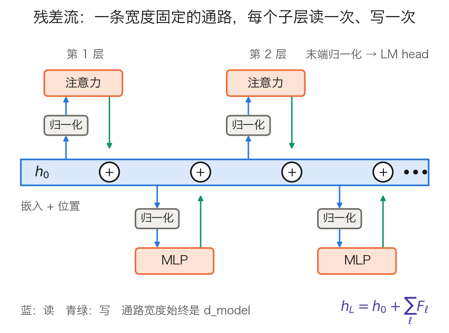

图 3-5：残差流——各子层从同一条通路读、向同一条通路写（[生成脚本](https://github.com/yeasy/llm_internals/blob/main/tools/figures/ch03_residual_stream.py)）。蓝色箭头是读，读操作不改变通路；青绿色箭头是写，写操作是一次逐元素相加。通路宽度始终是 `d_model`，这正是 3.5.2 的维度约束。

这个视角有三条直接推论。

其一，各子层的贡献是**线性叠加**的，因此可以逐项拆开分析：某个注意力头写了什么、某个 FFN 写了什么，可以分别投影到词表上看。这是 Logit Lens 一类方法可行的前提（见 [14.8 节](../14_future_trends/14.8_interpretability.md)）。

其二，靠前的子层写进去的东西，靠后的所有子层都读得到，无须逐层转发。跨层组合（如第 $l$ 层的头读第 $l'$ 层写入的特征）因此成为可能。

其三，残差流的宽度固定，写入的东西越多越挤。子层要写入互不干扰的信息，只能占用不同的方向；$d_{\text{model}}$ 是这条通路的全部预算。

**残差的尺度风险：方差可能随深度增长。** 相加可以增强信号，也可以抵消信号；对任一坐标，$\operatorname{Var}(x+F) = \operatorname{Var}(x) + \operatorname{Var}(F) + 2\operatorname{Cov}(x,F)$，增长与否取决于分支方差及协方差。

设 $h_0$ 与各子层输出近似零均值、各子层输出每个坐标的方差同量级 $s^2$，并且两两协方差的总贡献可忽略，则逐坐标有

$$\text{Var}(h_{\text{out}}) \approx \text{Var}(h_0) + 2L \cdot s^2$$

在这些假设下，方差随深度**线性增长**，均方根范数 $\sqrt{\mathbb{E}\|h\|_2^2}$ 约按 $\sqrt{2L}$ 增长。取 $\text{Var}(h_0) = s^2 = 1$：$L = 12$ 时方差约为 $1 + 24 = 25$，均方根范数为初值的 $\sqrt{25} = 5.0$ 倍；$L = 96$ 时方差约为 193，均方根范数为 $\sqrt{193} = 13.9$ 倍。按这一尺度估计，深层的子层输出相对于已积累的和越来越小，贡献被稀释；同时残差流的数值范围抬高，对低精度训练不利。这是协方差可忽略时的估计，并非每个样本、每个训练阶段都满足的规律。

GPT-2 的对策是在初始化时压小每个残差分支的末端投影。[GPT-2 论文](https://cdn.openai.com/better-language-models/language_models_are_unsupervised_multitask_learners.pdf) 2.3 节的原话是：“A modified initialization which accounts for the accumulation on the residual path with model depth is used. We scale the weights of residual layers at initialization by a factor of $1/\sqrt{N}$ where $N$ is the number of residual layers.”

HF 的 GPT-2 实现把 $N$ 取作 $2 \times$ 层数，即每层两次残差相加各算一层，只对注意力与 FFN 的输出投影 `c_proj` 生效：初始化标准差取 `initializer_range / sqrt(2 * n_layer)`。代入 `initializer_range = 0.02`：

- $L = 12$：$1/\sqrt{24} = 0.2041$，标准差 $0.00408$。
- $L = 48$：$1/\sqrt{96} = 0.1021$，标准差 $0.00204$。
- $L = 96$：$1/\sqrt{192} = 0.0722$，标准差 $0.00144$。

在分支输入尺度可比、协方差总贡献可忽略的近似下，这样每个分支的初始输出方差正比于 $1/(2L)$，$2L \cdot s^2$ 回到常数量级，从而抑制残差流初始尺度随深度的增长。这是一条**只作用于初始化**的措施：训练开始后权重自行调整，范数仍可能长大；把归一化放在子层之前（Pre-Norm，见 [3.6.5 节](3.6_layer_norm.md)）也不直接约束残差流本身的范数。同一条缩放放在训练配方里看，以及它与损失尖峰、logits 尺度失控的关系，见 [6.3.5 节](../06_training_techniques/6.3_regularization.md)的表 6-8。

这一条与本小节开头的残差流视角是同一件事的两面：分支逐层累加可能改变通路的尺度，因此既要靠归一化管住读出的尺度，也要靠初始化控制写入的初始尺度。

### 5.5 固定权重求和的代价与替代方案

上面的公式还隐含一件事：所有子层的输出以**固定的单位权重**相加。第 1 层的粗浅特征和第 50 层的推理结果在最终表示中权重相同，模型只能靠调整各分支自身的幅度来分配话语权。

这一约束并非不可改。表 3-10 列出四类改法及其代价。

| 方案 | 公式 | 改动的对象 | 代价 |
| --- | --- | --- | --- |
| Highway | $h = g \odot F(x) + (1 - g) \odot x$ | 用可学习的门控分配残差与分支 | 恒等路径被门衰减，深度一大又回到连乘问题 |
| ReZero / SkipInit | $h = x + \alpha F(x)$，$\alpha$ 初始为 0 | 给每个分支一个可学习标量 | 训练初期分支形同不存在，收敛路径改变 |
| 初始化缩放 | $h = x + F(x)$，$F$ 末端初始化乘 $1/\sqrt{2L}$ | 只改初值，结构不变 | 只在初始时刻成立，训练中不再保持 |
| 深度维注意力 | $h_l = \sum_{j<l} \alpha_{j\to l} v_j$ | 用注意力权重替代固定求和 | 需要保存前序层输出，额外内存与计算 |

表 3-10：四类替代固定权重求和的做法。前两类改的是分支的缩放系数，第三类只改初值，最后一类改的是聚合方式本身。初始化缩放即 3.5.4 的 GPT-2 做法，是四者中唯一被主流模型普遍采用的。

最后一行对应一类较新的工作。Moonshot AI 团队提出的**注意力残差**（Attention Residuals，AttnRes）为每层引入一个可学习的投影向量 $w_l$，对所有前序层输出计算注意力权重后加权聚合：

$$h_l = \sum_{j=0}^{l-1} \alpha_{j \to l} \cdot v_j, \quad \alpha_{j \to l} = \frac{\exp(w_l^\top \cdot \text{RMSNorm}(v_j))}{\sum_{k=0}^{l-1} \exp(w_l^\top \cdot \text{RMSNorm}(v_k))}$$

其中 $v_j$ 是第 $j$ 层的原始输出。归一化用的是 RMSNorm 而非 LayerNorm，原文给的理由是防止输出幅度大的层垄断注意力权重。全量版本每个词元需要 $O(Ld)$ 的额外内存来存各层输出，算术量为 $O(L^2 d)$；团队因此给出 **Block AttnRes**：把 $L$ 层分成若干块，块内仍用标准残差累积，只在块级表征上做注意力聚合。该团队报告的开销与基准增益属论文当时版本的快照，随规模与训练设置而异，以其官方报告为准（登记于 [A.5 易过期事实台账](../appendix/a5_volatile_facts.md)）。

这条线的意义不在某个具体数字，而在于说明：固定权重求和是一个设计选择，不是残差连接的必要形式。

### 5.6 对到实现

HF 的 `LlamaDecoderLayer.forward` 把 3.5.4 的读写画成了代码：一层里出现两次 `residual = hidden_states`，两次 `hidden_states = residual + hidden_states`，中间分别夹着 `input_layernorm` 加注意力、`post_attention_layernorm` 加 `mlp`。读一个新模型的层实现，先找这两对语句，就能确定它的归一化放在哪里。

两处工程细节值得留意。其一，推理引擎常把“残差相加”与“下一次归一化”融进同一个内核：两步都是逐元素操作，合并后残差流只需读写一遍显存，省掉一次全量往返。其二，低精度训练中残差流常保留较高精度累加，原因正是 3.5.4 的方差增长：一路累加的数值范围最宽，最先溢出。

残差把子层的输出加回主通路，却没说这条通路的数值该有多大。下一节的归一化负责这件事。

## 6. 层归一化：为什么选择 LayerNorm 而非 BatchNorm

上一节写出的子层输出是 $x + \text{Sublayer}(x)$，而 [1.4 节](../01_introduction/1.4_transformer_idea.md)给出的原始形式是 $\text{LayerNorm}(x + \text{Sublayer}(x))$。上一节暂时省掉的那层外壳，正是本节的主角。

**归一化**（Normalization）做的事只有一件：把一组数重新缩放到一个受控的尺度。本节回答四个问题：沿哪个轴归一化，一个 4 维输入具体算出什么，归一化层放在残差的哪一侧，以及 RMSNorm 省掉了什么。

### 6.1 归一化解决什么问题

深度网络训练的一个经典解释是**内部协变量偏移**（Internal Covariate Shift）：前面的层参数一更新，后面的层输入分布就变了，后者需要不断适应。

这是 BatchNorm 论文给出的原始动机，并非定论。[后续研究](https://arxiv.org/abs/1805.11604)发现归一化的实际收益未必来自减小协变量偏移，更可能来自平滑损失地形、让梯度更稳定可预测。把归一化理解为“行之有效的优化辅助手段”，比把这一解释当作严格机制更稳妥。

在 Transformer 里还有一个更直接的理由：[3.5.4 节](3.5_residual.md)已经说明残差流的方差随深度线性增长。子层读到的向量尺度一路抬高，归一化把它拉回固定范围，子层的权重才不必随深度重新标定。

### 6.2 沿哪个轴：BN 与 LN 在 `[B, T, d]` 上的区别

一次前向的激活张量形状是 `[B, T, d]`：B 个样本、每个样本 T 个位置、每个位置 d 个通道。两种归一化的唯一差别是沿哪个轴求统计量。

**层归一化**（Layer Normalization）沿最后一维：

$$\text{LN}(x) = \gamma \odot \frac{x - \mu_L}{\sqrt{\sigma_L^2 + \epsilon}} + \beta, \qquad
\mu_L = \frac{1}{d}\sum_{i=1}^{d} x_i, \quad \sigma_L^2 = \frac{1}{d}\sum_{i=1}^{d}(x_i - \mu_L)^2$$

每个**词元**自己算一对 $(\mu, \sigma)$，共 `B × T` 对。$\gamma$ 与 $\beta$ 的形状都是 `[d]`，与 B、T 无关。

**批归一化**（Batch Normalization）沿批次与位置两维：

$$\text{BN}(x) = \gamma \odot \frac{x - \mu_B}{\sqrt{\sigma_B^2 + \epsilon}} + \beta$$

其中 $\mu_B$、$\sigma_B^2$ 是某个通道在全批全位置上的均值与方差，共 `d` 对。图 3-6 把两者画在同一张表上。

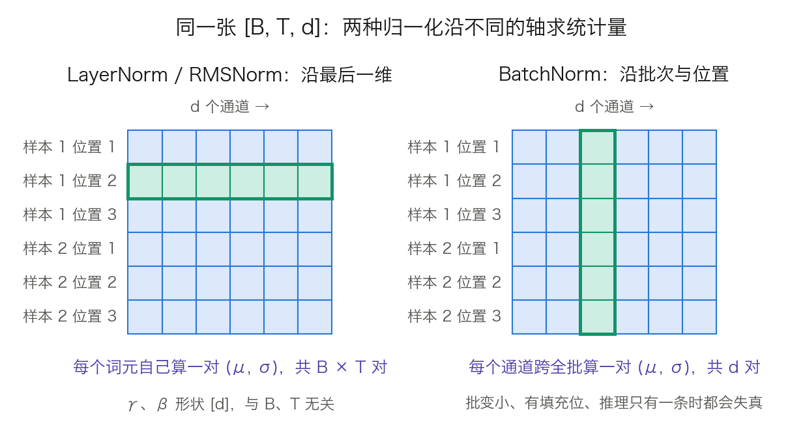

图 3-6：同一张 `[B, T, d]` 上，两种归一化沿不同的轴求统计量（[生成脚本](https://github.com/yeasy/llm_internals/blob/main/tools/figures/ch03_norm_axes.py)）。每一行是一个词元（样本与位置的组合），每一列是一个通道。LayerNorm 圈一行，BatchNorm 圈一列。

### 6.3 一个 4 维算例：LayerNorm 与 RMSNorm 各做了什么

取 $x = [1, 2, 3, 4]$，$d = 4$，暂设 $\gamma = 1$、$\beta = 0$、$\epsilon = 0$。

**LayerNorm。** 均值 $\mu = (1 + 2 + 3 + 4)/4 = 2.5$。方差 $\sigma^2 = \frac{1}{4}\left[(-1.5)^2 + (-0.5)^2 + 0.5^2 + 1.5^2\right] = \frac{5}{4} = 1.25$，标准差 $\sigma = 1.1180$。逐项相减再相除：

$$\frac{1 - 2.5}{1.1180} = -1.3416, \quad \frac{2 - 2.5}{1.1180} = -0.4472, \quad \frac{3 - 2.5}{1.1180} = 0.4472, \quad \frac{4 - 2.5}{1.1180} = 1.3416$$

结果是 $[-1.3416,\ -0.4472,\ 0.4472,\ 1.3416]$。

**RMSNorm。** 不减均值，直接除以均方根：$\text{RMS} = \sqrt{(1 + 4 + 9 + 16)/4} = \sqrt{7.5} = 2.7386$。逐项相除：

$$[0.3651,\ 0.7303,\ 1.0954,\ 1.4606]$$

两点结论可以直接读出来。

其一，**RMSNorm 只改变长度，不改变方向**：输出各分量之比仍是 1 : 2 : 3 : 4，符号不变。输出的 L2 范数恒为 $\sqrt{d} = 2$，即所有输出都落在半径 $\sqrt{d}$ 的球面上。

其二，**LayerNorm 多做了一次投影**：减均值等价于减去输入沿全 1 方向的分量。本例中 $x - \mu \mathbf{1} = [-1.5, -0.5, 0.5, 1.5]$，与全 1 向量的内积为 0。输出被限制在一个 $d - 1$ 维子空间里，范数同样是 $\sqrt{d} = 2$。

**RMS 不是标准差。** 两者都是“平方、求平均、开方”，差别在平方之前减不减均值。把均方根按均值拆开：

$$\text{RMS}^2 = \frac{1}{d}\sum_{i=1}^{d} x_i^2 = \sigma^2 + \mu^2$$

本例 $7.5 = 1.25 + 2.5^2$。所以 RMS 总是不小于标准差，只有均值为 0 时两者相等，这时 RMSNorm 与 $\gamma = 1$、$\beta = 0$ 的 LayerNorm 给出同一结果。本例均值 2.5，RMS 是标准差的 2.45 倍，两种输出因此差别很大。RMSNorm 的做法不是“用 RMS 近似标准差”，而是干脆不管均值，只把向量的整体尺度统一到 1。

### 6.4 为什么不用 BatchNorm

BatchNorm 在序列任务上的困难，来自它的统计量依赖整个批次。

**批内统计量不稳定。** 序列任务的批大小受显存限制，常远小于视觉任务；批越小，$\mu_B$、$\sigma_B^2$ 的估计方差越大。

**填充位置污染统计量。** 同一批内序列长度不齐，短序列要补 `[PAD]`。这些位置的激活是无意义的，却照样进入某个通道的均值与方差。要排除它们，需要带掩码的归约，实现复杂且随批内长度分布抖动。

**训练与推理行为不一致。** BatchNorm 训练时用批统计量、推理时用滑动平均；自回归生成每轮只处理一个新位置，批构成还随调度不断变化（见 [11.2 节](../11_serving/11.2_continuous_batching.md)），滑动统计量与实际分布容易对不上。

LayerNorm 一条也不沾：统计量只依赖当前词元自己的 d 个数，与批大小、序列长度、填充位置、训练还是推理全都无关。这才是它被选中的原因，而不是“不同位置的词元不构成同一分布”这类含混说法。BatchNorm 在 Transformer 上的具体失效与一种补救见 [PowerNorm](https://arxiv.org/abs/2003.07845)。

### 6.5 Pre-Norm 与 Post-Norm：梯度、预热与代价

原始 Transformer 用 **Post-Norm**：先算子层，再加残差，最后归一化。

$$\text{output} = \text{LN}\left(x + \text{Sublayer}(x)\right)$$

GPT-2 起改用 **Pre-Norm**：先归一化，再算子层，最后加残差。

$$\text{output} = x + \text{Sublayer}\left(\text{LN}(x)\right)$$

差别只有一处：**恒等路径上有没有归一化**。Post-Norm 下每层的恒等路径都要穿过一次 LN，梯度被逐层重新缩放；Pre-Norm 下恒等路径是一条纯加法通道，3.5.3 的 $I$ 项完整保留。图 3-7 把三种放置并排画出，第三种见 3.6.7。

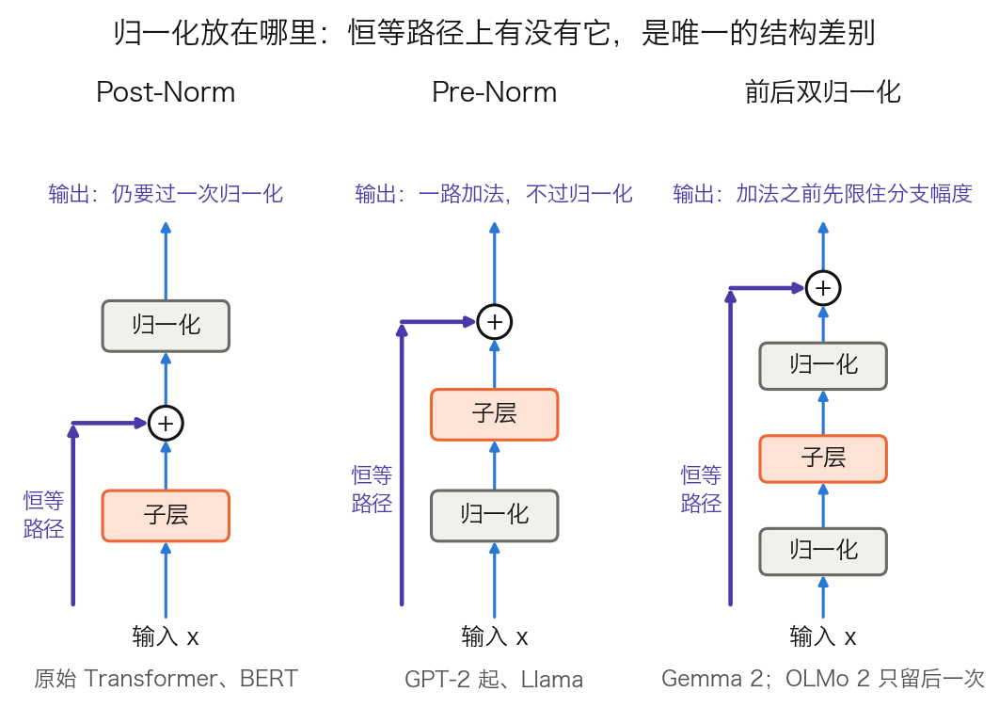

图 3-7：归一化放在哪里——Post-Norm、Pre-Norm 与前后双归一化（[生成脚本](https://github.com/yeasy/llm_internals/blob/main/tools/figures/ch03_norm_placement.py)）。紫色是恒等路径。三者的子层与归一化算子完全相同，差别只在接线。

[Xiong 等人 2020 年的工作](https://arxiv.org/abs/2002.04745)用平均场理论算了两者在初始化时的梯度量级：Post-LN 最后一层 FFN 的梯度范数是 $\mathcal{O}(d\sqrt{\ln d})$，与层数 $L$ 无关；Pre-LN 则是 $\mathcal{O}(d\sqrt{\ln d / L})$。原文的结论是“the learning rate warm-up stage can be safely removed”，因为 Pre-LN 的梯度在初始化时就已经良态。

这条结论要加两处限定。其一，它说的是“可以去掉预热”，不是“任意学习率都稳定”；主流 LLM 预训练仍普遍使用预热（见 [6.2 节](../06_training_techniques/6.2_lr_schedule.md)）。其二，Pre-Norm 有自己的代价，同一篇文章也说明了成因：“in the Pre-LN Transformer, the scale of the input to the final layer normalization is linear in $L$”。残差流范数随深度增长，深层子层的相对贡献被稀释，这与 [3.5.4 节](3.5_residual.md)的方差增长是同一件事。

Pre-Norm 还留下一个必须补的口子：最后一层之后残差流没有被任何归一化处理过，所以模型末端、LM head 之前要再加一次归一化。GPT-2 实现里它叫 `ln_f`，Llama 实现里叫 `model.norm`。

### 6.6 RMSNorm：省掉了什么，为什么影响不大

**RMSNorm**（Root Mean Square Normalization）去掉减均值这一步，也去掉偏移参数 $\beta$：

$$\text{RMSNorm}(x) = \frac{x}{\sqrt{\frac{1}{d}\sum_{i=1}^{d}x_i^2 + \epsilon}} \odot \gamma$$

[RMSNorm 原论文](https://arxiv.org/abs/1910.07467)给出的理由不是“残差连接已经稳住了分布”，而是关于不变性：原文认为重缩放不变性才是 LayerNorm 起效的关键，“We argue that this mean normalization does not reduce the variance of hidden states or model gradients, and hypothesize that it has little impact on the success of LayerNorm.”

省下的是什么：一次全量归约（求均值）与 $d$ 个偏移参数。收益的口径要看具体模型。原文摘要报告的是端到端运行时间，“reduces the running time by 7% ∼ 64% on different models”；其中 Transformer 一档的实测最小，“RMSNorm achieves BLEU scores comparable to LayerNorm, and yields a speedup of 7% ∼ 9%”，原文解释是 Transformer 里顺序执行的归一化操作本就比 RNN 少得多。

**为什么这点节省值得做。** 归一化的参数与 FLOPs 都可以忽略：GPT-3 175B 每层两个 LayerNorm 各 `2d` 个参数，加末端一个，合计 `2 × 2 × 12,288 × 96 + 2 × 12,288 = 4,743,168`，只占 1.75 × 10¹¹ 的 0.0027%。但它是逐元素、访存密集的操作，要把整条 `[B, T, d]` 完整读一遍、写一遍，实际耗时占比远高于 FLOPs 占比。少一次全量归约就是少一次全量读取，这也是推理引擎把 RMSNorm 与上一步残差相加融成一个内核的原因（见 [3.5.6 节](3.5_residual.md)）。

Llama、Gemma、Mistral 等开源模型均采用 RMSNorm。

### 6.7 放置方式的新变体

Pre-Norm 不是终点。表 3-11 列出三种在用的接线，对应图 3-7 的三块。

| 放置方式 | 一层里的归一化 | 恒等路径上有归一化吗 | 实现线索 |
| --- | --- | --- | --- |
| Post-Norm | 每个子层后 1 次，共 2 次 | 有 | 原始 Transformer、BERT |
| Pre-Norm | 每个子层前 1 次，共 2 次，末端再 1 次 | 无 | HF Llama 的 `input_layernorm`、`post_attention_layernorm`、`model.norm` |
| 前后双归一化 | 每个子层前后各 1 次，共 4 次 | 无 | HF Gemma 2 的 `input_layernorm`、`post_attention_layernorm`、`pre_feedforward_layernorm`、`post_feedforward_layernorm` |

表 3-11：三种归一化放置方式。名字容易误导：HF Llama 的 `post_attention_layernorm` 位于注意力之后，但它是 **FFN 的 Pre-Norm**，不是 Post-Norm。Gemma 2 在子层输出加回残差之前再归一化一次，等于给每个分支的写入幅度加了一道闸；OLMo 2 的实现走得更远，一层里只有 `post_attention_layernorm` 与 `post_feedforward_layernorm` 两次，即只归一化子层输出、不归一化子层输入。

把归一化放进注意力内部是另一条线：对 Q 与 K 分别做归一化（QK-Norm）可以压住注意力 logits 的量级，OLMo 2 的实现里就是 `q_norm` 与 `k_norm`。这一做法与 z-loss、logit soft-cap 一并在 [6.3.6 节](../06_training_techniques/6.3_regularization.md)讨论。

### 6.8 对到实现：模块名、$\epsilon$ 与精度

HF 的 `LlamaRMSNorm` 只有一个参数 `weight`，初始化为全 1；$\epsilon$ 来自配置字段 `rms_norm_eps`，Llama 2/3 的 `config.json` 里是 `1e-5`。

**精度是一处易错点。** `LlamaRMSNorm.forward` 先把输入 `to(torch.float32)`，算完平方均值与 `rsqrt` 后再转回原 dtype。平方和在 FP16 下极易溢出：一个 4,096 维向量，各分量哪怕只有 100 量级，平方和就到 $4.1 \times 10^{7}$，约为 FP16 上限 65,504 的 625 倍。归一化用 FP32 计算是必须的，不是保守。

**参数化也有差异。** Gemma 2 的 `Gemma2RMSNorm` 把 `weight` 初始化为全 0，前向时用 `(1.0 + weight)` 作为缩放系数。数学上等价于初始值为 1 的 $\gamma$，但权重衰减作用在 0 附近而不是 1 附近，正则化行为不同。移植权重时若忽略这一行，整个模型的尺度会错。

一层里的名字对照：HF Llama 的 `input_layernorm` 在注意力之前，`post_attention_layernorm` 在 FFN 之前，末端是 `model.norm`；GPT-2 的对应物是 `ln_1`、`ln_2` 与 `ln_f`。[附录 A.2](../appendix/a2_pytorch_examples.md) 给出了一段可运行的 RMSNorm 实现，可与上述细节逐项对照。

至此本章的零件全部到齐，但每个零件都是单独介绍的。下一节把它们接起来。

## 7. 编码器-解码器：完整架构如何协同工作

六节下来，零件已经齐了：词元与词表、嵌入矩阵、位置编码、FFN、残差、归一化。缺的只是接线图：谁先算、谁的输出接谁的输入、$N$ 层之间如何首尾相连。

本节先走通编码器与解码器两条信息流，再说明为什么仅解码器成为主流、现代层与原始层差在哪里，最后给出一套只凭 `config.json` 就能算出参数量、KV 缓存与训练算力的方法。

图 3-8 是一个 Transformer 编码器层的完整数据流。

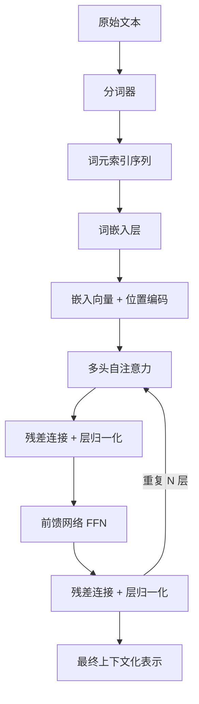

图 3-8：Transformer 编码器层的完整数据流。图中画的是 Post-Norm 接线（归一化在残差相加之后），即原始论文与 BERT 的做法；Pre-Norm 的接线见 [3.6.5 节](3.6_layer_norm.md)的图 3-7 与 [3.8.4 节](3.8_gpt_inference_flow.md)的图 3-15。

### 7.1 编码器的信息流

编码器由 $N$ 个同构层堆叠（原始论文 $N = 6$）。以输入“I love machine learning”为例：

1. 词元化与嵌入：文本切成词元，查表得向量，加上位置编码。
2. 自注意力：每个位置读取全部位置（双向，无掩码），建立上下文关系。
3. 残差与归一化：把注意力输出加回残差流，并归一化。
4. FFN：对每个位置独立做非线性变换。
5. 残差与归一化：同上。
6. 重复 2 到 5 步：$N$ 层之后，每个位置的表示都融合了整条序列。

编码器的输出是 `[T, d_model]`，每个输入位置各一行。它不产生新词元，只产生表示。

关于“底层学局部语法、高层学全局语义”的说法：探针研究与注意力可视化给出了一些支持，但这是一条统计上的倾向，不是层的硬分工。可检验的结论在 3.7.3。

### 7.2 解码器的信息流

解码器每层比编码器多一个交叉注意力子层，一层里因此有三处残差与三处归一化。以翻译“I love machine learning”为“我热爱机器学习”为例，设已生成“我 热爱”：

1. 嵌入与位置：已生成词元查表得向量，加上位置信息。
2. 掩码自注意力 + 残差 + 归一化：“热爱”能看到“我”和自己，看不到未来位置。
3. 交叉注意力 + 残差 + 归一化：Query 来自解码器当前表示，Key 与 Value 来自编码器最后一层的输出。
4. FFN + 残差 + 归一化：逐位置变换。
5. 重复 $N$ 层，最后一层的最后一行经 LM head 与 Softmax，得到下一个词元的分布。

两处细节决定了工程行为。

**交叉注意力的 K、V 只算一次。** 编码器最后一层的输出在整个生成过程中不变，每个解码器层用自己的 $W_K$、$W_V$ 把它投影一次并缓存；此后每生成一个词元，只需算新的 Query。这与解码器自注意力的 KV 缓存是两件事：前者长度固定为源序列长度，后者随生成变长。

**训练时不逐词元进行。** 训练用**教师强制**（teacher forcing）：把目标序列整体右移一位作为解码器输入，一次前向就算出所有位置的预测，损失在全部目标位置上同时计算。因果掩码保证位置 $i$ 看不到位置 $i$ 之后的目标词元。逐词元只发生在推理时（见 [2.4 节](../02_attention/2.4_self_cross_causal.md)与 [3.8 节](3.8_gpt_inference_flow.md)）。

### 7.3 为什么要重复堆叠 $N$ 层

“多层带来更深的思考”这类说法无法检验。两条可检验的事实更有用。

**其一：某些算法必须至少两层才能实现。** 最清楚的例子是归纳头（induction head）：它由两个头组成，前一层的“前序词元头”把“上一个词元是谁”搬到当前位置，后一层的匹配头据此回头查找，实现“序列中出现过 [A][B]，再遇到 [A] 就预测 [B]”。一层注意力做不到这件事，因为“把信息搬过来”和“据此再查一次”必须分两步（见 [14.8 节](../14_future_trends/14.8_interpretability.md)）。层数因此是可组合算法的步数预算，而不只是容量。

**其二：固定参数量下，深度与宽度可以大幅互换。** [Kaplan 等人](https://arxiv.org/abs/2001.08361)的实测结论是“Performance depends strongly on scale, weakly on model shape”，其图 5 注中写道“Aspect ratio in particular can vary by a factor of 40 while only slightly impacting performance”，并举例 $(n_{\text{layer}}, d_{\text{model}}) = (6, 4288)$ 的模型与 $(48, 1600)$ 的 GPT-2 相比，损失相差在 3% 以内。

两条合起来给出一个平衡的判断：深度提供组合步数，宽度提供每步的容量；在很宽的范围内两者可以互换，但深度不能压到算法所需的步数以下。真实模型的取法见 [3.8.7 节](3.8_gpt_inference_flow.md)的表 3-25：从 GPT-3 Small 到 Llama 3 405B，层数从 12 增到 126，宽度从 768 增到 16,384，两者一起长。

### 7.4 三种架构变体，以及仅解码器为何胜出

按编码器与解码器的组合方式，Transformer 有三种主流变体，见图 3-9。

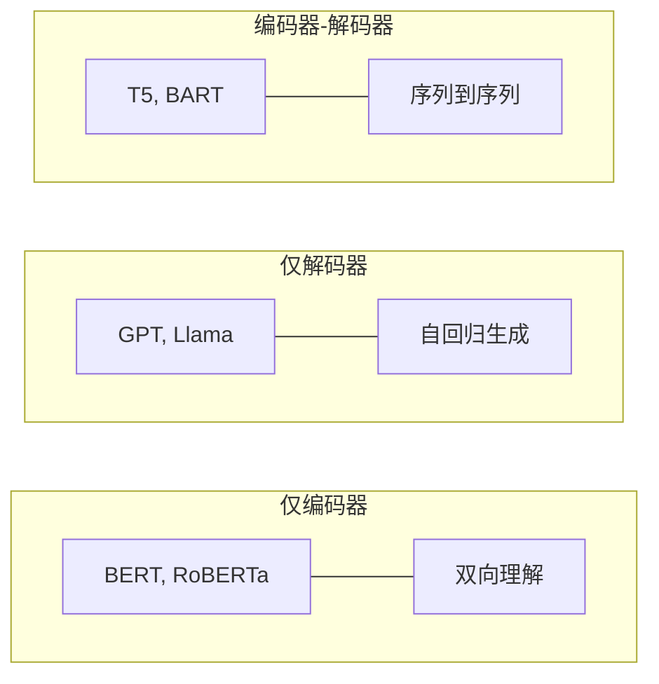

图 3-9：三种 Transformer 架构变体及代表模型。

**仅编码器**用全双向自注意力，输出表示而非词元，适合分类、序列标注、检索（BERT、RoBERTa，见[第十二章](../12_encoder_models/README.md)）。**仅解码器**用因果掩码，每个位置预测下一个词元（GPT、Llama，见[第十三章](../13_decoder_models/README.md)）。**编码器-解码器**用编码器读输入、解码器写输出，适合序列到序列任务（T5、BART）。

仅解码器胜出的原因不是“通用性”这样的词，而是三条可以算的账。

**训练信号密度。** 因果语言模型一次前向在每个位置产生一个监督信号，长度 $T$ 的序列给出 $T - 1$ 个（见 [5.1 节](../05_pretraining/5.1_autoregressive.md)）；掩码语言模型只在被掩盖的约 15% 位置产生信号（见 [5.2 节](../05_pretraining/5.2_masked_lm.md)）。同样的算力，前者从每条序列里榨出的梯度信息多好几倍。

**推理工程。** 多轮对话中，前缀的 KV 缓存可以原样复用，追加内容只需为新词元计算（见 [11.5 节](../11_serving/11.5_prefix_reuse.md)）。编码器的双向表示做不到这一点：输入一变，整条序列的表示都要重算。

**参数利用。** 编码器-解码器把参数分给两侧，其中一侧只处理输入。同样的总参数量，仅解码器全部用在同一条通路上。

**反面证据同样要写。** [Wang 等人 2022 年的大规模对照](https://arxiv.org/abs/2204.05832)在纯无监督预训练后确认“causal decoder-only models trained on an autoregressive language modeling objective exhibit the strongest zero-shot generalization”，但同一实验也发现，“models with non-causal visibility on their input trained with a masked language modeling objective followed by multitask finetuning perform the best among our experiments”。仅解码器的胜出是预训练目标、工程复用与规模化三者综合的结果，不是任何单一维度上的完胜。

**从原始层到现代层。** 今天的仅解码器层与 2017 年的原始层，零件几乎逐项换过一遍。表 3-12 把差异列齐，每一行都指向本章前面的某一节。

| 部位 | 原始 Transformer | 现代仅解码器（Llama 式） | 本书对应处 |
| --- | --- | --- | --- |
| 归一化算子 | LayerNorm | RMSNorm | 3.6.6 |
| 归一化位置 | Post-Norm | Pre-Norm，末端再加一次 | 3.6.5 |
| FFN 激活 | ReLU，两个矩阵 | SwiGLU，三个矩阵 | 3.4.5 |
| FFN 宽度 | `4 d` | `2.7 d` 到 `3.5 d` | 3.4.4 |
| 位置编码 | 正弦，输入端相加 | RoPE，每层注意力内部旋转 | 3.3.5 |
| 注意力 | 多头，`n_kv = n_h` | GQA，`n_kv` 远小于 `n_h` | 3.7.5 |
| 偏置项 | 只有 FFN 的 `b₁`、`b₂`；注意力投影本来就无偏置 | 线性层普遍无偏置 | 3.4.1 |
| 权重绑定 | 输入输出共享 | 视词表占比而定 | 3.7.6 |

表 3-12：原始 Transformer 层与现代仅解码器层的逐项对照。偏置那一行常被记反：1706.03762 的多头注意力写作 $\text{Concat}(\text{head}_i)W^O$、$\text{head}_i = \text{Attention}(QW_i^Q, KW_i^K, VW_i^V)$，全文不出现偏置项，只有 FFN 的 $\max(0, xW_1+b_1)W_2+b_2$ 带两个。真正给注意力投影加上偏置的是 GPT-2 一路：HF 实现里这些投影是 `Conv1D`，该模块无条件持有一个 `bias` 参数。Llama 一侧的做法可由 `config.json` 直接确认：`hidden_act`、`rms_norm_eps`、`intermediate_size`、`rope_theta`、`num_key_value_heads`、`attention_bias`、`mlp_bias`、`tie_word_embeddings` 各对应表中一行。另有一类改动本表未列：PaLM、GPT-J 采用的并行块把注意力与 FFN 并联在同一次归一化之后，而不是串联。

### 7.5 多查询与分组查询注意力

标准多头注意力里，每个头有自己的 K、V 投影，KV 缓存随头数线性增长。两个变体沿这条线做削减。

**多查询注意力**（Multi-Query Attention，MQA）让所有 Query 头共用同一组 K、V，KV 缓存减到原来的 $1/n_h$。**分组查询注意力**（Grouped-Query Attention，GQA）是中间档：Query 头分成 $n_{kv}$ 组，每组共用一组 K、V。图 3-10 画出三者的对应关系。

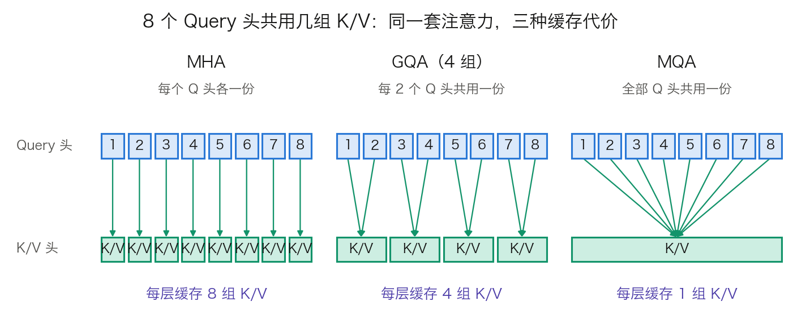

图 3-10：8 个 Query 头共用几组 K/V（[生成脚本](https://github.com/yeasy/llm_internals/blob/main/tools/figures/ch03_gqa_heads.py)）。蓝色是 Query 头，青绿色是它们共用的 K/V 头。注意力的计算步骤三者完全相同，差别只在每层要缓存几组 K/V。

**形状怎么变。** $W_Q$ 与 $W_O$ 仍是 `[d, d]`；$W_K$、$W_V$ 变成 `[d, n_kv × d_h]`。Llama 3 8B 的 `num_key_value_heads = 8`、`num_attention_heads = 32`、`d_h = 128`，所以 $W_K$、$W_V$ 各是 `[4096, 1024]`。算注意力分数时，每组 K/V 要被复制 $n_h / n_{kv} = 4$ 份与对应的 Query 头配对，HF 实现里这一步是 `repeat_kv`。

**缓存账。** 每个词元每层要存的 K/V 元素数是 `2 × n_kv × d_h`，全模型是 `2 × L × n_kv × d_h`。Llama 3 8B 是 `2 × 32 × 8 × 128 = 65,536` 个数，BF16 下 131,072 字节，即每词元 128 KiB。若改回多头（`n_kv = 32`），同一模型是 512 KiB，正好 4 倍。按 8K 上下文算，一条请求的 KV 缓存从 4 GiB 降到 1 GiB。完整推导与分页管理在 [10.2 节](../10_inference_optimization/10.2_kv_cache.md)与 [11.4 节](../11_serving/11.4_kv_memory_management.md)。

**质量代价。** [GQA 论文](https://arxiv.org/abs/2305.13245)的结论是“MQA can lead to quality degradation”，而“uptrained GQA achieves quality close to multi-head attention with comparable speed to MQA”。GQA 是这条取舍曲线上的折中点，不是免费的。

Llama 2 的 70B、Llama 3 全系与 Mistral 均采用 GQA；[Llama 3 论文](https://arxiv.org/abs/2407.21783)的措辞是“We use grouped query attention (GQA; Ainslie et al. 2023) with 8 key-value heads to improve inference speed and to reduce the size of key-value caches during decoding”。并非所有现代模型都走这条路：DeepSeek-V2 起改用 MLA，把所有头的 K、V 压成一个低维隐向量再缓存，方向与 GQA 不同（见 [10.2.7 节](../10_inference_optimization/10.2_kv_cache.md)与 [13.3 节](../13_decoder_models/13.3_deepseek_gemini.md)）。未公开架构的闭源模型不宜列入任何一侧。

### 7.6 参数共享与权重绑定

输入嵌入与输出 LM head 的形状互为转置，因此可以共用同一张矩阵，即**权重绑定**（Weight Tying）。原始 Transformer、GPT-2、BERT 都这样做。

取舍的判据已在 [3.2.4 节](3.2_embedding.md)量化：词表矩阵占总参数的比例。GPT-2 small 是 31.0%，不绑定意味着模型凭空大三成；Llama 3 405B 只有 1.0%，绑定省下的参数可以忽略，不如让输入表示与输出预测各自优化。

因此规律是随规模变化的：小尺寸或大词表模型倾向绑定，大模型倾向不绑定。判断一个模型属于哪一档，直接看 `config.json` 里的 `tie_word_embeddings`。

### 7.7 参数量与计算量的速算

三条估算式在实践中反复用到。它们不是精确公式，而是**数量级工具**。

**单层参数量 $\approx 12 d^2$。** 多头注意力有 $W_Q, W_K, W_V, W_O$ 四个 $d \times d$ 矩阵，合计 $4d^2$；4 倍宽的两矩阵 FFN 合计 $8d^2$。两者相加：

$$N \approx 12 L d^2$$

**这条式子有两个未声明的前提**：注意力是多头（$n_{kv} = n_h$），FFN 是 4 倍宽的两矩阵版本。Llama 3 两条都不满足。

先看一个逐项相加的精确账。表 3-13 用 Llama 3 8B 的 `config.json` 算出全部参数。

| 部位 | 形状 | 参数量 | 折合 |
| --- | --- | ---: | --- |
| `q_proj` | `[4096, 4096]` | 16,777,216 | `1.0 d²` |
| `k_proj` | `[4096, 1024]` | 4,194,304 | `0.25 d²` |
| `v_proj` | `[4096, 1024]` | 4,194,304 | `0.25 d²` |
| `o_proj` | `[4096, 4096]` | 16,777,216 | `1.0 d²` |
| `gate_proj`、`up_proj`、`down_proj` | 各 `4096 × 14336` | 176,160,768 | `10.5 d²` |
| 每层两个 RMSNorm | 各 `[4096]` | 8,192 | — |
| **每层合计** | | **218,112,000** | `13.0 d²` |
| 32 层 | | 6,979,584,000 | |
| `embed_tokens` | `[128256, 4096]` | 525,336,576 | |
| `lm_head` | `[128256, 4096]` | 525,336,576 | |
| `model.norm` | `[4096]` | 4,096 | |
| **总计** | | **8,030,261,248** | |

表 3-13：Llama 3 8B 的逐项参数账，全部由 `config.json` 的七个字段算出：`num_hidden_layers = 32`、`hidden_size = 4096`、`num_attention_heads = 32`、`num_key_value_heads = 8`、`intermediate_size = 14336`、`vocab_size = 128256`、`tie_word_embeddings = false`。`d_h = hidden_size / num_attention_heads = 128`，故 `k_proj`、`v_proj` 的列数是 `8 × 128 = 1024`。总计 80.3 亿，与标称的 8B 吻合。本书其他小节在算矩阵乘法或权重访存时只数七个矩阵，每层记 218,103,808、32 层记 6,979,321,856；与本表相差的 8,192 正是每层两个 RMSNorm，它们不参与矩阵乘法。

同一张表可以套到任何 Llama 式模型上，只要把七个字段换掉。表 3-14 把 $12Ld^2$ 与四个模型的逐项账放在一起对比。

| 模型 | 注意力/层 | FFN/层 | 逐项总计 | `12Ld²` | 偏差 |
| --- | --- | --- | ---: | ---: | ---: |
| Llama 2 7B | `4.00 d²` | `8.06 d²` | 6,738,415,616 | 6,442,450,944 | −4.4% |
| Llama 3 8B | `2.50 d²` | `10.50 d²` | 8,030,261,248 | 6,442,450,944 | −19.8% |
| Llama 3 70B | `2.25 d²` | `10.50 d²` | 70,553,706,496 | 64,424,509,440 | −8.7% |
| Llama 3 405B | `2.13 d²` | `9.75 d²` | 405,853,388,800 | 405,874,409,472 | +0.0% |

表 3-14：`12Ld²` 与逐项账的偏差。405B 上几乎完全吻合，但这是抵消的结果而非公式仍然精确：GQA 把注意力项从 `4 d²` 压到 `2.13 d²`，FFN 从 `8 d²` 放宽到 `9.75 d²`，再加上占 1.0% 的词表矩阵，三者正好凑回 `12 d²`。同一公式用在 8B 上低估近两成，因为那里词表占 13.1%，抵消关系不成立。

结论：`12Ld²` 适合估计同代模型的量级，不适合替代逐项相加。手边有 `config.json` 时，用表 3-13 的方法。

**训练每词元约 $6N$ 次浮点运算。** 矩阵乘法里每个参数对应一次乘加，[乘加算两次浮点运算](https://arxiv.org/abs/2001.08361)，故前向约 $2N$；反向要同时算输入梯度与权重梯度，代价约为前向的两倍，即 $4N$。合计

$$C \approx 6ND$$

$D$ 是训练词元总数。代入 Llama 3 405B：$N = 4.05 \times 10^{11}$，论文自报的 $D = 15.6 \times 10^{12}$ 词元，得 $6ND \approx 3.79 \times 10^{25}$ FLOPs，与论文自报的“pre-trained using $3.8 \times 10^{25}$ FLOPs”一致。这条式子是 Scaling Law 讨论的地基，[5.4 节](../05_pretraining/5.4_data_scaling.md)里 Chinchilla 的结论就是在这个约束下解出来的。

**推理每词元约 $2N$ 次浮点运算**，即只有前向那一份。训练与推理相差 3 倍。

**共同失效边界。** 三条式子只数了权重，没数注意力自身的 $O(T^2)$ 项。一层的计算量约为 $24Td^2 + 2T^2d$（推导见 [3.8.8 节](3.8_gpt_inference_flow.md)），两项之比正是

$$\frac{2T^2d}{24Td^2} = \frac{T}{12d}$$

Kaplan 等人用的判据是同一个：“For contexts and models with $d_{\text{model}} > n_{\text{ctx}}/12$, the context-dependent computational cost per token is a relatively small fraction of the total compute.” 注意 $T = 12d$ 是两项相等的点，不是“开始不能忽略”的点。对 $d = 4096$ 的模型，$12d = 49{,}152$，各档上下文下的占比见表 3-15。

| 上下文长度 | `T / (12d)` | 注意力项占一层计算量 |
| --- | ---: | ---: |
| 2,048 | 0.042 | 4.0% |
| 8,192 | 0.167 | 14.3% |
| 49,152 | 1.000 | 50.0% |
| 131,072 | 2.667 | 72.7% |

表 3-15：`d = 4096` 时注意力项随上下文长度的占比。第三列由第二列换算：记 `r = T / (12d)` 为两项之比，注意力项占一层计算量就是 `r / (1 + r)`，例如 `0.167 / 1.167 = 14.3%`。8K 上下文下已占一成四，到 128K 则反超权重项。长上下文因此是一个独立的工程问题（见 [14.7 节](../14_future_trends/14.7_long_context.md)），不能把同一套估算往大了套。

对 MoE 模型，$6ND$ 里的 $N$ 要取**激活参数量**而非总参数量，这正是 MoE 能在固定算力预算下堆更大总参数的原因（见 [14.2 节](../14_future_trends/14.2_moe.md)）。

零件与接线都已齐备。下一节把它们接通电源，走一遍真实的生成流程。

## 8. GPT 式仅解码器：一次回答如何生成

本节沿“2 + 3 等于几？”这一输入，展示 GPT 式仅解码器 Transformer 如何计算并逐词元生成回答。先看完整结构，再逐步计算首个词元，最后跟踪后续生成。

文中的词元、ID、向量和权重均为手工设定，仅用于演示计算流程，不是实际模型的参数，也不表示教学模型已经学会加法。真实模型的权重由训练得到（见[第五章](../05_pretraining/README.md)）。

### 8.1 整体结构与生成流程

一次生成循环分为五步：**构造输入 → 多层计算 → 词表打分 → 选择词元 → 继续或停止**。先用图 3-11 看一轮内部的计算结构，再用图 3-12 看多轮如何衔接。

本例把问题简写为“2 + 3 =”，加上角色标记后，固定为六个教学词元：`⟨user⟩`、`2`、`+`、`3`、`=`、`⟨assistant⟩`。这串完整输入称为 Prompt。其中“6”是输入词元的数量；回答中的“5”则是一个新生成的词元，其内容是数字字符“5”。生成时从词表候选中选择下一个词元，并不是从这六个输入词元中挑选。

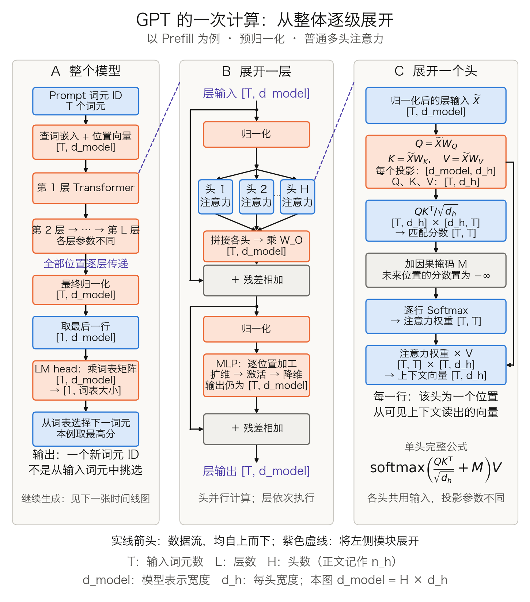

图 3-11：一次 Prefill 的计算结构，以预归一化、普通多头注意力和两矩阵 MLP 为例（[生成脚本](https://github.com/yeasy/llm_internals/blob/main/tools/figures/gpt_inference_overview.py)）。A 区展示整个模型，B 区展开其中一层，C 区展开一个注意力头；各区自上而下，紫色虚线只表示展开关系，不表示数据流。形状按“行数、列数”标注，T 是输入词元数。后文按同一路径给出矩阵算例。

图中的“表示”是描述一个位置的数值向量；将多个位置的向量按行排列，就得到矩阵。“头”是注意力内部并行计算的分支，“层”则是依次执行的处理单元。先理解它们的输入、输出与目的，后文再引入公式。

**归一化的目的。** 分别调整每个词元向量的数值尺度，有助于稳定训练；不混合不同位置的信息，也不改变矩阵形状。X̃ 表示归一化后的 X，仍为 `[T, d_model]`。归一化不是将数值变成概率，也不保证每个数落在固定区间；具体计算见 [3.6.3 节](3.6_layer_norm.md)。

**先看通用维度。** 矩阵形状统一写作 `[行数, 列数]`，暂不写批大小。`d_model` 是每个位置在层间传递的向量宽度；例如 `d_model = 4096` 表示每个词元位置用 4096 个数表示，不是 4096 个词元。`n_h` 是注意力头数，`d_h` 是每头宽度；普通多头注意力常取 `d_model = n_h × d_h`。`d_ff` 是 MLP 中间向量的宽度，`n_vocab` 是词表大小，不能与 Value 矩阵 V 混淆。

为同时描述两个阶段，用 `n` 表示本轮输入的位置数，`m` 表示本层历史与当前 K/V 的总位置数。首次处理整个 Prompt 时 `n = m = T`；启用缓存后，单词元 Decode 的 `n = 1`，但 `m` 随生成增长。各宽度由模型配置确定，不随本轮输入长短变化。

| 运算与目的 | 输入、参数 → 输出形状 |
| --- | --- |
| 嵌入查表：把 ID 变成向量 | `n` 个 ID，从嵌入表 `[n_vocab, d_model]` 取出 `n` 行 → `[n, d_model]` |
| 加位置向量：标明位置（本图方案） | 两个 `[n, d_model]` 逐元素相加 → `[n, d_model]` |
| 注意力前归一化：调整特征尺度 | `[n, d_model] → [n, d_model]`，每行独立处理 |
| 单头 Q/K/V 投影：生成查询、键、值 | 三次独立的 `[n, d_model] × [d_model, d_h]` → Q、新 K、新 V 各 `[n, d_h]` |
| 合并 K/V 缓存：保留可读取的历史 | 历史各 `[m−n, d_h]` 与新值各 `[n, d_h]` 沿行拼接 → 完整 K、V 各 `[m, d_h]` |
| 打分：衡量各位置的匹配程度 | `Q × Kᵀ`：`[n, d_h] × [d_h, m] → [n, m]`；除以 `√d_h` 不改变形状 |
| 掩码与逐行 Softmax：得到读取权重 | 分数加上 `[n, m]` 掩码，再沿每行的 `m` 列做 Softmax → `[n, m]` |
| 加权读取：得到一个头的上下文 | 权重乘 V：`[n, m] × [m, d_h] → [n, d_h]` |
| 拼接多头：汇集各头结果 | `n_h` 个 `[n, d_h]` 沿列拼接 → `[n, n_h × d_h]` |
| 输出投影：混合各头信息 | `[n, n_h × d_h] × W_O[n_h × d_h, d_model] → [n, d_model]` |
| 第一次残差：将注意力结果加回层输入 | 两个 `[n, d_model]` 逐元素相加 → `[n, d_model]` |
| MLP 前归一化：调整下一子层的输入 | `[n, d_model] → [n, d_model]` |
| 两矩阵 MLP：逐位置加工特征 | `[n, d_model] × W_up[d_model, d_ff] → [n, d_ff]`；激活后再乘 `W_down[d_ff, d_model] → [n, d_model]` |
| 第二次残差：将 MLP 结果加回其输入 | 两个 `[n, d_model]` 逐元素相加 → 本层输出 `[n, d_model]`；交给下一层 |
| 全部 L 层后，最终归一化并取最后位置 | `[n, d_model] → [n, d_model] → [1, d_model]` |
| LM head：为词表候选打分 | `[1, d_model] × W_vocab[d_model, n_vocab] → [1, n_vocab]` |
| 选词与停止判断：确定本轮结果 | 从 `n_vocab` 个分数中选出一个词元 ID；未停止则作为下一轮输入 |

表 3-16：普通多头、Pre-Norm 模型的一轮计算，省略线性层偏置；矩阵乘法的内侧维度必须相等。3.8.2 至 3.8.5 展开首轮计算，3.8.6 展开缓存复用。GQA 的 K/V 共享方式与带批大小的形状见 3.8.7；RoPE 不在输入处加位置向量，而是在各层 Q/K 投影后旋转，形状不变。

注意力权重 `[n, m]` 的**行是发起查询的位置，列是被读取的位置**，不是 `m` 维的词元表示。本例 Prefill 为 `Q[6,2] × Kᵀ[2,6] → 权重[6,6] → 上下文[6,2]`；下一轮 Decode 为 `Q[1,2] × Kᵀ[2,7] → 权重[1,7] → 上下文[1,2]`。其中打分后仍需缩放、掩码与 Softmax，读取上下文时再乘 V。

表中的真实两矩阵 MLP 会先扩维再降维；SwiGLU 则有两个并行的升维投影，其中一支先经 SiLU 激活，两支逐元素相乘后再降维，输入输出仍同形状（见 [3.4 节](3.4_feedforward.md)）。后文的 `0.1 × ReLU(x)` 只是手算替代，不能据此省略真实模型的投影矩阵。

首次计算处理全部输入词元，称为 **Prefill（预填充）**；此后每轮处理一个刚生成的词元，称为 **Decode（解码）**。两者使用同一个模型，区别是本轮输入的行数，以及是否读取历史缓存。每层保留自己算出的 Key、Value，供下一轮使用，这就是 **KV Cache（KV 缓存）**；3.8.3 解释这些量，3.8.6 说明缓存为什么可以复用。

在本例的基本自回归流程中，每轮前向计算得到下一词元的分数，选词后才能确定下一轮的输入。回答“5。”需要三轮计算：

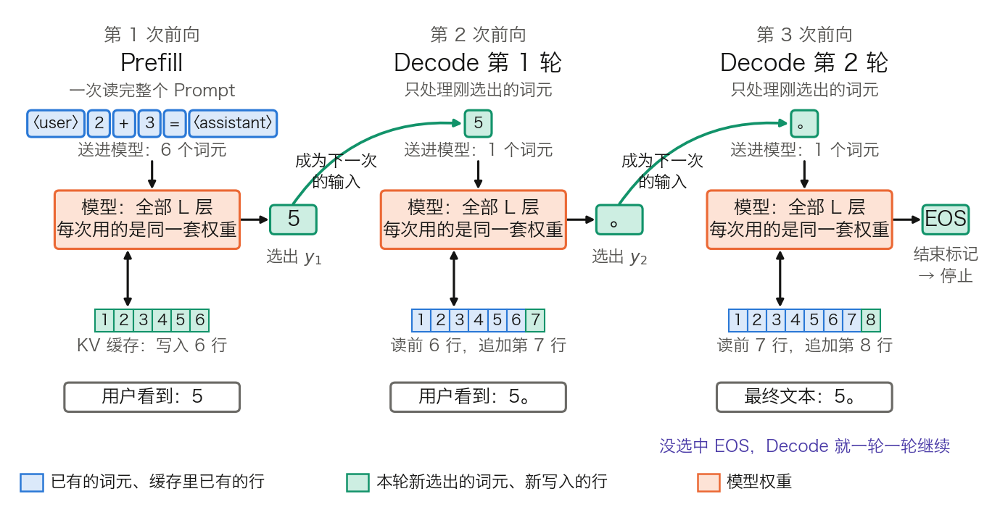

图 3-12：同一模型连续运行三轮：处理全部六个输入词元，生成首个词元“5”；输入词元“5”，生成下一个词元“。”；输入词元“。”，生成结束标记 EOS（[生成脚本](https://github.com/yeasy/llm_internals/blob/main/tools/figures/inference_timeline.py)）。EOS 只控制停止，不显示给用户。已生成词元的 ID 可以逐步还原为文本并输出，这一步称为反分词，不必等到整个回答生成完毕。

以下先逐步算出首个词元，再在 3.8.6 跟踪 Decode；优化放到最后讨论。

### 8.2 构造输入表示：从文本到向量矩阵

模型接收的是词元 ID，而不是原始文本。服务端先按模型的聊天模板组织消息，再由分词器转换为词元 ID；生成前，模板通常还会加入表示“助手回复开始”的控制标记。不同模型的模板和特殊词元不同，本节使用固定的教学模板与教学 ID。

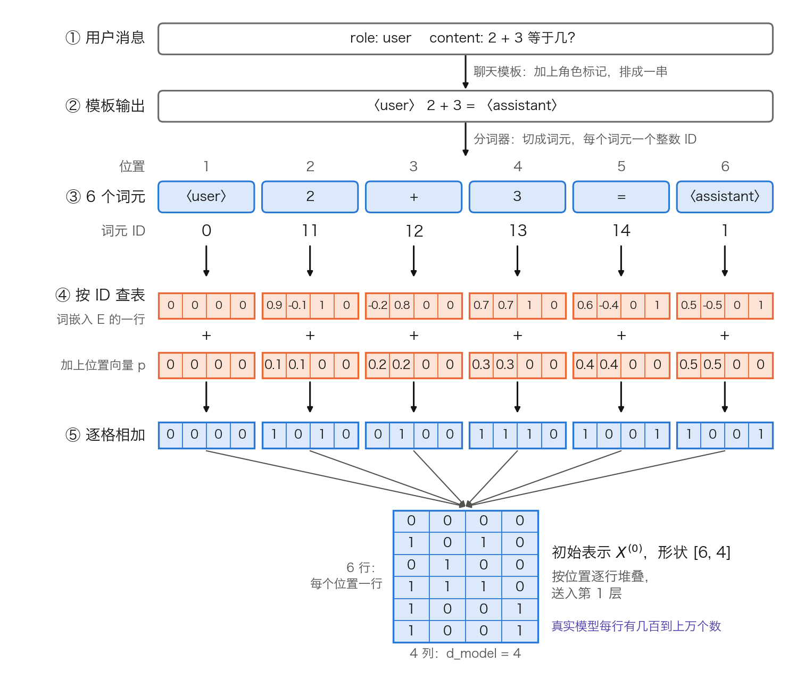

图 3-13：一条消息怎样变成初始表示 X⁽⁰⁾（[生成脚本](https://github.com/yeasy/llm_internals/blob/main/tools/figures/input_pipeline.py)）。图中数值与表 3-17 一致；真实模型的模板与 ID 可以不同，但数据流顺序相同。

图中先做分词，再做嵌入查表。分词把文本切成词元，并给每个词元一个整数 ID，此时仍是离散表示；嵌入查表才将 ID 转为连续向量：按 ID 从词嵌入矩阵 E 中取出对应的一行向量（见 [3.2 节](3.2_embedding.md)）。取出的向量只说明“这是哪个词元”，不说明“它排在第几位”，所以还要加上位置向量 p。两者之和就是该位置进入第 1 层之前的**初始表示**，全部位置合起来记作 X⁽⁰⁾。

表 3-17 展开前述六个教学词元：角色标记表示用户消息和助手回复的边界，算式是问题内容。把“等于几？”简写为“=”只是本例减少手算量的约定，不是聊天模板的功能；真实聊天模板通常保留用户内容，并补充角色、消息边界等控制标记。位置方面，这里采用“词嵌入加位置向量”的方案（见 [3.3 节](3.3_position_encoding.md)）；RoPE 则在每层注意力内部旋转 Query 和 Key 来引入位置（见[第四章](../04_position_encoding/README.md)），不在输入处相加。两种方案都在注意力打分之前引入位置信息。

| 位置 | 教学词元 | 教学 ID | 词嵌入 E | 位置向量 p | 初始表示 X⁽⁰⁾ |
| --- | --- | ---: | --- | --- | --- |
| 1 | `⟨user⟩` | 0 | [0.0, 0.0, 0, 0] | [0.0, 0.0, 0, 0] | [0, 0, 0, 0] |
| 2 | `2` | 11 | [0.9, -0.1, 1, 0] | [0.1, 0.1, 0, 0] | [1, 0, 1, 0] |
| 3 | `+` | 12 | [-0.2, 0.8, 0, 0] | [0.2, 0.2, 0, 0] | [0, 1, 0, 0] |
| 4 | `3` | 13 | [0.7, 0.7, 1, 0] | [0.3, 0.3, 0, 0] | [1, 1, 1, 0] |
| 5 | `=` | 14 | [0.6, -0.4, 0, 1] | [0.4, 0.4, 0, 0] | [1, 0, 0, 1] |
| 6 | `⟨assistant⟩` | 1 | [0.5, -0.5, 0, 1] | [0.5, 0.5, 0, 0] | [1, 0, 0, 1] |

表 3-17：教学 Prompt 的离散 ID 如何成为连续的初始表示。最后一列由它左边的两列（词嵌入 E 与位置向量 p）逐分量相加得到，例如位置 2 是 `[0.9 + 0.1, −0.1 + 0.1, 1 + 0, 0 + 0] = [1, 0, 1, 0]`。

每个位置用 4 个数表示，即 `d_model = 4`。这些值都是手工设定的：前两维是倒推出来的，为的是让相加后只剩 0 和 1，后面的乘法可以心算；第 3 维标记“这个词元是数字”，第 4 维标记“这个位置在等答案”，是为了让后文第二个注意力头的行为一眼看得懂。真实模型的向量有数百到上万维，由训练得到，单独某一维通常没有这样清晰的含义。

为便于跟踪输出，本例再固定四个教学 ID：`15` 对应 `5`，`16` 对应 `。`，`17` 对应 `6`，`2` 对应 EOS；“其他”代表其余候选。于是后文的 ID `15` 可以直接还原为词元 `5`。

### 8.3 多头注意力：计算权重并读取上下文

现在进入总图中的第 1 层，先计算多头注意力。输入是六个位置的向量，输出是每个头为各位置读出的上下文向量；这还不是整层输出，也不是词元。

本例采用 1 层、2 个头，每个位置用 4 个数表示，每头输出 2 个数。对应记号为：层数 `L = 1`、头数 `n_h = 2`、模型宽度 `d_model = 4`、每头宽度 `d_h = 2`。本轮有 6 个词元，即 `T = 6`。真实模型通常更深、更宽，公开配置在 3.8.7 集中对照。

真实预归一化模型先对层输入做归一化，再投影 Q/K/V。为便于手算，本例将归一化设为恒等变换，因此可直接使用上一小节的初始表示。头 1 展开全部位置的计算；头 2 沿用同一算法，只展开本层最后位置所需的结果。矩阵相乘遵循 `[a, b] × [b, c] → [a, c]`：左边的列数等于右边的行数，结果保留左边的行数和右边的列数。

为保证后续计算可复现，补充以下教学设定：各处归一化都设为恒等变换（即不改变输入）；MLP 定义为 `0.1 × ReLU(x)`，其中 ReLU 把负数变成 0、正数保持不变，这个定义省掉了真实 MLP“先扩到约 4 倍宽、再压回来”的两个矩阵，真实 MLP 的结构和一个能手算的小例见 [3.4.1 节](3.4_feedforward.md)；LM head 不设偏置。输出投影 `W_O`、词表投影 `W_vocab` 以及新词元 `5`、`。` 的词嵌入，用到时给出。每个头的三个投影矩阵都是 `[4, 2]`，即 4 行 2 列。头 1 的三个投影取同一个矩阵：

$$
W_{Q,1} = W_{K,1} = W_{V,1} =
\begin{bmatrix}
0 & 1 \\
1 & 0 \\
0 & 0 \\
0 & 0
\end{bmatrix}
$$

矩阵的第 k 行决定输入向量的第 k 维怎样进入结果，全 0 的行表示这个头不看那一维。头 1 只看前两维，并把它们左右互换，例如 `[1, 0, 1, 0]` 变成 `[0, 1]`；为缩短手算，它的三个投影设成了相同。头 2 的矩阵留到算头 2 时再给。这些权重都不是训练得到的，只为让乘法的每一步看得见。

以下分六步计算头 1，重点跟踪 Prompt 的最后位置（位置 6）：它经过全部层后的表示用于预测首个新词元。

手算只需要两样工具。一是矩阵乘法的规则：结果的第 i 行第 j 列，等于左边矩阵的第 i 行与右边矩阵的第 j 列逐项相乘再相加。二是几个常数。本例 Prefill 中的注意力分数只有 0、`1/√2 ≈ 0.707`、`√2 ≈ 1.414` 三种取值，对应的指数是 `e⁰ = 1`、`e^(1/√2) ≈ 2.028`、`e^√2 ≈ 4.113`；Decode 第 2 轮还会用到 `e^(−1/√2) ≈ 0.493`。本节所有注意力权重都能由这几个数加减乘除得到，普通计算器即可复核；只有 LM head 的概率一列需要计算器上的 eˣ 键。

**第 1 步：排成输入矩阵。** 问题：怎样让 6 个位置一起参与计算？把各位置的向量按行堆叠成一个矩阵，后面每一次矩阵乘法就同时处理了全部位置：

$$
X^{(0)} =
\begin{bmatrix}
x_1^{(0)} \\
\vdots \\
x_T^{(0)}
\end{bmatrix}
\in \mathbb{R}^{T\times d_{\mathrm{model}}}
$$

本例将表 3-17 的最后一列按位置堆叠，得到 `X⁽⁰⁾:[6, 4]`，6 行是 6 个位置，4 列是 `d_model`：

$$
\underbrace{X^{(0)}}_{6\times4} =
\begin{bmatrix}
0 & 0 & 0 & 0 \\
1 & 0 & 1 & 0 \\
0 & 1 & 0 & 0 \\
1 & 1 & 1 & 0 \\
1 & 0 & 0 & 1 \\
1 & 0 & 0 & 1
\end{bmatrix}
$$

**第 2 步：投影出 Q、K、V。** 将输入分别投影为 Query、Key 和 Value，用于匹配位置和读取内容。三个投影的输入相同，参数分别定义：

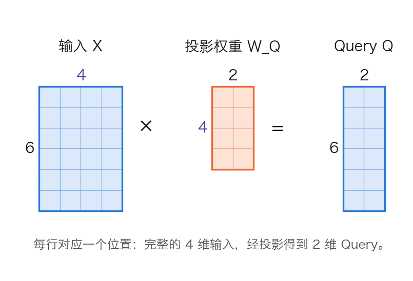

图 3-14：教学模型的矩阵形状示意，后续分图随计算展开。每个格子代表一个数，紫色标出相乘时必须相等的维度；蓝色为数据，橙色为训练参数（[生成脚本](https://github.com/yeasy/llm_internals/blob/main/tools/figures/attention_shape_flow.py)）。此图是 Q 的投影，K、V 的形状相同。

$$
Q=XW_Q,\quad K=XW_K,\quad V=XW_V
$$

形状：本例 `X[6, 4] × W_Q[4, 2] → Q[6, 2]`，每个位置从 4 个数变成 2 个数；GPT-3 Small 是 `X[6, 768] × W_Q[768, 64] → Q[6, 64]`。Q 的第 i 行是位置 i 的“我要找什么”，K 的第 i 行是“我可被怎样匹配”，V 的第 i 行是“我提供什么内容”。以头 1、位置 2 为例，取 `X⁽⁰⁾` 的第 2 行 `[1, 0, 1, 0]`，分别与 `W_Q,1` 的第 1 列 `[0, 1, 0, 0]`、第 2 列 `[1, 0, 0, 0]` 逐项相乘再相加：

$$
\begin{aligned}
\text{第 1 格} &= 1\times0+0\times1+1\times0+0\times0 = 0 \\
\text{第 2 格} &= 1\times1+0\times0+1\times0+0\times0 = 1 \\
[1,\ 0,\ 1,\ 0]\,W_{Q,1} &= [0,\ 1]
\end{aligned}
$$

其余各行同法。头 1 的三组权重相同，所以三个矩阵也相同，每一行恰是 `X⁽⁰⁾` 对应行的前两维左右互换：

$$
\underbrace{X^{(0)}}_{6\times4}
\underbrace{W_{Q,1}}_{4\times2}
= \underbrace{Q_1 = K_1 = V_1}_{\text{各为 }6\times2} =
\begin{bmatrix}
0 & 0 \\
0 & 1 \\
1 & 0 \\
1 & 1 \\
0 & 1 \\
0 & 1
\end{bmatrix}
$$

这一步的 K 和 V 还有第二个用途：它们就是 Prefill 留给 Decode 的 KV 缓存，3.8.6 会原样取用。第 3 到 6 步继续只算头 1，为了简洁，把 `Q₁`、`K₁`、`V₁` 写作 Q、K、V。

**第 3 步：Q 与 K 打分。** 问题：位置 i 该重点读取哪些位置？用位置 i 的 Query 与每个位置的 Key 做点积（对应分量相乘再相加），点积越大表示越匹配；再除以 `√d_h`，避免分数随维度增大而过大（见 2.2 节）：

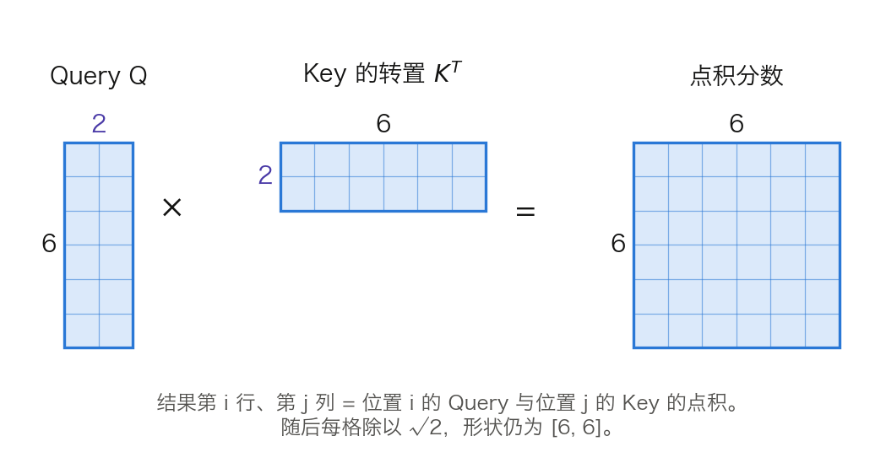

$$
\text{匹配分数}=\frac{QK^T}{\sqrt{d_h}}
$$

形状：本例 `Q[6, 2] × Kᵀ[2, 6] → 分数[6, 6]`；GPT-3 Small 是 `Q[6, 64] × Kᵀ[64, 6] → 分数[6, 6]`，沿每头的向量维度求和，结果的行、列分别对应 Query 和 Key 的位置，因此仍是 `[6, 6]`。第 i 行第 j 列是“位置 i 的 Query 对位置 j 的 Key”的分数。`Kᵀ` 是把 K 的行列对调，它的第 j 列就是 K 的第 j 行，所以按矩阵乘法的规则，这一格等于 Q 的第 i 行与 K 的第 j 行的点积。除数里是每头宽度 `d_h = 2` 而不是 `d_model = 4`，故除以 `√2`。以位置 6 对位置 4 为例，取 Q 的第 6 行和 K 的第 4 行：

$$
\frac{[0,1]\,[1,1]^T}{\sqrt{2}} = \frac{0\times1+1\times1}{\sqrt{2}} = 0.707
$$

同理，位置 4 对自己的分数是 `[1, 1]·[1, 1] / √2 = 2 × 0.707 = 1.414`，是全表最大的一格。头 1 的 Q、K 各行只含 0 和 1，点积只可能是 0、1 或 2，因此分数只有 0、0.707、1.414 三种取值。对所有位置对重复这一步，得到匹配分数矩阵：

$$
\frac{\underbrace{Q}_{6\times2}\underbrace{K^T}_{2\times6}}{\sqrt{2}}
=
\begin{bmatrix}
0 & 0 & 0 & 0 & 0 & 0 \\
0 & 0.707 & 0 & 0.707 & 0.707 & 0.707 \\
0 & 0 & 0.707 & 0.707 & 0 & 0 \\
0 & 0.707 & 0.707 & 1.414 & 0.707 & 0.707 \\
0 & 0.707 & 0 & 0.707 & 0.707 & 0.707 \\
0 & 0.707 & 0 & 0.707 & 0.707 & 0.707
\end{bmatrix}
$$

**第 4 步：加因果掩码。** 问题：上面的矩阵里，位置 2 对位置 5 也有分数，可位置 5 在位置 2 的右边，属于“未来”。Prompt 里位置 5 的内容其实是已知的，屏蔽它不是因为看不到，而是因为模型训练时每个位置就只见过自己和左边的内容，推理时必须保持同样的条件；也正因为每个位置从不读取右边，3.8.6 的 KV 缓存才成立。所以要把未来位置的分数屏蔽掉。做法是加上因果掩码 M：允许读取的格子加 0，禁止读取的格子加 −∞。

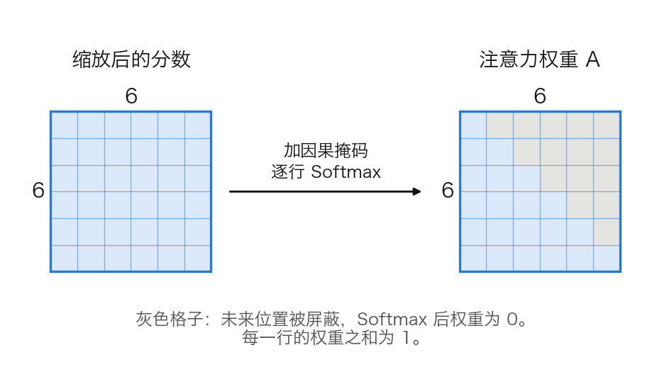

| Query 位置 \ Key 位置 | 1 | 2 | 3 | 4 | 5 | 6 |
| --- | ---: | ---: | ---: | ---: | ---: | ---: |
| 1 | 0 | −∞ | −∞ | −∞ | −∞ | −∞ |
| 2 | 0 | 0 | −∞ | −∞ | −∞ | −∞ |
| 3 | 0 | 0 | 0 | −∞ | −∞ | −∞ |
| 4 | 0 | 0 | 0 | 0 | −∞ | −∞ |
| 5 | 0 | 0 | 0 | 0 | 0 | −∞ |
| 6 | 0 | 0 | 0 | 0 | 0 | 0 |

表 3-18：教学 Prompt 的因果掩码 M。行是正在计算的 Query 位置，列是被读取的 Key 位置；位置 i 只能读取位置 1 到 i。

$$
\text{带掩码的分数}=\text{匹配分数}+M
$$

形状：`分数[6, 6] + M[6, 6] → [6, 6]`，逐格相加，不是矩阵乘法。位置 2 对位置 5 的分数变为 −∞；位置 6 右边没有位置，故整行不变：

$$
\underbrace{\text{匹配分数}}_{6\times6} + \underbrace{M}_{6\times6}
=
\begin{bmatrix}
0 & -\infty & -\infty & -\infty & -\infty & -\infty \\
0 & 0.707 & -\infty & -\infty & -\infty & -\infty \\
0 & 0 & 0.707 & -\infty & -\infty & -\infty \\
0 & 0.707 & 0.707 & 1.414 & -\infty & -\infty \\
0 & 0.707 & 0 & 0.707 & 0.707 & -\infty \\
0 & 0.707 & 0 & 0.707 & 0.707 & 0.707
\end{bmatrix}
$$

**第 5 步：把分数变成权重。** 问题：分数有大有小，还不能直接用来“按比例读取”。对每一行做 Softmax，把分数换成一组非负且和为 1 的权重；−∞ 经过 Softmax 恰好变成 0，被屏蔽的位置因此完全读不到：

$$
\text{注意力权重}=\operatorname{softmax}_{\mathrm{row}}(\text{带掩码的分数})
$$

一行分数 `s₁ … sₙ` 的 Softmax 分三个动作：每个分数取 e 的指数，把这一行的指数全部加起来，再用每个指数除以这个和。其中 `e^(−∞) = 0`，所以被屏蔽的格子既不进入行和，自己的权重也是 0：

$$
\text{第 } j \text{ 格的权重} = \frac{e^{s_j}}{e^{s_1}+e^{s_2}+\cdots+e^{s_n}}
$$

形状：`[6, 6] → 权重[6, 6]`，每一行各自归一化，行与行互不影响。位置 6 这一行的分数是 `[0, 0.707, 0, 0.707, 0.707, 0.707]`，取指数得 `[1, 2.028, 1, 2.028, 2.028, 2.028]`，行和为 `2 × 1 + 4 × 2.028 = 10.112`。于是它对位置 2 的权重为：

$$
\text{位置 6 对位置 2 的权重}
= \frac{e^{0.707}}{2e^0 + 4e^{0.707}} = \frac{2.028}{10.112} = 0.201
$$

对位置 1 的权重则是 `1 / 10.112 = 0.099`。表 3-19 对每一行都写出这三个动作。

| 位置 | 可见各格取指数 | 行和（指数相加） | 权重（各项 ÷ 行和） |
| --- | --- | ---: | --- |
| 1 | 1 | 1 | 1 |
| 2 | 1、2.028 | 3.028 | 0.330、0.670 |
| 3 | 1、1、2.028 | 4.028 | 0.248、0.248、0.503 |
| 4 | 1、2.028、2.028、4.113 | 9.169 | 0.109、0.221、0.221、0.449 |
| 5 | 1、2.028、1、2.028、2.028 | 8.084 | 0.124、0.251、0.124、0.251、0.251 |
| 6 | 1、2.028、1、2.028、2.028、2.028 | 10.112 | 0.099、0.201、0.099、0.201、0.201、0.201 |

表 3-19：逐行计算注意力权重。第一列是 Query 位置；每行从左到右依次对应 Key 位置 1、2、3…；被掩码屏蔽的格子指数为 0，未列出。

把各行的权重填回 `[6, 6]` 的矩阵，屏蔽的格子填 0：

$$
\underbrace{\text{注意力权重}}_{6\times6} =
\begin{bmatrix}
1 & 0 & 0 & 0 & 0 & 0 \\
0.330 & 0.670 & 0 & 0 & 0 & 0 \\
0.248 & 0.248 & 0.503 & 0 & 0 & 0 \\
0.109 & 0.221 & 0.221 & 0.449 & 0 & 0 \\
0.124 & 0.251 & 0.124 & 0.251 & 0.251 & 0 \\
0.099 & 0.201 & 0.099 & 0.201 & 0.201 & 0.201
\end{bmatrix}
$$

这张矩阵可以逐行读：最后一行表示位置 6 把约 20% 的注意力各分给位置 2、4、5、6，约 10% 各分给位置 1、3。右上角全是 0，正是因果掩码的效果；位置 1 只能读自己，所以第一行是 `[1, 0, 0, 0, 0, 0]`。

**第 6 步：按权重读取 Value。** 问题：权重只说明“各读多少”，读的内容是什么？是各位置的 Value。把每个位置的 Value 按权重加起来，得到该位置读到的上下文向量 context：

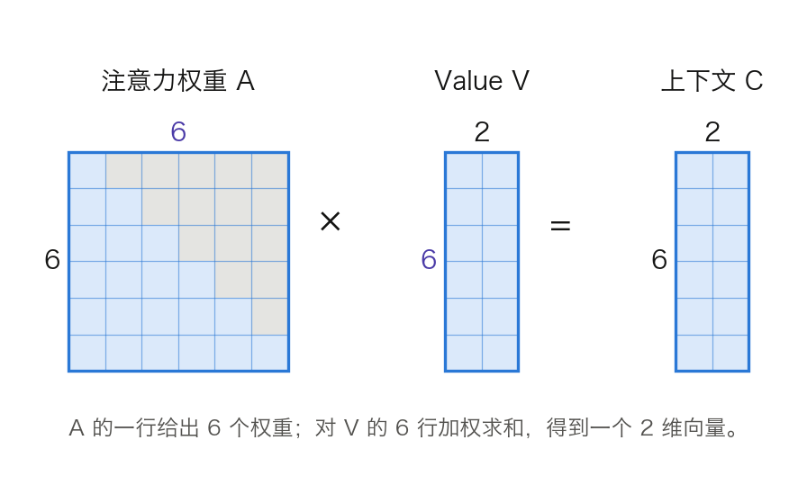

$$
\text{context}=\text{注意力权重}\times V
$$

形状：本例 `权重[6, 6] × V[6, 2] → context[6, 2]`；GPT-3 Small 是 `权重[6, 6] × V[6, 64] → context[6, 64]`。位置 6 的一行就是六个 Value 的加权和，权重取自上一步的最后一行，Value 取自第 2 步 V 矩阵的六行：

$$
\begin{aligned}
\text{位置 6 的 context}
&= 0.099[0,0] + 0.201[0,1] + 0.099[1,0] \\
&\quad + 0.201[1,1] + 0.201[0,1] + 0.201[0,1]
\end{aligned}
$$

两个分量分开算：第 1 个分量只有位置 3 和位置 4 的 Value 有贡献，第 2 个分量来自位置 2、4、5、6。直接用三位小数的权重相加会得到 `[0.300, 0.804]`，末位带有舍入误差；要得到准确值，可以先用未除行和的指数做加权，最后只除一次：

$$
\begin{aligned}
\text{位置 6 的 context}
&= \frac{[\,1+2.028,\ \ 4\times2.028\,]}{10.112} \\
&= \frac{[3.028,\ 8.112]}{10.112}
= [0.299,\ 0.802]
\end{aligned}
$$

本节其余的分数、权重和向量也都由未舍入的值算出后再保留三位，所以用页面上已舍入的数复算时，可能出现约 0.001 到 0.002 的差异。行和与 LM head 的指数例外：它们按页面上写出的常数和 logit 计算，可以直接核对。再看一个短的例子：位置 2 只能读位置 1 和 2，它的 context 是 `(1 × [0, 0] + 2.028 × [0, 1]) / 3.028 = [0, 0.670]`。

对所有位置重复这一步，得到：

$$
\underbrace{\text{注意力权重}}_{6\times6}\underbrace{V}_{6\times2}
=
\begin{bmatrix}
0 & 0 \\
0 & 0.670 \\
0.503 & 0.248 \\
0.670 & 0.670 \\
0.375 & 0.753 \\
0.299 & 0.802
\end{bmatrix}
$$

每一行都是该位置在头 1 里读出的 `d_h = 2` 维 context，最后一行 `[0.299, 0.802]` 留待拼接。第 2 步到第 6 步合起来，就是第 2 章的公式：

$$
\text{context} =
\operatorname{softmax}\!\left(\frac{QK^T}{\sqrt{d_h}} + M\right)V
$$

**头 2：同样的第 2 到 6 步，换一组权重。** 头 2 与头 1 读的是同一个 `X⁽⁰⁾`，区别只在投影矩阵。它的三个矩阵互不相同，这才是真实模型的常态：

$$
W_{Q,2} =
\begin{bmatrix}
0 & 0 \\
0 & 0 \\
0 & 1 \\
2 & 0
\end{bmatrix},\quad
W_{K,2} =
\begin{bmatrix}
0 & 0 \\
0 & 0 \\
1 & 0 \\
0 & 1
\end{bmatrix},\quad
W_{V,2} =
\begin{bmatrix}
1 & 0 \\
0 & 1 \\
0 & 0 \\
0 & 0
\end{bmatrix}
$$

回忆表 3-17 下方的说明：第 3 维标记“是数字”，第 4 维标记“在等答案”。头 2 的 Key 直接取这两维，第 1 格是“是数字”，第 2 格是“在等答案”；Query 则是交叉摆放的，第 1 格放“在等答案”并放大 2 倍，第 2 格放“是数字”；Value 取前两维。点积是对应格相乘再相加，所以 Query 第 1 格的“我在等答案”恰好对上 Key 第 1 格的“我是数字”。合起来的意思是：**等待答案的位置对数字位置给出更高的匹配分数，再对所有可见位置的前两维加权求和**；反向匹配时，数字位置对等待答案的位置也给出较高分数，但分数减半，3.8.6 会用到这一条。

先做第 2 步，三个投影都是 `[6, 4] × [4, 2] → [6, 2]`：

$$
Q_2 =
\begin{bmatrix}
0 & 0 \\
0 & 1 \\
0 & 0 \\
0 & 1 \\
2 & 0 \\
2 & 0
\end{bmatrix},\quad
K_2 =
\begin{bmatrix}
0 & 0 \\
1 & 0 \\
0 & 0 \\
1 & 0 \\
0 & 1 \\
0 & 1
\end{bmatrix},\quad
V_2 =
\begin{bmatrix}
0 & 0 \\
1 & 0 \\
0 & 1 \\
1 & 1 \\
1 & 0 \\
1 & 0
\end{bmatrix}
$$

以位置 6 的 Query 为例，`X⁽⁰⁾` 的第 6 行是 `[1, 0, 0, 1]`，第 1、4 维非 0；`W_Q,2` 的第 1 行全是 0，不起作用，只剩第 4 行 `[2, 0]`，得到 `q = 1 × [0, 0] + 1 × [2, 0] = [2, 0]`。`K₂` 的每一行就是 `X⁽⁰⁾` 对应行的第 3、4 维，`V₂` 的每一行是前两维。这一次 Q、K、V 三个矩阵各不相同。

本例只有一层，决定输出的只有位置 6 这一行，所以第 3 到 6 步只算这一行。用 `q = [2, 0]` 与 `K₂` 的六行逐一做点积再除以 `√2`：只有位置 2 和位置 4 的 Key 是 `[1, 0]`，点积为 2，分数为 `2 × 0.707 = 1.414`；其余都是 0。位置 6 是最后一个位置，掩码不改变这一行。

$$
\text{头 2 中位置 6 的分数} = [0,\ 1.414,\ 0,\ 1.414,\ 0,\ 0]
$$

取指数得 `[1, 4.113, 1, 4.113, 1, 1]`，行和为 `4 × 1 + 2 × 4.113 = 12.226`，于是：

$$
\text{头 2 中位置 6 的权重} = [0.082,\ 0.336,\ 0.082,\ 0.336,\ 0.082,\ 0.082]
$$

头 2 把约三分之二的注意力放在 `2` 和 `3` 这两个数字上；同一个位置 6，在头 1 里却是把注意力大致均分给位置 2、4、5、6。**各头使用不同的投影参数，分别计算注意力权重与上下文向量**，这正是设置多个头的目的。再按权重读取 `V₂`，沿用“先加权、最后只除一次”的算法：

$$
\begin{aligned}
\text{头 2 中位置 6 的 context}
&= \frac{[\,4.113+4.113+1+1,\ \ 1+4.113\,]}{12.226} \\
&= \frac{[10.226,\ 5.113]}{12.226}
= [0.836,\ 0.418]
\end{aligned}
$$

第 1 个分量来自 Value 首分量为 1 的位置 2、4、5、6，第 2 个分量来自位置 3 和位置 4。

### 8.4 完成一层并逐层传递

两个头的计算结束后，仍需合并各头结果、完成两次残差相加与 MLP，才能得到本层输出。先按同一例子完成计算，再说明这一层如何重复。

**拼接两个头，乘输出投影 `W_O`。** 每个头为位置 6 算出一个 2 维上下文向量，将两个向量首尾拼接，得到 `n_h × d_h = 4` 维：

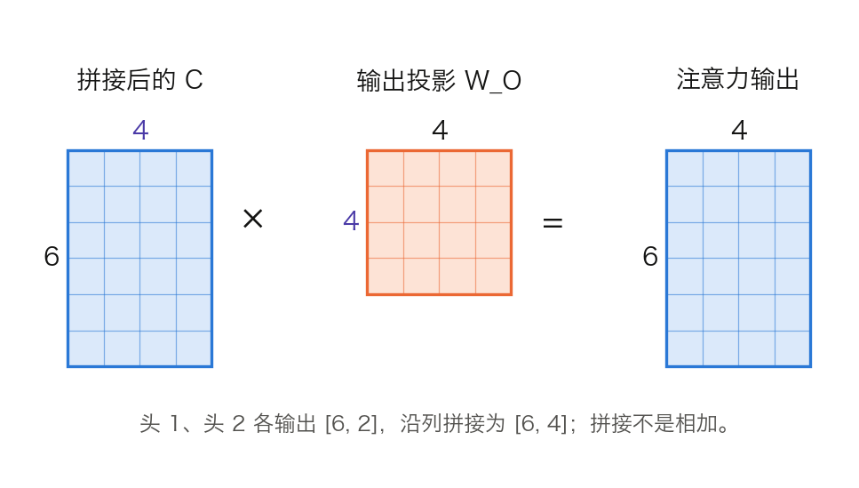

$$
\operatorname{Concat}\big([0.299,\ 0.802],\ [0.836,\ 0.418]\big)
= [0.299,\ 0.802,\ 0.836,\ 0.418]
$$

对 6 个位置都这样做，就是把两个头的 `[6, 2]` 左右并排成 `[6, 4]`。GPT-3 Small 做的是同一件事：12 个 `[T, 64]` 的 context 左右并排成 `[T, 12 × 64] = [T, 768]`。拼接只是把数字排在一起，前两维仍只含头 1 的信息，后两维只含头 2 的信息。输出投影 `W_O` 是一个 `[n_h × d_h, d_model] = [4, 4]` 的矩阵，它让两个头的结果相互混合，得到注意力子层的最终输出。整张矩阵的形状是 `[6, 4] × W_O[4, 4] → [6, 4]`（GPT-3 Small 是 `[6, 768] × W_O[768, 768] → [6, 768]`）；这里只算位置 6 这一行，所以是 `[1, 4] × W_O[4, 4] → [1, 4]`：

$$
\begin{aligned}
\text{注意力输出}
&= [0.299,\ 0.802,\ 0.836,\ 0.418]
\begin{bmatrix}
1 & 0 & 1 & 0 \\
0 & 1 & 0 & 1 \\
1 & 0 & 0 & 0 \\
0 & 1 & 0 & 0
\end{bmatrix} \\
&= [0.299+0.836,\ \ 0.802+0.418,\ \ 0.299,\ \ 0.802] \\
&= [1.136,\ 1.220,\ 0.299,\ 0.802]
\end{aligned}
$$

算法仍是“行乘列”：输出的第 1 个分量取 `W_O` 的第 1 列 `[1, 0, 1, 0]`，即头 1 的第 1 个数加上头 2 的第 1 个数。第 1 个分量若用页面上的三位小数相加会得到 1.135，未舍入的值是 1.1359，这仍是舍入带来的末位差。

**从注意力输出到本层输出。** 注意力只完成了“读”。接着把读到的结果加回位置 6 原来的向量（残差），再让 MLP 加工一次，加工结果同样加回去：

$$
\begin{aligned}
\text{注意力残差后的向量}
&= [1, 0, 0, 1] + [1.136, 1.220, 0.299, 0.802] \\
&= [2.136, 1.220, 0.299, 1.802] \\
\text{MLP 输出}
&= 0.1\operatorname{ReLU}([2.136, 1.220, 0.299, 1.802]) \\
&= [0.214, 0.122, 0.030, 0.180] \\
x_6^{(1)}
&= [2.349, 1.342, 0.329, 1.982]
\end{aligned}
$$

其中 `[1, 0, 0, 1]` 是位置 6 的初始表示。残差向量的四个分量均为正数，经过教学 MLP 后各乘以 0.1，再加回原向量，因此本层输出是残差向量的 1.1 倍。计算使用未舍入值，第一个分量约为 2.34945。

输出 `x₆⁽¹⁾` 仍有 4 个分量。残差相加要求输入与输出同形状，`W_O` 将拼接结果投回 `d_model`。真实多层模型在 Prefill 时把**全部位置的本层输出**送入下一层，而非只传递最后一行。本例只有一层，`x₆⁽¹⁾` 就是位置 6 的末层表示。

#### 一层的结构与多层重复

**一层包含两个子层。** 注意力子层从可见位置读取信息，MLP 子层逐位置加工信息。两者都采用“归一化 → 核心计算 → 残差相加”的组织方式，但核心计算不同。

| 子层 | 运算 | 目的 | 输入 → 输出 |
| --- | --- | --- | --- |
| 注意力 | 归一化 | 调整每个位置的特征尺度（见 [3.6 节](3.6_layer_norm.md)） | `[T, d_model] → [T, d_model]` |
| 注意力 | 多头因果自注意力 | 从自己和左侧位置读取信息，再合并各头结果 | `[T, d_model] → [T, d_model]` |
| 注意力 | 残差相加 | 将注意力输出加到本子层归一化前的输入上 | 两个 `[T, d_model]` 逐元素相加 |
| MLP | 归一化 | 用另一组参数调整特征尺度 | `[T, d_model] → [T, d_model]` |
| MLP | 逐位置 MLP | 对每个位置做非线性变换，不交换位置信息 | `[T, d_model] → [T, d_model]` |
| MLP | 残差相加 | 将 MLP 输出加到本子层归一化前的输入上 | 两个 `[T, d_model]` 逐元素相加 |

表 3-20：预归一化 Transformer 层的结构。表中是各运算的输入、输出形状；注意力内部和 MLP 中间的形状可以改变。

图 3-15 只展开归一化与残差：X 是层输入，U 是第一次残差相加后的中间结果，Y 是本层输出，三者均为 `[n, d_model]`。左侧旁路保留原输入，右侧计算分支学习对它的修正。

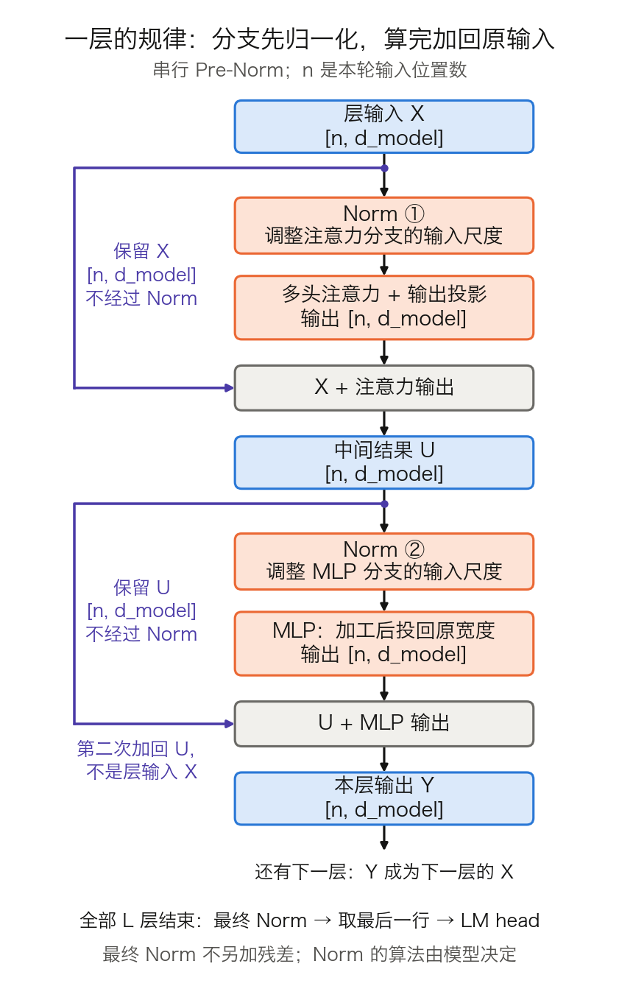

图 3-15：两次归一化与两次残差相加。紫色旁路分别保留归一化前的 X、U；每次相加的两路都是 `[n, d_model]`（[生成脚本](https://github.com/yeasy/llm_internals/blob/main/tools/figures/transformer_layer_blocks.py)）。多头内部计算见图 3-11；本图不重复展开。

**位置与目的。** 本节采用串行 Pre-Norm：子层的计算分支先归一化，调整输入尺度；子层出口做残差相加，保留原表示并叠加计算结果。位置由模型结构固定，不是运行时发现数值过大才临时插入。对应图中两次相加：

$$
\begin{aligned}
U &= X + \operatorname{Attention}\!\left(\operatorname{Norm}_{\mathrm{attn}}(X)\right), \\
Y &= U + \operatorname{MLP}\!\left(\operatorname{Norm}_{\mathrm{mlp}}(U)\right).
\end{aligned}
$$

这里 Attention 包括全部头的 Q/K/V 投影、注意力计算、拼接和输出投影；Decode 时还读取本层缓存。两条旁路分别保留**归一化前**的 X 和 U，不能把第二次相加也写成加 X。MLP 的中间向量可以扩为 `[n, d_ff]`，但必须投回 `[n, d_model]` 才能相加。

残差让子层在原表示上追加修正，而不是直接替换原表示；反向传播时也提供一条不经过子层权重的直通路径，有助于训练深层网络，但不保证梯度始终稳定（见 [3.5 节](3.5_residual.md)）。

便于检查的规则是：**看计算分支入口找 Norm，看子层出口找残差，看全部层的出口找最终 Norm。** 注意力和 MLP 各一组，不是每次矩阵乘法之后都添加一组。其他架构可以采用不同安排，不能在推理时随意更改。

**用 RMSNorm 还是 LayerNorm。** Llama 系列采用 RMSNorm，GPT-2 采用 LayerNorm；因此图中统一写 Norm，不将某一种方法当作所有 GPT 式模型的固定配置。两者都逐位置处理 `d_model` 个分量，且不改变形状。区别是 LayerNorm 先减均值再按标准差缩放，RMSNorm 不减均值，按均方根缩放。可对照 [Llama 实现](https://github.com/meta-llama/llama/blob/main/llama/model.py)的 `TransformerBlock` 与 [GPT-2 实现](https://github.com/openai/gpt-2/blob/master/src/model.py)的 `block`。

对一个位置的向量 x，RMSNorm 的第 j 个输出为：

$$
\operatorname{RMSNorm}(x)_j
= g_j\frac{x_j}{\sqrt{\frac{1}{d_{\mathrm{model}}}\sum_{k=1}^{d_{\mathrm{model}}}x_k^2+\varepsilon}}.
$$

其中 j、k 是向量分量的编号，g 是长度为 `d_model` 的可学习缩放向量，ε 是防止分母为零的小正数。每层两处 Norm 各有自己的参数，末层后的 Norm 也独立。RMSNorm 调整特征尺度；注意力 Softmax 则把一行匹配分数变为非负、总和为 1 的读取权重，二者作用不同，不能替代。推理仍需执行训练时的 Norm；本节手算将其设为恒等变换，只是教学简化。进一步比较见 [3.6 节](3.6_layer_norm.md)和 [RMSNorm 论文](https://arxiv.org/abs/1910.07467)。

**重复与收尾。** 本层的 Y 成为下一层的 X，换用下一层自己的参数，重复上述结构。完成全部 L 层后，做最终归一化，再取最后一行、经 LM head 得到词表分数；最终归一化处不另加残差。本节结构共有 `2L + 1` 次归一化、`2L` 次残差相加。选词后检查停止条件，决定是否进入下一轮生成。

只有注意力让位置之间交换信息；归一化、MLP 和残差相加都逐位置进行。3.8.3 已展开这些注意力运算；本小节补齐了合并、残差与 MLP。

Pre-Norm 表示归一化的位置，RMSNorm/LayerNorm 表示归一化的算法，两者是不同的选择维度。原始 Transformer 的 Post-Norm 则先计算子层、做残差相加，再归一化；与本节的结构差异见 [3.6 节](3.6_layer_norm.md)。

### 8.5 从最终表示选出首词元

只有全部 Transformer 层计算结束后，才将最后位置的最终表示转换为词元分数。本例只有一层，因此可直接使用上一小节得到的向量；最终归一化同样按教学设定取恒等变换。

记首个选出的词元为 y₁。

**从最终表示到首词元。** 最后一步由 LM head 完成：它是一个线性层，把最后位置的 `d_model` 维向量换算成词表中每个词元的一个分数。这些未归一化的分数称为 logits，记作 z。下面用 s 表示本轮最后位置（此处为 6），用 `n_vocab` 表示候选词元数：

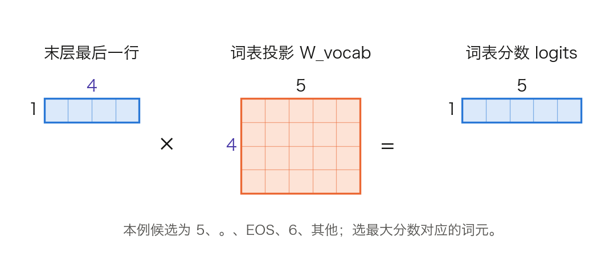

$$
\underbrace{\operatorname{Norm}_{\mathrm{final}}\left(x_s^{(L)}\right)}_{[1,\ d_{\mathrm{model}}]}
\underbrace{W_{\mathrm{vocab}}}_{[d_{\mathrm{model}},\ n_{\mathrm{vocab}}]}
+ \underbrace{b_{\mathrm{vocab}}}_{[n_{\mathrm{vocab}}]}
= \underbrace{z_s}_{[1,\ n_{\mathrm{vocab}}]}
$$

`Norm_final` 是全部 Transformer 层之后的最终归一化；本例将它设为恒等变换，因此下面仍直接用 `x₆⁽¹⁾`。`W_vocab` 是模型学习到的词表投影，`b_vocab` 是偏置；多数 GPT 式模型不设偏置，有些模型还让 `W_vocab` 直接取输入词嵌入矩阵的转置（见 3.7 节）。真实词表有数万到数十万个词元，z 也就有同样多个分数。本例只保留 `5`、`。`、EOS、`6`、“其他”五个候选，`W_vocab` 取一个手工设定的 `[4, 5]` 矩阵，偏置为 0。形状：本例 `x₆[1, 4] × W_vocab[4, 5] → logits[1, 5]`；GPT-3 Small 是 `[1, 768] × W_vocab[768, 50257] → [1, 50257]`：

$$
\begin{aligned}
z_6 = x_6^{(1)}W_{\mathrm{vocab}}
&= [2.349,\ 1.342,\ 0.329,\ 1.982]
\begin{bmatrix}
1 & 0 & -1 & 0 & 0 \\
0 & 1 & 0 & 0 & 0 \\
0 & 0 & 1 & 0 & 0 \\
0 & 0 & 0 & 1 & 0
\end{bmatrix} \\
&= [2.349,\ 1.342,\ -2.020,\ 1.982,\ 0]
\end{aligned}
$$

每一列对应一个候选词元。第 3 格取第 3 列 `[−1, 0, 1, 0]`，是 `2.349 × (−1) + 0.329 × 1 = −2.020`；第 5 列全 0，所以“其他”恒为 0。表 3-21 把这个矩阵的五列翻译成五条打分规则。

| 候选词元 | 教学 ID | 教学打分规则 | 位置 6 的 logit | 取指数 | 概率（÷ 22.692） |
| --- | ---: | --- | ---: | ---: | ---: |
| `5` | 15 | 取 `x₆⁽¹⁾` 的第 1 个分量 | 2.349 | 10.475 | 0.462 |
| `。` | 16 | 取第 2 个分量 | 1.342 | 3.827 | 0.169 |
| EOS | 2 | 第 3 个分量减第 1 个分量 | −2.020 | 0.133 | 0.006 |
| `6` | 17 | 取第 4 个分量 | 1.982 | 7.257 | 0.320 |
| 其他 | — | 恒为 0 | 0 | 1 | 0.044 |

表 3-21：教学 LM head 对位置 6 的打分。“取指数”一列是对表中三位小数的 logit 取指数，方便用计算器上的 eˣ 键直接核对；五个指数之和为 22.692，概率的算法与第 5 步的 Softmax 完全相同。

Softmax 把 logits 变成概率，第 9 章讨论如何按概率采样。本节固定采用最简单的贪心策略：直接选分数最大的候选，即 `argmax(z₆)`。贪心只需比较 logits 的大小，概率一列并非必需，列出来只为直观。五个 logits 中 2.349 最大，它对应教学 ID `15`，所以 y₁ = `5`。表中还可看到，错误答案 `6` 的概率也有 0.320，词元 `5` 的概率还不到一半；若改用按概率采样，这个教学模型大约每三次就有一次答成 `6`，这也印证了引言的提醒：它的权重是手工设定的，并未学会加法。

为什么只用位置 6？其实 6 个位置都能算出各自的 logits，位置 i 的 logits 预测的是“位置 i + 1 是什么词元”。对位置 1 到 5 而言，下一个词元早已写在 Prompt 里，预测结果在推理时用不上（训练时才用它们计算损失）；只有位置 6 的下一个位置还空着，所以只有它的 logits 决定新词元。

至此 Prefill 结束。本轮得到两个结果：首词元 y₁ = `5`，以及两个头在第 2 步算出的 `K₁`、`V₁`、`K₂`、`V₂` 四个 `[6, 2]` 矩阵，也就是这一层、6 个位置的 KV 缓存。真实模型的**每一层、每个 K/V 头**都要各留一份。

### 8.6 Decode：继续生成直到结束

根据位置 6 的 logits 只能确定第一个输出词元 `5`，不能同时确定第二个。要继续生成，先把 y₁ = `5` 作为位置 7 追加到序列末尾，再为位置 7 做一次前向；位置 7 的 logits 才决定 y₂。

**为什么位置 1 到 6 不必重算。** 位置 7 的 Query 要与位置 1 到 7 的 Key 逐一打分，再按权重读取位置 1 到 7 的 Value。其中位置 1 到 6 的 K、V 在 Prefill 的第 2 步已经算过，而且一个数都不会变：因果掩码保证位置 1 到 6 从不读取位置 7，而归一化、MLP 和残差都只作用于单个位置，注意力是位置之间唯一的信息通道；所以在末尾追加新词元，不会改变前面任何位置的任何中间结果。把它们原样留下、下一轮直接读取，就是 KV 缓存。表 3-22 列出本例缓存的全部内容：两个头各有一份 K 和一份 V。

| 位置 | 词元 | 头 1 的 K 行 | 头 1 的 V 行 | 头 2 的 K 行 | 头 2 的 V 行 | 何时写入 |
| --- | --- | --- | --- | --- | --- | --- |
| 1 | `⟨user⟩` | [0, 0] | [0, 0] | [0, 0] | [0, 0] | Prefill |
| 2 | `2` | [0, 1] | [0, 1] | [1, 0] | [1, 0] | Prefill |
| 3 | `+` | [1, 0] | [1, 0] | [0, 0] | [0, 1] | Prefill |
| 4 | `3` | [1, 1] | [1, 1] | [1, 0] | [1, 1] | Prefill |
| 5 | `=` | [0, 1] | [0, 1] | [0, 1] | [1, 0] | Prefill |
| 6 | `⟨assistant⟩` | [0, 1] | [0, 1] | [0, 1] | [1, 0] | Prefill |
| 7 | `5` | [1, 0] | [1, 0] | [1, 0] | [0, 1] | Decode 第 1 轮 |
| 8 | `。` | [0, −1] | [0, −1] | [0, 0] | [−1, 0] | Decode 第 2 轮 |

表 3-22：教学模型唯一一层的 KV 缓存。前 6 行就是 3.8.3 中的 `K₁`、`V₁`、`K₂`、`V₂` 四个矩阵。缓存里没有 Q：位置 i 的 Query 只用来算位置 i 自己那一行注意力，那一行算完就不再变，后来的位置也用不到它。

于是 Decode 的一轮只需为新位置 s 在每个头里多算一行。新 Query 是 `[1, d_h]`，这个头缓存的 Key/Value 追加新行后是 `[s, d_h]`；注意力权重是 `[1, s]`，新位置的 context 是 `[1, d_h]`。对第 ℓ 层的任意一个头写成公式（省略头下标）：

$$
\begin{aligned}
A_s^{(\ell)}
&= \operatorname{softmax}\!\left(
\frac{\underbrace{q_s^{(\ell)}}_{[1,\ d_h]}
\underbrace{[K_{\mathrm{cache}}^{(\ell)};k_s^{(\ell)}]^T}_{[d_h,\ s]}}{\sqrt{d_h}}
\right) && [1,\ s] \\
\operatorname{context}_s^{(\ell)}
&= \underbrace{A_s^{(\ell)}}_{[1,\ s]}
\underbrace{[V_{\mathrm{cache}}^{(\ell)};v_s^{(\ell)}]}_{[s,\ d_h]} && [1,\ d_h]
\end{aligned}
$$

其中 `q_s`、`k_s`、`v_s` 是同一个新位置分别投影得到的三个向量，每个向量各占一行，`A_s` 是它对各可见位置的一行注意力权重；上标 `ℓ` 表示层号。`[K_cache; k_s]` 表示在缓存的 K 矩阵下方追加新的一行 `k_s`，V 同理。公式里没有掩码 M：本例每轮只处理最后一个位置，右边没有需要屏蔽的“未来”。有填充位置（padding）、缓存预留空位或一次处理多个新位置时，需要相应的屏蔽规则；合批本身并不意味着一定需要额外屏蔽。

代入形状，教学模型第 1 轮中每个头分三步：投影 `新行[1, 4] × W_Q[4, 2] → q[1, 2]`，k、v 同理；打分 `q[1, 2] × Kᵀ[2, 7] → 分数[1, 7]`；读取 `权重[1, 7] × V[7, 2] → context[1, 2]`。GPT-3 Small 只需把 4 换成 768、把 2 换成 64。对照 3.8.3 的 Prefill 计算，每次乘法里左边的数据和结果的行数都从 6 变成了 1，因为 Query 一侧只剩新位置这一行；K、V 一侧的 6 反而变成 7，因为缓存追加了新行。Prefill 一次算 6 行，Decode 每轮只算 1 行。

图 3-16 的上半幅用头 1 在第 1 轮 Decode 中的真实数值，把“只算一行”画了出来：新位置的 q 与缓存里的 7 行 K 逐行打分，每一行 K 对应一个分数、一个权重，再按权重混合 7 行 V。下半幅是真实模型的情形，下文再说。

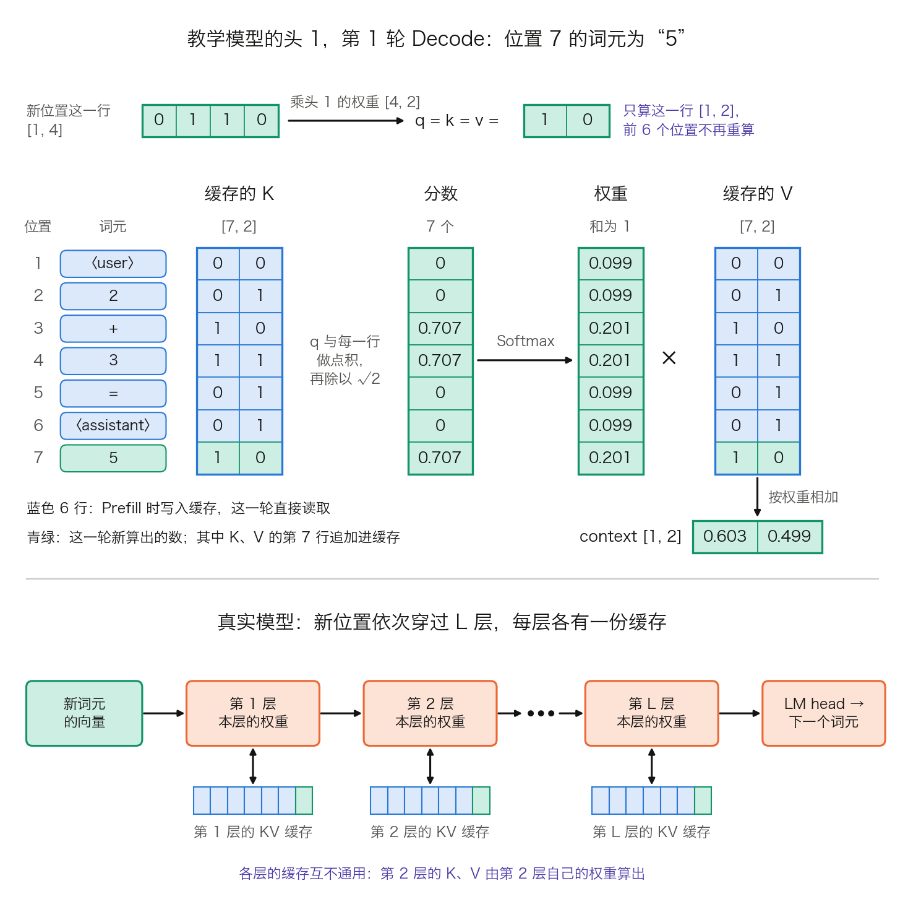

图 3-16：一轮 Decode 怎样对着 KV 缓存只算一行（[生成脚本](https://github.com/yeasy/llm_internals/blob/main/tools/figures/decode_with_cache.py)）。上：教学模型头 1 的第 1 轮，数值与下文的手算一致。下：真实模型中新位置依次穿过 L 层，每层读写本层自己的缓存。

#### 第 1 轮 Decode：由 y₁ = `5` 选出 y₂ = `。`

教学词元 `5` 的 ID 为 15，被追加到位置 7。令它的词嵌入为 `[-0.6, 0.4, 1, 0]`，第 3 维的 1 表示它是数字；位置向量沿表 3-17 的规律每个位置增加 0.1，位置 7 是 `[0.6, 0.6, 0, 0]`。两者相加，新位置的初始表示为 `[0, 1, 1, 0]`。这一轮送进模型的只有这一行 `[1, 4]`，而不是 `[7, 4]` 的整个矩阵。

**头 1。** 新行乘以 `W_Q,1` 得到 `q = k = v = [1, 0]`；其中 k、v 追加进缓存，成为表 3-22 的第 7 行。用 q 与头 1 的前 7 个 K 行逐一打分，例如对位置 4 是 `[1, 0]·[1, 1] / √2 = 0.707`，对位置 2 是 `[1, 0]·[0, 1] / √2 = 0`：

$$
\text{头 1 的分数}
= [0,\ 0,\ 0.707,\ 0.707,\ 0,\ 0,\ 0.707]
$$

取指数得 `[1, 1, 2.028, 2.028, 1, 1, 2.028]`，行和为 `4 × 1 + 3 × 2.028 = 10.084`，各项除以行和即得权重：

$$
\text{头 1 的权重} = [0.099,\ 0.099,\ 0.201,\ 0.201,\ 0.099,\ 0.099,\ 0.201]
$$

再按权重读取头 1 的前 7 个 V 行，沿用“先加权、最后只除一次”的算法。第 1 个分量来自 Value 首分量为 1 的位置 3、4、7，第 2 个分量来自位置 2、4、5、6：

$$
\begin{aligned}
\text{头 1 的 context}
&= \frac{[\,3\times2.028,\ \ 1+2.028+1+1\,]}{10.084} \\
&= \frac{[6.084,\ 5.028]}{10.084}
= [0.603,\ 0.499]
\end{aligned}
$$

**头 2。** 同一行 `[0, 1, 1, 0]` 乘以头 2 的三个矩阵，得到 `q = [0, 1]`、`k = [1, 0]`、`v = [0, 1]`，后两者追加进头 2 的缓存。q 与头 2 的 7 个 K 行打分，只有位置 5 和位置 6 的 Key 是 `[0, 1]`，分数为 0.707，其余为 0；换句话说，数字 `5` 在头 2 里回头去看 `=` 和 `⟨assistant⟩`：

$$
\text{头 2 的分数}
= [0,\ 0,\ 0,\ 0,\ 0.707,\ 0.707,\ 0]
$$

取指数得 `[1, 1, 1, 1, 2.028, 2.028, 1]`，行和为 `5 × 1 + 2 × 2.028 = 9.056`：

$$
\text{头 2 的权重} = [0.110,\ 0.110,\ 0.110,\ 0.110,\ 0.224,\ 0.224,\ 0.110]
$$

读取头 2 的 7 个 V 行，第 1 个分量来自位置 2、4、5、6，第 2 个分量来自位置 3、4、7：

$$
\begin{aligned}
\text{头 2 的 context}
&= \frac{[\,1+1+2.028+2.028,\ \ 1+1+1\,]}{9.056} \\
&= \frac{[6.056,\ 3]}{9.056}
= [0.669,\ 0.331]
\end{aligned}
$$

**拼接、输出投影、残差、MLP 和 LM head** 与 Prefill 中位置 6 的算法完全相同，用的也是同一个 `W_O` 和同一个 `W_vocab`：

$$
\begin{aligned}
\text{拼接} &= [0.603,\ 0.499,\ 0.669,\ 0.331] \\
\text{注意力输出} &= [0.603+0.669,\ \ 0.499+0.331,\ \ 0.603,\ \ 0.499] \\
&= [1.272,\ 0.830,\ 0.603,\ 0.499] \\
\text{注意力残差后的向量} &= [0, 1, 1, 0] + [1.272, 0.830, 0.603, 0.499] \\
&= [1.272,\ 1.830,\ 1.603,\ 0.499] \\
x_7^{(1)} &= 1.1 \times [1.272,\ 1.830,\ 1.603,\ 0.499] \\
&= [1.399,\ 2.013,\ 1.764,\ 0.548]
\end{aligned}
$$

四个分量都是正数，MLP 输出是各分量的 0.1 倍，加回去就是 1.1 倍。后两个分量若用页面上的三位小数计算会得到 1.763 和 0.549，各相差约 0.001，原因仍是舍入。

$$
z_7 = x_7^{(1)}W_{\mathrm{vocab}} = [1.399,\ 2.013,\ 0.364,\ 0.548,\ 0]
$$

五个分数仍按表 3-21 的顺序排列，其中第 3 格是 `1.764 − 1.399`（未舍入为 0.3644）。对这五个三位小数取指数，约为 `[4.051, 7.486, 1.439, 1.730, 1]`，和为 15.706，对应概率 `[0.258, 0.477, 0.092, 0.110, 0.064]`。`argmax(z₇)` 是第 2 个候选，对应教学 ID `16`，所以 y₂ = `。`。

这一轮可以用来检验缓存是否改变了结果。假如不用缓存，把 7 个词元重新做一遍 Prefill，每个头都会得到一张 `[7, 7]` 的权重矩阵：它的前 6 行与 Prefill 时的矩阵逐格相同，只是末尾多出一列 0；第 7 行正是上面那一行权重。缓存省掉的是前 6 行的重复计算，两种方法在数学上等价。实际实现若使用不同内核或计算顺序，可能有浮点数值差异；若再量化 KV 缓存，还会引入量化误差。计算量的差别也由此可见：Prefill 的每个头要算一张 `[6, 6]` 的分数矩阵，这一轮每个头只算了一行 7 个分数。

#### 第 2 轮 Decode：由 y₂ = `。` 选出 EOS

教学 ID `16` 被追加到位置 8。令它的词嵌入为 `[-1.7, -0.7, 0, 0]`，位置 8 的位置向量为 `[0.7, 0.7, 0, 0]`，新位置的初始表示为 `[-1, 0, 0, 0]`。

**头 1。** 新行乘以 `W_Q,1` 得到 `q = k = v = [0, −1]`，追加为表 3-22 的第 8 行。q 与头 1 的 8 个 K 行打分，例如对位置 2 是 `[0, −1]·[0, 1] / √2 = −0.707`：

$$
\text{头 1 的分数}
= [0,\ -0.707,\ 0,\ -0.707,\ -0.707,\ -0.707,\ 0,\ 0.707]
$$

这一行第一次出现负分数，取指数时用 `e^(−1/√2) ≈ 0.493`：指数为 `[1, 0.493, 1, 0.493, 0.493, 0.493, 1, 2.028]`，行和为 `3 × 1 + 4 × 0.493 + 2.028 = 7.000`：

$$
\text{头 1 的权重} = [0.143,\ 0.070,\ 0.143,\ 0.070,\ 0.070,\ 0.070,\ 0.143,\ 0.290]
$$

读取 Value 时，第 1 个分量来自 V 的首分量为 1 的位置 3、4、7，它们的指数分别是 1、0.493、1。第 2 个分量来自位置 2、4、5、6，指数各为 0.493；另有位置 8 的 Value `[0, −1]`，它的贡献是负的 2.028：

$$
\begin{aligned}
\text{头 1 的 context}
&= \frac{[\,1+0.493+1,\ \ 4\times0.493-2.028\,]}{7.000} \\
&= \frac{[2.493,\ -0.056]}{7.000}
= [0.356,\ -0.008]
\end{aligned}
$$

**头 2。** `。` 的第 3、4 维都是 0，乘以 `W_Q,2` 和 `W_K,2` 得到 `q = [0, 0]`、`k = [0, 0]`；Value 取前两维，`v = [−1, 0]`。Query 全为 0，它与任何 Key 的点积都是 0，8 个分数全是 0，取指数全是 1，于是 8 个位置各分到 `1/8 = 0.125`：一个“什么都不找”的 Query，得到的是平均注意力。读取头 2 的 8 个 V 行就是求它们的平均：

$$
\begin{aligned}
\text{头 2 的 context}
&= \frac{[\,1+1+1+1-1,\ \ 1+1+1\,]}{8} \\
&= \frac{[3,\ 3]}{8}
= [0.375,\ 0.375]
\end{aligned}
$$

第 1 个分量来自位置 2、4、5、6 的 1 和位置 8 的 −1，第 2 个分量来自位置 3、4、7。

$$
\begin{aligned}
\text{拼接} &= [0.356,\ -0.008,\ 0.375,\ 0.375] \\
\text{注意力输出} &= [0.356+0.375,\ \ -0.008+0.375,\ \ 0.356,\ \ -0.008] \\
&= [0.731,\ 0.367,\ 0.356,\ -0.008] \\
\text{注意力残差后的向量} &= [-1, 0, 0, 0] + [0.731, 0.367, 0.356, -0.008] \\
&= [-0.269,\ 0.367,\ 0.356,\ -0.008] \\
\text{MLP 输出} &= 0.1\operatorname{ReLU}([-0.269,\ 0.367,\ 0.356,\ -0.008]) \\
&= [0,\ 0.037,\ 0.036,\ 0] \\
x_8^{(1)} &= [-0.269,\ 0.404,\ 0.392,\ -0.008]
\end{aligned}
$$

这一次第 1、4 个分量是负数，ReLU 把它们置 0，MLP 对这两个分量没有贡献。再乘以 `W_vocab`，第 3 个候选 EOS 的分数是第 3 个分量减第 1 个分量，即 `0.392 − (−0.269) = 0.661`：

$$
z_8 = x_8^{(1)}W_{\mathrm{vocab}} = [-0.269,\ 0.404,\ 0.661,\ -0.008,\ 0]
$$

对这五个三位小数取指数，约为 `[0.764, 1.498, 1.937, 0.992, 1]`，和为 6.191，对应概率 `[0.123, 0.242, 0.313, 0.160, 0.162]`。`argmax(z₈)` 是第 3 个候选 EOS，循环停止。EOS 用于控制生成结束，不会被拼接到用户可见文本中；服务端去掉它和其他控制词元，把剩下的 ID `15`、`16` 反分词为“5。”。表 3-23 把图 3-12 写成一张完整的状态轨迹。

| 阶段 | 本轮输入 | 本轮选择 | 本轮结束后的 KV 长度 | 本轮结束后用户可见的文本 |
| --- | --- | --- | ---: | --- |
| Prefill | 6 个 Prompt 词元的 ID | y₁ = `5` | 6 | `5` |
| Decode 第 1 轮 | `5` 的 ID | y₂ = `。` | 7 | `5。` |
| Decode 第 2 轮 | `。` 的 ID | EOS | 8 | `5。` |
| 结束处理 | 已选词元 `5`、`。`、EOS | 去除 EOS，反分词 | 不再增长 | `5。` |

表 3-23：同一请求的离散状态轨迹。每一轮的“本轮选择”只能在本轮前向计算结束后出现；流式输出时，用户大体按这个节奏看到文本，不过一个汉字可能由多个词元拼成，要攒齐才能显示。

**真实模型中，每一层各有一份缓存。** 教学模型只有一层，所以表 3-22 就是它的全部缓存。真实模型的新位置要依次穿过第 1 层到第 L 层：每层用本层的权重算出新位置的 q、k、v，读取并追加**本层自己的**缓存，再把输出交给下一层。图 3-16 的下半幅画的就是这件事：每一层下方各有一条自己的缓存。新位置仍须经过全部 L 层，KV 缓存只是避免重算历史前缀。

在这种每层各有一套 K/V 投影的标准结构里，各层缓存不能混用：第 2 层的 K、V 来自第 1 层的输出，经第 2 层自己的归一化与投影得到，与第 1 层的 K、V 不是同一组数。让若干层共用一份 K/V 的变体见 [10.2 节](../10_inference_optimization/10.2_kv_cache.md)。可以把全部缓存想成“K 与 V 两份 × 层 × K/V 头 × 已有长度 × 每头宽度”的一大块数组；带 batch 时，单层的 K 和 V 各常写作 `[B, n_kv, s, d_h]`，B 是批大小，`n_kv` 是 K/V 头数，s 是当前总长度，实际数组顺序因运行时而异。要记住的只有一条：标准结构中，K/V 只在**同一层、跨时间步**复用。

### 8.7 从教学模型到真实模型

手算展开的是 1 层、2 个头、4 维的模型。回看 3.8.4 的图 3-15，可以将投影、注意力、拼接、残差和词表打分逐项对应起来。还原真实模型时，除了扩大矩阵、增加头数和层数，还要恢复本例简化掉的归一化与完整 MLP。


对照关系是：图中的 `T` 对应本例的 6，`d_model` 对应 4，`d_h` 对应 2，`n_h` 对应 2；将手算中相应的维度替换成真实配置，矩阵乘法规则不变。KV 缓存的大小也可以照此换算：每个词元要存“K 与 V 两份 × K/V 头数 × 每头宽度 × 层数”个数，教学模型是 `2 × 2 × 2 × 1 = 8` 个，GPT-3 Small 是 `2 × 12 × 64 × 12 = 18,432` 个。

从教学模型走到真实模型，变化发生在三个互相独立的方向上，难度并不一样。向量变宽（4 到 768）最容易：点积、加权求和的算法一字不改，只是每次多加几百项。头变多（2 到 12）也不改算法：每个头各做一遍第 2 到 6 步，拼接时多排几段。层变多（1 到 12）是把“注意力、残差、MLP、残差”整个重复，每层换一套权重，上一层的输出作为下一层的输入；这时位置 1 到 5 的 context 也要全部算出来，因为下一层要用到它们，而教学模型只有一层，才可以在头 2 里只算最后一行。

表 3-24 再从生成顺序的角度，将“可手算的 1 层 2 头”与“典型 L 层 n_h 头”并列。两者的区别在于并行的头数和串行的层数，而不是输出词元是否还能并行地产生。

| 教学局部 | 典型 GPT 式结构 | 对生成顺序的影响 |
| --- | --- | --- |
| 2 个头各有 Q/K/V 投影，拼接后过 W_O | 每层 n_h 个头各有 Q/K/V 投影，随后拼接并过 W_O | 同一层的头可并行；Prefill 处理全部输入位置，Decode 只计算新位置 |
| 1 层注意力与 MLP | L 层参数不同的注意力、残差、归一化和 MLP 依次执行 | 第 ℓ 层输出必须成为第 ℓ + 1 层输入 |
| 1 层、2 个头各存一份 K/V | 每层、每个 K/V 头各存一份；GQA/MQA 可令 n_kv 小于 n_h | 标准结构中只在同层跨时间步复用 |
| x⁽¹⁾ 的最后一行直接进 LM head | x⁽ᴸ⁾ 的最后一行经最终归一化后进 LM head | 每轮仍只得到一个“下一词元”分布 |

表 3-24：教学局部与典型 GPT 式结构的对应关系。

因此，完整的 Decode 不是“只跑一个小注意力层”。一个已选词元要先过第 1 层，再过第 2 层，直到第 L 层；每层中的 `n_h` 个头可以并行。最后才由 LM head 选出一个新词元。对单个请求，`y₁ → y₂ → …` 的因果顺序不可跳过；服务端能做的，是把多个请求各自的当前一步（不论各是第几轮）合并进同一次前向。

**回看：图 3-15 的精确写法。** 下面汇总一次 Prefill 的完整计算，采用预归一化与普通多头注意力；词元数为 T，省略各子层线性投影的偏置，位置信息已在初始表示中加入。若采用 RoPE，还需在 Q/K 投影后应用旋转；Decode 则使用 3.8.6 中追加缓存的注意力公式，不能只把下式的 T 换成 1。层号 `ℓ` 从 1 重复到 L，头号 `h` 从 1 重复到 `n_h`：

$$
\begin{aligned}
\widetilde{X}^{(\ell)}
&= \operatorname{Norm}_{\mathrm{attn}}^{(\ell)}\left(X^{(\ell-1)}\right) && [T, d_{\mathrm{model}}] \\[2pt]
Q_h^{(\ell)},K_h^{(\ell)},V_h^{(\ell)}
&= \widetilde{X}^{(\ell)}W_{Q,h}^{(\ell)},\ \widetilde{X}^{(\ell)}W_{K,h}^{(\ell)},\ \widetilde{X}^{(\ell)}W_{V,h}^{(\ell)} && [T, d_h] \\[2pt]
A_h^{(\ell)}
&= \operatorname{softmax}_{\mathrm{row}}\left(
\frac{Q_h^{(\ell)}K_h^{(\ell)T}}{\sqrt{d_h}} + M
\right) && [T, T] \\[2pt]
C_h^{(\ell)}
&= A_h^{(\ell)}V_h^{(\ell)} && [T, d_h] \\[2pt]
U^{(\ell)}
&= X^{(\ell-1)} +
\operatorname{Concat}\left(C_1^{(\ell)},\ldots,C_{n_h}^{(\ell)}\right)W_O^{(\ell)} && [T, d_{\mathrm{model}}] \\[2pt]
X^{(\ell)}
&= U^{(\ell)} +
\operatorname{MLP}^{(\ell)}\left(\operatorname{Norm}_{\mathrm{mlp}}^{(\ell)}\left(U^{(\ell)}\right)\right) && [T, d_{\mathrm{model}}] \\[2pt]
z
&= \operatorname{Norm}_{\mathrm{final}}\left(x_T^{(L)}\right)W_{\mathrm{vocab}} + b_{\mathrm{vocab}} && [n_{\mathrm{vocab}}]
\end{aligned}
$$

这里 `X̃` 是归一化后的层输入，`A_h` 是第 h 个头的注意力权重（3.8.3 的第 5 步），3.8.6 的 `A_s` 就是它的第 s 行，只是省略了头下标；`C_h` 是这个头读出的 context（第 6 步），`U` 是加上注意力残差后的中间表示。每层的两处归一化 `Norm_attn`、`Norm_mlp` 各有独立参数，最后还有一次 `Norm_final`。第 1 行是各头共用的归一化，第 2 到 4 行对应“一个头”，第 5、6 行对应“拼接 → 输出投影 → 残差 → MLP”；对 `ℓ = 1…L` 重复后，最后位置才经 LM head 得到 logits。真实模型的 `W_Q`、`W_K`、`W_V` 是三组分别学习到的权重，通常互不相同，也不会像教学模型那样只含 0、1、2 这几个“挑选维度”的数。GQA/MQA 只改变 K/V 的共享方式，不改变这条计算顺序；多头可并行，多层必须依次执行。

**真实规模的参照。** 实际规模没有唯一的“典型值”。表 3-25 从 [GPT-3 论文](https://arxiv.org/pdf/2005.14165)公开的八个纯解码器配置中取出三个，再加上 [Llama 3 论文](https://arxiv.org/abs/2407.21783)的三个配置。`d_h` 是每个 Query 头的宽度，等于 `d_model / n_h`。

| 公开配置 | 层数 L | `d_model` | Query 头数 `n_h` | 每头宽度 `d_h` | K/V 头数 `n_kv` | MLP 中间层宽度 |
| --- | ---: | ---: | ---: | ---: | ---: | ---: |
| GPT-3 Small（125M） | 12 | 768 | 12 | 64 | 12 | 3,072 |
| GPT-3 6.7B | 32 | 4,096 | 32 | 128 | 32 | 16,384 |
| GPT-3 175B | 96 | 12,288 | 96 | 128 | 96 | 49,152 |
| Llama 3 8B | 32 | 4,096 | 32 | 128 | 8 | 14,336 |
| Llama 3 70B | 80 | 8,192 | 64 | 128 | 8 | 28,672 |
| Llama 3 405B | 126 | 16,384 | 128 | 128 | 8 | 53,248 |

表 3-25：公开模型的层数、宽度与头数。GPT-3 各行取自该论文表 2.1，其 MLP 中间层宽度按文中规定的 `4 × d_model` 算出，`n_kv` 等于 `n_h`；Llama 3 各行取自该论文表 3，`d_h` 由 `d_model / n_h` 算出。

几条经验可以从表中直接读出。模型从 1 亿到 4000 亿参数，每头宽度只在 64 到 128 之间变化（GPT-3 未列出的配置里还有 80 和 96）；变大靠的是层数（12 到 126）、宽度（768 到 16,384）和头数（12 到 128）一起增长。MLP 中间层约为 `d_model` 的 3 到 4 倍：GPT-3 固定为 4 倍；Llama 3 采用 SwiGLU，MLP 有三个矩阵，中间层取 3.25 到 3.5 倍，高于 3.4 节提到的 8/3 惯例。GPT-3 6.7B 与 Llama 3 8B 的层数、宽度、头数完全相同，差别之一是后者只保留 8 组 K/V，每个词元的 KV 缓存因此缩小到四分之一。上下文长度方面，GPT-3 为 2,048 个词元；Llama 3 论文的结果均出自 Llama 3.1，三个规模都支持到 128K（见 13.2 节）。教学模型的 `L = 1`、`n_h = 2`、`d_model = 4` 只为把图 3-15 缩小到能手算的程度，并不表示真实模型只有一层两头。

**延伸：实现中的打包形状。** 上文按“一个头、一个请求”写作 `[T, d_h]`；实际运行通常还显式保留 batch 和头数：

| 对象 | 一个头的数学视角 | 常见的打包实现形状 |
| --- | --- | --- |
| Q | `[T, d_h]` | `[B, n_h, T, d_h]` |
| K、V | `[T, d_h]` | `[B, n_kv, T, d_h]` |
| 注意力权重 | `[T, T]` | `[B, n_h, T, T]` |
| 因果掩码 | `[T, T]` | 通常广播为 `[B, 1, T, T]` |

表 3-26：同一计算在运行时额外保留 batch 与头维度。权重同样是打包存放的：各头的 `[d_model, d_h]` 投影横向拼成一个 Q 投影 `[d_model, n_h × d_h]`，K、V 各为 `[d_model, n_kv × d_h]`，Llama 3 8B 分别是 4096 到 4096 和 4096 到 1024；有些框架按“输出 × 输入”存放，行列与本书相反。对照代码时看到方阵，并不与“每个头的投影不是方阵”矛盾。表中是 Prefill 的形状；Decode 时 Q 为 `[B, n_h, 1, d_h]`，注意力权重为 `[B, n_h, 1, s]`。`B` 是并行请求数；普通多头注意力中 `n_kv = n_h`，GQA/MQA 中 `n_kv` 更小。以 GPT-3 6.7B 为例，Q 可写作 `[B, 32, T, 128]`。

#### 参数与符号速查

以下内容用于回查，不是另一条计算流程。

**教学模型的设定，以及真实模型的典型取值。** 表 3-27 左边是本节的取值，右边是三个公开模型的取值，用来建立量级感：教学模型中每个位置的向量只有 4 维，真实模型则通常有数百到上万维。

| 符号 | 含义 | 教学取值 | GPT-3 Small | GPT-3 175B | Llama 3 8B |
| --- | --- | ---: | ---: | ---: | ---: |
| `L` | 层数 | 1 | 12 | 96 | 32 |
| `d_model` | 每个位置的向量宽度 | 4 | 768 | 12,288 | 4,096 |
| `n_h` | Query 头数 | 2 | 12 | 96 | 32 |
| `d_h` | 每个头的宽度 | 2 | 64 | 128 | 128 |
| `n_kv` | K/V 头数 | 2 | 12 | 96 | 8 |
| — | MLP 中间层宽度 | 不扩展 | 3,072 | 49,152 | 14,336 |
| `n_vocab` | 词表大小 | 5 个候选 | 50,257 | 50,257 | 128,000 |

表 3-27：教学取值与公开模型取值的对照。GPT-3 的层数、宽度、头数取自 [GPT-3 论文](https://arxiv.org/pdf/2005.14165)的表 2.1；该文规定 MLP 中间层为 `4 × d_model`，并说明沿用 GPT-2 的分词器，词表大小 50,257 出自 [GPT-2 论文](https://cdn.openai.com/better-language-models/language_models_are_unsupervised_multitask_learners.pdf)；它采用普通多头注意力，故 `n_kv = n_h`。Llama 3 的数值取自 [Llama 3 论文](https://arxiv.org/abs/2407.21783)的表 3，`d_h` 由 `d_model / n_h` 算出；128,000 是论文口径，发布权重的嵌入表另含特殊词元，共 128,256 行（见 9.3 节）。

这张表里有三条规律，读真实模型的配置时可以直接套用：

- **多数模型取 `d_model = n_h × d_h`。** 每个头都读取完整的 `d_model` 维输入，分别投影成 `d_h` 维；各头输出拼接后的总宽度等于 `d_model`，并不是把输入向量切片分给各头：本节是 `4 = 2 × 2`，GPT-3 Small 是 `768 = 12 × 64`。每头宽度 `d_h` 常见的取值是 64 到 128，模型变大主要靠增加宽度、头数和层数。少数模型单独设定每头宽度，此时拼接后的宽度 `n_h × d_h` 不等于 `d_model`，由 `W_O` 投影回去。
- **Q/K/V 的投影矩阵因此不是方阵**，形状是 `[d_model, d_h]`：本节是 `[4, 2]`，GPT-3 Small 是 `[768, 64]`。各头的结果拼接后回到 `n_h × d_h = d_model` 维。
- **`n_kv` 可以小于 `n_h`。** Llama 3 8B 让 32 个 Query 头共用 8 组 K/V，这就是 GQA（见 [3.7 节](3.7_full_architecture.md)），首次阅读可跳过；本节取 `n_kv = n_h = 2`，每个头各有自己的 K/V。

表 3-28 汇总本节符号，便于对照公式和实现。

| 符号 | 含义与用途 |
| --- | --- |
| `T`、`n_vocab` | 当前序列的词元数（本例 Prefill 时为 6）、词表大小。 |
| `n`、`m` | 通用维度表中的本轮输入位置数、完整 K/V 的位置数；Prefill 时均为 T，单词元 Decode 时 n 为 1、m 为当前总长度。 |
| `L` | Transformer 层数；层按 1 到 L 依次执行。 |
| `h`、`n_h`、`n_kv` | 第 h 个注意力头、Query 头总数、K/V 头总数；普通多头注意力中 `n_h = n_kv`，GQA/MQA 中 `n_kv` 可更小。 |
| `i`、`s`、`t` | 词元位置与生成轮次；i 表示任意已有位置，s 表示正在预测下一个词元的位置（Prefill 时是 Prompt 的最后位置，Decode 时是刚追加的新位置），t 表示第 t 个已选输出词元。 |
| `E[idᵢ]`、`pᵢ` | ID `idᵢ` 的词嵌入、位置 i 的位置向量。 |
| `X⁽ˡ⁾`、`xₛ⁽ˡ⁾` | 第 ℓ 层输出的全部位置表示、其中位置 s 的单个向量；`X⁽⁰⁾` 是进入第 1 层前的表示。 |
| `Q`、`K`、`V` | Query、Key、Value：分别表示“当前位置要找什么”“各位置可怎样匹配”“被加权读出的内容”。 |
| `qₛ`、`kₛ`、`vₛ`、`A` | 小写 q、k、v 是 Q、K、V 中位置 s 的那一行；A 是 Softmax 之后的注意力权重。 |
| `W_Q,h`、`W_K,h`、`W_V,h`、`W_O` | 第 h 个头的三个投影矩阵，形状 `[d_model, d_h]`；`W_O` 是把各头拼接（Concat）结果投回 `d_model` 的输出投影。 |
| `W_vocab`、`b_vocab` | LM head 的词表投影 `[d_model, n_vocab]` 与偏置。 |
| `d_model`、`d_h`、`M` | 模型表示宽度、每个头的向量宽度、因果掩码；M 将未来位置的分数置为 −∞。 |
| `d_ff`、`W_up`、`W_down` | MLP 中间宽度、升维矩阵 `[d_model, d_ff]`、降维矩阵 `[d_ff, d_model]`。 |
| `g`、`ε` | RMSNorm 的可学习缩放向量 `[d_model]`、防止分母为零的小正数。 |
| `zₛ`、`yₜ`、EOS | 位置 s 的 logits（各候选词元的未归一化分数）、已选第 t 个输出词元、序列结束词元。 |

表 3-28：本节使用的符号与含义。大写 `X` 表示全部位置，小写 `x` 表示一个位置；公式中的上标 `T` 表示矩阵转置，方括号形状里的 `T` 表示词元数。第 2 章的数学推导记每头宽度为 `d_k`、头数为 `h`、序列长度为 `n`，讨论张量形状时则已并用 `d_h`、`n_h`、`n_kv`、`T`；本节一律取后一套，并把 `h` 改作头的序号。3.2 节用 `V` 表示词表大小；本节的 `V` 专指 Value，词表大小记作 `n_vocab`。10.2 节把 K/V 头数记作 `H_kv`、已有长度记作 `t`，对应本节的 `n_kv` 和 `s`。单个位置的向量写作 `[d]` 或 `[1, d]`，两者不作区分。

### 8.8 计算开销与优化位置

前面展示的是单请求、使用 KV 缓存的基本自回归流程。有了 3.8.3 的矩阵形状，就可以估算各步骤的计算量和数据读取量，分析潜在瓶颈及对应优化。这里列出的优化都不改变“后一个词元依赖前一个词元”的因果顺序。

**怎么数计算量。** 一次 `[a, b] × [b, c]` 的矩阵乘法，要做 `a × b × c` 次乘法和差不多同样多次加法，按 [3.7 节](3.7_full_architecture.md)的惯例记作约 `2abc` 次浮点运算（FLOPs）。下面以 GPT-3 式普通多头注意力、两矩阵且中间宽度为 `4d` 的 MLP 为例，忽略归一化、激活等较小开销。用 d 表示 `d_model`、T 表示词元数，并把各个头合在一起算：

- 乘号右边是权重的几步：Q/K/V 投影约 `6Td²`，输出投影约 `2Td²`，MLP 的两个矩阵约 `16Td²`，合计约 `24Td²`，其中 MLP 占三分之二。
- 两边都是数据的第 3 步和第 6 步：打分与读取合计约 `2T²d`。因果掩码下只需要算下三角那一半，这个数已经折半。

所以一层的计算量约为 `24Td² + 2T²d`。前一项随词元数线性增长，后一项按平方增长；两项在 `T = 12d` 时相等，与 3.7 节给出的门槛一致。GPT-3 Small 的 `12d` 是 9,216，超过了它 2,048 的上下文上限，所以在它身上始终是前一项占大头；上下文越长的模型，后一项越不能忽略。

Decode 的一轮只有新位置这一行，相当于 `T = 1`：与权重相乘的部分是每层 `24d²`；打分与读取要对着缓存里的 s 行各做一次，每层约 `4sd`，s 是当前的总长度。不论 Prefill 还是 Decode，LM head 都只算一行，约 `2 × d × n_vocab`。

表 3-29 借用 GPT-3 Small 的尺寸算一个具体场景：上下文里已有 1,000 个词元，权重按 FP16 存放，每个数占 2 字节。这里统一按所有层使用全因果注意力估算，不复现 [GPT-3 论文](https://arxiv.org/html/2005.14165v4)第 2.1 节中密集与局部稀疏注意力交替的实现。代入 `d = 768`、12 层、`n_vocab = 50,257`，例如 Prefill 与权重相乘一项是 `24 × 1,000 × 768² × 12`，约 1,700 亿次；Decode 的同一项少了 1,000 这个因子，约 1.7 亿次；Decode 的打分与读取是 `4 × 1,001 × 768 × 12`，约 0.37 亿次。

| 项目 | Prefill：一次处理 1,000 个词元 | Decode：为第 1,001 个位置算一轮 |
| --- | ---: | ---: |
| 与权重相乘（Q/K/V、`W_O`、MLP），12 层 | 约 1,700 亿次 | 约 1.7 亿次 |
| 打分与读取，12 层 | 约 184 亿次 | 约 0.37 亿次 |
| LM head | 约 0.8 亿次（只算最后一行） | 约 0.8 亿次 |
| 计算量合计 | 约 1,880 亿次 | 约 2.8 亿次 |
| 要从显存读出的权重 | 约 250 MB | 约 250 MB |
| 要从显存读出的 KV 缓存 | 无，边算边写入 | 约 37 MB |
| 每读 1 字节，做多少次运算 | 约 750 次 | 约 1 次 |

表 3-29：借用 GPT-3 Small 尺寸、按全因果注意力计算的开销估算。权重约 1.25 亿个数，每个 2 字节，合 250 MB；KV 缓存每个词元 18,432 个数（算法见 3.8.7），1,000 个历史词元约 37 MB。Decode 的打分还包括当前第 1,001 个位置，当前 K/V 的读写在此粗略访存估算中略去。最后一行是“计算量合计 ÷ 要读出的字节数”：Prefill 为 `1,880 亿 ÷ 250 MB`，Decode 为 `2.8 亿 ÷ (250 MB + 37 MB)`。访存只数了权重和历史 KV 缓存，没有数其他中间结果的读写。

最后一行是关键。对 GPT-3 这类稠密模型，Prefill 和 Decode 要读的权重一样多，因为每一层的每个矩阵都得用到；可 Decode 只拿它们算一行，计算量不到 Prefill 的千分之二。[10.1 节](../10_inference_optimization/10.1_bottleneck.md)给出的判据是：以 H100 为例，每读 1 字节要配上约 295 次运算，理论算力上限与显存带宽上限才相匹配。Prefill 的约 750 次/字节只计权重读取，忽略了激活和中间结果的显存读写，因此是这一估算口径下的上界，不能据此认定实际执行一定受算力限制。它说明长 Prompt 提供了较高的权重复用机会；实际瓶颈还取决于矩阵尺寸、内核、并行度和硬件利用率。单请求 Decode 的约 1 次/字节则表明它更容易受显存带宽限制。这里采用的是一阶性能模型，而非实测结果；具体执行需用性能分析确认，参见 [NVIDIA 性能分析指南](https://docs.nvidia.com/deeplearning/performance/dl-performance-gpu-background/index.html)。图 3-17 把这几个数画在同一条数轴上。

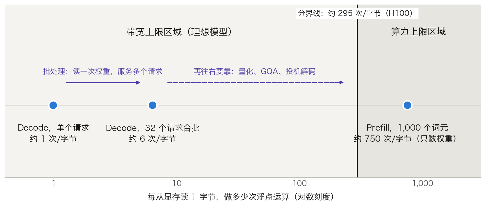

图 3-17：一阶模型下的算术强度对照，分区表示理论上限，不是实测瓶颈（[生成脚本](https://github.com/yeasy/llm_internals/blob/main/tools/figures/inference_bottleneck.py)）。数值按表 3-29 的口径算出；批处理能把 Decode 往右推，但提升幅度受 KV 缓存读取开销限制，见下文瓶颈三。

由此得到三个性质不同的瓶颈。

**瓶颈一：Prefill 的矩阵计算与中间结果读写。** 长 Prompt 的矩阵乘法有较高的并行度和权重复用率，因此更有机会充分利用算力。上下文变长后，`[T, T]` 的打分矩阵按平方增长，而且标准实现要把这张矩阵整个写进显存再读回来，增加了访存开销。FlashAttention 把第 3 到 6 步分块放在片上的高速存储中计算，不把完整的 `[T, T]` 中间矩阵写回显存。调度层面还有两种方法：分块 Prefill 把长 Prompt 拆成几段，与其他请求的 Decode 交错执行；前缀缓存复用相同 Prompt 前缀的 KV，省去命中前缀的计算，未命中的后缀仍需处理。

**瓶颈二：单请求 Decode 容易受显存带宽限制。** 每生成一个词元，250 MB 的权重要完整读一遍，却只换来 2.8 亿次运算。可通过三种方式减少或分摊权重读取成本：量化让每个权重占更少的字节，相对 FP16，FP8 减半，4 比特再减半；批处理把多个请求的当前一步合进同一次前向，同一遍权重读取换来多份结果；投机解码让一次前向确认多个词元。

**瓶颈三：KV 缓存卡在容量和带宽上。** 在这个估算中，批处理分摊的是权重读取成本，各请求仍需读取各自的 KV 缓存。上面的例子若把 32 个请求合成一批，每轮要读的 KV 缓存是 `32 × 37 MB`，约 1.2 GB，已是权重的近 5 倍；计算量是 `32 × 2.8 亿`，要读的字节是 `250 MB + 1.2 GB`，每字节的运算次数只从 1 升到约 6，而不是 32。每个词元要存的数按 3.8.7 的算法是“K 与 V 两份 × K/V 头数 × 每头宽度 × 层数”，GPT-3 Small 是 18,432 个，Llama 3 8B 是 `2 × 8 × 128 × 32 = 65,536` 个。KV 缓存的总大小再与上下文长度和批大小成正比，它既占用显存容量、限制可同时处理的请求数，也增加每轮生成的显存读取量。GQA/MQA 直接减少 K/V 头数；KV 量化减少每个数的字节；PagedAttention 按页分配显存，减少碎片和过度预留，让同样的显存装下更多请求；前缀缓存让相同前缀的请求共享一份。GPT-3 Small 的权重规模较小，合批后 KV 缓存的读取量较容易超过权重读取量；更大的模型权重占比更高，但上下文足够长、批足够大时，结论相同。

表 3-30 把三个瓶颈和对应的优化技术逐项对上。

| 瓶颈 | 技术 | 它改变了什么 | 深入阅读 |
| --- | --- | --- | --- |
| 不用缓存时的重复计算 | KV 缓存本身 | 用显存换计算：历史前缀的 K/V 不再重算；代价是增加缓存的显存占用与读取开销 | [10.2 节](../10_inference_optimization/10.2_kv_cache.md) |
| Prefill 的算力与 `[T, T]` 读写 | FlashAttention | attention 内核分块计算，中间矩阵不落显存；Decode 每轮只有一行分数，这项收益小得多 | [10.3 节](../10_inference_optimization/10.3_flash_attention.md) |
| Prefill 的算力与 `[T, T]` 读写 | 分块 Prefill、前缀缓存 | 长 Prompt 拆段与 Decode 交错；重复前缀不再计算 | [11.2 节](../11_serving/11.2_continuous_batching.md)、[10.2 节](../10_inference_optimization/10.2_kv_cache.md) |
| Decode 的显存带宽 | FP8 等低精度 | 权重、激活或 KV 的字节数 | [10.4 节](../10_inference_optimization/10.4_quantization.md)、[11.12 节](../11_serving/11.12_hardware.md) |
| Decode 的显存带宽 | Continuous Batching | 多个请求的当前一步合进同一次前向，并随时补位 | [11.2 节](../11_serving/11.2_continuous_batching.md) |
| Decode 的显存带宽 | 投机解码 | 一次前向确认多个词元 | [10.6 节](../10_inference_optimization/10.6_speculative_decoding.md) |
| KV 缓存的容量与带宽 | GQA/MQA | 每个词元须保存的 K/V 头数 | [3.7 节](3.7_full_architecture.md)、[10.2 节](../10_inference_optimization/10.2_kv_cache.md) |
| KV 缓存的容量与带宽 | PagedAttention | 多请求 KV 的显存分配方式，减少碎片和过度预留 | [11.2 节](../11_serving/11.2_continuous_batching.md) |
| 以上全部 | vLLM 等推理运行时 | 将执行内核、缓存和调度组织为系统 | [11.1 节](../11_serving/11.1_engines_overview.md) |

表 3-30：各项优化技术针对的瓶颈、改变的对象与深入章节。

这些技术作用于不同层面。FlashAttention 优化 attention 内核；GQA/MQA 改变模型结构；KV 缓存保存请求的历史状态（相同前缀还可以跨请求共享，见 10.2 节）；PagedAttention 管理缓存内存；Continuous Batching 调度请求；vLLM 将这些机制组织为运行时。KV 缓存本身就是一项优化：它以显存占用换取更少的重复计算。其余技术分别降低计算、数据搬运和缓存管理成本，或提高请求调度效率。

#### 回放与自测

回到本节开头的图 3-12。第一次看它时，三个“模型”方框里发生了什么还是未知的；现在每一格都已经算过：6 个 Prompt 词元经 Prefill 得到 `z₆`，选出 ID `15`，即 `5`，各层缓存写入 6 行；第 1 轮 Decode 只送进这一个词元，缓存长到 7 行，`z₇` 选出 ID `16`，即 `。`；第 2 轮缓存长到 8 行，`z₈` 选出 ID `2`，即 EOS，生成停止，去掉 EOS 后反分词得到“5。”。

读完本节，应能不看正文回答下面六个问题；答不上来时，括号里是回看的位置。

1. 回答“5。”一共做了几次前向计算？每次送进模型几个词元？（图 3-12）
2. 为什么 y₂ 不能与 y₁ 同时算出？（3.8.1；位置 7 的输入正是 y₁ 的嵌入）
3. KV 缓存里存的是什么？为什么追加新词元后，旧的内容不必更新？（表 3-22 及其上方的说明）
4. Prefill 时 6 个位置都能算出 logits，为什么只用位置 6 的？（3.8.5）
5. 真实模型有 L 层、每层 `n_h` 个头，哪些计算可以并行，哪些必须依次执行？（表 3-24）
6. Prefill 和 Decode 要读的权重一样多，为什么长 Prompt 的 Prefill 更有利于利用算力，而单请求 Decode 更容易受显存带宽限制？FlashAttention、量化、GQA 和 Continuous Batching 各自针对哪个瓶颈，有哪一条规则是它们都没有改变的？（3.8.8）

想换一个角度再看一遍同样的流程，可以读 Jay Alammar 的[图解 Transformer](https://jalammar.github.io/illustrated-transformer/)和[图解 GPT-2](https://jalammar.github.io/illustrated-gpt2/)，前者逐步讲解单个位置的注意力计算，后者画出了逐词元生成与 K/V 的保留；[Transformer Explainer](https://poloclub.github.io/transformer-explainer/) 则可以在浏览器里对真实的 GPT-2 逐阶段查看输入和输出。

本节固定用贪心策略选词；[第九章](../09_decoding/README.md)从这里接手，讨论贪心之外的选词方式，第十、十一章则沿 3.8.8 的三个瓶颈逐项展开各种优化。
