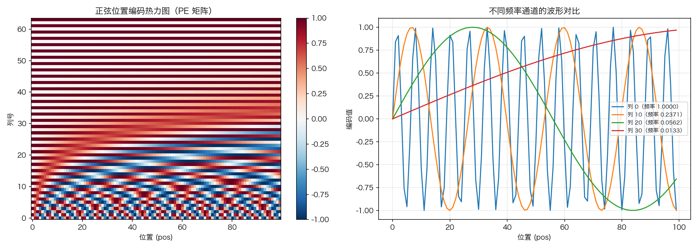
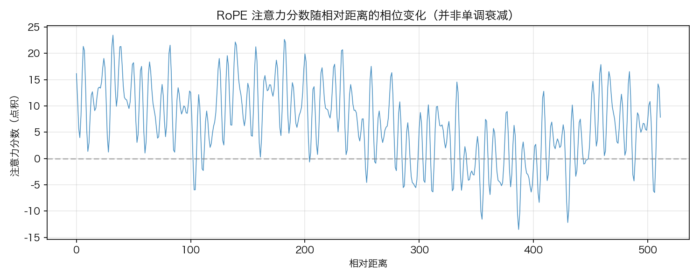
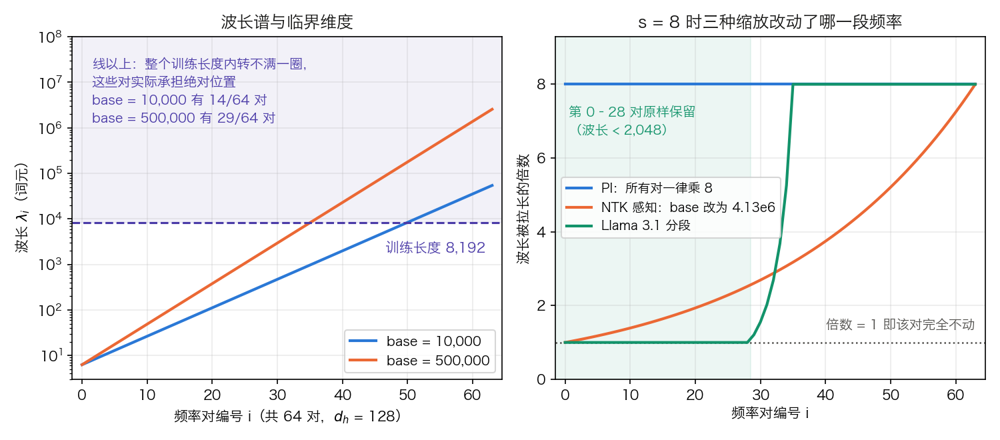
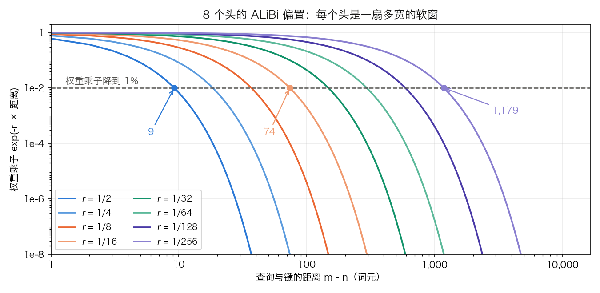

# 第四章：位置编码的设计哲学

[第三章](../03_components/3.3_position_encoding.md)已经解释了位置编码存在的必要性：自注意力是置换等变的，必须显式注入位置信息。但“如何”编码位置，是一个充满巧妙设计与持续演进的领域。

从原始 Transformer 的正弦位置编码到 GPT 等模型的可学习位置编码，再到 Llama 等现代模型广泛采用的旋转位置编码（RoPE），每一种方案都体现了不同的设计哲学和对“位置”这一概念的不同理解。本章沿着四个问题展开：

- [4.1 节](4.1_sinusoidal.md)：为什么偏偏是正弦？“相对距离可以通过线性变换表示”怎么证明？
- [4.2 节](4.2_learnable.md)：让模型自己学位置向量更直接，代价是什么？
- [4.3 节](4.3_rope.md)：RoPE 为什么靠“旋转”就同时编码了绝对与相对位置？既然分数只依赖相对距离，为什么它仍然外推失败？
- [4.4 节](4.4_alibi_others.md)：长度外推的手段都是事后补丁，有没有一开始就不这么写位置的方案？

## 1. 正弦位置编码：频率与外推的直觉

原始 Transformer 用一组不同频率的正弦和余弦函数给每个位置发一个向量。[3.3.4 节](../03_components/3.3_position_encoding.md)已经按公式逐位算出了前三个位置，也断言过“相对距离可以通过线性变换表示”，但那里既没有解释为什么偏偏是正弦，也没有证明那条线性性质。本节从这两处补起：先把那张表补成四个位置，供 4.1.4 验算线性平移性质时复用；再把线性性质证出来；最后交代这条性质在真实注意力里还剩多少。

### 1.1 编码公式

**正弦位置编码**（Sinusoidal Positional Encoding）的定义为：

$$\text{PE}(pos, 2i) = \sin\left(\frac{pos}{10000^{2i/d_{\text{model}}}}\right)$$

$$\text{PE}(pos, 2i+1) = \cos\left(\frac{pos}{10000^{2i/d_{\text{model}}}}\right)$$

其中 $pos$ 是位置索引（0, 1, 2, …），$i$ 是频率对的编号（0, 1, …, $d_{\text{model}}/2 - 1$）。每个位置得到一个 $d_{\text{model}}$ 维向量，第 $2i$ 列放正弦，第 $2i+1$ 列放余弦。记第 $i$ 对的角频率为 $\omega_i = 10000^{-2i/d_{\text{model}}}$，则位置 $pos$ 在第 $i$ 对上的两个数就是 $(\sin(\omega_i \cdot pos),\ \cos(\omega_i \cdot pos))$。

取 $d_{\text{model}} = 4$ 就能把公式算成数。此时只有两对频率：$\omega_0 = 10000^{0} = 1$，$\omega_1 = 10000^{-1/2} = 0.01$。位置 1 的第 0 列是 $\sin(1 \times 1) = 0.8415$，第 2 列是 $\sin(1 \times 0.01) = 0.0100$。表 4-1 给出前四个位置的完整向量，列号从 0 起算。

| 位置 | 第 0 列 $\sin(\omega_0 pos)$ | 第 1 列 $\cos(\omega_0 pos)$ | 第 2 列 $\sin(\omega_1 pos)$ | 第 3 列 $\cos(\omega_1 pos)$ |
| ---: | ---: | ---: | ---: | ---: |
| 0 | 0.0000 | 1.0000 | 0.0000 | 1.0000 |
| 1 | 0.8415 | 0.5403 | 0.0100 | 1.0000 |
| 2 | 0.9093 | −0.4161 | 0.0200 | 0.9998 |
| 3 | 0.1411 | −0.9900 | 0.0300 | 0.9996 |

表 4-1：$d_{\text{model}} = 4$ 时前四个位置的编码向量，保留四位小数。第 0、1 列是高频对（$\omega_0 = 1$），三步之内已经转过 172 度；第 2、3 列是低频对（$\omega_1 = 0.01$），三步只转过 1.7 度。同一张表在 4.1.4 用来验证线性平移性质。

两条规律从表里直接看得出来。第一，位置 0 的向量不是全零，因为余弦列取值为 1。第二，高频列在几步之内就绕了大半圈，低频列几乎没动；这正是 4.1.2 要解释的多尺度设计。

### 1.2 为什么是正弦函数

一个可用的位置编码需要同时满足几条约束：

1. **唯一性**：不同位置的编码向量必须不同，否则模型无法区分它们。
2. **有界性**：取值应当落在 $[-1, 1]$ 这类有限区间，避免与词嵌入的尺度冲突。
3. **平滑性**：相邻位置的编码应当接近，同时多个频率合起来在目标长度内仍能区分。
4. **相对位置可提取**：注意力要感知两个位置的距离，因此编码里应当有结构，使得位置偏移可以由一个线性变换实现。
5. **不依赖查找表**：推理时可能遇到训练中未见过的位置，编码应当对任意实数位置有定义。

约束 4 是筛掉其他周期函数的那一条。要求“位置偏移 $k$ 对应一个只依赖 $k$ 的线性变换”，等价于要求这组基函数在平移下张成一个平移不变子空间。在约束 2（有界）之下，满足这一要求的最低维实值表示就是一对 $(\sin, \cos)$。去掉有界性，一维的实指数 $f(pos) = e^{a \cdot pos}$ 也满足 $f(pos + k) = e^{ak} f(pos)$，维度更低；排除它的正是有界性，因为它的幅值随位置发散或衰减到零。方波、锯齿波不具备这一性质：它们的平移要展开成整条傅里叶级数才能表示，对应的变换矩阵不再是一个 2×2 的旋转。

**几何视角：高维环面上的旋转。** 一对 $(\sin(\omega \cdot pos),\ \cos(\omega \cdot pos))$ 在二维平面上描出一个单位圆，位置每加一，点就沿圆转过 $\omega$ 弧度。$d_{\text{model}}/2$ 对这样的值，把每个位置映射到 $d_{\text{model}}/2$ 个圆的笛卡尔积上，即一个高维**环面**（torus）。位置从 $pos$ 移到 $pos + k$，在每个二维子空间里都是转过 $\omega_i k$，对应一个标准的二维旋转矩阵，这就是 4.1.4 中 $M_k$ 的几何含义。

sin 与 cos 必须成对出现，理由是单独一个分量无法唯一确定角度：$\sin\theta$ 相同的角有两个，只有配上 $\cos\theta$ 才能把这一圈上的点定死。欧拉公式 $e^{i\theta} = \cos\theta + i\sin\theta$ 给出同一件事的复数写法：每对 (cos, sin) 就是复数 $e^{i\omega \cdot pos}$ 的实部和虚部，整个编码等价于在 $d_{\text{model}}/2$ 个复平面上以不同频率做复数旋转。这个写法直接通向 [4.3 节](4.3_rope.md)的 RoPE，区别在于 RoPE 不再把这个向量加到词嵌入上，而是用它去旋转 Query 和 Key。

**频率按等比数列排布。** $\omega_i = 10000^{-2i/d_{\text{model}}}$ 是一个公比固定的等比数列，对应的波长 $\lambda_i = 2\pi / \omega_i = 2\pi \cdot 10000^{2i/d_{\text{model}}}$ 同样等比。最高频（$i = 0$）的波长恒为 $2\pi \approx 6.28$；最低频（$i = d_{\text{model}}/2 - 1$）的波长是 $2\pi \cdot 10000^{1 - 2/d_{\text{model}}}$。代入 $d_{\text{model}} = 512$ 得 60,611，跨度接近四个数量级。原论文把这个范围写成“从 $2\pi$ 到 $10000 \cdot 2\pi$”，即 62,832，是把指数里的 $1 - 2/d_{\text{model}}$ 近似成 1 的说法；维度越高两者越接近。

这套排布与傅里叶分解同理：高频分量区分相邻位置，低频分量区分远距离位置，叠加起来同时覆盖局部词序和段落级结构。也可以类比二进制计数，最低位每加一就翻转，最高位变化最慢；差别只在二进制用离散的 0/1，正弦编码用连续波形。

### 1.3 频率分解的可视化

上文的多尺度特性用图看更直观。先按公式把 PE 矩阵构造出来：

```python
import torch
import math

d_model = 64   # 编码维度
max_pos = 100  # 位置数量

pe = torch.zeros(max_pos, d_model)
position = torch.arange(0, max_pos).unsqueeze(1).float()
div_term = torch.exp(torch.arange(0, d_model, 2).float() *
                     -(math.log(10000.0) / d_model))
pe[:, 0::2] = torch.sin(position * div_term)  # 偶数列
pe[:, 1::2] = torch.cos(position * div_term)  # 奇数列
```

把这个矩阵画成两幅图：左边是全部位置与全部列的热力图，右边选四个不同频率的列叠加展示波形。



图 4-1：正弦位置编码的频率分解可视化（[生成脚本](https://github.com/yeasy/llm_internals/blob/main/tools/figures/sinusoidal_pe.py)）。第 $2i$ 与 $2i+1$ 两列共用第 $i$ 对的频率。

热力图（左）里，底部的低编号列变化密集，顶部的高编号列平滑过渡。波形图（右）里，第 0 列的波长是 $2\pi \approx 6.3$，100 个位置里振荡了近 16 个周期；第 30 列的波长是 $2\pi \cdot 10000^{30/64} \approx 471$，100 个位置只走过 0.21 个周期。

### 1.4 相对位置的线性表示

正弦编码的关键性质是：存在一个只依赖偏移量 $k$ 的矩阵 $M_k$，使得

$$\text{PE}(pos + k) = M_k \cdot \text{PE}(pos)$$

这来自三角函数的**和角公式**（angle addition formula）。对单个频率 $\omega$ 展开：

$$\sin(\omega(pos + k)) = \sin(\omega \cdot pos)\cos(\omega k) + \cos(\omega \cdot pos)\sin(\omega k)$$

$$\cos(\omega(pos + k)) = \cos(\omega \cdot pos)\cos(\omega k) - \sin(\omega \cdot pos)\sin(\omega k)$$

写成矩阵形式，恰好是一个二维旋转：

$$\begin{pmatrix} \sin(\omega(pos+k)) \\ \cos(\omega(pos+k)) \end{pmatrix} = \begin{pmatrix} \cos(\omega k) & \sin(\omega k) \\ -\sin(\omega k) & \cos(\omega k) \end{pmatrix} \begin{pmatrix} \sin(\omega \cdot pos) \\ \cos(\omega \cdot pos) \end{pmatrix}$$

矩阵里只出现 $\omega k$，与绝对位置 $pos$ 无关。整个 $M_k$ 是 $d_{\text{model}}/2$ 个这样的 2×2 块拼成的分块对角矩阵。

**用表 4-1 验算一遍。** 取 $k = 1$、$d_{\text{model}} = 4$。第一块用 $\omega_0 = 1$，$\cos 1 = 0.5403$、$\sin 1 = 0.8415$；第二块用 $\omega_1 = 0.01$，$\cos 0.01 = 0.99995$、$\sin 0.01 = 0.0100$。把 $\text{PE}(1) = [0.8415,\ 0.5403,\ 0.0100,\ 1.0000]$ 代进去，第一格是

$$0.5403 \times 0.8415 + 0.8415 \times 0.5403 = 0.9093$$

第二格是

$$-0.8415 \times 0.8415 + 0.5403 \times 0.5403 = -0.4162$$

两个数与表 4-1 中 $\text{PE}(2)$ 的前两列相符；第二格的精确值是 $\cos 2 = -0.4161$，末位差别来自输入只取了四位小数。后两格同理得到 0.0200 与 0.9998。$M_1$ 把位置 1 的向量原地转成了位置 2 的向量，且这张矩阵对任何起点都一样。

**一个更直接的推论：点积只依赖距离。** 计算两个位置编码的内积，每一对贡献一项积化和差：

$$\text{PE}(pos) \cdot \text{PE}(pos+k) = \sum_{i} \bigl[\sin(\omega_i pos)\sin(\omega_i (pos+k)) + \cos(\omega_i pos)\cos(\omega_i (pos+k))\bigr] = \sum_{i} \cos(\omega_i k)$$

右边不含 $pos$，只含 $k$。表 4-2 给出 $d_{\text{model}} = 512$ 时的取值。

| 距离 $k$ | 0 | 1 | 2 | 10 | 100 | 1000 | 2000 |
| --- | ---: | ---: | ---: | ---: | ---: | ---: | ---: |
| $\sum_i \cos(\omega_i k)$ | 256.00 | 249.10 | 231.73 | 173.79 | 111.95 | 44.97 | 22.53 |

表 4-2：$d_{\text{model}} = 512$ 时两个位置编码的点积，由 256 项余弦求和得到。$k = 0$ 时每项都是 1，合计 256，即 $d_{\text{model}}/2$。数值随距离下降但并不单调，且 $\cos$ 是偶函数，$k$ 与 $-k$ 给出同一个值：这条曲线分不清“在前面 10 个词”和“在后面 10 个词”。

### 1.5 这条性质在注意力里还剩多少

上一小节证的是两个位置向量之间的关系。真实注意力算的不是这个。位置向量与词嵌入相加之后，位置 $m$ 与位置 $n$ 的打分是

$$(x_m + p_m)^T W_Q^T W_K (x_n + p_n)$$

展开成四项：内容-内容 $x_m^T W_Q^T W_K x_n$、内容-位置 $x_m^T W_Q^T W_K p_n$、位置-内容 $p_m^T W_Q^T W_K x_n$、位置-位置 $p_m^T W_Q^T W_K p_n$。只有最后一项与 4.1.4 的点积有关，而且中间还隔着 $W_Q^T W_K$。$M_k$ 是正交矩阵，但 $M_k^T W_Q^T W_K M_k \ne W_Q^T W_K$，所以整段平移之后这一项通常会变。结论是：正弦编码让“相对距离可以被线性提取”成为可能，但并不保证注意力分数只依赖距离，那需要模型自己学。这四项展开正是 [4.4.2 节](4.4_alibi_others.md)中 Transformer-XL 的出发点，它把后两项改写成与查询位置无关的两个全局偏置。

**加性注入还有一个尺度问题。** 位置向量与词嵌入共用同一条残差通道，两者直接相加，量级必须可比。正弦编码的每个分量幅值不超过 1，而词嵌入按常规初始化后幅值可能小得多。原论文只写了在嵌入层把词嵌入乘上 $\sqrt{d_{\text{model}}}$ 这一做法，没有给动机；通行解释是量级匹配，算例见 [3.2.6 节](../03_components/3.2_embedding.md)。

### 1.6 外推的实际边界

正弦函数对任意实数位置都有定义，因此训练长度之外的位置也能算出编码。能算出不等于算得对。本章用 $L_{\text{train}}$ 记训练长度，以区别于 [3.8 节](../03_components/3.8_gpt_inference_flow.md)表 3-28 中表示层数的 $L$，以及 [4.2 节](4.2_learnable.md)中表示位置表行数的 $L_{\max}$。ALiBi 论文做过直接测量：一个在 $L_{\text{train}} = 512$ 上训练的正弦编码模型，推理长度加到 $L_{\text{train}} + k$ 后，困惑度在 $k = 20$ 之前还在改善，$k$ 从 20 到 50 之间持平，此后开始变差；$L_{\text{train}} = 1024$ 的模型同样在 $L_{\text{train}} + 50$ 之后下滑。也就是说，可用的外推余量是几十个词元量级，不是成倍。

原因可以从波长看出来。以原始 Transformer 的 $d_{\text{model}} = 512$ 为例，256 对频率里只有 123 对的波长不超过 512，其余 133 对在整个训练长度内都没转满一圈。最低频那一对的波长是 60,611，在位置 512 处才转过 3.04 度。上面被测的基线其实宽 1,024。它的 512 对频率里波长不超过 512 的有 245 对，占比同样是 48%；最低频那一对波长 61,712，在位置 512 处转过 2.99 度。对数不同，机制一样。这些维度取到的值，在训练中只覆盖了整个圆周上很短的一段弧；超出训练长度后，它们给出的取值组合模型从未见过，相当于外插到分布之外。4.3.4 会看到，同样的机制在 RoPE 上原样重演。

### 1.7 固定与可学习：论文的口径与实现细节

Vaswani 等人在论文里给出的对比只有一句：两种编码在翻译任务上得到几乎相同的结果（见其表 3 第 (E) 行）。选择正弦版本的理由原文也只写了一条，即它**可能**让模型外推到训练中未见过的更长序列。“不增加参数”“数学结构清晰”是后人补的好处，论文本身没有把它们列为理由，4.2 节沿用同一口径。

实现上有三处值得知道。第一，论文公式写的是奇偶列交错，而 Tensor2Tensor 的原始实现把 sin 全放前半、cos 全放后半；两种布局只差一个固定的列置换，数学等价，但权重与布局绑定，移植时不能混用。同一个分歧在 RoPE 上再次出现（见 [4.3.6 节](4.3_rope.md)）。第二，正弦编码表通常以 `register_buffer` 的形式挂在模块上，不进优化器，也可以在遇到更长输入时按公式重算，不存在“表不够长”的问题。第三，这套公式至今仍在用。Whisper 的编码器把位置嵌入初始化为正弦值并关掉梯度；Transformer-XL 把正弦用在相对距离而非绝对位置上；扩散模型的时间步嵌入沿用同一组频率。

固定编码的代价在下一节的对照里才看得清楚：它把“位置怎样影响表示”这件事完全交给了一组人为选定的频率，模型无从调整。

## 2. 可学习位置编码：灵活性与局限

GPT、BERT 没有沿用正弦编码，而是给每个位置分配一个可训练的向量。[4.1.7 节](4.1_sinusoidal.md)交代过原论文的口径：两种编码在翻译任务上结果几乎相同，选择正弦的理由只有一条，即它可能支持外推。本节把可学习方案的账算清楚：它花了多少参数、长度上限到底卡在哪里、越界时框架的真实表现是什么。

### 2.1 机制：一张表，一次查，一次相加

**可学习位置编码**（Learned Positional Embedding）就是一张普通的嵌入表 $P \in \mathbb{R}^{L_{\max} \times d_{\text{model}}}$，$L_{\max}$ 是预设的最大序列长度。位置 $pos$ 的编码是这张表的第 $pos$ 行，与词嵌入相加后送入第一层：

$$X^{(0)} = \text{wte}[\text{ids}] + \text{wpe}[\text{position\_ids}]$$

按 [3.8.7 节](../03_components/3.8_gpt_inference_flow.md)的写法，形状是 `ids[T] → 词嵌入[T, d_model]`，`position_ids[T] → 位置向量[T, d_model]`，两者逐格相加得到 `X⁽⁰⁾[T, d_model]`。GPT-2 Small 的具体形状是 `wte[50257, 768]` 与 `wpe[1024, 768]`，同 3.8 表 3-27 的教学模型对齐时，把 768 换成 4、把 50,257 换成教学模型的 5 个候选词即可。

`position_ids` 从哪来是实现里最容易出错的一处。Prefill 时它是 `arange(T)`；带 KV 缓存解码时，新词元只有一个，它的位置号必须从已缓存的长度起算，即 `arange(1) + past_seen_tokens`。GPT-2 的实现正是这样写的。缓存长度算错一位，整条序列的位置就整体错位，而模型不会报错，只会变笨。序列打包（见 [6.4 节](../06_training_techniques/6.4_batch_sequence.md)）时同理：几段互不相关的文本拼进同一行，每段的 `position_ids` 都要从 0 重新开始，否则第二段会被当成第一段的续写。

梯度只流向被取到的那些行。一个批次里出现的最长序列有多长，这一步就只更新前多少行；其余行的梯度是零。

### 2.2 它花了多少参数

位置表的参数量就是 $L_{\max} \times d_{\text{model}}$，与层数无关。表 4-3 给出三个公开配置。

| 模型 | 位置表形状 | 参数量 | 模型总参数 | 占比 |
| --- | --- | ---: | ---: | ---: |
| GPT-2 Small | 1,024 × 768 | 786,432 | 124,439,808 | 0.63% |
| BERT-base | 512 × 768 | 393,216 | 109,482,240 | 0.36% |
| GPT-3 175B | 2,048 × 12,288 | 25,165,824 | 约 1,750 亿 | 0.014% |

表 4-3：可学习位置表的参数量。形状取自各模型公开的 `config.json`（GPT-2 的 `n_positions`、`n_embd`；BERT 的 `max_position_embeddings`、`hidden_size`）与 GPT-3 论文表 2.1 的 `d_model` 和 2,048 上下文。总参数量按配置里的形状逐项累加得到：GPT-2 Small 为词表 38,597,376、位置表 786,432、12 层各 7,087,872 与末端归一化 1,536 之和；BERT-base 含词表、位置表、段嵌入、12 层与 pooler。

结论是位置表根本不贵。真正的代价不在参数量，而在 $L_{\max}$ 被写死在了权重的形状里。

### 2.3 学到了什么，哪些行没学好

模型确实能学到位置的连续性：对训练好的位置表做可视化，通常能看到相邻行的向量彼此接近，远离的行逐渐分开。这一观察本书未核实到一手出处，但很容易自行复核——位置表就是一个 `[L_max, d_model]` 的矩阵，加载权重后算一遍行与行的余弦相似度即可。

更值得关注的是哪些行没学好。第 $i$ 行只在出现了长度大于 $i$ 的样本时才拿到梯度。预训练语料的长度分布通常严重偏短，于是靠后的行更新次数远少于靠前的行。这带来一个隐蔽的失效：模型的名义上限是 512 或 1,024，但接近上限的那几百行可能只被训练过很少次，质量不如前面的行。它不会报错，只表现为长输入上的性能下滑。相比之下，“第 513 行不存在”这类硬边界反而容易发现。

### 2.4 长度上限写在权重形状里

超出 $L_{\max}$ 时发生的不是性能下降，而是查表越界。`nn.Embedding` 会直接抛出索引错误，框架层面就走不下去。实际工程有三种处理方式：

1. **截断**：把输入裁到 $L_{\max}$ 以内，最常见，代价是丢掉内容。
2. **滑窗分块**：把长文切成若干段各自处理，段与段之间的依赖只能靠拼接策略补，缺点是跨段信息丢失。
3. **插值位置表**：把 $L_{\max}$ 行按需插值成更多行，再用长数据微调。ViT 改输入分辨率时用的就是这一招，与 [4.3.5 节](4.3_rope.md)的位置内插是同一个思路，只是作用在表上而不是角度上。

三种办法都要付出代价，这正是相对位置方案的动机。

### 2.5 对到实现

读源码时会遇到以下名字。GPT-2 的配置键是 `n_positions`（等价写法 `max_position_embeddings`），模块名是 `transformer.wpe`，与词嵌入 `transformer.wte` 并列。BERT 的配置键是 `max_position_embeddings`，模块名是 `embeddings.position_embeddings`；它还多一张 `token_type_embeddings`（`type_vocab_size` 为 2），三张表相加后再过一次 LayerNorm 和 Dropout，而 GPT-2 只相加两张表。

OPT 有一处容易踩的偏移：它的位置表长度是 $L_{\max} + 2$，查表时位置号统一加 2，且位置号由 `cumsum(attention_mask) * attention_mask - 1` 算出，从而跳过左侧填充。多乘的那一次掩码不能省：省掉它，掩码为 0 的位置会继承前一格的累加值，而不是统一归到 −1。照抄别的模型的 `position_ids` 会错两位。

可学习绝对位置并未退场。GPT-3、OPT 用它；Whisper 的解码器用它（编码器用的是关掉梯度的正弦值）；ViT 及其后续视觉模型也用它。共同点是长度固定或有明确上限，此时“写死上限”不构成问题。

### 2.6 从绝对到相对

正弦编码和可学习编码都是**绝对位置编码**：每个位置号对应一个向量，这个向量与它和谁配对无关。把 [4.1.5 节](4.1_sinusoidal.md)的四项展开拿过来，就能看清这种写法的结构性问题。位置 $m$ 的查询与位置 $n$ 的键打分时，分数里含有 $p_m$ 与 $p_n$ 各自的三项；把同一个片段从句首整体平移到句中，$m$ 和 $n$ 同时增加，这三项全部改变，只有内容-内容那一项不变。

语言里真正稳定的却是相对关系。“猫吃鱼”出现在开头还是中间，“猫”与“吃”的依存关系不变。理想的方案应当让分数只依赖 $m - n$。下一节的 RoPE 给出的正是这样一个构造：它保留 [4.1.4 节](4.1_sinusoidal.md)证明过的那个旋转，扔掉被加到残差流里的向量。

## 3. 旋转位置编码：为什么旋转能编码相对位置

**旋转位置编码**（Rotary Position Embedding，RoPE）由 Su 等人在 2021 年提出，现已是 Llama、Gemma、Qwen、DeepSeek 等模型的默认方案。[4.2.6 节](4.2_learnable.md)把病灶指向“给每个绝对位置发一个向量”这件事本身；RoPE 保留了 [4.1.4 节](4.1_sinusoidal.md)证明过的那个旋转，扔掉了被加进残差流的向量。本节先把旋转算成数，再回答一个被反复问到的问题：既然分数只依赖相对距离，为什么 RoPE 仍然外推失败。

### 3.1 核心直觉

把查询和键各看成一串二维向量。位置 $m$ 的查询整体转 $m\theta$ 弧度，位置 $n$ 的键整体转 $n\theta$ 弧度，两者的点积就只与转角之差有关：

$$\bigl(R(m\theta) q\bigr)^T \bigl(R(n\theta) k\bigr) = q^T R((n-m)\theta) k$$

其中 $R(\alpha)$ 是下文采用的列向量旋转矩阵。结果只依赖 $n - m$。有的实现或论文把同一关系写成 $R((m-n)\theta)$，差别来自旋转矩阵的正负号或左右乘约定；关键是全文公式与代码用同一套约定。

**代进数字。** 取 $\theta = \pi/6$（30 度）、$q = (1, 0)$、$k = (1, 1)$。先算位置对 $(m, n) = (3, 1)$。查询转 $3 \times 30° = 90°$：

$$R(90°)\,(1, 0)^T = (\cos 90° \cdot 1 - \sin 90° \cdot 0,\ \sin 90° \cdot 1 + \cos 90° \cdot 0) = (0,\ 1)$$

键转 $1 \times 30°$：

$$R(30°)\,(1, 1)^T = (0.8660 - 0.5,\ 0.5 + 0.8660) = (0.3660,\ 1.3660)$$

两者点积为 $0 \times 0.3660 + 1 \times 1.3660 = 1.3660$。换成 $(m, n) = (23, 21)$：查询转 $690°$，减掉两圈等于 $-30°$，得 $(0.8660,\ -0.5)$；键转 $630°$，即 $-90°$，得 $(1,\ -1)$；点积为 $0.8660 + 0.5 = 1.3660$，与前一组完全相同。表 4-4 给出更多组。

| 位置对 $(m, n)$ | 相对距离 $m - n$ | 旋转后的点积 |
| --- | ---: | ---: |
| (0, 0) | 0 | 1.0000 |
| (1, 0) | 1 | 1.3660 |
| (3, 1) | 2 | 1.3660 |
| (23, 21) | 2 | 1.3660 |
| (4, 1) | 3 | 1.0000 |
| (5, 0) | 5 | −0.3660 |

表 4-4：$\theta = \pi/6$、$q = (1, 0)$、$k = (1, 1)$ 时旋转后的点积。闭式为 $\cos(j\theta) + \sin(j\theta)$，$j = m - n$，等于 $\sqrt{2}\cos(j\theta - \pi/4)$。距离相同的两组位置给出同一个值；距离变大时数值先升后降，到 $j = 5$ 已经为负，说明单个频率上的“衰减”并不成立。[附录 A.2](../appendix/a2_pytorch_examples.md) 给出同一性质的 `allclose` 验证代码。

### 3.2 数学形式

位置 $m$ 的二维旋转矩阵为：

$$R_m = \begin{pmatrix} \cos m\theta & -\sin m\theta \\ \sin m\theta & \cos m\theta \end{pmatrix}$$

对 $d$ 维向量（$d$ 为偶数），把它切成 $d/2$ 个二维子空间，每个子空间用自己的频率独立旋转：

$$\theta_i = b^{-2i/d}, \quad i \in \{0, 1, \dots, d/2 - 1\}$$

底数 $b$ 在原论文中取 10000，与正弦编码同一套频率。

**这里的 $d$ 是每个注意力头的宽度。** 它取 $d_h$ 而不是 $d_{\text{model}}$，Llama 系为 128，于是每个头有 64 对二维子空间。读源码时这是第一道坎：旋转发生在每一层、每一个头、Q/K 投影之后、打分之前，而不是在嵌入层。按 [3.8.3 节](../03_components/3.8_gpt_inference_flow.md)的手算步骤，它插在第 2 步与第 3 步之间，`Q[T, d_h] → Q_rot[T, d_h]`，形状不变。

实现不会真的去乘一个矩阵。把 64 个 2×2 块的乘法展开，等价于两次逐元素乘加：

$$\text{RoPE}(x) = x \odot \cos + \text{rotate}(x) \odot \sin$$

其中 $\cos$、$\sin$ 是按位置和频率预先算好的表，$\text{rotate}$ 把每个二维子空间里的两个分量交换并给其中一个取负。形状是 `Q[T, d_h] ⊙ cos[T, d_h] → [T, d_h]`，cos、sin 两张表各存 `[T, d_h/2]` 个不同的数，再复制成 `[T, d_h]` 与 Q 对齐。

RoPE 只作用于查询和键，不作用于值。位置信息要影响的是“哪些位置该互相关注”，这由 $QK^T$ 决定；“关注之后读出什么内容”由 $V$ 决定，不需要带位置。ALiBi 论文对这一点的评价是：不把位置信息放进值，每一层的输出就不显式携带位置，这可能有利于外推。

### 3.3 RoPE 的性质

**天然的相对位置。** 固定旋转前的内容向量 q、k 后，旋转后点积中的位置依赖只通过 $n - m$ 进入，模型不必先学会从绝对位置推出相对位置。与 [4.1.5 节](4.1_sinusoidal.md)的四项展开相比，这里不存在“位置项被 $W_Q^T W_K$ 搅乱”的问题：旋转直接作用在已经投影完的 q、k 上。

**相对距离相关的相位偏置。** RoPE 让分数显式依赖相对距离：距离改变时，各频率分量的相位差随之改变。原论文主张的“长程衰减”应理解为统计或包络意义上的倾向，而不是任意一对随机向量的点积都会随距离单调下降。表 4-4 里 $j$ 从 3 到 5 时分数由正转负，就是反例。下面的代码固定一个查询向量，扫描不同相对距离处的键，画出这条曲线：

```python
import torch

d = 64  # 向量维度
max_dist = 512  # 最大相对距离
theta_base = 10000.0

# 频率参数
freqs = 1.0 / (theta_base ** (torch.arange(0, d, 2).float() / d))

# 固定查询向量（随机初始化）
torch.manual_seed(42)
q = torch.randn(d)
k = torch.randn(d)

def apply_rope(x, pos):
    """对向量施加 RoPE 旋转"""
    x_pairs = x.view(-1, 2)
    angles = pos * freqs
    cos_a, sin_a = torch.cos(angles), torch.sin(angles)
    x_rot = torch.stack([
        x_pairs[:, 0] * cos_a - x_pairs[:, 1] * sin_a,
        x_pairs[:, 0] * sin_a + x_pairs[:, 1] * cos_a
    ], dim=-1)
    return x_rot.flatten()

# 计算不同相对距离的注意力分数
distances = torch.arange(0, max_dist)
scores = []
q_pos0 = apply_rope(q, 0)  # 查询固定在位置 0
for dist in distances:
    k_rot = apply_rope(k, dist.float())
    scores.append(torch.dot(q_pos0, k_rot).item())
```



图 4-2：RoPE 注意力分数随相对距离的相位变化示例（[生成脚本](https://github.com/yeasy/llm_internals/blob/main/tools/figures/rope_phase.py)）

曲线随距离振荡，因为各频率分量的相位差在变。它不应被读成单调或必然的衰减。

**计算量可以忽略，访存不能。** 以 Llama 3 8B 为例（`d_model = 4096`、32 个查询头、8 个 K/V 头、$d_h = 128$、MLP 中间层 14,336，取自 3.8 表 3-25）。每个词元每层要旋转 $(32 + 8) \times 128 / 2 = 2{,}560$ 个二维对，每对 4 次乘法加 2 次加法，合计 15,360 次浮点运算。同一层的 Q/K/V 与输出投影约 8,389 万次，SwiGLU MLP 约 3.52 亿次，RoPE 只占两者之和的 0.0035%。但它是逐元素算子，读写的元素数与计算量同阶，属于访存受限的一类；主流实现因此把它与投影或注意力融合成一个内核，而不是单独起一次核。RoPE 也不引入任何可学习参数。

### 3.4 波长与临界维度：为什么相对编码仍然外推失败

既然分数只依赖 $n - m$，超出训练长度似乎不该出问题。实测恰恰相反。[位置内插论文报告](https://arxiv.org/abs/2306.15595)，把 LLaMA 直接喂进更长序列，困惑度会冲到 $10^3$ 以上，注意力分数被“灾难性地放大”。ALiBi 论文的测量温和一些但结论相同：把 RoPE 用在它的基线模型上，$L_{\text{train}} = 512$ 训练的模型只能在多出 200 个词元以内继续改善，$L_{\text{train}} = 1024$ 的模型只能多出 100 个。

相对位置恒等式并不保证模型能处理训练中未见过的相对距离。波长提供了一个观察训练覆盖范围的角度。第 $i$ 对的波长是

$$\lambda_i = \frac{2\pi}{\theta_i} = 2\pi \cdot b^{2i/d_h}$$

即这一对转满一整圈所需的词元数。给定训练长度 $L_{\text{train}}$，$\lambda_i > L_{\text{train}}$ 的低频对在训练窗口内没有转满一圈，只覆盖圆周上的一段角度。[YaRN 论文 3.2 节](https://arxiv.org/html/2309.00071v2#S3.SS2)据此提出假说：模型可能利用这些未绕回的相位保留绝对位置线索。这是对模型如何利用位置信息的解释，不是相对位置恒等式失效的判据。

对每个频率，无论训练时是否转满一圈，固定 q、k 后都有 $\bigl(R(m\theta_i)q\bigr)^T\bigl(R(n\theta_i)k\bigr)=q^T R((n-m)\theta_i)k$；这正是 [RoFormer 的推导](https://arxiv.org/html/2104.09864v5#S3.SS2)与 YaRN 2.1 节使用的性质。低频对在更长窗口中可能进入训练时未覆盖的相位区间，但恒等式仍然成立。长上下文中的距离范围、相位组合与内容分布能否被模型正确利用，是另一个泛化问题；仅凭“低频未转满一圈”不能断言模型必然外推失败。

表 4-5 代入 $d_h = 128$ 算出具体数目。

| 底数 $b$ | $\lambda_0$ | $\lambda_{63}$ | 4,096 内未转满 | 8,192 内未转满 | 131,072 内未转满 |
| ---: | ---: | ---: | ---: | ---: | ---: |
| 10,000 | 6.28 | 54,410 | 18 / 64 | 14 / 64 | 0 / 64 |
| 500,000 | 6.28 | 2,559,196 | 32 / 64 | 29 / 64 | 15 / 64 |

表 4-5：$d_h = 128$ 时的波长跨度与临界维度。$\lambda_{63} = 2\pi \cdot b^{126/128}$，$b = 10{,}000$ 时为 54,410。Llama 3 用 $b = 500{,}000$ 且以 8,192 预训练，因此有 29 对频率在预训练阶段从未转满一圈。注意 $\lambda_0 = 2\pi$ 与底数无关，这一点在 4.3.5 讨论调大底数的代价时要用到。



图 4-3：左图是 64 对频率的波长谱，紫色虚线是训练长度 8,192，线以上的对在训练中从未转满一圈；右图是 $s = 8$ 时三种缩放各把哪一段频率的波长拉长了多少倍（[生成脚本](https://github.com/yeasy/llm_internals/blob/main/tools/figures/ch04_rope_wavelength.py)）。右图取 $b = 500{,}000$；NTK 感知的倍数曲线 $s^{2i/(d_h-2)}$ 与底数无关，图例里的 4.13e6 才是这一底数下的换底结果。右图各条曲线在 4.3.5 逐条解释。

### 3.5 把长度补回来：内插与外推

先把两个常被混用的词分开。**直接外推**指把更大的位置号喂进原来的公式，前述实验表明它可能严重退化。**位置内插**则把更大的位置号压回训练范围。下面的长度扩展技术采用不同折中：PI 对所有频率统一内插，NTK 感知缩放和分段方案则保留部分频率的外推，不能都理解为把全部角度压回训练范围。

**位置内插**（Position Interpolation，PI）最直接：把位置号压缩回原范围，$m \to m \cdot L_{\text{train}} / L_{\text{new}}$，$L_{\text{new}}$ 是目标长度。训练长度 4,096、目标 8,192 时位置号一律除以 2，等价于所有 $\theta_i$ 同除以 2。它需要微调：PI 论文把 LLaMA 7B 到 65B 扩到 32,768，微调步数在 1,000 步以内。代价是均匀压缩了全部频率，包括最高频的那几对。YaRN 论文对此的说法是 PI “移除了 RoPE 的高频成分”，并指出前人用 PI 微调出的模型，扩展倍数大约到 $s = 8$ 就开始退化。

**NTK 感知缩放与调大底数是同一件事的两种说法。** 思路是不均匀地分摊内插压力：高频少动、低频多动。最简单的做法就是换底数。YaRN 论文给出的换底公式是

$$b' = b \cdot s^{\frac{d}{d-2}}$$

$d = 128$、$b = 10{,}000$ 时，$s = 2, 4, 8, 32$ 分别对应 $b' \approx 20{,}221$、$40{,}890$、$82{,}685$、$338{,}097$。这个式子的设计目标是让最低频那一对恰好被内插 $s$ 倍，而最高频那一对完全不变，因为 $\lambda_0 = 2\pi$ 与底数无关。图 4-3 右图的橙色曲线就是这条从 1 平滑升到 8 的倍数线。

至于“不改推理逻辑，只在长上下文续训时把底数调大”这个更朴素的做法，YaRN 论文在脚注里已经把它归到同一族。该脚注指出，Code Llama 采用的正是 NTK 感知缩放：手工把底数调到 100 万，称之为调整基频（adjusted base frequency，ABF）。[Code Llama 论文](https://arxiv.org/abs/2308.12950)自己的表述是把基周期从 10,000 提高到 1,000,000，在 16,384 长度上做长上下文续训，默认 10,000 步；它给出的理由是这样做减小了注意力分数随距离的衰减，让远处的词元也能参与当前预测。[Llama 3 的技术报告](https://arxiv.org/abs/2407.21783)同样把基频提高到 500,000，并引 Xiong 等人的结果说明该值对 32,768 以内有效；这是架构超参，从 8K 预训练起就采用，不是续训时才改。

调大底数对短距离分辨率的影响不能一概而论。$\lambda_0 = 2\pi$ 与 $b$ 无关，最高频那一对不受影响，其他对的频率则有所降低（图 4-3 右图的橙色曲线在左侧接近 1）。同样以 8,192 训练，底数从 10,000 改到 500,000 会让未转满的对数从 14 涨到 29；这说明更多频率在训练窗口内的相位覆盖变窄，不能直接等同于丢失绝对位置信息。工程上还需选择合适的底数或缩放倍数。YaRN 论文指出，NTK 感知缩放会让部分维度越过训练范围，名义缩放倍数未必等于实际可用的扩展倍数，因此需要经验调整；论文报告其微调效果不如 PI。

**NTK-by-parts 把上面的取舍写成一条显式的分段斜坡。** 引入比值 $r_i = L_{\text{train}} / \lambda_i$，即第 $i$ 对在训练长度内转了多少圈。$r < \alpha$ 的低频对完全按 PI 内插，$r > \beta$ 的高频对完全不动，中间按一条斜坡过渡。斜坡函数是

$$\gamma(r) = \mathrm{clip}\left(\frac{r - \alpha}{\beta - \alpha},\ 0,\ 1\right)$$

缩放后的频率按 $\gamma$ 在两端之间取加权平均：

$$\theta_i' = \bigl(1 - \gamma(r_i)\bigr)\frac{\theta_i}{s} + \gamma(r_i)\,\theta_i$$

$\gamma = 0$ 时整条除以 $s$，等同 PI；$\gamma = 1$ 时原样保留。YaRN 论文说明，对 Llama 系模型取 $\alpha = 1$、$\beta = 32$ 效果较好。

**YaRN 在分段内插之外多加了一项注意力温度。** 它与频率无关，容易被当成实现细节略过。[YaRN 论文的观察是](https://arxiv.org/abs/2309.00071)：在 Softmax 之前给 logits 引入温度 $t$，对困惑度的改善在扩展后的整个窗口内是一致的，与数据样本和词元位置无关。一个可能的解释是序列变长后每个查询要在更多键上分配注意力，Softmax 分布被摊平、熵随之上升，温度项把这个熵压回去；论文本身只写了“熵增加的这一性质”，并未展开这条因果。实现上有个便宜的技巧：由于 RoPE 已被重参数化成一组二维旋转，直接把 $q$ 和 $k$ 同乘常数 $\sqrt{1/t}$ 即可，等价于缩放预先算好的 cos/sin 表。这一项因此在训练和推理时都是零开销，不必改注意力代码。论文对 LLaMA 系列拟合出的经验式是

$$\sqrt{1/t} = 0.1\ln(s) + 1$$

$s = 8$ 时为 1.208，与论文式 23 一致；$s = 32$ 时为 1.347。所谓 YaRN 方法，按论文自己的定义就是 NTK-by-parts 分频内插加上这个注意力缩放。它同样需要微调：论文的 64K 模型在 $s = 16$ 下微调 400 步，128K 模型从该检查点起在 $s = 32$ 下再训 200 步，不是零样本。

**Llama 3.1 的分段方案给出了一个可以逐维复核的实例。** 它的 `rope_scaling` 写着 `factor = 8`、`low_freq_factor = 1`、`high_freq_factor = 4`、`original_max_position_embeddings = 8192`。记 $s = 8$、$f_{\text{lo}} = 1$、$f_{\text{hi}} = 4$、$L_0 = 8192$，规则按波长分三段：$\lambda < L_0/f_{\text{hi}} = 2048$ 的对完全不动；$\lambda > L_0/f_{\text{lo}} = 8192$ 的对频率整体除以 8；两者之间按一条斜坡过渡。斜坡上的权重与 $\gamma$ 同形，只是判据由转圈数换成了波长：

$$w_i = \frac{L_0/\lambda_i - f_{\text{lo}}}{f_{\text{hi}} - f_{\text{lo}}}, \qquad \theta_i' = (1 - w_i)\frac{\theta_i}{s} + w_i \theta_i$$

代入 $b = 500{,}000$、$d_h = 128$，第 0 至 28 对不动，第 29 至 34 对处在斜坡上，第 35 至 63 对整体除以 8。三段都能逐对验算。先看第 35 对：$\theta = 7.645 \times 10^{-4}$，位置 8,192 处的角度是 6.263 弧度；缩放后 $\theta' = 9.556 \times 10^{-5}$，位置 65,536 处的角度同样是 6.263 弧度。再看斜坡带的第 32 对：$\theta = 1.414 \times 10^{-3}$，$\lambda = 4{,}443$。代入上式得 $w_{32} = (8192/4443 - 1)/(4 - 1) = 0.281$，于是 $\theta' = 0.719 \times \theta/8 + 0.281\,\theta = 5.248 \times 10^{-4}$，相当于只除以 2.69，正落在 1 与 8 之间。只有整体除以 8 的低频对，在 8 倍位置上的角度与原位置完全一致；斜坡带仍有部分外推，高频对则保留原频率与局部相位差。Meta 参考实现里对这组常数的注释只有一句：由网格搜索得到。

表 4-6 把五种做法并列。

| 方法 | 改动了哪些频率 | 需要微调 | 主要代价 |
| --- | --- | --- | --- |
| 直接外推 | 不改 | 否 | 低频对进入未见过的角度区间，困惑度可升至 $10^3$ 以上 |
| 位置内插 PI | 全体一律除以 $s$ | 是（约千步量级） | 移除高频成分，约 $s = 8$ 后退化 |
| NTK 感知（调大底数） | 高频几乎不动，低频接近除以 $s$ | 通常配合长上下文续训 | 最佳底数只能经验搜索；部分维度轻微越界 |
| NTK-by-parts | 按 $r = L_{\text{train}}/\lambda$ 分三段 | 是 | 多两个超参 $\alpha$、$\beta$ 要调 |
| YaRN | NTK-by-parts 加注意力温度 | 是（论文用 400 步） | 同上，外加一个温度经验式 |

表 4-6：五种长度扩展做法的对照。PI 对所有频率统一内插；NTK 感知与分段方案则结合了内插和部分外推。Llama 3.1 的分段方案在形式上与 NTK-by-parts 同类，按波长阈值分段，且不含温度项，因此不应直接等同于 YaRN。

### 3.6 对到实现

公式与源码之间有四处对不上，读实现时会逐一碰到。以下的模块名、配置键与默认值核对自 Transformers v5.17.0 与各模型公开的 `config.json`；这类名字随框架版本增减，落到手边的版本要再确认一遍。

**两种配对布局。** 论文与 4.3.3 的代码把相邻两维配成一对（第 0 与第 1 维、第 2 与第 3 维……）；Hugging Face 的 `rotate_half` 则把前半与后半配对（第 0 与第 64 维、第 1 与第 65 维……），对应地把 cos/sin 表由 `[T, d_h/2]` 拼成 `[T, d_h]`。两者只差一个固定的维度置换，数学等价，但训练好的权重与布局绑定：把 Meta 的原始权重转成 HF 格式时，必须对 `q_proj`、`k_proj` 做相应的行置换，否则模型输出全错。[附录 A.2](../appendix/a2_pytorch_examples.md) 的 RoPE 实现用的是相邻配对，末尾也标注了这一点。

**cos/sin 表按 fp32 算。** 位置号可以很大而低频 $\theta_i$ 很小，bf16 只有 8 位尾数，直接相乘会丢相位精度。Transformers 的 Llama 实现显式关闭自动混合精度来强制 fp32 计算这张表，算完再转回激活的 dtype。

**KV 缓存里存的是旋转后的 K。** 因此 Decode 每轮只需旋转新词元的 q、k，历史部分直接复用（见 [3.8.6 节](../03_components/3.8_gpt_inference_flow.md)）。代价是位置一旦写进缓存就固定了：滑窗淘汰之后若想把剩余词元重新编号，或者想把某段前缀搬到别的位置复用，就必须存一份未旋转的 K 或者重新旋转一遍。这是 RoPE 相对 ALiBi 的一处结构性劣势，[4.4.1 节](4.4_alibi_others.md)会回到这一点。

**旋转挡住了低秩吸收。** 位置相关的旋转夹在查询投影与键的上投影之间，矩阵乘法不可交换，两个投影无法预先合并。MLA 因此把位置信息单独拉出一条不压缩的旁路，即 [10.2.7 节](../10_inference_optimization/10.2_kv_cache.md)讲的解耦 RoPE。

常见配置键见表 4-7。

| 配置键 | 含义 | 取值示例 |
| --- | --- | --- |
| `rope_theta` | 底数 $b$ | Llama 3 为 `500000.0`；GPT-NeoX 写作 `rotary_emb_base`，为 `10000` |
| `rope_scaling` | 缩放方案与参数 | `rope_type` 取 `ROPE_INIT_FUNCTIONS` 的键：`linear`、`dynamic`、`yarn`、`longrope`、`llama3`、`proportional`；不写则按 `default` 走不缩放的原始公式 |
| `max_position_embeddings` | 声明支持的最大位置 | Llama 3.1 为 131072 |
| `partial_rotary_factor` | 只旋转每个头的前若干维 | GPT-NeoX 写作 `rotary_pct`，20B 模型取 0.25 |

表 4-7：RoPE 相关的常见配置键，取自各模型公开的 `config.json` 与 Transformers 的 `modeling_rope_utils.py`（版本见本小节开头）。`partial_rotary_factor` 指向的“部分旋转”在 [4.4.3 节](4.4_alibi_others.md)与隔层 NoPE 放在一起讨论。

位置内插、NTK 感知、YaRN、调大底数这几项，性质上都是事后补丁：RoPE 把位置写进了每一层的 q、k 向量，一旦训练时的长度范围定死，超出部分就得靠这类手段往回掰。有没有一开始就不这么写的方案？

## 4. ALiBi 与其他相对位置方案

[4.3.5 节](4.3_rope.md)的几种长度扩展手段有一个共同前提：位置已经写进了每一层的 q、k 向量，只能事后往回掰。本节的方案换了注入点，把位置直接写进注意力分数；最极端的一种干脆什么都不写。把它们放在一起看，能划出位置编码的设计空间和各自的代价。

### 4.1 ALiBi：用偏置替代编码

**ALiBi**（Attention with Linear Biases，Press 等人，2021 年）不添加任何位置编码向量，而是在注意力分数上加一个与距离成正比的负偏置：

$$\text{score}(q_m, k_n) = \frac{q_m^T k_n}{\sqrt{d_k}} - r \cdot (m - n), \quad n \leq m$$

$r$ 是预设的斜率，每个头一个。头数为 2 的幂时，论文用的几何级数是 $r_h = 2^{-8h/n_h}$，$h = 1, \dots, n_h$；8 个头时即 $1/2, 1/4, \dots, 1/256$。头数不是 2 的幂时，常用实现按分段或几何插值生成斜率，而不是直接套用上式。$m - n$ 是因果注意力中当前查询到历史键的距离。扩展到双向注意力需要重新定义方向与掩码，不能把因果场景的公式无条件外推。

**偏置有多大。** 这个问题决定了 ALiBi 实际上是什么。Softmax 之前加上 $-r \cdot (m-n)$，等价于把该键的权重乘上 $e^{-r(m-n)}$。8 个头的情形：斜率 $1/2$ 的头在距离 16 处偏置为 $-8$，乘子 $e^{-8} \approx 3.4 \times 10^{-4}$；斜率 $1/16$ 的头在距离 256 处偏置为 $-16$，乘子约 $1.1 \times 10^{-7}$；最平缓的 $1/256$ 头在距离 2,048 处偏置为 $-8$，乘子同样是 $3.4 \times 10^{-4}$。以乘子降到 1% 作为这个头的有效窗口，该距离等于 $\ln 100 / r$，八个头依次是 9、18、37、74、147、295、589、1,179 个词元。



图 4-4：8 个头的 ALiBi 偏置换算成 Softmax 权重乘子后的衰减曲线，横纵轴均为对数坐标（[生成脚本](https://github.com/yeasy/llm_internals/blob/main/tools/figures/ch04_alibi_decay.py)）。虚线是乘子降到 1% 的位置，标注的是三个头对应的距离。

结论是：ALiBi 的八个头是八扇宽度不同的软窗，最宽的一扇也只有一千多个词元。这不是“无限外推”，而是“窗口宽度与序列长度无关”。困惑度不崩，是因为最窄的几个头就足以支撑局部可预测性。

**外推能力的两条口径都写在原论文里。** 第一，它是困惑度口径的外推，且有甜点区。论文自己的说法是性能在约两倍于训练长度处达到峰值，此后才是“在长达 10,000 的序列上仍保持强性能”；峰值之后并非无衰减。第二，收益来自一个明确的先验。论文把 ALiBi 在 WikiText-103 上胜过多种强位置方法的原因，直接归于它朝向近期的归纳偏置（inductive bias towards recency）。

这两条合起来给出一个重要的分辨：困惑度不随长度崩掉，与能在长上下文里精确检索远处的信息，不是同一件事。上面那组乘子把足够远的键压到了 $10^{-4}$ 以下，而困惑度主要由局部可预测性主导，对这种压平并不敏感；“从 100K 词元里找出那一句话”却恰恰依赖远端注意力不被压平。评估长上下文能力因此不能只报困惑度，需要检索类指标，见 [14.7.4 节](../14_future_trends/14.7_long_context.md)的大海捞针与 RULER。这也解释了为什么在长上下文成为主要战场之后，工业界的主流方案停在了 RoPE 加各种缩放（[4.3.5 节](4.3_rope.md)）：它不施加随距离线性增长的硬惩罚，代价是必须显式处理外推。

**实现形态。** 偏置是一个与内容无关的常量张量，按 `[n_h, T, T]` 加到掩码上。由于 Softmax 对每一行加同一个常数不变，$-r(m-n)$ 与 $+r \cdot n$ 等价，实现只需要键的位置。BLOOM 的实现正是这样：它构造的张量形状是 `[B × n_h, 1, T]`，只含键位置，靠广播对上查询维。由此得到一条 RoPE 没有的好处：K 缓存里不含任何位置信息，淘汰、重排、跨请求复用前缀都不需要重新旋转。FlashAttention 也以 `alibi_slopes` 参数原生支持这项偏置，接受形状 `(n_h,)` 或 `(B, n_h)` 的 fp32 斜率。

### 4.2 写进分数的其他方案

**Shaw 等人（2018 年）的相对位置表示**是这条路线的源头。它给每个相对距离学一个向量，加到键（可选地也加到值）上，并把距离裁剪在 $\pm k$ 之内，共 $2k + 1$ 个可学习向量；论文的基础模型取 $k = 16$。裁剪的理由有两条：精确的相对位置信息超过一定距离后没有用；裁剪也让模型能泛化到训练中未见过的长度。

**Transformer-XL 的相对位置编码**（Dai 等人，2019 年）把绝对位置下的四项展开重新参数化。绝对位置时分数展开为内容-内容、内容-位置、位置-内容、位置-位置四项（同 [4.1.5 节](4.1_sinusoidal.md)）。Transformer-XL 做两处替换：键一侧的绝对位置嵌入 $U_j$ 换成相对位置向量 $R_{i-j}$，查询一侧的 $U_i^T W_q$ 换成两个与位置无关的可训练向量 $u$、$v$。四项因而变成内容寻址、内容相关的位置偏置、全局内容偏置、全局位置偏置，查询侧不再含位置。注意 $R_{i-j}$ 本身是固定的正弦编码，不含可学习参数；可学习的是投影 $W_{k,R}$ 与 $u$、$v$。它与段级循环绑定：缓存上一段的隐状态后，绝对位置号在跨段复用时会冲突，这才是它必须改用相对位置的直接原因。Shaw 等人的方案只含前两项，且把 $W_{k,R}$ 与 $R$ 合并成一个可训练矩阵，丢掉了正弦编码自带的归纳偏置。

**T5 的相对位置偏置**更简。每个相对距离先映射到一个桶，每个桶、每个头学一个标量，直接加到 logits 上；这组参数在所有层之间共享，但同一层内各头不同。论文的取值是 32 个桶、按对数合并、128 以上同桶；Transformers 的实现进一步把前 16 个桶做成一距离一桶。表 4-8 给出因果方向上的映射。

| 相对距离 | 0 | 1 | 15 | 16 | 17 | 20 | 24 | 32 | 64 | 96 | 128 及以上 |
| ---: | ---: | ---: | ---: | ---: | ---: | ---: | ---: | ---: | ---: | ---: | ---: |
| 桶号 | 0 | 1 | 15 | 16 | 16 | 17 | 19 | 21 | 26 | 29 | 31 |

表 4-8：T5 的相对距离分桶（32 个桶、最大距离 128、因果方向），按 Transformers 的 `_relative_position_bucket` 规则算出。前 16 个桶一一对应距离 0 到 15；其余 16 个桶覆盖 16 到 127，宽度按对数增长；128 以上全部落进第 31 号桶。配置键是 `relative_attention_num_buckets` 与 `relative_attention_max_distance`。T5 论文提醒，单独一层对 128 以外的距离不敏感，但多层叠加后仍可组合出更大尺度的敏感性。

**DeBERTa 的解耦注意力**把内容与位置拆成两组向量，分数由内容-内容、内容-位置、位置-内容三项相加得到，位置一侧用相对距离。论文的理由是：Shaw 等人的写法只保留前两项，而位置-内容这一项同样重要，两项齐全才能完整刻画一对词的相对位置；位置-位置那一项在相对位置下提供的信息不多，实现中被略去。

### 4.3 不写位置与少写位置

位置可以少写，也可以干脆不写。本小节涉及的配置键与默认值核对自 Transformers v5.17.0 与各模型公开的 `config.json`，随版本可能改名或改默认值。

**NoPE**（No Positional Encoding）完全不注入位置信息，只靠因果掩码。它之所以能工作，是因为因果掩码本身携带位置：越靠后的词元可见的前驱越多，模型可以据此推出自己的大致位置。Haviv 等人（2022 年）据此指出，不带任何显式位置信息的因果语言模型能够学到隐式的绝对位置，困惑度在多个数据集、多种规模和多种输入长度上都接近显式方案。Kazemnejad 等人（2023 年）在从零训练的小规模解码器上比较了五种方案。结论有两条：在一组推理与数学任务的长度泛化上，NoPE 优于 APE、T5 偏置、ALiBi 与 RoPE；NoPE 在表达能力上可以表示绝对与相对两类编码，但用 SGD 训练出来的注意力模式更接近 T5 的相对偏置。两篇工作都不覆盖大规模长上下文模型，纯 NoPE 至今没有成为大模型的默认方案。

**混合方案已经进入公开发布的模型。** 做法是只在一部分层上加位置编码，其余层留空。Transformers 的 Llama 4 实现把它写成两个配置项：`no_rope_layers` 逐层标出哪些层用 RoPE，`no_rope_layer_interval` 默认 4，即每四层去掉一次；同时 `attention_chunk_size` 默认 8192，带 RoPE 的层做分块局部注意力。合起来就是“局部层带位置、全局层不带位置”的交错结构。SmolLM3 用同一组配置键，36 层里每四层去掉一次 RoPE。Cohere 的 Command 系列（`cohere2` 架构）走的是同一思路的另一种写法：滑窗层施加 RoPE，全局层不施加，实现里按层类型判断是否调用 `apply_rotary_pos_emb`。动机是一致的：负责长程的那些层不带显式位置，就不必为它们处理外推。

**部分旋转**是同一取舍在维度上的版本：只对每个头的前若干维施加 RoPE，其余维度保持不变。配置键是 `partial_rotary_factor`，GPT-NeoX 写作 `rotary_pct`，20B 模型取 0.25，即只旋转四分之一的维度。

**局部层与全局层用不同底数**是第三种写法。Gemma 3 的实现给滑窗层和全局层各配一个 $\theta$：全局层取 1,000,000，滑窗层取 10,000。理由可以从 4.3.4 的波长表直接读出：滑窗层只看几千个词元，用小底数保住高频分辨率即可；全局层要覆盖十万量级，需要大底数把低频波长拉长。

### 4.4 各方案的对比

表 4-9 把前面各节的结论按三条口径横向排开：位置信息注入在哪一层、超出训练长度时表现如何、扩展是否需要微调。各列的证据来源见表下说明。

| 方案 | 类型 | 注入点 | 超出训练长度时的表现 | 扩展是否需要微调 | 额外参数 | 代表模型 |
| --- | --- | --- | --- | --- | --- | --- |
| 正弦编码 | 绝对 | 嵌入层 | 困惑度约在 L+50 之后开始变差 | 不适用 | 无 | 原始 Transformer |
| 可学习编码 | 绝对 | 嵌入层 | 查表越界，直接报错 | 需插值后微调 | $L_{\max} \times d$ | GPT-2、BERT |
| RoPE | 相对为主 | 每层 Q/K 旋转 | 直接外推即崩，困惑度可上千 | 内插方案普遍需要 | 无 | Llama、Gemma |
| ALiBi | 相对 | 注意力偏置 | 困惑度约在两倍处见顶，其后缓降 | 否 | 无 | BLOOM |
| T5 偏置 | 相对 | 注意力偏置 | 超出最大距离的键全部同桶，不再可分 | 否 | 桶数 × 头数个标量，跨层共享 | T5、Flan-T5 |
| NoPE | 隐式 | 不注入 | 缺乏大规模长上下文证据 | 不适用 | 无 | 小规模研究模型；混合用法见 4.4.3 |

表 4-9：主要位置编码方案对比。“表现”一列的依据：正弦编码与 ALiBi 取自 ALiBi 论文的实测（分别见 [4.1.6 节](4.1_sinusoidal.md)与 4.4.1），RoPE 取自位置内插论文（见 [4.3.4 节](4.3_rope.md)）。RoPE 标为“相对为主”，是因为 4.3.4 已经说明它的低频维实际承担绝对位置。

### 4.5 设计趋势

四条趋势可以从上表读出。

1. **从绝对到相对**：注入的信息从“第几个”转向“相隔多远”，因为语言中的依存关系与相对距离更相关。
2. **从嵌入层到注意力层**：注入点从输入端移到每层的打分过程，位置因而不再占用残差通道，也不必穿过 $W_Q^T W_K$。
3. **从固定长度到可扩展**：把长度上限写进权重形状的方案退出，取而代之的是可以事后缩放的连续参数化。
4. **从全局统一到分层混合**：同一模型的不同层采用不同的位置方案或不同的底数，把局部分辨率和长程覆盖分开处理（4.4.3）。

RoPE 在相对位置、外推路径和计算效率三方面的综合表现使它成为目前的默认选择。但这道题没有关闭。4.3.4 的临界维度分析说明它的低频维仍在承担绝对位置；4.3.5 的每一种缩放都需要额外的微调预算；4.4.3 的混合设计正在把“哪些层需要位置”重新变成一个待定的问题。
