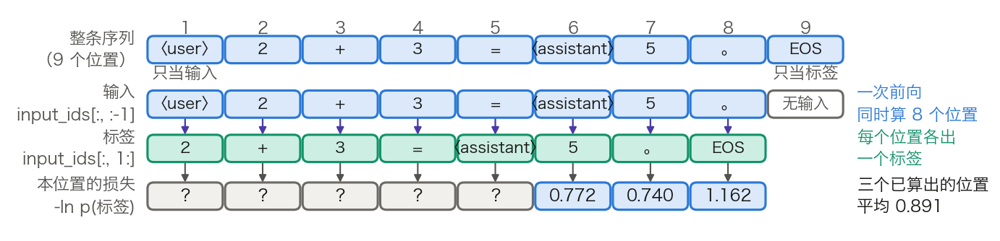
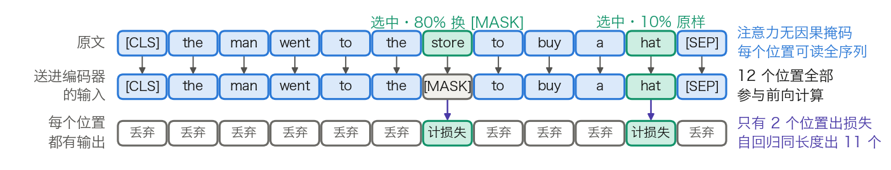
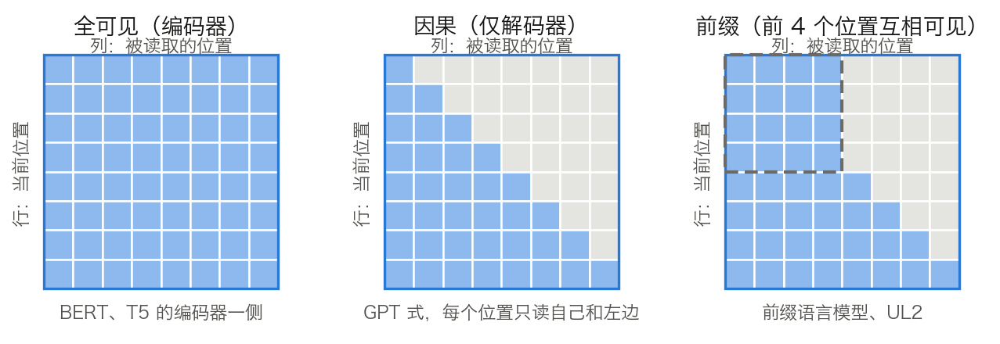
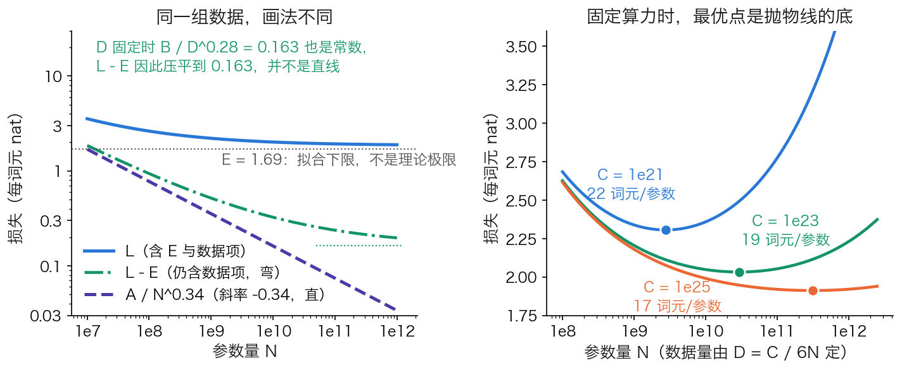
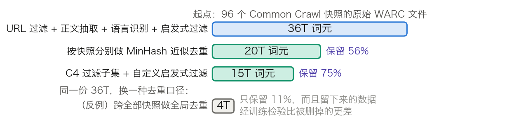
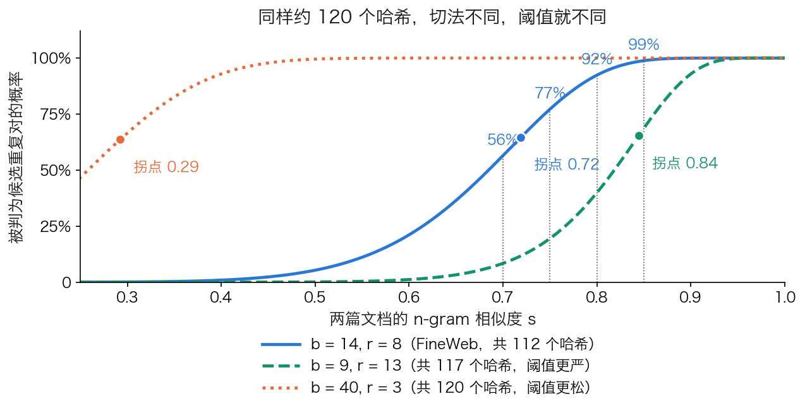

# 第五章：预训练：为什么“预测下一个词”能学到知识

预训练（Pre-training）是现代大语言模型的基石。一个看似简单的任务——“预测下一个词”——为什么能让模型学会语法、语义、推理乃至世界知识？三种预训练范式（自回归、掩码语言模型、编码器-解码器）的本质区别又在哪里？

第一部分交付的是一个 Transformer 的形状，权重从哪来留给了本章。本章先把三种范式各自写成可优化的目标函数，并把一条序列算成一个损失标量；再回答语料该有多大、参数与数据怎么配；最后拆开这份语料的来历，看它从原始网页变成一份配比的过程中，抽取、过滤、去重各扔掉多少。沿着五个问题展开：

- 5.1 节：“预测下一个词”怎样写成一个可优化的目标，一条序列的损失如何逐格算出？
- 5.2 节：完形填空换来了双向上下文，代价为什么落在信号密度上？
- 5.3 节：编码器双向读、解码器自回归写，两种范式并成一格之后，为什么仍是仅解码器胜出？
- 5.4 节：给定算力，参数量与数据量该如何分配，工业界为什么普遍不按计算最优来训？
- 5.5 节：这些词元怎样从原始网页一步步筛成一份可训练的数据，各步的淘汰率有多高？

## 1. 自回归语言模型：从左到右的世界观

第一部分交付的是一个 Transformer 的形状：注意力如何计算、位置如何编码、层与层如何相连。3.8 节已经走完一次完整的前向，但那里的权重是手工摆的，它自己也说明“会算”的能力存放在权重里，而权重从哪来留给了本章。1.5.1 节提到过 GPT 靠“预测下一个词”起家，那是一句历史叙述，不是一个可以优化的目标。本节把它写成目标函数，并把一条序列算成一个损失标量。

### 1.1 训练目标：链式分解与负对数似然

自回归语言模型（Autoregressive Language Model）把一段文本的联合概率按链式法则拆成逐位置的条件概率：

$$
P_\theta(x_1,\dots,x_T) = \prod_{t=1}^{T} P_\theta(x_t \mid x_{<t})
$$

其中 $x_{<t}$ 表示位置 $t$ 左边的全部词元。这个分解是恒等式，不含任何假设；模型要做的只是给每个条件概率一个参数化形式。训练目标取它的负对数，并按位置数归一：

$$
\mathcal{L}(\theta) = -\frac{1}{T}\sum_{t=1}^{T} \log P_\theta(x_t \mid x_{<t})
$$

三处细节决定了它能不能与别处的数字对上。第一，$t=1$ 时条件为空，需要一个约定：多数实现在序列开头补一个 BOS（begin of sequence）词元，$x_{<1}$ 就是它；不补 BOS 的实现则从 $t=2$ 起求和。第二，除以 $T$ 是必须的，否则长序列的损失天然更大，不同批次之间无法比较；6.1.1 节的困惑度正是对这个每词元平均值取指数。第三，$\log$ 用自然对数时损失的单位是 nat，用以 2 为底的对数时单位是 bit，两者差一个常数因子 $\ln 2$。

### 1.2 从一条序列到一个损失标量

公式里的每个条件概率都要由模型算出来。关键在于因果掩码（见 2.4 节）让这件事一次前向就能全部完成：位置 $t$ 的输出只依赖位置 $1$ 到 $t$，所以把整条序列送进去，每个位置各自给出一份“下一个词元”的分布，互不污染。

按形状把整条链路写一遍，`B` 是批大小、`T` 是序列长度、`n_vocab` 是词表大小：

- **第 1 步：整条序列一次送进模型**（不切片）
  - `input_ids[B, T] → X⁽⁰⁾[B, T, d_model]`
- **第 2 步：前向到最后一层**（L 层，结构见 3.8.4）
  - `X⁽⁰⁾[B, T, d_model] → X⁽ᴸ⁾[B, T, d_model]`
- **第 3 步：LM head 对每个位置各算一次**（矩阵乘法）
  - `X⁽ᴸ⁾[B, T, d_model] × W_vocab[d_model, n_vocab] → logits[B, T, n_vocab]`
- **第 4 步：错位对齐**（两次切片，不是计算）
  - 预测端取前 T−1 个位置：`logits[B, T, n_vocab] → [B, T−1, n_vocab]`
  - 标签端取后 T−1 个位置：`input_ids[B, T] → 标签[B, T−1]`
- **第 5 步：逐位置取正确词元的负对数概率**（沿最后一维做 Softmax，再按标签取一格）
  - `logits[B, T−1, n_vocab] + 标签[B, T−1] → 逐位置损失[B, T−1]`
- **第 6 步：对有效位置求平均**（求和再除一次）
  - `逐位置损失[B, T−1] → 标量`

第 3 步与推理的差别只有一处，却决定了训练的性价比：3.8.5 末尾说明推理时只取最后一行送进 LM head，因为前面位置的“下一个词元”早已写在 Prompt 里；训练时恰恰要的就是这些位置，因为标签就是它们右边那个真实词元。第 4 步丢掉的则是最后一个位置的 logits，它预测的词元还不存在。图 5-1 把这一点画了出来。



图 5-1：一条序列怎样错一位变成 T−1 个训练样本（[生成脚本](https://github.com/yeasy/llm_internals/blob/main/tools/figures/ch05_shift_labels.py)）。序列沿用 3.8 节的教学例子，共 9 个位置：第 1 个位置只当输入，第 9 个位置只当标签，中间每个位置既是上一个位置的标签，又是下一个位置的输入。蓝色是数据，青绿色是本步新产生的标签。

由此得到自回归目标最重要的一条工程性质：一条长 $T$ 的序列一次前向产生 $T-1$ 个**监督信号**，每个词元既当过输入也当过标签（序列开头补了 BOS 时是 $T$ 个，与 5.1.1 的求和范围对应）。训练的计算量按 3.7.7 节的 $C \approx 6ND$ 计，$D$ 就是这些词元位置数。下一节的掩码语言模型每次前向只产生约 $0.15T$ 个监督信号，差距正是从这里来的。

### 1.3 手算一步训练损失

3.8 节已经把一个 1 层 2 头 4 维的教学模型逐格算完，它的输出概率可以直接当作训练损失的输入。设训练序列为 `〈user〉 2 + 3 = 〈assistant〉 5 。 EOS`，共 9 个位置。位置 6、7、8 的下一个词元分别是 `5`、`。`、EOS，而这三个位置的概率 3.8 节都给出了：3.8.5 的表 3-21 给出位置 6 的五个候选概率，3.8.6 的两轮 Decode 分别给出位置 7 和位置 8 的。

先算位置 6 这一格。它的标签是 `5`，该表中 `5` 的概率是 0.462：

$$
\ell_6 = -\log P(\text{`5'} \mid x_{<7}) = -\ln 0.462 = 0.772
$$

其余两格同法，`。` 的概率 0.477、EOS 的概率 0.313：

$$
\ell_7 = -\ln 0.477 = 0.740,\qquad \ell_8 = -\ln 0.313 = 1.162
$$

三格平均为 $(0.772 + 0.740 + 1.162)/3 = 0.891$。位置 1 到 5 的 logits 3.8 节没有算（推理时用不上，那里就跳过了），完整的训练损失还要把它们一并平均进来。这三个数说明了一件事：损失不是某种抽象的“误差”，它就是模型分给正确答案的那个概率取负对数，概率越接近 1，这一格的损失越接近 0。

**训练开始时损失应该是多少。** 权重随机初始化时，模型对每个候选词元给出的概率大致均等，即 $1/n_{\text{vocab}}$，于是损失约为 $\ln n_{\text{vocab}}$。这是排查训练脚本最省事的一个检查：第一步的损失若明显偏离这个值，多半是标签没有对齐、学习率过大，或者词表配错了。表 5-1 给出几个常见词表的锚点。

| 词表 | `n_vocab` | 初始损失 `ln n_vocab`（nat） | 以 2 为底（bit） |
| --- | ---: | ---: | ---: |
| 本节教学模型（5 个候选） | 5 | 1.61 | 2.32 |
| T5 的 SentencePiece 词表 | 32,000 | 10.37 | 14.97 |
| GPT-2 与 GPT-3 | 50,257 | 10.82 | 15.62 |
| Llama 3 发布权重 | 128,256 | 11.76 | 16.97 |

表 5-1：均匀猜测时的损失锚点，由 `ln n_vocab` 算出。GPT-2 与 Llama 3 的词表大小见 3.8.7 的表 3-27，T5 的 32,000 见 5.3.2 引用的 T5 论文；Llama 3 论文的口径是 128,000，发布权重的嵌入表另含特殊词元，共 128,256 行。一个训练充分的大模型在通用网页语料上的每词元损失通常落在 2 附近，与这里的 11.76 相比，差的是近 10 个 nat。

### 1.4 为什么这个目标能学到知识

“预测下一个词元”看上去只是拟合共现频率。把损失写成信息论的形式，就能看清它要求的东西远不止于此。

设真实文本分布为 $p$、模型分布为 $q$，把期望损失按交叉熵展开：

$$
\mathbb{E}_{x\sim p}\!\left[-\log q(x)\right] = H(p) + D_{\mathrm{KL}}(p \,\|\, q)
$$

其中 $H(p)$ 是数据分布自身的熵，与模型无关；$D_{\mathrm{KL}}$ 非负，且仅当 $q = p$ 时为零。因此最小化损失等价于最小化模型分布与真实分布的 KL 散度，损失的下界就是数据的熵。这条恒等式给出三个推论。

第一，**损失降不到零不是缺陷**。自然语言本身有不确定性，$H(p)$ 大于零；5.4 节拟合式里的常数项正是对它的估计。

第二，**语言建模等价于无损压缩**。按香农的信源编码定理，以 2 为底的交叉熵就是用模型 $q$ 做算术编码时的平均码长。每词元损失 2.0 nat 换算为 $2.0/\ln 2 = 2.885$ bit/词元。若分词器在英文上平均每个词元覆盖 3.94 个字符（Llama 3 论文自报的压缩率），折合约 0.73 bit/字节。这一步换算默认英文 ASCII 文本下一个字符即一个字节，非 ASCII 文本不成立（见 5.4.7 节）。要把码长压到这个水平，模型必须把“下一个词元”预测得很准，而准确预测的前提是掌握语法、搭配、事实和篇章结构——压缩率是能力的一个直接度量。跨模型比较时要注意，困惑度依赖分词方式，bit/字节才与分词无关（见 6.1.1 节）。

第三，**被压缩的对象决定了学到什么**。同样一个目标，在网页文本上压出的是世界知识与常识，在代码上压出的是语法与控制流。补全“法国的首都是＿＿”需要世界知识，补全“如果 x > 5 且 x < 10，那么 x 的范围是＿＿”需要逻辑推理；这两类能力都不是被单独教授的，而是压缩这批语料的副产品。反过来说，语料里没有的东西，这个目标也学不到，也不保证事实可靠性或任务执行能力。

### 1.5 训练并行、推理串行

训练时整条序列一次算完，推理时每次只出一个词元，这两件事看似矛盾，其实由同一个因果掩码同时保证。

训练之所以能并行，是因为位置 $t$ 的条件 $x_{<t}$ 已经写在语料里，不必等模型自己生成。这种用真实前缀当条件的做法称为**教师强制**（Teacher Forcing）。推理时真实前缀不存在，只能把上一步选出的词元追加进去，再算下一步，于是 3.8.1 说的“后一次的输入是前一次的输出”成立。

需要精确区分的是哪一层一致、哪一层不一致。一致的是条件分布的形式：训练与推理用的是同一套权重、同一个因果掩码、同一条计算路径，位置 $t$ 的 logits 都是 $P_\theta(\cdot \mid x_{<t})$。不一致的是条件的来源：训练条件于人写的前缀，推理条件于模型自己生成的前缀。模型一旦生成了一个训练语料里不会出现的前缀，后续就在一个它没见过的条件分布上工作，误差可能逐步累积，这一现象称为**暴露偏差**（Exposure Bias）。它是第九章各种解码策略要面对的前提之一。因此“训练与推理完全一致”是一句过强的表述，准确的说法是条件分布的形式一致、条件的来源不同。

### 1.6 单向性的代价，以及仅解码器为什么胜出

自回归目标的直接代价是**单向性**：每个位置的表示只汇总了它左边的信息。在理解型任务中右边同样重要，“这部电影的特效很好，但剧情＿＿”这一句，不看后文就无法判断整体情感。这一局限正是下一节 BERT 要解决的问题。

一个更尖锐的例子是**逆转诅咒**（Reversal Curse）：模型在“A 是 B”形式的句子上训练后，并不会自动学会回答“B 是 A”。[提出该现象的工作](https://arxiv.org/abs/2309.12288)给出的实测是，GPT-4 回答“某位名人的母亲是谁”的正确率约 79%，反过来问“某人的儿子是谁”只有约 33%。这不是记忆容量不足，而是训练目标只要求在给定左侧上下文时预测右侧词元，从未要求反向的条件概率也成立。

尽管如此，仅解码器架构仍然成为主流，理由是成本而非能力上限。三条都能落到数字上：

- **信号密度**。同样长度的一次前向，自回归产生 $T-1$ 个监督位置，掩码语言模型约 $0.15T$ 个（5.2.5 节给出算例）。
- **训练与推理同一条路径**。因果掩码使 KV 缓存成立（见 10.2 节），训练好的模型直接就能增量生成，不需要为推理另配结构。
- **无需任务头**。任何任务都可以写成“给一段前缀、续写后面”，不必像 BERT 那样为每类任务接一个分类头（见 12.1.3 节）。

至于规模变大后在理解型任务上的表现追平甚至反超，常被归因于涌现能力（Emergent Abilities）。该归因本身有争议，可能是评测指标选择的产物，详见 13.1.3 节；更稳妥的说法是，足够大的模型可以用更多上下文和更强的表示部分补偿单向性，而不是单向性不再是代价。

### 1.7 对到实现

上面的形状清单在框架里对应几个具体约定，读源码时会直接遇到。

**标签由框架内部移位。** Hugging Face 的因果语言模型接口只接收一个 `labels`，与 `input_ids` 等长，移位在损失函数里完成：先把 `labels` 右侧补一格，再取 `labels[..., 1:]` 与 logits 对齐。调用方因此不需要自己错位，把 `input_ids` 原样传给 `labels` 即可。

**不计损失的位置用 −100 标记。** 交叉熵的 `ignore_index` 默认取 −100，被标为 −100 的位置既不进分子也不进分母。填充位置、跨文档边界都靠它排除。监督微调阶段只对回答部分计损失，做法同样是把指令部分的标签全部置为 −100（见 8.1 节），这是它与预训练“全位置计损失”的唯一区别。

**文档边界要显式隔断。** 预训练把大量短文档拼接成定长序列以避免填充浪费，这时必须防止一个文档读到上一个文档的内容。仅重置 `position_ids` 不够，还需要块对角的注意力掩码或等价的序列边界元数据（见 6.4.2 节）。文档之间通常插入 EOS，模型由此学会“何时该停”。

## 2. 掩码语言模型：完形填空的智慧

上一节末尾那句“这部电影的特效很好，但剧情＿＿”卡住的是单向性：自回归目标让每个位置的表示只汇总左边的信息。掩码语言模型（Masked Language Model，MLM）用一种完形填空式的设计换来双向上下文。本节讲清它的数据流与损失怎么算，给出可复核的名额分配，并把“训练效率低”这句话变成一个可比的数字。

### 2.1 为什么不能直接做双向语言模型

把因果掩码去掉，让每个位置都能读全序列，再照旧预测“下一个词元”，这条路走不通。BERT 论文给出的理由是：双向条件下每个词可以**间接看到自己**，多层堆叠后模型能轻易预测出目标词。

“间接”二字是关键，它指的不是第一层就直接读到答案。第 1 层里位置 $t+1$ 的表示吸收了位置 $t+1$ 自己的词元；第 2 层里位置 $t$ 读取第 1 层的位置 $t+1$，于是位置 $t$ 的表示已经含有“下一个词元是什么”的信息。层数越多，这条泄漏路径越宽，预测退化为复制。

绕开它有两条路。一条是浅层拼接：分别训练一个从左到右和一个从右到左的模型，再把两者的表示拼起来，ELMo 走的就是这条路（见 1.1 节）。它可行，两个方向却从不在同一层交互，BERT 论文称之为“浅层拼接”，并认为深度双向严格更强。另一条就是改任务：不预测下一个词元，改为预测被遮住的词元，泄漏路径随之被掐断。

### 2.2 掩码流程与损失

设原始序列为 $x_1,\dots,x_T$。随机挑出一个位置集合 $M$ 作为预测目标，按下面的规则改写输入，得到 $\tilde{x}$，然后在 $\tilde{x}$ 上做一次双向前向，只在 $M$ 的位置上计损失：

$$
\mathcal{L}_{\mathrm{MLM}}(\theta) = -\frac{1}{|M|}\sum_{i \in M} \log P_\theta(x_i \mid \tilde{x})
$$

与 5.1.1 的式子对照，差别有三处。条件从 $x_{<i}$ 变成了整条改写后的序列 $\tilde{x}$，注意力没有因果掩码。求和范围从全部位置缩到 $M$，分母也相应变成 $|M|$。被预测的目标 $x_i$ 是原始词元，不是改写后的词元。

按形状把链路写一遍，与 5.1.2 并排看差别最清楚：

- **第 1 步：采样目标位置**（不涉及张量运算）
  - `input_ids[B, T] → 目标掩码[B, T]`，每个位置以 15% 的概率被选中
- **第 2 步：按 80/10/10 改写输入**（逐位置替换）
  - `input_ids[B, T] + 目标掩码[B, T] → 改写后的输入[B, T]`
- **第 3 步：双向前向**（无因果掩码，注意力矩阵是满的 `[B, n_h, T, T]`）
  - `改写后的输入[B, T] → X⁽ᴸ⁾[B, T, d_model]`
- **第 4 步：全部位置都过 MLM head**（矩阵乘法）
  - `X⁽ᴸ⁾[B, T, d_model] × W_vocab[d_model, n_vocab] → logits[B, T, n_vocab]`
- **第 5 步：只取目标位置的损失**（未选中位置的标签置 −100）
  - `logits[B, T, n_vocab] + 标签[B, T] → 标量`

有三件事容易弄错。未选中的位置照常参与前向计算、照常产生 logits，只是这些 logits 被丢弃，不计损失。“10% 保持不变”的位置输入虽未改动，仍属于 $M$，仍要计损失。改写只发生在输入侧，标签始终是原始词元。

图 5-2 把这三件事画在一条 12 个词元的序列上。



图 5-2：一条句子经 80/10/10 改写后，哪些位置计损失（[生成脚本](https://github.com/yeasy/llm_internals/blob/main/tools/figures/ch05_mlm_masking.py)）。12 个位置全部参与前向，只有 2 个选中位置产生损失；其中一个被改成 `[MASK]`，另一个保持原样。与图 5-1 对照：同样长度的序列，自回归会在 11 个位置上产生损失。

### 2.3 名额怎么分：一组可复核的数字

取序列长度 512，按 BERT 的配置算一遍每条序列的名额：

$$
|M| = 512 \times 15\% = 76.8
$$

实现里取整为 77 个位置。这 77 个再按 80/10/10 分：

$$
512 \times 0.15 \times 0.8 = 61.44,\quad
512 \times 0.15 \times 0.1 = 7.68
$$

即约 61 个换成 `[MASK]`、约 8 个换成随机词元、约 8 个保持原样。随机替换只占全部词元的 $0.15 \times 0.10 = 1.5\%$，BERT 论文特意指出这个比例小到不会损害模型的语言理解能力。

这组数字与官方实现对得上。BERT 的 `create_pretraining_data.py` 有两个相关默认值：`masked_lm_prob` 为 0.15，`max_predictions_per_seq` 为 20；该脚本的 `max_seq_length` 默认是 128，而 $128 \times 0.15 = 19.2$，向上取整恰为 20。Hugging Face 的 `DataCollatorForLanguageModeling` 把同一组比例写成三个参数：`mlm_probability` 为 0.15、`mask_replace_prob` 为 0.8、`random_replace_prob` 为 0.1，剩下的 0.1 即保持不变。

### 2.4 三个比例从何而来

原论文给出的动机只有一条，而且与常见的解释不同：`[MASK]` 这个词元只在预训练里出现，微调阶段从不出现，两阶段的输入分布因此失配。不总是替换成 `[MASK]`，就是为了缩小这个差距。

两个 10% 各自的作用，论文的表述同样具体。保持不变那一档是为了让表示偏向真实观测到的词。整套做法的效果则在于：编码器事先不知道哪些位置会被考、哪些已被换成随机词，因此必须为每一个输入词元都保留一份带上下文的表示。

论文附录 C.2 用消融支撑了这一设计，表 5-2 抄录其结果。

| Mask 比例 | Same 比例 | Rnd 比例 | MNLI 微调 | NER 微调 | NER 特征式 |
| ---: | ---: | ---: | ---: | ---: | ---: |
| 80% | 10% | 10% | 84.2 | 95.4 | 94.9 |
| 100% | 0% | 0% | 84.3 | 94.9 | 94.0 |
| 80% | 0% | 20% | 84.1 | 95.2 | 94.6 |
| 80% | 20% | 0% | 84.4 | 95.2 | 94.7 |
| 0% | 20% | 80% | 83.7 | 94.8 | 94.6 |
| 0% | 0% | 100% | 83.6 | 94.9 | 94.6 |

表 5-2：不同掩码策略的消融，数值取自 [BERT 论文](https://arxiv.org/abs/1810.04805)附录 C.2 的表 8。Mask 指换成 `[MASK]`，Same 指保持不变，Rnd 指换成随机词元。

这张表的读法不是“80/10/10 最优”。论文自己的结论是，微调路线对掩码策略相当不敏感：六行的 MNLI 成绩落在 83.6 到 84.4 之间，差距不到 1 分。真正拉开差距的是最后一列的特征式用法，即冻结 BERT、只把它的表示当特征喂给下游模型。在这一列里，只用 `[MASK]` 的那一行掉到 94.0，比 80/10/10 的 94.9 低 0.9 分，因为冻结的表示没有机会在微调阶段适应“没有 `[MASK]`”的输入。失配的代价正出现在无法补偿失配的场景里。

至于 15% 这个比例，BERT 论文只说“在全部实验中都遮 15%”，未给出扫描。T5 论文倒是扫过 10%、15%、25%、50% 四档，结论是破坏率对下游成绩影响有限，唯独 50% 会显著拖累 GLUE 与 SQuAD；它最终仍取 15%，理由是沿用 BERT 的先例。取舍的方向是清楚的：比例太低则每次前向的监督信号太少，太高则上下文被破坏到无从推断，中间有一大段平坦区。

### 2.5 信号密度：77 对 511

“MLM 训练效率低”是一句常见判断，把它量化成一个可比的量才有意义。可比的量是每次前向产生多少个监督位置：

$$
\frac{T - 1}{T \times 15\%} = \frac{511}{76.8} = 6.65
$$

同样一条 512 长度的序列，自回归给出 511 个监督位置，MLM 只给出约 77 个，相差约 6.6 倍。

这个倍数不能直接读作“学习效率差 6.6 倍”，理由有两条。一是 MLM 的每个预测用到了双向上下文，单个监督信号携带的约束更强；BERT 论文的实测是 MLM 收敛只是略慢于从左到右的模型，且绝对成绩很快反超。二是这个比值只统计损失位置，前向与反向的算力两者一样多，差的是同样算力换回多少梯度信号。

ELECTRA 是一个直接的旁证。它换一个判别式目标，让损失铺满全部 $T$ 个位置而不是 $0.15T$ 个，同等计算预算下训练效率提升约 4 倍（见 12.2.3 节）。4 倍与 6.6 倍之间的差距，正是“每个监督信号的价值不等”的量化体现。

再把总量算一笔。BERT 的预训练配置是批大小 256 条、序列长 512、训练 100 万步：

$$
10^6 \times 256 \times 512 = 1.31 \times 10^{11}
$$

约 1,310 亿个词元位置流过模型，其中只有 15%、约 197 亿个产生了损失。这是按全程 512 计的口径，与论文自报的每批 128,000 个词元一致。实际排布还有一个常被忽略的细节：为节省算力，BERT 的前 90% 步数用的是 128 的序列长度，只有最后 10% 用 512。按这个排布重算：

$$
0.9 \times 10^6 \times 256 \times 128 + 0.1 \times 10^6 \times 256 \times 512 = 4.26 \times 10^{10}
$$

实际流过的位置数因此只有上面那个数的约三分之一。论文同时说明这相当于在 33 亿词的语料上过约 40 遍——早在 2018 年，数据受限下的重复训练就已是常态，5.4.8 节会给出重复几遍才划算的定量答案。

表 5-3 把两种范式的差别汇总为可对照的五行。

| 特性 | 自回归 LM | 掩码 LM |
| --- | --- | --- |
| 预测目标 | 每个位置预测右边相邻的词元 | 只预测被选中的词元 |
| 注意力掩码 | 因果，位置 $i$ 只读 $1$ 到 $i$ | 无掩码，每个位置读全序列 |
| 512 长度下的监督位置 | 511 | 约 77 |
| 能否增量生成 | 能，KV 缓存成立 | 不能，改一个位置要重算全序列 |
| 代表模型 | GPT 系列、Llama | BERT 系列 |

表 5-3：两种预训练范式的机制差别。监督位置数的算法见 5.2.5 节。

### 2.6 NSP 的去留

BERT 还引入了**下一句预测**（Next Sentence Prediction，NSP）作为辅助任务：给定两段文本，判断第二段是否紧接第一段。训练损失是 MLM 与 NSP 两项的和。

RoBERTa 去掉了 NSP，同时还改了另外三件事：用动态掩码代替静态掩码、放大批次、换成更大的字节级 BPE 词表，并配合更多数据训练更久。成绩确实提升，但把提升全部记在“NSP 有害”上是过度引申。四项改动是一起做的，而 RoBERTa 自己对动态掩码的评价只是“与静态掩码相当或略好”；MLM 目标本身并未被改进。ALBERT 的结果从另一侧说明问题：它把 NSP 换成句序预测（Sentence Order Prediction，SOP），即判断两段文本的先后顺序是否被颠倒，这个聚焦句间连贯性的损失在多句输入的下游任务上持续有帮助。合理的结论是句间任务设计得当仍然有益，而不是辅助任务一概无用（见 12.2 节）。

### 2.7 对到实现

**静态掩码与动态掩码。** BERT 在数据预处理阶段一次性生成掩码并写进文件，这叫静态掩码。为免每一遍都做同一道填空题，它把训练数据复制了 10 份、各用一种掩码，于是 40 遍训练中每种掩码各被看到 4 次。RoBERTa 改为每次把序列喂进模型时现场生成掩码，这叫动态掩码；按其说明，数据集更大、步数更多时这一点更重要。`DataCollatorForLanguageModeling` 在每个批次现场采样，属于动态掩码。

**片段级的掩码。** 把 15% 的名额分散到孤立的词元上，模型常能靠词内其他片段猜出答案。全词掩码要求同一个词的所有子词一起被遮；[SpanBERT](https://arxiv.org/abs/1907.10529) 更进一步，直接遮连续随机片段，并训练片段两端的边界表示去还原整段内容，不依赖段内各词元自己的表示。下一节 T5 的片段破坏是同一思路在编码器-解码器上的版本。

**MLM 今天仍在用的地方。** 生成模型的主流是仅解码器，但嵌入模型、检索模型与重排序器仍以双向编码器为主：这类任务要的是整段文本的一个表示，而非逐词生成，双向上下文正对路（见第十二章）。

## 3. 编码器-解码器预训练：两种范式的统一

5.2.5 节那张对比表把前两种范式分在了两边：自回归能生成但只能看左边，掩码 LM 能看两边却不能生成。第三条路想把这两格并成一格——编码器双向读输入，解码器自回归写输出。T5 和 BART 是它的代表。本节给出片段破坏怎样造出一对训练样本、它的序列长度账、三种注意力掩码形状的关系，以及仅解码器最终胜出的四条论据。

### 3.1 T5：文本到文本的接口

[T5](https://arxiv.org/abs/1910.10683)（Text-to-Text Transfer Transformer）的核心主张是把所有 NLP 任务统一为文本到文本的生成问题。做法是在输入前加一段任务前缀：

- 翻译：`translate English to German: That is good.` → `Das ist gut.`
- 语法可接受性判断：`cola sentence: John made Bill master of himself.` → `acceptable`

统一带来的工程收益很具体：同一个模型、同一套训练与推理流程、同一个损失函数可以处理所有任务，不必为每类任务另设分类头或序列标注头。

代价在边界处显形。T5 论文自述，它考虑的任务里只有 STS-B 无法直接转写，因为那是一个预测 1 到 5 之间相似度分数的回归任务。做法是把分数四舍五入到 0.2 的整数倍再写成字符串，例如 2.57 写作 `2.6`，回归于是被改造成 21 类分类。测试时若模型输出的字符串不是 1 到 5 之间的数，直接判错——输出不再受标签集合约束，是文本到文本接口固有的代价，需要在解码端另加限制（见 9.4 节）。

### 3.2 片段破坏怎样造出一对训练样本

T5 的预训练目标叫**片段破坏**（Span Corruption）。它随机丢弃输入中 15% 的词元，把每一段连续被丢的词元换成一个**哨兵词元**（sentinel token）；目标序列则由被丢掉的那些片段组成，各段前面放回它在输入里对应的哨兵，末尾再补一个新的哨兵表示结束。

论文自带的例句最能说明问题。原句是 `Thank you for inviting me to your party last week .`，`for`、`inviting`、`last` 三个词被选中破坏，前两个相邻因而合成一段：

```text
输入：Thank you <X> me to your party <Y> week .
目标：<X> for inviting <Y> last <Z>
```

四件事由此确定。每段连续被破坏的词元只占用一个哨兵，所以输入变短。同一条样本里各哨兵的 ID 互不相同，模型据此知道该填哪一段。目标只含被丢掉的内容，不含整句。损失是解码器一侧对目标串的标准自回归交叉熵，与 5.1.1 的式子完全相同，区别只在条件里多了编码器输出，经交叉注意力进入解码器（见 2.4 节）。

实现上，哨兵是加进词表的特殊词元，不对应任何 wordpiece。T5 用的是 32,000 词的 SentencePiece 词表，Hugging Face 的 `T5Tokenizer` 默认追加 `extra_ids=100` 个哨兵，名字从 `<extra_id_0>` 起；`t5-base` 的 `config.json` 里 `vocab_size` 写作 32128，即 32,000 加 100 个哨兵再向上对齐。训练时 `T5ForConditionalGeneration` 由 `labels` 右移得到 `decoder_input_ids`，移位规则与 5.1.7 的因果语言模型一致。

### 3.3 长度账：为什么片段破坏省算力

片段破坏相对逐词遮盖的收益是工程性的，可以直接算出来。设输入长 512、破坏率 15%、平均片段长 3。

被破坏的词元数与片段数：

$$
512 \times 0.15 = 76.8,\qquad 76.8 \div 3 = 25.6
$$

编码器输入去掉这 76.8 个词元，换回 25.6 个哨兵：

$$
512 - 76.8 + 25.6 = 460.8
$$

解码器目标由 76.8 个被丢词元、25.6 个哨兵和 1 个结束哨兵组成：

$$
76.8 + 25.6 + 1 = 103.4
$$

论文自己举的是 500 与 25 个片段的版本，算出被破坏 75 个词元、平均片段长 3，与这里同一口径。

这组数字的意义要与两种替代方案比才看得清。BERT 式的逐词遮盖不合并片段，编码器输入长度不变，仍是 512。BART 式的重建整句让目标也是 512，是这里 103.4 的约 5 倍；解码器的自回归计算量与目标长度成正比，差距因此直接落在训练速度上。T5 论文在讨论各种目标时给出的取舍正是这一条：几种去噪目标的下游成绩差别有限，选哪一个主要看计算成本。

破坏率与片段长度都被扫过。破坏率 10%、15%、25%、50% 四档中，只有 50% 明显变差，且目标变长拖慢训练。平均片段长 2、3、5、10 四档差别也有限，其中 3 在多数非翻译基准上略优于逐词破坏。T5 最终取 15% 与 3。

再算一笔总量。T5 基线预训练 $2^{19}$ 步，每批约 $2^{16}$ 个词元：

$$
2^{19} \times 2^{16} = 2^{35} \approx 3.44 \times 10^{10}
$$

约 344 亿个词元，论文写作“约 34B”。对照 5.2.5 节 BERT 的 1,310 亿个词元位置，T5 基线只有它的约四分之一；而 C4 语料远大于此，所以 T5 基线训练中没有任何数据被重复使用。

### 3.4 BART：去噪自编码器

[BART](https://arxiv.org/abs/1910.13461) 把预训练视为序列去噪：对输入施加噪声，训练模型重建原始文本。论文评估了五种噪声：

- 词元遮盖：用单个掩码词元替换部分词元，同 BERT。
- 词元删除：直接删掉某些词元，模型还须推断删除的位置。
- 文本填充（Text Infilling）：采样若干片段，长度服从 $\lambda = 3$ 的泊松分布，每段换成一个掩码词元；长度为 0 的片段相当于插入一个掩码词元。
- 句子排列：打乱句子顺序。
- 文档旋转：从随机位置开始旋转文档。

五种是消融对象，不是最终配方。BART 大模型最终采用的是文本填充与句子排列的组合，遮盖 30% 的词元并打乱全部句子，训练 50 万步、批大小 8000，分词沿用 GPT-2 的字节级 BPE。

与 T5 的关键差别在目标串。BART 重建整句，因而目标长度等于原文长度；T5 只生成被破坏的片段。另一处差别是 BART 的文本填充让模型必须推断“这里缺了几个词元”，因为一个掩码词元可能对应任意长度的片段；SpanBERT 则用等长的掩码序列把长度直接告诉模型。

### 3.5 三种注意力掩码形状

编码器、解码器、前缀语言模型三者的区别，归根结底只是同一张 $T \times T$ 可见性方阵的形状不同。图 5-3 把三种形状并排画出。



图 5-3：全可见、因果、前缀三种注意力掩码形状（[生成脚本](https://github.com/yeasy/llm_internals/blob/main/tools/figures/ch05_mask_shapes.py)）。行是正在计算的位置，列是被读取的位置，深色表示可读，浅色表示分数被置为 −∞。虚线框标出前缀部分，其内部互相可见。

**前缀语言模型**（Prefix LM）是介于两者之间的形态：前缀部分用全可见掩码，其后的生成部分用因果掩码。它与编码器-解码器交出的信息流几乎相同，区别在于没有独立的编码器堆栈，前缀与生成部分共享同一套权重，也不存在交叉注意力。[UL2](https://arxiv.org/abs/2205.05131) 更进一步，用混合去噪器（Mixture-of-Denoisers）把几种去噪方案合进同一次预训练，并引入模式切换，让下游使用时指定套用其中哪一种。

这也解释了 3.8.3 所说的“因果掩码保证每个位置从不读右边”为何是 KV 缓存成立的前提：一旦掩码形状里出现“右边可见”的格子，追加新词元就会改变旧位置的表示，缓存随之失效。前缀语言模型的前缀部分一次性算完、其后严格因果，因此仍然可缓存。

### 3.6 三种范式的成绩与代价

T5 论文用同一套语料、同一套评测系统比较了架构与目标的组合，结果列在表 5-4。$P$ 是一个 12 层 BERT-base 规模堆栈的参数量，$M$ 是编码器-解码器处理一对输入-目标所需的 FLOPs。

| 架构 | 预训练目标 | 参数量 | 计算量 | GLUE | SQuAD | SuperGLUE |
| --- | --- | ---: | ---: | ---: | ---: | ---: |
| 编码器-解码器 | 去噪 | $2P$ | $M$ | 83.28 | 80.88 | 71.36 |
| 编码器-解码器（共享参数） | 去噪 | $P$ | $M$ | 82.81 | 80.63 | 70.73 |
| 编码器-解码器（各半层） | 去噪 | $P$ | $M/2$ | 80.88 | 77.59 | 68.42 |
| 前缀语言模型 | 去噪 | $P$ | $M$ | 81.82 | 78.94 | 68.11 |
| 仅解码器语言模型 | 去噪 | $P$ | $M$ | 74.70 | 61.14 | 55.02 |
| 编码器-解码器 | 自回归 | $2P$ | $M$ | 79.56 | 76.02 | 64.29 |

表 5-4：架构与预训练目标的组合成绩，取自 [T5 论文](https://arxiv.org/abs/1910.10683)的表 2，此处保留 GLUE、SQuAD、SuperGLUE 三列。该文的结论是编码器-解码器配去噪目标在所有任务上最好，且去噪目标一律优于自回归目标。

有一条关于参数量的常见误读需要纠正。$L+L$ 层的编码器-解码器确有约 $2P$ 个参数，是 $L$ 层仅解码器的两倍，但处理一对输入-目标的计算量同为 $M$：每个词元只经过编码器或解码器之一，不会两边都走一遍。T5 论文实测两者的单步耗时几乎相同。所以“参数量翻倍”不是纯粹的代价，它换来的是同等计算量下更多的容量。真正的代价在推理侧的显存与缓存形态，下一节展开。

表 5-5 把三种范式按本章已经算过的量重排。

| 范式 | 架构 | 每次前向的损失位置 | 同计算量下的参数量 | 增量生成时的缓存形态 | 代表模型 |
| --- | --- | --- | --- | --- | --- |
| 自回归 | 仅解码器 | $T-1$，全部位置 | $P$ | 单栈 KV 缓存，逐轮追加 | GPT 系列、Llama |
| 掩码 LM | 仅编码器 | 约 $0.15T$ | $P$ | 不适用，无法增量生成 | BERT 系列 |
| 片段破坏 | 编码器-解码器 | 约 $0.15T$（在解码器侧） | $2P$ | 解码器自注意力 KV 加交叉注意力 KV | T5 |

表 5-5：三种预训练范式的机制对照。损失位置数的算法见 5.2.5 与 5.3.3 节；参数量与计算量的关系见表 5-4 上方的说明。

### 3.7 为什么仅解码器成为主流

四条论据，每条都能落到前面算过的量上。

**信号密度。** 仅解码器的每个词元都产生损失，片段破坏只有约 15% 的词元产生损失。同样的 $C \approx 6ND$ 预算，前者换回的梯度信号多得多。数据规模进入万亿词元量级后，这一条的权重迅速上升。

**零样本能力。** [一项覆盖三种架构与两种目标的系统评估](https://arxiv.org/abs/2204.05832)给出一条分界：纯无监督预训练之后，因果仅解码器配自回归目标的零样本泛化最强；但若接一轮多任务提示微调，带非因果可见性、用掩码目标预训练的模型反而最好。大模型的主流用法是“预训练完直接提示”，正落在前一半。

**缓存形态。** 多轮对话里仅解码器只有一份逐轮追加的 KV 缓存，历史前缀还能跨请求共享（见 11.5 节）。编码器-解码器每轮要么重新编码整个上下文，要么额外维护一份交叉注意力的 K/V，服务端的状态管理复杂一档。

**系统简单。** 单一堆栈让张量并行的切分、流水线的分段、推理引擎的调度都只需处理一种层（见 11.8 节）。两个形状不同的堆栈要各自调优。

反过来，编码器-解码器仍占优的场景有共同特征：输入固定且完整、输出是对输入的转写而非开放续写。机器翻译、语音识别、固定模板的条件生成都属此类，编码器一次读完输入、解码器专注生成的分工在这里是优势而非负担。所以准确的说法不是“编码器-解码器被淘汰”，而是通用对话与工具调用这个最大的场景更偏爱仅解码器。

## 4. 预训练数据：规模定律与数据质量的博弈

上一节把仅解码器的胜出落在了“超大规模”和“足够大”两个词上，但多大算大、要配多少数据，那里并没有交代。本节把这两个词换成数字：先给出规模定律的三条幂律与指数取值，再从参数化损失推出“计算最优”是怎么解出来的，然后用 3.7.7 节的 $C \approx 6ND$ 算三笔真实的算力账，最后说明为什么工业界普遍不按计算最优来训。

### 4.1 三条幂律与它们的指数

Kaplan 等人 2020 年的[规模定律工作](https://arxiv.org/abs/2001.08361)给出的结论是：模型的交叉熵损失与参数量 $N$、数据量 $D$、计算量 $C$ 之间存在平滑的幂律关系，且在各自不受另外两项限制时分别成立。原文给出的三条式子连指数与常数一起写出：

$$
L(N) = (N_c/N)^{\alpha_N},\quad \alpha_N \approx 0.076
$$

$$
L(D) = (D_c/D)^{\alpha_D},\quad \alpha_D \approx 0.095
$$

$$
L(C_{\min}) = (C_c^{\min}/C_{\min})^{\alpha_C^{\min}},\quad \alpha_C^{\min} \approx 0.050
$$

其中 $N$ 取的是非嵌入参数量，$N_c \approx 8.8 \times 10^{13}$。第三条的上标不可省：$C_{\min}$ 是按最优批大小折算的算力，原文另有一个固定批大小口径的 $\alpha_C \approx 0.057$，两者在该文表 4 里并列，照书中记号去对原文会对到 0.057。指数小得出奇，这正是规模定律既令人振奋又令人沮丧的地方。把 $\alpha_N = 0.076$ 换算成一句可感知的话：

$$
10^{-0.076} = 0.840
$$

参数量翻 10 倍，损失只乘 0.84；翻 100 倍，也只乘 $100^{-0.076} = 0.705$。改善是平滑、可预测、连续的，但每一分改善都极其昂贵。这条性质支撑了整个大模型时代的投资逻辑：可预测意味着可以先用小模型试，再外推到大模型，不必赌。

Kaplan 的另一条结论是算力该怎么分：固定算力预算时，最优分配是 $N \propto C^{0.73}$、$D \propto C^{0.27}$，即额外算力应优先投给参数，训练时长与数据量增长得很慢。2022 年 DeepMind 的 [Chinchilla 工作](https://arxiv.org/abs/2203.15556)用改进的实验设置重新拟合，得到两者各约 $\propto C^{0.5}$，即参数与数据应同比例增长。这一修正的直接后果是：此前的许多大模型是“过大欠训练”的。

### 4.2 计算最优是怎么解出来的

“同比例增长”不是实验观察，是一个可以推导的结论。Chinchilla 把损失参数化为一个带常数项的双幂律：

$$
L(N, D) = E + \frac{A}{N^{\alpha}} + \frac{B}{D^{\beta}}
$$

三项各有含义。$E$ 是一个理想生成过程在该数据分布上的损失，按论文的说法应当对应自然文本的熵，即 5.1.4 节的 $H(p)$ 那一项；再大的模型、再多的数据也降不到它以下。$A/N^{\alpha}$ 是模型容量不足带来的额外损失，$B/D^{\beta}$ 是数据不足带来的额外损失。论文正文公布的拟合结果是 $E = 1.69$、$A = 406.4$、$B = 410.7$、$\alpha = 0.34$、$\beta = 0.28$。

在约束 $C = 6ND$ 下最小化它。把 $D = C/(6N)$ 代入，对 $N$ 求导并令其为零：

$$
-\frac{\alpha A}{N^{\alpha+1}} + \frac{\beta B}{N^{1-\beta}}\left(\frac{6}{C}\right)^{\beta} = 0
$$

整理得 $N^{\alpha+\beta} \propto C^{\beta}$，于是：

$$
N_{\mathrm{opt}} \propto C^{\frac{\beta}{\alpha+\beta}},\qquad
D_{\mathrm{opt}} \propto C^{\frac{\alpha}{\alpha+\beta}}
$$

代入上面的两个指数：$\beta/(\alpha+\beta) = 0.28/0.62 = 0.452$，$\alpha/(\alpha+\beta) = 0.548$。两个数都接近 0.5，这就是“同比例增长”的来源。论文自己报告的区间是 0.454 到 0.455、0.542 到 0.543，与这里的手算一致。$\alpha \approx \beta$ 是关键前提：两项的边际收益衰减速度相近，算力就该在两边平分。

该文并列用了三种估计方法。一是固定几个模型尺寸、改变训练词元数，沿各条训练曲线取最优点；二是 IsoFLOP 剖面，即固定算力、扫不同的 $N$，看损失随 $N$ 变化的抛物线最低点落在哪里；三是把上面的参数化式拟合到前两种方法产生的全部最终损失上。前两种不需要假设函数形式，第三种需要。三者给出的指数略有差异，5.4.4 节会说明这个差异并非无关紧要。

图 5-4 把这两件事画在一起。



图 5-4：左为同一条幂律的两种画法，右为 IsoFLOP 剖面（[生成脚本](https://github.com/yeasy/llm_internals/blob/main/tools/figures/ch05_scaling_curves.py)）。左图固定 $D = 1.4$T，用 Chinchilla 正文公布的系数画三条曲线：$L$、$L - E$、只剩参数项的 $A/N^{\alpha}$。带常数项的幂律在 log-log 坐标下是弯的；$D$ 固定时数据项也是常数，所以只减 $E$ 还不够，$L - E$ 会压平到 $B/D^{\beta} = 0.163$；把全部与 $N$ 无关的项都减掉，才得到斜率恰为 $-\alpha = -0.34$ 的直线。右图对三个算力预算各画一条 $L(N, C/6N)$ 的剖面，最低点就是该预算下的计算最优配比；为避免复现下一节要讨论的不自洽，右图用的是[复现工作](https://arxiv.org/abs/2404.10102)重拟合的一组系数。

左图那条性质值得单列一句：只有减去全部与 $N$ 无关的项，幂律在 log-log 坐标下才是直线。这里要减掉的不止 $E$：固定 $D = 1.4$T 时数据项也是常数，$B/D^{\beta} = 410.7/(1.4\times10^{12})^{0.28} = 0.163$，所以 $L - E$ 在大 $N$ 处会压平到 0.163 而不是趋于零，仍然不是直线。减到 $A/N^{\alpha}$ 才是直线，$N = 10^9$ 时它等于 0.354，而同一点的 $L - E$ 是 0.517。直接画 $L$ 会看到一条随规模增大而逐渐压平的曲线，那条曲线不是直线，压平也不意味着规模定律失效——失效与趋近 $E$ 是两回事。$E$ 本身是当前设定下的拟合项，换一套语料、换一种分词就会变，不应被读作语言建模的理论下界。

### 4.3 三笔算力账

有了 $C \approx 6ND$ 和上面的参数化式，就可以把几个公开模型放进同一张表里比较。表 5-6 的算力一列是 $6ND$ 的直接代入，损失一列是把 $N$、$D$ 代进 Chinchilla 正文系数得到的预测值。

| 模型配置 | 参数量 $N$ | 训练词元 $D$ | 词元/参数 | $C = 6ND$ | 预测损失 $L(N,D)$ |
| --- | ---: | ---: | ---: | ---: | ---: |
| Gopher 280B | 2.8×10¹¹ | 3.0×10¹¹ | 1.1 | 5.04×10²³ | 1.993 |
| Chinchilla 70B | 7.0×10¹⁰ | 1.4×10¹² | 20.0 | 5.88×10²³ | 1.937 |
| 8B 配 Chinchilla 比例 | 8.0×10⁹ | 1.6×10¹¹ | 20.0 | 7.68×10²¹ | 2.164 |
| Llama 3 8B | 8.0×10⁹ | 1.5×10¹³ | 1,875 | 7.20×10²³ | 1.949 |
| Llama 3 405B | 4.05×10¹¹ | 1.56×10¹³ | 38.5 | 3.79×10²⁵ | 1.819 |

表 5-6：五组配置的算力与预测损失。算力由 $C = 6ND$ 算出；损失由 $L = 1.69 + 406.4/N^{0.34} + 410.7/D^{0.28}$ 算出，系数取自 Chinchilla 论文正文，该文表 1 也是 Gopher 与 Chinchilla 两行参数量与词元数的出处。Llama 3 405B 的 15.6T 取自 [Llama 3 论文](https://arxiv.org/abs/2407.21783)，8B 的 15T 取自 [Llama 3 的官方模型卡](https://github.com/meta-llama/llama3/blob/main/MODEL_CARD.md)（记作“15T+”）。两处口径校验：405B 一行的 3.79×10²⁵ 与论文自报的 3.8×10²⁵ 对得上；Gopher 一行的 5.04×10²³ 则比 Chinchilla 论文记的 5.76×10²³ 低 12.5%，$6ND$ 只数与权重相乘的部分（见 3.8.8），是个便于心算的下界。“预测损失”一列是跨语料外推：系数拟合自 MassiveText 与该文自己的分词器，却被代到了 Llama 3 的 15T 语料上，且用的正是 5.4.4 节指出已知有偏的那一组。该列只能用于同一口径下的相对比较，不可当作实测损失。

三处对照值得停下来看。

第一，前两行复现了 Chinchilla 论文的主结论：算力几乎相同（5.04×10²³ 对 5.88×10²³），但 70B 配 1.4T 的预测损失比 280B 配 300B 低 0.056 nat。参数少了四分之三，成绩反而更好，代价只是数据量是它的 4.7 倍。

第二，第三行与第四行是同一个 8B 模型的两种训法。按 Chinchilla 比例只喂 160B 词元，预测损失 2.164；喂 15T 词元，降到 1.949。后者的训练算力是前者的 94 倍，换来 0.215 nat。

第三，也是最反直觉的一条：训练 Llama 3 8B 花掉的算力（7.20×10²³）比训练 Chinchilla 70B（5.88×10²³）还多 22%，而两者的预测损失几乎相同（1.949 对 1.937）。所以“用小模型多喂数据”根本不是省钱，它是把钱从推理挪到了训练。下一节说明这笔挪动为什么划算。

### 4.4 “20 词元/参数”的来历，以及它不是常数

“计算最优约等于 20 词元每参数”是流传最广的一条经验。它的准确出处是 Chinchilla 论文前两种估计方法的结果，也是该文真正用来训练 70B 模型的配比。

用第三种方法反解会得到别的数字。把论文正文公布的那组系数放回 $C = 5.88 \times 10^{23}$ 的约束下求极小，算出的最优点是 $N = 3.25 \times 10^{10}$、$D = 3.02 \times 10^{12}$，即约 93 词元每参数，而不是 20。一项[复现工作](https://arxiv.org/abs/2404.10102)专门追查了这处不自洽，结论是：论文报告的那组参数隐含约 70 词元每参数的策略，与它自己训练 70B 时用的 20 不符，也与前两种方法不符。70 与上面算出的 93 不矛盾。$\alpha \neq \beta$ 时这组系数给出的最优比值不是常数，而随算力上升：用同一组正文系数扫一遍，$C = 10^{21}$ 时是 50，$10^{23}$ 时是 78，$10^{25}$ 时是 122。该文的 70 是这条曲线在其考察区间上的代表值（见其图 5），93 是 $C = 5.88\times10^{23}$ 这一点的值。两者都远离 20。该文找到的原因有两条——优化器因损失尺度选得不当而提前停止，以及正文里的系数经过了四舍五入，而舍入本身就给预测带来了可观偏差。用该文重新拟合的系数（$E = 1.8172$、$A = 482.01$、$B = 2085.43$、$\alpha = 0.3478$、$\beta = 0.3658$）反解，同一算力下得到约 18 词元每参数，重新与 20 这个经验值吻合。

这件事给出两条可以带走的判断。其一，同一篇论文里的三种方法不一定自洽，引用“最优配比”时要说清是哪一种方法给出的。其二，最优配比不是常数：用重拟合的系数扫一遍算力，$C = 10^{21}$ 时约 22，$10^{23}$ 时约 19，$10^{25}$ 时约 17，随算力增大缓慢下降。图 5-4 右图画的正是这三个点。

### 4.5 把推理成本算进来

计算最优只优化训练期的算力。模型一旦部署，每处理一个词元还要付 $2N$ 的前向算力（见 3.7.7 节）。把两段成本写进同一个式子：

$$
C_{\mathrm{total}} = 6 N D_{\mathrm{train}} + 2 N D_{\mathrm{infer}}
$$

这正是[一项把推理计入规模定律的工作](https://arxiv.org/abs/2401.00448)采用的目标函数。它优化的不再是“给定算力把损失压到最低”，而是“给定质量要求把全生命周期算力压到最低”。

用表 5-6 的两行代进去算。Llama 3 8B 配 15T 与 Chinchilla 70B 配 1.4T 的预测损失只差 0.012 nat，在这一口径下差别极小，于是比较总算力有意义（这一列的外推局限见表 5-6 的脚注）：

- 部署后累计服务 1 万亿词元：8B 方案 $7.20\times10^{23} + 2\times8\times10^{9}\times10^{12} = 7.36\times10^{23}$；70B 方案 $5.88\times10^{23} + 2\times7\times10^{10}\times10^{12} = 7.28\times10^{23}$。两者基本打平。
- 累计服务 10 万亿词元：8B 方案 8.80×10²³，70B 方案 1.99×10²⁴，后者是前者的 2.3 倍。

令两个方案的总算力相等，解出打平点：

$$
D_{\mathrm{infer}} = \frac{6 \times 8{\times}10^{9} \times 1.5{\times}10^{13} - 6 \times 7{\times}10^{10} \times 1.4{\times}10^{12}}{2 \times 7{\times}10^{10} - 2 \times 8{\times}10^{9}} = \frac{1.32{\times}10^{23}}{1.24{\times}10^{11}} = 1.06{\times}10^{12}
$$

即约 1.06 万亿个推理词元。超过它，过度训练的小模型总算力更省；低于它，按计算最优训的大模型更省。这就是“何时该过度训练”的判据，也解释了为什么面向大规模部署的开源模型普遍远离计算最优，而一次性的研究型训练不必如此。

表 5-7 把三个阶段的口径并排。

| 口径 | 优化目标 | 算力如何分配 | 对应的词元/参数 |
| --- | --- | --- | ---: |
| Kaplan（2020） | 固定训练算力下的损失 | $N \propto C^{0.73}$、$D \propto C^{0.27}$，优先给参数 | 随 $C$ 增大而下降 |
| Chinchilla（2022） | 固定训练算力下的损失 | $N \propto C^{0.5}$、$D \propto C^{0.5}$，同比例增长 | 约 20 |
| 推理感知（2024） | 训练加推理的总算力 | 按预期推理量把最优点推向更小的 $N$ | 视推理量而定，可达数千 |

表 5-7：三种口径的差别在优化目标，不在幂律本身。三条幂律描述的是约束关系，决定怎么分配算力的是在优化哪一段成本。

需要划清边界的是：Chinchilla 在它自己的设定下依然成立，它从未声称 20 是任何目标下的最优。把 Llama 3 8B 说成“证明 Chinchilla 错了”是误读，准确的说法是它换了优化目标。同理，把某个 MoE 模型的总参数量代进“词元/参数”也要小心：$6ND$ 中的 $N$ 对 MoE 取的是激活参数量（见 3.7.7 节），按总参数和按激活参数算出的配比可以差一个数量级，不加限定的比较没有意义。

### 4.6 Llama 3 自己拟合的规模定律

Llama 3 论文公开了一套值得对照的做法，因为它把规模定律用在了两件事上。

第一件是选模型尺寸。该文在 $6\times10^{18}$ 到 $10^{22}$ FLOPs 之间做了一批预训练，每个算力档训练 40M 到 16B 不等的多个模型，得到一组 IsoFLOP 曲线，再用二次多项式拟合每条曲线、取最低点作为该预算下的计算最优模型。把由此得到的幂律外推到 3.8×10²⁵ FLOPs，结论是最优配置为 402B 参数配 16.55T 词元，即约 41 词元每参数。这个数是在它自己的数据上拟合出来的，比 20 大一倍；最终发布的 405B 与它很接近。论文还给出一条工程上有用的观察：算力预算越大，IsoFLOP 曲线在最低点附近越平坦，因此旗舰模型对“参数与数据怎么折中”并不敏感。

第二件是预测下游成绩。规模定律通常只预测下一词元损失，不预测基准分数。该文用两步桥接：先把计算最优模型在某个基准上正确答案的归一化负对数似然与训练 FLOPs 做线性关联，再把这个负对数似然与准确率用 Sigmoid 关联，后一步借用了算力更高的 Llama 2 系列作为锚点。

按这套口径，Llama 3 系列里只有 8B 和 70B 属于刻意的过度训练，405B 本身接近它自己拟合出的计算最优点。把整个系列笼统称作“远超计算最优”并不准确。

### 4.7 词元化与词表大小

$D$ 的单位是词元，而一个词元覆盖多少文本由分词器决定，所以分词器直接改变同一批文本折算出的 $D$。

Llama 3 把词表从 Llama 2 的 32K 扩到 128K：其中 10 万个取自 tiktoken 的词表，另加 2.8 万个用于更好地支持非英语。论文自报的收益是英文压缩率从每词元 3.17 个字符提升到 3.94，即同样的训练算力可以“读”到多约 24% 的文本；另加的 2.8 万个词元同时改善了压缩率和下游成绩，且不影响英文分词。

扩词表的代价也能直接算出来。嵌入矩阵与 LM head 各占 $n_{\mathrm{vocab}} \times d_{\mathrm{model}}$ 个参数，两者合计：

$$
2 \times 128{,}256 \times 4{,}096 = 1.05 \times 10^{9}
$$

Llama 3 8B 按 3.8.7 的表 3-25 配置逐项累加共约 8.03×10⁹ 个参数，上面这一项占 13.1%。若词表仍是 32K，这一项只有 2.62×10⁸，占 3.3%。换言之，扩词表花掉了约 7.9 亿个参数，相当于多加了近四层 Transformer。模型越小这笔开销的占比越高，这也是小模型往往不跟进超大词表的原因。

还有一条常被含混带过的前提：“每个汉字可能被拆成多个词元”只对字节级回退的分词器成立。字节级 BPE 把未登录字符按 UTF-8 字节切开，一个汉字通常占 3 个字节，于是最坏情况下变成 3 个词元；若分词器的词表里本就收录了该汉字，它就是 1 个词元。同一段中文在两个词表下的词元数之比，因此取决于该词表对中文的覆盖程度，而不是 BPE 这个算法本身（见 3.1 节）。

### 4.8 $D$ 不是随便什么词元

规模定律把 $D$ 当成一个标量，但它隐含一个前提：这些词元互不重复、质量均匀。真实语料两条都不满足，于是 $D$ 需要打折。

**重复的词元只值一部分。** [一项在最多 9000 亿词元、90 亿参数规模上的系统扫描](https://arxiv.org/abs/2305.16264)给出了折算方式。设唯一词元数为 $U$、重复次数为 $R_D$（即 epoch 数减一），有效词元数近似为：

$$
D' = U + U \cdot R_D^{*} \cdot \left(1 - e^{-R_D / R_D^{*}}\right)
$$

其中 $R_D^{*}$ 是重复的“半衰期”，即重复词元损失掉 $1/e$ 价值的那一点。该文拟合出 $R_D^{*} \approx 15$，对应 16 个 epoch。这个式子有一个立刻可见的性质：$R_D \to \infty$ 时 $D'$ 趋于 $U(1 + R_D^{*}) = 16U$，再怎么重复也超不过唯一数据的 16 倍。表 5-8 代入几个 epoch 数。

| epoch 数 | 处理的词元 | 有效词元 $D'$ | 这一段每多处理 1 份唯一数据值多少 |
| ---: | ---: | ---: | ---: |
| 1 | 1.0 $U$ | 1.00 $U$ | — |
| 2 | 2.0 $U$ | 1.97 $U$ | 0.97 |
| 4 | 4.0 $U$ | 3.72 $U$ | 0.88 |
| 8 | 8.0 $U$ | 6.59 $U$ | 0.72 |
| 16 | 16.0 $U$ | 10.48 $U$ | 0.49 |
| 32 | 32.0 $U$ | 14.10 $U$ | 0.23 |

表 5-8：重复训练的有效词元数，由上式代入 $R_D^{*} = 15$ 算出。最后一列是本行与上一行之间的边际值。论文的两条结论正对应表中两处：重复至多 4 个 epoch 相对于全用新数据，损失变化可以忽略（其 8.7B 模型训 4 个 epoch 的验证损失只比单 epoch 高 0.5%）；重复到 16 个 epoch 附近收益急剧衰减，此后很快趋平。

一个直接的用法：手里只有 2T 词元的语料，却想花掉 8T 词元的训练预算，即训 4 个 epoch，有效词元约 7.44T，相当于全新数据的 93%。这个折扣通常是可以接受的。

**重复的对象要分清。** 上式描述的是整个语料重复若干遍。只把某个小子集上采样很多遍是另一回事，该文引用的先前工作发现，把 0.1% 的训练数据重复 100 次会显著损害性能。5.5 节讲配比时会再回到这条边界。

**重复次数还决定逐字记忆。** 去重的收益不只是省算力。[一项去重研究](https://arxiv.org/abs/2107.06499)报告，在原始 C4 上训练的模型无提示生成 10 万条文本时，1.571% 的词元属于某段 50 词元的逐字复制；在去重后的数据上训练，这个比例降到 0.264%，约为六分之一。该文还发现网页语料里的近似重复占比在 3.04%（C4）到 13.63%（RealNews）之间，且 C4 验证集有 4.6% 的样本在训练集里有近似重复——后者直接抬高评测成绩。评测污染的检测手段与防御手段是两件事，见 5.5.8 节。

这三条合起来说明，$D$ 的大小与它的构成同样重要。下一节讲的就是一条真实管线怎样把原始网页变成可用的 $D$。

## 5. 预训练数据管线：从原始网页到一份配比

5.4.8 节的结论是规模定律里的 $D$ 需要打折：重复的词元只值一部分，混进去的垃圾词元一分不值。本节讲清这份 $D$ 是怎么造出来的——抽取、语言识别、启发式过滤、质量分类器、去重、配比六个步骤各解决什么问题，各扔掉多少数据，以及每一步的参数怎么调。这些步骤在论文里通常只占半页，在工程上却占预训练团队大半的时间。

### 5.1 一条公开管线的顺序与逐步保留量

先看一条完整公开的管线。[FineWeb](https://arxiv.org/abs/2406.17557) 处理了 96 个 Common Crawl 快照，每一步的产出词元数都写在论文里，可以直接读出各步的淘汰率。



图 5-5：FineWeb 管线的逐步保留量（[生成脚本](https://github.com/yeasy/llm_internals/blob/main/tools/figures/ch05_data_pipeline.py)）。条形长度与词元数成正比，数值取自该论文对 96 个 Common Crawl 快照的自报口径，词元数按 GPT-2 分词器计。最下面一行是它的反例，见 5.5.5 节。

表 5-9 把每一步做的事和它解决的问题列全。步骤顺序不是随意的：便宜的过滤放前面，贵的放后面，去重放在过滤之后，因为对垃圾做去重是白费算力。

| 顺序 | 步骤 | 解决的问题 | 产出 |
| ---: | --- | --- | ---: |
| 1 | URL 黑名单过滤 | 成人内容、已知低质量站点 | — |
| 2 | 正文抽取 | 把 HTML 里的导航栏、页脚、广告剥掉 | — |
| 3 | 语言识别 | 只保留目标语言 | — |
| 4 | 启发式质量与重复规则 | 乱码、模板、极端重复 | 36T 词元 |
| 5 | 按快照分别做 MinHash 近似去重 | 转载、镜像、近似副本 | 20T 词元（保留 56%） |
| 6 | C4 过滤子集与自定义启发式过滤 | 更细的低质量模式 | 15T 词元（保留 75%） |

表 5-9：FineWeb 管线的六个步骤与产出，词元数取自该论文。步骤 1 到 4 的产出论文只给了合计值，故前三行留空。

### 5.2 正文抽取与语言识别

Common Crawl 同时提供两种文件：WARC 是原始 HTTP 响应，WET 是它自带的纯文本转换。直接用 WET 省事，但其正文抽取质量不高。FineWeb 的消融是：在同样 280 亿词元、除英文语言过滤外不做任何其他处理的条件下，用专门的抽取工具从 WARC 重新抽取，下游成绩优于直接用 WET。这一步排在最前面，是因为后面所有过滤规则都建立在“正文是干净的”这个前提上。

Llama 3 的做法更进一步，其团队自建了 HTML 解析器，并在两处做了专门处理：数学与代码页面要保留结构；数学内容常以预渲染图片呈现，而公式往往同时写在图片的 alt 属性里，因此保留 alt 文本。它还有一条反直觉的实测结论：对一个主要用网页数据训练的模型，保留 Markdown 标记反而有害，所以把全部 Markdown 标记都去掉了。

语言识别用的是轻量分类器。FineWeb 用 fastText 只保留得分不低于 0.65 的英文文档；Llama 3 用 fastText 把文档分到 176 种语言，再按语言分别去重和过滤。阈值是一个明确的取舍：调高会丢掉代码片段多、自然语言少的技术页面，调低会放进大量混杂语种的垃圾。

### 5.3 启发式过滤

启发式规则便宜且可解释，是淘汰量最大的一层。FineWeb 给出了每条规则的淘汰率，正好展示了这类规则的调参方式：

- 行尾带终止标点的行所占比例低于 0.12 的文档被删，淘汰 10.14% 的词元。C4 原版的同类规则阈值更严，一次淘汰约 30%。
- 重复行中的字符占比不低于 0.1 的文档被删，淘汰 12.47%。MassiveText 原版的阈值是 0.2。
- 短于 30 个字符的行占比不低于 0.67 的文档被删，淘汰 3.73%。

三条合起来淘汰约 22% 的词元，小于逐条相加的 26.34%，因为三条规则删掉的文档相互重叠。这一步在 280 亿词元的消融上把综合成绩抬高约 1%。

这组数字说明了启发式过滤的真实形态：不是照搬别人的规则，而是逐条测阈值再定阈值。C4 原版的终止标点过滤器单条收益最大，代价是删掉约 30% 的词元。FineWeb 的消融显示，去掉这一条、只留其余 C4 过滤器的组合成绩更好，且总共只删约 7%。于是它没有采用原版，改用上面那个 0.12 的自定义阈值。

Llama 3 公开的三条规则是另一种思路：用重复 $n$-gram 覆盖率删掉由重复内容构成的行（这类行很长且各不相同，行级去重抓不到）；用脏词计数过滤域名黑名单没覆盖的成人站点；用词元分布相对训练语料的 KL 散度过滤离群词元过多的文档。

### 5.4 质量分类器

启发式规则抓的是形式上的毛病，抓不到“这段文字有没有信息量”。模型打分补的是这一层。

常见做法是训练一个轻量分类器，正例取自已知高质量来源。Llama 3 用了两类。一类是 fastText，训练目标是判断一段文本是否可能被 Wikipedia 引用。另一类更重：先用 Llama 2 的对话模型按给定的质量要求给文档打标，再把这套判断蒸馏进一个 DistilRoBERTa 打分器，以便在万亿词元规模上跑得动。代码与数理推理另有专门的分类器与抽取流程，因为这两类内容的词元分布与自然语言差别很大。

FineWeb 的 FineWeb-Edu 是同一思路的一个公开结果：用一个自训的分类器从 15T 词元中挑出教育性强的部分，得到 1.3T 词元的子集，在 MMLU、ARC、OpenBookQA 这类知识与推理密集的基准上显著优于同规模的网页数据集。论文给出的成本是：把分类器跑一遍这 15T 词元花了 6,000 个 H100 小时。这个数字值得记住——模型打分是整条管线里最贵的一步，所以它排在便宜的启发式过滤之后。

### 5.5 去重：三层方法与一组可调参数

去重是分层的，不是一件事。三层的成本与召回的重复类型同步递增，实际管线通常三层都用。

**精确去重**按文档或段落的哈希消重，最便宜，只能抓到逐字相同的副本。

**近似去重**的主流做法是 MinHash 配合 LSH 的分带技巧。先把文档切成 $n$-gram，用 $b \times r$ 个哈希函数各取一次最小值，得到一个长度为 $b \times r$ 的签名；再把签名切成 $b$ 个带、每带 $r$ 行，只要有任意一个带完全相同，就把两篇文档视为候选重复对。

这样做的价值在于阈值是可以设计的。两篇 $n$-gram 相似度为 $s$ 的文档，某一个哈希函数取值相同的概率是 $s$，一个带的 $r$ 行全同的概率是 $s^r$，$b$ 个带全都不同的概率是 $(1-s^r)^b$，于是成为候选的概率是：

$$
P(s) = 1 - (1 - s^{r})^{b}
$$

这条 S 形曲线的拐点约在 $(1/b)^{1/r}$。代入 FineWeb 公开的配置——5-gram、112 个哈希函数、切成 14 个带每带 8 行——拐点为：

$$
(1/14)^{1/8} = 0.719
$$

再逐点代入，相似度 0.70、0.75、0.80、0.85 的文档对被判为候选的概率依次是 56%、77%、92%、98.8%。这组数与论文附录给出的值一致，也解释了它对这套参数的描述：目标是以高概率抓住相似度不低于 75% 的文档，并几乎必然抓住 85% 以上的。

调 $b$ 与 $r$ 就是调“多像才算重复”。在哈希总数几乎不变的前提下改切法，阈值会大幅移动。切成 9 个带每带 13 行，拐点升到 0.84，相似度 0.80 的文档对只有 40% 的概率被抓到。切成 40 个带每带 3 行，拐点降到 0.29，大量只是题材相近的文档会被误判为重复。图 5-6 把三组参数画在一起。



图 5-6：三组 $(b, r)$ 下的候选概率曲线（[生成脚本](https://github.com/yeasy/llm_internals/blob/main/tools/figures/ch05_minhash_scurve.py)）。实线是 FineWeb 的 14 × 8 配置，虚线与点线是哈希总数相近但切法不同的两组。三组曲线的哈希开销几乎一样，判定阈值却相差很大。

**语义去重**是最内层。[SemDeDup](https://arxiv.org/abs/2303.09540) 用预训练模型的嵌入找出语义相似但并非逐字相同的数据对，在 LAION 的子集上移除 50% 数据而性能损失极小、训练时间近乎减半。

**去重的范围比去重的算法更要紧。** FineWeb 报告了一个反直觉的结果。对 96 个快照做全局去重，越老的快照被删得越狠——最老的那些被删掉高达 90%，因为它们要与后来所有快照比对——全部做完只剩 4T 词元，训练效果却远不如预期。论文进一步用实验查证：把 2013-48 这个老快照单独拿出来，在全局去重中被保留的那 10% 数据，质量反而不如被删掉的那 90%。原因是全局去重把反复被转载的高质量内容删光了，留下的是各快照独有的、往往更边缘的内容。改为按快照分别去重，产出 20T 词元，成绩反而更好。这条结论的一般形态是：**去重强度**不是越大越好，被删掉的重复里含有“被反复引用因而重要”的信号。

去重的另一项收益是抑制逐字记忆，量化结果见 5.4.8 节。

### 5.6 配比：把同一批数据按什么比例抽

过完滤之后剩下的数据仍要决定各来源按什么比例进入训练。配比不改变总量，只改变同样的 $D$ 里模型学到的是什么。

Llama 3 公开了最终的大类比例，落到 15T 词元上如表 5-10。

| 大类 | 比例 | 折合词元 |
| --- | ---: | ---: |
| 通用知识 | 50% | 7.50T |
| 数理推理 | 25% | 3.75T |
| 代码 | 17% | 2.55T |
| 多语言 | 8% | 1.20T |

表 5-10：Llama 3 的预训练数据配比，比例取自 [Llama 3 论文](https://arxiv.org/abs/2407.21783)的 3.1.2 节，词元数由比例乘 15T 算出。非英语内容只占 8%，与该文“8B 和 70B 虽用多语言数据预训练，但当时的目标用法是英语”的说明一致。

配比怎么定出来，论文给的方法比比例本身更有价值。其一是知识分类：先训一个分类器给网页数据打上内容类别，才谈得上按类别配比。其二是用规模定律做代理实验：在一个候选配比上训几个小模型，按 5.4.6 节的两步法预测大模型在关键基准上的成绩，据此挑出下一个候选配比，反复多轮。这套做法把“配比”从口味问题变成了可测量的优化问题。同一方向上的自动化尝试是 [DoReMi](https://arxiv.org/abs/2305.10429)，它用一个小的代理模型学出各领域的权重，再用这组权重训练大模型。

配比与 5.4.8 节的有效词元数直接相扣：给某个小的高质量子集分配过高的权重，等价于让它重复很多遍，而那条折算式描述的是整个语料重复若干遍的情形。把一小部分数据上采样上百倍属于另一种情形，前述工作引用的先前结果是，把 0.1% 的训练数据重复 100 次会显著损害性能。所以提高一个子集的权重之前，先算它会被抽到几遍。

数据不够时还有一条替代路径：用别的数据类型补。同一项数据受限研究发现，在自然语言里混入代码可带来约 2 倍的有效词元增益，即便评测只看自然语言任务；混到占比一半仍无劣化，再往上自然语言任务开始下滑。

### 5.7 退火：训练末期的配比切换

训练末期学习率衰减到零的那一段称为**退火**（annealing），这一段常常切换数据配比，把高质量语料集中投放。

Llama 3 给出了可复核的效果与边界。在 GSM8K 与 MATH 的训练集上做退火，8B 预训练模型在这两个验证集上分别提升 24.0% 和 6.4%；而同样的做法对 405B 提升可以忽略。论文的解释是旗舰模型本身的上下文学习与推理能力已经够强，不需要特定领域的样本。这条对照本身就是一个有用的判据：退火带来的收益随模型变大而缩小。

该文还把退火当成一件评估工具用：要判断一份新的小数据集有没有价值，就取一个训练到一半的 8B 模型，在 400 亿词元上把学习率线性退火到零，新数据集给 30% 权重、默认配比给 70%，看基准成绩的变化。这比为每个小数据集单独做一轮规模定律实验便宜得多。作为纪律，该文明确说明退火数据里不含任何常用基准的训练集，以免污染少样本评估。

Llama 3 的完整训练还分成三个阶段：主训练、把上下文窗口从 8K 扩到 128K 的继续预训练，以及最后的退火——论文提到在最后 4,000 万词元上把学习率线性退到零，并保持 128K 的上下文长度。

### 5.8 污染防御与数据治理

**检测与防御是两件事。** 检测手段包括 $n$-gram 重叠比对、在语料中预埋 canary 串，以及基于模型行为的方法——[Min-K% Prob 的假设很朴素](https://arxiv.org/abs/2310.16789)：没见过的文本里往往含有几个概率极低的离群词，而见过的文本不太会有。但检测本质上是事后补救，真正的防线是让评测集从一开始就不可能进训练集：使用私有的、未公开的评测集，或者按时间切分——同一篇论文提出的 WIKIMIA 基准正是用模型训练前后创建的数据来构造判定基准。5.4.8 节给出的“C4 验证集有 4.6% 的样本在训练集里有近似重复”说明了不做这件事的代价。微调阶段的污染另有形态，见 8.5 节。

**合成数据是一条正在变化的边界。** 它能低成本补足稀缺领域，但完全用模型生成的内容训练下一代模型会触发[模型崩溃](https://arxiv.org/abs/2305.17493)：原始内容分布的尾部会消失，且这种缺陷是不可逆的。Llama 3 的实践给出了一个可用的折中：8B 与 70B 在更强模型生成的数据上训练收益明显，而让 405B 在自己生成的数据上训练无益甚至有害；它的做法是给合成数据接上执行反馈这类外部真值，把“模型自说自话”变成“模型提出、外部检验”。

**数据治理是管线的账本。** 预训练数据还需要记录来源、许可、过滤规则、去重版本和敏感信息处理策略。没有可追溯的账本，后续很难解释模型能力来源、复现实验、排查评测污染，也难以满足版权、隐私和安全审查要求。Llama 3 在管线最前端就移除了含大量个人身份信息的域名和已知成人内容域名，这类决定必须记录在案，否则无法在事后回答“某段内容为什么在或不在语料里”。
