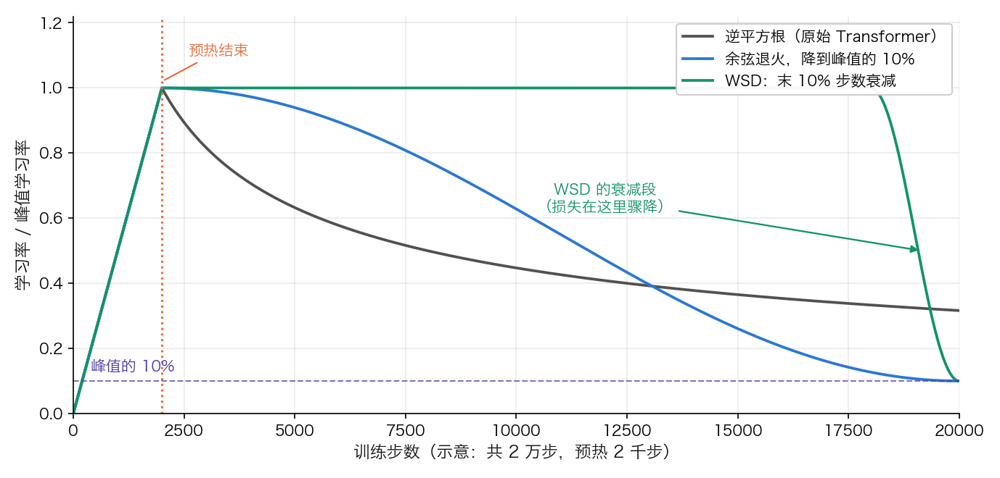
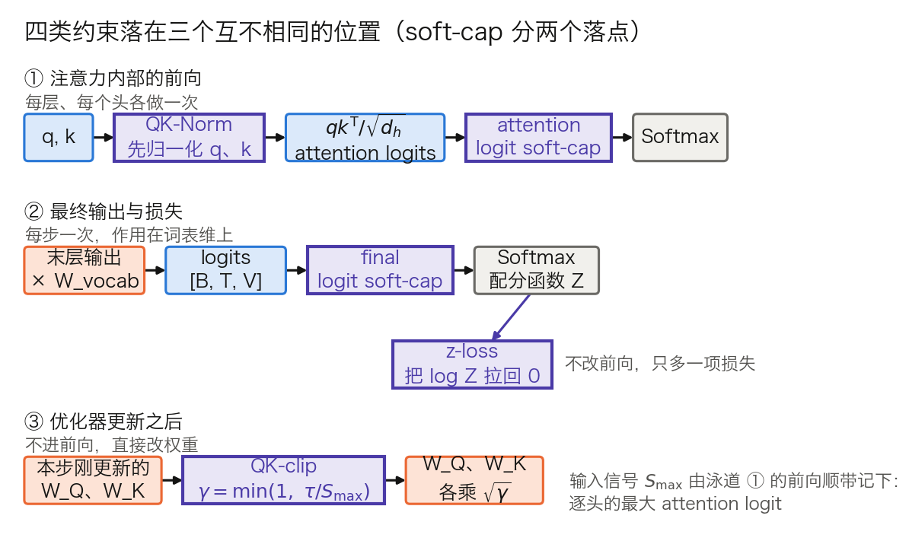
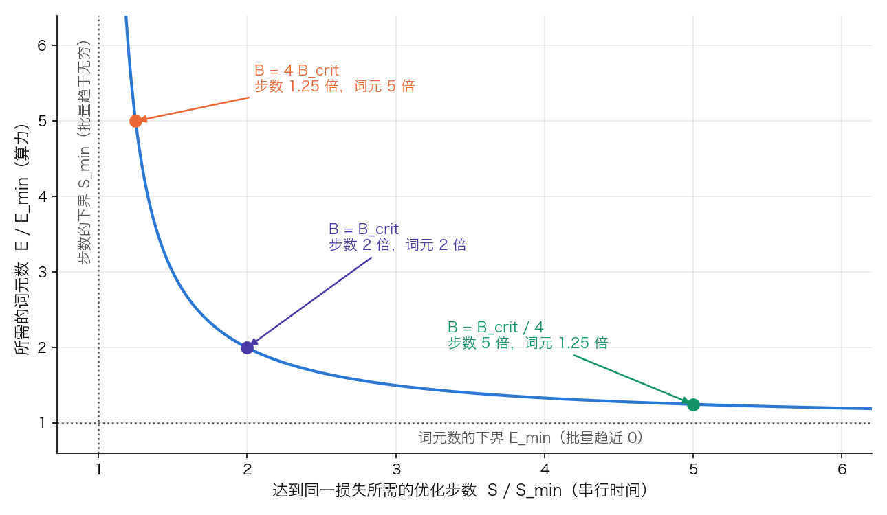
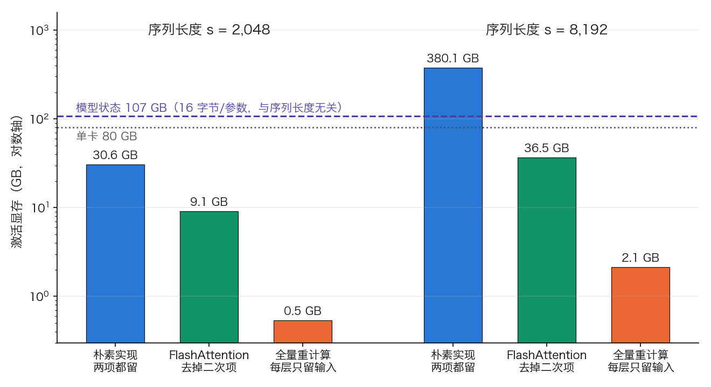

# 第六章：训练技术的底层逻辑

确定了预训练目标和架构之后，如何让训练过程真正有效地收敛到良好的解，是一个充满技术细节的工程挑战。损失函数的选择、优化器的设计、学习率的调度和正则化策略——这些看起来“只是超参数调整”的工作，实际上包含着深刻的数学原理和丰富的工程经验。

本章将解析这些训练技术的底层逻辑，沿着四个问题展开：

- 6.1 节：Adam 为什么是默认优化器，这个“默认”近来又为什么被动摇？
- 6.2 节：Adam 已自适应各参数步长，全局学习率为什么还要先预热再衰减？
- 6.3 节：学习率调得再准，异常放大的梯度照样能毁掉训练，怎么按住它？
- 6.4 节：有效批次大小该定到多大，上界由什么决定？

## 1. 损失函数与优化器：为什么选择 Adam

Transformer 训练中最常用的损失函数是**交叉熵损失**（Cross-Entropy Loss）。本节从它出发，一直走到把这个标量变成参数更新的那一端：SGD 差在哪里、Adam 补上了什么、AdamW 又改了 Adam 的哪一处，以及 AdamW 这个“默认”近来为什么开始被 Muon 动摇。第五章停在“15 万亿词元”这样的数据规模上，但同一批词元交给不同的优化器，收敛到的并不是同一个模型。学习率本身随训练进程如何变化不在本节，见 6.2 节。

可运行的梯度核对见 A.6 实验一：用同一组矩阵对照手算、自动微分与有限差分，再观察一次参数更新。

### 1.1 交叉熵损失

对于一个分类问题（语言模型的每步预测本质上就是在词汇表中分类），交叉熵衡量的是模型预测分布 $\hat{p}$ 与真实分布 $p$ 之间的差异：

$$\mathcal{L} = -\sum_{c=1}^{n_{\text{vocab}}} p(c) \log \hat{p}(c)$$

在语言建模中，真实分布是独热的（正确词元概率为 1，其余为 0），因此简化为：

$$\mathcal{L} = -\log \hat{p}(x_{\text{true}})$$

直觉上，交叉熵惩罚的是 **“对正确答案分配的概率太低”**——模型越不确定正确答案，损失越大。

**对 logits 的梯度只有一行。** 反向传播真正用到的不是上面这个标量，而是它对 LM head 输出 $z$ 的导数。设 $\hat{p} = \operatorname{softmax}(z)$、$y$ 为独热标签，代入 Softmax 的导数 $\partial \hat p_i/\partial z_j = \hat p_i(\delta_{ij} - \hat p_j)$ 可得：

$$\frac{\partial \mathcal{L}}{\partial z_i} = \hat{p}_i - y_i$$

形状上，这一步是 `logits[B, T, n_vocab] → dlogits[B, T, n_vocab]`（符号沿用 5.1 节：`B` 是批大小、`T` 是序列长度、`n_vocab` 是词表大小），逐格相减即可：正确词元那一格减 1，其余各格保持自己的概率。整条反向链条的第一环就是这样一个不含指数、不含对数的差值，数值上极其稳定；不稳定发生在它前面那一步，即算 $\hat p$ 时的指数，实现上一律先减去每行最大值再取指数。

**训练第一步的损失应当约等于 $\ln n_{\text{vocab}}$。** 随机初始化时模型对词表里每个词元给出近似相等的概率 $1/n_{\text{vocab}}$，于是 $\mathcal{L} \approx -\log(1/n_{\text{vocab}}) = \ln n_{\text{vocab}}$，几个常见词表的锚点见 5.1 节的表 5-1。这里要补的是偏离方向怎么读：首步损失明显低于这个值，通常意味着标签泄漏或数据管线把输入和目标对错了位；明显高于它，则说明初始化或 logits 缩放有问题。

#### 困惑度：交叉熵的“人话”版本

**困惑度**（Perplexity，PPL）是衡量语言模型好坏最常用的指标，本质就是对每词元平均交叉熵取指数：

$$\text{PPL} = \exp\!\left(\frac{1}{N}\sum_{i=1}^{N} -\log \hat{p}(x_i)\right) = \exp(\mathcal{L})$$

它可以直观理解为模型在每一步“等效地在多少个候选词元之间犹豫”——PPL=1 表示完全确定，PPL=10 表示平均纠结于约 10 个等概率选项。代几个数：`L = 3.0 → PPL = 20.09`，`L = 2.0 → 7.39`，`L = 1.8 → 6.05`。注意指数的放大效应：损失从 2.0 降到 1.8 只动了 0.2，困惑度却降了 18%。

但要特别注意：**PPL 依赖于分词方式**——词表与切分粒度不同的两个模型，其困惑度不可直接比较。跨模型评测因此常改用与分词无关的 **bits-per-byte**（BPB）：

$$\text{BPB} = \frac{\mathcal{L}}{\ln 2}\cdot\frac{\text{词元数}}{\text{字节数}}$$

第一项把 nats 换成 bits，第二项把“每词元”换成“每字节”。同一份文本上，若某分词器平均每词元覆盖 4.2 个字节，则 `L = 2.0` 对应 `BPB = 2.0 / 0.693 / 4.2 = 0.687`。分词器越“贪”，每词元的损失越高，但除以字节数之后两边可比。

**标签平滑**（Label Smoothing）把真实标签从硬性的 [0, 0, ..., 1, ..., 0] 软化为均匀分布与 one-hot 标签的混合：正确类概率为 $1-\epsilon+\epsilon/n_{\text{vocab}}$，其他类为 $\epsilon/n_{\text{vocab}}$。原始 Transformer 取 $\epsilon_{ls} = 0.1$，并直言这一项**损害困惑度**（模型被迫变得不那么确定），换来的是 BLEU 和准确率的提升。当代 LLM 预训练一般不用它：PaLM 明确写明损失是全部词元对数概率的平均、不含标签平滑。原因与它的收益方向有关——预训练的评测口径就是困惑度本身，而下游用法（采样、对齐）也不需要一个被人为抹平的分布。

**损失层是显存的一个隐形大户。** logits 的形状是 `[B, T, n_vocab]`，它与 $d_{\text{model}}$ 无关，只由批量、序列长度和词表决定。取 `B = 8, T = 8192, n_vocab = 128256`，这个张量有 84.1 亿个数：bf16 下 16.8 GB，fp32 下 33.6 GB，已经超过多数中间层的激活（6.4.3 会给出整层的激活账）。减少这一峰值，可以按词元分块执行词表投影和损失，或用融合内核把 `矩阵乘 → logsumexp → 取标签项` 合成一遍。普通 [F.cross_entropy](https://docs.pytorch.org/docs/stable/generated/torch.nn.functional.cross_entropy.html) 接收已经生成的 logits，不会自动融合前面的词表投影；先生成完整 logits 再分块计算损失，并没有消除这个大张量。其中 `ignore_index` 用来跳过填充位置（惯例取 −100），`reduction` 决定是求和还是求平均——6.3.4 会说明在梯度累积下这个选择为什么不能随手定。

### 1.2 SGD 的局限

随机梯度下降（SGD）是最基本的优化算法：$\theta \leftarrow \theta - \eta \nabla_\theta \mathcal{L}$。它在卷积网络上一直工作得很好，在 Transformer 上却明显吃亏。问题不在于“损失地形复杂”这种对任何深网都成立的说法，而在于**梯度噪声的分布形状在两类模型上不一样**。

[一项对比研究直接量了这件事](https://arxiv.org/abs/1912.03194)：把一个小批量的梯度噪声看成高维向量，估计其分布的尾指数 $\hat\alpha$（$\hat\alpha = 2$ 对应高斯，越小尾巴越重、方差越发散）。ImageNet 上训练 ResNet 得到 $\hat\alpha = 1.99$，几乎就是高斯；BERT 预训练得到 $\hat\alpha = 1.08$，是明显的重尾。同一篇工作还给出了反向证据：在 ImageNet + ResNet-50 上，SGD 的验证准确率 0.754 高于 Adam 的 0.716——**噪声集中时 SGD 反而更好**。

重尾意味着什么，可以一步推出来。SGD 的单步位移正比于梯度本身，因此一次罕见的大梯度会原样变成一次大更新；尾巴越重，这种罕见事件越频繁。Adam 把更新除以 $\sqrt{\hat v}$，减弱了更新对梯度绝对尺度的依赖，但实际步长仍由一阶矩、二阶矩和当前梯度共同决定，并不以 $\eta$ 为硬上限。梯度裁剪进一步限制异常梯度进入这些状态的幅度，见 6.3.2。

还有一层原因来自各参数块之间的**尺度差异**：嵌入表、注意力投影、归一化增益工作在完全不同的量级上，而 SGD 只有一个全局 $\eta$，它对某一块合适就对另一块过大或过小。PaLM 用带“参数缩放”的 Adafactor，理由正是这个——它把学习率按参数矩阵自身的均方根缩放，于是在不同尺度上工作的参数矩阵（嵌入、归一化增益）不会被按同一比例压低学习率。6.2 节讲到 μP 时会看到，这条尺度问题在模型变宽时还会继续恶化：标准参数化下调小全局学习率压住了 logits，词嵌入就几乎学不动。

### 1.3 Adam 优化器：自适应学习率

**Adam**（Adaptive Moment Estimation，Kingma & Ba，2015）通过维护梯度的一阶矩（均值）和二阶矩（未中心化方差）的指数移动平均来解决上述问题：

$$m_t = \beta_1 m_{t-1} + (1 - \beta_1) g_t \quad \text{（一阶矩估计）}$$
$$v_t = \beta_2 v_{t-1} + (1 - \beta_2) g_t^2 \quad \text{（二阶矩估计）}$$

由于 $m_t$ 和 $v_t$ 初始化为零，在训练初期会产生有偏估计。为此，Adam 引入了**偏差修正**：

$$\hat{m}_t = \frac{m_t}{1 - \beta_1^t} \quad \text{（修正一阶矩）}$$
$$\hat{v}_t = \frac{v_t}{1 - \beta_2^t} \quad \text{（修正二阶矩）}$$

参数更新规则为：

$$\theta_t = \theta_{t-1} - \eta \frac{\hat{m}_t}{\sqrt{\hat{v}_t} + \epsilon}$$

这里 $t$ 是时间步数（从 1 开始），$\eta$ 是学习率，$\epsilon$ 是数值稳定性项。

**把前两步算出来。** 取当代 LLM 的常见配置 $\beta_1 = 0.9$、$\beta_2 = 0.95$、$\eta = 3\times10^{-4}$、$\epsilon = 10^{-8}$，看某一个参数连续两步的梯度 $g_1 = 0.02$、$g_2 = -0.01$。

第 1 步：$m_1 = 0.1 \times 0.02 = 0.002$，$v_1 = 0.05 \times 0.02^2 = 2\times10^{-5}$。偏差修正 $\hat m_1 = 0.002/(1-0.9) = 0.02$，$\hat v_1 = 2\times10^{-5}/(1-0.95) = 4\times10^{-4}$，$\sqrt{\hat v_1} = 0.02$。于是比值恰为 1，更新量 $= 3\times10^{-4} \times 1 = 3.0\times10^{-4}$。

第 2 步：$m_2 = 0.9\times0.002 + 0.1\times(-0.01) = 8\times10^{-4}$，$v_2 = 0.95\times2\times10^{-5} + 0.05\times10^{-4} = 2.4\times10^{-5}$。修正后 $\hat m_2 = 8\times10^{-4}/(1-0.81) = 4.211\times10^{-3}$，$\hat v_2 = 2.4\times10^{-5}/(1-0.9025) = 2.462\times10^{-4}$，$\sqrt{\hat v_2} = 0.01569$，比值 0.2684，更新量 $= 8.05\times10^{-5}$。梯度反号，一阶矩被抵消掉大半，步子自动缩小到约 0.27 倍。

这两步给出两条后面反复要用的结论。

**其一，学习率给出更新的基准尺度，不是位移上限。** 忽略 $\epsilon$ 且 $g_1\ne0$ 时，首步的比值绝对值等于 1；但后续的 $\hat m_t$ 与 $\hat v_t$ 使用不同的历史权重，不能保证 $|\hat m_t|\le\sqrt{\hat v_t}$。沿用上面的 $\beta_1$、$\beta_2$，让前 999 步梯度都为 1，第 1,000 步变为 2，代入 [Adam 更新公式](https://docs.pytorch.org/docs/stable/generated/torch.optim.Adam.html)得到当步位移约为 $1.0258\eta$，已经超过 $\eta$。监控真正的更新量，需要同时看 $\eta\hat m_t/(\sqrt{\hat v_t}+\epsilon)$；使用 AdamW 时还要计入权重衰减。

**其二，全部历史梯度按同一正常数缩放时，Adam 的更新近似不变。** 把上面两步的梯度同乘 10（$g_1 = 0.2$、$g_2 = -0.1$），$\hat m$ 与 $\sqrt{\hat v}$ 同比放大；忽略 $\epsilon$ 后更新量不变，保留它则只在分母远大于 $\epsilon$ 时近似成立。这个前提不适用于只缩放当前一步的梯度裁剪：已有的 $m$、$v$ 没有同比变化，裁剪会同时改变当步更新和后续状态，见 6.3.2。

**$\beta_2$ 决定二阶矩看多长的历史。** 指数移动平均的有效窗口约为 $1/(1-\beta_2)$ 步：

| $\beta_2$ | 0.999 | 0.99 | 0.98 | 0.95 | 0.9 |
| --- | ---: | ---: | ---: | ---: | ---: |
| 有效窗口（步） | 1000 | 100 | 50 | 20 | 10 |

表 6-1：二阶矩的指数移动平均看多长的历史。窗口越短，$v$ 对梯度分布的突变反应越快，代价是估计噪声更大。

原始 Transformer 取 $\beta_2 = 0.98$、$\epsilon = 10^{-9}$，对应 50 步的窗口。当代 LLM 预训练普遍压到 $\beta_2 = 0.95$（20 步），GPT-3 与 DeepSeek-V3 都写明了这个值，见 6.1.4 的表 6-3。取短窗的理由是大规模训练中梯度的尺度会随数据配比、批量和课程阶段变化，$v$ 必须跟得上；代价是 $v$ 本身更抖。PaLM 走的是另一条路，让 $\beta_2 = 1 - k^{-0.8}$ 随步数 $k$ 变化，理由是罕见词元的嵌入在短窗口里估不准二阶矩。

**$\epsilon$ 有两个截然不同的工作区间。** 当 $\sqrt{\hat v} \gg \epsilon$ 时，它可以忽略，更新与梯度尺度无关，即上面那两条结论成立的区间。当 $\sqrt{\hat v} \ll \epsilon$ 时，更新退化为 $\eta\hat m/\epsilon$，即一个学习率为 $\eta/\epsilon$ 的动量 SGD；梯度长期极小的参数就落在这一侧。$\epsilon$ 能取多小还受实现精度约束：若二阶矩与更新不在 FP32 上算，$10^{-9}$ 量级的项会被直接舍掉（混合精度的标准做法是把它们留在 FP32，见 7.6 节）。公开配置里这一项并无统一取值，原始 Transformer 取 $10^{-9}$，GPT-3 取 $10^{-8}$，见 6.1.4 的表 6-3。

**每个参数的状态要占多少字节。** Adam 的自适应不是白来的：它为每个参数多存两个浮点数。混合精度训练下这笔账要连同 16 位参数、16 位梯度和 FP32 主权重一起算（机制见 7.6 节）：

| 优化器 | 16 位参数 | 16 位梯度 | FP32 主权重 | 优化器状态 | 合计 |
| --- | ---: | ---: | ---: | --- | ---: |
| SGD + 动量 | 2 | 2 | 4 | 动量 4 | 12 |
| AdamW | 2 | 2 | 4 | $m$ 4 + $v$ 4 | 16 |
| Muon（矩阵参数） | 2 | 2 | 4 | 动量 4 | 12 |
| 8-bit AdamW | 2 | 2 | 4 | $m$ 1 + $v$ 1 | 10 |
| Adafactor（不带动量） | 2 | 2 | 4 | 行和列各一份，$O(n+m)$ | ≈ 8 |

表 6-2：每参数的常驻字节数（混合精度口径）。[8-bit AdamW](https://arxiv.org/abs/2110.02861) 的依据是它把两个状态各量化到 8 位，原文的说法是 32 位状态下 Adam 每参数 8 字节、10 亿参数 8 GB，量化后降到 2 GB。[Adafactor](https://arxiv.org/abs/1804.04235) 只保存二阶矩的逐行和逐列和，对 $n\times m$ 的矩阵把 $O(nm)$ 降到 $O(n+m)$，合计一栏因此写成近似值；它默认不带一阶矩。Muon 只维护一个动量缓冲，Moonlight 报告的说法是“Muon 只用一个动量缓冲，而 AdamW 用两个，因此优化器多占的显存是 AdamW 的一半”。

代进具体模型：AdamW 的 16 字节/参数下，GPT-3 6.7B 的模型状态是 107 GB，Llama 3 8B 是 128 GB，Llama 3 405B 是 6,480 GB。第一个数就已经放不进一张 80 GB 的卡，这正是 ZeRO 与 FSDP 要分片的对象（7.2 节）。6.4.3 会把它和激活放在一起比较。

### 1.4 AdamW：权重衰减的修正

在实践中，更常用的是 **AdamW**（Loshchilov & Hutter，2019）——它修正了 Adam 中权重衰减（L2 正则化）的实现方式。

**问题根源**：把 L2 正则写进损失函数，等价于在梯度上加一项，即 $g_t \leftarrow g_t + \lambda\theta_{t-1}$，然后照常走上面五条公式。关键在于这一项**同时进入了 $m_t$ 和 $v_t$**：它先被一阶矩平滑，又被自己贡献的二阶矩除掉。结果是，梯度历史大的参数（$v_t$ 大）受到的实际衰减被 $1/\sqrt{v_t}$ 压得更小——衰减强度反而与参数的梯度历史挂钩，而这并不是正则化想要的。

**AdamW 的改进**：AdamW 把权重衰减从梯度里拿出来，直接施加在参数上：

$$\theta_t = \theta_{t-1} - \eta \frac{\hat{m}_t}{\sqrt{\hat{v}_t} + \epsilon} - \eta \lambda \theta_{t-1}$$

第二项与优化器状态无关，对所有参数一视同仁。AdamW 原文的实验做在 CIFAR-10 与 ImageNet32x32 的 ResNet 上，结论是解耦后测试误差相对改善约 15%，并且超参搜索空间更可分离（学习率与衰减系数不再强耦合）。把这个结论直接外推成“显著改善大模型的泛化”并不成立——原文没有做大模型实验；它在 LLM 上被普遍采用，靠的是后来的训练实践，而非这组实验。

**实现口径：衰减项跟着学习率一起变。** PyTorch 的 `torch.optim.AdamW` 写成 $\theta_t \leftarrow \theta_{t-1} - \gamma\lambda\theta_{t-1}$，其中 $\gamma$ 就是当前学习率。这意味着 6.2 节的调度在衰减学习率时，**也在同步削弱权重衰减**。把两者放在一起看，能得到一个有用的量：只受衰减作用的参数按 $(1-\eta\lambda)$ 逐步收缩，其特征时间尺度是 $1/(\eta\lambda)$ 步。$\eta = 3\times10^{-4}$、$\lambda = 0.1$ 对应约 3.3 万步；DeepSeek-V3 的峰值 $2.2\times10^{-4}$ 配 $\lambda = 0.1$ 对应约 4.5 万步，而它 14.8 万亿词元按末期批量（15,360 条 × 4,096 词元）折算约 23.5 万步。收缩的时间尺度比总训练长度短，说明权重衰减在整个训练周期内反复起作用，不是可有可无的小项。

**不是所有参数都做衰减。** 训练脚本里几乎总会看到一个 no-decay 参数组：偏置、归一化层的增益与偏移通常被排除，很多实现连嵌入表一起排除。理由是权重衰减的先验是“范数越小模型越简单”，而这条先验对这些参数不成立——归一化增益的合适尺度由它要还原的激活方差决定，把它往 0 推只会让后面的层重新学回来。判断标准很直接：参数是不是一个作用在向量上的线性映射；是，就归入衰减组。

**公开模型的配置。** 表 6-3 把几个可核对的预训练配置放在一起，值都取自各自论文的训练超参段落。

| 模型 | 优化器 | $\beta_1$ | $\beta_2$ | $\epsilon$ | 权重衰减 | 梯度裁剪 |
| --- | --- | ---: | ---: | ---: | ---: | ---: |
| 原始 Transformer | Adam | 0.9 | 0.98 | $10^{-9}$ | — | — |
| GPT-3（全部规模） | Adam | 0.9 | 0.95 | $10^{-8}$ | 0.1 | 全局范数 1.0 |
| PaLM 540B | Adafactor（不做分解） | 0.9 | $1-k^{-0.8}$ | — | $\text{lr}^{2}$ | 全局范数 1.0 |
| DeepSeek-V3 | AdamW | 0.9 | 0.95 | — | 0.1 | 1.0 |

表 6-3：几个公开模型写明的优化器配置，“—”表示该论文未在训练超参处给出。GPT-3 一行出自其附录的训练细节，PaLM 一行出自其训练设置一节——它的 $\beta_2$ 随步数 $k$ 变化，权重衰减取当前学习率的平方，是本表里唯一一个动态口径，理由是罕见词元的二阶矩在短窗口上估不准。Llama 3 405B 没有进表：其预训练配方只写明用 AdamW 以及峰值 $8\times10^{-5}$、线性预热 8,000 步、余弦降到 $8\times10^{-7}$ 共 120 万步，$\beta$ 与 $\epsilon$ 未在原文给出；论文另在 scaling-law 实验一节写明“每一步的权重衰减取当步学习率的 0.1 倍”，是与 PaLM 同类的动态写法。

AdamW 长期是大模型训练的默认选择，DeepSeek-V3 等前沿模型均采用。同一位置上还有另外两支。一支是针对大批量训练的 LAMB（Layer-wise Adaptive Moments optimizer for Batch training），另一支是 T5 等模型采用的 Adafactor 一类低内存优化器。但自 2024 年底 Muon 提出、并在 2025—2026 年被多个前沿模型采用之后，这个“默认”开始被动摇。

### 1.5 Muon：把更新矩阵正交化

Adam 系优化器把每个参数当作独立标量来自适应缩放，完全忽略了权重本身是一个**矩阵**。**Muon**（MomentUm Orthogonalized by Newton-Schulz）正是从这里切入，[原始设计](https://kellerjordan.github.io/posts/muon/)由 Keller Jordan 于 2024 年底给出。它只作用于隐藏层的二维参数。每一步先算出常规的 SGD 动量更新，再用 **Newton-Schulz 迭代**对这个更新矩阵做近似正交化，然后才施加到参数上。正交化等价于取更新矩阵的 SVD 后只保留 $U$ 和 $V$、丢掉奇异值。标量与向量参数、以及输入输出层，仍交给 AdamW——这是 Muon 原始设计就明确的分工。

**三行公式。** 按 Moonlight 论文的写法，给定当前权重 $W_{t-1}$、动量系数 $\mu$、学习率 $\eta_t$：

$$M_t = \mu M_{t-1} + \nabla\mathcal{L}_t(W_{t-1}),\quad O_t = \text{Newton-Schulz}(M_t),\quad W_t = W_{t-1} - \eta_t O_t$$

中间那一步要近似算的是 $(M_tM_t^{\top})^{-1/2}M_t$。若 $M_t = U\Sigma V^{\top}$ 是奇异值分解，这个量恰好等于 $UV^{\top}$：方向全部保留，奇异值全部抹成 1。

**Newton-Schulz 迭代做了什么。** 先把动量矩阵除以自己的 Frobenius 范数，得到 $X_0 = M_t/\|M_t\|_F$，然后重复

$$X_k = aX_{k-1} + b(X_{k-1}X_{k-1}^{\top})X_{k-1} + c(X_{k-1}X_{k-1}^{\top})^2X_{k-1}$$

每一项都只含矩阵乘法，因此在 GPU 上很便宜。系数取原始设计的 $a = 3.4445$、$b = -4.7750$、$c = 2.0315$，迭代 $N = 5$ 次（Moonlight 沿用这组系数，并说明 $N = 10$ 正交化更准但不带来更好的效果，故取 5）。

关键在于这条递推只作用在**奇异值**上：$X$ 的奇异值 $\sigma$ 每次按标量多项式 $f(\sigma) = a\sigma + b\sigma^3 + c\sigma^5$ 更新，奇异向量不动。取一个能手算的例子，$M = \operatorname{diag}(10, 1)$，两个奇异值相差 10 倍。$\|M\|_F = \sqrt{101} = 10.05$，归一化后是 0.99504 与 0.09950。逐次代入 $f$：

| 迭代次数 | 大奇异值 | 小奇异值 | 两者之比 |
| ---: | ---: | ---: | ---: |
| 0 | 0.9950 | 0.0995 | 10.00 |
| 1 | 0.7047 | 0.3381 | 2.085 |
| 2 | 1.1093 | 0.9889 | 1.122 |
| 3 | 0.7153 | 0.7097 | 1.008 |
| 5 | 0.7020 | 0.7087 | 0.991 |

表 6-4：Newton-Schulz 迭代在 $M = \operatorname{diag}(10, 1)$ 上的五步轨迹，由 $f(\sigma) = 3.4445\sigma - 4.7750\sigma^3 + 2.0315\sigma^5$ 逐次代入算出，可用计算器复核。

两件事从这张表里读得出来。一是收敛的是**比值**：三步之后两个方向的更新幅度已经基本拉平，这正是“防止权重只沿少数主导方向学习”的那句话的数值含义。二是奇异值并没有停在 1，而是在 0.70 到 1.11 之间来回跳。这组系数本就是为“小奇异值也能快速抬起来”而调的，五步之后所有奇异值落在一个带子里而不是一个点上。正因为如此，Muon 的更新尺度不能靠迭代本身保证，要在外面另行校准。

**更新尺度的校准。** Moonlight 给出的引理是：形状为 $[A, B]$ 的满秩矩阵参数，其 Muon 更新的理论 RMS 为 $\sqrt{1/\max(A,B)}$——**同一个学习率作用在不同形状的矩阵上，实际步长不同**。AdamW 没有这个问题，它的更新 RMS 理论上在 1 附近、实测常在 0.2 到 0.4。于是 Moonlight 把更新按 $\sqrt{\max(A,B)}$ 放大再乘 0.2，并把权重衰减加回来：

$$W_t = W_{t-1} - \eta_t\left(0.2\cdot O_t\cdot\sqrt{\max(A,B)} + \lambda W_{t-1}\right)$$

代入 Llama 3 8B 的形状验算：$W_Q$ 是 `[4096, 4096]`，理论 RMS $= \sqrt{1/4096} = 0.0156$，乘 $0.2\sqrt{4096} = 12.8$ 得 0.2；MLP 的 $W_1$ 是 `[4096, 14336]`，理论 RMS $= \sqrt{1/14336} = 0.00835$，乘 $0.2\sqrt{14336} = 23.9$ 同样得 0.2。两个形状差别很大的矩阵被拉到同一个更新尺度，这就是“不必重新调参就能换上 Muon”的来历。加权重衰减的理由是实测：不加时权重与层输出的 RMS 会一路涨到超出 bf16 的高精度区间。

**代价在分布式那一侧。** 正交化需要**完整的**梯度矩阵，而 ZeRO/FSDP 把参数和梯度按元素切开了。Moonlight 的分布式实现因此要先把本地分片对应的梯度在数据并行组内聚齐，做完 Newton-Schulz 再丢掉不属于本地的部分；额外通信可以用 bf16，全程通信量是分布式 AdamW 的 1 到 1.25 倍，实践中接近下界。计算侧的开销则不大：5 次迭代只是几次矩阵乘法，论文给出的量级是优化器端到端延迟通常占前后向时间的 1% 到 3%。

**它管不到哪些参数。** 嵌入表、输出头、所有一维参数（归一化增益、偏置）都不走 Muon。判据与 6.1.4 的 no-decay 组是同一条：这些张量不是“作用在残差流上的线性映射”，把它们的更新矩阵正交化没有对应的几何意义。实践中它们仍由 AdamW 更新，因此一次训练里两个优化器是同时在跑的。工程上 Muon 已经进了 NVIDIA Megatron Core，配套的是一个**逐层分布式优化器**：把整层指派给某个数据并行 rank，使整层的预条件不需要额外通信就能算出来，绕开了上面那条分片冲突。Megatron-LM 的命令行一侧可以直接对照：`--optimizer` 的可选值里有 `muon`，`--muon-num-ns-steps` 的默认值正是 5，`--muon-scalar-optimizer` 指定一维参数交给谁、默认 `adam`。

**为什么正交化会更快？** 这正是本节“为什么选择 Adam”要追问的层次。一项曲率视角的分析（[Why Muon Outperforms Adam: A Curvature Perspective](https://arxiv.org/abs/2606.04662)，2026 年 6 月）对训练曲面做二阶泰勒展开后发现：在相同验证损失下，Muon 与 Adam 的**一阶收益相当、更新范数也相当**，差别出在二阶的曲率惩罚项——把该惩罚拆成“更新范数平方”与“归一化方向锐度”（Normalized Directional Sharpness，NDS）两部分后，Muon 的优势**主要来自更低的 NDS**，而不是更新幅度。换句话说，正交化的作用更像是让更新避开高曲率方向，而非走得更远。

多个前沿模型已在训练中使用它——

- **Moonlight**（[Muon is Scalable for LLM Training](https://arxiv.org/abs/2502.16982)）：3B/16B MoE、5.7T 词元，论文报告在计算最优设置下达到与 AdamW 相当的性能只需约 52% 的训练 FLOPs（该倍数为特定设置下的结论，不宜外推为通用常数）
- **Kimi K2**：1T 总参数 / 32B 激活、15.5T 词元训练无损失尖峰，使用的是 Muon 的变体 **MuonClip**（在 Muon 基础上增加 QK-clip 以抑制训练不稳定，机制见 6.3.6）
- **Kimi K3**：延续 K2 用 Muon 优化矩阵参数，并对注意力投影再细化出 **Per-Head Muon**——不对完整的 Q/K/V 投影矩阵做 Newton-Schulz 正交化，而是把动量矩阵按头维切开、逐头分别正交化。其理由是：整矩阵正交化把所有头当成一个耦合块，梯度或动量尺度较大的头会主导共享的更新方向，尺度较小的头则得不到充分归一化；逐头正交化使各头的更新尺度对齐，在更大规模上训练更稳，且因为在瘦长的逐头块上做 Newton-Schulz 比在整个投影矩阵上更便宜，优化器开销还略有下降（[arXiv:2607.24653](https://arxiv.org/abs/2607.24653)）。该报告的口径是 **Muon**，不再沿用 MuonClip 这个名字，但 K2 的权重裁剪机制本身仍在使用
- **DeepSeek-V4**：对**大部分模块**使用 Muon，而嵌入层、预测头、mHC 的静态偏置与门控因子、以及所有 RMSNorm 权重仍保留 AdamW（[技术报告](https://arxiv.org/abs/2606.19348)的优化器一节）

需要注意两点分寸：一是各家的“Muon”往往是变体而非原版（Kimi K2 是 MuonClip），引用时应以模型方自己的论文口径为准；二是 Muon 的收益体现在**收敛速度与稳定性**上，而非单步吞吐——[NVIDIA 在 GB300 上的实测](https://developer.nvidia.com/blog/advancing-emerging-optimizers-for-accelerated-llm-training-with-nvidia-megatron/)表明其训练吞吐与 AdamW 大致持平，官方措辞是“使用 Muon 相对 AdamW 有很小的训练性能损失”；同一篇还写明，若把 Newton-Schulz 迭代中矩阵乘法的浮点运算也计进去，Muon 的 MFU（Model FLOPs Utilization，模型浮点运算利用率，口径见 7.5.6 节）反而更高。

## 2. 学习率调度：为什么需要先预热再衰减

学习率可能是 Transformer 训练中最关键的超参数。6.1 节的每一条更新公式里，$\eta$ 都只是写在最前面的一个常数——Adam 自适应的是各参数之间的相对步长，这个全局尺度并不在它的调节范围内。6.1.3 已经给出它的物理含义：Adam 下单步更新的幅度上界约为 $\eta$，所以“调学习率”调的是每个参数每步能挪多远。本节先写清原始论文那条“先预热再衰减”的曲线，再说明预热与衰减各自在防什么，最后换成当代模型实际在用的三种调度，并给出峰值学习率怎样随模型规模改变。

### 2.1 原始调度公式

Transformer 的学习率调度公式为：

$$\text{lr} = d_{\text{model}}^{-0.5} \cdot \min(\text{step}^{-0.5}, \text{step} \cdot \text{warmup\_steps}^{-1.5})$$

这个公式通过 min 函数的“切换”实现两个阶段的平稳过渡。在 step = warmup_steps 时，两项相等：

$$\text{warmup\_steps}^{-0.5} = \text{warmup\_steps} \cdot \text{warmup\_steps}^{-1.5}$$

因此：

- **预热阶段**（step < warmup_steps）：$\text{step} \cdot \text{warmup\_steps}^{-1.5}$ 较小，学习率按此项线性增长：$\text{lr} \propto \text{step}$
- **衰减阶段**（step ≥ warmup_steps）：$\text{step}^{-0.5}$ 较小，学习率按此项逐渐衰减：$\text{lr} \propto \text{step}^{-0.5}$

原始论文使用 warmup_steps = 4000。峰值出现在 step = warmup_steps，此时学习率为 $d_{\text{model}}^{-0.5} \cdot \text{warmup\_steps}^{-0.5}$；对于 d_model = 512、warmup_steps = 4000，峰值约为 $512^{-0.5} \cdot 4000^{-0.5} \approx 6.99 \times 10^{-4}$。$512^{-0.5} \approx 0.0442$ 只是模型维度缩放因子，不是最终峰值学习率。

代进几个步数，这条曲线的形状就具体了：

| step | 1 | 100 | 1,000 | 4,000 | 8,000 | 16,000 | 100,000 |
| --- | ---: | ---: | ---: | ---: | ---: | ---: | ---: |
| lr | $1.75\times10^{-7}$ | $1.75\times10^{-5}$ | $1.75\times10^{-4}$ | $6.99\times10^{-4}$ | $4.94\times10^{-4}$ | $3.49\times10^{-4}$ | $1.40\times10^{-4}$ |

表 6-5：$d_{\text{model}} = 512$、warmup_steps = 4000 时原始调度的学习率，由上面的公式逐点代入算出。左半段严格线性：step 从 100 到 1,000 涨 10 倍，学习率也涨 10 倍。右半段衰减极慢：从峰值起步数涨 25 倍，学习率才降到峰值的五分之一。这条尾巴太平，是它后来被余弦与 WSD 取代的直接原因。

$d_{\text{model}}^{-0.5}$ 这个因子里藏着一条经验：模型越宽，同一个全局学习率就该越小。6.2.4 的 μP 与它方向一致但指数不同——μP 在 Adam 下按 $1/\text{fan\_in}$ 缩小隐藏层与输出层的学习率，而不是 $1/\sqrt{d_{\text{model}}}$，且按层的类型分开处方。

### 2.2 为什么需要预热

预热要防的不是一件事，而是两件，它们的前提并不相同。

**其一，Post-LN 结构在初始化时靠近输出层的梯度偏大。** 原始 Transformer 把层归一化放在残差相加之后（Post-LN）。[一项用平均场理论做的分析](https://arxiv.org/abs/2002.04745)证明：在这种结构下，初始化时输出层附近参数的期望梯度很大，对这些梯度直接用大学习率会让优化不稳定，预热正是绕开这一段的办法。同一篇工作还给出了对偶的结论——把归一化搬进残差分支内部（Pre-LN，见 3.6 节）后初始化时的梯度表现良好，因此**预热阶段可以安全去掉**，并在 IWSLT14、WMT14 与 BERT 预训练上验证了这一点。

这意味着“预热必不可少”是一句有前提的话。当代 LLM 几乎全是 Pre-LN，却仍然保留预热，理由要到第二条上去找。

**其二，Adam 的二阶矩在开头几步估不准。** 由 6.1.3 的手算可知，第一步的 $\hat m_1/\sqrt{\hat v_1}$ 精确等于 1——此时 $v$ 只见过一个样本，这个比值里不含任何统计信息。$\beta_2 = 0.95$ 要约 20 步、$\beta_2 = 0.999$ 要约 1000 步才积累起一个像样的二阶矩估计。在此之前，自适应学习率的方差很大，而它乘的又是全局 $\eta$，于是几个参数可能一步就被推到很远的地方。预热用小学习率把这段窗口“走过去”。

这两条机制解释不了预热长度的具体取值。DeepSeek-V3 用 2,000 步预热，而它的 $\beta_2 = 0.95$ 只对应 20 步的窗口；Llama 3 405B 用 8,000 步。实践中预热长度更像是按总步数的一个小比例来定的，Megatron-LM 因此同时提供 `--lr-warmup-iters` 与 `--lr-warmup-fraction` 两种写法。

**预热常与批量预热同时发生。** 大规模训练常在开头同时做两件事：学习率从 0 升起，全局批量也从小往大升（6.4.1）。GPT-3 的描述是“在最初的 40 亿到 120 亿词元内，批量从 3.2 万词元线性增到全量”，与 3.75 亿词元的学习率预热重叠。两者防的是同一件事的两个侧面：初期梯度方向不可靠，既不宜迈大步，也不宜用过大的批量去平滑一个本来就没稳定的方向。

### 2.3 为什么需要衰减

在训练后期，模型已经接近了损失函数的局部最优区域。此时如果继续使用较大的学习率，模型会在最优点附近**反复震荡**而无法收敛。逐步降低学习率让模型的更新步长越来越精细，最终“平稳着陆”到一个好的解。

这个说法可以被一条经验结果钉死。[MiniCPM 的一组扫描实验](https://arxiv.org/abs/2404.06395)在 0.036B 模型上把余弦调度的周期 $T$ 与实际总步数 $S$ 拆开：在 $S = 20N, 40N, 60N, 80N$ 四种设定下，最低损失**总是出现在 $T = S$**，$T < S$ 与 $T > S$ 都更差。$T > S$ 差，是因为训练结束时学习率还没降下来，衰减没做完；$T < S$ 差，是因为高学习率的探索期被砍短了。式中 $N$ 为该模型的非嵌入参数量，四档设定对应词元数与参数量之比从 20 到 80。MiniCPM 还引述 Chinchilla 的同一观察：$T > S$ 会掉点，$T = S$ 则提高训练效率。结论是，衰减不是可有可无的收尾，它要落在正确的位置上。

衰减还有一个常被忽略的连带效应。6.1.4 已经指出，AdamW 的实际衰减量是 $\eta\lambda\theta$，学习率下降时权重衰减同步变弱。所以“降学习率”降的不只是步长，也在放松正则；Llama 3 在 scaling-law 实验里把权重衰减直接定义成“当步学习率的 0.1 倍”，就是把这层耦合写进了配置。

### 2.4 现代调度策略

除了原始的逆平方根衰减，现代大模型训练常用的是下面三条曲线。记预热结束步为 $T_w$、总步数为 $T$、峰值与终值为 $\eta_{\max}$、$\eta_{\min}$。

**余弦退火**（Cosine Annealing）：

$$\eta(t) = \eta_{\min} + \tfrac{1}{2}(\eta_{\max}-\eta_{\min})\left(1 + \cos\frac{\pi(t-T_w)}{T-T_w}\right)$$

它在中期保持较高学习率，末期下降很快。这里的 $\eta_{\min}$ 通常**不是 0**：GPT-3 的原话是“把学习率按余弦衰减到初值的 10%，跨 2,600 亿词元；之后继续以原学习率的 10% 训练”；Llama 3 的 scaling-law 实验同样写明“余弦衰减到峰值的 0.1 倍”。降到 0 与降到 10% 的差别在于末段还留不留一点更新能力——留着，训练可以从终点继续；降到 0，则这条曲线只对一个事先定死的总步数有效。

**线性衰减**（Linear Decay）：$\eta(t) = \eta_{\max} - (\eta_{\max}-\eta_{\min})\frac{t-T_w}{T-T_w}$。简单直接，效果通常不亚于余弦退火。

**预热-稳定-衰减**（Warmup-Stable-Decay，WSD）：名称与系统研究出自 MiniCPM，写成三段：

$$
\eta(s) =
\begin{cases}
\dfrac{s}{W}\,\eta, & s < W \\[4pt]
\eta, & W \le s < T \\[4pt]
f(s-T)\,\eta, & T \le s < S
\end{cases}
$$

其中 $f$ 是一个从 1 递减的函数，$W$ 是预热结束步，$T$ 是稳定段结束步。MiniCPM 的实验结论是**衰减段占总词元的 10% 就够**：2.5% 不足，10% 已能取得最好结果。

**WSD 换来了什么。** 余弦调度必须事先定死总步数——由 6.2.3 可知 $T \ne S$ 两侧都掉点，而训练要跑多久往往在开跑时并不确定。WSD 把这个约束解开：稳定段的**任何一个检查点**都可以接一段短衰减，得到一个可用的模型；不满意就回到稳定段继续训，再衰减一次。MiniCPM 正是用这一点把 scaling-law 实验的代价从“模型轴与数据轴上都要平方级的工作量”降到“数据轴上几乎没有额外代价”。

**它的代价是一个极易踩中的比较陷阱。** MiniCPM 观察到，进入衰减段后损失会**急剧下降**，迅速追平甚至低于同点的余弦调度。反过来说，在衰减段开始之前，WSD 的损失曲线看上去一直比余弦高。于是：**中途截取两条曲线比损失，得到的结论毫无意义**——比的不是调度的好坏，而是“谁已经衰减完了”。

[Kimi K3 的技术报告](https://arxiv.org/abs/2607.24653)给出了同一类陷阱的另一个版本，值得记住的是它的方法论。他们的 scaling-law 研究一致偏好余弦退火而非 WSD，但给出的理由不是“余弦更好”，而是先说明为什么此前的对比可能不可信。即使在相同模型规模与相同训练词元预算下，两种调度的最优峰值学习率与最优批大小也显著不同。用同一组超参去比较两种调度，可能仅仅因为那组超参更贴合其中一方，就不公平地偏向它。该结论属该团队在自己的模型族与数据上的观察，不是普适定论。他们的做法是对每种调度各自独立做一次 scaling-law 搜索，让两者都跑在自己的最优超参上再比较最终损失；在这个前提下余弦退火才稳定更优。这条经验的适用面远超学习率调度本身：**只要两个方案各自有一组需要调的超参，“固定超参、只换方案”的对比就是有偏的**——优化器、归一化位置、注意力变体的比较都吃这个坑。

**真实配置。** 表 6-6 把三个公开模型的调度放在一起，数值均取自各自论文的训练配方段落。

| 模型 | 峰值 | 预热 | 衰减形状 | 终值 | 总长 |
| --- | ---: | --- | --- | ---: | --- |
| GPT-3 175B | $0.6\times10^{-4}$ | 前 3.75 亿词元线性升 | 余弦，跨 2,600 亿词元 | 峰值的 10% | 3,000 亿词元 |
| Llama 3 405B | $8\times10^{-5}$ | 8,000 步线性升 | 余弦 | $8\times10^{-7}$ | 120 万步 |
| DeepSeek-V3 | $2.2\times10^{-4}$ | 2,000 步线性升 | 恒定到 10T 词元，再余弦跨 4.3T | $2.2\times10^{-5}$，末段两级常数 | 14.8T 词元 |

表 6-6：三个公开模型的学习率调度。DeepSeek-V3 的末段是“最后 5,000 亿词元里先用 $2.2\times10^{-5}$ 训 3,330 亿，再用 $7.3\times10^{-6}$ 训 1,670 亿”，是一个带两级常数尾巴的多段式，不是单纯的“最后快速衰减”；它的衰减段占 `4.3 / 14.8 = 29%` 的词元，恒定段占 68%。

把公式代进去可以复核：GPT-3 175B 的满批量是 320 万词元/步，3.75 亿词元的预热折合 `3.75e8 / 3.2e6 = 117` 步，2,600 亿词元的余弦段折合 81,250 步，3,000 亿词元的总长减去这一段还剩 12,500 步，维持在 $6\times10^{-6}$。开头批量还在从 3.2 万词元往上爬，所以“117 步”是下界，实际预热步数更多。Llama 3 405B 按余弦公式代入，第 4,000 步（预热过半）是 $4.0\times10^{-5}$，第 30 万步是 $6.88\times10^{-5}$，中点第 60.4 万步是 $4.04\times10^{-5}$，第 90 万步已降到 $1.25\times10^{-5}$。

**峰值学习率怎样随规模变。** GPT-3 的表 2.1 把八个规模的峰值学习率一并给出，取其中三行：

| 配置 | GPT-3 Small（125M） | GPT-3 6.7B | GPT-3 175B |
| --- | ---: | ---: | ---: |
| 峰值学习率 | $6.0\times10^{-4}$ | $1.2\times10^{-4}$ | $0.6\times10^{-4}$ |
| 批量（词元） | 0.5M | 2M | 3.2M |

表 6-7：GPT-3 三个规模的峰值学习率与批量，取自该论文表 2.1。参数量涨 1,400 倍，峰值学习率降到十分之一，批量涨 6.4 倍。

这条“模型越大学习率越小”的经验背后有结构性原因。标准参数化（SP）下，宽度增加时各层更新对激活的影响并不等价：一步更新之后，logits 与 attention logits 的量级会随宽度一起涨，必须靠调小全局学习率去压住，而这又让另一些参数（如词嵌入）几乎学不动。**μP**（Maximal Update Parametrization，最大更新参数化）就是为消掉这种宽度依赖而设计的一组缩放规则。用 Adam 时，[它的处方](https://arxiv.org/abs/2203.03466)按层的类型分三类：

- 输入层权重与所有偏置：初始化方差 $1/\text{fan\_in}$，学习率不随宽度变；
- 输出层权重：初始化方差 $1/\text{fan\_in}^2$，学习率按 $1/\text{fan\_in}$ 缩小；
- 隐藏层权重：初始化方差 $1/\text{fan\_in}$，学习率按 $1/\text{fan\_in}$ 缩小。

Transformer 还要多改一处：attention logits 除以每头宽度 $d_h$ 而不是 $\sqrt{d_h}$。做完这些之后，最优学习率在不同宽度上基本重合，于是可以在小模型上调好超参、零样本迁移到大模型。论文把这套流程叫 **μTransfer**，并报告从 4,000 万参数的代理模型迁移出的超参，在 6.7B 的 GPT-3 规模上超过了原论文公布的结果，调参代价只占总预训练算力的 7%。它的适用边界有两条。一是迁移的对象是同一族模型在**不同宽度**上的超参，换数据或换任务不在保证范围内。二是不能只改学习率一项，上面三类参数的初始化与学习率要同时改对。

**框架里的名字。** Hugging Face 的 `transformers.optimization` 直接提供 `get_cosine_schedule_with_warmup`、`get_linear_schedule_with_warmup`、`get_inverse_sqrt_schedule`、`get_cosine_with_min_lr_schedule_with_warmup` 与 `get_wsd_schedule`，通过 `lr_scheduler_type` 选择，WSD 对应的枚举值是 `SchedulerType.WARMUP_STABLE_DECAY`。Megatron-LM 的 `--lr-decay-style` 可取 `constant`、`linear`、`cosine`、`inverse-square-root`、`WSD`，配 `--min-lr` 指定终值、`--lr-warmup-iters` 或 `--lr-warmup-fraction` 指定预热长度；选 WSD 时还有 `--lr-wsd-decay-style`（`exponential`、`linear`、`cosine`、`minus_sqrt`）与 `--lr-wsd-decay-iters` 单独控制衰减段。本节三条曲线与这两处的参数名可以逐条对上。

**续训与重新预热。** 从一个已训练好的检查点继续训（继续预训练、长上下文扩展、退火阶段）时，优化器状态若一并恢复，$m$ 与 $v$ 都是热的，不需要重新走一遍预热；若只恢复权重而丢掉优化器状态，6.2.2 的第二条机制重新生效，就要补一段短预热。DeepSeek-V3 的长上下文扩展两阶段直接沿用预训练末尾的 $7.3\times10^{-6}$，没有重新升回峰值，是前一种情形的例子。

### 2.5 学习率调度可视化

不同的调度策略在训练过程中的学习率走势差异显著。把三种主流策略——原始逆平方根、余弦退火、WSD 三阶段——画在同一张图上，行为差异一目了然。



图 6-1：三种学习率调度策略的曲线对比（[生成脚本](https://github.com/yeasy/llm_internals/blob/main/tools/figures/lr_schedule_comparison.py)）。纵轴统一归一化为“占峰值学习率的比例”，以便三条曲线并排；横轴的 2 万步与 2 千步预热是示意值，真实配置见表 6-6。余弦与 WSD 都降到峰值的 10%，WSD 的衰减段取总步数的 10%，与 MiniCPM 的结论一致。

三条曲线的形状差异可以直接读出：**逆平方根**衰减最平缓，两万步后仍停在峰值的三成；**余弦退火**在中期保持较高学习率，末期快速下沉；**WSD** 在九成的训练时间里维持峰值，只在最后 10% 掉下来。图上没有画的是损失曲线，而那正是比较时最容易出错的地方——WSD 的损失在衰减段之前一直偏高，要等这段陡坡走完才追上余弦。

## 3. 正则化策略：防止过拟合的多重手段

上一节的三条曲线规定的是每一步该走多远，却不对梯度本身的量级作任何假设——峰值学习率调得再准，一个异常放大的梯度照样能让单个批次毁掉整个训练过程。本节管的是两件不同的事，读的时候值得分开记：**泛化侧**（Dropout、权重衰减）压的是模型对训练集的过度贴合，**稳定性侧**（梯度裁剪、初始化与残差缩放、对 logits 的动态约束）压的是训练过程本身的发散。单轮预训练里前者几乎不构成主要矛盾，后者才是真正会让一次长达数月的训练前功尽弃的东西。

### 3.1 Dropout

**Dropout** 在训练时随机将一定比例的神经元输出置零，推理时恒等通过。为了让两个阶段的期望一致，实现上用的是 **inverted dropout**：训练时把保留下来的值乘以 $1/(1-p)$，$p = 0.1$ 即乘 1.111，$p = 0.5$ 即乘 2。这样推理端不需要任何改动。

原始 Transformer 论文正文写明的 Dropout 只有两处（率 $P_{\text{drop}} = 0.1$）：

- 每个子层的输出，在与子层输入相加并归一化之前（残差 Dropout）
- 词嵌入与位置编码相加之后

常被一并列出的“注意力权重 Dropout”不在论文正文里：该段落在论文的排版源码中被注释掉了，这种写法见于其参考实现与后来的复现。引用这一条时值得区分论文与实现。

Dropout 的工作原理是**防止神经元之间的共适应**——当某些神经元随时可能被关闭时，模型被迫学习更鲁棒的、分布式的特征表示，而非依赖特定的少数神经元。

现代超大规模语言模型预训练时通常**不使用 Dropout**——PaLM 论文明确说明训练未用 Dropout，仅微调时使用 0.1。这是因为在极大规模数据上训练时，模型远未过拟合，Dropout 反而可能减慢收敛。但它偶尔会以稳定性工具的身份回来：Chameleon 报告 7B 模型需要 Dropout 与 z-loss 并用才稳定，34B 则只需 z-loss——同一个开关在不同规模上的角色可以完全不同。

### 3.2 梯度裁剪与梯度爆炸防止

**梯度爆炸问题**：在深度网络中，梯度通过链式法则逐层反向传播。各层雅可比矩阵的谱范数（最大奇异值）之积给出梯度放大倍数的一个上界；即使这个上界随深度增长，也不代表实际梯度必然增长，还要看梯度方向与各层放大方向是否持续对齐。若实际连乘反复放大梯度，极端情况下就可能溢出为 NaN 或 Inf。这在层数很深的模型上更容易出现——注意这里的深度指的是**层数**，而不是序列长度：Transformer 里任意两个位置之间是 O(1) 的注意力路径（2.5 节），反传路径的长度由 $L$ 决定，序列变长并不会拉长它。

**梯度裁剪**（Gradient Clipping）是最直接的防护手段。常见的实现是按**全局范数**裁剪：

$$\|g\| = \sqrt{\sum_{p}\|g_p\|_2^2},\qquad \text{若 } \|g\| > \text{max\_norm}，\text{则所有 } g_p \leftarrow g_p\cdot\frac{\text{max\_norm}}{\|g\|}$$

要点在于平方和跨**全部参数**求，不是逐张量各裁各的：这样缩放对所有参数统一，梯度的整体方向完全保留。常用阈值为 1.0，GPT-3、PaLM、DeepSeek-V3 都取这个值（表 6-3）。一次算例：某步全局范数 $\|g\| = 7.3$、阈值 1.0，则所有梯度统一乘 `1.0 / 7.3 = 0.137`；若 $\|g\| = 0.4$，则这一步什么也不做。

**在 Adam 下，裁剪会改变当步更新和后续状态。** 6.1.3 的尺度不变性要求全部历史梯度同比缩放，而裁剪系数逐步变化，通常不满足这个条件。裁剪约束的是进入优化器的梯度，不能直接保证参数位移按同一比例缩小。例如梯度长期为 0.02，$\beta_1=0.9$、$\beta_2=0.95$，已有 $m\approx0.02$、$v\approx0.0004$；当前梯度为 0.4 时，更新约为 $0.6336\eta$，将当前梯度裁到 0.04 后反而约为 $1.0258\eta$。分子与分母同时改变，必须一起计算；裁剪的重要作用还包括减轻异常梯度对两个状态的持续扰动。

单看二阶矩的影响。设某参数梯度长期在 0.02 附近，稳态 $v \approx 4\times10^{-4}$。某一步来了一个 20 倍的梯度 0.4，按 $\beta_2 = 0.95$ 更新：$v \leftarrow 0.95\times4\times10^{-4} + 0.05\times0.16 = 8.38\times10^{-3}$，一步抬高约 21 倍。更新分母中的 $\sqrt{v}$ 因而增大约 4.58 倍；只有把分子 $m$ 固定时，才能把它直接解释为更新被压小 4.58 倍。此后若梯度恢复到 0.02，衰回去的是 $v$ **超出稳态的那一部分**，按 $\beta_2^{\,k}$ 递减：

$$v_k = v_{\infty} + (v_0 - v_{\infty})\,\beta_2^{\,k}$$

代入 $v_{\infty} = 4\times10^{-4}$、$v_0 = 8.38\times10^{-3}$、$\beta_2 = 0.95$，下面三个倍数都由这一式算出：

- 再过 20 步，$v$ 仍是稳态的 8.2 倍，分母约为稳态的 2.9 倍；
- 再过 45 步，分别为 3.0 倍与 1.7 倍；
- 再过 60 步，分别为 1.9 倍与 1.4 倍。

**一次尖峰梯度，可以改变随后几十步的有效步长。** 一阶矩也会被改变，只是这里的窗口较短（$1/(1-\beta_1) = 10$ 步）；净更新的大小和方向须把两个状态合起来判断，不能仅凭 $v$ 偏大就断言停止学习。梯度裁剪限制的是送入优化器的梯度范数，6.3.6 那几种手段约束的则是前向计算中 logits 的量级。

**实现与监控。** PyTorch 的 `torch.nn.utils.clip_grad_norm_()` 返回裁剪**之前**的总范数，可以直接当成监控量记下来。分布式下要当心：参数被张量并行、流水线并行或 FSDP 切开后，各分片只持有梯度的一部分，全局范数必须把各分片的平方和先归约再开方，否则每个 rank 算出的“全局范数”都是偏小的，缩放系数也就各不相同。FSDP 为此提供了自己的 `clip_grad_norm_` 方法，Megatron-LM 用 `--clip-grad` 指定阈值（默认 1.0）并在其分布式优化器内部完成跨组归约。

比损失曲线更早的健康度信号是**裁剪触发比例**：记录每步 $\|g\|$ 是否超过阈值。一个稳定的训练里这个比例通常很低且平稳；它先开始上升、然后损失才出问题，是最常见的顺序。

**梯度消失问题**虽然在现代 Transformer 中不如梯度爆炸严重（得益于残差连接和层归一化），但在极其深的模型中仍可能出现。梯度消失时，某些参数的梯度接近零，导致这些参数几乎停止更新。相比梯度爆炸的灾难性，梯度消失的危害是隐性的——模型可能能够训练，但某些早期层学习效率极低。

### 3.3 权重衰减

**权重衰减**（Weight Decay）在每次参数更新时对参数施加微小的收缩，AdamW 下的形式见 6.1.4：

$$\theta \leftarrow \theta - \eta\lambda\theta - \eta\cdot(\text{优化器给出的更新})$$

在 LLM 单轮预训练里，它的作用与“防止过拟合”这个教科书说法已经不太一样。15 万亿词元只过一遍，模型远谈不上记住训练集；权重衰减实际起作用的地方在**优化动力学**：它给参数范数设了一个平衡点，抵消更新带来的范数增长。6.1.4 给出的时间尺度 $1/(\eta\lambda)$ 说明这种收缩贯穿整个训练，不是收尾的修饰。Moonlight 的实验给出了反面例子：Muon 不加权重衰减时，权重与层输出的 RMS 会一路涨到超出 bf16 的高精度区间，加上之后才稳住并取得更低的验证损失。

常见取值是 $\lambda = 0.1$（GPT-3、DeepSeek-V3），也有把它定义成当前学习率倍数的动态写法（PaLM 取 $\text{lr}^2$，Llama 3 的 scaling-law 实验取 $0.1\times\text{lr}$）。哪些参数不做衰减见 6.1.4 的 no-decay 组。

### 3.4 梯度累积

**梯度累积**（Gradient Accumulation）是在显存有限时扩大有效批次大小的重要技术。其基本思想是：不在每个小批次后更新参数，而是累积多个小批次的梯度后统一更新。有效批次大小该定到多大，由 6.4.1 的临界批量决定；这里只讲怎样把它凑出来。

```python
import contextlib

accumulation_steps = 4
optimizer.zero_grad()
for i in range(accumulation_steps):
    batch = get_batch(size=64)
    sync = (i == accumulation_steps - 1)          # 只在最后一次同步梯度
    with contextlib.nullcontext() if sync else model.no_sync():
        loss = model(batch)
        (loss / accumulation_steps).backward()    # 梯度累积到各参数的 param.grad
torch.nn.utils.clip_grad_norm_(model.parameters(), 1.0)   # 裁剪在累积之后
optimizer.step()
```

三处细节决定这段代码对不对。

**其一，归一化的分母。** 上面假设 `loss` 已是小批次内按样本平均的标量，除以 `accumulation_steps` 才与一次性使用大批次匹配。对按词元计损失的语言模型，如果各小批的有效词元数不同，这样做是错的。算例：两个小批，一个有 1,000 个有效词元、平均损失 2.0，另一个有 100 个、平均损失 3.0。先各自取均值再平均得 `(2.0 + 3.0) / 2 = 2.50`；按词元加权得 `(2000 + 300) / 1100 = 2.09`。相差 0.41，比很多消融实验的效应还大。稳妥的做法是对累积窗口内所有非填充词元的交叉熵求和，再除以该窗口的非填充词元总数。

**其二，通信。** DDP 在每次 `backward()` 结束时触发 AllReduce。不加处理时，累积 N 步就要通信 N 次，而其中前 N−1 次的结果马上会被下一次覆盖。`model.no_sync()` 把前 N−1 次的同步关掉，只在最后一次归约累积好的梯度，通信量因此降到 1/N。

**其三，裁剪的位置。** 全局范数要在**累积完成之后**、更新之前算一次。逐个小批裁剪等于改变了各小批在合成梯度里的权重，与大批次不再对应。

**等价性到什么程度。** 若归一化正确，累积 N 个小批得到的梯度**等于**在 N 倍大的批次上算出的梯度，依据只是求导的线性，与用哪种优化器无关。但这条等价只在精确算术下成立：浮点累加顺序不同会带来舍入差异；含 Dropout 时两边只是分布相同而非逐值相同；依赖批内统计量的层（BatchNorm）则根本不等价——Transformer 用的是逐样本归一化的 LayerNorm/RMSNorm，不受此影响。

**对学习率的影响。** 学习率通常按有效批次大小调整。SGD 场景常用**线性缩放法则**（批次扩大 $k$ 倍，学习率乘 $k$，出自[大批次训练的经典实践](https://arxiv.org/abs/1706.02677)），Adam 等自适应优化器则常用更保守的**平方根法则**（乘 $\sqrt{k}$）。两条都是经验规则，并且都假定批量仍在临界批量以内。

### 3.5 训练稳定性的实践建议

大规模 Transformer 训练中的稳定性问题是一个持续的工程挑战。

**损失尖峰的机制与处置。** 训练中偶尔出现的损失突然飙升，直接诱因通常是一批梯度异常大，随后由 6.3.2 的 $v$ 污染机制把影响拖长几十步。但“坏数据”不是完整解释。PaLM 报告其最大的模型在训练中出现约 20 次尖峰，出现时机高度不规律，小模型上则没有；他们的处置是**从尖峰前约 100 步的检查点重启，并跳过约 200 到 500 个数据批次**。关键在于同一篇论文做的对照：把尖峰附近的那些批次单独拿到另一个更早的检查点上重放，**不会**再触发尖峰。所以尖峰来自“特定数据批次”与“特定参数状态”的组合，不是数据本身有毒。这也解释了为什么训练框架必须能定位并跳过指定批次，以及为什么要保留多个历史检查点（7.7 节）。

相反的一面是，尖峰并非不可避免。Llama 3 405B 报告“很少观察到损失尖峰，也不需要人工干预来纠正发散”；Kimi K2 报告用 MuonClip 训完 15.5 万亿词元零损失尖峰。前者靠的是保守的批量与学习率配方，后者靠的是 6.3.6 的 QK-clip。

**参数初始化与残差分支缩放。** 合理的初始化确保各层激活值与梯度处于合理范围。多数 Transformer 实现采用较小的初始化标准差（如 $\mathcal{N}(0,\,0.02^2)$）；更关键的是 **GPT-2／Megatron 的残差缩放**——把每个子层中直接写入残差流的输出投影（注意力的 $W_O$、FFN 的 $W_2$）额外乘以 $1/\sqrt{2L}$。[GPT-2 原文](https://cdn.openai.com/better-language-models/language_models_are_unsupervised_multitask_learners.pdf)的写法是“把残差层的权重在初始化时按 $1/\sqrt{N}$ 缩放，$N$ 为残差层数”，$N$ 即残差子层总数 $2L$。

动机可以一行算出来。设残差流入口方差为 1，每个子层输出的方差为 $\sigma^2$，各子层输出近似互不相关，则 $2L$ 次累加后残差流的方差是 $1 + 2L\sigma^2$。取 $\sigma^2 = 1$：

| 层数 $L$ | 12 | 32 | 48 | 96 |
| --- | ---: | ---: | ---: | ---: |
| 不缩放时的残差流方差 | 25 | 65 | 97 | 193 |
| 乘 $1/\sqrt{2L}$ 之后 | 2 | 2 | 2 | 2 |
| 对应的初始化标准差 $0.02/\sqrt{2L}$ | 0.00408 | 0.00250 | 0.00204 | 0.00144 |

表 6-8：残差分支缩放把残差流方差的深度依赖抵消掉。缩放使每个子层的方差贡献变成 $\sigma^2/(2L)$，$2L$ 次累加后合计恰为 $\sigma^2$，与层数无关。

不缩放的后果不是“把信号推入饱和区”——Pre-LN 结构里子层输入先归一化，不存在饱和。后果是**残差流的方差随深度线性增长**，于是每个子层的输出相对残差流越来越小（后层对输出的影响被稀释），同时最终 logits 的尺度随深度失控，直接喂给 6.3.6 要治的那个问题。这正是“残差让梯度流过百层”（3.5 节）在前向方向上的对偶保障：3.5 节关心的是梯度能不能传回去，这里关心的是激活会不会在前向上越滚越大。

**监控哪些量，看到什么算有问题。** 6.3.2 的裁剪触发率与这里的几项一起，构成一份可操作的清单：

| 监控量 | 正常时的样子 | 异常信号 |
| --- | --- | --- |
| 首步损失 | 约 $\ln n_{\text{vocab}}$（6.1.1） | 明显偏低多为标签泄漏，明显偏高多为初始化或 logits 缩放有误 |
| 全局梯度范数 | 平稳，缓慢下降 | 突刺，或整体台阶式抬升 |
| 裁剪触发比例 | 低且平稳 | 持续上升，通常早于损失异常 |
| 最后一层输出的范数 | 缓慢增长 | 失控增长，与未来的损失发散强相关 |
| 逐头最大 attention logit | 有界 | 持续攀升（6.3.6） |

表 6-9：训练过程中值得长期记录的几个量。第四行出自 Chameleon 的观察：训练发散可能迟至训练进度的 20% 到 30% 才在损失上显现，而监控最后一层输出范数的失控增长与预测未来的损失发散高度相关。这份清单的价值在于，除第一行是一次性自检外，其余四项都在损失曲线之前先动。

### 3.6 注意力 logits 的动态约束：QK-Norm、z-loss 与 logit soft-cap

2.2 节已经解释了为什么点积要除以 $\sqrt{d_h}$（$d_h$ 是每头宽度，第 2 章记作 $d_k$，本节沿用 3.8 节表 3-28 的记法）：当 $q$ 与 $k$ 的分量独立同分布于 $\mathcal{N}(0,1)$ 时，点积方差等于 $d_h$，除以 $\sqrt{d_h}$ 把它拉回 1，Softmax 因而落在梯度活跃区。但这个论证有一个容易被忽略的前提：**那个分布假设只在初始化时刻成立**。训练一旦开始，$W_Q$ 与 $W_K$ 的范数会持续增长，而 $\sqrt{d_h}$ 是个常数，它不会跟着一起长。于是 attention logits 可以在训练中途重新爆炸，缩放因子对此无能为力——**$\sqrt{d_h}$ 是静态修正，管不住动态漂移**。

这不是理论担忧。Google 把 ViT 扩到 220 亿参数时观察到：约 80 亿参数规模上训练损失会在几千步后发散，[原因是 attention logits 出现极大值](https://arxiv.org/abs/2302.05442)，导致注意力权重几乎变成 one-hot、熵接近零；论文附录给出的量级是——不加归一化时，attention logits 会迅速涨到 **50000 以上**。熵接近零意味着每个查询只盯住一个键，梯度几乎不再流向其他位置，模型实际上失去了继续学习注意力分布的能力。

那么范数为什么会一路涨？[Chameleon 报告给出的机制解释很有说服力](https://arxiv.org/abs/2405.09818)：它把发散的根源归到 Softmax 的**平移不变性**（$\text{softmax}(z) = \text{softmax}(z+c)$）。整体抬高 logits 不改变输出，于是模型要让分布更尖锐时，除了拉开 logits 之间的相对差距，还可以简单地把整体范数抬上去，而后者**没有任何回压**。在多模态共享权重的设定下，各模态会靠略微抬高自身范数互相「竞争」，起初无害，直到超出 bf16 的有效表示范围就发散。单模态下的同一现象被称为 **logit drift**。

三种手段被用来给 logits 加上动态约束，它们作用在**不同的位置**，理解这一点比记住名字更重要——Chameleon 报告的提法很清楚：Transformer 里的 Softmax 出现在两个地方，**注意力内部**和**最终输出**。本节末还会补上第四类，它落在前向之外。图 6-2 把四类手段的落点画在一起。



图 6-2：四类约束落在三个互不相同的位置，soft-cap 按落点拆成两个框，共五个框（[生成脚本](https://github.com/yeasy/llm_internals/blob/main/tools/figures/ch06_logit_guards.py)）。泳道 ① 是注意力内部的前向，每层每头各做一次；泳道 ② 是最终输出与损失，每步一次；泳道 ③ 在优化器更新之后，不进前向。z-loss 从最终 Softmax 的配分函数分叉出去，只多加一项损失。

**QK-Norm**：在点积**之前**先归一化 $Q$ 与 $K$：

$$\text{softmax}\left(\frac{1}{\sqrt{d_h}}\,\text{LN}(XW^Q)\big(\text{LN}(XW^K)\big)^{\top}\right)$$

这是 ViT-22B 给出的 LayerNorm 版本。LLM 里更常见的是 RMSNorm 版本，逐头在 $d_h$ 维上做：Gemma 3 在 Hugging Face 中的实现就是两个形状为 `head_dim` 的 `q_norm`、`k_norm`，插在把 Q/K 拆成头之后、施加 RoPE 之前。归一化把 $q$、$k$ 的范数钉在固定尺度上，logits 的量级于是不再随权重范数漂移——Chameleon 的措辞是它「直接控制送入 Softmax 的输入的范数增长」。它补上的正是 $\sqrt{d_h}$ 缺的那一半：静态修正管初始化，QK-Norm 管整个训练过程。

它到底把 logits 钉得多紧，可以算出来。若归一化后取单位增益，则 $\|q\| = \|k\| = \sqrt{d_h}$，由柯西—施瓦茨不等式 $|q\cdot k| \le d_h$，除以 $\sqrt{d_h}$ 后 attention logit 的绝对上界恰是 $\sqrt{d_h}$：$d_h = 64$ 时 8，$d_h = 128$ 时 11.3。对照两个量级——Kimi K2 给 QK-clip 设的阈值是 100，ViT-22B 观察到的失控值是 50000——可见这是本节四种手段里最硬的一条约束。真实实现里的 RMSNorm 带一个可学习的逐维增益，上界因此是 $\sqrt{d_h}$ 乘以增益的量级。这正是 QK-Norm 的实质：它换来的不是“绝对有界”，而是“尺度由一组显式的、会被权重衰减和梯度共同约束的参数决定，不再由 $W_Q$、$W_K$ 的范数自由漂移决定”。

**但它只管注意力内部那个 Softmax**——同一份报告明确写道，QK-Norm 有助于 Transformer 内部的 Softmax，**并不解决最终 Softmax 上的 logit 漂移**。这就引出了第二种手段。

**z-loss**：约束的正是**最终 Softmax 的归一化项本身**。PaLM 在标准语言建模损失之外加了一项[辅助损失 $z_{\text{loss}} = 10^{-4}\cdot\log^2 Z$](https://arxiv.org/abs/2204.02311)（$Z=\sum_i e^{x_i}$ 即 Softmax 的配分函数），把 $\log Z$ 往 0 上拉。它拴住的就是上面那个平移自由度：损失本身不管整行 logits 偏移多少，于是它可以自由漂到很大的绝对值上，而 $e^{z}$ 在低精度下会立刻失去精度。

系数为什么能取到 $10^{-4}$ 这么小而仍然有效？把这一项的取值代出来：$\log Z = 1$ 时是 $10^{-4}$，$\log Z = 5$ 时 $2.5\times10^{-3}$，$\log Z = 10$ 时 0.01，$\log Z = 50$ 时 0.25。主损失本身在 2 上下，所以 $\log Z$ 正常时这一项完全无感；一旦漂到几十，它才开始有可比的分量。平方项加小系数，等于一个只在远处才收紧的软约束。

它对相对差距的影响则是**主要约束平移、但不完全中立**：$\partial(\log^2 Z)/\partial z_i = 2\log Z\cdot\hat p_i$，对各 logit 的下压与其概率成正比，概率高的被压得多一点。这与模型真正要学的相对差距并不正交，只是量级上被系数压得很小。Chameleon 沿用了这一项但把系数取为 $10^{-5}$，并报告 7B 需要 Dropout 与 z-loss 并用才稳定，34B 则只需 z-loss。MoE 的路由器有完全相同的问题，[ST-MoE 因此引入了 router z-loss](https://arxiv.org/abs/2202.08906)，并说明它是最终 Softmax 上那个 z-loss 的改编。

**logit soft-cap**：用 $\tanh$ 做软截断，把 logits 压进有界区间：

$$\text{logits} \leftarrow c\cdot\tanh(\text{logits}/c)$$

[Gemma 2 在每个注意力层和最后一层都做了这个截断](https://arxiv.org/abs/2408.00118)，注意力层取 $c=50.0$、最后一层取 $c=30.0$；Hugging Face 的 Gemma 2 配置里对应 `attn_logit_softcapping` 与 `final_logit_softcapping` 两个字段，默认值正是 50.0 与 30.0。这个函数的形状值得代几个数：$c = 50$ 时，输入 1 出 1.000，输入 10 出 9.869，输入 50 出 38.08，输入 100 出 48.20，输入 1000 出 50.00。小值近似恒等，大值平滑饱和——与硬截断不同，它处处可导，不会把梯度直接截成 0。

它的代价在工程侧：截断插在 Softmax 之前，融合注意力核（FlashAttention 一类，见 10.3 节）必须为它单独适配——FlashAttention 的 Python 接口为此带了一个 `softcap` 参数。这也是为什么下一代直接换了方案：[Gemma 3 写明把 Gemma 2 的 soft-capping 换成了 QK-norm](https://arxiv.org/abs/2503.19786)。该报告只陈述了这一替换，并未声称两者的稳定性收益相当。

**QK-clip：为什么还需要第四条路**。6.1 节提到 Kimi K2 用 MuonClip 训完 15.5 万亿词元零损失尖峰，其中的 Clip 指的就是 QK-clip。[K2 报告把选它的理由写得很直接](https://arxiv.org/abs/2507.20534)：他们发现 attention logits 爆炸在用 Muon 时比用 AdamW 更频繁，而现有手段都不够——**logit soft-cap 虽然直接裁剪 attention logits，但 Q 与 K 的点积在被裁剪之前就已经可以涨得过大**；而 **QK-Norm 不适用于 MLA，因为 MLA 的 Key 矩阵在推理时并不完整物化**（10.2 节解释了 MLA 为何要把 K 留在压缩域）。

QK-clip 的落点因此完全不同：不改前向结构、也不加损失项，而是在**优化器更新之后**按实测的逐头最大 logit 反过来缩放 $W_Q$ 与 $W_K$。前向时顺带记下每个头在本批次上的最大 logit

$$S_{\max}^{h} = \frac{1}{\sqrt{d_h}}\max_{X\in B}\max_{i,j} Q_i^{h}K_j^{h\top}$$

更新完参数后，对超出阈值 $\tau$ 的头取 $\gamma_h = \min(1, \tau/S_{\max}^{h})$，把该头的 $W_Q$ 与 $W_K$ 各乘 $\sqrt{\gamma_h}$，两者相乘后 logit 恰好缩小 $\gamma_h$ 倍。代两个数：$\tau = 100$、$S_{\max} = 200$ 时 $\gamma = 0.5$，两个矩阵各乘 0.707；$S_{\max} = 1000$ 时 $\gamma = 0.1$，各乘 0.316。逐头而不是整层统一做，是因为实测中只有少数头会爆，对其余头的干预应当为零。MLA 下共享的旋转分量不能这样拆，K2 的做法是只对逐头独有的分量做：$q^C$ 与 $k^C$ 各乘 $\sqrt{\gamma_h}$，逐头的旋转分量 $q^R$ 乘 $\gamma_h$。

K2 取 $\tau = 100$ 训练完整个 1 万亿参数模型，并报告最大 logit 先被压在 100 这条线上，约 30% 的训练步之后自行回落到正常区间，全程不需要调整 $\tau$。这说明 QK-clip 更像一副**训练早期的护具**，而不是一个永久生效的约束。

表 6-10 把四类手段放在一起对照。

| 手段 | 作用位置 | 改前向 | 加损失项 | 对融合注意力核 | 与 MLA 兼容 | 代表模型 |
| --- | --- | --- | --- | --- | --- | --- |
| QK-Norm | 点积之前，注意力内部 | 是 | 否 | 友好 | 不适用（K 不完整物化） | ViT-22B、Chameleon、Gemma 3 |
| attention logit soft-cap | Softmax 之前，注意力内部 | 是 | 否 | 须专门适配 `softcap` | 可 | Gemma 2 |
| final logit soft-cap | 末层 Softmax 之前 | 是 | 否 | 无关 | 可 | Gemma 2 |
| z-loss | 最终 Softmax 的 $\log Z$ | 否 | 是 | 无关 | 可 | PaLM、Chameleon、ST-MoE（路由器） |
| QK-clip | 优化器更新之后 | 否 | 否 | 无关 | 可（只缩逐头分量） | Kimi K2（MuonClip） |

表 6-10：四类约束的对照，soft-cap 按落点拆成两行，共五行。“改前向”一栏决定它是否需要重新适配推理路径：改前向的三种在推理时也必须原样执行，z-loss 与 QK-clip 则只影响训练。“与 MLA 兼容”一栏解释了 K2 为什么不能直接用前两种。

把这一小节接回 6.3.5 的清单：**梯度裁剪管的是参数更新的幅度，这几种手段管的是前向计算中 logits 的量级**。两者拦的是不同环节的失控，实践中通常同时开启；只有梯度裁剪而不管 logits，正是很多“裁剪已经开了、尖峰照来”的排查会卡住的地方。

## 4. 批次与序列长度：效率与质量的平衡

批次大小（Batch Size）和序列长度（Sequence Length）是影响训练效率、模型质量和显存占用的两个关键变量。6.3.4 节讲梯度累积时，把有效批次大小当成一个已经定好的目标——显存放不下就多累积几步凑上去；至于这个目标该定到多大，那一节没有回答。本节先给这个数字划出上界，再转向与它一起吃掉显存的另一个变量：序列长度，最后把两者合并成一笔可以复核的显存账。

### 4.1 批次大小的影响

**大批次的优势**：

- 更稳定的梯度估计：批量扩大 $k$ 倍，梯度估计的方差降到 $1/k$
- 更高的 GPU 利用率：矩阵乘法的 $M$、$N$ 维更大，算术强度更高，更容易把运算单元喂饱
- 更少的串行步数：同样的词元预算下参数更新次数更少，通信与优化器开销被摊薄

**大批次的风险**：

- **样本效率下降**：越过临界批量后，再扩大批量几乎不再减少步数，词元却照样多花——这是 LLM 单轮预训练里最实际的代价，下文会把它算成一张表
- **内存瓶颈**：直接增大物理批次会线性增加激活显存，很快达到硬件限制
- **学习率的敏感性增加**：大批次通常需要重调学习率，增加超参调优的复杂度

教科书上还有一条“大批次陷入尖锐极小、泛化差”的说法，它来自多轮训练的视觉任务，在只过一遍数据的 LLM 预训练里并不是主要矛盾，学界对“尖锐即泛化差”本身也有争议。真正把批量上限压住的是下面这条。

**实践中的折中**：现代训练通常使用**梯度累积**（见 6.3.4）来在显存约束下达成大的有效批次大小。物理批次大小主要受单卡显存、序列长度和并行策略约束；梯度噪声与学习率调度则由全局有效批次决定。

原始 Transformer 每个训练批次包含源、目标各约 25,000 个词元。现代大语言模型的批次规模要大得多——GPT-3 使用 320 万词元/批次，Llama 3 从初始阶段的 400 万词元/批次逐步增大到 1600 万，DeepSeek-V3 从 3,072 条序列升到 15,360 条（序列长 4K，即 1,258 万到 6,291 万词元）。这些是全局训练批次，通常由数据并行、张量并行、流水线并行、上下文并行、micro-batch 调度和必要的梯度累积共同实现，而不是靠单节点显存直接承载。

**全局批量是怎样凑出来的。** 一条恒等式把 6.3.4 与这里接上：

$$\text{全局批量（词元）} = \text{micro-batch} \times \text{序列长度} \times \text{累积步数} \times \text{数据并行度}$$

代入 Llama 3 405B 后期的 1,600 万词元、序列长度 8,192：`16e6 / 8192 = 1,953` 条序列/步。若数据并行度为 128、每卡 micro-batch 为 1，则需要 `1953 / 128 = 15.3` 步累积。反过来，初期的 400 万词元配 4,096 的序列长度是 977 条序列/步，同样的并行配置只需累积 8 步。这条式子里任何一项翻倍，其余三项就要相应地减半才能维持同一个全局批量——它是第七章各种并行度取值的硬约束（7.4 节）。

#### 临界批量：为什么不能靠加卡无限扩数据并行

上面那些数字看起来像是「显存和工程能力允许多大就多大」，但其实存在一个与硬件无关的上界。[McCandlish 等人提出的**梯度噪声尺度**](https://arxiv.org/abs/1812.06162)可以预测「最大有用批量」。它最简形式的定义是

$$\mathcal{B}_{\text{simple}} = \frac{\operatorname{tr}(\Sigma)}{|G|^2}$$

分子是梯度各分量方差之和，分母是真实梯度模长的平方——本质上就是梯度在样本之间的信噪比的倒数。这个量可以实测：用大小为 $B$ 的批量估计梯度时，相对误差恰为 $\mathcal{B}_{\text{simple}}/B$，于是取两个不同的批量各算一次梯度模长，就能同时解出 $|G|^2$ 与 $\operatorname{tr}(\Sigma)$。

**取舍是一条双曲线。** 该文的核心结果是：达到同一目标损失所需的优化步数 $S$ 与样本数 $E$ 满足

$$\left(\frac{S}{S_{\min}}-1\right)\left(\frac{E}{E_{\min}}-1\right) = 1$$

其中 $S_{\min}$ 是批量趋于无穷时的步数下界，$E_{\min}$ 是批量趋近 0 时的样本数下界，而**临界批量**（critical batch size）正是二者之比 $\mathcal{B}_{\text{crit}} = E_{\min}/S_{\min}$。把 $B/\mathcal{B}_{\text{crit}} = r$ 代进去可以解出一组干净的关系：$S/S_{\min} = 1 + 1/r$，$E/E_{\min} = 1 + r$。

| $B / \mathcal{B}_{\text{crit}}$ | 1/4 | 1 | 4 | 16 |
| --- | ---: | ---: | ---: | ---: |
| 步数 $S/S_{\min}$ | 5 | 2 | 1.25 | 1.06 |
| 词元 $E/E_{\min}$ | 1.25 | 2 | 5 | 17 |

表 6-11：批量偏离临界批量的代价，由取舍式直接解出。在 $\mathcal{B}_{\text{crit}}$ 上，步数和词元都恰好是各自下界的两倍——这是两项开销的折中点。往右每翻一倍批量，步数的改善迅速趋零而词元开销线性上涨：从 4 倍到 16 倍，步数只从 1.25 降到 1.06，词元却从 5 涨到 17。图 6-3 把这条双曲线和表里的三个点画在一起。



图 6-3：批量在「步数」与「词元数」之间的取舍（[生成脚本](https://github.com/yeasy/llm_internals/blob/main/tools/figures/ch06_batch_tradeoff.py)）。横轴是达到同一损失所需的优化步数（串行时间），纵轴是所需的词元数（算力），两条虚线是各自的下界。曲线的两端都很陡：靠近任一渐近线时，为了再换一点点都要付出成倍的另一项。

**临界批量有多大。** Kaplan 等人在 Transformer 语言模型上把它拟合成损失的幂律：

$$\mathcal{B}_{\text{crit}}(L) \approx \frac{B_*}{L^{1/\alpha_B}},\qquad B_*\approx 2\times10^{8}\ \text{词元},\ \alpha_B \approx 0.21$$

代入几个损失值：`L = 3.0 → 107 万词元`，`L = 2.5 → 255 万`，`L = 2.0 → 737 万`，`L = 1.8 → 1,217 万`。论文自己的概括是“损失每降 13%，临界批量约翻一倍”（代入验算：$(1/0.87)^{1/0.21} = 1.94$）。这些数与 GPT-3 的 320 万、Llama 3 的 400 万到 1,600 万落在同一量级。两条使用前提：损失以该文自己分词器下的 nats 计，换分词器不能直接套用；该文的 $\mathcal{B}_{\text{crit}}$ 是从训练曲线直接测出的，噪声尺度只是它的一个预测器。

这条公式有两个反直觉之处，恰恰是它有用的地方。**其一，临界批量随训练推进而增大**：若 $\operatorname{tr}(\Sigma)$ 大致不变而 $|G|$ 随接近极小点而下降，则固定批量下信噪比下降、噪声尺度升高，需要更大批量才能维持梯度估计的精度。这为「批量预热」（batch size warmup）提供了一种解释。需要注意归因的分寸：PaLM 在解释自己的批量日程时直接引用了噪声尺度这项工作，写明“早期小批量的样本效率更高，后期大批量因梯度估计更准而更有利”；Llama 3 给出的理由则是“前期小批量利于训练稳定，后期增大以提高效率”，并未援引噪声尺度。两者的做法一致，论证不同。**其二，在 Kaplan 等人的实验范围内，临界批量主要取决于当前损失而不直接依赖模型规模**，即 $\mathcal{B}_{\text{crit}}(L)$ 通过已达到的损失值与模型规模发生联系。因此不能仅凭模型更大就设定更大的批量，也不能把这条经验拟合当成适用于所有训练阶段的定律。

对分布式训练，这个上界有一个直接后果：**数据并行的可扩展性是有天花板的**。当卡数继续增加、全局批量已经越过临界批量时，再加卡换不来收敛速度，只会摊薄每卡的计算量。此时唯一的出路是把新增的卡投到别的并行维度上——张量并行、流水线并行、上下文并行（7.3、7.4 节）。**「为什么大规模训练非要搞三维并行」这个问题的答案，一半在显存，另一半就在这里。**

### 4.2 序列长度的管理

序列长度影响两件事：注意力的计算量按 $O(n^2)$ 增长，以及注意力中间结果的显存。后者的 $O(n^2)$ 只对朴素实现成立——FlashAttention 分块计算、不物化 $n\times n$ 的分数矩阵（10.3 节），显存那一侧的平方项因此消失，计算量那一侧不变。6.4.3 会把这两笔账分开算。

**序列长度什么时候才真的成为瓶颈。** 按 3.8.8 节的口径，一层的计算量约为 `24Td² + 2T²d`（$d$ 为 $d_{\text{model}}$，$T$ 为词元数，因果掩码的折半已计入），两项在 `T = 12d` 时相等。这是前向口径，但前后向把两项同乘约 3，比值不变，所以它可以直接当训练口径用。于是注意力项与权重项之比就是 $s/(12d)$：

| $d_{\text{model}} = 4096$（GPT-3 6.7B） | $s$ = 2K | 4K | 32K | 128K |
| --- | ---: | ---: | ---: | ---: |
| 注意力项占训练算力的比例 | 4.0% | 7.7% | 40.0% | 72.7% |

表 6-12：注意力的平方项在训练算力中的占比，由 $\frac{s/(12d)}{1+s/(12d)}$ 算出。4K 以内它几乎可以忽略，32K 时已与权重项相当，128K 时反客为主。同一张表换成 GPT-3 175B（$d = 12288$）则是 1.4%、2.7%、18.2%、47.1%——**模型越宽，同样的序列长度越不算长**。`12d` 这个门槛只对 GPT-3 式的层（普通多头注意力加 4h 的 GeLU MLP，每层矩阵参数 $12d^2$）成立：SwiGLU 与 GQA 把每层权重项抬到约 $26Td^2$，门槛相应移到 `13d = 53,248`，同样宽度的 Llama 3 8B 四个数是 3.7%、7.1%、38.1%、71.1%。

**填充与打包**：同一批次中的序列需要统一长度。传统做法是将短序列填充到最大长度，浪费的比例可能极高。取一个批次的 8 条序列，长度分别是 7800、5100、3200、2600、1900、1200、800、400，按模型的最大长度 8,192 填充：有效词元 23,000，实际占用 `8 × 8192 = 65,536`，**填充率 64.9%**——近三分之二的算力花在无意义的位置上。

**序列打包**（Sequence Packing）把多条短序列拼接起来填满一个完整的训练样本。同样这 23,000 个词元打包成 3 条 8,192 的序列，填充率降到 6.4%。打包必须配合 block-diagonal/block-triangular attention mask、FlashAttention varlen 的 `cu_seqlens`，或等价的序列边界元数据，确保不同序列之间不交互。`position_ids` 只能重置位置编号，不能阻断样本间 attention。

打包有两种口径，取舍不同。早期预训练常常**不加文档掩码**：PaLM 的做法是把样本拼接后直接切成恰好 2,048 词元的序列、完全不留填充，样本之间只用一个 `[eod]` 词元隔开，论文未提到任何文档掩码。Llama 3 则明确**使用一个阻断同一序列内不同文档之间自注意力的掩码**，并指出这在长上下文阶段尤其重要——序列越长，一条序列里塞进的文档越多，跨文档污染的机会也越多。代价在工程侧：文档掩码会让各段的计算量不均衡，Llama 3 因此在流水线并行里改用异步点对点通信来消化这种不均衡。

打包还改变了损失的统计口径：批次里不再是“每条序列等权”，而是“每个词元等权”，与 6.3.4 归一化那一节说的是同一件事。

**渐进式长度扩展**：先用短序列快速迭代，后期切到长序列学长距离依赖。真实日程比示意值有意思得多：Llama 3 405B 在预训练末段把上下文从 8K **分六个阶段**扩到 128K，共用掉约 8,000 亿词元，每一阶段都要先确认短上下文评测完全恢复、且能完美解出该长度的“大海捞针”任务才进入下一阶段；DeepSeek-V3 预训练全程用 4K，之后用 YaRN 做两个各 1,000 步的扩展阶段，4K → 32K → 128K，批量相应从 1,920 降到 480。位置编码一侧要同步调整（4 章的 RoPE 基数）。

**按长度分组**：把相近长度的序列放进同一批次也能减少填充，代价是批次内容不再随机，需要额外打乱来避免引入顺序偏置。

### 4.3 显存占用分析

训练显存分两大块：与序列长度无关的**模型状态**，和随批量与序列长度增长的**激活**。两块的量级关系随配置变化很大，把它们各自算清楚比记一个百分比有用得多。以下按 1 GB $= 10^9$ 字节，算式左边是字节数。

**模型状态：16 字节/参数。** 沿用 6.1.3 表 6-2 的口径（混合精度 AdamW），其中优化器侧（FP32 主权重、$m$、$v$）占 `12 / 16 = 75%`，这正是 ZeRO 分片优先拿它开刀的原因（7.2 节）；这 16 字节怎样拆、各项分别落在什么精度上，见 7.6 节。

代入 GPT-3 6.7B（配置见 3.8.7 节的表 3-25：$L = 32$、$h = 4096$、$a = 32$）：模型状态 `16 × 6.7e9 ≈ 107 GB`，一张 80 GB 的卡已经装不下。

**激活：有公式可算。** 7.5 节逐项清点过一层要为反向保存哪些张量，16 位精度下合计

$$\text{每层激活} = sbh\left(34 + 5\frac{as}{h}\right)$$

$s$ 为序列长度、$b$ 为 micro-batch、$h$ 为隐藏维、$a$ 为注意力头数。34 对应与 $s$ 线性相关的那批张量，$5as/h$ 对应形状为 $[a, s, s]$ 的注意力中间结果。这组系数假定的是 GPT 式的层（4h 的 GeLU MLP、普通多头注意力、带 Dropout），换成别的层要按 7.5 节的清单重新数。

取 GPT-3 6.7B、$b = 1$，代三个序列长度：

- $s = 2048$：线性项 `34 × 2048 × 4096 ≈ 0.285 GB`，平方项 `5 × 32 × 2048² ≈ 0.671 GB`，每层 0.956 GB，32 层共 **30.6 GB**；
- $s = 8192$：线性项 1.141 GB，平方项 10.737 GB，每层 11.878 GB，32 层共 **380 GB**；
- $s = 32768$：每层 176 GB，32 层共 5,644 GB。

序列长度翻两番，激活涨了 12 倍：线性项按 $s$ 涨，平方项按 $s^2$ 涨，后者很快占绝对多数（$5as/h$ 在 $s = 2048$ 时是 80，$s = 8192$ 时是 320，都远大于 34）。

**两种手段各砍掉哪一块。** FlashAttention 不物化 $[s, s]$ 的分数矩阵，等于去掉 $5as/h$ 这一项；**全量激活重计算**每层只保留输入的 $2sbh$ 字节，反向时重算其余部分。图 6-4 把这三档与模型状态画在同一条对数轴上。



图 6-4：GPT-3 6.7B（micro-batch 1）在两种序列长度下的激活显存，纵轴为对数（[生成脚本](https://github.com/yeasy/llm_internals/blob/main/tools/figures/ch06_memory_stack.py)）。紫色虚线是与序列长度无关的模型状态 107 GB。$s = 2048$ 时激活 30.6 GB，只有模型状态的三成；$s = 8192$ 时朴素实现的 380 GB 已是模型状态的 3.5 倍，用 FlashAttention 压到 36.5 GB，再叠全量重计算只剩 2.1 GB。“优化器状态是最大消耗者”这句话只在短序列、小 micro-batch 下成立。

**重计算的代价。** 全量重计算相当于多做一次前向：训练每词元的浮点运算从 $6N$ 变成约 $8N$，多 33%。只重算上面那个平方项的选择性重计算便宜得多，它的取舍、分段数的选法与各框架的参数名见 7.5 节，本节只给账。

这几笔账和这张图合起来回答了本节开头的问题：批量的上界由临界批量给出，序列长度的上界由激活显存和注意力的平方项一起给出，而两者都不是由单卡显存直接决定的——显存只决定要用多少张卡、按哪一维切。
