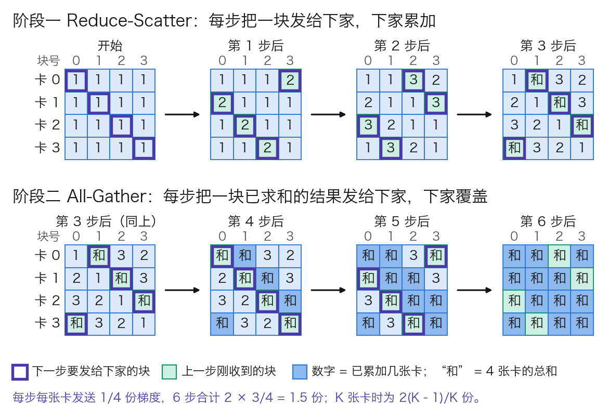
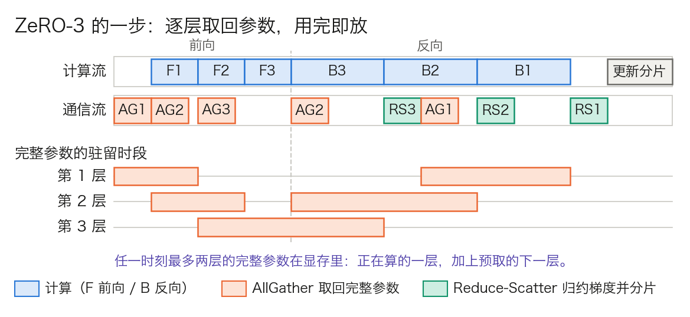
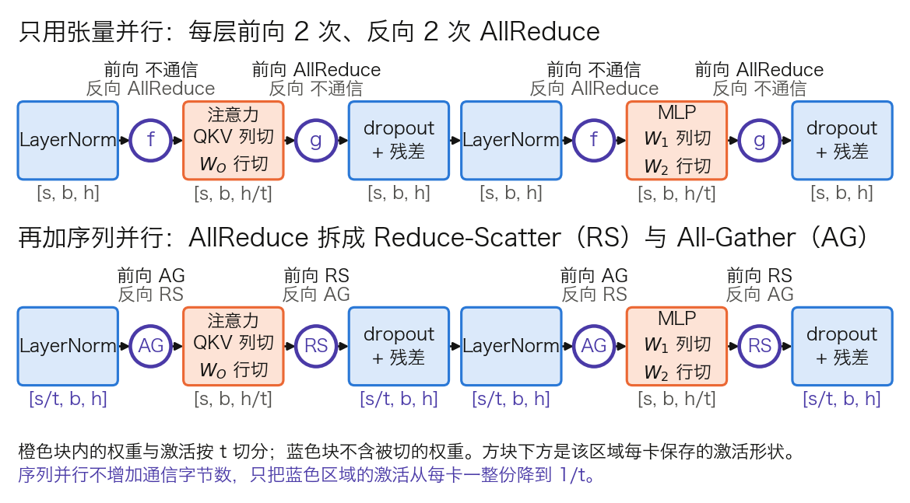
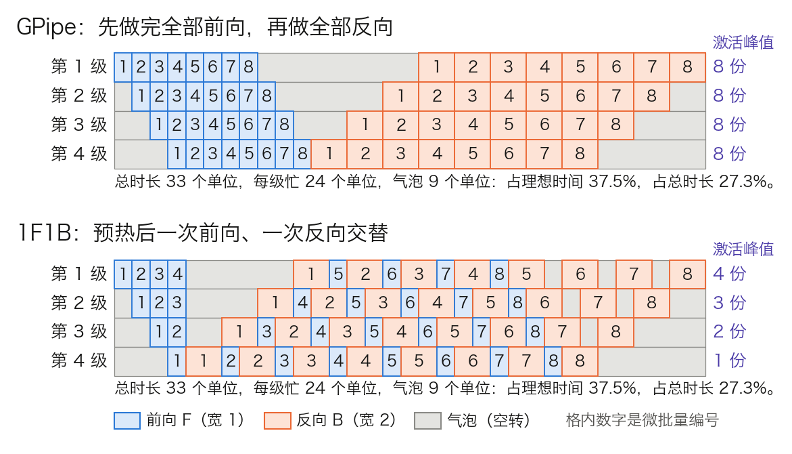
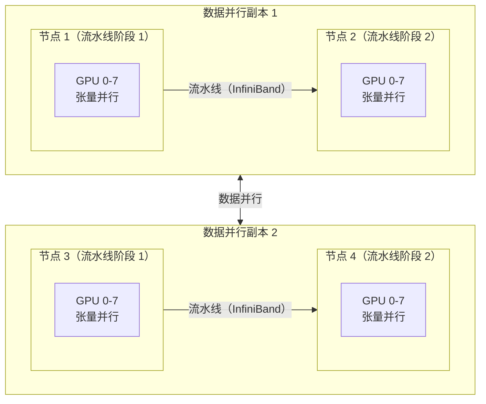
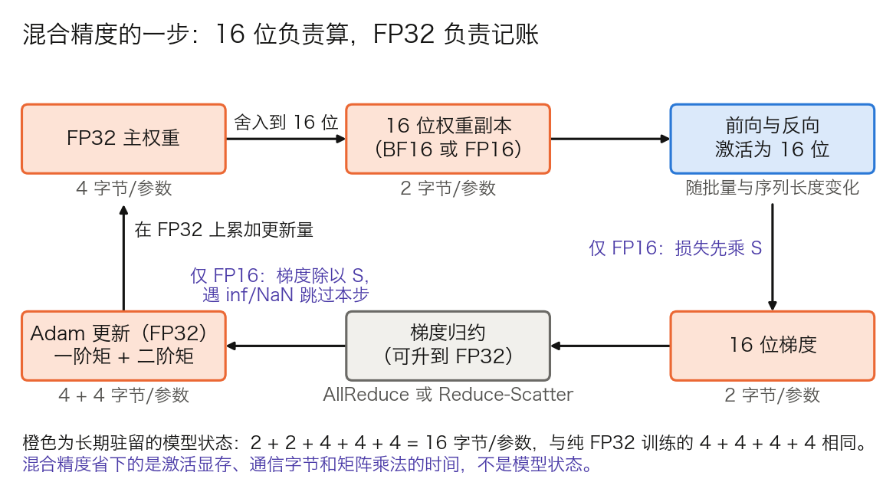
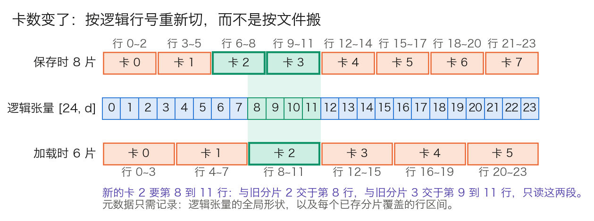

# 第七章：大规模分布式训练

当模型参数从数百万扩展到数千亿，单张 GPU 的显存和计算能力远远不够。大规模分布式训练是将 Transformer 从论文中的小模型变为拥有数千亿参数的大语言模型的关键工程技术。

本章系统介绍分布式训练的核心策略——数据并行、ZeRO 优化、张量并行、流水线并行、激活重计算、混合精度训练以及检查点管理与容错——解释每种技术解决的具体问题和背后的设计逻辑，沿着七个问题展开：

- [7.1 节](7.1_data_parallel.md)：梯度在多卡上取平均，凭什么等价于大批次训练？
- [7.2 节](7.2_zero.md)：模型状态在每张卡上复制一份，冗余怎么拆掉？
- [7.3 节](7.3_model_tensor_parallel.md)：把单层权重切到多卡，一层最少要几次通信？
- [7.4 节](7.4_pipeline_hybrid.md)：改成按层切分，流水线空转的气泡怎么摊薄？
- [7.5 节](7.5_activation_checkpointing.md)：激活值还是装不下，能不能不存、用时再算？
- [7.6 节](7.6_mixed_precision.md)：位宽减半就能提速，梯度下溢怎么办？
- [7.7 节](7.7_checkpoint.md)：重启时卡数变了，落盘的状态还拼得回来吗？

实践先完成 [A.6 的训练恢复实验](../appendix/a6_practice_path.md)，再按 [A.7](../appendix/a7_framework_recipes.md) 连接 DDP、FSDP2 与分布式框架。扩展卡数前，应先验证损失归一化、恢复状态和单卡基线。

## 1. 数据并行：为什么简单复制就能加速

**数据并行**（Data Parallelism，DP）在每张 GPU 上放一份完整的模型副本，各卡处理不同的数据，再把梯度同步成一份。本节回答三个问题：多卡平均出的梯度凭什么等于大批次的梯度，同步一次要传多少字节、花多少时间，以及这种做法在哪里到头。

本章各节共用一套算例，见表 7-1。模型配置沿用 [3.8 节](../03_components/3.8_gpt_inference_flow.md)的表 3-25，参数量由配置逐项算出；链路带宽取标称值，实际可用带宽更低，所得时间都是下界。

| 对象 | 取值 | 说明 |
| --- | --- | --- |
| Llama 3 8B | 参数量 Ψ = 80.3 亿，32 层，`d_model = 4096` | BF16 权重 16.06 GB |
| Llama 3 70B | 参数量 Ψ = 705.5 亿，80 层，`d_model = 8192` | BF16 权重 141.1 GB |
| 集群 | 64 个节点，每节点 8 张 80 GB 的 H100，共 512 卡 | 与 Llama 3 训练集群的节点形态相同 |
| 节点内链路 | 第四代 NVLink，每卡双向 900 GB/s，单向 450 GB/s | [NVIDIA H100 产品页](https://www.nvidia.com/en-us/data-center/h100/) |
| 节点间链路 | 每卡一个 400 Gb/s 端口，单向 50 GB/s | [Llama 3 论文](https://arxiv.org/abs/2407.21783)所述集群同为 400 Gb/s |
| 单卡实测算力 | 约 400 TFLOPs/s | Llama 3 论文表 4 报告 380 到 430 TFLOPs/s |

表 7-1：本章贯穿算例的模型与集群。Llama 3 的词表按发布权重的 128,256 行计，输入嵌入与输出投影各一份。每层 = Q/K/V/O 四个投影 + SwiGLU 三个矩阵 + 2 个 RMSNorm，末尾另有 1 个 RMSNorm；8B 每层 2.18 亿，70B 每层 8.56 亿。

### 1.1 基本流程

一步训练分五个动作：

1. 把全局批次切成 $K$ 份，$K$ 为数据并行的卡数。
2. 每张卡持有完整的参数、梯度和优化器状态。
3. 各卡用自己那份数据独立完成前向与反向，得到本地梯度。
4. 所有卡把梯度求平均，每张卡都拿到同一份平均梯度。
5. 各卡用这份梯度更新参数。初始参数相同、梯度相同，更新后的参数仍然逐位相同。

卡数增加有两种用法。每卡批量不变，全局批量随 $K$ 增大，称为弱扩展（weak scaling）。全局批量不变，每卡批量随 $K$ 减小，称为强扩展（strong scaling），单步变快而优化轨迹不变。两种用法的边界不同，见 7.1.6。

### 1.2 梯度平均为什么严格等价，何时不等价

**等价来自求导的线性。** 设全局批次 $B$ 被切成大小相等的 $K$ 份 $B_1,\dots,B_K$，损失取样本平均。求导与求和可以交换，所以

$$
\nabla_\theta \frac{1}{|B|}\sum_{x\in B}\ell(x)
= \frac{1}{K}\sum_{k=1}^{K}\nabla_\theta \frac{1}{|B_k|}\sum_{x\in B_k}\ell(x)
$$

等号两边是同一个数，不是期望意义上的近似。取 2 张卡、每卡 2 个样本，某个参数上的逐样本梯度为卡 0 的 `1, 3` 和卡 1 的 `5, −1`。各卡的均值是 `(1 + 3) ÷ 2 = 2` 和 `(5 − 1) ÷ 2 = 2`，卡间再平均得 2；4 个样本直接平均是 `(1 + 3 + 5 − 1) ÷ 4 = 2`。两种算法结果相同。

**前提是各卡的分母相等。** 语言模型的损失按有效词元取平均，变长序列和 padding 掩码会让各卡的有效词元数不同。设卡 0 有 100 个有效词元、损失和为 250，卡 1 有 300 个、损失和为 600：

- 先按卡平均再跨卡平均：`(250 ÷ 100 + 600 ÷ 300) ÷ 2 = (2.5 + 2.0) ÷ 2 = 2.25`。
- 按全局词元数平均：`(250 + 600) ÷ (100 + 300) = 2.125`。

两者相差 5.9%。前一种口径下，卡 0 每个词元的权重是 `1 ÷ (2 × 100)`，卡 1 是 `1 ÷ (2 × 300)`，短序列里的词元被放大了 3 倍。记录全局平均损失时，归约各卡的损失和与有效词元数，再相除。

反向传播还要考虑 DDP 默认会对梯度除以卡数 $K$。若 `local_loss_sum` 是本卡有效词元的损失和，`global_token_count` 是全部卡的有效词元总数，则本卡反传 `K * local_loss_sum / global_token_count`，让 DDP 的平均抵消前面的 $K$。只用全局词元数作分母会使最终梯度额外缩小 $K$ 倍。梯度累积时，分母覆盖整个累积窗口及所有卡；使用 Accelerate 等封装时还需核对框架是否已处理累积缩放，不能重复补偿，见[变长样本的梯度累积示例](https://huggingface.co/docs/accelerate/usage_guides/gradient_accumulation#gradient-accumulation-on-training-samples-of-variable-size)。

上述等价是精确算术下的结论。实际归约顺序会带来舍入差异；独立的 dropout 随机数也不保证与单卡逐值一致，做一步更新的数值对照时应先关闭 dropout。梯度裁剪应在同步之后执行，BatchNorm 一类依赖批统计量的层还要另行处理。Transformer 的 LayerNorm 和 RMSNorm 逐位置归一化，不依赖跨样本统计量。

### 1.3 Ring AllReduce：一步步怎么传

第 4 步的“求平均”由集合通信 **AllReduce** 完成：每张卡交出一份数据，每张卡都拿回全体之和。设每卡的梯度共 $M$ 字节。

**朴素做法的瓶颈在中心。** 参数服务器（parameter server）让 $K$ 张卡都把梯度发给一个中心节点，中心求和后再发回。每个工作节点收发各 $M$，中心节点却要收 $KM$、发 $KM$。Llama 3 8B 的 BF16 梯度是 `2 × 80.3 亿 = 16.06 GB`，64 张卡时中心要搬 `2 × 64 × 16.06 ≈ 2,056 GB`，它的网口就是全局的上限。

**环形算法把负载摊平。** Ring AllReduce 把 $K$ 张卡排成环，每张卡只发给下家、只收上家，梯度切成 $K$ 块。图 7-1 以 4 张卡演示两个阶段。

图 7-1：4 张卡上的 Ring AllReduce（[生成脚本](https://github.com/yeasy/llm_internals/blob/main/tools/figures/ch07_ring_allreduce.py)）。每个方阵是一个时刻的全局状态，行是卡，列是梯度的块；数字表示这一块已累加几张卡的贡献。

- **阶段一，Reduce-Scatter。** 第 1 步，卡 $i$ 把自己的第 $i$ 块发给下家，下家加到自己的同一块上。此后每一步，各卡把上一步刚累加好的那一块继续往下传。$K-1$ 步后，每张卡上恰有一块累加了全部 $K$ 张卡，图中卡 $i$ 持有的是第 $i+1$ 块的总和。
- **阶段二，All-Gather。** 各卡把手里那块已求和的结果发给下家，下家直接覆盖。再过 $K-1$ 步，每张卡都有了全部 $K$ 块的总和。

每一步每张卡只发 $M/K$ 字节，两个阶段共 $2(K-1)$ 步，所以

$$
\text{每卡发送量} = 2\cdot\frac{K-1}{K}\cdot M
$$

`K = 4` 时是 `2 × 3/4 = 1.5` 份梯度；$K$ 增大时趋近 $2M$，与卡数无关。任何一条链路上的流量都相同，没有中心瓶颈。

这条恒等式后面各节反复用到：

$$
\text{AllReduce} = \text{Reduce-Scatter} + \text{All-Gather}
$$

Reduce-Scatter 结束时，每张卡只持有 $1/K$ 份求和完毕的梯度。[7.2 节](7.2_zero.md)的 ZeRO 就停在这一步：每卡只更新自己那 $1/K$ 的参数，后半程的 All-Gather 改为传更新后的参数，字节数不变而显存省下大半。[7.3 节](7.3_model_tensor_parallel.md)的序列并行把一次 AllReduce 拆成同样的两步，换来的主要是激活显存。

字节数相同不等于耗时相同。[Megatron 的论文实测指出](https://arxiv.org/abs/2205.05198)，搬运的数据量一样时，Reduce-Scatter 与 All-Gather 分两次执行仍慢于一次 AllReduce。原因是每次集合通信各有一份启动开销和同步点，这正是下一小节延迟项的内容。

### 1.4 通信要花多少时间：α–β 模型

只比字节数无法判断通信是不是瓶颈，要换算成时间。常用的 **α–β 模型**把一次点对点发送的耗时写成两项：固定开销 $\alpha$（内核启动、各卡对齐、链路延迟），加上字节数除以带宽 $B$。环形 AllReduce 有 $2(K-1)$ 步，每步发 $M/K$ 字节：

$$
T_{\text{ring}} = \underbrace{2(K-1)\,\alpha}_{\text{延迟项}} + \underbrace{2\cdot\frac{K-1}{K}\cdot\frac{M}{B}}_{\text{带宽项}}
$$

**代入 Llama 3 8B。** 梯度 `M = 16.06 GB`，64 张卡跨节点同步，瓶颈链路是单向 50 GB/s 的网口。每卡发送 `2 × 63/64 × 16.06 = 31.62 GB`，带宽项为 `31.62 ÷ 50 ≈ 0.63 s`。Llama 3 论文称其网络延迟可达几十微秒，这里取 `α = 20 μs` 作示意，延迟项是 `2 × 63 × 20 μs ≈ 2.5 ms`，可以忽略。

这 0.63 s 要与计算时间比。每卡每步处理 4 条 8,192 词元的序列，共 32,768 个词元，按 [3.7 节](../03_components/3.7_full_architecture.md)的 $6ND$ 估算，计算量为 `6 × 80.3 亿 × 32,768 ≈ 1.58 × 10¹⁵` 次。单卡按 400 TFLOPs/s 计，需 3.95 s。通信若排在计算之后串行执行，每步多出 `0.63 ÷ 3.95 ≈ 16%`。

表 7-2 把两项在不同卡数和消息大小下并列。

| 场景 | 延迟项 $2(K-1)\alpha$ | 带宽项 | 谁占主导 |
| --- | ---: | ---: | --- |
| `K = 64`，整份梯度 16.06 GB | 2.5 ms | 632 ms | 带宽 |
| `K = 64`，一个 25 MiB 的桶 | 2.5 ms | 1.0 ms | 延迟 |
| `K = 1,024`，整份梯度 | 40.9 ms | 642 ms | 带宽 |
| `K = 1,024`，一个 25 MiB 的桶 | 40.9 ms | 1.0 ms | 延迟 |

表 7-2：环形 AllReduce 的两项耗时，`α = 20 μs`（示意值），`B = 50 GB/s`。带宽项几乎不随 $K$ 变，延迟项随 $K$ 线性增长。

由此读出两点。第一，带宽项与卡数无关，这是数据并行能扩到上千张卡的原因。第二，延迟项随 $K$ 线性增长，消息越小越吃亏：1,024 张卡时，一个 25 MiB 的桶有 97% 的时间花在延迟上。通信库因此不只用环形算法。NCCL 的 [`NCCL_ALGO` 环境变量](https://docs.nvidia.com/deeplearning/nccl/user-guide/docs/env.html)列出 Ring、Tree 等多种算法，默认按拓扑自动选择；树形算法的步数随 $\log K$ 增长，适合大规模下的小消息。推理侧的同一笔账见 [11.8 节](../11_serving/11.8_multi_gpu_inference.md)。

### 1.5 DDP 的实现：装桶、重叠与 no_sync

PyTorch 的 **DistributedDataParallel**（DDP）是最常用的数据并行实现。它的三个机制都可以用上一小节的公式解释，细节见 [PyTorch Distributed 论文](https://arxiv.org/abs/2006.15704)。

**梯度装桶（bucketing）。** 逐个参数做 AllReduce 会产生成百上千条小消息，每条都付一次延迟项。DDP 把参数按 `model.parameters()` 的逆序装进若干个桶，逆序近似于反向传播中梯度就绪的顺序。桶的大小由 `bucket_cap_mb` 控制，[文档](https://docs.pytorch.org/docs/stable/generated/torch.nn.parallel.DistributedDataParallel.html)给出的默认值是 25 MiB；16.06 GB 的梯度约合 613 个桶。桶太小，延迟项占主导；桶太大，要等很多层的梯度算完才能发，重叠的机会变少。

**计算与通信重叠。** DDP 给每个参数的梯度累加器注册一个 autograd hook。某个桶里的梯度全部就绪，就立刻对这个桶发起异步 AllReduce，此时反向传播还在计算更靠近输入的层。反向约占一步计算的三分之二，即 `3.95 × 2/3 ≈ 2.6 s`，上面串行执行的 0.63 s 大部分可以藏在这段时间里。Megatron 的论文也提到，高效的重叠几乎可以完全消除数据并行带来的迭代时间增长。

**梯度累积要关同步。** 一步由多个微批量累积而成时，只有最后一个微批量需要同步。`no_sync()` 上下文管理器让其内部的反向只在本地累加梯度，退出后的第一次反向再统一同步。不加它，每个微批量都做一次完整的 AllReduce，通信量翻成累积步数倍。

另有两个参数与正确性和显存有关。`find_unused_parameters=True` 让 DDP 每步遍历 autograd 图，找出本步不产生梯度的参数并提前标记就绪，否则含条件分支的模型会卡在等待上；代价是每步多一次图遍历。`gradient_as_bucket_view=True` 让梯度张量直接成为桶的视图，省掉一份与梯度等大的拷贝。

### 1.6 局限：同步语义、临界批量、慢节点与显存

**为什么同步而不是异步。** 异步 SGD 让各卡算完就更新，不等别人。它没有同步点，代价是梯度基于过时的参数算出，卡数越多越陈旧，收敛性要重新论证。同步数据并行在数学上就是大批次训练，超参数和收敛结论可以直接沿用，大模型训练因此几乎都采用同步方式。

**弱扩展受临界批量限制。** 全局批量越过临界批量后，再加卡换不来收敛速度，见 [6.4 节](../06_training_techniques/6.4_batch_sequence.md)。

**强扩展受通信占比限制。** 全局批量固定时，每卡的计算量随 $K$ 减小，通信的带宽项却不变。上例若把每卡批量从 4 条减到 1 条，计算降到约 1 s，通信仍是 0.63 s，重叠也藏不住了。

**慢节点拖慢全体。** AllReduce 是同步点，一步的耗时由最慢的那张卡决定。一张卡降频、一条链路丢包，所有卡一起等。

**显存是最硬的上限。** 每张卡都要装下完整的模型状态。混合精度 Adam 训练下每个参数占 16 字节：BF16 参数 2、BF16 梯度 2、FP32 主权重 4、Adam 一阶矩与二阶矩各 4，见 [7.6 节](7.6_mixed_precision.md)。Llama 3 8B 是 `16 × 80.3 亿 ≈ 128.5 GB`，已超过 80 GB；Llama 3 70B 是 `16 × 705.5 亿 ≈ 1,129 GB`。这还没有算激活。纯数据并行连 8B 的模型都放不下，而这 128.5 GB 在每张卡上是一模一样的。

## 2. ZeRO 优化：如何突破单卡显存限制

**ZeRO**（Zero Redundancy Optimizer）由 Microsoft DeepSpeed 团队在 [ZeRO 论文](https://arxiv.org/abs/1910.02054)中提出，用来消除数据并行里的显存冗余。7.1 末尾算出的 128.5 GB 放不进一张卡，问题不在它大，而在每张数据并行卡上都有一模一样的一份。7.1.3 的恒等式 AllReduce = Reduce-Scatter + All-Gather 已经给出了拆掉冗余的入口。本节依次回答：冗余有多少，三个阶段各省了什么、多了什么通信，一步训练里参数何时取回、何时释放，以及什么情况下不该全分片。

### 2.1 冗余分析

标准数据并行中，每张卡都存着完整的**模型状态**：参数、梯度和优化器状态。冗余不在于“每张卡只需要自己数据的梯度”，每个 rank 逻辑上仍要参与完整模型的梯度同步；浪费的是这些状态在每个副本上都完整复制了一份。ZeRO 把它们按数据并行的 rank 分片保存，同时保持与数据并行等价的更新语义。

以 ZeRO 论文使用的 15 亿参数模型（GPT-2 规模）为例，混合精度训练加 Adam 优化器：

| 组成部分 | 大小 | 说明 |
| --- | --- | --- |
| FP16 参数 | 3 GB | $1.5 \times 10^{9} \times 2$ 字节 |
| FP16 梯度 | 3 GB | 与参数同大小 |
| FP32 优化器状态 | 18 GB | 主权重、一阶矩、二阶矩各 4 字节，共 12 字节/参数 |
| 总计 | 24 GB | 每张卡一份，16 字节/参数 |

表 7-3：15 亿参数模型在每张卡上的模型状态。

64 张卡做数据并行时，这 24 GB 在每张卡上各有一份。总计 1,536 GB 的显存中只有 24 GB 是唯一状态，其余 1,512 GB（63/64）都是冗余拷贝。

表 7-4 固定参数 3 GB、梯度 3 GB、优化器状态 18 GB，按 $K=64$ 逐项分片。它只核算持久的模型状态，不含激活、临时的 AllGather 缓冲、通信工作区和碎片。

<!-- numeric-claim: zero-partitions -->
| 方案 | 参数 GB | 梯度 GB | 优化器 GB | 数据并行 K | 单卡模型状态 GB | 相对 DDP |
| --- | ---: | ---: | ---: | ---: | ---: | ---: |
| DDP | 3 | 3 | 18 | 64 | 24.000000 | 1.00 |
| ZeRO-1 | 3 | 3 | 18 | 64 | 6.281250 | 3.82 |
| ZeRO-2 | 3 | 3 | 18 | 64 | 3.328125 | 7.21 |
| ZeRO-3 | 3 | 3 | 18 | 64 | 0.375000 | 64.00 |

表 7-4：64 路数据并行下的模型状态分片重算。ZeRO-1 为 $P+G+O/K$，ZeRO-2 为 $P+(G+O)/K$，ZeRO-3 为 $(P+G+O)/K$；“相对 DDP”是 $24\,/\,\text{单卡模型状态}$，不是端到端吞吐倍数。

### 2.2 三个阶段：各省了什么，多了什么通信

设参数量为 Ψ，每参数 16 字节拆成参数 2、梯度 2、优化器状态 12。三个阶段依次把最大的一项先分掉。

**ZeRO-1，优化器状态分片。** 每张卡只保留 $1/K$ 的优化器状态，负责更新对应的那 $1/K$ 参数。一步的流程是：反向结束后照常归约梯度；各卡用自己负责的那段梯度更新自己的主权重分片；再用一次 All-Gather 把更新后的 16 位参数收齐。每卡模型状态为 $4\Psi + 12\Psi/K$。

**ZeRO-2，再分梯度。** 梯度的归约从 AllReduce 改为 Reduce-Scatter：每张卡只留下自己负责的那段已求和的梯度，其余算完即丢。每卡模型状态为 $2\Psi + 14\Psi/K$。

**ZeRO-3，再分参数。** 每张卡只存 $1/K$ 的参数。前向和反向算到某一层时，用 All-Gather 临时取回这一层的完整参数，用完释放。每卡模型状态为 $16\Psi/K$，随卡数线性下降。

ZeRO 论文给出的“4 倍、8 倍”是 $K$ 很大时的极限：`16 ÷ 4 = 4`，`16 ÷ 2 = 8`。`K = 64` 时的实际值是 `16 ÷ (4 + 12/64) = 3.82` 和 `16 ÷ (2 + 14/64) = 7.21`，与表 7-4 的最后一列一致。

**通信量怎么来的。** 沿用 7.1.3 的结论，一次 Reduce-Scatter 或 All-Gather 每卡约发送一份数据，AllReduce 是两份。以参数个数为单位：

| 方案 | 一步里的集合通信 | 每卡通信量 | 相对 DDP |
| --- | --- | ---: | ---: |
| DDP | 梯度 AllReduce = Reduce-Scatter + All-Gather | 2Ψ | 1× |
| ZeRO-1 | 梯度归约，再 All-Gather 更新后的参数 | 2Ψ | 1× |
| ZeRO-2 | 梯度 Reduce-Scatter，再 All-Gather 更新后的参数 | 2Ψ | 1× |
| ZeRO-3 | 前向 All-Gather 参数，反向再 All-Gather 一次，梯度 Reduce-Scatter | 3Ψ | 1.5× |

表 7-5：各方案每步的通信量，取自 ZeRO 论文第 7 节的分析；系数 $(K-1)/K$ 从略。ZeRO-1 的梯度归约在实现上可用 AllReduce，也可用 Reduce-Scatter（DeepSpeed 的 `reduce_scatter` 选项默认开启），表中按后者计。

ZeRO-1 和 ZeRO-2 的通信量与 DDP 相同，原因就是那条恒等式：DDP 的 All-Gather 传的是求和后的梯度，ZeRO 把它换成传更新后的参数，字节数一样。计算与通信的重叠影响的是耗时，不改变字节数。ZeRO-3 多出的 Ψ 来自反向前的第二次 All-Gather。

### 2.3 ZeRO-3 的一步：逐层取回，用完即放

ZeRO-3 不会一次取回整个模型，否则峰值显存与不分片无异。参数按**分片单元**成组收发，通常一个 Transformer 层是一个单元。图 7-2 画出 3 层模型在一张卡上的一步。

图 7-2：ZeRO-3 的一步（[生成脚本](https://github.com/yeasy/llm_internals/blob/main/tools/figures/ch07_zero3_timeline.py)）。AG 是取回某层完整参数的 All-Gather，RS 是归约某层梯度的 Reduce-Scatter；时长为示意值。第 3 层前向后紧接反向，图中不重新分片、反向前不再取回；表 7-5 的 3Ψ 按每层都重新分片计。FSDP2 对根单元的默认值正是 `reshard_after_forward=False`，理由相同，见 7.2.7。

- **前向。** 算第 ℓ 层之前，All-Gather 取回该层参数；计算第 ℓ 层的同时，通信流预取第 ℓ+1 层；第 ℓ 层算完，释放它的完整参数，只留本卡分片。
- **反向。** 顺序反过来。算第 ℓ 层的反向之前再取回一次参数；算完得到该层的完整梯度，用 Reduce-Scatter 求和并只留本卡那一段，随后释放参数和完整梯度。
- **更新。** 每张卡用自己那段梯度，更新自己那段主权重和优化器状态。这一步没有通信。

预取让通信与计算重叠。重叠成立的条件是取回一层参数的时间不长于计算一层的时间，7.2.5 用数字检验这一点。

**峰值显存不只是分片。** 任一时刻，显存里除了 $16\Psi/K$ 的持久分片，还有正在计算的那个单元的完整参数，加上预取的下一个单元。分片单元越大，这一项越高：把整个模型当成一个单元，ZeRO-3 就退化成每步先拼出完整参数，峰值里多出一整份 2Ψ。

### 2.4 算例：Llama 3 70B 在 64、128、512 卡下

Llama 3 70B 的模型状态是 `16 × 705.5 亿 ≈ 1,128.9 GB`，其中参数 141.1 GB、梯度 141.1 GB、优化器状态 846.6 GB。

| 数据并行 K | ZeRO-1 | ZeRO-2 | ZeRO-3 |
| ---: | ---: | ---: | ---: |
| 64 | 295.4 GB | 156.5 GB | 17.64 GB |
| 128 | 288.8 GB | 148.8 GB | 8.82 GB |
| 512 | 283.9 GB | 143.0 GB | 2.20 GB |

表 7-6：Llama 3 70B 每卡的持久模型状态，公式同表 7-4。

ZeRO-1 和 ZeRO-2 的每卡占用不会低于完整的 16 位参数 141.1 GB，卡再多也放不进 80 GB。70B 的模型要么用 ZeRO-3，要么先用 7.3、7.4 节的模型并行把参数切开，再在数据并行维度上叠 ZeRO-1。

ZeRO-3 的峰值还要加未分片的单元。Llama 3 70B 每层 8.56 亿参数，BF16 下一层是 1.71 GB。`K = 64`、每层一个单元时，峰值约为 `17.64 + 2 × 1.71 ≈ 21.1 GB`，余下的显存留给激活。若整个模型只包成一个单元，峰值约为 `17.64 + 141.1 ≈ 158.7 GB`，分片失去意义。

### 2.5 什么时候不该全分片

**All-Gather 在关键路径上。** DDP 的梯度同步可以整个藏在反向后面；ZeRO-3 的参数没取回来，这一层就不能开始算。64 张卡跨节点时，取回一层要收 `63/64 × 1.71 ≈ 1.68 GB`，按 50 GB/s 需 34 ms。一层的前向按“2 × 参数量 × 词元数”估算，每卡 1 条 8,192 词元的序列时是 `2 × 8.56 亿 × 8,192 ≈ 1.4 × 10¹³` 次，约 35 ms。两者相当，预取刚好能盖住；每卡批量再小，或链路再慢，计算就要停下来等参数。同样的 All-Gather 走 NVLink 只要 3.7 ms。

这给出三条边界：

- 分片组跨过慢速链路、每卡批量又小时，ZeRO-3 的吞吐会明显下降。对策是只在节点内分片、节点间复制，即下文的 HSDP。
- ZeRO 不减少激活显存。激活随批量和序列长度增长，要靠 [7.5 节](7.5_activation_checkpointing.md)的重计算与 7.3 节的序列并行。
- 梯度累积时，ZeRO-2 和 ZeRO-3 每个微批量都要做一次 Reduce-Scatter，因为完整梯度不落地；ZeRO-1 和 DDP 可以累积到最后一个微批量再同步。

### 2.6 卸载到 CPU 与 NVMe

显存仍不够时，还可以把模型状态搬出 GPU。[ZeRO-Offload](https://arxiv.org/abs/2101.06840) 把梯度、FP32 主权重和优化器状态放到主机内存，Adam 更新由 CPU 执行，GPU 上只留 16 位参数和前向、反向计算。论文按数据流图论证了这种切法的通信量最小：GPU 与 CPU 之间每步只传 16 位梯度和 16 位参数。它报告可在单张 V100 上训练 130 亿参数的模型。[ZeRO-Infinity](https://arxiv.org/abs/2104.07857) 进一步把参数和优化器状态卸到 NVMe。

代价是每步都经过 PCIe 和 CPU，吞吐低于纯 GPU 方案；它解决的是“卡少也要能跑”，不是“卡多要跑得快”。DeepSpeed 中对应的配置项是 `offload_optimizer` 和 `offload_param`，后者只在 stage 3 下有效。激活的卸载是另一回事，见 7.5.5。

### 2.7 实现：DeepSpeed 配置与 FSDP

DeepSpeed 用 `zero_optimization.stage` 选阶段，0 到 3 分别是关闭、分优化器状态、再分梯度、再分参数。几个常调的参数都对应上文的机制，名称与默认值见其[配置文档](https://www.deepspeed.ai/docs/config-json/)：

- `overlap_comm`：梯度归约是否与反向计算重叠。
- `reduce_bucket_size`：一次归约的元素数，作用与 DDP 的桶相同。
- `stage3_prefetch_bucket_size`：参数预取缓冲的大小，调小省显存，但计算更容易等通信。
- `stage3_max_live_parameters`：每卡同时驻留的完整参数上限，就是 7.2.3 峰值公式里的第二项。

PyTorch 原生的 **FSDP**（Fully Sharded Data Parallel）实现了同一套全分片思路，设计与取舍见 [PyTorch FSDP 论文](https://arxiv.org/abs/2304.11277)；7.7 节讲分片检查点时还会用到它。

#### FSDP2：从“拍平成一维”到“逐参数分片”

FSDP 自身演进过一轮，动机不在显存，而在可组合性。第一代 FSDP 把一组参数拍平（flatten）成一个一维缓冲区再切分。这对通信高效，但原来的参数在实现里已经不存在，任何按参数区别对待的需求都变得别扭：给某几个参数单独设混合精度、只量化一部分权重、冻结其中一些，或者导出按参数组织的状态字典。

第二代实现 `fully_shard`（FSDP2）改用 **DTensor 逐参数分片**，[官方文档](https://docs.pytorch.org/docs/stable/distributed.fsdp.fully_shard.html)称其面向高性能的 eager 模式，并用逐参数分片改善易用性。每个参数沿第 0 维切给各卡。初始化时 `model.parameters()` 原地从 `torch.Tensor` 转成 `DTensor`；前向和反向之前由 pre-hook 负责 All-Gather 并转回普通张量，之后由 post-hook 释放未分片的参数。参数始终保留自己的身份，切分信息记在 DTensor 的 placement 里。

三个接口细节值得对照上文：

- **分片单元由调用方式决定。** 每调用一次 `fully_shard(module)` 就形成一个通信组，组内参数用一次 All-Gather 取回。文档要求自底向上逐层调用，不要只包最外层，理由就是 7.2.3 的峰值公式。
- **`reshard_after_forward`。** 取 `True` 是标准的 ZeRO-3；取 `False` 则前向之后不释放，省掉反向的 All-Gather，显存多占一份参数，通信量回到 2Ψ。文档对根单元默认取 `False`，因为反向一开始就要用到它。Llama 3 405B 取的就是这一档：[论文](https://arxiv.org/abs/2407.21783)说明其 FSDP 分片了优化器状态和梯度，但前向之后不重新分片参数，省掉反向的那次 All-Gather。取整数则前向之后重分片到更小的组，例如节点内的 8 张卡。
- **`MixedPrecisionPolicy`。** `param_dtype` 决定 All-Gather 与计算用的精度，`reduce_dtype` 决定梯度归约的精度。FSDP 的分片参数本身保持高精度，兼作主权重，不必另存一份。

同一套 device mesh 抽象还表达出了 **HSDP**（Hybrid Sharded Data Parallel）。mesh 是 1D 时，参数在这一维上全分片，placement 为 `(Shard(0),)`；mesh 是 2D 时，参数在第 1 维分片、在第 0 维复制，placement 为 `(Replicate(), Shard(0))`。这就是“节点内分片、节点间复制”：All-Gather 只走 NVLink，节点间只剩每步一次、可与反向重叠的梯度归约。代价是每卡的持久分片从 $16\Psi/K$ 升到 $16\Psi/8$，70B 的模型是 141 GB，仍放不下；HSDP 适合单节点装得下分片、只是跨节点全分片太慢的模型。

从 ZeRO 论文到 FSDP2，分片的数学没有变，变的是分片怎样表达。这个表达方式决定了它能否与量化、混合精度和张量并行叠在一起，而张量并行要切的是 ZeRO 没有碰的东西：一层之内的计算和激活。

## 3. 模型并行与张量并行：把一层切到多张卡上

**模型并行**（Model Parallelism）把模型本身切到多张卡上，每张卡只算其中一部分。7.2 的 ZeRO 分掉了模型状态，却留下两件事没有动：每张卡仍要独自算完每一层，也仍要独自存下每一层的激活；数据并行度又受临界批量限制，不能无限加大。本节讲按层内切分的**张量并行**（Tensor Parallelism，TP），回答怎样切才能让结果与单卡逐位相同，一层最少要通信几次，每次多少字节，以及为什么它通常走不出一个节点。按层间切分的流水线并行留给 [7.4 节](7.4_pipeline_hybrid.md)。

本节沿用 Megatron 论文的记号：微批量大小 $b$，序列长度 $s$，隐藏维度 $h$，张量并行度 $t$。三者依次对应 3.8 节表 3-28 的 `B`、`T`、`d_model`，形状括号里也一律写作 $s$、$b$、$h$。

### 3.1 为什么要切层内的权重

层内切分的思路更早见于 [Mesh-TensorFlow](https://arxiv.org/abs/1811.02084)，它允许沿任意张量维度切分。[Megatron-LM](https://arxiv.org/abs/1909.08053) 的贡献是给出 Transformer 上的一种具体切法：每个子层的前向只需一次 AllReduce，且几行代码就能实现。

与 ZeRO-3 对比可以看清张量并行切的是什么。ZeRO-3 切的是存储：参数平时分片存放，计算前拼回完整的矩阵，每张卡做的仍是完整的 `X × W`。张量并行切的是计算：每张卡只持有 `W` 的一片，只做 `X × W` 的一部分，中间激活也只有一部分。所以它同时减少每卡的参数、计算量和大部分激活，也不会增大全局批量。代价是通信进入了每一层的关键路径，7.3.5 给出这笔账。

### 3.2 列切与行切：一个两卡手算例

**要解决的问题。** 线性层 `Y = XW` 怎样分给 $t$ 张卡，使各卡只存 `W` 的 $1/t$，合起来的结果与单卡相同。有两种切法：

- **列切**（column parallel）：`W` 按列分成 $t$ 块，每张卡都拿完整的 `X`，算出结果的一段列。形状为 `X[s, h] × W⁽ⁱ⁾[h, h′/t] → Y⁽ⁱ⁾[s, h′/t]`，各卡结果左右拼接即为 `Y`。
- **行切**（row parallel）：`W` 按行分成 $t$ 块，输入也相应按列分成 $t$ 段。形状为 `X⁽ⁱ⁾[s, h′/t] × W⁽ⁱ⁾[h′/t, h] → Y⁽ⁱ⁾[s, h]`，各卡结果逐格相加即为 `Y`。

单独用任何一种，每个线性层后都要通信一次。MLP 由两个线性层夹一个逐格激活组成，把第一个列切、第二个行切，列切的输出恰好是行切需要的输入，中间不必通信。

**代入数字。** 取 `X[1, 2]`、`W_1[2, 4]`、逐格 ReLU、`W_2[4, 2]`，两张卡：

$$
X = [2,\ 1],\quad
W_1 = \begin{bmatrix} 1 & 0 & -1 & 2 \\ 0 & 1 & 1 & -1 \end{bmatrix},\quad
W_2 = \begin{bmatrix} 1 & 0 \\ 2 & 1 \\ 0 & 1 \\ 1 & -1 \end{bmatrix}
$$

单卡：`X × W_1 = [2, 1, −1, 3]`，ReLU 后为 `[2, 1, 0, 3]`，乘 `W_2` 得 `[2 + 2 + 0 + 3, 0 + 1 + 0 − 3] = [7, −2]`。

两卡：卡 0 持有 `W_1` 的前两列和 `W_2` 的前两行，卡 1 持有其余。

- 卡 0：`X × W_1` 的前两列得 `[2, 1]`，ReLU 不变，乘 `W_2` 的前两行得 `[2 + 2, 0 + 1] = [4, 1]`。
- 卡 1：`X × W_1` 的后两列得 `[−1, 3]`，ReLU 后为 `[0, 3]`，乘 `W_2` 的后两行得 `[0 + 3, 0 − 3] = [3, −3]`。
- AllReduce 求和：`[4 + 3, 1 − 3] = [7, −2]`，与单卡逐数相同。

**为什么必须先列后行。** 反过来先行切 `W_1`，卡 0 拿 `X` 的第 1 维和 `W_1` 的第 1 行，得 `[2, 0, −2, 4]`；卡 1 得 `[0, 1, 1, −1]`。两者要先相加才是真正的中间结果。若各自先过 ReLU 再相加，得 `[2, 0, 0, 4] + [0, 1, 1, 0] = [2, 1, 1, 4]`，而正确值是 `ReLU([2, 1, −1, 3]) = [2, 1, 0, 3]`，第 3、4 格出错。逐格非线性不能拆到部分和上，激活之前就得多通信一次。推理侧直接用这条结论，其形状与 all-reduce 的位置见 [11.8.2](../11_serving/11.8_multi_gpu_inference.md)。

### 3.3 反向传播与 f、g 算子：每层 4 次 AllReduce

前向的通信在子层末尾，反向的通信在子层开头。原因是列切时每张卡都用了完整的 `X`，`X` 的梯度是各卡贡献之和。

接着上例，设输出的梯度为 `dY = [1, −1]`。单卡反向：`dY × W_2ᵀ = [1, 1, −1, 2]`，ReLU 的导数在中间结果为负的第 3 格取 0，得 `[1, 1, 0, 2]`，再乘 `W_1ᵀ` 得 `dX = [1 + 0 + 0 + 4, 0 + 1 + 0 − 2] = [5, −1]`。两卡反向：行切层的每张卡都收到完整的 `dY`，不必通信；卡 0 算出自己那一路的 `[1, 1]`，乘 `W_1` 前两列的转置得 `[1, 1]`；卡 1 算出 `[0, 2]`，乘后两列的转置得 `[4, −2]`。两者相加得 `[5, −1]`，这一次相加就是反向的 AllReduce。

Megatron-LM 把这两处通信封装成一对共轭算子：

- **f**：前向恒等，反向 AllReduce。放在子层入口，即列切层之前。
- **g**：前向 AllReduce，反向恒等。放在子层出口，即行切层之后。

源码中它们是 `megatron/core/tensor_parallel/mappings.py` 里的两个 `torch.autograd.Function`：`_CopyToModelParallelRegion` 的 `forward` 直接返回输入、`backward` 调用 `_reduce`；`_ReduceFromModelParallelRegion` 反之。一层有注意力和 MLP 两个子层，所以前向 2 次、反向 2 次，共 4 次 AllReduce。图 7-3 的上半幅标出了它们的位置。

### 3.4 注意力、SwiGLU、嵌入与 LM head 怎么切

**注意力按头切。** 各头之间本来就独立。Q、K、V 投影列切，等价于把头分给各卡；输出投影 `W_O` 行切，末尾一次 AllReduce。以 Llama 3 70B、`t = 8` 为例，每张卡分到 64 个 Query 头中的 8 个和 8 个 K/V 头中的 1 个：

- `X[s, 8192] × W_Q⁽ⁱ⁾[8192, 1024] → Q⁽ⁱ⁾[s, 1024]`
- `X[s, 8192] × W_K⁽ⁱ⁾[8192, 128] → K⁽ⁱ⁾[s, 128]`，V 同形
- 本卡 8 个头各自做注意力，拼接为 `[s, 1024]`
- `[s, 1024] × W_O⁽ⁱ⁾[1024, 8192] → [s, 8192]`，各卡相加

由此得到两条约束：头数 `n_h` 必须被 $t$ 整除；GQA 下 K/V 头数 `n_kv` 小于 $t$ 时，K/V 头要在卡间复制。Llama 3 各规模的 `n_kv` 都是 8，`t = 8` 是不复制 K/V 的上限。

**SwiGLU 的两个上投影同为列切。** gate 与 up 两个矩阵都是 `[8192, 28672]`，每卡各持 `[8192, 3584]`，逐格相乘在分片上完成；down 矩阵行切为 `[3584, 8192]`。中间维也要被 $t$ 整除。

**嵌入与 LM head 按词表切。** 嵌入表 `[128256, 8192]` 沿词表维分给 8 张卡，每卡 `[16032, 8192]`；查表时不属于本卡的词元得到零向量，AllReduce 后拼齐。LM head 的输出 logits 是 `[s, 128256]`，`s = 8192` 时 BF16 下为 2.10 GB，升到 FP32 算交叉熵是 4.20 GB。把它 All-Gather 到每张卡上是浪费。Megatron 的 `VocabParallelCrossEntropy` 直接在分片的 logits 上算损失，每卡只保留 1/8，只需归约每个位置的最大值、目标词元的 logit 和指数和这几个标量。

### 3.5 通信账：每层多少字节，节点内外各多少时间

**每次 AllReduce 的消息是一份激活。** 形状 `[s, b, h]`，BF16 下 $2sbh$ 字节。按 7.1.3 的结论，每卡每次发送 $2\frac{t-1}{t}$ 份；每层 4 次，所以每层每卡每个微批量发送

$$
8\,\frac{t-1}{t}\,sbh \ \text{个元素}
$$

这与 [Megatron 论文](https://arxiv.org/abs/2104.04473)给出的 $8bsh\frac{t-1}{t}$ 一致。

**代入 Llama 3 70B，`b = 1`、`s = 8192`、`t = 8`。** 一份激活是 `8192 × 8192 × 2 ≈ 134.2 MB`。一次 AllReduce 每卡发送 `2 × 7/8 × 134.2 ≈ 234.9 MB`，每层 4 次是 939.5 MB，80 层共 75.2 GB。

| 链路 | 单向带宽 | 75.2 GB 的耗时 | 相对一个微批量的计算 1.08 s |
| --- | ---: | ---: | ---: |
| 节点内 NVLink | 450 GB/s | 0.17 s | 15% |
| 节点间 400 Gb/s 网口 | 50 GB/s | 1.50 s | 139% |

表 7-7：张量并行在一个微批量上的通信耗时下界。计算时间按 `6 × 705.5 亿 × 8,192 ÷ (8 × 400 TFLOPs/s) ≈ 1.08 s` 估算；只算带宽项，未计延迟项。

带宽相差 9 倍，落到时间上，是“可以接受的 15%”与“通信比计算还长”的区别。与数据并行不同，这些 AllReduce 无处可藏：下一层的输入就是这次 AllReduce 的输出，没有独立的计算可以与之并行。数据并行每步通信一次，张量并行每个微批量、每一层都要通信。Megatron 论文的第一条经验因此是：张量并行度不超过单节点的卡数，更大的模型交给流水线并行。

### 3.6 序列并行：把剩下的激活也切掉

**张量并行没有切到的部分。** 表 7-8 列出一层之内哪些量被 $t$ 除。

| 对象 | 是否被 $t$ 除 | 说明 |
| --- | --- | --- |
| Q/K/V、`W_O`、MLP 各矩阵及其梯度、优化器状态 | 是 | 每层每卡约 `8.56 亿 ÷ 8 ≈ 1.07 亿`参数 |
| 子层内部的激活（Q、K、V、注意力输出、MLP 中间层） | 是 | 形状 `[s, b, h/t]` 或 `[s, b, 4h/t]` |
| LayerNorm 的输入、子层的输入、dropout 掩码、残差流 | 否 | 形状 `[s, b, h]`，每卡一整份 |
| 归一化层的参数 | 否 | 每层只有 `2 × 8192` 个，可忽略 |

表 7-8：张量并行下一层内各对象的分摊情况，以 Llama 3 70B、`t = 8` 为例。

按 [Megatron 的逐项清点](https://arxiv.org/abs/2205.05198)（7.5.1 详述），不被切的激活每层约 $10sbh$ 字节。上例中是 `10 × 8192 × 8192 ≈ 0.67 GB`，80 层合 53.7 GB，是 $t$ 无论取多大都省不掉的一项。

**做法。** LayerNorm 和 dropout 逐位置独立计算，可以沿序列维切分。**序列并行**（Sequence Parallelism，SP）让这些区域的每张卡只处理 $s/t$ 个位置，如图 7-3 的下半幅。

图 7-3：一层 Transformer 内张量并行的通信位置（上），以及叠加序列并行之后的变化（下）（[生成脚本](https://github.com/yeasy/llm_internals/blob/main/tools/figures/ch07_tp_sp_layer.py)）。方块下方是该区域每卡保存的激活形状。

进入注意力或 MLP 之前，各卡用 All-Gather 把 `[s/t, b, h]` 拼回 `[s, b, h]`；子层末尾原本的 AllReduce 改为 Reduce-Scatter，求和的同时沿序列维分给各卡。反向时两者互换。一次 AllReduce 本来就等于一次 Reduce-Scatter 加一次 All-Gather，通信字节数不变，不被切的 $10sbh$ 变成 $10sbh/t$，上例从 0.67 GB 降到 0.084 GB。

Megatron 论文在 22B 模型上测得一层的前向从 7.7 ms 降到 7.2 ms，来自 LayerNorm 和 dropout 只算 $1/t$ 的数据。同一段也指出两次集合通信比一次 AllReduce 慢，抵消了部分收益，并说明这 6% 只是附带收益，主要收益是激活显存。

这里的序列并行只切 LayerNorm 和 dropout 区域，注意力内部每张卡仍看到完整的序列。把注意力本身沿序列维切开的是上下文并行（Context Parallelism），见 7.4.3 与 [14.7 节](../14_future_trends/14.7_long_context.md)；10.3.5 与 14.7.2 把这一类做法称为序列并行或 Ring Attention，与本节的序列并行不是一回事。

### 3.7 边界与实现

**失效情形。**

- 头数、K/V 头数、MLP 中间维、词表大小不被 $t$ 整除时无法均分，需要补齐或复制。
- $t$ 增大，每卡的矩阵变窄。Megatron 论文指出，层不够大时，GPU 执行这些子矩阵乘法达不到峰值效率。
- 通信在关键路径上，延迟项不可忽略。小批量、短序列时消息很小，7.1.4 的延迟项占主导。
- 跨节点时带宽降到约 1/9，表 7-7 已给出后果。

“无法重叠”并不绝对。Megatron-LM 提供 `tp_comm_overlap` 选项，把通信切碎后与同一层内的矩阵乘法交错执行；源码的检查表明它只能在序列并行开启时使用。

**实现锚点。** Megatron-LM 的层定义在 `megatron/core/tensor_parallel/layers.py`：`ColumnParallelLinear`、`RowParallelLinear`、`VocabParallelEmbedding`；并行度由 `tensor_model_parallel_size` 配置，序列并行由 `sequence_parallel` 开启。PyTorch 原生的对应物是 `torch.distributed.tensor.parallel` 中的 `parallelize_module`，配合 `ColwiseParallel`、`RowwiseParallel`、`SequenceParallel` 三种切分方式，以及在分片 logits 上算交叉熵的 `loss_parallel`，见其[文档](https://docs.pytorch.org/docs/stable/distributed.tensor.parallel.html)。

实际的大规模训练同时使用张量并行和数据并行：节点内 8 路张量并行，节点间数据并行并配合 ZeRO。这一组合有一条硬边界：张量并行被带宽锁在节点内，Llama 3 70B 切成 8 份后每卡仍有 `1,128.9 ÷ 8 ≈ 141 GB` 的模型状态要靠 ZeRO 再分；模型更大时，层数这一维还没有任何机制去切。

## 4. 流水线并行与混合并行策略

**流水线并行**（Pipeline Parallelism，PP）把模型按层切成几段，每段放在不同的卡上。7.3 的张量并行把一层切开，却被带宽锁在节点内：跨节点做 AllReduce，通信比计算还长。层数这一维还没有人切。本节回答四个问题：按层切分后空转的气泡有多大，1F1B 调度省的到底是什么，几种并行怎样按通信量分配到不同的链路，以及给定模型和集群后怎样定各维的并行度。

记号沿用 Megatron 论文：流水线级数 $p$，一步里的微批量个数 $m$，张量并行度 $t$，数据并行度 $d$（即 7.1、7.2 节的 $K$）。

### 4.1 流水线的一步：气泡从哪来

切分以层为单位：80 层的模型切成 8 级，每级 10 层，各占一组卡。相邻两级之间只传一份激活，前向从第 1 级流到第 8 级，反向原路返回。

若一次只送进一个批次，任一时刻只有一级在算，其余都在等。对策是把批次切成 $m$ 个**微批量**（micro-batch），依次送入，让各级同时处理不同的微批量。同步训练要求一步结束时所有微批量的梯度都已算完，再统一更新参数，所以每一步的开头和结尾各有一段填充和排空，这段空转称为**气泡**（bubble）。图 7-4 画出 `p = 4`、`m = 8` 时两种调度的时间线。

图 7-4：4 级流水线、8 个微批量时 GPipe 与 1F1B 的时间线（[生成脚本](https://github.com/yeasy/llm_internals/blob/main/tools/figures/ch07_pipeline_schedules.py)）。反向按前向的 2 倍宽画；右侧是各级同时持有的微批量激活份数的峰值。

**气泡的大小。** 设一个微批量在一级上的前向、反向耗时为 $t_f$、$t_b$。第 $i$ 级要等前面 $i-1$ 级的前向传过来才能开工，做完自己的前向后，又要等后面各级的反向传回来。对任何一级，开头与结尾的等待合计都是 $(p-1)(t_f+t_b)$，有用的计算是 $m(t_f+t_b)$。气泡有两种常见口径：

$$
\frac{\text{气泡}}{\text{理想计算时间}} = \frac{p-1}{m}
\qquad
\frac{\text{气泡}}{\text{一步总时长}} = \frac{p-1}{m+p-1}
$$

前者是 [Megatron 论文](https://arxiv.org/abs/2104.04473)的口径，后者是 [GPipe 论文](https://arxiv.org/abs/1811.06965)的口径，[11.8 节](../11_serving/11.8_multi_gpu_inference.md)用的也是后者。两者分母不同，不能混着比。图 7-4 中 `p = 4`、`m = 8`：一步总长 `(8 + 3) × 3 = 33` 个单位，每级忙 24 个单位，气泡 9 个单位，占理想时间 `9 ÷ 24 = 37.5%`，占总时长 `9 ÷ 33 = 27.3%`。

| $p$ | $m$ | 占理想时间 $(p-1)/m$ | 占总时长 $(p-1)/(m+p-1)$ |
| ---: | ---: | ---: | ---: |
| 4 | 8 | 37.5% | 27.3% |
| 8 | 8 | 87.5% | 46.7% |
| 8 | 32 | 21.9% | 17.9% |
| 4 | 128 | 2.3% | 2.3% |

表 7-9：几组 $p$、$m$ 下的气泡占比。

$m \gg p$ 时气泡趋近于零。GPipe 论文的经验是 $m \ge 4p$ 时气泡开销可以忽略；反过来，$m$ 小于 $p$ 时一半以上的时间在空转。

### 4.2 1F1B 省的是显存，不是气泡

图 7-4 的两幅时间线总长相同，气泡相同。差别在右侧那一列。

**GPipe** 先做完全部 $m$ 个微批量的前向，再做反向。第一个微批量的反向开始之前，每一级都存着全部 $m$ 个微批量的前向激活，激活显存随 $m$ 线性增长。而压低气泡恰恰要求 $m$ 大。

**1F1B**（one forward, one backward）即 PipeDream-Flush 调度，出自[这篇论文](https://arxiv.org/abs/2006.09503)。第 $i$ 级先做 $p-i$ 个前向预热，此后每做一个前向就紧跟一个反向，最后补完剩下的反向。一个微批量的反向一做完，它的激活就可以释放。第 $i$ 级同时持有的激活份数因此是 $p-i+1$：第 1 级最多 $p$ 份，最后一级只有 1 份，都与 $m$ 无关。

以 Llama 3 70B 切成 8 级、每级 10 层为例，假设启用全量重计算（[7.5 节](7.5_activation_checkpointing.md)），每层只存 `[s, b, h]` 的层输入。`b = 1`、`s = 8192` 时，一个微批量在一级上占 `10 × 2 × 8192 × 8192 ≈ 1.34 GB`。`m = 32` 时，GPipe 的每一级要存 `32 × 1.34 ≈ 42.9 GB`；1F1B 的第 1 级存 `8 × 1.34 ≈ 10.7 GB`，第 8 级只存 1.34 GB。

由此可以读出三点。第一，1F1B 让 $m$ 可以放心调大，气泡随之下降，它是间接地帮了气泡。第二，各级的显存压力不均，第 1 级最重，Llama 3 论文也把预热阶段的微批量列为第 1 级显存偏高的原因之一。第三，1F1B 管的是份数，每一份有多大由 7.5 节的重计算决定，两者相乘才是流水线并行的激活显存。

### 4.3 三维并行：按通信量分配链路

超大规模训练同时使用数据并行、张量并行和流水线并行，称为 **3D 并行**，图 7-5 是一个典型布局。

图 7-5：3D 并行策略的典型配置。

**谁走哪条链路，由通信量和能否重叠决定。** 表 7-10 用同一组数字（Llama 3 70B，`b = 1`，`s = 8192`，BF16）比较三者。

| 并行方式 | 通信原语 | 何时发生 | 每卡发送量 | 能否与计算重叠 |
| --- | --- | --- | ---: | --- |
| 张量并行 `t = 8` | AllReduce | 每个微批量、每层 4 次 | 每层 939.5 MB，一级 10 层共 9.40 GB | 基本不能，在关键路径上 |
| 流水线并行 | 点对点 | 每个微批量、每个级边界，前向反向各 1 次 | `2 × 134.2 = 268.4 MB` | 可以，与相邻微批量的计算并行 |
| 数据并行 | AllReduce，或 Reduce-Scatter 与 All-Gather | 每步 1 次 | 约为本卡所持梯度的 2 倍 | 可以，藏在反向里 |

表 7-10：三种并行的通信对比。张量并行的数字取自 7.3.5；流水线并行每次传一份 `[s, b, h]` 的激活或其梯度，即 Megatron 论文给出的 $bsh$。

同一个微批量，一级内的张量并行通信是级边界点对点通信的 35 倍。268.4 MB 走 50 GB/s 的网口只需约 5.4 ms。匹配硬件拓扑的原则由此而来：

- 节点内的 NVLink 每卡单向 450 GB/s，留给通信最密、又无法重叠的张量并行。
- 节点间的网口每卡单向 50 GB/s，承担通信量小得多的流水线并行。Megatron 还利用张量并行各卡上的激活相同这一点，发送前切成 $t$ 份、每卡各走自己的网口，接收端再经 NVLink 拼回，把每对卡之间的流量降到 $bsh/t$。
- 数据并行与 ZeRO 每步同步一次，量大但可以重叠，放在最外层。Llama 3 论文把顺序定为 `[TP, CP, PP, DP]`，理由是越靠内的维度对带宽和延迟的要求越高，最外层的 FSDP 可以靠异步预取参数和归约梯度来容忍多跳网络的延迟。

**另外两个维度。** 长序列训练引入**上下文并行**（Context Parallelism，CP），把注意力沿序列维切到多张卡上。机制见 [14.7 节](../14_future_trends/14.7_long_context.md)与 [10.3 节](../10_inference_optimization/10.3_flash_attention.md)的 10.3.5，两处把这类做法称为序列并行或 Ring Attention；它不同于 7.3.6 只切 LayerNorm 与 dropout 区域的序列并行。MoE 模型引入**专家并行**（Expert Parallelism，EP），把不同的专家放在不同的卡上。每层用两次 all-to-all 把词元送到专家所在的卡再取回，机制见 [14.2 节](../14_future_trends/14.2_moe.md)与 [11.8 节](../11_serving/11.8_multi_gpu_inference.md)。all-to-all 的通信量随词元数增长，也落在每层的关键路径上，对链路的要求介于张量并行与流水线并行之间。

**公开配置。** 表 7-11 列出三个公开模型的训练配置。

| 模型 | 卡数 | TP | PP | 其他 | DP | 出处 |
| --- | ---: | ---: | ---: | --- | --- | --- |
| MT-NLG 530B（105 层） | 280 | 8 | 35 | 无 | 1（评测配置，不含数据并行） | [Megatron 论文](https://arxiv.org/abs/2205.05198)表 3 |
| Llama 3 405B（126 层），序列 8K | 8,192 | 8 | 16 | CP = 1 | 64（FSDP） | [Llama 3 论文](https://arxiv.org/abs/2407.21783)表 4 |
| Llama 3 405B，序列 8K | 16,384 | 8 | 16 | CP = 1 | 128（FSDP） | 同上 |
| Llama 3 405B，序列 131K | 16,384 | 8 | 16 | CP = 16 | 8（FSDP） | 同上 |
| DeepSeek-V3（MoE） | 2,048 | 不用 | 16 | EP = 64，跨 8 个节点 | ZeRO-1 | [DeepSeek-V3 技术报告](https://arxiv.org/abs/2412.19437) |

表 7-11：三个公开模型的并行配置。前四行的卡数等于各维并行度之积，例如 `8 × 16 × 64 = 8,192`、`8 × 35 = 280`；DeepSeek-V3 的 EP 组与 DP 组重叠，`16 × 64 = 1,024` 不等于卡数，报告未单独给出 DP 度。

这些配置印证了同一条原则。稠密模型的 TP 都取 8，正好是单节点的卡数。MT-NLG 的 105 层切成 35 级，每级只有 3 层，可见 PP 的首要作用是让模型放得下。Llama 3 把序列从 8K 拉到 131K 时，卡数不变，仍是 16,384，每步的词元总数保持 1,600 万：CP 从 1 升到 16 的同时，DP 从 128 降到 8，每个 DP 组的批量仍是 16 条。DeepSeek-V3 是 MoE，报告明确说不使用代价高的张量并行，改用专家并行。Llama 3 在 DP 从 64 加到 128 时，MFU 从 43% 降到 41%，论文给出的原因是每个 DP 组分到的批量减半。

### 4.4 怎样定 t、p、d

三个并行度满足两条恒等式：

$$
N = t \times p \times d
\qquad
\text{全局批量（序列数）} = d \times m \times b
$$

第二条常被忽略：在流水线并行里，$m$ 就是梯度累积的步数。全局批量由优化决定（临界批量，见 [6.4 节](../06_training_techniques/6.4_batch_sequence.md)），给定之后 $d$ 与 $m$ 此消彼长：数据并行度越大，每条流水线分到的微批量越少，气泡越大。

一条可操作的顺序，与 Megatron 论文的前两条经验一致：

1. $t$ 先取到单节点的卡数以内，通常是 8，并检查头数和中间维能否整除。
2. $p$ 取到模型状态和激活刚好放得下为止。$p$ 越大气泡越大，不要多取。
3. 余下的卡给 $d$，并在数据并行维度上叠 ZeRO-1，把优化器状态再分一次。
4. 用全局批量反推 $m = \text{全局批量} / (d \cdot b)$，检查 $m \ge 4p$ 是否成立；不成立就减小 $b$，或用 7.4.5 的调度压气泡。

**代入本章的集群。** 512 张卡训练 Llama 3 70B，全局批量取 2,048 条 8,192 词元的序列，合 1,680 万词元。表 7-12 比较两种配置。

| 配置 | 每个模型分片的参数 | 每卡模型状态 | $m$ | 气泡 $(p-1)/m$ | 主要通信 |
| --- | ---: | ---: | ---: | ---: | --- |
| `t = 8`，`p = 4`，`d = 16`，ZeRO-1 | 22.0 亿 | 10.5 GB | 128 | 2.3% | NVLink 上的 TP，节点间的点对点与每步一次的梯度归约 |
| `t = 8`，`p = 1`，`d = 64`，ZeRO-3 | 88.2 亿 | 2.2 GB | 32 | 0 | NVLink 上的 TP，节点间逐层的参数 All-Gather |

表 7-12：512 卡上两种配置的对比。ZeRO-1 一行按 `参数 × (2 + 2 + 12/16)` 字节计，ZeRO-3 一行按 `参数 × 16/64` 计；两行都满足 `d × m × b = 2,048`。

两种配置都放得下。前者有 2.3% 的气泡，节点间的通信量小；后者没有气泡，但每层的参数 All-Gather 要走节点间链路，按 7.2.5 的估算刚好能被计算盖住。Llama 3 405B 选的是两者的混合：流水线并行压低每卡的参数量，FSDP 作为最外层，且前向之后不重新分片。哪一种更快取决于实测，这里的账只用来排除明显不可行的组合。

### 4.5 气泡的进一步压缩：交错、拆分与双向

7.4.1 的气泡公式指向一个直接的对策：把 $m$ 调大。但 $m$ 不能无限大。全局批量受临界批量约束，微批量太小又会让矩阵乘法的效率下降。另一条路线是不动 $m$，改调度本身。三种做法各自换掉了一样东西，以下的气泡都按“占理想计算时间”的口径。

**交错式 1F1B（interleaved 1F1B），用通信换气泡。** 不再让一组卡连续持有若干层，而是给它分配 $v$ 个不连续的层块。流水线在时间轴上被切得更细，气泡降为 $\frac{1}{v}\cdot\frac{p-1}{m}$：`p = 8`、`m = 32` 时，`v = 1` 是 21.9%，`v = 4` 是 5.5%。代价写在结构里：同一个微批量要在各组卡之间往返 $v$ 趟，点对点通信量变为 $v$ 倍。[Megatron-LM 报告这一调度在显存相当的前提下最多把吞吐提升 10%](https://arxiv.org/abs/2104.04473)。Llama 3 也采用交错调度。

**零气泡（zero bubble），用调度自由度换气泡。** 反向传播可以拆成两件事：算输入的梯度（记作 B），算参数的梯度（记作 W）。[Zero Bubble 论文指出](https://arxiv.org/abs/2401.10241)，同一微批量的 F 与 B 必须跨级保持顺序，但 W 可以放在本级对应的 B 之后的任意位置，于是 W 成了可以搬动的填充物，专门用来塞进气泡。论文报告在相近的显存约束下比 1F1B 吞吐高出至多 23%，放宽显存约束后可达 31%。要真正做到零气泡，还要绕开优化器步骤处的同步，同时保持同步训练语义。

**双向流水（DualPipe），用显存换气泡。** DeepSeek-V3 让微批量同时从流水线两端注入，前向与反向在中间相遇，从而把计算与通信充分重叠。它的代价是[必须保存两份模型参数](https://arxiv.org/abs/2412.19437)；报告的说明是，训练时用了很大的专家并行度，这份额外开销并不显著。这是“代价是否可接受取决于其他并行维度怎么切”的一个例子。

| 方案 | 换掉的是什么 | 适用前提 |
| --- | --- | --- |
| 增大 $m$ | 矩阵乘法的效率、全局批量预算 | 临界批量还有余量 |
| 交错式 1F1B | 点对点通信量（×$v$） | 互连带宽有富余 |
| 零气泡 | 调度复杂度与显存峰值 | 框架支持 B/W 拆分 |
| DualPipe | 一份额外的参数显存 | 其他维度已把参数切得足够碎 |

表 7-13：四种压缩气泡的做法各自的代价。

这四条路线都不改变同步训练语义，压缩的是等待。早期的 [PipeDream](https://arxiv.org/abs/1806.03377) 走的是另一条路：不做排空，各级算完就更新，气泡为零，但一个微批量的前向和反向会遇到不同版本的权重。它用权重暂存（weight stashing）为每个在飞的微批量保留一份前向时的权重，代价是多份权重的显存和梯度的陈旧。大模型训练普遍选择带排空的同步调度，原因与 7.1.6 选择同步数据并行相同。

### 4.6 边界

- **负载不均。** 第 1 级多一个嵌入表，最后一级多一个 LM head 和损失计算。Llama 3 的做法是从首尾两级各减去一层，让第 1 级的第一个层块只含嵌入，最后一级的最后一个层块只含输出投影和损失。
- **层数不整除。** 层数不被 $p \times v$ 整除时，各级的层数不等，最慢的一级决定整条流水线的节拍。
- **$m < p$。** 大规模下全局批量有上限，$d$ 一大，每条流水线分到的 $m$ 可能小于 $p$。Llama 3 论文提到现有实现对批量有整除约束，并为此改写了调度，使微批量个数可以任意取。
- **微批量要等长。** 气泡公式假设每格耗时相同。变长序列、文档掩码会让各微批量的计算量不同，时间线上出现额外的等待。
- **显存不均。** 如 7.4.2 所示，第 1 级的激活份数最多。

按层切、按层内切、按数据切，三者各自把模型状态和计算分了下去。每一份激活本身有多大，到这里仍是未经压缩的。

## 5. 激活重计算：用时间换空间

前四节分掉的都是模型状态：参数、梯度和优化器状态。训练时显存里还有另一大块，即前向传播留给反向使用的**激活值**（activations）。7.4.2 说明 1F1B 只限制了同时持有几份激活，每一份有多大还没有处理。本节先逐项清点一层要存多少激活，再讲三种安置办法：留在显存、丢掉重算、卸载到主机内存，最后说明它们怎样影响效率指标 MFU 与 HFU。

### 5.1 一层要存多少激活：逐项清点

**要解决的问题。** 反向传播计算某个算子的梯度时，要用到它前向的输入，有时还要用到输出。前向因此不能算完就丢，每层都要留下一批张量。

[Megatron 的论文](https://arxiv.org/abs/2205.05198)对标准 Transformer 层（GeLU 的 MLP、中间维 `4h`、带 dropout）做了逐项清点。记序列长度 $s$、微批量 $b$、隐藏维 $h$、头数 $a$，依次对应 3.8 节表 3-28 的 `T`、`B`、`d_model`、`n_h`；激活按 16 位存放，每个元素 2 字节，dropout 掩码每个元素 1 字节。

| 位置 | 要保存的张量 | 字节数 |
| --- | --- | ---: |
| 注意力 | Q/K/V 投影的共同输入 | $2sbh$ |
| 注意力 | Q 与 K（供 $QK^{T}$ 反向） | $4sbh$ |
| 注意力 | Softmax 输出 `[a, s, s]` | $2as^{2}b$ |
| 注意力 | Softmax 后的 dropout 掩码 | $as^{2}b$ |
| 注意力 | dropout 的输出与 V（供“权重乘 V”反向） | $2as^{2}b + 2sbh$ |
| 注意力 | 输出投影的输入，及其后的 dropout 掩码 | $2sbh + sbh$ |
| MLP | 两个线性层的输入 | $2sbh + 8sbh$ |
| MLP | GeLU 的输入，及末尾的 dropout 掩码 | $8sbh + sbh$ |
| 归一化 | 两个 LayerNorm 的输入 | $4sbh$ |

表 7-14：一层 Transformer 为反向保存的激活，取自 Megatron 论文第 4.1 节。注意力合计 $11sbh + 5as^{2}b$，MLP 合计 $19sbh$，归一化 $4sbh$。

三项相加：

$$
\text{每层激活} = sbh\left(34 + 5\,\frac{as}{h}\right)\ \text{字节}
$$

括号里的 34 随序列长度线性增长，$5as/h$ 一项来自 `[s, s]` 的注意力矩阵，随序列长度平方增长。

**代入 GPT-3 175B。** `s = 2048`、`h = 12288`、`a = 96`、`b = 1`。线性项 `34 × 2048 × 12288 ≈ 0.856 GB`；平方项 `5 × 96 × 2048² ≈ 2.013 GB`，相当于 `5as/h = 80`。每层合计 2.87 GB，其中平方项占 70%。96 层共 275 GB，而这个模型的 BF16 参数是 350 GB。一个微批量、2K 的序列，激活已接近参数的规模；批量加大或序列变长，激活反超参数。

**FlashAttention 改变了这张表。** [10.3 节](../10_inference_optimization/10.3_flash_attention.md)的 FlashAttention 前向不保存 `[s, s]` 的矩阵，只保存注意力输出和每行一个 LSE，反向时分块重算。用了它，表中三个含 $as^{2}b$ 的项就消失了。它本身就是一种内核内部的重计算。SwiGLU、无 dropout、GQA 的模型也要按同样的方法重新清点，系数不再是 34，方法不变。

### 5.2 重计算的机制

**激活重计算**（activation recomputation）也称 activation checkpointing 或 gradient checkpointing。它放弃保存一部分前向激活，反向用到时再算一遍：

1. **前向。** 把模型划成若干段，只保存每段的输入，称为检查点；段内的中间激活算完即丢。
2. **反向。** 反向传播走到某一段时，从该段的检查点出发，重做一次这一段的前向，得到段内激活，算出梯度后再丢弃。

**重算必须复现同一次前向。** dropout 依赖随机数，重算时若掩码不同，梯度就是错的。PyTorch 的 `torch.utils.checkpoint.checkpoint` 默认 `preserve_rng_state=True`，在检查点处保存并恢复随机数状态；[文档](https://docs.pytorch.org/docs/stable/checkpoint.html)建议使用 `use_reentrant=False` 的实现。张量并行下还要区分两类随机数状态：Megatron-LM 的 `CudaRNGStatesTracker` 让张量并行区域内的 dropout 在各卡上取不同的种子，区域外的 dropout 取相同的种子。

### 5.3 代价怎么算：三分之一的来历与分段数的选择

**计算的代价。** 一层的反向约为前向的 2 倍计算量，因为要分别对输入和对权重求梯度（Megatron 论文附录 A）。不重算时一步是 `1 + 2 = 3` 份前向的量；每层都重算一次前向，变成 `1 + 2 + 1 = 4` 份，增加三分之一。Megatron 论文的实测与此相符：全量重计算带来 30% 到 40% 的时间开销，530B 模型上是 36%。

**分段数怎么选。** 设共 $L$ 层，分成 $k$ 段，每个检查点大小为 $c$，一层的完整激活为 $A$。反向处理某一段时，显存里有 $k$ 个检查点，加上这一段 $L/k$ 层的完整激活：

$$
\text{峰值} \approx k\,c + \frac{L}{k}\,A
\qquad\Rightarrow\qquad
k^{*} = \sqrt{\frac{L\,A}{c}}
$$

[Chen 等人的经典结果](https://arxiv.org/abs/1604.06174)讨论的是 $A = c$ 的均匀链式网络，此时 $k^{*} = \sqrt{L}$，显存从 $O(L)$ 降到 $O(\sqrt{L})$，代价是多一次前向。把检查点压到 $O(1)$ 个并不能让显存也降到 $O(1)$：段内的 $L/k$ 项随之变成 $O(L)$。要继续降只能递归地分段，同一篇论文给出的极限是 $O(\log L)$ 的显存、$O(L\log L)$ 的前向计算。

Transformer 不是均匀链。GPT-3 175B 的检查点是层输入 `2sbh ≈ 0.050 GB`，一层的完整激活是 2.87 GB，相差 57 倍：

| 分段数 $k$ | 检查点 $k\,c$ | 段内激活 $(L/k)A$ | 峰值 |
| ---: | ---: | ---: | ---: |
| 1 | 0.05 GB | 275.4 GB | 275.5 GB |
| 10（约 $\sqrt{96}$） | 0.50 GB | 27.5 GB | 28.0 GB |
| 74（$k^{*}$） | 3.72 GB | 3.72 GB | 7.4 GB |
| 96（每层一个） | 4.83 GB | 2.87 GB | 7.7 GB |

表 7-15：GPT-3 175B 在不同分段数下的激活峰值，`L = 96`、`b = 1`、`s = 2048`。

最优分段数是 74，与“每层一个检查点”几乎没有差别，而 $\sqrt{L} \approx 10$ 的峰值是它的近 4 倍。实际框架的全量重计算因此以层为单位：每层只存输入 $2sbh$，总计 $2sbhL$，反向时一次只展开一层。

### 5.4 选择性重计算

全量重计算把 275 GB 压到不足 8 GB，代价是 33% 的计算。Megatron 论文提出**选择性激活重计算**（selective activation recomputation）：只重算显存占用大而计算量小的部分。

符合这一条件的正是 7.5.1 中 $5as/h$ 对应的几步：$QK^{T}$、Softmax、Softmax 后的 dropout、权重乘 V。它们的张量是 `[a, s, s]`，体积大；每个元素上的运算却很少，没有大矩阵乘法。只丢弃并重算这一部分：

- **省下的显存。** GPT-3 175B 每层从 2.87 GB 降到 0.856 GB，省 70%；MT-NLG 530B 的 `5as/h = 64`，省 65%。
- **多出的计算。** 只需重做注意力矩阵的计算和权重乘 V 两步。论文附录 A 推得硬件 FLOPs 与模型 FLOPs 之比约为 $1 + s/6h$。代入 GPT-3 175B 是 `1 + 2048 ÷ 73,728 ≈ 1.028`，计入词表项后为 1.027，论文报告的开销是 2.7%，对照全量重计算的 33%。

表 7-16 汇总各种组合下的每层激活，张量并行与序列并行的部分见 7.3.6。

| 配置 | 每层激活（字节） | GPT-3 175B、`t = 8` 时 |
| --- | --- | ---: |
| 不并行 | $sbh(34 + 5as/h)$ | 2.87 GB |
| 张量并行 | $sbh(10 + 24/t + 5as/(ht))$ | 0.58 GB |
| 张量并行 + 序列并行 | $sbh(34/t + 5as/(ht))$ | 0.36 GB |
| 张量并行 + 序列并行 + 选择性重计算 | $sbh \cdot 34/t$ | 0.107 GB |
| 全量重计算 | $2sbh$ | 0.050 GB |

表 7-16：各种技术组合下的每层激活，公式取自 Megatron 论文表 2。

三者叠加后每层 0.107 GB，96 层约 10.3 GB，已与全量重计算的 4.8 GB 同一量级，计算开销却只有 2.7%。论文在 530B 模型上的端到端结果是吞吐比全量重计算高 29.7%。

**与 FlashAttention 的关系。** 选择性重计算丢掉的那几项，正是 FlashAttention 本来就不保存的。用了 FlashAttention，这部分收益已经在内核里兑现，选择性重计算只剩下其余可选模块。

**实现锚点。** Megatron-LM 用 `recompute_granularity` 选粒度：`selective` 重算 `recompute_modules` 指定的子模块，默认是 `core_attn`；`full` 重算整层，此时由 `recompute_method` 决定哪些层参与，`uniform` 是把各层均匀分组、每组存一个检查点，`block` 是每个流水线级只对指定数量的层重算、其余层照常保存。后者用于显存还有余量时少做一些重算。

### 5.5 第三条路：把激活值卸载到主机内存

前面几小节把权衡讲成了两端：要么存显存，要么花算力重算。还有第三种做法：把选中的激活在前向阶段搬到主机内存，反向需要时再传回来。它既不占显存，也不重算，付出的是互连带宽。

它变得实用，是因为硬件条件变了。NVIDIA 的一篇博客说明了这一点，题为 [Reducing High-Bandwidth Memory Bottlenecks in JAX-Based LLM Training with Host Offloading](https://developer.nvidia.com/blog/reducing-high-bandwidth-memory-bottlenecks-in-jax-based-llm-training-with-host-offloading/)，发布于 2026-07-10。Grace CPU 与 Blackwell GPU 之间通过 NVLink-C2C 相连，双向带宽 900 GB/s，锁页主机内存因此成为可用的中转区。下一代 Vera Rubin 把这一数字提高到 1.8 TB/s。在带宽低得多的 PCIe 链路上，这条路的性价比要差得多。

激活的安置于是成为三选一。这是本书的归纳，NVIDIA 原文并未如此表述。

| 策略 | 省下什么 | 付出什么 |
| --- | --- | --- |
| 保存在显存 | 不重算、不搬运 | 显存 |
| 重计算（7.5.2 到 7.5.4） | 显存 | 算力 |
| 卸载到主机内存 | 显存与重算的算力 | 互连带宽，以及能否与计算重叠 |

表 7-17：激活值的三种安置策略。

最后一列的后半句最容易被忽略：有带宽还不够，还要有独立的计算把传输藏在后面。同一篇文章给出了实测数据，配置是 DeepSeek-V3 671B、GB200 NVL72、128 卡。未经调优的主机卸载比重计算慢约 6.3%：541.6 对 578.3 TFLOPs/s/device，`1 − 541.6 ÷ 578.3`。启用延迟隐藏调度与流水化传输之后，才反超到 908.2 TFLOPs/s/device，比重计算快约 57%。

所以不能简化成“卸载比重计算更快”。准确的说法是：互连带宽充足，且有足够的独立计算可供重叠时，卸载才优于重计算；否则它只是把显存压力换成一段暴露在关键路径上的传输。卸载也不总是降低显存峰值。在上面的最优配置里，因为要为拷贝缓冲和预取的激活留空间，GPU 峰值显存从重计算的 151.3 GiB 升到 165.2 GiB。它真正改变的是相对于“把激活直接留在显存”而言哪些批量配置变得可行：后者在同一配置下直接 OOM，而重计算也能跑通，只是慢得多。

### 5.6 怎么报效率：MFU 与 HFU

上一小节的 TFLOPs/s/device 是绝对值，跨硬件不可比。用来横向比较的是利用率：实测吞吐除以硬件峰值。分子算哪些浮点运算，有两种口径：

- **模型 FLOPs**：完成一次前向加反向在数学上必需的浮点运算，只由模型架构决定，与实现和硬件无关，即 [3.7 节](../03_components/3.7_full_architecture.md)（3.7.7）的 $6ND$。
- **硬件 FLOPs**：硬件上实际执行的浮点运算。启用了激活重计算，多做的前向也算在内，因此硬件 FLOPs 大于模型 FLOPs。

两者分别除以“迭代时间 × 加速器峰值算力”，得到 **MFU**（Model FLOPs Utilization）与 **HFU**（Hardware FLOPs Utilization）。[Megatron 的论文](https://arxiv.org/abs/2205.05198)采用这一定义，7.5.4 的 $1 + s/6h$ 就是两者之比。

**手算一次 MFU。** Megatron 论文表 3 与表 5 给出 175B 模型的评测配置：64 张 A100，全局批量 64 条、每条 2,048 词元，每步 13.75 s。每步 `64 × 2048 = 131,072` 个词元：

- 按 $6ND$：`6 × 1,750 亿 × 131,072 ≈ 1.376 × 10¹⁷` 次。
- 每卡每秒：`1.376 × 10¹⁷ ÷ 13.75 ÷ 64 ≈ 156 TFLOPs/s`。
- 除以 A100 的峰值 312 TFLOPs/s，得 50.1%。

论文用的是含注意力项和词表项的精确公式，模型 FLOPs 为 `1.411 × 10¹⁷`，得 51.4%，与其表 5 一致；换成硬件 FLOPs 的公式得 52.8%，即 HFU。$6ND$ 略去了注意力的平方项，所以偏低约 1 个百分点。[PaLM 论文](https://arxiv.org/abs/2204.02311)附录 B 给出同样的算法：`238.3K 词元/s × 6 × 5,400 亿 ÷ (275 TFLOPs/s × 6,144)`，得 45.7%，计入注意力后为 46.2%。

**开启重计算会让 HFU 上升、MFU 下降。** 重计算增加了硬件实际执行的运算，HFU 的分子变大；它没有让模型多处理任何词元，只延长了迭代时间，MFU 下降。PaLM 论文提出 MFU 的动机就在这里。它指出 HFU 不是一致而有意义的训练效率指标。MFU 的理论最大吞吐只计入前向与反向必需的运算，不计重物化（rematerialization），不同实现之间才能公平比较。PaLM 540B 报告的是一对数字：MFU 46.2%，HFU 57.8%。

看到一个利用率数字时，有三件事要问清楚：

1. **报的是 MFU 还是 HFU。** 同一次训练两个数字可以差十几个百分点，PaLM 的 46.2 与 57.8 就是例子。
2. **分母用的哪个峰值。** 同一张卡的 BF16 稠密峰值、FP8 峰值、带结构化稀疏的峰值可以相差一倍以上，换个分母 MFU 就能凭空翻倍。Megatron 的论文在脚注里写明它用的 A100 峰值是 312 TFLOPs/s，Llama 3 的表 4 注明是 BF16 MFU，都是值得效仿的写法。
3. **有没有把优化效果算进去。** Megatron 在 2,240 张 A100 上训练 530B 模型时，MFU 从全量重计算的 42.1% 提到 54.2%。提升来自少做无用功，不是模型变好了。

重计算和卸载都是拿 MFU 换显存：它们让原本 OOM 的配置跑得起来，代价是同样的时间里模型 FLOPs 变少。7.5.5 那组 541.6、578.3、908.2 的对比，就是在同一块显存约束下比较几种换法各剩多少 MFU。这些办法调的都是“哪些数留下”，每个数自身占几位还没有动。

## 6. 混合精度训练：精度与速度的权衡

**混合精度训练**（Mixed Precision Training）用 16 位浮点数完成大部分计算，只在少数地方保留 32 位。7.5 处理的是“哪些数该留下”，每个数自身的位宽没有动；本节换的正是位宽这条轴。要回答的问题是：位宽减半之后，哪些数会出错，怎样补救，补救之后到底省下了什么；再往下压到 8 位和 4 位，又多出哪些机制。

### 6.1 浮点格式对照：范围与间隔

浮点数由符号、指数、尾数三段组成。指数位决定能表示多大和多小的数，即动态范围；尾数位决定相邻两个可表示的数隔多远，即精度。表 7-18 列出训练中用到的几种格式。

| 格式 | 符号/指数/尾数 | 最大值 | 最小正规数 | 最小非正规数 | 1 附近的间隔 |
| --- | --- | ---: | ---: | ---: | ---: |
| FP32 | 1/8/23 | 3.4 × 10³⁸ | 1.2 × 10⁻³⁸ | 1.4 × 10⁻⁴⁵ | 1.2 × 10⁻⁷ |
| FP16 | 1/5/10 | 65,504 | 6.1 × 10⁻⁵ | 6.0 × 10⁻⁸ | 9.8 × 10⁻⁴ |
| BF16 | 1/8/7 | 3.4 × 10³⁸ | 1.2 × 10⁻³⁸ | 9.2 × 10⁻⁴¹ | 7.8 × 10⁻³ |
| FP8 E4M3 | 1/4/3 | 448 | 1.6 × 10⁻² | 2.0 × 10⁻³ | 0.125 |
| FP8 E5M2 | 1/5/2 | 57,344 | 6.1 × 10⁻⁵ | 1.5 × 10⁻⁵ | 0.25 |
| FP4 E2M1 | 1/2/1 | 6 | 1 | 0.5 | 0.5 |

表 7-18：训练中常见的浮点格式。1 附近的间隔等于 $2^{-\text{尾数位数}}$；各值由位宽按 IEEE 754 的规则算出。E4M3 按 [FP8 Formats for Deep Learning](https://arxiv.org/abs/2209.05433) 的定义不表示无穷大，多出的编码使最大值到 448；E2M1 能表示的绝对值只有 0、0.5、1、1.5、2、3、4、6 这 8 个。

后文用到三个数。FP16 的最大值只有 65,504，超过就变成 inf。FP16 的最小正规数是 `6.1 × 10⁻⁵`，再小就进入非正规数区间，有效位逐位减少，小于最小非正规数的一半（约 `3 × 10⁻⁸`）就舍入为 0。BF16 的指数位与 FP32 相同，范围相同，但 1 附近的间隔是 0.0078，比 FP16 粗 8 倍。

### 6.2 为什么用半精度：省下的是什么

半精度带来三项直接收益：

- **低精度激活占用减半。** 同一张量从 FP32 改为 16 位存放，字节数减半；保留 FP32 的激活、掩码与其他缓冲区不在这项节省内。
- **低精度通信的字节数减半。** 前提是相应消息确实从 FP32 改成 16 位。梯度归约、张量并行与流水线传输各有自己的精度策略，开启混合精度计算不代表梯度通信自动减半。
- **矩阵乘法更快。** 每个数的字节减半，同样的显存带宽能送进两倍的数；A100、H100 上的 Tensor Cores 对 16 位矩阵乘法有专门的硬件支持。实际加速比取决于模型与内核，没有固定倍数。

模型状态通常并不减半。训练仍需高精度的参数更新与优化器状态；FP32 参数本身可以承担主权重的作用，不一定另存一份常驻副本。7.6.4 区分经典混合精度与原生 AMP 的字节账。

### 6.3 两个失效：梯度下溢与更新被吞

直接把所有张量换成 FP16，会在两处出错。[Mixed Precision Training 论文](https://arxiv.org/abs/1710.03740)针对它们提出了损失缩放和 FP32 主权重。

**失效一：小梯度变成 0。** 设某个梯度的真实值是 `10⁻⁸`。它小于 FP16 最小非正规数的一半，转成 FP16 后是 0，这个参数在这一步得不到任何更新。论文的说法是绝对值小于 $2^{-24}$ 的数在 FP16 中变为零。

**损失缩放**（loss scaling）利用链式法则的线性：反向之前把损失乘以常数 $S$，所有梯度都放大 $S$ 倍；更新之前再除以 $S$。`S = 1024` 时，上面的梯度变成 `1.02 × 10⁻⁵`，落在非正规数区间，可以表示但有效位不足；`S = 65,536` 时变成 `6.55 × 10⁻⁴`，是正规数，除回去得 `1.00 × 10⁻⁸`。

$S$ 太小救不回小梯度，太大则大梯度乘上去超过 65,504，变成 inf。**动态损失缩放**用溢出本身当信号：

1. 每步在更新之前检查梯度里有没有 inf 或 NaN。
2. 有，则跳过这一步的参数更新，并把 $S$ 乘以回退系数。
3. 连续若干步没有溢出，则把 $S$ 乘以增长系数。

PyTorch 的 `torch.amp.GradScaler` 就是这一算法：`init_scale` 默认 65,536，`backoff_factor` 默认 0.5，`growth_factor` 默认 2.0，`growth_interval` 默认 2,000 步，见其[文档](https://docs.pytorch.org/docs/stable/amp.html)。它根据过去的溢出情况调整 $S$，不能预先保证下一步不溢出。代价是偶尔跳过参数更新，以及更新前检查梯度是否有限。

**与累积、裁剪配合的顺序。** 同一累积窗口内保持 $S$ 不变，所有微批量完成 `scaler.scale(loss).backward()` 后，只调用一次 `scaler.unscale_(optimizer)`，再做梯度范数监控与裁剪，最后调用 `scaler.step(optimizer)` 和 `scaler.update()`。若先裁剪再反缩放，实际阈值就被缩小为原来的 $1/S$；若每个微批量都反缩放，后续会把不同尺度的梯度加到一起。官方 [AMP 示例](https://docs.pytorch.org/docs/stable/notes/amp_examples.html#gradient-accumulation)给出了这一顺序。发生 inf/NaN 时应让 scaler 跳过更新，不能用裁剪把非有限梯度“修好”。

**失效二：更新量被权重吞掉。** 即使梯度本身可以表示，加到权重上时也可能消失。浮点加法要先对齐指数，小的一方的尾数右移，移出尾数位的部分丢失。设权重 `w = 1.0`，更新量 `ηg = 10⁻⁴`：

- FP16 在 1 附近的间隔是 `9.8 × 10⁻⁴`，`10⁻⁴` 不到半个间隔，`1.0 + 10⁻⁴` 舍入回 1.0。连加 1,000 次，结果仍是 1.0，正确值是 1.1。
- BF16 的间隔是 `7.8 × 10⁻³`，同样舍入回 1.0。
- FP32 的间隔是 `1.2 × 10⁻⁷`，得到 1.0001，连加 1,000 次得 1.1000。

论文给出的判据是：权重与更新量之比超过 2,048 时，FP16 下更新可能归零。学习率 `10⁻⁴` 量级、权重 `10⁻²` 到 1 的量级时，这个条件很容易满足。

对策是保留一份 **FP32 主权重**（master weights）：更新量在 FP32 上累加，每步再把主权重舍入成 16 位副本供前向和反向使用。转换是就近舍入，不是截断。

### 6.4 一步里的精度数据流与每参数字节账

图 7-6 把一步训练中各个张量的精度连成一圈。

图 7-6：经典混合精度实现的一步（[生成脚本](https://github.com/yeasy/llm_internals/blob/main/tools/figures/ch07_precision_flow.py)），按常驻低精度参数、低精度梯度和独立 FP32 主权重计账。橙色是长期驻留的模型状态，方框下方标出每参数字节数；紫色标注只在 FP16 下需要。原生 AMP 的存储布局不同，见下文。

**每参数 16 字节的来历。** 图中的经典实现为 16 位参数 2、16 位梯度 2、FP32 主权重 4、Adam 一阶矩与二阶矩各 4，合计 `2 + 2 + 4 + 4 + 4 = 16`，7.1.6 和表 7-3 采用这个口径。PyTorch 原生 AMP 通常保留 FP32 参数及其 `.grad`，Adam 的两个状态也为 FP32，常驻部分同样是 `4 + 4 + 4 + 4 = 16`；算子按需生成低精度计算张量，缓存和临时张量还会影响峰值。官方 [autocast 文档](https://docs.pytorch.org/docs/stable/amp.html#torch.autocast)因此明确要求不要再手动对模型调用 `.half()` 或 `.bfloat16()`。默认 DDP 同步这类 FP32 参数梯度时，不能按每参数 2 字节估通信量。FSDP 则将存储、计算与归约精度分别管理，须按实际策略计账。

**哪些算子留在 FP32。** 不是所有计算都适合 16 位。以 PyTorch CUDA 的 `torch.autocast` 为例，符合 autocast 条件的矩阵乘法、卷积、`linear` 等使用指定的低精度；`softmax`、`log_softmax`、`layer_norm`、`cross_entropy`、`exp`、`log`、`pow`、`sum`、`norm` 等使用 FP32。还有一类按多个输入中的最宽类型执行；未列入规则的算子通常跟随输入。具体列表随设备后端而异，显式指定 `dtype` 和原位算子也有例外，不能把 CUDA 列表直接当成 CPU 的规则。保留 FP32 的常见理由是指数、对数或大范围求和容易造成溢出与精度损失。

**梯度用什么精度归约。** 16 位梯度在几千张卡上求和，既可能溢出，也会丢掉小的分量。Llama 3 论文说明，为保证收敛，它跨微批量的梯度累积用 FP32，FSDP 中跨数据并行组的 Reduce-Scatter 也用 FP32。FSDP2 的 `MixedPrecisionPolicy` 里，`param_dtype` 管计算和 All-Gather 的精度，`reduce_dtype` 管梯度归约的精度，可以分别设置。代价是梯度通信的字节数翻倍。

### 6.5 BF16：省掉损失缩放，省不掉主权重

**BF16**（Brain Floating Point 16）把 16 位中的 8 位给指数，范围与 FP32 相同。代价是尾数只剩 7 位，比 FP16 的 10 位少。

接近 FP32 的动态范围使 BF16 通常不需要损失缩放，这省掉了一整套动态调节的状态。但 BF16 的最小非正规数仍大于 FP32，极小梯度仍可能舍入为零；它也不能阻止非法运算或异常激活造成 NaN/Inf，有限性监控仍然必要。支持 BF16 的硬件（如 A100 及之后的 NVIDIA 数据中心 GPU）上，大模型训练普遍使用 BF16。

失效二仍然存在，而且更严重：BF16 在 1 附近的间隔比 FP16 粗 8 倍。常见 BF16 混合精度配方仍用 FP32 累积参数更新和优化器状态；原生 AMP 中，FP32 参数自身承担主权重角色。需要区分“没有额外的主权重副本”和“完全用 BF16 更新参数”，后者并不能靠指数位多来避免小更新被吞。

### 6.6 FP8：缩放因子怎么定

Hopper 与 Ada 架构的 GPU 引入了 FP8 的硬件支持。FP8 有两种编码：E4M3 精度较高、最大值 448；E5M2 范围更大、最大值 57,344。8 位只有 256 个编码，张量的数值必须先缩放到这个窄窗口里再量化，关键在缩放因子怎么定。

**按张量缩放。** 每个张量（权重、激活、梯度）各带一个缩放因子，使该张量的最大绝对值（amax）映射到 FP8 的最大值附近。它与 FP16 的损失缩放不同：损失缩放全局只有一个 $S$，FP8 是每个张量各一个。DeepSeek-V3 技术报告概括了此前框架的两种通行做法：

- **混合格式。** 前向用 E4M3，反向的输入梯度和权重梯度用 E5M2，因为梯度的动态范围更大。
- **延迟缩放**（delayed scaling）。维护最近若干步的 amax 历史，用它推断本步的缩放因子，这样不必在量化之前先扫描一遍张量。分布式训练时 amax 还要在 rank 之间同步。代价是数值突变的那一步，缩放因子是过时的，溢出的值被截到最大值。

**细粒度缩放。** 一个张量只用一个缩放因子，少数离群值会把整个窗口撑大，其余的值挤在少数几个编码上。[DeepSeek-V3](https://arxiv.org/abs/2412.19437) 把分组做细：激活按 `1 × 128` 的 tile 分组，即每个词元的每 128 个通道一个缩放因子；权重按 `128 × 128` 的 block 分组。分组之后，它在所有张量上统一用 E4M3，并改为在线计算每组的 amax，不再依赖历史。报告把可行性归因于小分组让组内元素共享了指数位，弥补了动态范围的不足。代价是内核要支持带分组缩放的矩阵乘法，当时的 GPU 并不原生支持。

**累加精度是另一个隐蔽的问题。** 低精度 GEMM 的准确性主要取决于累加精度。DeepSeek-V3 技术报告实测发现，H800 上 FP8 GEMM 的累加精度只保留约 14 位，远低于 FP32 累加；内积维度 $K$ 越大，误差累积越明显。用两个随机矩阵在 `K = 4096` 下测试，有限的累加精度带来接近 2% 的最大相对误差。这个量级足以损害训练，而它与缩放因子怎么设无关。

他们的对策是周期性提升累加精度：每累加 $N_C = 128$ 个元素，就把中间结果转到 CUDA Core 上的 FP32 寄存器做一次高精度累加，再继续。排查低精度训练问题时由此多一个检查项：在怀疑缩放策略之前，先确认累加是在哪里、以什么精度做的。

### 6.7 4 比特预训练：NVFP4

精度压缩的下一站是 4 比特。先分清两件常被混为一谈的事：推理侧的 4 比特量化，是把训练好的权重压到 4 位再部署，见 [10.4 节](../10_inference_optimization/10.4_quantization.md)；训练侧的 4 比特预训练，是前向、反向、梯度本身都在 4 位上算。后者难得多，到 2025 年下半年才出现可信的大规模证据。

**格式本身。** 表 7-18 的 E2M1 只有 8 个绝对值，单靠它无法表示一个张量。4 比特格式都是“元素 + 分块缩放”的组合，差别在缩放：

| 格式 | 元素 | 块大小 | 块缩放因子 | 张量级缩放 | 每元素折合位数 |
| --- | --- | ---: | --- | --- | ---: |
| MXFP4 | E2M1 | 32 | 8 位，只能取 2 的幂（UE8M0） | 无 | `4 + 8/32 = 4.25` |
| NVFP4 | E2M1 | 16 | 8 位 E4M3，带尾数 | 一个 FP32 | `4 + 8/16 = 4.5` |

表 7-19：MXFP4 与 NVFP4 的结构，取自 [NVFP4 预训练论文](https://arxiv.org/abs/2509.25149)第 2 节。

**NVFP4** 是 NVIDIA 定义、Blackwell 原生支持的格式，与 MXFP4 或泛称的“FP4”并不等同。它做了三处改动：块从 32 缩到 16，块内的动态范围更窄；块缩放因子从 2 的幂换成带尾数的 E4M3，能更贴近块内的 amax；再加一个张量级的 FP32 缩放，补回 E4M3 缩放因子损失的范围。论文指出，MXFP4 的缩放因子只能向上取到 2 的幂，最多会浪费一个二进制数量级的范围。推理侧同一格式的显存账见 [11.12 节](../11_serving/11.12_hardware.md)。

这篇论文给出了第一个关键证据：用 NVFP4 训练一个 120 亿参数的模型，消耗 10 万亿词元。论文称这是当时公开记录中最长的 4 比特精度训练。训练损失和下游任务准确率与 FP8 基线相当，例如 MMLU-Pro 为 62.58% 对 62.62%。它靠四件事把 4 位训稳：

- **随机 Hadamard 变换**（RHT）：抑制块内离群值，让数值分布更适合极低位宽。
- **二维量化方案**：保证前向与反向传播使用一致的表示。
- **随机舍入**：获得无偏的梯度估计，避免确定性舍入累积系统性偏差。
- **选择性高精度层**：一部分敏感层不做 4 位量化。

之后 NVIDIA 的 Nemotron 3 系列把它推到了前沿规模。Super（120B 总参 / 12B 激活）用 NVFP4 完成了 25T 词元量级的预训练，见其[模型卡](https://huggingface.co/nvidia/NVIDIA-Nemotron-3-Super-120B-A12B-NVFP4)；Ultra（550B / 55B 激活）沿用同一配方，预训练规模为 20T 词元。Ultra 的[技术报告](https://research.nvidia.com/labs/nemotron/files/NVIDIA-Nemotron-3-Ultra-Technical-Report.pdf)展示了“选择性高精度”在实践中的含义。网络最后 15%（16 层）、Mamba 输出投影、latent 投影、QKV 与注意力投影、MTP 层和嵌入层都保留在更高精度，其余大部分线性层才走 NVFP4。

这里有两个口径要交代清楚。第一，基线是 FP8 而非 BF16，官方措辞是“与 FP8 基线相当”（comparable），不是“无损”，实测存在可测量的差距。第二，DeepSeek-V4 不是 FP4 预训练的例子。按其[技术报告](https://arxiv.org/abs/2606.19348)，它的 FP4（MXFP4）用在后训练的量化感知训练与推理阶段，对象是 MoE 专家权重与 indexer 的 QK 路径；训练框架仍是 FP8。位宽压得越低，训练对数值扰动越敏感；一旦中途出错或硬件故障，能不能从最近的状态原样接上，取决于落盘了什么。

## 7. 检查点管理与容错

大规模训练持续数周到数月，硬件故障不是意外，而是日程的一部分。前面几节留下了一串必须落盘的东西：7.2 分片后的优化器状态，7.6 的 FP32 主权重，以及 7.3、7.4 决定的它们散落在哪几张卡上。本节回答四个问题：检查点里要存什么、有多大，多久存一次才划算，怎样存才不挡住训练，以及重启后卡数变了，这些分片怎样拼回来。

### 7.1 检查点里有什么、有多大

**要解决的问题。** 从检查点恢复之后，训练应当与从未中断一样继续下去。凡是影响后续计算的状态都要存，漏掉任何一项，恢复后的轨迹就与原来不同。

| 状态 | 漏存的后果 |
| --- | --- |
| FP32 主权重 | 无法恢复；只存 16 位副本，则 7.6.3 被吞掉的低位更新全部丢失 |
| 优化器的一阶矩、二阶矩与步数 | Adam 的矩从零重新积累，偏差校正重置，恢复后数百步内更新幅度异常 |
| 学习率调度器状态与全局步数 | 学习率回到预热或错误的位置 |
| 数据加载器位置 | 重复训练已见过的数据，或跳过一段数据 |
| 各 rank 的随机数状态 | dropout 掩码与数据打乱的序列改变，无法逐位复现；重计算与张量并行还依赖 7.5.2 的多类随机数状态 |
| 损失缩放器的 $S$，FP8 的 amax 历史 | 恢复后的头几步溢出或下溢，直到重新收敛到合适的缩放 |

表 7-20：检查点应保存的状态，以及漏存各项的后果。

**大小。** 主权重 4 字节加两个矩各 4 字节，每参数 12 字节；实现上若连 16 位参数副本一起存，是 14 字节。Llama 3 70B 分别是 `12 × 705.5 亿 ≈ 847 GB` 和 `14 × 705.5 亿 ≈ 988 GB`，接近 1 TB。它与 7.1.6 的 16 字节账只差不落盘的梯度。其余各项合计不过几 MB，却决定了恢复是否正确。

一次保存要多久，取决于存储的写带宽。988 GB 以聚合 10 GB/s 写入，需 99 s；训练若同步等待，这 99 s 里全部 GPU 空转。Llama 3 论文给出一组真实的量级：存储系统可持续吞吐 2 TB/s、峰值 7 TB/s，每张卡的检查点在 1 MB 到 4 GB 之间，并指出突发的检查点写入会短时间占满存储网络。405B 按 14 字节计是 5.67 TB，分到 16,384 张卡每卡约 346 MB；全部 5.67 TB 以 2 TB/s 的聚合带宽写完要 2.8 s。

### 7.2 多久存一次：MTBF 与 Young/Daly 公式

**存得太勤和太疏各有代价。** 设每次保存让训练停顿 $\delta$ 秒，每隔 $T$ 秒存一次，集群的平均无故障时间（MTBF）为 $M$。浪费的时间占比有两项：

$$
\text{开销} \approx \underbrace{\frac{\delta}{T}}_{\text{保存}} + \underbrace{\frac{T}{2M}}_{\text{故障后重做}}
$$

第一项是保存本身的停顿。第二项是故障的代价：故障平均落在两次保存的正中间，要重做 $T/2$ 的工作，而故障每 $M$ 秒来一次。对 $T$ 求极小：

$$
T_{\text{opt}} = \sqrt{2\,\delta\,M}
$$

这就是 [Young 在 1974 年给出的一阶近似](https://doi.org/10.1145/361147.361115)，[Daly 在 2006 年给出了高阶修正](https://doi.org/10.1016/j.future.2004.11.016)；$\delta \ll M$ 时两者几乎相同。取最优间隔时，两项开销恰好相等。

**代入公开的故障数据。** Llama 3 论文报告，在 405B 预训练的 54 天里共有 466 次作业中断，其中 419 次是意外中断，规模最大到 16,384 张 H100。按意外中断计：

$$
M = \frac{54 \times 24\ \text{小时}}{419} \approx 3.09\ \text{小时} \approx 11{,}135\ \text{秒}
$$

| 每次保存的停顿 $\delta$ | $T_{\text{opt}}$ | 保存开销 | 重做开销 | 合计 |
| ---: | ---: | ---: | ---: | ---: |
| 60 s（同步写） | `√(2 × 60 × 11,135) ≈ 1,156 s`，约 19 分钟 | 5.2% | 5.2% | 10.4% |
| 5 s（异步写，见 7.7.3） | `√(2 × 5 × 11,135) ≈ 334 s`，约 5.6 分钟 | 1.5% | 1.5% | 3.0% |

表 7-21：MTBF 为 3.09 小时的集群上，两种保存停顿下的最优间隔与开销。

由此读出三点。第一，“每隔多少步存一次”不是常数，它由 MTBF 和保存停顿决定；`δ = 60 s` 时把间隔定成 1 小时，开销是 17.8%，定成 5 分钟是 21.3%，都远高于最优的 10.4%。第二，把保存的停顿从 60 s 压到 5 s，开销从 10.4% 降到 3.0%，这是异步保存值得做的定量理由。第三，集群越大，越要频繁地存。

**MTBF 随卡数反比下降。** 一张卡出故障，整个同步作业都要重启。各卡独立故障时，$N$ 张卡的集群 MTBF 约为单卡 MTBF 的 $1/N$。把上面的 3.09 小时全部折到 16,384 张卡上，单卡约 5 万小时，即 5.8 年。同样的单卡可靠性，1,024 张卡的集群 MTBF 是 49.5 小时，`δ = 60 s` 时最优间隔是 77 分钟，开销只有 2.6%；10 万张卡则只有约 30 分钟。这是粗略的折算：那 54 天并非始终满规模，故障也不全来自 GPU。

**恢复的完整账。** 每次故障除了重做 $T/2$，还有重启本身的代价 $R$：发现故障、换掉坏节点、重新建立通信、加载检查点、内核预热。它再贡献 $R/M$ 的开销。`R = 10 分钟`时是 `600 ÷ 11,135 ≈ 5.4%`，比最优配置下保存与重做的总和还大。三项合起来，`δ = 5 s` 时有效训练时间约占 91.6%。Llama 3 论文报告的有效训练时间占比高于 90%，并说明其手段正是缩短作业启动与检查点的时间、加快故障定位。

### 7.3 怎样存得不挡路：分片与两阶段异步

**分片检查点。** 不把状态汇集到某一张卡上再写，而是每张卡只写自己持有的分片。写入带宽随卡数线性扩展，也避免了在单卡上拼出一份放不下的完整状态。恢复时各卡并行读取。

**两阶段异步保存。** 写存储慢，但不必让 GPU 等它：

1. **拷出阶段（阻塞）。** 在两步训练之间，把本卡的分片从显存拷到主机的锁页内存。Llama 3 70B 在 512 张卡上每卡约 1.93 GB，按 PCIe 25 GB/s 估算不到 0.1 s。这一段必须阻塞，否则下一步的参数更新会改写正在拷贝的内容，存下的状态前后不一致。
2. **落盘阶段（后台）。** 后台线程或进程把主机内存里的这份快照写入存储，训练同时继续。

代价有两个：主机内存要多留一份检查点大小的缓冲；上一次的落盘没写完，下一次保存就不能开始，所以保存间隔的下限是落盘时间。7.7.2 的 $\delta$ 由此从“写完存储的时间”降为“拷到主机内存的时间”。

PyTorch 的 `torch.distributed.checkpoint`（DCP）提供这两种能力，见其[文档](https://docs.pytorch.org/docs/stable/distributed.checkpoint.html)。`save` 让每个 rank 只保存自己的本地分片，每个检查点至少每 rank 一个文件。`async_save` 先把状态拷到暂存区（默认是 CPU 内存），再在单独的线程里写入；默认的暂存实现使用锁页内存。状态对象只要实现 `state_dict` 与 `load_state_dict`，就能被一并保存，数据加载器位置和随机数状态可以照此接入。

**存储分层。** 最近的检查点放在本地 SSD 或主机内存，恢复快；定期再复制到分布式文件系统或对象存储，防止节点整体丢失。保留最近几个而非只留一个，7.7.5 的回滚要用到更早的检查点。

### 7.4 卡数变了怎么拼回来

故障后坏节点可能一时补不上，或者要换一种并行配置继续训练。此时每张卡应当持有的分片与保存时不同。

**思路：按逻辑张量寻址，而不是按文件寻址。** 分片只是存放方式，模型在逻辑上仍是一组形状固定的张量。检查点的元数据记两样东西：每个逻辑张量的全局形状，以及每个已存分片覆盖这个张量的哪个区间。加载时，每张卡按新的拓扑算出自己要的区间，与各个已存分片的区间求交，只读有交集的那几段。图 7-7 以一个 24 行的张量为例，保存时沿第 0 维切成 8 片，加载时要 6 片。

图 7-7：同一个逻辑张量从 8 片重切为 6 片（[生成脚本](https://github.com/yeasy/llm_internals/blob/main/tools/figures/ch07_reshard.py)）。新的卡 2 需要第 8 到 11 行，分别来自旧分片 2 的第 8 行和旧分片 3 的第 9 到 11 行。

这正是 7.2.7 中 FSDP2 改用 DTensor 逐参数分片的收益之一。DTensor 自带全局形状和 placement，每个参数沿第 0 维切分，分片与逻辑张量的对应关系一目了然。第一代 FSDP 把多个参数拍平、拼接后再切，一个分片里混着几个参数的片段，[官方文档](https://docs.pytorch.org/docs/stable/distributed.fsdp.fully_shard.html)指出这使重分片到不同的并行配置变得复杂。DCP 的文档把这一能力称为加载时重分片（load-time resharding）：在一种集群拓扑下保存，在另一种拓扑下加载。

**重分片覆盖不了的部分。**

- **张量并行与流水线并行改变时**，切分的维度和归属都变了：列切的矩阵沿第 1 维切，流水线决定某一层在哪一级。元数据仍按逻辑张量描述就能处理，前提是保存时记录的是逻辑名称和全局形状，而不是“第几级的第几个参数”。
- **优化器状态要跟着参数走。** 一阶矩、二阶矩与参数同形，用同样的方式重切。把多个参数的状态合并成一个扁平缓冲区的优化器实现，要先拆回逐参数的形式。
- **随机数状态和数据加载器位置无法逐位迁移。** 卡数变了，每张卡该用哪个随机数流、读数据的哪一段都要重新定义。常见做法是让数据位置由全局步数和全局样本序号决定，与卡数无关；随机数按新拓扑重新播种，接受恢复前后不能逐位一致。
- **全局批量要保持不变。** 数据并行度变了，要相应调整微批量个数，使 7.4.4 的 `d × m × b` 不变，否则优化轨迹会改变。

### 7.5 故障谱：崩溃、挂起、静默损坏与损失尖峰

Llama 3 论文的表 5 给出了 419 次意外中断的分类：约 78% 归因于确认或疑似的硬件问题，GPU 相关的占 58.7%。它们对应四类性质不同的故障：

- **崩溃。** 进程退出、节点宕机、链路中断，有明确的错误信号。对策是自动重启：调度器检测到失败，换掉坏节点，从最近的检查点恢复。419 次中断里只有 3 次需要大量人工介入。
- **挂起。** 某张卡停在集合通信里不返回，其他卡无限等待，没有任何错误。对策是给集合通信设超时，并由看门狗杀掉超时的作业；表 5 中 NCCL 看门狗超时有 7 次。定位是哪张卡、哪次通信出的问题，要靠通信记录。Llama 3 使用 PyTorch 的 NCCL flight recorder，把集合通信的元数据和调用栈记在环形缓冲区里，超时后自动导出。
- **慢节点。** 不报错，只是慢。同步训练的步时由最慢的卡决定，一张降频的卡拖慢整个作业，要靠逐卡的步时监控发现。
- **静默数据损坏**（silent data corruption，SDC）。硬件算错了数却不报错，表 5 中有 6 次。它无法由检查点机制本身发现：错误的权重会被原样存下。线索是损失或梯度范数的异常，以及各数据并行副本之间本应逐位相同的参数出现分歧。

**损失尖峰是另一类“故障”。** 它不是硬件问题，处理手段却依赖检查点。[PaLM 论文](https://arxiv.org/abs/2204.02311)报告其最大的模型在训练中出现约 20 次损失尖峰，做法是从尖峰前约 100 步的检查点重启，并跳过约 200 到 500 个数据批次。论文还验证了单独重放这些批次并不会触发尖峰，问题出在特定数据与特定参数状态的组合。稳定性手段见 [6.3 节](../06_training_techniques/6.3_regularization.md)。这解释了为什么要保留多个历史检查点，也解释了为什么数据加载器必须能定位并跳过指定的批次。

DeepSpeed、Megatron-LM、Ray Train 等框架提供了不同程度的自动重启与弹性支持。它们解决的是“重新拉起来”；上面各项状态存没存全、元数据是否按逻辑张量记录，仍要使用者自己核对。

### 7.6 检查点平均

保留下来的多个检查点还有一种用途。**检查点平均**（checkpoint averaging）在训练后期取若干相邻检查点，把参数逐元素求平均，有时能得到比任何单个检查点都好的模型。

它与模型集成不同。集成对多个模型的输出取平均，推理成本成倍增加；权重平均得到的仍是一个模型。它成立的前提是这些检查点位于损失曲面的同一个盆地里，盆地内近似凸，平均后的点更靠近盆地中心。相隔很远的检查点，或学习率还很大的阶段，平均的结果可能比任何一个都差。收益强依赖任务、指标、训练阶段和检查点间距，不能把某个基准上的数值外推为通用的收益。
