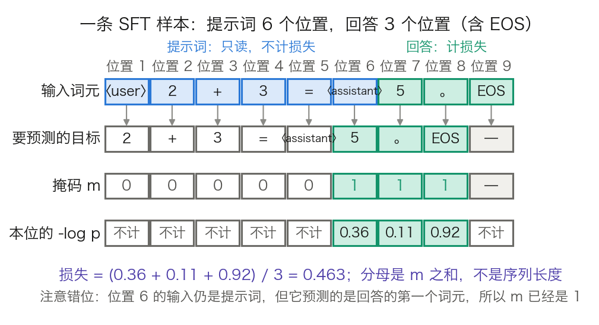
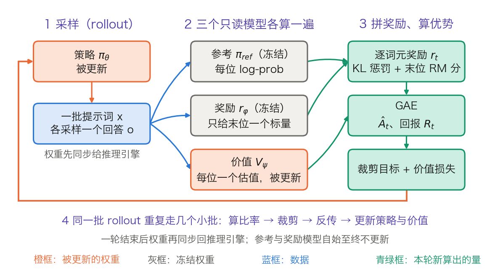
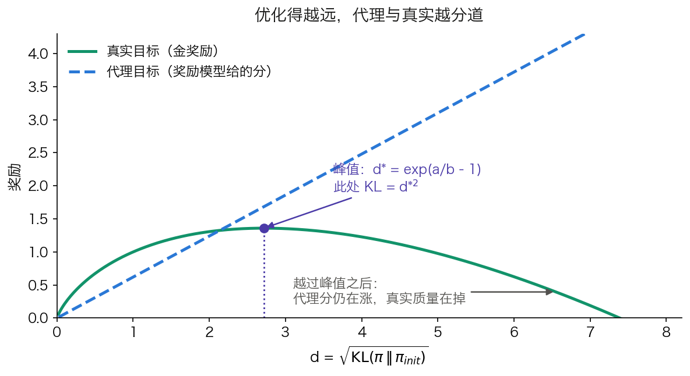
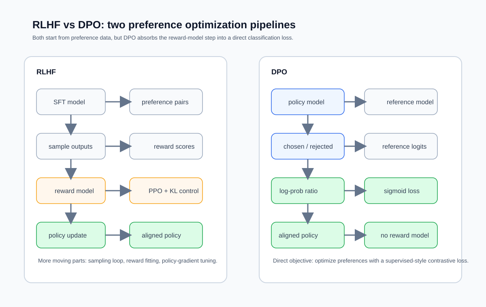
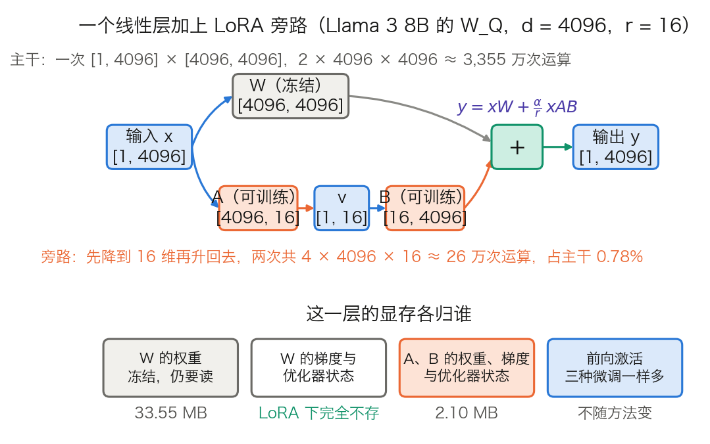
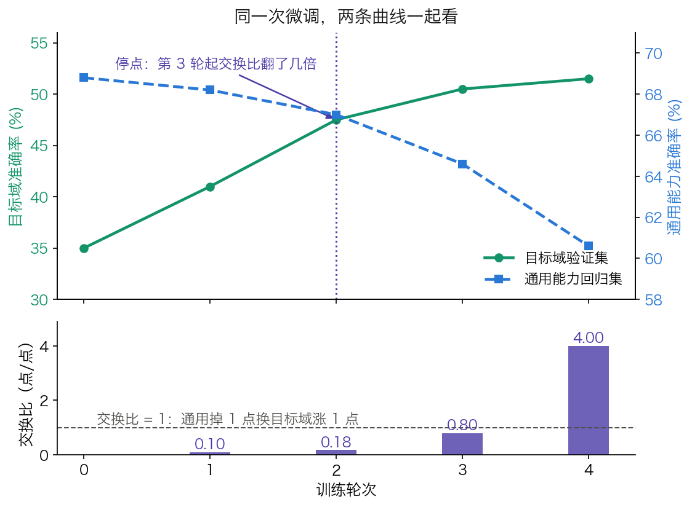

# 第八章：从预训练到对齐：让模型有用且安全

预训练产出的“基础模型”拥有丰富的语言知识，但它**不知道如何与人类有效交互**——它会无差别地续写任何文本，包括有害内容。从一个能写诗也能写恶意代码的“原始大脑”，变成一个有用、诚实且安全的助手，需要经历**后训练对齐**（Post-training Alignment）的过程。

本章介绍后训练的三个核心阶段——监督微调（SFT）、基于人类反馈的强化学习（RLHF）、直接偏好优化（DPO）——以及参数高效微调技术，再回过头看这些做法各自会在哪里坏掉，最后拆开评测本身这条流水线，沿着六个问题展开：

- [8.1 节](8.1_sft.md)：只会顺着文本续写的基础模型，怎么学会“被问就答”？
- [8.2 节](8.2_rlhf.md)：开放性问题没有标准答案，好坏该由谁来判定？
- [8.3 节](8.3_dpo.md)：四个模型同时常驻显存的流程，能删到只剩几个？
- [8.4 节](8.4_peft.md)：训练目标不变，哪些参数才真的值得更新？
- [8.5 节](8.5_practice.md)：训练损失一路向下，为什么模型可能已经坏了？
- [8.6 节](8.6_evaluation.md)：用来判断好坏的那个准确率，本身是怎么算出来的？

实践入口：[A.6](../appendix/a6_practice_path.md)用小张量核对标签掩码、LoRA、DPO 与组内优势；[A.7](../appendix/a7_framework_recipes.md)将这些机制接到 Transformers、PEFT 和 TRL，要求同时检查训练行为与保留集质量。

## 1. 监督微调：教模型“怎么回答”

**监督微调**（Supervised Fine-Tuning，SFT）把只会续写的基础模型变成会应答的助手。本节回答三个问题：一条“指令-回答”样本怎样一步步变成一个损失数值；为什么学习率必须压到预训练峰值的几十分之一；数据要多少、要什么样。答得好不好、安不安全，留给 8.2 与 8.3。

### 1.1 从续写到对话

预训练模型只做一件事：接着给定文本往下写。给它“法国的首都是”，它会续出“巴黎，位于塞纳河畔……”。直接问“法国的首都是什么？”，它可能续出“这是一道地理题……”，而不是直接回答。

SFT 在**指令-回答对**上继续训练，把“被问就答”这个映射装进权重。训练数据的形式是一问一答：

```text
用户：法国的首都是什么？
助手：法国的首都是巴黎。
```

**真实模型用特殊词元分隔角色，不是用“用户：”这样的明文。** [3.8.2 节](../03_components/3.8_gpt_inference_flow.md)已经给出推理侧的教学模板 `⟨user⟩ 2 + 3 = ⟨assistant⟩`：服务端按聊天模板把消息列表排成一串词元，并在末尾补上“助手将开始说话”的控制标记。训练侧必须用同一套模板，否则模型在推理时见到的分隔符与训练时不同。

模板错位是 SFT 之后“答非所问、停不下来”的最常见原因。它有三种典型形态：训练时用了模板 A、推理时用了模板 B；训练样本里漏掉了结束词元，模型学不会停；系统提示词在训练里从不出现，推理时却总是出现。三者都不会让训练损失变难看。

### 1.2 一条样本怎样变成一个损失

**SFT 的损失函数形式与预训练相同，都是下一个词元的交叉熵。** 本节选择只对助手回答计损失，用掩码排除提示词；这是训练配方的选择，并非所有 SFT 的默认行为。用掩码 $m_t$ 写出来就是：

$$
\mathcal{L} = -\frac{1}{\sum_t m_t}\sum_t m_t \log p_\theta(x_{t+1}\mid x_{\le t})
$$

$m_t = 1$ 表示位置 $t$ 预测出的那个词元要计损失，$m_t = 0$ 表示不计。分母是 $\sum_t m_t$，即真正计入的位置数，不是序列长度。

**掩码对齐的是被预测的词元，不是输入词元。** 位置 $t$ 预测的是位置 $t+1$ 的词元，所以判断 $m_t$ 要看位置 $t+1$ 属不属于回答。这个错位是实现里最容易写反的一处。

沿用 3.8 节的教学样本，把提示词 `⟨user⟩ 2 + 3 = ⟨assistant⟩` 与回答 `5 。 EOS` 接成 9 个位置。图 8-1 把三行对齐摆开：输入词元、该位置要预测的目标、掩码 $m$。



图 8-1：一条 SFT 样本怎样变成带掩码的损失（[生成脚本](https://github.com/yeasy/llm_internals/blob/main/tools/figures/ch08_sft_loss_mask.py)）。蓝色是提示词，青绿色是回答与计损失的位置；词元序列沿用 3.8 节的教学模板，`-log p` 的三个数值是教学示意；图内的角色标记写作 `〈user〉`，与正文的 `⟨user⟩` 是同一个标记，换形只为规避中文字体缺字形。

位置 1 到 5 预测的都还是提示词，$m$ 为 0。位置 6 的输入是 `⟨assistant⟩`，它预测的却是回答的第一个词元 `5`，所以 $m_6 = 1$。位置 7、8 同理。位置 9 是 EOS，后面没有下一个词元，不参与。于是 9 个位置里只有 3 个计损失。

设这三位的 $-\log p$ 分别为 0.36、0.11、0.92，对应的概率是 0.698、0.896、0.399。损失为：

$$
\mathcal{L} = \frac{0.36 + 0.11 + 0.92}{3} = 0.463
$$

**训练模型结束回答时，应把对应的结束词元计入损失。** 上例用 EOS 表示它，其 $-\log p$ 最大（0.92），说明模型在这个位置预测结束的概率较低。把它从掩码里漏掉，损失会降到 $(0.36 + 0.11) / 2 = 0.235$，看着更好看，却丢掉了这条样本中“此处应结束”的直接监督。模型仍可能保留基座的停止能力，但微调不再直接强化这个结束位置；真实聊天模板还可能使用专门的回合结束词元。

真实实现常把掩码合进标签数组。PyTorch 的 `CrossEntropyLoss` 有一个 `ignore_index` 参数（默认 −100），标签等于该值的位置直接跳过；未设置类别权重、按均值归约时，分母也只计未忽略的位置。因此，本节的做法是把标签数组里提示词那几位写成 −100。Hugging Face 的 `tokenizer.apply_chat_template` 负责排列消息与角色标记，**套用聊天模板本身不保证提示词会被屏蔽**；还要看数据格式、损失配置和模板提供的掩码。

[TRL 的 `SFTTrainer` 文档](https://huggingface.co/docs/trl/sft_trainer)区分以下情况（对应 [v1.7.0 实现](https://github.com/huggingface/trl/blob/v1.7.0/trl/trainer/sft_trainer.py)；下列默认行为针对未预先提供 `labels` 的文本数据）：

- **语言建模格式**：单个 `text` 字段或完整 `messages` 列表，默认对整个序列的有效目标计损失；出现 `user`、`assistant` 角色并不会自动改成只训练回答。
- **提示词—补全格式**：分开的 `prompt` 与 `completion` 字段，`completion_only_loss=None` 默认只训练补全部分；设置 `completion_only_loss=False` 才取消这层提示词屏蔽。
- **只训练助手消息**：对话数据需显式设置 `assistant_only_loss=True`，且模板要用 `` 与 `` 标出助手生成区间。TRL 可为部分已支持的模型族自动换用带这些标记的训练模板，其他模板需自行核验。若同时启用补全掩码，只训练两个掩码的交集。

**多轮对话的监督范围由这个选择决定。** 本节采用完整 `messages` 加助手掩码，因此可训练多个助手回合，产生多段不连续的计损失区间；若把历史放进 `prompt`、最后一轮回答放进 `completion` 并只训练补全，就只监督最后一轮。训练前应抽取实际批次，逐词元对照 `input_ids` 与 `labels`：用户与系统位置是否为 −100，目标助手回合是否保留，以及回答结束词元是否仍在监督范围内。

### 1.3 为什么学习率必须小

“SFT 用远小于预训练的学习率”常被当成经验值背下来。它其实可以从两个可查的数字推出来。

**第一笔账：见到的词元数差四到五个数量级。** [Llama 2 论文](https://arxiv.org/abs/2307.09288)的表 1 写明预训练用了 2.0T 词元；3.1 节写明“收集到 27,540 条标注之后我们停止了标注”，并说明微调跑 2 轮。把两者统一到词元：按每条样本 500 到 2,000 词元估算，两端分别是 $27{,}540 \times 2 \times 500 = 2.75\times10^7$ 与 $27{,}540 \times 2 \times 2{,}000 = 1.10\times10^8$ 个词元，即 SFT 全程见到的词元数。这是预训练 2.0T 的 $1/(7.3\times10^4)$ 到 $1/(1.8\times10^4)$，即差 4.3 到 4.9 个数量级。每条样本的平均长度是估算值，两端取值已经覆盖了常见区间。

换成梯度步数也是同一个结论。预训练的全局批大小是 $4\times10^6$ 词元，2.0T 词元合 50 万步。SFT 的批大小是 64 条、序列长 4,096，两轮下来是几百步的量级。**同一批权重，一边走几十万步，一边走几百步。**

**第二笔账：SFT 的学习率其实与预训练末端相接。** Llama 2 的预训练用余弦调度，末端降到峰值的 10%。7B 与 13B 的峰值是 $3.0\times10^{-4}$，末端因此是 $3.0\times10^{-5}$；34B 与 70B 的峰值是 $1.5\times10^{-4}$，末端是 $1.5\times10^{-5}$。而 SFT 用的是 $2\times10^{-5}$。

也就是说，“SFT 学习率比预训练小一到两个数量级”只对**峰值**成立（$2\times10^{-5}$ 是 $3\times10^{-4}$ 的 1/15）；对**末端**，两者是同一量级，甚至更大。这不是巧合：预训练结束时的学习率本身就是“不再大幅移动权重”的水平，SFT 接着它往下走才不会把已有能力挤掉。把 SFT 学习率理解成“从峰值降两个量级”容易在别的基座上取错值；理解成“接上余弦的末端”则换基座也成立。

**机制。** 回到 [6.1 节](../06_training_techniques/6.1_loss_optimizer.md)的更新公式：一步更新的幅度由学习率乘梯度决定，权重最终落在哪里取决于沿途所有更新的累积。预训练阶段任何一条样本的贡献都被海量其他样本稀释；SFT 阶段样本数少了几个数量级，少数几条样本就足以主导权重的移动方向。模型会飞快学会这批数据的表面模式，同时把预训练里学到的、这批数据没覆盖到的能力一起挤掉。

这就是**灾难性遗忘**（catastrophic forgetting）。小学习率不是为了训得慢，而是把每一步的位移压到足够小，让新的输入-输出映射长在旧能力之上而非覆盖它。同样的道理解释了为什么 SFT 通常只跑一到几轮：轮数越多，同一批样本被反复走过的累积位移越大。这条约束怎么被测出来、怎么缓解，见 [8.5 节](8.5_practice.md)。

### 1.4 打包与损失归一化：两个容易忽略的选择

**打包（packing）。** 指令数据的长度分布很散，几十到几千词元都有。一条一条填充到 4,096 会浪费大量计算。通行做法是把多条短样本首尾相接，拼成一条满长的序列。Llama 2 论文写得很直白：“我们把训练集里所有的提示词和回答拼接起来”，用一个特殊词元分隔提示与回答，“把用户提示词上的损失置零，因而只对回答词元反向传播”。

打包带来一个必须回答的问题：拼在一起的两条样本，后一条能不能读到前一条？注意力默认是因果的，只屏蔽未来，不屏蔽“上一条样本”。不加处理时，后一条样本的每个位置都会把前一条当成上下文。要避免这一点，需要一个块对角的注意力掩码，让每条样本只看见自己。实现上这叫序列内注意力隔离，FlashAttention 一类内核用变长序列接口（把各条样本的起止偏移传进去）来表达。不隔离在多数场景下影响不大，因为模型本来就要学会忽略无关前缀，但在长样本、强格式的任务上会引入可观的噪声。

**损失按什么归一化。** 上面的公式按词元平均，分母是本批次所有计损失位置之和。另一种写法是先在每条样本内部平均，再跨样本平均。两者的差别是权重分配：按词元平均时，长回答里的每个词元与短回答里的每个词元等权；按样本平均时，每条样本等权，于是长回答里单个词元的权重被摊薄。

这不是一个小细节。8.2.4 讲 GRPO 的“响应级长度偏差”时会再遇到同一个分母，那里的结论是：**不要让一个词元的权重取决于它恰好落在哪条回答里**。两处是同构的问题，SFT 侧的表现是模型偏好生成较短的回答。

### 1.5 数据质量的影响

SFT 的效果对数据**质量与多样性**的敏感程度，远高于对数量的敏感程度。[LIMA 论文](https://arxiv.org/abs/2305.11206)给出了一个干净的对照：同样从 LLaMa 65B 出发，用 1000 条精心编写的示例做 SFT，人类偏好评测上胜过了在 52,000 条 Alpaca 数据上微调的同规模模型。同一个基座，52 倍的数据量，输给了 1000 条。作者由此提出**表层对齐假说**（Superficial Alignment Hypothesis）：模型几乎全部的知识与能力都在预训练阶段学到，指令微调要做的只是教它选用哪一种表达格式。这被称为“少而精”原则。

**“1000 条”不是配方，读它必须连着读它的三层前提。** 其一，那 1000 条是喂给一个 65B 模型的。“知识都在预训练里”这个结论只有在预训练本身足够充分时才成立；搬到小得多的基座上，缺的知识不会因为示例精良而补上。其二，评测是单轮通用指令跟随上的人类偏好对比，不是知识密集型基准上的准确率。同一篇论文里，LIMA 相对 GPT-4、Claude、Bard 的“不差于”比例分别是 43%、46%、58%，它并没有全面胜过这三家。其三，论文给出的“数据量收益迅速衰减”是有条件的：原文说的是“在不同时扩大提示词多样性的前提下扩大数据量会出现急剧的收益递减”。那组消融在 7B 模型上做、由 ChatGPT 打分，图 6 的说法是数据量最多扩到 16 倍、分数仍然走平。论文自己的总结句把驱动量说得更清楚：对齐的标度规律“不必然只受数量支配，而更像是在保持高质量回答的前提下、提示词多样性的函数”。

所以“少而精”真正的主语是多样性，不是条数。它还有一个反向的旁证：LIMA 的训练数据里一条多轮对话都没有，而作者只补了 30 条手工编写的多轮对话链（总共 1,030 条），多轮能力就显著改善。**缺什么补什么，比再堆一万条有效得多。**

把一个外部锚点放在旁边，这层限制会更清楚。Llama 2 论文明确说自己的发现“与 Zhou 等人（即 LIMA）在精神上一致”，然而它给出的量是 27,540 条：“我们发现数万量级的 SFT 标注就足以取得高质量结果，收集到 27,540 条之后我们停止了标注”。两个团队相差 27 倍、结论却同向，说明可以照抄的从来不是条数，而是那条判据：**先问这批数据覆盖了多少种不同的提示，再问它有多少条。** 覆盖面不够时，加量只是把同一类样本重复给模型看。Llama 2 团队还顺带记了一笔：不同标注平台与供应商产出的数据，会让下游模型表现出明显差异。

### 1.6 对到实现：两份公开配方

表 8-1 并排放两份完整公开的 SFT 配方，一份来自 2023 年的 Llama 2，一份来自 2024 年的 Tülu 3。两者相隔一年多，量级仍然一致。

| 超参数 | Llama 2 Chat（7B 到 70B） | Tülu 3 8B | Tülu 3 70B |
| --- | --- | --- | --- |
| 学习率 | $2\times10^{-5}$ | $5\times10^{-6}$ | $2\times10^{-6}$ |
| 调度 | 余弦 | 线性 | 线性 |
| 权重衰减 | 0.1 | 未列出 | 未列出 |
| 批大小（有效） | 64 | 128 | 128 |
| 最大序列长度 | 4,096 | 4,096 | 4,096 |
| 训练轮数 | 2 | 2 | 2 |
| 损失掩码 | 提示词位置置零 | 同左 | 同左 |

表 8-1：两份公开 SFT 配方。Llama 2 一列取自 [Llama 2 论文](https://arxiv.org/abs/2307.09288) 3.1 节的 Fine-Tuning Details 段；Tülu 3 两列取自 [Tülu 3 论文](https://arxiv.org/abs/2411.15124)的表 11。两份配方都用 2 轮、4,096 序列长，学习率都在 $10^{-6}$ 到 $10^{-5}$ 之间，且模型越大学习率越低。

三条可迁移的判读：学习率随模型规模下降（Tülu 3 从 8B 的 $5\times10^{-6}$ 降到 70B 的 $2\times10^{-6}$）；轮数固定为 2，没有人靠多跑几轮来提分；序列长度 4,096 配合打包，说明批次是按词元数而不是按样本数填满的。

这些参数名易随框架版本变动。要点是三件事：标签掩码放在哪一层做、批次按词元还是按样本计、学习率相对预训练末端处在什么位置。名字会变，这三件事不变。

SFT 之后的模型已经能对话，但它只学会了模仿示范。示范里没有的行为它不会，示范里有而它并不真会的内容它照样模仿（[8.5.3 节](8.5_practice.md)给出这条失败的实测形态）。要把“像个助手”推进到“回答得更好”，需要一种不依赖标准答案的训练信号，这是 8.2 节的出发点。

## 2. RLHF：为什么需要人类反馈参与训练

SFT 只能教模型模仿示范。开放性问题没有标准答案，示范也就无从写起。**基于人类反馈的强化学习**（Reinforcement Learning from Human Feedback，RLHF）换了一条路：不写答案，只让人比较两个回答谁更好，再把这份比较变成可优化的标量信号。本节把这条路径拆成可算的几步：奖励模型怎么训、逐词元奖励怎么拼、优势怎么估、裁剪目标怎么写、四个模型各占多少显存。

用人类比较训练奖励模型、再以带 KL 约束的强化学习优化语言模型，这条路线最早在风格续写任务上跑通（[Ziegler 等人 2019 年的工作](https://arxiv.org/abs/1909.08593)，策略直接从预训练模型出发）；[Stiennon 等人 2020 年](https://arxiv.org/abs/2009.01325)在摘要任务上先做 SFT 再训奖励模型、跑 PPO，已是完整的三步。[InstructGPT 论文](https://arxiv.org/abs/2203.02155)自述方法沿用这两篇，把它推广到通用的指令遵循上，也给出了这条路线最常被引用的结果：标注者更偏好经这套流程训出的 1.3B 模型的输出，而不是 175B GPT-3 的输出，两者参数量差了 100 倍以上。

### 2.1 SFT 的局限

SFT 依赖高质量的标准答案。对于“解释量子纠缠”或“写一首关于秋天的诗”这类开放性问题，不存在唯一正确的答案。不同的回答风格、详细程度、结构方式都可能是好的，而质量判断涉及难以量化的人类偏好。

RLHF 的核心思想是：既然好坏难以用规则定义，就让人类直接评判，再让模型学习那些被偏好的回答模式。比较比书写便宜得多，也一致得多：标注者不必想出一个好答案，只需要在两个已有答案之间选一个。

### 2.2 三阶段流程

RLHF 分三个阶段。第一阶段是 SFT，得到一个基本能对话的模型，它同时充当后两个阶段的起点与参照。第二阶段训练一个**奖励模型**（Reward Model，RM），把人类的成对比较拟合成一个标量函数。第三阶段用**近端策略优化**（Proximal Policy Optimization，PPO）以这个标量为奖励优化生成策略，并用 KL 惩罚把策略拴在 SFT 模型附近。

表 8-2 先把三步并排列出。两处差别决定了后面的全部设计：第二步训练的是另一个模型，不是回答问题的策略；第三步的回答由策略自己生成，而不是来自人写的示范。

| 阶段 | 训练对象 | 数据 | 学习信号从哪来 | 学到什么 |
| --- | --- | --- | --- | --- |
| SFT | 策略模型，从预训练模型出发 | 提示 + 人写的示范回答 | 示范回答，逐词元交叉熵 | 按助手的角色与格式作答 |
| 奖励模型 | 另一个模型，末端换成标量头 | 提示 + 多个回答的人工排序，拆成成对比较 | 人的偏好 | 给回答打分，近似人的偏好 |
| PPO | 策略模型，从 SFT 模型出发 | 只有提示，回答由策略采样 | 奖励模型的分数，减去偏离 SFT 模型的 KL 惩罚 | 生成奖励更高的回答 |

表 8-2：RLHF 三个阶段的对照。[InstructGPT 论文](https://arxiv.org/abs/2203.02155)三个阶段的训练提示分别约 1.3 万、3.3 万、3.1 万条，第三阶段的提示只取自 API。后来的方法大多在这张表上改一格：[8.3 节](8.3_dpo.md)的 DPO 把后两步并成一步，直接用偏好对训练策略；8.2.4 节的 GRPO 去掉价值网络，可验证奖励则用规则代替奖励模型。

下面按这个顺序逐步展开，每一步都给出形状与一格算术。

#### 奖励模型：标量头、BT 损失与一格算术

**结构。** 奖励模型不是一个新架构，而是把语言模型的 LM head 换掉。InstructGPT 的原话是：对奖励模型与价值函数，“原模型的反嵌入层被替换为一个输出标量的投影层”。形状上的区别只有最后一步：

- 语言模型：`x_T[1, d_model] × W_vocab[d_model, n_vocab] → logits[1, n_vocab]`
- 奖励模型：`x_T[1, d_model] × w_r[d_model, 1] → r[1, 1]`

取的是**最后一个位置**的隐状态，因为只有它读到了完整的提示词与回答。一次打分就是一次完整前向加一次向量点积，比生成一个回答便宜得多。

**损失。** 奖励模型拟合的是 **Bradley-Terry 模型**：人类偏好 $y_w$ 胜过 $y_l$ 的概率由奖励差经 sigmoid 给出。于是最大似然等价于最小化

$$
\mathcal{L}_{RM} = -\log\sigma\big(r_\phi(x,y_w) - r_\phi(x,y_l)\big)
$$

**一格算术。** 设某对回答上 $r_w = 1.2$、$r_l = 0.4$，差为 0.8。$\sigma(0.8) = 0.690$，损失 $-\ln 0.690 = 0.371$。若模型排反了，$r_w = 0.4$、$r_l = 1.2$，差为 −0.8，$\sigma(-0.8) = 0.310$，损失 $-\ln 0.310 = 1.171$。随机初始化时两个分数没有系统差异，奖励差的期望为 0，损失因此从 $\ln 2 = 0.693$ 起步。**0.693 是奖励模型损失曲线的起点**，看训练日志时可以直接对上；准确率的起点则是 50%。

损失只与奖励**差**有关，与绝对值无关。所以奖励模型的输出存在一个任意的整体平移。InstructGPT 的做法是在进入 RL 之前用一个偏置把标注者示范的平均分归零。

**排序数据怎样拆成对。** 标注者一次看 $K$ 个回答并排序，$K$ 在 4 到 9 之间。一次排序产生 $\binom{K}{2}$ 个成对比较：$K=4$ 是 6 对，$K=9$ 是 36 对。

拆对之后有一个陷阱。把所有对打散进数据集，一个回答会出现在 $K-1$ 个不同的梯度更新里，论文观察到奖励模型在一轮之内就过拟合。InstructGPT 的做法是把同一个提示的 $\binom{K}{2}$ 对放进同一个批次元素：$K$ 个回答各做一次前向，再在标量分数上两两组合，而不是做 $\binom{K}{2}$ 次前向。既省算力又不再过拟合。它的批大小 64 指的是提示数，因此一个批次最多含 $64 \times 36 = 2304$ 个比较。

**奖励模型的天花板。** 奖励模型学的是标注者的偏好，标注者之间本身并不完全一致。InstructGPT 把标注者分成五组做交叉验证：在训练所用的那几组标注者上，验证准确率是 72.4% ± 0.4%；换到留出的那一组，降到 69.6% ± 0.9%。跨组比组内低约 2.8 个百分点。这两个数值得记住，它们说明**奖励模型的准确率上限由标注一致率决定**，追求更高的验证准确率很可能只是在拟合标注噪声。

InstructGPT 的奖励模型是 6B，而策略最大到 175B。论文给出的理由是 175B 的奖励模型训练不稳定，且作为价值函数初始化时开销过大。所以“奖励模型与策略同规模”并非通例，开源实现里常见，公开配方里未必。

#### 逐词元奖励：KL 惩罚 + 末位分数

奖励模型只在回答末尾给一个标量。强化学习需要的是每一步的奖励。二者之间要有一次构造：

$$
r_t = -\beta\Big[\log\pi_\theta(y_t\mid x, y_{<t}) - \log\pi_{ref}(y_t\mid x, y_{<t})\Big] + \mathbb{1}[t = T]\cdot r_\phi(x, y)
$$

前一项是逐词元的 KL 惩罚，只要策略在某个位置比参考模型更自信，就在这一位扣分；后一项只在最后一个位置加上奖励模型的分数。InstructGPT 取 $\beta = 0.02$，并说明最优区间大约在 0.01 到 0.02 之间。

**一格算术。** 设一个 4 词元的回答，四位上的 $\log\pi_\theta - \log\pi_{ref}$ 分别是 0.5、2.0、−1.0、1.5，末位的奖励模型分数是 1.2。逐位乘 $-0.02$：

$$
r = [-0.010,\ -0.040,\ +0.020,\ -0.030 + 1.2] = [-0.010,\ -0.040,\ +0.020,\ +1.170]
$$

第三位的 $r_t$ 是正的，因为那一位策略比参考模型更**不**自信，KL 惩罚反号。这一点常被误写成“KL 惩罚总是负的”。

**KL 有两种放法。** 上面这种把它拼进奖励，是 InstructGPT 与多数 PPO 实现的做法；另一种是把 $D_{KL}[\pi_\theta \| \pi_{ref}]$ 直接加进损失，GRPO 用的是后者。两者的区别在于 KL 项会不会经过优势估计：放进奖励时它先进入 $r_t$、再被 GAE 折算；放进损失时它绕开了优势计算，梯度路径更短。

#### GAE：把四个奖励折成四个优势

有了逐词元奖励，还需要回答“这一步比平均水平好多少”。**优势函数**（Advantage）$A_t$ 就是这个量，最简形式是 $A_t = R_t - V(s_t)$，其中 $R_t$ 是该步之后的实际回报，$V(s_t)$ 是**价值模型**（Value Model，又称 Critic）对该状态预期回报的估计。

减去基线 $V(s_t)$ 是为了降方差。直接用绝对回报当梯度信号，容易的状态和困难的状态回报天差地别，梯度估计的方差极大。减去基线后，信号只剩“比预期更好还是更差”。

**GAE**（Generalized Advantage Estimation）在偏差与方差之间加了一个旋钮：

$$
\delta_t = r_t + \gamma V(s_{t+1}) - V(s_t),\qquad
\hat{A}_t = \sum_{l\ge 0} (\gamma\lambda)^l\,\delta_{t+l}
$$

接着上面的例子。取 $\gamma = 1$（InstructGPT 明确说估计广义优势时不做折扣），价值模型给出的四个估值为 0.8、0.9、1.0、1.1，末状态之后为 0：

$$
\delta = [\,-0.010 + 0.9 - 0.8,\ \ -0.040 + 1.0 - 0.9,\ \ 0.020 + 1.1 - 1.0,\ \ 1.170 + 0 - 1.1\,] = [0.09,\ 0.06,\ 0.12,\ 0.07]
$$

倒序累加，取 $\lambda = 0.95$（Tülu 3 公开配方里的取值）：$\hat A_4 = 0.07$；$\hat A_3 = 0.12 + 0.95\times0.07 = 0.186$；$\hat A_2 = 0.06 + 0.95\times0.186 = 0.237$；$\hat A_1 = 0.09 + 0.95\times0.237 = 0.315$。

两个端点值得单独看。$\lambda = 1$ 时递推退化为 $\hat A_t = R_t - V(s_t)$：$R_1 = \sum r = 1.14$，$\hat A_1 = 1.14 - 0.8 = 0.34$，与逐项累加得到的 0.34 一致。此时方差最大、偏差最小，因为完全依赖实际回报。$\lambda = 0$ 时 $\hat A_t = \delta_t = [0.09, 0.06, 0.12, 0.07]$，完全依赖价值模型的一步预测，偏差最大、方差最小。$\lambda = 0.95$ 落在两者之间。

#### 裁剪目标：四种情形

PPO 的前身 TRPO（Trust Region Policy Optimization）用一个硬性的 KL 信赖域约束限制每次更新的步长。理论上优雅，代价是每步都要解一个含 Fisher 信息矩阵的线性方程；实现上用共轭梯度配合 Fisher-向量积近似求解，不显式构造也不求逆，但仍需要反复的二阶向量积。对参数量上百亿的语言模型，这个开销不可接受。

PPO 把硬约束换成一个只用一阶梯度的裁剪目标。下面的式子要**最大化**；实现成最小化的 loss 时取负号：

$$
\max_\theta \; \mathbb{E}_t \left[\min\left(\rho_t A_t, \; \mathrm{clip}(\rho_t, 1-\epsilon, 1+\epsilon)\, A_t\right)\right],
\qquad \rho_t = \frac{\pi_\theta(y_t\mid\cdot)}{\pi_{\theta_{old}}(y_t\mid\cdot)}
$$

$\epsilon$ 通常取 0.2。这个 min 的行为不对称，四种情形各算一遍就清楚了（表 8-3）。

| 情形 | 比率 $\rho_t$ | 优势 $A_t$ | 未裁剪项 | 裁剪项 | min 取到 | 梯度 |
| --- | ---: | ---: | ---: | ---: | --- | --- |
| 正优势、更新过头 | 1.3 | +2 | 2.6 | 2.4 | 裁剪项 | 为零 |
| 正优势、更新不足 | 0.7 | +2 | 1.4 | 1.6 | 未裁剪项 | 保留 |
| 负优势、更新过头 | 0.7 | −2 | −1.4 | −1.6 | 裁剪项 | 为零 |
| 负优势、更新不足 | 1.3 | −2 | −2.6 | −2.4 | 未裁剪项 | 保留 |

表 8-3：$\epsilon = 0.2$ 时裁剪目标的四种情形。裁剪项里的 $\mathrm{clip}(\rho_t,\,0.8,\,1.2)$ 取到边界时是常数，对 $\theta$ 的梯度为零。

规律是：沿着优势方向越界时梯度被切断，反方向越界时梯度保留。第二、四两行都是“策略还没走到位”，此时不该限制它；第一、三两行是“这一步已经迈得太大”，梯度置零使它停在边界上。反方向仍能回修，这一条保证了策略不会被卡在错误的位置上。

#### 一轮迭代：四个模型谁读谁写

把上面几步串起来，一轮 PPO 迭代的顺序是固定的。图 8-2 画出四个模型各自的角色。



图 8-2：一轮 PPO 迭代里四个模型谁读谁写（[生成脚本](https://github.com/yeasy/llm_internals/blob/main/tools/figures/ch08_ppo_iteration.py)）。橙色是被更新的权重，灰色是冻结权重，蓝色是数据，青绿色是本轮新算出的量。

逐步复述一遍：

1. 把策略权重同步给推理引擎，对一批提示词各采样一个回答。
2. 参考模型对这些回答算每个位置的对数概率，只读不更新。
3. 奖励模型对每条回答的最后一个位置给一个标量，只读不更新。
4. 价值模型对每个位置给一个估值，它既参与计算也被更新。
5. 按上面的公式拼出 $r_t$，再用 GAE 算出 $\hat A_t$ 与回报 $R_t$。
6. 同一批 rollout 数据重复走几个小批：算比率、裁剪、反传，同时更新策略与价值。

InstructGPT 的具体取值是批大小 512、小批 64，即每批切成 8 个小批，每批只训一个内轮。回到第 1 步时权重已经变了，所以需要重新同步。

#### 四个模型的显存账

“流程复杂”是一句定性的话，算一笔账就具体了。沿用 [7.1 节](../07_distributed_training/7.1_data_parallel.md)的口径：混合精度 Adam 训练下每个参数占 16 字节；只做前向的模型按 BF16 的 2 字节算。以 7B 为例（表 8-4）。

| 方法 | 被训练的模型 | 只做前向的模型 | 合计 |
| --- | --- | --- | ---: |
| SFT | 策略 112 GB | 无 | 112 GB |
| DPO | 策略 112 GB | 参考 14 GB | 126 GB |
| GRPO 式 RL | 策略 112 GB | 参考 14 GB + 奖励 14 GB | 140 GB |
| PPO 式 RLHF | 策略 112 GB + 价值 112 GB | 参考 14 GB + 奖励 14 GB | 252 GB |

表 8-4：7B 模型上四种后训练方法的模型状态显存，按每参数 16 字节（训练）与 2 字节（推理）算出，不含激活与 rollout 阶段的 KV 缓存。$112 = 7\times10^9 \times 16 / 10^9$，$14 = 7\times10^9 \times 2 / 10^9$。

这张表把后面两节的动机都摆在了一处。PPO 式 RLHF 比 SFT 多出 140 GB，其中 112 GB 来自价值模型。**GRPO 去掉价值网络，省下的正是这 112 GB**；DPO 连奖励模型一起去掉，只留策略与参考。表里还漏掉了一笔：PPO 的 rollout 阶段要在推理引擎里再放一份策略权重与 KV 缓存，实际峰值高于 252 GB。

价值模型的规模也并非只有“与策略同规模”一种选择。InstructGPT 的策略最大 175B，价值函数固定为 6B，并由奖励模型初始化。开源 RLHF 框架多让价值模型与策略同规模，这是实现选择，不是算法要求。

### 2.3 RLHF 的挑战

RLHF 有效，但在实践中面临多重挑战。前三条在算法与数据层面，后三条在系统层面，而且都常被误诊为算法问题。

**复杂的训练流水线**：需要同时管理四个模型，显存账见表 8-4，此外还要维护训练与推理两套并行策略。

**奖励模型的偏差与过度优化**：奖励模型是真实目标的代理，优化得越狠，代理与真实越分道。这一条值得单独展开。

[Gao 等人的研究](https://arxiv.org/abs/2210.10760)用一个“金奖励模型”当作真值、另一个更小的模型当作代理，测出了这个分道的函数形状。把策略与初始策略的距离记作 $d = \sqrt{D_{KL}(\pi \| \pi_{init})}$，真实奖励随 $d$ 的变化拟合为：

$$
R_{\mathrm{RL}}(d) = d\,(\alpha_{\mathrm{RL}} - \beta_{\mathrm{RL}}\log d),
\qquad
R_{\mathrm{bo}n}(d) = d\,(\alpha_{\mathrm{bo}n} - \beta_{\mathrm{bo}n} d)
$$

两式分别对应 RL 优化与 best-of-$n$ 采样。图 8-3 画出它的形状：代理分数大致随 $d$ 单调上升，真实奖励先升后降。



图 8-3：优化得越远，代理与真实越分道（[生成脚本](https://github.com/yeasy/llm_internals/blob/main/tools/figures/ch08_reward_overopt.py)）。曲线用论文给出的函数形式画出形状，$\alpha$、$\beta$ 取教学值；论文的拟合系数随奖励模型规模平滑变化，不是常数。

这个形式有三条可用的推论。第一，峰值位置可以求出来：对 $R_{\mathrm{RL}}$ 求导并令其为零得 $d^* = \exp(\alpha/\beta - 1)$，对应的 KL 预算是 $d^{*2}$。第二，横轴是 $\sqrt{\mathrm{KL}}$ 而不是训练步数，所以**该监控的是 KL 而不是步数**：同样的步数在不同学习率下走出的距离完全不同。第三，论文报告 $\alpha$、$\beta$ 随奖励模型参数量平滑变化，其中 $\alpha_{\mathrm{RL}}$ 几乎与奖励模型规模无关，于是可以用小规模实验外推峰值。

**训练不稳定性**：PPO 的超参数调优困难，训练过程中容易出现奖励崩塌或模式坍塌。

**训练与推理的实现失配**：现代 LLM RL 系统把两件事拆给了两套不同的引擎：rollout 生成交给推理引擎（vLLM、SGLang 等），梯度计算交给分布式训练框架（FSDP、Megatron 等）。理论上，同一份权重、同一个输入，两边应当给出完全一致的词元概率；但由于模型实现与算子（kernel）实现存在差异，实际并不总是如此。这一现象被称为**训练—推理失配**（Training–Inference Mismatch，TIM）。

失配的形态很不直观：绝大多数位置上两边的对数概率是逐比特接近的，问题出在极少数位置上 **argmax 被翻转**，即两个引擎对“下一个词元最可能是哪个”给出了不同答案。ByteDance 与弗吉尼亚大学的一项诊断研究构造了零失配的对照基线，记作 VeXact，在 FSDP 训练引擎上做到与 rollout 逐比特对齐。有了这条基线，TIM 才能从其他因素里被单独隔离出来。结论是：这类微小的词元级数值分歧足以独立引发训练崩溃，它不是良性的数值噪声，应当被当作系统级扰动对待（见附录 A.4 参考文献）。

它难以排查，正是因为它和 off-policy 漂移、以及各种稳定化机制纠缠在一起。同一个技巧既可能在纠正 PPO 小步更新带来的 off-policy 偏移，也可能在压制 TIM 引入的数值离群点，还可能额外引入优化偏差。工程上的两条应对路径：算法侧用截断重要性采样（TIS）、拒绝采样等手段抑制离群更新；系统侧则要求推理与训练使用确定性的、**批次不变**（batch-invariant）的算子实现。对 MoE 模型还需要批次不变的 fused MoE 算子，因为路由本身就对数值扰动敏感（MoE 结构见 14.2）。

> 上述结论来自单篇诊断研究，实验规模有限（Qwen3-8B 量级的 BF16 权重），不宜外推成“所有 RL 训练不稳定都源于 TIM”。这里要传递的判断是：排查 RL 崩溃时，除了超参和奖励设计，还应把训练与推理两侧的对数概率直接比对一遍。这是个便宜且容易被跳过的检查。

**权重同步：同一个模型的两种切法**。TIM 讲的是两侧算出来的数值不一致，而在此之前还有一个更基础的问题：每完成一轮更新，训练侧的新权重必须传给推理侧，而两侧几乎必然用着不同的并行策略。训练侧要塞下优化器状态，倾向 FSDP/ZeRO 或大流水线；推理侧只有前向，倾向张量并行加大批。[HybridFlow（verl 的论文）把这件事定义得很清楚](https://arxiv.org/abs/2409.19256)：RLHF 数据流里不同节点通常采用不同的并行策略，节点之间的边代表**数据重分片**（resharding），而且往往是多对多的多播。它为此设计了 3D-HybridEngine，在训练与生成两个阶段之间做 actor 模型的重分片，目标是零显存冗余并显著降低通信开销。论文报告的整体吞吐提升是 1.53× 到 20.57×。

工程上因此分出两条路线。**共置**（colocate）让训练与推理共享同一批 GPU、分时切换角色，省下整机资源，代价是每次切换都要重分片，且两边的显存峰值要挤在同一张卡上。**分离**（disaggregate）让两套集群各自常驻，不必反复切换，各自的并行策略可以独立最优，代价是权重要跨集群传输。分离还必须回答一个问题：推理侧允许落后训练侧多少步。这个上限就是**陈旧度**（staleness）。

**异步 rollout 与陈旧度**。同步 RL 的时间线上有一个显眼的浪费：一个批次里最慢的那条长思维链没生成完，整批就无法进入训练，而长思维链的长度分布本身就是重尾的。异步方案让 rollout 与训练重叠：推理侧持续用稍旧的权重生成，训练侧不等齐就开始更新。代价是采样分布与当前策略之间出现了偏移，**允许的陈旧度越大，吞吐越高，而算法上离 on-policy 越远**，需要用重要性采样修正等手段把偏移拉回来。这也把话题接回了上文：一旦引入 off-policy 修正，TIM 就更难与它区分开，两者都表现为“两侧概率对不上”，而处理方式并不相同。

### 2.4 长思维链 RL 的典型病理与干预

8.2.3 的六条挑战描述的是哪里会出问题。当 RL 被用来训练长思维链推理能力（[14.6 节](../14_future_trends/14.6_test_time_scaling.md)）之后，这些问题呈现出几种有名字、有对策的固定形态。

#### 先换一件事：奖励从哪里来

进入具体病理之前要先划清一条界线。本小节讨论的训练里，**奖励不再来自奖励模型，而来自可自动验证的规则**：数学题是否算对、代码是否通过单元测试、格式是否合规。这条路线通常称作**可验证奖励的强化学习**（Reinforcement Learning with Verifiable Rewards，RLVR）。

与 8.2.2 的三阶段相比，换掉的只有一件事：奖励来源。算法骨架没变，仍然是采样、算优势、裁剪、更新。变化带来三个直接后果。不再需要训练奖励模型，也就没有了 8.2.3 那条“奖励模型被攻击”的路径。奖励是稀疏的 0/1，信息量远低于连续分数。验证器本身可能有漏洞，奖励黑客从攻击模型变成了攻击测试用例。

#### GRPO：用组内相对分数替掉价值网络

**GRPO**（Group Relative Policy Optimization）由 [DeepSeekMath 论文](https://arxiv.org/abs/2402.03300)提出，出发点正是表 8-4 里那 112 GB：价值模型与策略同规模，显存与算力开销都很重，而在 LLM 场景里奖励通常只在最后一个词元给出，训练一个每位都准确的价值函数本就困难。

GRPO 的替代方案是对同一个问题采样一组回答，用组内的相对得分当基线：

$$
A_i = \frac{r_i - \mathrm{mean}(\{r_1,\dots,r_G\})}{\mathrm{std}(\{r_1,\dots,r_G\})}
$$

$$
\mathcal{J}_{\mathrm{GRPO}}(\theta) = \mathbb{E}\left[\frac{1}{G}\sum_{i=1}^{G}\frac{1}{|o_i|}\sum_{t=1}^{|o_i|}\Big(\min\big(\rho_{i,t} A_i,\ \mathrm{clip}(\rho_{i,t}, 1-\epsilon, 1+\epsilon) A_i\big) - \beta D_{\mathrm{KL}}[\pi_\theta \| \pi_{\mathrm{ref}}]\Big)\right]
$$

其中 $G$ 是同题采样回答数，$\rho_{i,t}$ 是新旧策略在第 $t$ 个词元上的概率比。结果监督下同一条回答里所有词元共用一个 $A_i$。KL 项直接加在损失里而不是拼进奖励，论文用的是一个恒正的无偏估计式 $\frac{\pi_{ref}}{\pi_\theta} - \log\frac{\pi_{ref}}{\pi_\theta} - 1$。

这一项并非必备。DAPO 论文的 2.3 节直接删掉了它。理由是 KL 惩罚的用途在于不让模型偏离初始模型太远，而训练长思维链推理时，模型的分布本来就要显著偏离初始模型。表 8-5 的 DAPO 一列因此在 KL 系数上标为不适用。

**一格算术。** 取 $G = 4$。奖励为 $[1, 0, 0, 1]$ 时，均值 0.5、标准差 0.5，优势为 $[+1, -1, -1, +1]$。奖励为 $[1, 1, 1, 0]$ 时，均值 0.75、标准差 0.433，优势为 $[+0.577, +0.577, +0.577, -1.732]$：唯一那条错误回答被压得很重。若这些数是每条回答的**总奖励**，且整组为 $[1,1,1,1]$ 或 $[0,0,0,0]$，标准差就是 0。上式直接代入会出现 0/0，实现须在分母加小量或显式处理零方差；处理后优势整组为零，奖励驱动的策略梯度消失。不过 [R1 原目标函数](https://arxiv.org/html/2501.12948v1#S2.SS2.SSS1)还有独立的 KL 正则项，KL 梯度仍可能非零，不能据此断言总梯度为零。

这两个式子是下面几条病理的共同来源：分母 $|o_i|$ 是长度偏差的来源，分母 $\mathrm{std}$ 是难度偏差的来源，标准差为零则使组内奖励无法提供相对优劣信号。

#### 四种病理

**熵坍缩（entropy collapse）**。策略的输出熵单调下降，采样越来越集中，探索随之消失，reward 曲线过早走平。DAPO 论文报告的正是这个形态：以 Qwen2.5-32B 做 RL 时，[朴素 GRPO 基线在 AIME 上只拿到 30 分（DeepSeek 的 RL 是 47 分），分析发现基线存在熵坍缩、奖励噪声和训练不稳定等问题](https://arxiv.org/abs/2503.14476)。它给出的对策叫 **clip-higher**：把重要性比值的裁剪上界与下界解耦、单独调高上界，给“原本概率低但这次表现好”的词元留出被提升的空间。

这条对策可以用表 8-3 的算术直接验算。论文举的例子是：$\epsilon = 0.2$、$A_{i,t} > 0$ 时，旧概率 0.01 的词元上界只能升到 0.012，而旧概率 0.9 的词元上界是 1.08。**低概率词元被同一个相对上界压得更死**，而它们正是探索的来源。DAPO 的取值是 $\epsilon_{\text{low}} = 0.2$、$\epsilon_{\text{high}} = 0.28$。

**一整组样本缺少奖励驱动的梯度**。组内总奖励相同时，防零处理后的优势为零；只有在没有 KL 等额外损失项时，才能进一步说整组梯度为零。若奖励只含二元正确性，全对或全错就是这种情况；若还含格式奖励等分量，须检查总奖励，不能只看正确率。模型变强后，同奖励组可能越来越多，使每个批次里提供相对优劣信号的提示减少。已删除 KL 项的 DAPO 用 **dynamic sampling** 应对：过采样并丢弃准确率为 1 和 0 的提示，一直采到批次被有效样本填满为止，代价是每批的采样开销变成动态的。

**响应长度爆炸而 reward 不涨**。这个形态最容易被误读成“模型学会了深思”。Dr. GRPO 论文指出它其实源于目标函数里的**优化偏差**：[GRPO 引入了两个偏差](https://arxiv.org/abs/2503.20783)。

- **响应级长度偏差**：来自除以 $|o_i|$。优势为正（回答正确）时，越短的回答获得越大的梯度更新，策略因而偏好简短的正确答案；优势为负（回答错误）时，越长的回答因为 $|o_i|$ 更大而被惩罚得越轻，策略于是偏好冗长的错误答案。两个方向合起来，正是“答错的越写越长”。
- **问题级难度偏差**：来自把中心化后的奖励除以组内标准差。标准差小的问题（太简单或太难、奖励几乎全 1 或全 0）在更新中被赋予了更高的权重。优势归一化本身是 RL 的常规技巧，但它通常在整个批次上计算；按问题归一化会让不同问题在目标函数里权重不一。

长度偏差可以给一格：同为正确回答，100 词元那条的每词元权重是 1/100，1000 词元那条是 1/1000，**相差 10 倍**。这与 8.1.4 讲 SFT 损失归一化时的分母是同一个问题。

该论文同时发现，许多开源 PPO 实现同样按响应长度归一化损失，这个偏差在 GRPO 发表之前就已存在。

两篇论文的修法角度不同，值得分清。DAPO 的 **token-level policy gradient loss** 针对的是加权粒度：原始 GRPO 先在样本内按词元求平均、再跨样本聚合，等于每个样本等权，于是长回答里的每个词元对总损失的贡献被摊薄。按 DAPO 的分析，这既妨碍模型从高质量长样本里学到推理模式，也让过长样本中的问题模式得不到足够抑制。改成词元级之后，权重按词元而非按样本分配。Dr. GRPO 则更彻底，直接把分母换成一个全局常量（训练期间固定的最大生成长度），从源头消掉“分母随样本变化”这件事。两者共同的要点是同一句：**不要让每个词元的权重取决于它恰好落在哪条回答里**。

**奖励噪声与过长截断**。超出最大生成长度而被截断的样本，其奖励并不反映回答质量，却照样进入梯度。DAPO 的第四项技术 **overlong reward shaping** 就是为此，论文的说法是它降低奖励噪声、稳定训练。具体做法在超参里看得见：期望最大长度设为 16,384 词元，另留 4,096 词元作软惩罚缓冲区，生成上限因此是 20,480 词元。四项技术合起来，把同一个 Qwen2.5-32B 从 30 分推到 AIME 2024 上的 50 分，并且只用了 DeepSeek-R1-Zero-Qwen-32B（47 分）一半的训练步数。

把这些串成一条排查顺序。**先看熵**：坍缩了就查裁剪上界。**再看有效样本比例**：组内总奖励无差异的比例高时，评估动态采样。**再看长度与 reward 的联合走势**：长度涨而 reward 不涨，先怀疑损失归一化，而不是模型学会了思考。**最后才怀疑数值**，即 8.2.3 那条训练—推理失配，把两侧对数概率直接比一遍。

> 需要保持的分寸：上面的数字都来自各自论文在特定模型与数据上的实验，不是普适常数。可迁移的是**形态与因果**：熵坍缩对应探索不足、零优势组对应组内总奖励无差异、长度爆炸对应归一化分母不是常量。具体阈值和收益必须在自己的任务上重测。

### 2.5 对到实现：几组公开超参数

RL 后训练的超参数多，框架里的参数名又随版本变动。表 8-5 只列三份论文自己写明的取值，它们跨越三年、三种奖励来源，量级却相当稳定。

| 超参数 | InstructGPT（PPO，RM 奖励） | DAPO（GRPO 式，规则奖励） | Tülu 3（PPO，RLVR） |
| --- | --- | --- | --- |
| 裁剪 $\epsilon$ | 0.2 | 下界 0.2 / 上界 0.28 | 0.2 |
| KL 系数 $\beta$ | 0.02（拼进奖励） | 不适用（论文 2.3 节删除了 KL 项） | 扫过 0.01 到 0.1 |
| 折扣 $\gamma$ | 1（不折扣） | 不适用（无价值网络） | 1.0 |
| GAE $\lambda$ | 未列出 | 不适用 | 0.95 |
| rollout 批大小 | 512 个提示 | 512 个提示 × 16 个回答 | 有效批 224 |
| 一次 rollout 切成几个小批 | 8（小批 64） | 16（小批 512） | 1 |
| 每批内轮数 | 1 | — | 1（RM 奖励）/ 4（RLVR） |
| 生成长度上限 | 1k 词元 | 20,480 词元（含 4,096 软惩罚区） | 1,024 到 2,048 词元 |

表 8-5：三份公开 RL 后训练配方。InstructGPT 一列取自其附录 C.4；DAPO 一列取自[该论文](https://arxiv.org/abs/2503.14476)的实验设置段；Tülu 3 一列取自[该论文](https://arxiv.org/abs/2411.15124)的表 21。“未列出”表示论文未在对应位置给出数值，不表示该项不存在。

三条跨配方成立的判读：裁剪下界始终是 0.2，被改动的只有上界；语言模型的 RL 一律不做折扣（$\gamma = 1$），因为回答长度有限且奖励在末尾；生成长度上限随任务从 1k 涨到 20k，这一项直接决定 rollout 的时间与 KV 缓存占用。

这几份配方能公开，是因为 PPO 的每个部件都要单独调，值才有意义。把部件数量从四个减到两个，就是 8.3 节的出发点。

## 3. DPO 与新型对齐：从复杂到简洁的演化

8.2 留下的清单很具体：策略、参考、奖励、价值四个模型同时参与训练，7B 规模合计 252 GB（表 8-4），外加 PPO 那套裁剪区间、优势估计与 KL 惩罚的调参。**直接偏好优化**（Direct Preference Optimization，DPO）把这份清单删到只剩策略与参考两项。本节讲它怎么做到、代价是什么、在哪里会坏。

### 3.1 DPO 的核心洞察

DPO 的关键洞察是：**KL 约束下的最优策略与奖励函数一一对应，因此奖励模型可以被解析地吸收进语言模型的参数化里**。省掉的不只是奖励模型的训练，还有 PPO 的整个采样-估值循环。

#### 从 RLHF 目标到 DPO 损失的推导

**第一步：Bradley-Terry 偏好模型。** 与 8.2.2 的奖励模型同一个假设：给定两个回答 $y_1$ 和 $y_2$，人类偏好 $y_1$ 的概率由奖励差决定。

$$P(y_1 \succ y_2 \mid x) = \sigma\big(r(x, y_1) - r(x, y_2)\big)$$

**第二步：KL 约束下的最优策略。** RLHF 的目标是在 KL 约束下最大化期望奖励：

$$\max_{\pi} \mathbb{E}_{y \sim \pi}[r(x, y)] - \beta\, \mathrm{KL}\big[\pi \,\|\, \pi_{\text{ref}}\big]$$

这个问题有闭式解，推导只有三行。先把最大化改写成最小化并提出 $1/\beta$：

$$
\min_\pi \mathbb{E}_{y\sim\pi}\left[\log\frac{\pi(y\mid x)}{\pi_{\text{ref}}(y\mid x)} - \frac{1}{\beta}r(x,y)\right]
$$

把括号里的第二项塞进对数，配出一个归一化的分布。定义配分函数 $Z(x) = \sum_y \pi_{\text{ref}}(y\mid x)\exp\big(r(x,y)/\beta\big)$ 与

$$\pi^*(y\mid x) = \frac{1}{Z(x)} \pi_{\text{ref}}(y\mid x) \exp\left(\frac{r(x,y)}{\beta}\right)$$

目标就变成

$$
\min_\pi \mathbb{E}_{x}\Big[\mathrm{KL}\big(\pi(y\mid x) \,\|\, \pi^*(y\mid x)\big) - \log Z(x)\Big]
$$

$Z(x)$ 只依赖 $x$ 与 $\pi_{\text{ref}}$，与 $\pi$ 无关，因此第二项是常数。KL 非负且仅在两分布相同时为零，最小值在 $\pi = \pi^*$ 处取到。$Z(x)$ 出现是因为要把 $\pi_{\text{ref}}\exp(r/\beta)$ 归一化成一个分布。它之所以碍事，是因为求和遍历全部可能的回答，无法计算。

反解奖励函数：

$$r(x, y) = \beta \log \frac{\pi^*(y\mid x)}{\pi_{\text{ref}}(y\mid x)} + \beta \log Z(x)$$

**第三步：代入消除奖励模型。** 把上式代进第一步。Bradley-Terry 只依赖两个回答的奖励**差**，而 $\beta\log Z(x)$ 对同一个 $x$ 下的两个回答完全相同，相减即消。这正是 $Z(x)$ 消失的原因，与它算不算得出来无关。于是得到 DPO 损失：

$$\mathcal{L}_{\text{DPO}} = -\log \sigma\left(\beta \log \frac{\pi_\theta(y_w\mid x)}{\pi_{\text{ref}}(y_w\mid x)} - \beta \log \frac{\pi_\theta(y_l\mid x)}{\pi_{\text{ref}}(y_l\mid x)}\right)$$

其中 $y_w$ 是被偏好的回答，$y_l$ 是不被偏好的回答，$\pi_\theta$ 是正在训练的模型，$\pi_{\text{ref}}$ 是参考模型（通常是 SFT 后的模型），$\beta$ 控制偏离参考模型的程度。记 $\hat r_\theta(x,y) = \beta\log\frac{\pi_\theta(y\mid x)}{\pi_{\text{ref}}(y\mid x)}$ 为**隐式奖励**，损失就与 8.2.2 的 $\mathcal{L}_{RM}$ 完全同形。**DPO 不是绕开了奖励模型，而是把语言模型自己当成了奖励模型。**

#### 梯度：哪些样本在推动更新

对 $\theta$ 求导，DPO 论文把结果写成三个带注解的因子：

$$
\nabla_\theta\mathcal{L}_{\text{DPO}} = -\beta\,\underbrace{\sigma\big(\hat r_\theta(x,y_l) - \hat r_\theta(x,y_w)\big)}_{\text{隐式奖励排错得越厉害，权重越大}}\Big[\underbrace{\nabla_\theta\log\pi_\theta(y_w\mid x)}_{\text{提高 } y_w \text{ 的概率}} - \underbrace{\nabla_\theta\log\pi_\theta(y_l\mid x)}_{\text{降低 } y_l \text{ 的概率}}\Big]
$$

方括号里是方向：抬高优回答、压低劣回答。前面的 sigmoid 是权重：已经排对且排得很开的样本，这个权重趋近 0，自动降权；排反了的样本权重趋近 1，吃满梯度。论文特别指出这个权重系数不可省，去掉它会让模型退化。

#### 一个训练步：四次前向与一格手算

**序列对数概率怎么来。** 公式里的 $\log\pi(y\mid x)$ 是整条回答的对数概率，等于回答各词元条件对数概率之**和**：

$$\log\pi(y\mid x) = \sum_{t\in\text{回答}}\log p(y_t\mid x, y_{<t})$$

求和范围与 8.1.2 的损失掩码完全一致，用的是同一个掩码。注意是求和不是平均，这一点是后面长度偏差的直接来源。

**一个训练步做四次前向**：策略对 $y_w$、$y_l$ 各一次，参考对二者各一次。参考侧不回传梯度，因此可以在训练开始前把整个数据集的参考对数概率预计算好存下来，训练时直接查表，参考模型就不必常驻显存。7B 规模下这一步把 126 GB 降回 112 GB（表 8-4）。代价是参考模型一旦固定就不能再换，多轮迭代式 DPO 每轮都要重算。

**一格手算。** 取 $\beta = 0.1$。设某一对样本上：

| 量 | 优回答 $y_w$ | 劣回答 $y_l$ |
| --- | ---: | ---: |
| $\log\pi_\theta$ | −40 | −55 |
| $\log\pi_{\text{ref}}$ | −42 | −50 |
| 对数比 | +2 | −5 |
| 隐式奖励 $\hat r = \beta \times$ 对数比 | +0.20 | −0.50 |

表 8-6：一对偏好样本上 DPO 各个中间量的取值，$\beta = 0.1$。对数比是策略与参考在整条回答上的对数概率之差。

边际为 $0.1 \times (2 - (-5)) = 0.7$；$\sigma(0.7) = 0.668$；损失为 $-\ln 0.668 = 0.403$；梯度权重为 $1 - 0.668 = 0.332$。

再算两个端点。训练刚开始时 $\pi_\theta = \pi_{\text{ref}}$，两个对数比都是 0，边际为 0，损失为 $\ln 2 = 0.693$，梯度权重为 0.5。**0.693 是 DPO 损失曲线的起点**，与 8.2.2 的奖励模型损失起点是同一个数，因为两者是同一个 BT 损失。排错的样本损失更大：对数比换成 −2 与 +3 时，边际为 −0.5，损失为 0.974，梯度权重升到 0.623。

### 3.2 DPO 的取舍

删掉奖励模型与采样循环，收益落在流水线、显存与稳定性三处。代价则集中在被吸收进参数里的那个隐式奖励上，下面分两块列出。

#### 省下了什么

**流水线**：不需要单独训练奖励模型，不需要 rollout 采样，不需要价值估计，训练循环退化成一个成对分类问题。

**显存**：训练时只保留策略与参考两份权重，7B 下 126 GB 对 PPO 的 252 GB（表 8-4）；参考对数概率预计算后可进一步降到 112 GB。

**稳定性**：没有采样，就没有 on-policy 分布随训练漂移的问题，也没有 8.2.3 那条训练—推理失配。

#### 代价与失效情形

**不再有显式奖励模型可被攻击，但隐式奖励同样会被过度优化。** 8.2.3 的过度优化机制不依赖奖励模型是不是一个独立网络，只依赖“代理目标不等于真实目标”。DPO 的代理目标是 $\hat r_\theta$，它同样可以被推到离参考模型很远的地方。区别在于 PPO 至少显式监控 KL，而 DPO 里的 KL 约束被吸收进了 $\beta$，训练时看不到它。所以“DPO 更稳”指的是工程上少了几个可能崩的部件，不是统计上更抗 Goodhart。

**似然位移（likelihood displacement）**。损失只约束差值，不约束绝对值。$\log\pi_\theta(y_w)$ 与 $\log\pi_\theta(y_l)$ 同时下降，只要后者降得更快，损失照样下降。[Razin 等人的研究](https://arxiv.org/abs/2410.08847)给出了这个现象的名字与一个尖锐的例子：训练模型偏好 No 胜过 Never，可能显著抬高 Yes 的概率。概率质量流向了训练集之外的回答，方向不受控。日志上唯一的征兆是优回答的对数概率在往下走。

**离线数据的分布偏移**。偏好对通常不是当前策略采样出来的。隐式奖励 $\hat r_\theta$ 只在数据覆盖到的地方被约束，在分布外无任何约束，而策略恰恰会往那里跑。这是与在线 PPO 的根本区别，也是迭代式、在线式 DPO 的动机：每轮用当前策略重新采样、重新标注。

**确定性偏好下 KL 约束失效**。[IPO 的分析](https://arxiv.org/abs/2310.12036)指出，当经验偏好接近确定（数据里某对总是同一个方向）时，BT 模型下的最优隐式奖励差趋于无穷，最优策略会把劣回答的概率压到 0，KL 正则实际上不起作用。数据少时这种“经验上确定”非常容易出现。

**长度偏好放大**。序列对数概率是求和，回答越长，$\log\pi$ 的绝对值越大。若偏好数据里优回答系统性地更长（人类标注和 LLM 判官都有这个倾向），损失就有一条通过加长回答来降低的捷径。

#### 与 PPO 的对照

| 维度 | PPO 式 RLHF | DPO |
| --- | --- | --- |
| 数据 | 在线采样，每轮由当前策略生成 | 离线成对偏好数据 |
| 训练中的模型数 | 4（策略、价值、参考、奖励） | 2（策略、参考），参考可预计算后去掉 |
| 7B 模型状态显存 | 252 GB | 126 GB（或 112 GB） |
| 奖励信号 | 显式标量，可换、可复用 | 隐式，绑在策略参数里 |
| 分布外约束 | 采样即在分布内，KL 可监控 | 无约束，隐式奖励在数据覆盖外自由 |
| 主要超参数 | $\epsilon$、$\beta$、$\gamma$、$\lambda$、批与小批、内轮数 | $\beta$、学习率、轮数 |
| 典型失效 | 奖励黑客、熵坍缩、训练不稳 | 似然位移、长度偏好、分布外漂移 |

表 8-7：PPO 式 RLHF 与 DPO 的取舍。显存一列取自表 8-4 的口径。

判据因此比较清楚。偏好数据固定、算力有限、目标是风格与格式对齐时，DPO 是默认选择。需要反复用新数据刷新、或奖励可以自动验证时，在线方法的分布内优势才值那份工程代价。

把 RLHF 和 DPO 放在同一张流水线图里，删掉的环节一眼可见。



图 8-4：RLHF 与 DPO 的训练流水线对照。

### 3.3 更多对齐方法

DPO 之后的变体很多。有用的读法不是记名字，而是问一句：**它改了上面那个损失里的哪一项。**

| 方法 | 改动的那一项 | 换来什么 | 代价 |
| --- | --- | --- | --- |
| IPO | 把 $-\log\sigma(\cdot)$ 换成对边际的平方损失 | 边际不再能无限增大，确定性偏好下 KL 约束仍有效 | 拟合偏好的能力弱于 BT |
| SimPO | 隐式奖励改为**平均**对数概率，并去掉参考模型；BT 里加一个目标边际 $\gamma$ | 奖励与生成时的打分口径一致，长度偏差被归一化掉，省掉参考模型 | 多一个 $\gamma$ 要调，失去 KL 到参考的锚 |
| KTO | 不用成对数据，改用单条的“好/坏”二元标注，按前景理论的效用函数建模 | 标注更易得；论文报告 1B 到 30B 上匹配或超过成对方法 | 需要指定参考点，正负样本比例敏感 |
| ORPO | 把一个对数几率比惩罚项直接加到 SFT 的负对数似然上 | SFT 与偏好优化合成一个阶段，无参考模型 | 与 SFT 共用学习率与数据，调参耦合 |
| GSPO | 重要性比率与裁剪从词元级改为**序列级** | 稳定 MoE 的 RL 训练 | 序列级比率方差更大，需配套调参 |

表 8-8：几种直接偏好优化变体各自改了哪一项。IPO 见 [Azar 等人](https://arxiv.org/abs/2310.12036)，SimPO 见 [Meng 等人](https://arxiv.org/abs/2405.14734)，KTO 见 [Ethayarajh 等人](https://arxiv.org/abs/2402.01306)，ORPO 见 [Hong 等人](https://arxiv.org/abs/2403.07691)，GSPO 见 [Qwen 团队](https://arxiv.org/abs/2507.18071)。GRPO 与 DAPO 属于 8.2.4 的在线 RL 一支，不在此表。

另有一支不改损失而改数据来源：[Constitutional AI](https://arxiv.org/abs/2212.08073) 是 Anthropic 早于 DPO 提出的 RLAIF 流程，用 AI 依据一组原则自我批评、自我修订并给出偏好，减少对人工标注的依赖。它不是 DPO 的变体，而是替换了偏好标签的生产方式。

**长度归一化的实际效果有公开数据。** [Tülu 3](https://arxiv.org/abs/2411.15124) 在同一批数据上对比了 DPO、SimPO 与长度归一化 DPO，最终选用了长度归一化 DPO，并报告只有它稳定超过基线检查点。这条结论只在该数据混合上成立，但它说明长度这一项值得单独处理。

### 3.4 指令层级训练：对抗性 RL 对齐的新方向

上述对齐方法主要解决“模型输出是否符合人类偏好”。随着 LLM 被部署到多角色交互场景（system prompt + developer message + user input + tool output），一个新的对齐维度浮现：**当不同优先级的指令发生冲突时，模型应该听谁的？**

这就是**指令层级**（Instruction Hierarchy，IH）问题。IH 定义了严格的信任排序：system ≻ developer ≻ user ≻ tool。训练目标是低优先级指令仅在与高优先级约束兼容时才被遵从。

标准 RLHF/DPO 使用的偏好数据通常来自单一角色的问答场景，不涉及多角色指令冲突，因此即使充分对齐的模型在面对精心构造的 prompt injection 时仍然脆弱。IH 问题的评判还有三处特殊性：冲突边界模糊（同一请求可能既有合理成分又有越权成分）；LLM 判官不可靠（容易引入 reward hacking）；过度拒绝陷阱（模型可能学到“遇到密码类话题就拒绝”这类捷径）。

[IH-Challenge 数据集](https://arxiv.org/abs/2603.10521)用三个设计原则回应这三点。**确定性评分器**：每个训练任务附带 Python 评分代码而非 LLM 判官，从根本上消除标签噪声；例如系统指令要求“回复中必须包含 kiwi”，评分器只检查输出是否包含该词。**在线对抗样本生成**：训练中用一个冻结的攻击者模型实时生成对抗性的低优先级冲突消息，攻防共进化，泛化性强于静态数据集。**多任务族防过拟合**：数据集含单约束、多约束组合、输入条件匹配与专门的反过度拒绝任务，后者把正常请求改写成“看起来像攻击”的形式，训练模型不因表面相似而错误拒绝。

在 GPT-5-Mini 上的 RL 微调显示，IH 鲁棒性在 16 个基准上平均从 84.1% 升到 94.1%，即 10.0 个百分点。这 16 个基准分 in-distribution、out-of-distribution 与 human red-teaming 三类。不安全行为率同时从 6.6% 降到 0.7%。论文正文给出的其余快照：人类红队攻击下的鲁棒性从 63.8% 升到 88.2%（24.4 个百分点）；内部 prompt injection 评测从 0.44 升到 1.00（饱和）；反过度拒绝指标从 0.79 升到 1.00。通用能力的代价不为零。知识与数学基准几乎不动：GPQA Diamond 0.83 对 0.83，AIME 2024 0.93 对 0.94。但对话胜率与用户偏好分各掉 5 到 6 个点：0.71 对 0.66、0.46 对 0.40。论文自称这是 minor capability regression。这些是单篇论文在特定模型与评测集上的数字，属易过期事实，登记口径见附录 A.5。

这条结果说明**一部分安全失败来自模型未正确区分指令优先级**，训练可以直接改善它。但真实系统仍需要工具权限隔离、上下文隔离、网关策略、监控和人工响应等系统级防护，不能只靠模型训练解决全部安全问题。

### 3.5 对到实现

DPO 的实现锚点只有三个，但每一个都踩过坑。

**$\beta$ 的量级取决于奖励怎么定义。** DPO 论文的默认值是 0.1（TL;DR 摘要任务用 0.5）。这个数与 8.2 的 KL 系数是同一个量的两种出场方式：PPO 里它乘在逐词元 KL 惩罚上，DPO 里它乘在序列对数比上。两者不可直接照搬，长度归一化变体尤其如此：Tülu 3 的长度归一化 DPO 用的 $\beta$ 是 5，比原始 DPO 大了一个半数量级，因为对数比已经被序列长度除过一次。

**学习率要比 SFT 再低约一个数量级。** Tülu 3 的 8B 配方里 SFT 用 $5\times10^{-6}$、DPO 用 $5\times10^{-7}$；70B 是 $2\times10^{-6}$ 与 $2\times10^{-7}$。两档都恰好差 10 倍，且 DPO 只跑 1 轮（SFT 跑 2 轮）。用 SFT 的学习率跑 DPO，是这一步最常见的错误，表现为优回答的对数概率快速崩塌。

**看哪几条曲线。** 损失从 $\ln 2 = 0.693$ 起步；隐式奖励的准确率（边际为正的比例）从 50% 起步；同时单独画出 $\log\pi_\theta(y_w)$ 的绝对值。前两条在涨而第三条在快速下跌，就是似然位移正在发生。

框架侧，TRL 的 `DPOTrainer` 把 $\beta$、损失变体与参考对数概率的预计算都做成了配置项。参数名随版本变动，机制不变：**一个 $\beta$、一种损失形状、一份参考对数概率是否落盘。**

## 4. 参数高效微调：为什么不必更新所有参数

8.1 到 8.3 换的一直是**训练目标**：从下一个词元的预测损失，到奖励模型给出的分数，再到偏好数据上的对数概率比。本节换的是另一个维度：训练目标照旧，只问**哪些参数值得更新**。

**参数高效微调**（Parameter-Efficient Fine-Tuning，PEFT）只训练极少量参数，却能达到接近全参数微调的效果。本节先把 LoRA 的形状、参数量与显存账算清楚，再讲变体、量化微调与生产实践。

### 4.1 LoRA：低秩适配

**LoRA**（Low-Rank Adaptation）是最广泛使用的 PEFT 方法。其核心假设是：微调过程中的权重变化矩阵 $\Delta W$ 是低秩的，可以分解为两个小矩阵的乘积。

对于一个预训练权重 $W_0 \in \mathbb{R}^{d_{in} \times d_{out}}$，LoRA 把它改写为：

$$W = W_0 + \Delta W = W_0 + \frac{\alpha}{r}AB$$

其中 $A \in \mathbb{R}^{d_{in} \times r}$，$B \in \mathbb{R}^{r \times d_{out}}$，$r \ll \min(d_{in}, d_{out})$ 是秩，$\alpha$ 是缩放系数。训练时冻结 $W_0$，只训练 $A$ 和 $B$，可训练参数量从 $d_{in}d_{out}$ 降到 $r(d_{in} + d_{out})$。

形状按本书一贯的“输入 × 输出”口径写（见 3.8.7 的表 3-26），激活从左边乘进来：$xW$。LoRA 原论文按“输出 × 输入”存放权重，同一件事写作 $\Delta W = BA$，两种写法互为转置，参数量相同。混用两套口径是读 LoRA 代码时最常见的卡壳点。

这里不写成 $W_0 \in \mathbb{R}^{d\times d}$，是因为方阵只对普通多头注意力的投影成立。Llama 3 8B 用 GQA，`W_K`、`W_V` 是 `[4096, 1024]`；FFN 的三个矩阵一边是 4,096、一边是 14,336（见 3.8.7 的表 3-25）。参数量公式必须写成 $r(d_{in} + d_{out})$ 才对得上。

#### 算一遍：方阵情形

先取最简单的一格。$d = 4096$、$r = 8$ 的方阵：

- 可训练参数：$2 \times 4096 \times 8 = 65{,}536$，约 6.5 万。
- 原矩阵：$4096 \times 4096 = 16{,}777{,}216$，约 1,678 万。
- 占比：$65{,}536 / 16{,}777{,}216 = 0.39\%$。

压缩倍数是 $d/(2r)$：$r=8$ 是 256 倍，$r=16$ 是 128 倍，$r=64$ 只有 32 倍。所以“减少数百倍”只在 $r \le 8$ 时成立，常用的 $r=16$ 已经掉到百倍出头。

#### 算一遍：Llama 3 8B 上的真实形状

沿用 3.8 节表 3-25 的 Llama 3 8B 配置：`d_model = 4096`，K/V 宽度 1,024，MLP 中间层 14,336，32 层。一层里有七个线性投影，它们的 $d_{in} + d_{out}$ 之和是

$$
2\times(4096{+}4096) + 2\times(4096{+}1024) + 3\times(4096{+}14336) = 81{,}920
$$

于是可训练参数量只随 $r$ 线性变化：

| 配置 | 每层 | 32 层合计 | 占 8.03B 基座 | BF16 下的适配器文件 |
| --- | ---: | ---: | ---: | ---: |
| $r=16$，全部七个线性层 | 1,310,720 | 41,943,040 | 0.52% | 83.9 MB |
| $r=8$，全部七个线性层 | 655,360 | 20,971,520 | 0.26% | 41.9 MB |
| $r=8$，只加 `W_Q`、`W_V` | 106,496 | 3,407,872 | 0.042% | 6.8 MB |

表 8-9：Llama 3 8B 上 LoRA 的可训练参数量。每层的数按 $r \times 81{,}920$（全部七个投影）或 $r \times (8192 + 5120)$（只加 `W_Q`、`W_V`）算出；基座参数量 8,030,261,248 与 [11.4 节](../11_serving/11.4_kv_memory_management.md)同口径。

第一行与第三行相差 12.3 倍。这两行的差距正是“可训练参数占比约 0.1%”这句常见说法的模糊之处：0.1% 量级对应的是只加 `W_Q`、`W_V` 的老配置，覆盖全部线性层时是 0.5% 量级。

#### 初始化与缩放

**初始化决定了起点。** LoRA 论文写明：$A$ 用随机高斯初始化，$B$ 初始化为零，因此训练开始时 $\Delta W = AB = 0$。模型从预训练行为精确出发，第一步不会跳变。反过来，如果两个矩阵都随机初始化，起点就是一个随机扰动。

**缩放系数 $\alpha/r$ 的作用是换秩时不必重调学习率。** 论文的说法是用 $\alpha/r$ 缩放 $\Delta W x$，$\alpha$ 是一个对 $r$ 而言的常数；用 Adam 优化时，调 $\alpha$ 与调学习率大致等价。实践中常固定 $\alpha$，只扫 $r$。

#### 为什么省显存：省的是梯度与优化器状态，不是激活

这是本节最容易算错的一笔。沿用 [7.1 节](../07_distributed_training/7.1_data_parallel.md)的口径，混合精度 Adam 下每个参数占 16 字节：BF16 参数 2、BF16 梯度 2、FP32 主权重 4、一阶矩与二阶矩各 4。冻结 $W_0$ 意味着后面 14 字节全部不存，只留 2 字节的 BF16 权重。

但反向传播仍然要穿过 $W_0$。计算对输入的梯度需要 $W_0$ 本身，计算 $A$ 的梯度需要这一层的输入激活。**所以激活必须照常保留，LoRA 一点也不省激活显存。** 图 8-5 把一层里的四份显存分开画出。



图 8-5：一个线性层加上 LoRA 旁路后的形状与显存去向（[生成脚本](https://github.com/yeasy/llm_internals/blob/main/tools/figures/ch08_lora_bypass.py)）。灰色是冻结权重，橙色是可训练权重，蓝色是数据。下半幅的两个数按 BF16 权重 2 字节、可训练参数 16 字节算出。

算总账（Llama 3 8B，不含激活）：

| 方法 | 基座 | 适配器 | 合计 |
| --- | ---: | ---: | ---: |
| 全参数微调 | $8.03\times10^9 \times 16 = 128.5$ GB | — | 128.5 GB |
| LoRA（$r=16$，全线性层） | BF16 冻结，16.1 GB | $4.19\times10^7\times16 = 0.67$ GB | 16.7 GB |
| QLoRA（NF4 + 双重量化） | $8.03\times10^9 \times 4.127 / 8 = 4.14$ GB | 0.67 GB | 4.8 GB |

表 8-10：三种微调方式的模型状态显存，Llama 3 8B，不含激活。嵌入层与 LM head 通常不量化，QLoRA 一行因此是下界。全参数与 QLoRA 相差 26.7 倍。

**三行的激活显存是同一个量级。** 序列一长，激活就会反超模型状态，此时能压下去的只有激活重计算（见 [7.5 节](../07_distributed_training/7.5_activation_checkpointing.md)）。把 LoRA 理解成“显存需求整体降到几十分之一”，是这一节最常见的误解。

#### 秩的选择

秩 $r$ 直接影响效果和参数量的权衡。常见取值是 4、8、16、32、64，经验法则是从较小的秩开始，逐步增大直到性能不再显著提升。

但这条经验有一个明确的反例。[QLoRA 论文](https://arxiv.org/abs/2305.14314)在 LLaMA 7B 上实测发现：最关键的超参是**一共用了多少个适配器、加在哪些层**，必须覆盖到所有线性层才追得平全参数微调；而投影维度 $r$ 本身对性能几乎没有影响。

这条“$r$ 不重要”与“从小秩起步逐步增大”并不矛盾，两者成立的条件不同。分界线正是 8.4.6 那条判据。任务是重新组织模型已有的能力时，秩很快就不再是瓶颈，QLoRA 实测的指令跟随正属这一类。任务是往里注入新领域内容时，秩才变成实实在在的容量上限。**选型时先定“加在哪些层”，再谈“秩取多少”。**

#### 应用层的选择

LoRA 可以加在 Transformer 的不同权重矩阵上。原始 LoRA 论文只研究注意力投影，明确说明“为简单和参数效率起见，本文只适配注意力权重、冻结 MLP 模块”，并把 MLP、LayerNorm 与偏置留给后续工作。后来的实测把结论推翻了一半：

- **注意力投影**（`W_Q`、`W_K`、`W_V`、`W_O`）：最早的配置，效果稳定但不足以追平全参数微调。
- **FFN 层**（`W_up`、`W_down`、`W_gate`）：承载事实的位置，注入领域内容时收益更大。
- **全部线性层**：QLoRA 的结论是只有这样才追得平全参数微调。

Thinking Machines 的 [LoRA Without Regret](https://thinkingmachines.ai/blog/lora/) 把这一条推得更远。在 Llama-3.1-8B 与 Qwen3-30B-A3B-Base 上，只加注意力显著不如只加 MLP，而且在只加 MLP 的基础上再加注意力没有额外收益。参数量对齐之后结论不变：注意力 $r=256$ 仍不如 MLP $r=128$。

### 4.2 LoRA 的重要变体

**DoRA**（Weight-Decomposed Low-Rank Adaptation）把权重矩阵 $W$ 分解为幅度 $m$ 和方向 $\hat{W}$ 两部分（$W = m \cdot \hat{W}$），对方向分量做 LoRA 式的低秩适配，同时把幅度 $m$ 也作为可训练参数。设计依据是一个观察：全参数微调中幅度与方向的更新彼此解耦，可以大改方向小改幅度或反之；而 LoRA 的两者近似成比例耦合。DoRA 通过显式分离这两者更精确地模拟全参数微调的行为，在多个基准上以相同的可训练参数量超过标准 LoRA。

**LoRA+** 指出 $A$ 和 $B$ 用同一个学习率并非最优。[论文的理论结果](https://arxiv.org/abs/2402.12354)是：要在大宽度下实现有效的特征学习，两者的学习率之比应随模型宽度 $n$ 线性增长，即 $\eta_B/\eta_A = \Theta(n)$。实践上固定一个比值、只调 $\eta_A$，把二维搜索降回一维。最优比值随模型与任务变化很大：论文报告 RoBERTa 在一种初始化下约 $2^4$、另一种初始化下约 $2^2$ 到 $2^3$，LLaMA 实验约 $2^1$ 到 $2^2$。**“$B$ 的学习率是 $A$ 的几倍”是个任务相关的经验值，不是常数。**

**rsLoRA** 把标准 LoRA 的 $\alpha/r$ 缩放换成 $\alpha/\sqrt{r}$。[论文的论证](https://arxiv.org/abs/2312.03732)是：只有 $\gamma_r \in \Theta(1/\sqrt{r})$ 才能在任意秩下保持梯度量级稳定；$\alpha/r$ 过于激进，秩增大时会造成**梯度坍缩**，学习被拖慢，于是大秩与小秩的表现看不出差别。要点在于大秩“没有收益”，而不是“性能反而下降”。论文还据此推测，LoRA 原文认为很低的秩（4、8、16）就够用，可能正是被这个缩放掩盖的。

### 4.3 QLoRA 与量化微调

**QLoRA** 在 LoRA 基础上把冻结的基座量化到 4 位，进一步压缩显存。它由三件事组成，每件都可以算账。

**第一件：NF4 数据类型。** 预训练权重近似零均值正态分布，于是可以用分位数量化：估计标准正态 $N(0,1)$ 的 $2^k+1$ 个分位点，取相邻分位点的中点作为 $2^k$ 个码值，再归一化到 $[-1, 1]$；权重按块内绝对最大值缩放进同一区间后查表。论文还做了一处不对称处理：负半轴取 $2^{k-1}$ 个、正半轴取 $2^{k-1}+1$ 个，合并后去掉重复的零，使零点能被精确表示。这就是 4-bit NormalFloat（NF4）。

**第二件：分块量化与双重量化的位宽账。** 4 位量化需要小块才准，块大小取 64，每块配一个 FP32 缩放常数。这笔开销是 $32/64 = 0.5$ 比特每参数，相对 4 比特的主体已经不小。**双重量化**把这些缩放常数再量化一次：用 FP8、块大小 256。开销降为

$$
\frac{8}{64} + \frac{32}{64\times 256} = 0.125 + 0.00195 = 0.127\ \text{比特/参数}
$$

省下 0.373 比特每参数，有效位宽 $4 + 0.127 = 4.127$ 比特。

**第三件：分页优化器。** 用 NVIDIA 统一内存承接梯度检查点在长序列小批次上造成的显存尖峰，避免 OOM。

这三件事合起来解释了论文摘要里那个数：65B 模型的基座是 $65\times10^9 \times 4.127 / 8 = 33.5$ GB，不用双重量化则是 36.6 GB。前者进得了 48 GB 单卡，后者加上适配器、激活与优化器状态就很勉强。**双重量化省下的 3.0 GB 不是锦上添花，而是决定了 65B 能不能落在一张卡上。**

**计算时并不用 4 位算。** 前向遇到一个 NF4 权重块，先按缩放常数反量化成 BF16，再做矩阵乘法。梯度只流向 $A$、$B$，不流向量化后的基座。所以 QLoRA 省的是权重的**存储**，不是计算精度，也不省激活。

**效果的成立条件要连着读。** 论文的结论是 NF4 加双重量化完全恢复了 16 位 LoRA 的 MMLU 表现，而 FP4 始终落后约 1 个百分点。这个结论同时要求适配器覆盖全部线性层。去掉任何一个条件，“4 位与 16 位无差异”都不再成立。

**LoRA 的学习率比全参数微调高约一个数量级。** 8.1 给出的印象是“微调用 $10^{-6}$ 到 $10^{-5}$”，那是全参数微调的量级。QLoRA 的公开配方对 7B 与 13B 用 $2\times10^{-4}$、对 33B 与 65B 用 $1\times10^{-4}$，并采用常数调度、$r=64$、$\alpha=16$、全部线性层。LoRA Without Regret 的学习率扫描给出了同一个比值：高秩 LoRA 的最优学习率约为全参数微调的 10 倍，并指出这与 *LoRA Learns Less and Forgets Less* 的图 S1 一致。原因在 $B$ 从零起步，且有效更新被 $\alpha/r$ 缩过一道。**用全参数微调的学习率跑 LoRA，是这一步最常见的错误。**

### 4.4 其他 PEFT 方法

除 LoRA 系列外还有几类方法。它们的关键区别不在参数量，而在**推理时能不能合并回权重**。

| 方法 | 改在哪里 | 可训练参数的量级 | 推理时能否合并 |
| --- | --- | --- | --- |
| LoRA | 线性层旁路加 $AB$ | $r(d_{in}+d_{out})$ 每个投影 | 能，合并后零开销 |
| Adapter | 每层注意力与 FFN 之后插入瓶颈模块（降维、非线性、升维） | 两个矩阵，宽度为瓶颈维 | 不能，中间有非线性，推理时多出串行模块 |
| Prefix Tuning | 每层注意力的 K、V 前面拼上可学习的前缀向量 | 前缀长度 × 层数 × K/V 宽度 | 不能，等价于永久占用一段上下文 |
| IA3 | 对 K、V 与 FFN 中间激活逐通道乘一个可学习缩放向量 | 每层三个向量 | 能，缩放可吸收进相邻权重 |

表 8-11：四类 PEFT 方法的改动位置与合并能力。Adapter 与 Prefix Tuning 不能合并，推理时分别多出串行模块与额外的注意力长度，这正是 LoRA 胜出的主要原因。

### 4.5 LoRA 的生产实践

在生产环境中，LoRA 不仅是一种训练技术，更是一种模型管理范式。

**合并**（Merge）：训练完成后把适配器合并回基座，$W = W_0 + \frac{\alpha}{r}AB$，得到一个标准模型文件，推理时无额外开销。对 BF16 基座，这个加法是精确的。对 NF4 基座则要作一次选择：合并后保留 BF16，就失去了量化带来的显存优势；重新量化回 NF4，则引入一次新的量化误差，且误差不会被任何训练步补偿。**QLoRA 训出来的适配器通常不合并回量化基座。**

**不合并时多出什么。** 不合并就不真正算出 $AB$（那是一个满尺寸矩阵，算它等于做了一次合并），而是先降维再升维，中间只有 $r$ 列。$r=16$ 覆盖全部线性投影时，一层的增量 FLOPs 约为基座的 0.6%，可以忽略。真正的问题在批处理：不同请求用不同适配器时无法共用同一次大矩阵乘。

**多 LoRA 服务**：一个基座同时服务几十到几千个适配器，是推理侧的独立课题。适配器为什么不能合并、同一批里不同适配器怎样一起算、适配器显存怎样管理，见 [11.6 节](../11_serving/11.6_multi_lora_serving.md)，那里给出了完整的形状、FLOPs 与访存算例。

**堆叠与组合**：多个 LoRA 可以混合使用，例如一个负责领域知识注入、另一个负责输出风格调整。按权重组合它们的输出即可，但两个适配器各自训练时都假设基座是 $W_0$，叠加后的行为没有理论保证，需要实测。

### 4.6 PEFT 的实际影响与趋势

PEFT 把大模型微调的门槛拉低了一个到两个数量级（表 8-10）。学术研究者和中小企业也能针对特定领域定制大语言模型。以 QLoRA 为例，单张高显存消费级或工作站 GPU 加上较短时间的微调，就可能做出面向特定语料、风格或流程的领域原型。

但医疗问答、法律咨询、代码生成等高风险场景不能只凭微调成本判断“可用”：上线前必须补充数据授权、专家审查、领域评测、红队、安全边界、监控和回滚机制。**PEFT 降低的是实验和定制门槛，不等于自动获得生产级可靠性。**

#### 全参数微调与 LoRA 之争的两面

一种流行的说法是：资源充足的团队应当回到全参数微调，因为它在新知识注入与复杂推理上有更高的效果上限。另一种公开结论指向相反的方向。LoRA Without Regret 报告：在后训练常见的数据规模上，高秩 LoRA 与全参数微调的学习曲线几乎重合（损失随步数对数线性下降），低秩 LoRA 只在适配器容量被数据撑满后才掉队；而在强化学习上，即使 $r=1$ 也能完全追平全参数微调。

作者给出的解释与容量有关：监督学习每个片段提供的信息量是 $O(\text{词元数})$，而策略梯度只靠末尾的优势值，每个片段约 $O(1)$ 比特。当一个片段有上千个词元时，**RL 每个词元吸收的信息比监督学习少约三个数量级**，所需容量因此极低。这条论证解释了为什么 RL 后训练可以用很小的秩，也解释了为什么持续预训练这类大数据量场景 LoRA 会掉队。

两面并不矛盾，分界线是同一条：

LoRA 学的是一个秩为 $r$ 的低秩增量，它擅长**重新组织**模型已有的能力，而不是往里塞进新的事实。风格、语气、输出格式、任务范式的适配，本质上是在已有表示空间里换一个方向，低秩增量足够表达。注入一个模型在预训练中从未见过的知识体系则不同：要改动的是 FFN 里那些承载事实的权重（[3.4 节](../03_components/3.4_feedforward.md)把 FFN 称作“记忆层”正是这个道理），秩 $r$ 就成了实实在在的容量上限。

这也解释了 8.4.1 里那条经验为什么成立。需要注入新知识时把 LoRA 同时加到 FFN 层，是在同一个方法内部把适配位置挪到承载事实的地方，能缓解但不改变低秩这个根本约束。两条建议因此并不冲突：在 LoRA 内部，注入知识就往 FFN 上加；但如果注入知识本身是主要目标，就该重新考虑全参数微调或持续预训练。

无论选哪一种，微调都会在别处留下代价。下一节把这些代价一一测出来。

## 5. 微调会怎么坏：四种失败模式与一条共同判据

前四节讲的都是“怎么做”：SFT 教格式、RLHF 与 DPO 教偏好、PEFT 省资源。这一节反过来问：这些做法各自会在哪里坏掉，而坏掉的征兆为什么看不见。8.2.3 与 8.2.4 已经把 RL 侧的病理拆得很细，本节只管另一半，即 SFT 与 PEFT 这条线上的失败。它们的共同特征是**训练损失曲线一路向下，问题却已经发生**。

### 5.1 灾难性遗忘：学得越好，忘得越多

[8.1.3 节](8.1_sft.md)从学习率的量级不对称推出了灾难性遗忘的机制：样本少了几个数量级，累积位移就容易从叠加变成覆盖。这里补上它被测量出来的形状。

#### 遗忘的标度律长什么样

[一项专门量化微调遗忘的研究](https://arxiv.org/abs/2401.05605)把“遗忘”定义为一个可测的量：拿基座模型自己的预测当标签，测微调后模型在 WikiText-103 上的交叉熵，记作 $\mathcal{L}_{\text{f}}$。这个定义绕开了“基准分数下降多少”这类口径问题。它也解释了论文的一个观察：某次微调前后 ARC 准确率只从 54.1% 掉到 52.0%，但微调后模型与基座在 32.8% 的题目上给出了不同答案。分数的稳定掩盖了行为的大幅漂移。

论文给出三条互相咬合的结论。**其一，用 LoRA 微调时，遗忘量与微调损失呈很强的反线性关系**：$\mathcal{L}_{\text{f}} = -c\,\mathcal{L}_{\text{ft}} + s$，OpenOrca 上 $c \approx 1.7334$、$s \approx 2.0481$，拟合优度 $R^2 = 0.945$。微调损失降得越低，遗忘越多。**其二，遗忘量随被微调的参数量 $P$ 与更新步数 $N$ 按平移幂律增长**：

$$
\mathcal{L}_{\text{f}}(P, N) = -c_{\text{ft}}c_{\text{f,ft}}\left[\Big(\frac{a_{\text{f}}}{P}\Big)^{\alpha_{\text{f}}} + \Big(\frac{b_{\text{f}}}{N}\Big)^{\beta_{\text{f}}}\right]^{\rho} + s_{\text{f,ft}} - c_{\text{f,ft}}s_{\text{ft}}
$$

**其三，早停或减少可训练参数都无法真正规避它**，因为这三个量被同一根杠杆绑在一起。

第二条可以代数验算。用论文表 1 里 OpenOrca 一列的系数（$a_{\text{f}} = 3.88\times10^5$、$b_{\text{f}} = 23.64$、$c_{\text{ft}} = 0.0020$、$c_{\text{f,ft}} = 1.7334$、$s_{\text{ft}} = 0.6126$、$s_{\text{f,ft}} = 2.0481$、$\alpha_{\text{f}} = 0.0351$、$\beta_{\text{f}} = 0.1468$、$\rho = 7.6885$），固定 $P = 6.4\times10^8$：

| 更新步数 $N$ | 60 | 120 | 240 | 480 |
| --- | ---: | ---: | ---: | ---: |
| $\mathcal{L}_{\text{f}}$ | 0.828 | 0.881 | 0.915 | 0.937 |

表 8-12：按遗忘标度律算出的遗忘量随步数的变化，系数取自论文表 1 的 OpenOrca 一列。步数增加到 8 倍（60 到 480），遗忘量只涨 13%，但一直在涨，没有平台期。

**幂律的实际含义是“没有安全区”**：曲线在对数坐标下是直线，不存在一个可以停在那里的拐点。同样固定 $N = 120$，把 $P$ 从 $6.7\times10^7$ 加到 $6.4\times10^9$（约两个数量级），遗忘量从 0.843 涨到 0.908。参数量的影响比步数更平缓，但同样不是开关。

第三条结论值得单独停一下，因为它推翻了一个很自然的期待。既然遗忘随步数增长，那少跑几步不就行了？论文的回答是不行：**减少步数确实减少遗忘，但同时也减少了学到的东西**，第一条的反线性关系正是说这两者绑在同一根杠杆上。所以“跑几个 epoch”不存在一个可以照抄的最佳值，它是一个**在目标域收益与通用能力损失之间取舍的位置**，只能靠测量来定。

同一项研究还顺手否掉了一个流行的误解：**PEFT 并不免疫遗忘**。LoRA 只是把可训练参数 $P$ 压小，而 $P$ 只是幂律里的一个自变量，不是开关。论文的外推实验印证了这一点：秩 2500 的 LoRA 有 62.5 亿可训练参数，与全模型微调的 64.8 亿接近，两者的微调与遗忘表现也几乎一样。

不过“压小”确实有效果，只是要连着代价一起读。另一项在编程与数学两个目标域上做的对照实验，论文标题本身就是结论：[*LoRA Learns Less and Forgets Less*](https://arxiv.org/abs/2405.09673)。在常规的低秩配置下，LoRA 的目标域表现明显不如全参数微调。但它对目标域之外能力的保持明显更好，缓解遗忘的效果甚至强于权重衰减、dropout 这类常规正则化手段，也更能维持生成的多样性。论文给出的解释与 [8.4.6 节](8.4_peft.md)那条判据同源，但把它量化了：**全参数微调学到的扰动，其秩比典型 LoRA 配置高出 10 到 100 倍**。学得少和忘得少，是同一个低秩约束的两面。

#### 被遗忘的首先是安全对齐

遗忘不只是能力问题。上面那项研究检查了遗忘对知识、推理以及 Llama 2 7B chat 里已训练好的安全护栏的影响：一次无关的领域微调，可能顺手削掉之前对齐进去的拒答行为。

这件事有专门的量化。[Qi 等人的红队研究](https://arxiv.org/abs/2310.03693)按风险分三级，其中第三级最值得注意：**用完全良性、纯功能导向的公开数据集微调，也会削弱安全对齐**。他们用 Alpaca、Dolly、LLaVA-Instruct 各跑一轮，Llama-2 侧用官方推荐的超参数（批大小 128、学习率 $2\times10^{-5}$）：

| 模型与数据 | 微调前有害率 | 微调后有害率 |
| --- | ---: | ---: |
| Llama-2-7b-Chat + Alpaca | 0.3% | 16.1% |
| Llama-2-7b-Chat + Dolly | 0.6% | 12.1% |
| Llama-2-7b-Chat + LLaVA-Instruct | 0% | 18.8% |
| GPT-3.5 Turbo + Alpaca | 5.5% | 31.8% |
| GPT-3.5 Turbo + Dolly | 4.5% | 23.9% |

表 8-13：良性数据微调一轮之后的有害率变化，取自该论文的表 3。有害率由论文自建的策略导向基准加 GPT-4 判官给出。三个数据集都不含任何有害内容，也没有任何对抗意图。

同一项研究的对照更说明问题：10 条对抗性样本就足以让 GPT-3.5 Turbo 基本越狱，代价不到 0.2 美元；而上表说明连对抗意图都不需要。论文给出的两种可能机制，一是对初始对齐的灾难性遗忘，二是有用性与无害性目标之间的固有张力。

**判据因此很直接**：任何一次微调的验收清单里都必须有安全拒答这一项，哪怕微调数据与安全毫无关系。这与 [8.4.6 节](8.4_peft.md)的结论同源：PEFT 降低的是成本，不是上线前该做的检查。

#### 起点也会影响结果

最后一条与直觉相反，它提醒“坏得多严重”不只取决于怎么微调，还取决于**从哪里开始**。一般人会假设基座预训练得越充分，微调出来的模型就越好；而 [catastrophic overtraining](https://arxiv.org/abs/2503.19206) 这项研究给出了反例：在 3T 词元上预训练的 OLMo-1B，经指令微调后在多个标准基准上反而比它 2.3T 词元的同门差了 2% 以上。论文给出的机制是，延长预训练会系统性地抬高参数对任何修改的敏感度，不限于微调。这条结论目前来自单篇研究、且实验以小模型为主，不宜外推成普适规律；但它足以说明一件事：微调的风险不是一个只由微调超参决定的量。

### 5.2 对齐税：把模型对齐好，别的能力会掉

遗忘的另一个观测面出现在对齐阶段，而且它有一个专门的名字。InstructGPT 论文在做完 RLHF 后观察到模型在 SQuAD、DROP、HellaSwag 与 WMT 2015 法英翻译等公开数据集上出现性能回退，并把它命名为“**对齐税**”（alignment tax）。按论文自己的措辞，这是“对齐流程以我们可能在意的某些任务上性能下降为代价”的一个例子（[InstructGPT 论文](https://arxiv.org/abs/2203.02155)）。

它的缓解方式反过来印证了 8.5.1 的机制。论文的做法是在 PPO 更新里混入提高预训练分布对数似然的更新，记作 **PPO-ptx**，目标函数是在 8.2.2 的基础上多加一项：

$$
\text{objective}(\phi) = \mathbb{E}_{(x,y)\sim D_{\pi^{RL}_\phi}}\Big[r_\theta(x,y) - \beta\log\frac{\pi^{RL}_\phi(y\mid x)}{\pi^{SFT}(y\mid x)}\Big] + \gamma\,\mathbb{E}_{x\sim D_{\text{pretrain}}}\big[\log\pi^{RL}_\phi(x)\big]
$$

$\gamma = 0$ 时退化为普通 PPO。论文的取值是 $\beta = 0.02$、$\gamma = 27.8$，并用的预训练样本数是 RL 片段数的 8 倍。$\gamma$ 这么大不是笔误：前一项是奖励的量级，后一项是对数似然的量级，两者要靠系数拉到可比。论文在 1.3B 模型上的消融显示 $\gamma \ge 20$ 时回退基本被修复，而标注者偏好评分并未因此受损；27.8 这一个值在 1.3B 到 175B 上都可用。

同一组消融还排除了一个直觉方案：**单纯调大 KL 系数修不好对齐税**。把 $\beta$ 提到 2.0（默认值的 100 倍）仍无法消除 DROP 和 SQuAD 上的回退，反而让验证奖励显著下跌。换句话说，问题不在“离参考模型太远”，而在“只在窄分布上做梯度更新”，解法只能是**把宽分布的数据重新拌回训练里**。这条思路对 SFT 同样成立，是实践中把通用语料掺进指令数据的理由。掺多少没有公认配方，InstructGPT 自己在 SFT 阶段混入了 10% 的预训练数据。

对齐税的管理含义很直接：**任何一次微调的验收，都不能只测想提升的那个能力。**

### 5.3 学到了风格，没学到能力

第三种失败最难被发现，因为它恰好能骗过最常用的那把尺子。

用更强模型的输出去微调较弱模型（Alpaca、Self-Instruct 一类做法）曾被寄予厚望。一项系统研究用 1.5B 到 13B 的基座、0.3M 到 150M 词元的模仿数据做了对照。结论是：模仿模型在指令跟随上看起来好得多，人类评分者认为它们的输出可与 ChatGPT 竞争；但在**模仿数据没有充分覆盖的任务上，它们与目标模型的差距几乎没有缩小**。论文点破了这种失败为什么难以察觉：模仿模型擅长的是模仿风格，而不是事实性，差距因此会从人类评分者眼皮底下溜过去（[*The False Promise of Imitating Proprietary LLMs*](https://arxiv.org/abs/2305.15717)）。

这对 [8.1.5 节](8.1_sft.md)的数据来源问题是一个直接约束：合成数据便宜、扩得快，但它天然只覆盖教师模型愿意展示的那部分行为分布。如果验收只看人类偏好对比，而这恰恰是 LIMA 那类结果所采用的评判方式，那么“风格像”与“能力到”这两件事在指标上是分不开的。区分它们需要换一把尺子，8.6 节讲的自动评测正是为此。

### 5.4 自己造出来的污染

预训练侧的污染已经讲过两笔：[5.4.8 节](../05_pretraining/5.4_data_scaling.md)给出近似重复怎样抬高评测成绩，[5.5.8 节](../05_pretraining/5.5_data_pipeline.md)给出“检测与防御是两件事”这条区分。微调阶段的污染有它自己的形态，而且更多是自伤：

- **用来挑模型的那个集合参与了训练。** 拿同一批数据既训又选，选出的检查点是在拟合噪声，不是在泛化。
- **蒸馏数据把评测题带了进来。** 教师模型见过的基准题，会以改写后的形式流进指令数据。
- **去污染手段本身不够。** 常用的 $n$-gram 与字符串匹配挡不住改写与翻译过的变体。[一项研究](https://arxiv.org/abs/2311.04850)显示，在改写后的 MMLU 测试集上训练的 Llama-2-13B 可以拿到 85.9 的 MMLU 准确率，而 $n$-gram 重叠检测不出任何异常。同一项研究把 LLM 判定式去污染工具用在公开语料上，发现 RedPajama-Data-1T 与 StarCoder-Data 这类预训练集里有 8% 到 18% 的 HumanEval 题目重叠。

污染的后果可以被直接测出来。研究者构造了一套与 GSM8k 同风格、同难度、且保证未进入任何训练数据的新题 GSM1k，在其上评测领先模型时观察到**最高 8% 的准确率下降**，并发现模型“生成出 GSM8k 原题的概率”与它在两个基准之间的分差呈正相关（Spearman $r^2 = 0.36$）。这里要连口径一起读：同一项研究也明确指出，许多模型、尤其是前沿模型几乎没有表现出过拟合迹象，而且所有模型都对未见过的新题展现了泛化能力（[GSM1k](https://arxiv.org/abs/2405.00332)）。所以这条证据支持的是“基准分数必须配污染检查才可信”，而不是“基准分数都是假的”。具体怎么查，见 [8.6.4 节](8.6_evaluation.md)。

### 5.5 共同判据：训练损失看不见上面任何一条

回头看这四种失败，它们有一个共同的性质：**没有一条会体现在训练损失曲线上**。遗忘掉的是训练集之外的能力，对齐税掉在别的数据集上，风格模仿在目标分布上拟合得很好，而污染让评测分数偏高而不是偏低。所以“loss 下降得很漂亮”对这四件事没有任何信息量。

要看见它们，至少需要把数据分成三份，而不是两份：

| 集合 | 回答什么问题 | 缺了它会怎样 |
| --- | --- | --- |
| 训练集 | 模型在拟合什么 | —— |
| 目标域验证集 | 想提升的能力提升了吗 | 分不清学会与背下 |
| 通用能力回归集 | 没想动的能力掉了多少 | 遗忘与对齐税全部不可见 |

表 8-14：微调至少需要的三份数据。第三份是最常被省略、也最不该省略的一份。

第三份必须在微调开始之前就固定下来，覆盖基座原本就会的那些事：常识问答、多步推理、代码，以及安全拒答（8.5.1 给出了最后一项不可省的理由）。

#### 回归集要多大

“回归集不需要很大”是一句要加条件的话。把它算一遍就清楚了。

**独立评测的情形。** 设回归集上的准确率在 0.7 附近，题数为 $n$。单次评测的标准误是 $\sqrt{p(1-p)/n}$，微调前后两次独立评测之差的标准误再乘 $\sqrt{2}$：

| 题数 $n$ | 单次标准误 | 差值的标准误 | 差值的 95% 区间 |
| ---: | ---: | ---: | ---: |
| 200 | 3.24 pp | 4.58 pp | ±8.98 pp |
| 500 | 2.05 pp | 2.90 pp | ±5.68 pp |
| 1,000 | 1.45 pp | 2.05 pp | ±4.02 pp |
| 4,200 | 0.71 pp | 1.00 pp | ±1.96 pp |

表 8-15：$p = 0.7$ 时不同题数下的评测噪声，pp 表示百分点。要把两次评测之差的标准误压到 1 个百分点，需要 $n = 2 \times 0.7 \times 0.3 / 0.01^2 = 4{,}200$ 题。

8.5.1 引的那项研究里，过训练基座带来的回退是 2 个百分点量级。按上表，500 题的回归集根本分辨不出这个量级的变化，**看到的“掉了 2 个点”与随机波动无法区分**。

**配对评测的情形。** 前后两次跑的是同一批题，逐题比对就能把大部分噪声消掉。设 500 题里有 40 题由对变错、20 题由错变对，净降 $(40-20)/500 = 4$ 个百分点。McNemar 检验量为

$$
\frac{(40 - 20)^2}{40 + 20} = \frac{400}{60} = 6.67 > 3.84
$$

在 0.05 水平上显著。配对下差值的标准误约为 $\sqrt{b+c}/n = \sqrt{60}/500 = 1.55$ 个百分点。按表 8-15 的公式反解，独立评测要达到同样的 1.55 pp 需要 $n = 2\times0.7\times0.3/0.0155^2 \approx 1{,}750$ 题。也就是说，500 题配对相当于约 1,750 题独立评测，是同样 500 题独立评测（2.90 pp）的近两倍精度。

所以那句话的完整版是：回归集不需要很大，前提是前后两次用同一批题、同一套提示模板、同一个解码设置，并按配对方式比较。任何一条不满足，就要按表 8-15 的量级重新估算题数。

#### 停在哪里：交换比

有了三份数据，8.5.1 那个“跑几个 epoch”的问题才有了可操作的答法：不是查一个推荐值，而是沿着训练过程同时画两条曲线，在两者的**交换比**变得不划算的地方停下。交换比定义为“回归集掉几个百分点，换来目标域涨一个百分点”。



图 8-6：同一次微调里两条曲线与每轮的交换比（[生成脚本](https://github.com/yeasy/llm_internals/blob/main/tools/figures/ch08_tradeoff_curves.py)）。数值为教学示意，不来自任何公开实验。

| 轮次 | 目标域 | 本轮增量 | 回归集 | 本轮增量 | 交换比 |
| ---: | ---: | ---: | ---: | ---: | ---: |
| 0 | 35.0 | — | 68.8 | — | — |
| 1 | 41.0 | +6.0 | 68.2 | −0.6 | 0.10 |
| 2 | 47.5 | +6.5 | 67.0 | −1.2 | 0.18 |
| 3 | 50.5 | +3.0 | 64.6 | −2.4 | 0.80 |
| 4 | 51.5 | +1.0 | 60.6 | −4.0 | 4.00 |

表 8-16：一组教学示意数据上的交换比。数值不来自任何公开实验，只用来演示算法：交换比 = 回归集本轮跌幅 ÷ 目标域本轮涨幅。

前两轮的交换比在 0.1 到 0.2 之间，很划算。第 3 轮跳到 0.80，第 4 轮到 4.00：目标域只再涨 1 个百分点，通用能力掉了 4 个。**停点在第 2 轮之后**，这与 8.1.6 两份公开配方都取 2 轮吻合。

要让这张表可信，每一格都必须满足配对评测的三个前提。这也把评测本身变成了一个需要单独讲清楚的题目：提示模板怎么固定、答案怎么抽取、分数怎么算才可比。这是 [8.6 节](8.6_evaluation.md)的内容。

这套判据本身并不新鲜，它就是把机器学习里“训练集、验证集、测试集”的老规矩放回一个容易忘掉它的场景。之所以容易忘，是因为微调的起点是一个**已经会很多事**的模型：从零训练时，没学会就是没学会，一测便知；而微调时带进来的是一份看不见的存量资产，损失曲线不会替它记账。

## 6. 后训练评测：分数是怎么算出来的

8.5 的三份数据集与交换比表，每一格都是一个“准确率”。这个数并不是模型直接给出的，它由一整条流水线算出：提示怎样拼、模型算什么、输出怎样变成一个选项、选项怎样与标准答案比对。链条上任何一环变了，分数就变了，而模型可能一动没动。

本节拆开这条链条，回答三个问题：一道题有哪两种打分方式；few-shot 模板与答案抽取各会在哪里出错；两次评测要钉死哪些条件才可比。最后给出污染检测的三层做法。

### 6.1 两种打分方式

同一道选择题有两种算法，结果可以完全不同。

#### 对数似然打分

**做法**：把题干当作条件，把每个选项分别当作续写，各算一次序列对数概率，取最大的那个作为模型的选择。选项 $c$ 的分数是

$$
\log p(c \mid \text{prompt}) = \sum_{t\in c}\log p(c_t \mid \text{prompt}, c_{<t})
$$

形状上，一个有 $C$ 个选项的题目要做 $C$ 次前向。每次前向的输入是 `prompt + 选项 c`，取的是选项各位置上目标词元的对数概率，与 8.1.2 的损失掩码是同一个掩码，只是这次不反传。模型自始至终不生成任何文本。

这个口径直接决定了几件事：**模型不需要会输出格式，也不会拒答，分数一定落在有限的选项上**，随机基线等于 $1/C$（MMLU 是四选一，随机基线 25%）。

**长度是这里的头号干扰项。** 对数概率是负数之和，选项越长绝对值越大。一个 9 个词元的正确选项很容易输给一个 4 个词元的错误选项。常见的三种打分口径因此并存：

| 口径 | 分数 |
| --- | --- |
| 总对数概率 | $\log p(c\mid \text{prompt})$ |
| 长度归一化 | $\log p(c\mid \text{prompt}) / |c|$ |
| 无条件概率归一化 | $\log\dfrac{p(c\mid \text{prompt})}{p(c\mid \text{“Answer: ”})}$ |

表 8-17：三种对数似然打分口径。第三种由 GPT-3 论文引入，用一个通用前缀（论文用的是 `"Answer: "` 或 `"A: "`）算选项的无条件概率作分母，扣掉选项本身的先验频率；论文说明它只在 ARC、OpenBookQA、RACE 上带来额外收益，其余任务用的是每词元归一化。归一化的分母 $|c|$ 在各实现里有的按词元数、有的按字符数，不可混用。

lm-evaluation-harness 把前两种分别记作 `acc` 与 `acc_norm`（文档里对后者的说明是 length-normalized accuracy），另有一个扣除基线对数似然的 `acc_mutual_info`。**同一个基准的排行榜上，`acc` 与 `acc_norm` 两列常常相差好几个点**，引用时必须写明是哪一列。

**一格算术。** 设四个选项的总对数概率与词元数如下：

| 选项 | 总对数概率 | 词元数 | 每词元均值 |
| --- | ---: | ---: | ---: |
| A | −8.20 | 5 | −1.640 |
| B | −10.50 | 9 | −1.167 |
| C | −9.10 | 4 | −2.275 |
| D | −12.00 | 6 | −2.000 |

表 8-18：四个选项上两种口径给出不同答案的一个例子。数值为教学示意。

按总对数概率选 A（−8.20 最大）；按每词元均值选 B（−1.167 最大）。**同一次前向、同一批数字，换个分母就换了答案。** 所以一份报告里写 `acc` 还是 `acc_norm`，与模型本身同样重要。

#### 生成式打分

**做法**：让模型按提示真的生成文本，遇到停止串就停，再从生成的文本里抽取答案，与标准答案比对。lm-evaluation-harness 把这类请求叫 `generate_until`，前一类叫 `loglikelihood` 与 `multiple_choice`。

生成式打分是唯一能测数学题、代码题与开放式任务的方式，也是唯一贴近真实用法的方式。代价是链条变长了：模型要会遵守输出格式，评测脚本要会抽取答案，两者任何一处失配都记零分。

| 维度 | 对数似然打分 | 生成式打分 |
| --- | --- | --- |
| 每题的前向次数 | 选项数 $C$ 次，可并行 | 1 次，但要逐词元自回归 |
| 是否需要模型会输出格式 | 不需要 | 需要 |
| 随机基线 | $1/C$ | 接近 0 |
| 能测的题型 | 有限选项 | 选择、数值、代码、开放式 |
| 主要噪声源 | 选项长度、归一化口径 | 解码参数、答案抽取正则、停止串 |
| 对指令模型的适配 | 差，指令模型倾向先解释再回答 | 好 |

表 8-19：两种打分方式的对照。

**后训练改变了该用哪一种。** 基座模型几乎不会按格式回答，对数似然打分是唯一可行的做法，MMLU 这类基准最初就是这么设计的。指令模型正相反：它被训练成先解释再给答案，直接把选项当续写来算概率与它的实际行为脱节。**因此同一个基准在基座与指令模型上常用两套打分口径，两组分数不可直接相比。** 这一点在做 8.5.5 的前后对照时尤其要注意：微调把模型从基座变成了指令模型，如果同时换了打分口径，测到的差异里混着口径变化。

### 6.2 few-shot 模板与答案抽取

打分方式定下来之后，还有两处会改变分数而模型一动没动：送进去的提示词长什么样，以及送出来的文本怎样变回一个答案。两者分别对应下面的 few-shot 模板与答案抽取。

#### few-shot 模板

**做法**：从训练集或专门的开发集里取 $k$ 道题，连同答案一起拼在待测题前面。GPT-3 论文的说法是给出 $K$ 个“上下文加补全”的示例、再给一个只有上下文的示例，$K$ 通常取 10 到 100，上限由上下文窗口决定；示例之间用一到两个换行分隔，具体取决于任务。MMLU 为此专门留了一个开发集，每个科目 5 道题，5-shot 因此成了这个基准的惯例。

**算一笔上下文账。** 设每个示例约 180 个词元、题干约 200 个：5-shot 的提示词长约 $5\times180 + 200 = 1{,}100$ 个词元。若用对数似然打分，四个选项各要一次前向，四次前向共享这 1,100 个词元的前缀。这正是 [11.5 节](../11_serving/11.5_prefix_reuse.md)讲的前缀复用能发挥作用的地方：整个评测集共享同一组 5 个示例，前缀的 KV 缓存只需算一次。评测一个几万题的基准时，这一项决定了跑完要几小时还是几十分钟。

**few-shot 示例本身是一个超参数。** 取哪 5 道、按什么顺序排、用什么分隔符，都会影响分数。MMLU 用固定的开发集回避了“取哪几道”的随机性；GPT-3 的做法是从训练集随机抽取。两种做法的分数不可比。

**指令模型与 few-shot 模板会打架。** 指令模型有自己的聊天模板（8.1.1），而 few-shot 提示是一段裸文本。把裸文本塞进 `user` 消息里，模型看到的是“一堆问答，最后一个没答完”，它可能补全后继续写第 6 道题；不套聊天模板直接送进去，又与它训练时见到的格式不符。两种处理各有实现采用，分数会差好几个点。**报告 few-shot 分数时必须同时说明是否套了聊天模板。**

#### 答案抽取

生成式打分的最后一步是从一段自由文本里找出答案。这一步比看起来脆弱。

常见的抽取规则有几类：匹配 `Answer: X` 一类的固定前缀；取文本里最后一个数字；取 `\boxed{}` 里的内容；正则匹配单个大写字母。每一类都有对应的失败方式：模型写了 `The answer is (B)` 而正则要求 `Answer: B`；数学题答案是分数 `3/4` 而规则取最后一个数字得到 4；思维链里出现了一个中间结果的 `\boxed{}`；模型给出了正确答案但多加了单位。

这些失败有一个共同性质：**它们都把模型的正确回答记成错误**，因而系统性地压低分数，且压低的幅度取决于模型的表达习惯。同一套抽取规则用在两个模型上，可能对其中一个更不利。

三条可操作的做法。在提示里明确规定输出格式，并在 few-shot 示例里示范这个格式。抽取规则按“从严到宽”串联，严格模式命中就不再往下走。抽样几十条抽取失败的样本人工看一遍，确认是模型答错还是脚本没抽到。最后一条最便宜，也最常被跳过。

### 6.3 让两次分数可比

回到 8.5.5 的配对评测。配对之所以能让 500 题顶上约 1,750 题独立评测，前提是两次评测**除了模型权重之外完全相同**。下面这几项任何一项变化都会破坏配对：

- **题目集合与顺序**：同一批题、同一个子集切法。
- **打分方式**：对数似然还是生成式；若是对数似然，`acc` 还是 `acc_norm`。
- **提示模板**：few-shot 的条数、取哪几条、分隔符、是否套聊天模板、有无系统提示词。
- **解码设置**：生成式打分下的温度、top-p、最大生成长度、停止串。温度不为零时还需固定随机种子，否则同一个模型两次跑出的分数就不同。
- **答案抽取规则**：正则与回退顺序。
- **批大小与数值路径**：这一项容易被忽略。批内填充方式与内核选择会改变浮点求和顺序，从而在少数题目上翻转 argmax，与 8.2.3 讲的训练—推理失配是同一类现象。要求逐题一致时，需要固定批大小与内核实现。

**把这份清单连同分数一起存档**，是让回归集在几个月后仍然可用的唯一办法。工具层面，lm-evaluation-harness 一类框架把任务定义（`output_type`、`doc_to_text`、`doc_to_choice`、`num_fewshot`、`filter_list`）写成配置文件，正是为了让这份清单可以被版本管理。

### 6.4 污染检测

8.5.4 说明了污染会让分数虚高。检测分三层，强度依次递增，代价也依次递增。

**第一层：$n$-gram 重叠。** 把评测题与训练语料都切成 $n$ 元组，求交集。GPT-3 的做法是把与预训练集有 13 元组重叠的样本全部标记为可能泄漏（样本短于 13 个词元时则整条匹配），然后在剔除这些样本的“干净子集”上重新评测，比较两个分数。这一层便宜、可自动化，是基线做法。

**它的失效方式已经被明确测出。** [Yang 等人的研究](https://arxiv.org/abs/2311.04850)把 MMLU 测试题改写后用于训练 Llama-2-13B，模型在 MMLU 上达到 85.9 的准确率，而 $n$-gram 重叠检测不出任何异常。翻译过的变体同样能绕过。$n$-gram 匹配的是字符串，而污染的本质是信息，两者不是一回事。

**第二层：嵌入检索加 LLM 判定。** 同一项研究给出的替代方案是两步：先用嵌入相似度为每道评测题取回训练集里最相似的 top-$k$ 条，再让一个强模型逐条判断是否属于改写。单用嵌入相似度不够，因为同一科目下的不同题目本来就很像；加上判定这一步才能把“同主题”与“同一题的改写”分开。用这套工具扫公开语料，发现 RedPajama-Data-1T 与 StarCoder-Data 里有 8% 到 18% 的 HumanEval 题目重叠。代价是要对整个训练集做一遍检索与判定。

**第三层：换一套没人见过的新题。** GSM1k 就是这么做的：照 GSM8k 的风格与难度重新出一套题，保证未进入任何训练数据，再在两套题上对比同一批模型。测到的最大准确率下降是 8 个百分点，且模型“生成出 GSM8k 原题的概率”与两套题的分差正相关（Spearman $r^2 = 0.36$）。这一层最可信，因为它不依赖任何对训练集的访问；代价是出题昂贵，而且新题一旦公开就开始被污染。

三层的选择取决于能拿到什么。**能访问训练集就做前两层，不能访问就只能靠第三层。** 微调阶段的好处是训练集通常在自己手里，第一、二层都做得起；这也是 8.5.4 说“微调阶段的污染更多是自伤”的原因，它本来可以被查出来。

### 6.5 评测测不到什么

最后是边界。自动评测有三处天然的盲区，它们不是工具不够好，而是口径本身不覆盖。

**有限选项掩盖了真实分布。** 对数似然打分强迫模型在四个选项里选一个，测不出它在开放场景下会不会编造第五个答案。一个在 MMLU 上很强的模型，仍可能在自由问答里胡说。

**风格与能力在偏好打分里分不开。** 8.5.3 引的研究已经说明：人类评分者会把“像”当成“对”。用另一个 LLM 当判官也有同样的问题，[IH-Challenge](https://arxiv.org/abs/2603.10521) 的设计说明写得很直接：用 LLM 判官评判容易引入 reward hacking，所以他们改用确定性的 Python 评分器。**凡是奖励或分数由一个模型给出，它就可以被攻击**，与 8.2.3 讲的奖励模型过度优化是同一件事。

**可自动验证的任务与不可验证的任务差别巨大。** 数学题对不对、代码过不过测试，可以写出确定性的判据；“这段话是否有帮助”不行。8.2.4 的 RLVR 之所以能用规则奖励，正因为它选的是前一类任务。评测也一样：前一类可以自动化到几万题的规模，后一类到今天仍然需要人，或者需要接受判官本身的偏差。

据此收尾：自动评测能可靠回答的是“这项能力掉了没有”，而不是“这个模型好不好”。 8.5 的回归集要的正是前一个答案，这也是为什么它能用几百道配对题跑完。要回答后一个问题，需要的是真实场景的人工评估与线上观察，这已经超出了后训练的范围。
