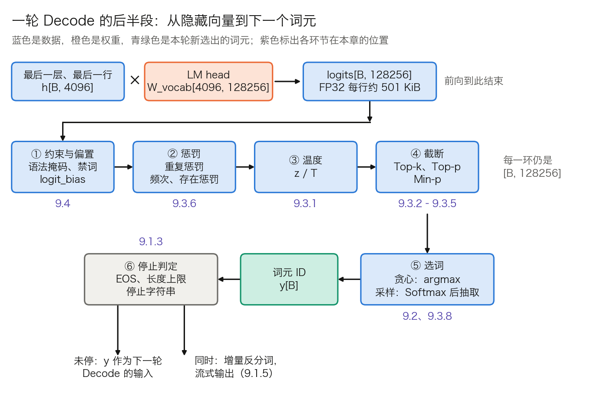
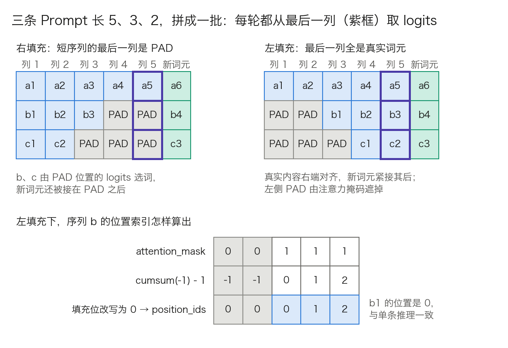
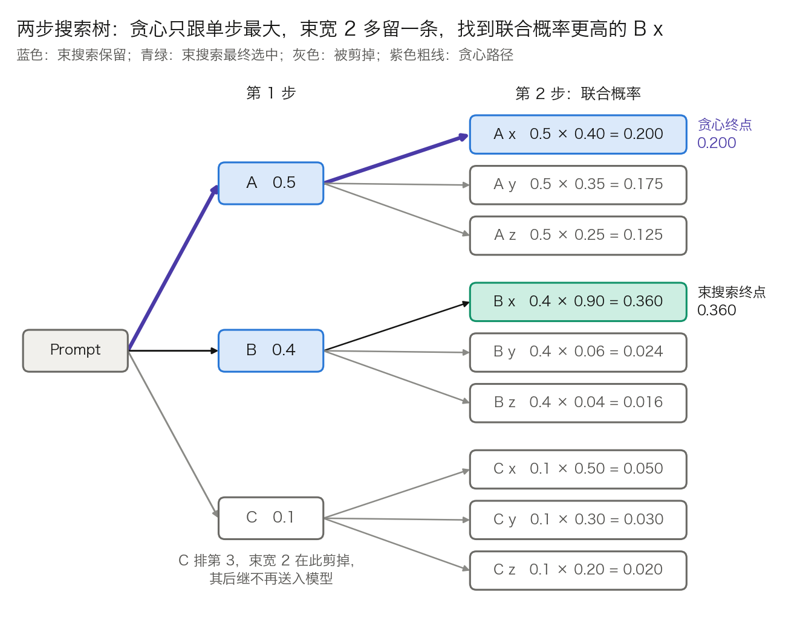
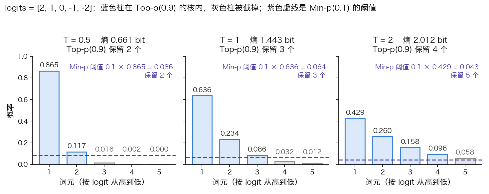
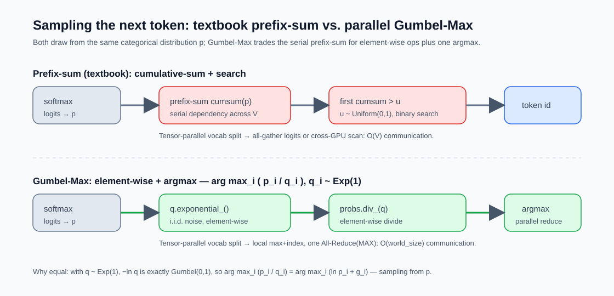
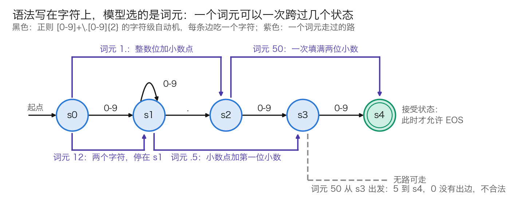
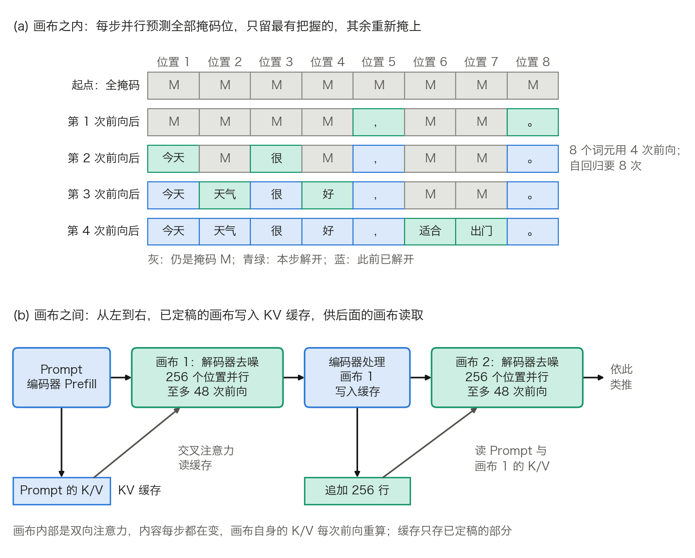

# 第九章：解码策略：模型如何生成文本

训练好的语言模型拥有了对文本的深层理解和生成能力，但**如何从模型输出的概率分布中选取词元来构建完整的文本**，是一个独立且重要的技术问题。不同的解码策略直接影响生成文本的质量、多样性和一致性。

本章将从自回归解码的基本机制出发，逐步讨论贪心搜索、束搜索和各种采样策略的设计逻辑与适用场景，并探讨推理时计算扩展这一新兴范式——如何通过在推理阶段投入更多计算来提升模型的深度推理能力。本章最后跳出自回归的框架，介绍**扩散语言模型**这条不同的生成路线，用它照出「生成必须串行」这个一直被默认成立的前提。

沿着这条线索，本章依次回答六个问题：

- 文本是一个词元接一个词元生成出来的，这个循环每一步重算什么、又复用什么？（[9.1 节](9.1_autoregressive_decode.md)）
- 每步都选概率最高的那个词元，为什么不等于整句最优？（[9.2 节](9.2_greedy_beam.md)）
- 把随机性放回来之后，多样性与质量之间的阈值该怎么定？（[9.3 节](9.3_sampling.md)）
- 采样只看概率，凭什么保证输出是一个合法的 JSON？（[9.4 节](9.4_constrained.md)）
- 在解码阶段多投入计算，能换来更强的推理吗？（[9.5 节](9.5_test_time_scaling.md)）
- 「从左到右、一次一个词元」这个前提，本身是必须的吗？（[9.6 节](9.6_diffusion_lm.md)）

## 1. 自回归解码：逐词生成的机制

[3.8 节](../03_components/3.8_gpt_inference_flow.md)跟踪的是一次前向的内部：6 个词元怎样流过一层 Transformer，变成一行 logits。本节讲前向与前向之间的那个循环：每一轮送进什么、logits 怎样变成一个词元、何时停下、多条序列怎样拼成一批、选出的词元怎样变回文字。9.2 到 9.4 节各自展开这条链上的一环，本节先把整条链摆出来。

### 1.1 解码循环：每一轮送进什么、读什么、写什么

**自回归解码**（autoregressive decoding）来自对序列概率的链式分解：

$$
p(y_1,\dots,y_n \mid x) = \prod_{k=1}^{n} p(y_k \mid x,\ y_{<k})
$$

模型一次前向只给出右边的一个因子，即“下一个词元”的分布。选定 $y_k$ 之后，它才能成为第 $k+1$ 个因子的条件，所以同一条回答里的词元只能一个接一个产生。

带 KV 缓存（见 [10.2 节](../10_inference_optimization/10.2_kv_cache.md)）时，循环分两种前向。第 1 轮是 Prefill：一次送入整个 Prompt，为每个位置算出 K、V 写入缓存，并由最后一个位置选出 $y_1$。此后每一轮是 Decode：只送入上一轮选出的那一个词元，它的 Query 对着缓存里的全部 K、V 打分。表 9-1 以 Prompt 长 `P = 1,000`、共选出 `n = 500` 个词元（最后一个是 EOS）为例，列出各轮的输入与缓存。

| 轮次 | 前向类型 | 送入的词元 | 送入行数 | 读缓存行数 | 本轮后缓存行数 | 产出 |
| ---: | --- | --- | ---: | ---: | ---: | --- |
| 1 | Prefill | Prompt 全部 | 1,000 | 0 | 1,000 | $y_1$ |
| 2 | Decode | $y_1$ | 1 | 1,000 | 1,001 | $y_2$ |
| 3 | Decode | $y_2$ | 1 | 1,001 | 1,002 | $y_3$ |
| k | Decode | $y_{k-1}$ | 1 | `P + k − 2` | `P + k − 1` | $y_k$ |
| 500 | Decode | $y_{499}$ | 1 | 1,498 | 1,499 | $y_{500}$ = EOS |

表 9-1：带 KV 缓存的解码循环。每轮的注意力还要读本轮新写入的那一行，表中“读缓存行数”只数此前已有的行。

从表中读出三个数：

- **前向次数。** 选出 n 个词元需要 1 次 Prefill 加 `n − 1` 次 Decode，本例是 `1 + 499`。最后选出的 EOS 不再送入模型，缓存停在 `P + n − 1 = 1,499` 行。
- **缓存省掉的计算。** 不用缓存时，第 k 轮要把此前的 `P + k − 1` 行全部重算，总行数是 `nP + n(n − 1)/2 = 500,000 + 124,750 = 624,750`；用缓存只算 `1,000 + 499 = 1,499` 行，相差约 417 倍。
- **每轮的成本不是常数。** Decode 每轮读的缓存行数随 k 增长，第 500 轮要读第 2 轮的约 1.5 倍；与权重相乘的部分则每轮相同（算法见 3.8.8）。

逐词生成的代价在 3.8.8 已经算过：Decode 每轮要把全部权重读一遍，却只算一行，瓶颈在显存带宽。绕开“一轮一个词元”的办法有两类：投机解码让一次前向确认多个词元（见 [10.6 节](../10_inference_optimization/10.6_speculative_decoding.md)），扩散语言模型改掉从左到右的分解本身（见 [9.6 节](9.6_diffusion_lm.md)）。两者都没有取消“已选词元成为后续条件”这一点。

这一点还带来一个后果：词元一经选出就不能修改，早期的一个坏选择会成为此后所有轮次的条件。束搜索（[9.2 节](9.2_greedy_beam.md)）和多路采样（[9.5 节](9.5_test_time_scaling.md)）都是为了减轻这个后果，办法是同时保留几条路径。

### 1.2 从 logits 到词元：一条处理链

**问题。** 前向交出的是一行分数，不是一个词元。中间还隔着若干步处理，API 里的 `temperature`、`top_p`、`presence_penalty`、`response_format` 各自作用在其中一步。不知道它们的先后，就无法解释参数之间的相互影响。

**形状。** 每条序列只取最后一层、最后一个位置的隐藏向量，经 LM head 得到 logits：

- GPT-3 Small：`h[B, 768] × W_vocab[768, 50257] → logits[B, 50257]`
- Llama 3 8B：`h[B, 4096] × W_vocab[4096, 128256] → logits[B, 128256]`

`B` 是批内序列数。此后直到选出词元，每一步的输入输出都是这个形状。

**大小。** 采样通常在 FP32 下做（原因见 9.3.8）。Llama 3 8B 的一行 logits 是 `128,256 × 4 = 513,024` 字节，约 501 KiB；`B = 256` 时为 `256 × 513,024` 字节，约 125 MiB。GPT-3 Small 的一行是 `50,257 × 4 = 201,028` 字节，约 196 KiB。

**LM head 占多少计算。** 沿用 3.8.8 的数法，一次 `[a, b] × [b, c]` 的乘法约 `2abc` 次运算。Llama 3 8B 每层的矩阵参数是 Q、O 各 `4096 × 4096`，K、V 各 `4096 × 1024`，MLP 三个 `4096 × 14336`，合计 218,103,808 个；32 层共约 69.8 亿个。LM head 是 `4096 × 128,256 = 525,336,576` 个，约 5.25 亿。一轮 Decode 的矩阵乘法约 `2 × (69.8 + 5.25) 亿 ≈ 150 亿` 次运算，LM head 占 `5.25 ÷ 75.05 ≈ 7.0%`。词表越大、模型越小，这个比例越高。

LM head 之后的各步都是对 12.8 万个数的逐元素运算或规约，每一遍的运算量比前向低约五个数量级（`150 亿 ÷ 12.8 万 ≈ 1.2 × 10⁵`）。它们的开销来自别处：逐请求不同的参数要整理成张量，Top-p 要排序，约束掩码在 CPU 上生成（见 [11.7 节](../11_serving/11.7_constrained_decoding.md)）。



图 9-1：一轮 Decode 的后半段（[生成脚本](https://github.com/yeasy/llm_internals/blob/main/tools/figures/ch09_logits_pipeline.py)）。形状按 Llama 3 8B；环节的先后取 vLLM 采样器的顺序，其他引擎的差异见 9.3.7。

表 9-2 逐环节列出作用与常见参数名。

| 环节 | 对 logits 做什么 | OpenAI 风格 API 与 vLLM `SamplingParams` 中的参数 | 会改变 argmax 吗 | 本章位置 |
| --- | --- | --- | --- | --- |
| ① 约束与偏置 | 不合法词元置 −∞；指定词元加常数 | `response_format`、`allowed_token_ids`、`bad_words`、`logit_bias`、`min_tokens` | 会 | 9.4 |
| ② 惩罚 | 已出现词元的 logit 调低 | `repetition_penalty`、`frequency_penalty`、`presence_penalty` | 会 | 9.3.6 |
| ③ 温度 | 整行除以温度 $\tau$ | `temperature` | 不会 | 9.3.1 |
| ④ 截断 | 低概率词元置 −∞ | `top_k`、`top_p`、`min_p` | 不会 | 9.3.2 到 9.3.5 |
| ⑤ 选词 | argmax，或 Softmax 后按概率抽取 | `temperature = 0` 即贪心；`seed` | | 9.2、9.3.8 |
| ⑥ 停止判定 | 检查选出的词元与已生成文本 | `max_tokens`、`stop`、`stop_token_ids`、`ignore_eos` | | 9.1.3 |

表 9-2：logits 处理链的各环节。参数名取自 vLLM 的 [`sampling_params.py`](https://github.com/vllm-project/vllm/blob/main/vllm/sampling_params.py)；`response_format` 是 OpenAI 风格接口的写法。

“会改变 argmax 吗”一列有实际用途。温度和截断都保留 logit 最高的那个词元，贪心解码可以整段跳过③④，直接在②的输出上取 argmax。vLLM 的采样器据此把处理器分成两组，先执行会影响贪心结果的，再按请求分出贪心与随机两条路径。

链上还有一条旁路：返回给调用方的 `logprobs`。vLLM 默认在语法掩码之后、①的其余处理与②③④之前就算好对数概率。无约束请求拿到的是模型的原始分布；约束请求拿到的是已遮掉不合法词元的分布。两者都不是实际抽样所用的分布，用 `logprobs` 做置信度估计时要先弄清拿到的是哪一个。

### 1.3 何时停止

循环有四种出口，见表 9-3。前两种看词元 ID，第三种看文本，第四种看长度。

| 出口 | 判定对象 | 典型参数 | 结束原因 | 常见故障 |
| --- | --- | --- | --- | --- |
| 选中结束词元 | 本轮选出的 ID 是否在停止集合内 | `eos_token_id`（可为列表）、`stop_token_ids` | `stop` | 集合配漏，停不下来 |
| 达到生成上限 | 已生成词元数 | `max_tokens`、`max_new_tokens` | `length` | 输出被截断，JSON 不完整 |
| 命中停止字符串 | 已生成文本的尾部 | `stop`、`stop_strings` | `stop` | 按词元 ID 匹配而漏判 |
| 上下文用尽 | `P + 已生成数` 与模型上限 | 引擎的最大序列长度 | `length` | 长 Prompt 留给输出的余量不足 |

表 9-3：解码循环的四种出口。

**结束词元可以不止一个。** Llama 3 的[官方分词器](https://github.com/meta-llama/llama3/blob/main/llama/tokenizer.py)定义 `stop_tokens = {<|end_of_text|>, <|eot_id|>}`。特殊词元排在 128,000 个基础词元之后，前者是第 2 个，ID 为 128001；后者是第 10 个，ID 为 128009。`<|end_of_text|>` 表示整段文本结束，`<|eot_id|>` 表示一轮对话结束，对话模板在每条消息末尾写的是后者。对话模型答完一轮时选出的是 `<|eot_id|>`；若停止集合里只配了 `<|end_of_text|>`，循环不会停，模型继续往下写，直到撞上长度上限。“模型停不下来”多数是这类配置问题，不是模型问题。

**下限与忽略。** `min_tokens` 在生成数不足时把停止集合内的词元置为 −∞，属于表 9-2 的环节①。`ignore_eos` 让循环无视结束词元、跑满 `max_tokens`，用于压测时固定输出长度。

**停止字符串要在文本上匹配。** 同一个字符串可以有多种切法，也可以只是某个更长词元的一部分，按 ID 序列匹配会漏判。实现是每轮把新词元反分词，在已生成文本的尾部查找。流式输出时还要多一步：尾部若是某个停止字符串的前缀，这几个字符先扣住不发，等下一轮确认；否则调用方会先收到半个停止串。

**结束原因要检查。** `length` 表示输出是被截断的，内容不完整。约束解码（9.4 节）保证每个前缀合乎语法，但不保证输出在截断之前写完。

**批内先结束的序列。** 静态批处理中，先结束的序列不能离开，只能继续占位。Hugging Face `generate()` 用一个 `unfinished_sequences` 向量标记，已结束的行此后每轮填入 `pad_token_id`，整批要等最长的一条。连续批处理让结束的序列立即退出、新请求补位（见 [11.2 节](../11_serving/11.2_continuous_batching.md)）。

### 1.4 批量生成：左填充、位置索引与不填充的方案

**问题。** 同一批里的 Prompt 长度不同，张量却要求等长。训练时的惯例是右填充，把 `[PAD]` 补在末尾，损失用掩码排除填充位即可。生成不同：每轮取的是最后一列的 logits。右填充时，短序列的最后一列是 `[PAD]`，模型从填充符之后续写，输出立刻跑偏，新词元还被接在填充之后。

**左填充。** 把 `[PAD]` 补在开头，真实内容右端对齐，最后一列对每条序列都是真实词元。配套要做两件事：

1. 注意力掩码把左侧填充位标为不可见。
2. 位置索引从真实内容起算。Hugging Face `generate()` 的算法是 `position_ids = attention_mask.cumsum(-1) - 1`，再把填充位改写为 0。

图 9-2 画出两种填充，以及序列 b 的位置索引怎样算出。



图 9-2：批量生成时的右填充与左填充，下半幅是左填充下位置索引的算法（[生成脚本](https://github.com/yeasy/llm_internals/blob/main/tools/figures/ch09_padding_sides.py)）。

位置索引为什么必须跳过填充，要分两种位置编码说。学习式绝对位置下，位置 0 和位置 2 查到的是两个不同的向量，错位直接改变输入。RoPE 下，注意力分数只依赖两个位置之差（见[第四章](../04_position_encoding/README.md)），整条序列统一平移在精确算术下不改变结果；但平移量随同批的最长 Prompt 变化，同一请求在不同批里会得到不同的浮点结果，也无法与单条推理逐位对照。两种情形的结论相同，理由不同。

实现上，Hugging Face 的分词器用 `padding_side="left"` 设置；`generate()` 发现仅解码器模型的输入是右填充时会给出警告。“单条推理正常、批量推理胡言乱语”这类故障，多半错在填充方向，模型和权重没有问题。

**另外两种方案。** 左填充不是唯一做法，表 9-4 列出三种方案的取舍。

| 方案 | 做法 | 代价 |
| --- | --- | --- |
| 左填充 | Prompt 右端对齐，Prefill 一次算完整批 | 填充位白占计算与 KV 缓存；批内长度差越大浪费越多 |
| 左对齐、从最短处起步 | 缓冲区左对齐，从最短 Prompt 的长度开始逐列前进；该列若仍属于某条 Prompt，用原词元覆盖采样结果 | 无填充；长 Prompt 超出最短长度的部分被逐词元处理，失去 Prefill 的并行 |
| 不填充 | 各序列的词元首尾相接，拼成一维批，注意力内核按每条序列的起止位置计算 | 需要专门的内核与调度器；连续批处理引擎的标准做法 |

表 9-4：批量生成对齐长度的三种方案。第二种是 Llama 3 官方参考实现 [`generation.py`](https://github.com/meta-llama/llama3/blob/main/llama/generation.py) 的做法，其中 `input_text_mask` 标记哪些格子属于 Prompt；第三种见 11.2 节和 [11.3 节](../11_serving/11.3_scheduler_loop.md)。

### 1.5 流式输出与增量反分词

**问题。** 流式输出要求每选出一个词元就把对应的文字发给用户。但词元与字符不是一一对应的，逐个词元单独反分词会出错。

**原因。** 字节级 BPE 的词元是字节串（见 [3.1 节](../03_components/3.1_tokenization.md)）。UTF-8 下一个汉字占 3 个字节，例如“智”是 `E6 99 BA`；表情符号多为 4 个字节。词表里没有整字对应的词元时，一个字的几个字节会分属相邻的两三个词元。只拿到前一个词元时，手里是一段不完整的 UTF-8，解码器只能输出替换字符 U+FFFD，显示为乱码。另一类问题是空格：许多分词器把词前空格并入词元，单独解码一个词元与放在上下文里解码，得到的空格可能不同。

**做法。** 增量反分词不解码单个词元，而是解码一个窗口。vLLM 的 [`detokenize_incrementally`](https://github.com/vllm-project/vllm/blob/main/vllm/tokenizers/detokenizer_utils.py) 维护两个下标 `prefix_offset` 和 `read_offset`：

1. 把 `prefix_offset` 到 `read_offset` 的词元解码成前缀文本。
2. 把 `prefix_offset` 到末尾的词元解码成新文本。
3. 新文本若以 U+FFFD 结尾，说明末尾的字节序列尚未完整，本轮不输出，两个下标不动。
4. 否则输出新文本比前缀文本多出的部分，并把两个下标前移。

窗口带上几个已输出的词元，是为了让空格和合并规则在正确的上下文里生效。

**代价与边界。** 用户看到的字符会比词元晚一到两轮。延迟指标按词元计，例如每词元输出时间（Time Per Output Token，TPOT，定义见 [11.13 节](../11_serving/11.13_best_practices.md)）；用户的体感按字符计，两者因此略有出入。非流式输出没有这个问题，结束后一次性解码全部词元即可。

## 2. 贪心搜索与束搜索：确定性与近似搜索

本节讨论图 9-1 第⑤环的确定性一侧：不引入随机数，选哪个词元完全由分数决定。贪心搜索按单步最高概率选；束搜索同时保留多条候选，用更大的搜索范围逼近整句最优。本节回答四个问题：单步最优为什么不等于整句最优，束搜索的一步具体做什么，它偏好短输出该怎样修正，以及束宽为什么不是越大越好。最后一问的答案引出 9.3 节的采样。

### 2.1 贪心搜索：单步最优不等于整句最优

**贪心搜索**（greedy search）每一轮取概率最高的词元：

$$
y_k = \arg\max_{v}\ p(v \mid x,\ y_{<k})
$$

实现上不必做 Softmax，直接对 logits 取 argmax 即可，因为 Softmax 保持大小顺序。它不需要随机数，延迟最低；多数 API 里 `temperature = 0` 就是走这条分支。

缺陷用一棵两步的树就能算清。设第 1 步有三个候选，概率是 A 0.5、B 0.4、C 0.1；第 2 步的条件分布见图 9-3。贪心在第 1 步选 A，第 2 步选 A 之后最高的 x，整条路径的联合概率是 `0.5 × 0.40 = 0.200`。而 B 之后的 x 概率高达 0.90，路径 B x 的联合概率是 `0.4 × 0.90 = 0.360`，是贪心结果的 1.8 倍。9 条路径的联合概率加起来是 1，B x 才是其中最大的。



图 9-3：两步搜索树（[生成脚本](https://github.com/yeasy/llm_internals/blob/main/tools/figures/ch09_beam_tree.py)）。贪心路径 A x 的联合概率是 0.200；束宽 2 多保留了 B，找到 0.360 的 B x。

原因在于第 1 步选 A 时，看不到 A 之后的分布很平、B 之后的分布很尖。要找到整句最优，理论上得比较全部 $|V|^n$ 条路径；Llama 3 的词表下，仅两步就有 `128,256² ≈ 1.6 × 10¹⁰` 条。束搜索是介于两者之间的折中。

### 2.2 束搜索的一步：扩展、打分、剪枝、收束

**束搜索**（beam search）始终保留 W 条得分最高的部分序列，W 称为**束宽**（beam width）。本节用 W 而不是 B 记它，因为 B 在全书其余各处表示批大小。得分是累积对数概率：

$$
s(y_{1:k}) = \sum_{i=1}^{k} \log p(y_i \mid x,\ y_{<i})
$$

用对数是为了把连乘变成连加，避免长序列的概率下溢。每一轮做四件事。

**第 1 步：扩展。** W 条序列作为一批送入模型，得到 `logits[W, n_vocab]`，逐行做 log-softmax 得到 `logp[W, n_vocab]`。

**第 2 步：打分。** 把每条序列已有的得分加到它那一行上：`s[W, 1] + logp[W, n_vocab] → cand[W, n_vocab]`。这张表的第 b 行第 v 列，是“第 b 条序列后接词元 v”的得分。

**第 3 步：剪枝。** 把 `cand` 展平成 `W × n_vocab` 个数，取最大的 W 个。Llama 3 8B 取 `W = 4` 时是从 `4 × 128,256 = 513,024` 个候选里取 4 个。设某个入选者在展平后的下标是 j，则它的父序列是 `j ÷ n_vocab` 的整数商（记作 `beam_idx`），新词元是余数。

**第 4 步：收束。** 入选者若以 EOS 结尾，就移入已完成集合，不再扩展；其余的成为下一轮的 W 条序列。

沿用图 9-3 的树，取 `W = 2`。第 1 轮保留 A（`ln 0.5 = −0.693`）和 B（`ln 0.4 = −0.916`），C 被剪掉。第 2 轮的 `cand[2, 3]` 共 6 个候选，见表 9-5。以 B x 为例：`−0.916 + ln 0.90 = −0.916 − 0.105 = −1.022`（末位因舍入差 1）。

| 候选 | 父序列得分 | 本步对数概率 | 累积得分 | 联合概率 | 是否保留 |
| --- | ---: | ---: | ---: | ---: | --- |
| B x | −0.916 | −0.105 | −1.022 | 0.360 | 是 |
| A x | −0.693 | −0.916 | −1.609 | 0.200 | 是 |
| A y | −0.693 | −1.050 | −1.743 | 0.175 | 否 |
| A z | −0.693 | −1.386 | −2.079 | 0.125 | 否 |
| B y | −0.916 | −2.813 | −3.730 | 0.024 | 否 |
| B z | −0.916 | −3.219 | −4.135 | 0.016 | 否 |

表 9-5：束宽 2 在第 2 轮的 6 个候选，按累积得分排序。保留的两条分别来自父序列 B 和 A，`beam_idx = [B, A]`。

**KV 缓存要跟着重排。** 新一轮的第 1 条序列来自旧的第 2 条，它要读的是旧第 2 条的缓存。朴素实现每轮按 `beam_idx` 把各层的 K、V 重新收集一遍，Hugging Face 里对应 `_reorder_cache` 或缓存对象的 `reorder_cache(beam_idx)`。若两条新序列来自同一个父序列，父序列的缓存还要复制一份。分页 KV 缓存把这件事变成改块表里的指针，只在写入共享块时才复制（见 [11.4 节](../11_serving/11.4_kv_memory_management.md)的写时复制）。

**何时结束。** 已完成集合攒够 W 条并不一定能停：仍在扩展的序列可能在归一化之后反超。Hugging Face 用 `early_stopping` 控制：取 `True` 时攒够 `num_beams` 条即停；取 `False` 时用启发式判断继续搜索是否还可能更优；取 `"never"` 时只有确认不可能更优才停。结束后按归一化得分返回前 `num_return_sequences` 条。

**边界。** 束搜索仍是启发式：早期被剪掉的序列不会再回来。它的输出对束宽、长度归一化和停止规则都敏感，三者任一不同，结果就可能不同。

### 2.3 长度偏置与长度惩罚

**问题。** 每个词元的对数概率都是负数，序列越长，累积得分越低。不加处理的束搜索因此偏好短输出，极端情形是直接输出 EOS。

**对策。** 选优时把得分除以一个随长度增长的量。常见两种形式：直接除以 $|y|^{\alpha}$，或用 [GNMT](https://arxiv.org/abs/1609.08144) 的长度惩罚

$$
lp(y) = \left(\frac{5 + |y|}{6}\right)^{\alpha},\qquad \text{score}(y) = \frac{\log P(y)}{lp(y)}
$$

$\alpha = 0$ 时不归一化，$\alpha$ 越大越偏向长序列；GNMT 常取 0.6 到 0.7。

**算例。** 比较两条候选：短序列 5 个词元、每个词元概率 0.8，累积得分 `5 × ln 0.8 = −1.116`；长序列 10 个词元、每个词元概率 0.85，得分 `10 × ln 0.85 = −1.625`。长序列每一步都比短序列更有把握，未归一化时却输了。以 GNMT、$\alpha = 0.6$ 为例：`lp(5) = (10/6)^0.6 = 1.359`，`lp(10) = (15/6)^0.6 = 1.733`，归一化后是 `−1.116 ÷ 1.359 = −0.821` 对 `−1.625 ÷ 1.733 = −0.938`。表 9-6 给出各种取法的结果。

| 归一化方式 | 短序列得分 | 长序列得分 | 胜者 |
| --- | ---: | ---: | --- |
| 不归一化（$\alpha = 0$） | −1.116 | −1.625 | 短 |
| GNMT，$\alpha = 0.6$ | −0.821 | −0.938 | 短 |
| GNMT，$\alpha = 1.0$ | −0.669 | −0.650 | 长 |
| 除以 $\lvert y\rvert^{0.6}$ | −0.425 | −0.408 | 长 |
| 除以 $\lvert y\rvert^{1.0}$（每词元平均） | −0.223 | −0.163 | 长 |

表 9-6：同一对候选在五种长度归一化下的得分。GNMT 式分子里的常数 5 让短序列的惩罚涨得慢，同样的 $\alpha$ 下比直接除以长度更保守。

表 9-6 说明 $\alpha$ 是一个要按任务调的旋钮：同一对候选，换一种归一化，胜负就翻转。取得过大，又会反过来奖励冗长。

**实现中的参数名容易读反。** Hugging Face 的 `length_penalty` 是上面第二种形式里的指数：得分除以 `长度 ** length_penalty`，默认 1.0。得分是负数，所以取正值偏向更长的序列，取负值偏向更短。名字叫“惩罚”，调大却得到更长的输出。

### 2.4 代价：计算、KV 缓存与延迟

常见的说法是“束搜索的计算量和 KV 缓存约为贪心的 W 倍”。这只对 Decode、且不共享前缀的朴素实现成立，分三项看。

**计算。** Prompt 对 W 条序列是同一份，Prefill 只需做一次。Decode 每轮送入 W 行，与权重相乘的部分是贪心的 W 倍。

**KV 缓存。** 设 Prompt 长 P、已生成 t 个词元。朴素实现每条序列各存一份，占用正比于 `W × (P + t)`。共享 Prompt 之后上限是 `P + W × t`；各序列已生成部分的公共前缀还能继续共享，实际更低。以 Llama 3 8B 为例，每个词元的 K、V 是 `2 × 8 × 128 × 32 = 65,536` 个数（见 3.8.8），BF16 下 128 KiB。取 `P = 1,000`、`t = 200`、`W = 4`：朴素实现是 `4 × 1,200 = 4,800` 个词元，合 600 MiB；共享 Prompt 后至多 `1,000 + 4 × 200 = 1,800` 个词元，合 225 MiB，约为前者的八分之三。分页缓存下束搜索的实测节省量见 11.4.4。

**延迟。** W 条序列作为一批并行前向。Decode 受显存带宽限制，批内多几行几乎不增加单轮耗时（见 3.8.8），所以单请求延迟的增幅远小于 W 倍。代价落在吞吐上：这 W 行本可以服务 W 个不同的请求。

**不能流式输出。** 得分最高的序列在结束前随时可能换成另一条，已经发给用户的前缀无法收回。对话场景要求边生成边显示，这是束搜索在对话产品中少见的直接原因，与成本无关。

### 2.5 束宽不是越大越好

束搜索的目标是找概率更高的序列。机器翻译的经验却是：束宽超过某个值之后，译文质量反而下降。

- [Koehn 与 Knowles](https://arxiv.org/abs/1706.03872) 在 8 个语言对上观察到，几乎所有情形下，束宽超过某个最优值后译文都会变差，主要原因是束越宽、译文越短。
- [Stahlberg 与 Byrne](https://arxiv.org/abs/1908.10090) 为 Transformer 翻译模型实现了精确搜索，在整个 WMT15 英德测试集上找出模型真正的最高分输出。结果是 51.8% 的句子，最高分输出是空译文，即只有一个结束符；精确搜索的 BLEU 只有 2.1，束宽 10 的束搜索却有 30.3。束宽加到 100，仍有 53.62% 的句子没有找到最高分输出。

第二项结果的含义是：束搜索之所以管用，恰恰因为它搜得不彻底。模型把最高概率给了一个明显错误的输出，窄束的搜索误差碰巧避开了它。“概率最高的序列”与“最好的序列”不是一回事，这一点不因搜索更强而改变。

开放式生成里同样如此。[Holtzman 等人](https://arxiv.org/abs/1904.09751)指出，以似然为解码目标会得到平淡而且反复重复的文本；人写的文本逐词元看并不总是落在高概率区，而是不时出现低概率的词。一旦进入重复，模型给“继续重复”的概率会越来越高，最大化类方法就此锁死在循环里。9.3 节的采样从这里出发：不再追求最高概率，而是从分布里抽取，同时截掉不可靠的尾部。

**束搜索今天用在哪里。** 输出由输入基本确定、长度适中的任务仍是它的主场：机器翻译、语音识别、摘要。开放式对话和长文写作改用采样。它的骨架还以另一种形式出现：把“词元”换成“推理步骤”、把对数概率换成过程奖励模型的打分，就是 [9.5 节](9.5_test_time_scaling.md)的按步骤搜索。若要同一批候选彼此不同，可用[多样束搜索](https://arxiv.org/abs/1610.02424)，它把束分成若干组，并在打分时惩罚与前面各组重复的选择。

## 3. 采样策略：温度、Top-k 与 Top-p 的设计直觉

9.2.5 的结论是概率最高的序列未必最好，最大化类方法在开放式生成里还会陷入重复。**采样**（sampling）换一个目标：不找最高概率，而是按模型给出的分布随机抽取下一个词元。直接从完整分布抽取也有问题，词表有十几万项，尾部每一项概率极小，合起来却不可忽略，抽中其中任何一个都可能让后文跑偏。本节的各种策略都在回答同一个问题：抽取之前，怎样改造这个分布。

对照图 9-1，温度是第③环，Top-k、Top-p、Min-p 是第④环，惩罚类参数是第②环，最后的抽取是第⑤环。全节用同一组 logits `[2, 1, 0, −1, −2]` 作算例，5 个词元按 logit 从高到低编号。

### 3.1 温度：调分布的熵

**温度**（temperature）$\tau$ 在 Softmax 之前把整行 logits 除以同一个正数：

$$
p_i = \frac{\exp(z_i / \tau)}{\sum_j \exp(z_j / \tau)}
$$

形状上是把 `logits[B, n_vocab]` 逐行除以该行请求自己的温度，结果仍是 `[B, n_vocab]`，批内每个请求可以有自己的温度。

**一格的算术。** 取 $\tau = 1$：五个指数是 `e² = 7.389`、`e¹ = 2.718`、`e⁰ = 1`、`e⁻¹ = 0.368`、`e⁻² = 0.135`，和为 11.611，第 1 个词元的概率是 `7.389 ÷ 11.611 = 0.636`。取 $\tau = 0.5$ 相当于 logits 变成 `[4, 2, 0, −2, −4]`，取 $\tau = 2$ 相当于 `[1, 0.5, 0, −0.5, −1]`。表 9-7 是三种温度下的完整结果。

| $\tau$ | $p_1$ | $p_2$ | $p_3$ | $p_4$ | $p_5$ | 熵（bit） | $2^{H}$ | Top-p(0.9) 保留 | Min-p(0.1) 保留 |
| ---: | ---: | ---: | ---: | ---: | ---: | ---: | ---: | ---: | ---: |
| 0.5 | 0.8647 | 0.1170 | 0.0158 | 0.0021 | 0.0003 | 0.661 | 1.58 | 2 个 | 2 个 |
| 1.0 | 0.6364 | 0.2341 | 0.0861 | 0.0317 | 0.0117 | 1.443 | 2.72 | 3 个 | 3 个 |
| 2.0 | 0.4287 | 0.2600 | 0.1577 | 0.0956 | 0.0580 | 2.012 | 4.03 | 4 个 | 5 个 |

表 9-7：同一组 logits 在三种温度下的概率、熵与截断结果。熵 $H = -\sum_i p_i \log_2 p_i$；$2^{H}$ 可读作“等效候选数”，5 个词元均匀分布时为 5。后两列在 9.3.3 和 9.3.4 用到。



图 9-4：表 9-7 的图示（[生成脚本](https://github.com/yeasy/llm_internals/blob/main/tools/figures/ch09_temperature_truncation.py)）。温度升高，分布变平，Top-p 的核随之变大；Min-p 的阈值随峰值一起下降。

**为什么除在 logits 上。** 它等价于对原概率取 $1/\tau$ 次幂再归一化：$p_i^{(\tau)} \propto p_i^{1/\tau}$。$\tau = 0.5$ 就是把 $\tau = 1$ 的概率逐项平方后归一化，`0.6364² ÷ (0.6364² + 0.2341² + …) = 0.8647`，与表中一致。幂运算保持大小顺序，所以温度不改变 argmax，只改变大小之间的差距。若改为把概率乘一个常数再归一化，结果原样返回，起不到调节作用。

**两个极限。** $\tau \to 0$ 时最大项的指数压倒其余各项，分布收缩到 argmax，等同贪心。实现里不会真的除以 0：vLLM 把温度低于 `1e-5` 的请求直接送入贪心分支；Hugging Face 要求温度严格为正，贪心由 `do_sample=False` 指定。$\tau \to \infty$ 时各项趋于相等，分布趋于均匀，Llama 3 词表下每个词元约 `1 ÷ 128,256 ≈ 7.8 × 10⁻⁶`。

**边界。** 温度对整行一视同仁。调高它，头部几个合理候选之间更均衡，尾部十几万个不合理候选的总质量也一起上涨。只靠温度无法同时得到“头部多样”和“尾部干净”，这是需要截断的原因。

### 3.2 Top-k：只留前 k 名

**Top-k 采样**只保留概率最高的 k 个词元，其余置零后重新归一化：

$$
p^{\text{top-}k}_i =
\begin{cases}
p_i \Big/ \sum_{j \in \text{Top-}k} p_j & i \in \text{Top-}k \\
0 & \text{其他}
\end{cases}
$$

[Fan 等人](https://arxiv.org/abs/1805.04833)在故事生成中用的是 `k = 10`。算例取 $\tau = 1$、`k = 2`：保留 0.6364 和 0.2341，和为 0.8705，归一化后是 `[0.7311, 0.2689]`。实现上不必真的算概率，把第 k 大的 logit 当阈值，低于它的置为 −∞ 即可；取前 k 大用部分选择，不需要对整张词表排序。

**边界。** k 是固定的，而合理候选的个数随上下文变化。“中华人民”之后几乎只有“共和国”一个合理续写，`k = 50` 会放进 49 个噪声；一句话的开头可能有上百种合理写法，`k = 50` 又砍掉了一半。

### 3.3 Top-p：只留累积概率达到 p 的核

**Top-p 采样**（nucleus sampling）由 [Holtzman 等人](https://arxiv.org/abs/1904.09751)提出。把词元按概率从高到低排列，取最短的前缀使累积概率达到 p：

$$
S = \{x_{(1)},\dots,x_{(m)}\},\qquad m = \min\Big\{m' : \sum_{i=1}^{m'} p_{(i)} \ge p\Big\}
$$

再在 S 内重新归一化。算例取 $\tau = 1$、`p = 0.9`：累积概率依次是 0.6364、0.8705、0.9567，第 3 个词元使它越过 0.9，故 `m = 3`；归一化后是 `[0.6652, 0.2447, 0.0900]`。

**集合大小跟着熵走。** 表 9-7 里同样的 `p = 0.9`，熵为 0.661 bit 时留 2 个，1.443 bit 时留 3 个，2.012 bit 时留 4 个。模型有把握时核小，没把握时核大，不需要像 k 那样按场景重调。常用取值是 0.9 到 0.95。

**失效情形：分布被拉平时，核里装满尾部。** Top-p 花的是一份固定的累积概率预算，不看买进来的每一项有多小。设某一步头部只有 1 个词元、概率 0.3，其余 0.7 均摊给 10,000 个尾部词元，每个 `7 × 10⁻⁵`。`p = 0.9` 要求再凑 0.6，需要 `0.6 ÷ (7 × 10⁻⁵) ≈ 8,572` 个尾部词元。归一化后，抽中尾部的概率是 `0.6 ÷ 0.9 = 2/3`。高温采样恰恰会制造这种分布。

**成本。** 求核需要按概率排序。Llama 3 的 logits 有 128,256 列，即 128,000 个基础词元加 256 个保留的特殊词元（见 9.1.3）。对这么多项做比较排序约 `n log₂ n ≈ 2.2 × 10⁶` 次比较，每行每轮一次，是采样阶段最贵的一步。vLLM 的 PyTorch 原生路径 `apply_top_k_top_p_pytorch` 在文档字符串里直接写明“排序在大批量下可能很慢”；9.3.8 会看到免排序的替代做法。

### 3.4 Min-p：阈值跟着峰值走

**Min-p 采样**（见 [Min-p 论文](https://arxiv.org/abs/2407.01082)）保留所有满足 $p_i \ge \alpha \cdot p_{\max}$ 的词元，$\alpha$ 是一个较小的比例。它逐个词元判断“相对峰值够不够格”，不看累积质量。

**长尾例。** 沿用上一小节的分布，取 $\alpha = 0.1$：阈值是 `0.1 × 0.3 = 0.03`，10,000 个尾部词元每个只有 `7 × 10⁻⁵`，全部淘汰，只剩头部 1 个。Top-p 在这里放进 8,572 个尾部词元，Min-p 一个不留，这就是“高温下更稳”的来源。

**边界。** 同一个例子也暴露了 Min-p 的另一面：

- 只剩 1 个候选时，采样退化为贪心，多样性归零。若那 10,000 个尾部词元其实是同样合理的续写（例如随机取一个名字），Min-p 会把它们全部丢掉。要留住它们需要 $\alpha \le 7 \times 10^{-5} \div 0.3 \approx 2.3 \times 10^{-4}$。
- $\alpha$ 与 Top-p 的 p 量纲不同，不能互相换算。
- 它并不总比 Top-p 严：表 9-7 中 $\tau = 2$ 时阈值是 `0.1 × 0.4287 = 0.0429`，5 个词元全部保留，Top-p(0.9) 只留 4 个。

Min-p 依赖 $p_{\max}$，因此与温度的先后有关。Hugging Face 把它排在温度之后，源码注释专门说明了这一点。

### 3.5 同一类方法：按某个判据截尾

Top-k、Top-p、Min-p 以及另外几种方法，做的都是同一件事：定一个判据，把不满足的词元置为 −∞。区别只在判据看什么，见表 9-8。

| 方法 | 保留条件 | 参数 | 判据看什么 |
| --- | --- | --- | --- |
| Top-k | 排名不超过 k | `top_k` | 名次 |
| Top-p | 落在累积概率达到 p 的最短前缀内 | `top_p` | 累积质量 |
| Min-p | $p_i \ge \alpha\, p_{\max}$ | `min_p` | 相对峰值的比例 |
| ε 采样 | $p_i \ge \varepsilon$ | `epsilon_cutoff` | 绝对概率 |
| η 采样 | $p_i \ge \eta,\ \eta = \min(\varepsilon,\ \sqrt{\varepsilon}\, e^{-H})$ | `eta_cutoff` | 绝对概率，阈值随熵下降 |
| 典型采样 | 信息量 $-\log p_i$ 最接近熵 H 的词元，累积到质量 τ | `typical_p` | 与熵的距离 |

表 9-8：几种截断方法的判据。参数名取自 Hugging Face 的 `GenerationConfig`；ε 与 η 采样出自 [Hewitt 等人](https://arxiv.org/abs/2210.15191)，典型采样出自 [Meister 等人](https://arxiv.org/abs/2202.00666)。

典型采样可能丢掉概率最高的词元，是表中唯一会改变 argmax 的方法。表中各方法只看当前这一行分布；[Mirostat](https://arxiv.org/abs/2007.14966) 走另一条路，它是带反馈的自适应 Top-k，每一步按已生成文本的实际困惑度调整 k，使困惑度维持在预设值附近。

### 3.6 直接改 logits：惩罚、偏置与水印

前面的方法不看历史，只看当前这一行分布。另一类参数根据已经生成的内容，直接改动个别词元的 logit，位于图 9-1 的第②环。

**重复惩罚。** `repetition_penalty` 源自 [CTRL 论文](https://arxiv.org/abs/1909.05858)。设系数 $\theta > 1$，对出现过的词元：

$$
z_i \leftarrow
\begin{cases}
z_i / \theta & z_i > 0 \\
z_i \cdot \theta & z_i \le 0
\end{cases}
$$

分符号处理是为了让正负 logit 都朝降低概率的方向变。算例：把第 1 个词元的 `z = 2` 除以 1.2 得 1.667，它的概率从 0.6364 降到 0.5564。

**频次惩罚与存在惩罚。** OpenAI 风格的 API 提供两个加性参数。设词元 j 已出现 $c_j$ 次：

$$
z_j \leftarrow z_j - c_j \cdot \alpha_{\text{freq}} - \mathbb{1}[c_j > 0] \cdot \alpha_{\text{pres}}
$$

`frequency_penalty` 按次数累加，重复越多扣得越多；`presence_penalty` 只要出现过就扣一个固定值。一个出现过 3 次的词元，在 $\alpha_{\text{freq}} = 0.2$、$\alpha_{\text{pres}} = 0.5$ 下被扣 `3 × 0.2 + 0.5 = 1.1`。vLLM 的 `apply_penalties` 逐字实现了这条公式，两个参数的取值范围是 −2 到 2。

**乘性与加性的差别。** 乘性惩罚的力度取决于 logit 自身的大小：$\theta = 1.2$ 时，`z = 5` 被减去 0.833，`z = 0.5` 只被减去 0.083，相差十倍；加性惩罚对两者都减同一个数。logit 的绝对尺度因模型而异，同一个 $\theta$ 换一个模型，效果可能差很多。

**统计范围不同。** Hugging Face 的重复惩罚默认把 Prompt 里的词元也算作“出现过”，要排除须传 `prompt_ignore_length`。vLLM 的重复惩罚同样统计 Prompt 加输出，频次与存在惩罚则只统计输出。迁移参数时要先确认范围。

**失效情形。**

- 惩罚分不清“复读”与“正当重复”。代码里的变量名、抽取任务里要原样照抄的实体、标点和虚词，都会被压低。Prompt 也计入时，模型被推着回避问题里出现过的词。
- 频次惩罚随长度累积。一篇长文里“的”出现 50 次并不异常，$\alpha_{\text{freq}} = 0.2$ 时它已被扣 `50 × 0.2 = 10`，相当于概率乘以 `e⁻¹⁰ ≈ 4.5 × 10⁻⁵`。输出越长，越容易在后半段变得不通顺。

**偏置。** `logit_bias` 给指定词元 ID 加一个常数，取很大的负值相当于禁用，很大的正值相当于强制。它与 9.4 的约束掩码同属第①环，区别是偏置表固定不变，掩码每一轮按语法状态重算。

**水印。** 文本水印也是对 logits 的偏置。[Kirchenbauer 等人](https://arxiv.org/abs/2301.10226)的做法是：每一步用前一个词元的哈希作随机种子。按它把词表分成占比 $\gamma$ 的绿名单和其余的红名单，给绿名单的 logit 统一加 $\delta$，再照常采样。检测方不需要模型，只需同一个哈希函数，数出文本里的绿词元个数 $|s|_G$，做单侧 z 检验：

$$
z = \frac{|s|_G - \gamma T}{\sqrt{T\,\gamma\,(1-\gamma)}}
$$

算例：$\gamma = 0.5$、长度 `T = 200`。无水印时绿词元的期望是 100，标准差 `√(200 × 0.25) = 7.07`；若数出 140 个，`z = 40 ÷ 7.07 = 5.66`。论文取 `z > 4` 为阈值，对应约 $3 \times 10^{-5}$ 的误报率。代价有两条：分布被人为扭曲；低熵文本（代码、事实性短答）里几乎每一步都只有一个合理词元，偏置插不进去，信号很弱。Hugging Face 把水印处理器排在所有其他处理之后。

### 3.7 组合与顺序：同一组参数，不同的分布

实际使用时这些策略叠在一起，例如 $\tau = 0.7$ 配 `top_p = 0.9`。处理的先后本身就是结果的一部分，而各引擎的默认顺序并不相同，见表 9-9。

| 引擎 | 默认顺序 | 依据 |
| --- | --- | --- |
| Hugging Face `generate()` | 重复惩罚 → 温度 → Top-k → Top-p → Min-p → 典型 → ε → η → 水印 | `_get_logits_processor` 中 `processors.append` 的先后 |
| vLLM | 白名单、禁词、`min_tokens`、`logit_bias` → 三种惩罚 → 温度 → Min-p → Top-k 与 Top-p | `Sampler` 类的文档字符串 |
| llama.cpp | 惩罚 → DRY → Top-nσ → Top-k → 典型 → Top-p → Min-p → XTC → 温度 | `common.h` 中 `samplers` 的默认值 |

表 9-9：三个引擎的默认采样顺序，均读自各自主干源码（[transformers](https://github.com/huggingface/transformers/blob/main/src/transformers/generation/utils.py)、[vLLM](https://github.com/vllm-project/vllm/blob/main/vllm/v1/sample/sampler.py)、[llama.cpp](https://github.com/ggml-org/llama.cpp/blob/master/common/common.h)）。表中只列本节讲到的处理器。前两者先调温度再截断；llama.cpp 把温度放在最后，顺序可用 `--samplers` 重排。

**先后差多少。** 取 $\tau = 2$、`top_p = 0.9`：

- 先温度后截断：分布先变成表 9-7 的第 3 行，累积到第 4 个词元才越过 0.9，保留 4 个，归一化为 `[0.4551, 0.2760, 0.1674, 0.1015]`。
- 先截断后温度：在 $\tau = 1$ 的分布上保留 3 个，再对这 3 个 logit 除以 2 后归一化，得 `[0.5065, 0.3072, 0.1863]`。

第 4 个词元的概率，一边是 0.10，一边是 0。先调温度时，温度会把尾部抬进核里；先截断时，温度只在已经选定的候选之间调整。“同一组参数换引擎后效果变了”，先查这张表。

### 3.8 从分布中抽取：Gumbel-Max 与指数竞赛

前面各步只是改造分布，最后仍要按概率抽出一个词元。

**教科书做法：前缀和加查找。** 取均匀随机数 $u \sim \text{Uniform}(0,1)$，对概率做前缀和，返回第一个累积值超过 u 的位置。它逻辑直观，但每个位置的累积值依赖前面所有位置，是“扫描加查找”的多趟、相互依赖的计算，不如逐元素运算适合 GPU。

**Gumbel-Max 技巧。** 给每个类别的对数概率加一份独立的 Gumbel 噪声，再取 argmax，所得的分布与按 p 抽样完全相同：

$$
\text{sample}(p) \;\overset{d}{=}\; \arg\max_i \big(\ln p_i + g_i\big), \quad g_i \overset{\text{iid}}{\sim} \text{Gumbel}(0, 1)
$$

标准 Gumbel 噪声可由均匀分布生成：$g = -\ln(-\ln U)$。

**实现用的是它的等价形式：指数竞赛。** vLLM 的 [`topk_topp_sampler.py`](https://github.com/vllm-project/vllm/blob/main/vllm/v1/sample/ops/topk_topp_sampler.py) 里，`random_sample` 对每个词元抽一个指数噪声，用概率除以噪声，再取 argmax。略去逐请求随机数发生器等分支，核心是：

```python
def sample_with_exponential_noise(logits):
    probs = logits.softmax(dim=-1, dtype=torch.float32)
    q = torch.empty_like(probs)
    q.exponential_()
    return probs.div_(q).argmax(dim=-1)
```

**为什么等价，三步即可证明。**

1. 令 $q_i \sim \text{Exp}(1)$。$p_i / q_i$ 最大，等价于 $q_i / p_i$ 最小。
2. 速率为 1 的指数变量除以 $p_i$，得到速率为 $p_i$ 的指数变量：$q_i / p_i \sim \text{Exp}(p_i)$。
3. 一组独立的指数变量里，第 i 个取得最小值的概率是它的速率占总速率的比例：$p_i / \sum_j p_j = p_i$。

与 Gumbel 形式的联系是取对数：$\ln(p_i/q_i) = \ln p_i - \ln q_i$，而 $-\ln q_i$ 恰好服从 Gumbel(0, 1)。用本节的 5 个概率做 100 万次模拟，各词元被选中的频率是 `[0.6362, 0.2345, 0.0860, 0.0317, 0.0116]`，与表 9-7 第 2 行吻合到小数点后第 3 位。

**GPU 视角。** 整个过程只有三步：

1. `q.exponential_()`：独立随机数，逐元素，无依赖。
2. `probs.div_(q)`：逐元素除法，无依赖。
3. `argmax(dim=-1)`：一次标准的并行规约。

贪心解码是直接 argmax，随机采样只多了一步“除以噪声”，两者在内核层面汇合到同一个规约。



图 9-5：教科书式前缀和抽样与 Gumbel-Max（指数竞赛）抽样的执行流对比。后者把带依赖的前缀和换成逐元素运算加一次 argmax。图中的 prefix-sum 指教科书式实现，不指 `torch.multinomial`。

**几个实现细节。**

- PyTorch 自己也这样做。`torch.multinomial` 在只抽 1 个样本或无放回抽样时，走的正是 `q = empty_like(p).exponential_(1)`、相除、argmax 这条快速路径，源码注释写明它来自 Gumbel-Softmax。vLLM 仍然自己实现一遍，文档字符串给的理由是 `torch.multinomial` 会引入 CPU 与 GPU 的同步；自己实现还便于给个别请求换上独立的随机数发生器。
- Softmax 强制用 FP32。FP16 能表示的最小正数约 `6 × 10⁻⁸`，比它小的概率直接变成 0；BF16 只有 7 位尾数，相对精度约 0.8%。12.8 万项的长尾在半精度下会整段失真，vLLM 在处理链一开始就把 logits 转成 FP32，另有 `use_fp64_gumbel` 选项让噪声用 FP64。
- 指定了 Top-k 或 Top-p 时，默认路径并不是上面这段代码。CUDA 上若 FlashInfer 可用，`TopKTopPSampler` 走 `forward_cuda`，由 FlashInfer 的拒绝采样内核一步完成截断与抽样，免去 9.3.3 的整表排序。源码注明它与 `random_sample` 只是统计等价，同一个种子下两条路径的输出不保证相同。指数竞赛用于未指定 Top-k 与 Top-p 的请求，以及 `forward_native` 回退路径；带 `seed` 的请求（FlashInfer 不支持逐请求随机数发生器）和开启 `use_fp64_gumbel` 时也回到这条路径。
- 词表沿张量并行切分时，裸的全词表抽样可以用“每卡局部最大值加一次全局带下标的 max 规约”完成。一旦有 Top-p、禁词表或约束掩码，就需要全局的候选集合或概率质量，实际通信收益取决于框架的实现。

> [!NOTE]
> 指数竞赛与前面的温度、截断并不互斥。前者决定怎样从分布中抽取，后者决定分布的形状。

### 3.9 可复现性：种子、批组成与并列

**种子。** 采样的随机性来自噪声 q。vLLM 的 `seed` 参数为该请求单独建一个随机数发生器，只改写 q 中属于它的那一行；源码里的 TODO 写明这条路径逐请求处理、较慢。同一个种子只在同一引擎、同一条代码路径下可复现，换引擎或换路径都不保证。

**`temperature = 0` 也可能不确定。** 贪心解码不用随机数，输出却仍可能因运行而异。[Thinking Machines 的实验](https://thinkingmachines.ai/blog/defeating-nondeterminism-in-llm-inference/)用 Qwen3-235B-A22B-Instruct-2507 在温度 0 下对同一提示生成 1,000 次、每次 1,000 个词元。结果有 80 种不同的输出，最常见的一种出现 78 次。各输出的前 102 个词元完全相同，此后才分叉。

机制分三环：

1. 浮点加法不满足结合律，规约的先后不同，结果的末位就不同。
2. 多数矩阵乘法与注意力内核会按批大小选择不同的分块与规约方式，同一个请求与不同的请求拼批，logits 的末位不同。批大小由服务器当时的负载决定，对单个用户而言是随机的。
3. 两个候选的 logit 几乎并列时，末位的差异足以翻转 argmax。一个词元不同，它就成为后续所有轮次的条件（9.1.1），两条输出从此分道。

对策是让内核的结果与批大小无关，即**批不变**（batch-invariant）内核，代价是放弃一部分按批优化的性能。强化学习训练对这一点格外敏感，见 [8.2 节](../08_alignment/8.2_rlhf.md)的训练与推理失配。工程上的结论是：不要把 `temperature = 0` 当作可复现的保证；需要逐位复现时，固定批组成或启用引擎的确定性模式。

## 4. 结构化输出与约束解码

9.3 节的采样只看概率。输出若要交给程序解析，例如一个 JSON 对象、一条 SQL、一次函数调用，概率再高也不等于格式合法：少一个引号、多一个逗号，下游就解析失败。本节讲**约束解码**（constrained decoding）：在图 9-1 的第①环按语法遮掉不合法的词元，使输出必然可解析。先比较三种拿到结构化输出的办法，再讲一步约束解码怎样进行、难点在哪里、它保证什么、又付出什么代价。引擎怎样在几十微秒内为十几万词元的词表算出掩码，放在 [11.7 节](../11_serving/11.7_constrained_decoding.md)。

### 4.1 三种拿到结构化输出的办法

| 办法 | 做法 | 保证强度 | 成本 | 对输出分布的影响 |
| --- | --- | --- | --- | --- |
| Prompt 加校验重试 | 在 Prompt 里描述格式，解析失败就重新生成 | 无保证，只有成功率 | 失败时整条重来，尾延迟高 | 无 |
| 微调 | 用目标格式的数据训练 | 成功率更高，仍无保证 | 训练成本；格式一变就要重训 | 改变模型本身 |
| 约束解码 | 每一轮按语法遮掉不合法词元 | 语法层面必然合法 | 每轮在 CPU 上算掩码 | 逐步归一化会扭曲分布，见 9.4.5 |

表 9-10：三种办法的取舍。三者可以叠加，生产系统里常见的组合是 Prompt 写明格式，再加约束解码兜底。

“只有成功率”在多步流程里会被放大。设单次输出的格式错误率是 5%，期望的生成次数是 `1 ÷ 0.95 ≈ 1.05`，看上去无关紧要；但一个 10 步的智能体流程，每一步都要产出一次合法的工具调用，10 步全部一次通过的概率只有 `0.95¹⁰ ≈ 0.60`，四成的流程至少要重试一次。错误率降到 1%，这个数是 `0.99¹⁰ ≈ 0.90`，仍有一成。约束解码把这一项直接变成 1。

### 4.2 一步约束解码：状态、掩码、采样、转移

约束解码给解码循环加了一个随输出前进的**语法状态** $s_t$。每一轮做四件事：

1. **取合法集合。** 由当前状态得到 $V_{\text{valid}}(s_t)$，即“接上去之后仍是某个合法字符串的前缀”的全部词元。
2. **加掩码。** 合法词元加 0，其余加 −∞：`logits[B, n_vocab] + M[B, n_vocab] → [B, n_vocab]`。批内每个请求有自己的语法和自己的状态，`M` 的各行互不相同。
3. **照常选词。** 后面的惩罚、温度、截断、抽取都不变。Softmax 之后，−∞ 变成概率 0，其余词元自动重新归一化：

$$
P_{\text{constrained}}(x) =
\begin{cases}
P(x) \Big/ \sum_{x' \in V_{\text{valid}}(s_t)} P(x') & x \in V_{\text{valid}}(s_t) \\
0 & \text{其他}
\end{cases}
$$

4. **状态转移。** 用选中的词元更新状态：$s_{t+1} = \delta(s_t, x)$。

两条细则决定了它能否正常工作。EOS 只在接受状态合法，否则输出会停在半截。掩码必须排在 Top-k、Top-p、Min-p 之前：若先截断，合法词元可能已被全部丢掉，加上掩码后整行都是 −∞（算例见 11.7.6）。

模型本身不受影响。权重、注意力、KV 缓存都照旧，改动只在 LM head 之后。

### 4.3 难点：语法写在字符上，模型选的是词元

**问题。** 正则表达式和 JSON Schema 描述的是字符序列，模型的字母表却是词元。一个词元可以是某个语法成分的一部分，也可以横跨两三个成分。所以不能拿字符级的“下一个合法字符”直接筛词表，而要问：从当前状态出发，把这个词元的字符逐个走完，中途会不会无路可走。

**一个反例。** 要求输出两位小数的金额，正则是 `[0-9]+\.[0-9]{2}`，编译成 5 个状态的字符级自动机，见图 9-6。词元 `.5` 一口气吃掉小数点和第一位小数，从 `s1` 直达 `s3`；词元 `1.` 从 `s0` 直达 `s2`。按“一个词元对应一个语法成分”来筛词表，这两个都会被误判为不合法。词元 `50` 在 `s2` 合法、在 `s3` 不合法，因为在 `s3` 它会写出第三位小数：合不合法取决于状态，掩码因此必须每一轮重算。同一字符串还有多种切法，“12.50” 可以切成 `12`、`.5`、`0`，也可以切成 `12`、`.`、`50`，掩码对两者一视同仁，不偏向分词器的规范切法，后果见 11.7.7。



图 9-6：正则 `[0-9]+\.[0-9]{2}` 的字符级自动机，以及几个多字符词元走过的路（[生成脚本](https://github.com/yeasy/llm_internals/blob/main/tools/figures/ch09_token_vs_char.py)）。

**真实规模下不能每轮试走。** 真实词表是 128,256 项，每轮把每个词元从当前状态试走一遍，按 11.7.4 的假设值约需 3.2 ms，与一轮 Decode 的 4.8 ms 同量级。批内请求一多，它就成了瓶颈。引擎的做法是把“状态到合法词元”的索引在请求开始前算好并缓存，运行时只查表。完整的自动机、教学词表与逐状态的索引见 11.7.2。

### 4.4 从正则到嵌套结构

正则表达式对应有限状态自动机，状态数有限，上一小节的索引可以整表预计算。JSON 一般情形不行：`[[[1]]]` 要求左右括号数目相等，层数不设上限时，有限个状态数不过来。这类语法要用上下文无关文法描述，对应的机器在有限状态之外还带一个栈。

后果有两条。不含递归、嵌套层数固定的 JSON Schema 可以先展开成正则，仍走有限状态的路。含递归引用或要求“任意合法 JSON”时，合法集合依赖整个栈，状态无法枚举，整表预计算做不下去。XGrammar 的办法是把词元分成“只看栈顶就能判定”和“要看整个栈”两类，前者预计算，后者运行时再判，后者只占词表的不到 1%（机制与数字见 11.7.3）。

### 4.5 代价：逐步归一化改变了分布

约束解码保证输出属于语法定义的语言，不保证它是模型在这个语言里最想说的那一句。应当得到的是原分布在合法输出上的条件分布，写成逐步的形式：

$$
p(y_t \mid y_{<t},\ \text{合法}) \;\propto\; p(y_t \mid y_{<t}) \cdot F(y_{\le t})
$$

其中 $F(y_{\le t})$ 是“沿这个前缀继续生成，最终落在语法内”的总概率。逐步掩码只检查“这一步能否走通”，相当于把所有尚未走死的前缀的 F 一律当成 1，于是 F 小的分支被系统性高估。完整算例与工程对策见 11.7.7。

[Grammar-Aligned Decoding](https://arxiv.org/abs/2405.21047) 一文把这个偏差形式化，并指出精确修正需要估计每个前缀的 F，一般情形下只能靠多次采样逐步逼近。

### 4.6 保证什么，不保证什么

- **保证的是前缀合法，不是输出完整。** 触到 `max_tokens` 被截断的 JSON 照样解析失败，调用方要检查结束原因（见 9.1.3）。
- **语法合法不等于语义正确。** 字段齐全、类型正确，取值仍可能是编的。字段含义、业务约束、安全权限都不在语法里，生产系统仍需要 Schema 校验之外的语义校验、超时控制和失败回退。
- **语法过松时模型可能不停。** 语法允许任意多的空白时，模型可以一直输出空格或换行直到长度上限。
- **各后端支持的 JSON Schema 只是子集。** 不支持的关键字有的报错，有的被静默忽略；后一种情形下，实际约束比预期弱。
- **Prompt 与语法冲突时，质量下降。** Prompt 要求 Markdown、语法要求 JSON，模型的首选词元每一轮都被遮掉，9.4.5 的偏差最大。

**工具调用通常只约束一段。** 模型先自由作答，写出某个触发标记之后才进入受约束的参数段，结束后回到自由文本。vLLM 的 `structural_tag` 和 llama.cpp 的惰性语法（`grammar_lazy` 与 `grammar_triggers`）都是这种用法。全程约束会连模型“是否调用工具”的决定一起限制住。

### 4.7 对到 API 与引擎

OpenAI 风格的接口用 `response_format` 表达约束：`{"type": "json_object"}` 只要求输出是合法 JSON；`{"type": "json_schema", "json_schema": {...}}` 要求符合给定的 Schema。

vLLM 把约束放在 `SamplingParams.structured_outputs` 里，类型是 `StructuredOutputsParams`，字段 `json`、`regex`、`choice`、`grammar`、`json_object`、`structural_tag` 各对应一种约束；后端由 `StructuredOutputsConfig.backend` 选择，可取 `auto`、`xgrammar`、`guidance`、`outlines`、`lm-format-enforcer`，默认 `auto`。旧版本把这项功能称作引导解码（guided decoding），参数名为 `guided_json`、`guided_regex` 等，这些字段已在 v0.12.0 移除。读旧文档和旧代码时两套名字指的是同一件事。

各后端的构造方式（Outlines 的有限状态索引、XGrammar 的下推自动机、llguidance 的运行时解析）见 11.7 节。掩码与前向的重叠执行、确定性片段的跳跃前进、与投机解码的配合也在那里。

## 5. 解码侧的推理时扩展：生成、搜索与验证

前面几节回答的都是“下一个词元选哪个”。推理时扩展换了一个问题：要不要为同一个问题多花一些生成、验证或搜索的计算。模型怎样通过训练学会长思考、过程奖励模型怎样训练，放在 [14.6 节](../14_future_trends/14.6_test_time_scaling.md)；本节只站在解码系统一侧，回答三个问题：多采几条能好多少，要花多少，在引擎里怎样实现。

从解码系统看，它有三种形态：

- **单路径加长。** 让模型先写出更长的思维链，再给答案。
- **多路径采样与选择。** 对同一个 Prompt 并行采出多条回答，用多数投票、奖励模型或验证器选一条。
- **按步骤搜索。** 把推理组织成树，在中间步骤打分、剪枝、扩展。

三者与 9.3 节的采样互补：采样决定每条路径怎样展开，推理时扩展决定展开几条、怎样选、预算怎样分。

### 5.1 多采几条能好多少：多数投票的算式

**做法。** [自洽性](https://arxiv.org/abs/2203.11171)（self-consistency）对同一道题采 n 条带推理过程的回答，只取各自的最终答案，选出现次数最多的那个。

**二元简化下的算式。** 设每条回答独立、答对的概率是 p，答案只有对错两种。n 取奇数时，多数票正确的概率是

$$
P_{\text{maj}}(n, p) = \sum_{k=(n+1)/2}^{n} \binom{n}{k} p^{k} (1-p)^{n-k}
$$

取 `p = 0.6`、`n = 5`：5 条里至少对 3 条，三项分别是 `C(5,3) × 0.6³ × 0.4² = 0.3456`、`C(5,4) × 0.6⁴ × 0.4 = 0.2592`、`0.6⁵ = 0.0778`，合计 0.6826。表 9-11 给出更多取值。

| 单条正确率 p | n = 1 | n = 5 | n = 15 | n = 41 |
| ---: | ---: | ---: | ---: | ---: |
| 0.7 | 0.700 | 0.837 | 0.950 | 0.996 |
| 0.6 | 0.600 | 0.683 | 0.787 | 0.904 |
| 0.4 | 0.400 | 0.317 | 0.213 | 0.097 |

表 9-11：二元答案、样本独立时，多数投票的正确率。

从表中读出两点。收益递减：`p = 0.6` 时，前 5 条把正确率提高 8 个百分点，从 15 条加到 41 条再提高 12 个百分点，却多花了 26 条。第三行是反例：单条正确率低于一半时，票越多错得越稳。

**三个前提。**

- **样本要有差异。** `temperature = 0` 时 n 条回答相同（暂不计 9.3.9 的数值扰动），投票没有意义。自洽性依赖 9.3 节的采样提供多样性，温度太低则各条高度相关，太高则单条正确率 p 下降。
- **正确答案要是众数，不必过半。** 真实题目的答案不止两种。设正确答案的概率是 0.4，三种错误答案分别是 0.3、0.2、0.1，取相对多数，票数并列时随机取一个。精确枚举的结果是：n 为 1、5、15、41 时，正确率为 0.400、0.490、0.622、0.763。单条正确率不到一半，投票仍然有效，因为错误是分散的。反过来，模型若系统性地偏向同一个错误答案，投票只会放大它。
- **样本并不真正独立。** 同一个模型、同一个 Prompt 采出的回答共享同一套系统性偏差，表 9-11 是上界。

工程上还要多做一步：从自由文本里抽出最终答案并归一化（`1/2`、`0.5`、`50%` 算同一个答案），否则票会被表面形式分散。

### 5.2 采到与选到：覆盖率、验证器与过度优化

**采到很容易。** n 条里至少有一条正确的概率，即**覆盖率**（coverage，代码评测中称 pass@k），是

$$
\text{pass@}k = 1 - (1-p)^{k}
$$

`p = 0.2` 时，k 取 1、4、16、64，覆盖率依次是 0.20、0.59、0.97、约 1.00；`p = 0.05` 时是 0.05、0.19、0.56、0.96。单条正确率只有 5% 的题，采 64 条就几乎一定能采到一条对的。[Large Language Monkeys](https://arxiv.org/abs/2407.21787) 一文报告，覆盖率随样本数的增长可以持续四个数量级；在 SWE-bench Lite 上，同一个模型的解决率从单样本的 15.9% 升到 250 个样本的 56%。

**选到才是瓶颈。** 上面这个 56% 的前提是有单元测试自动判对错。同一篇论文指出，在没有自动验证器的领域，多数投票和奖励模型的效果在几百个样本之后就不再提升。覆盖率是上限，实际正确率取决于选择器能从 n 条里认出对的那一条的能力：

- 答案可机械验证（单元测试、形式化证明、可代入检验的方程）时，覆盖率几乎可以全部兑现。
- 只能靠奖励模型打分时，选择器本身的错误率成为上限。

**n 越大，越容易选中钻空子的样本。** 奖励模型是对真实质量的不完美近似。[Gao 等人](https://arxiv.org/abs/2210.10760)用一个“金标准”奖励模型充当真实质量，研究对代理奖励模型做 Best-of-N 时两者的关系：随着 n 增大，代理分数一直上升，金标准分数先升后降。n 很大时，选中的是最会讨好代理模型的样本，未必是最好的样本。

### 5.3 要花多少：并行采样的成本账

“采 N 条，成本 N 倍”只对了一部分。沿用 9.2.4 的口径：Llama 3 8B，Prompt 长 1,000，每条生成 500 个词元，`N = 8`。

| 项目 | 单条 | N = 8，共享 Prompt | N = 8，不共享 |
| --- | ---: | ---: | ---: |
| Prefill 处理的词元 | 1,000 | 1,000 | 8,000 |
| Decode 生成的词元 | 500 | 4,000 | 4,000 |
| 处理词元合计 | 1,500 | 5,000 | 12,000 |
| KV 缓存峰值 | 1,500 个词元，约 188 MiB | 5,000 个词元，625 MiB | 12,000 个词元，1,500 MiB |
| 每轮 Decode 耗时下界 | 约 4.8 ms | 约 5.2 ms | 约 5.2 ms |
| 生成吞吐上界 | 约 207 词元/秒 | 约 1,525 词元/秒 | 约 1,525 词元/秒 |

表 9-12：并行采样 8 条的成本。KV 按每词元 128 KiB 计；耗时下界取“每轮要读的字节 ÷ 显存带宽”，带宽取 10.1 节的 3.35 TB/s，权重取整为 16 GB（同 11.7.4），KV 取末轮的长度；吞吐上界 = 并行条数 ÷ 每轮耗时下界。

三行结论：

- **Prefill 只做一次。** N 条样本的 Prompt 完全相同，共享后总处理量是 `1,000 + 8 × 500 = 5,000`，不是 `8 × 1,500 = 12,000`。共享靠写时复制或前缀缓存实现（见 [11.4 节](../11_serving/11.4_kv_memory_management.md)和 [11.5 节](../11_serving/11.5_prefix_reuse.md)）。
- **延迟几乎不变。** Decode 受显存带宽限制，每轮耗时约等于“读一遍权重和 KV”的时间。单条是 `(16 + 0.197) GB ÷ 3.35 TB/s ≈ 4.8 ms`；8 条并行时每条各读自己的 1,500 行 KV，是 `(16 + 1.573) GB ÷ 3.35 TB/s ≈ 5.2 ms`，只慢约 8%，吞吐上界却是 7.4 倍。对单个用户，采 8 条再投票的等待时间与采 1 条相差无几。
- **真正按 N 倍增长的是生成的词元数和它们的 KV。** 这 8 行占掉的批容量，本可以服务 8 个不同的用户。批足够大、把 GPU 推过 10.1 节的拐点之后，延迟也会开始随 N 增长。

接口上，OpenAI 风格的 API 和 vLLM 的 `SamplingParams` 都用参数 `n` 表示“同一个 Prompt 采几条”。

### 5.4 单路径加长：思考预算的解码期实现

推理模型把思考过程写在一对特殊标记之间，再写答案。“思考多久”可以完全在解码期控制，不改模型。[s1](https://arxiv.org/abs/2501.19393) 一文称之为**预算强制**（budget forcing），两个方向各一种操作：

- **截短。** 思考词元数超过预算时，直接把“结束思考”的分隔符追加到序列里，模型随即转入写答案。这是一次强制写入，不经过采样。
- **延长。** 模型想结束思考时，压住“结束思考”标记不让它被选中，并追加一个 “Wait”，模型通常会接着检查前面的推理。前一半是对单个词元 ID 的掩码，属于图 9-1 的第①环，做法与 `min_tokens` 压住 EOS 相同；后一半是强制写入。

该文报告，对微调后的 32B 模型施加预算强制延长思考，AIME24 的成绩从 50% 升到 57%。

成本结构与并行采样相反。思考词元是串行生成的，延长一倍，延迟和 KV 占用都近似翻倍，无法靠并行摊薄。对本来就简单的题，强制延长还可能让模型把对的答案改错。延迟敏感的场景应当设预算上限，并按题目难度分配预算。

### 5.5 按步骤搜索：束搜索换了单位

第三种形态把 9.2.2 的束搜索原样搬过来，只换两样东西。扩展的单位从“一个词元”换成“一个推理步骤”，例如以换行为界的一段。打分从累积对数概率换成**过程奖励模型**（Process Reward Model，PRM，见 14.6.4）对部分解的评分。每一轮：W 条部分解各采 M 个候选的下一步，PRM 给 `W × M` 个候选打分，保留最高的 W 条（束宽仍按 9.2.2 记作 W）。

解码系统一侧的含义与束搜索相同：保留下来的候选要继承父节点的 KV 缓存，分页缓存下是改块表加写时复制；被剪掉的分支立即释放。额外的开销是 PRM 自己的前向，每个候选步骤一次。

预算怎样在“加长、多采、搜索”之间分配，取决于题目难度。[Snell 等人](https://arxiv.org/abs/2408.03314)的结论是，不同方法的效果随 Prompt 的难度显著变化；按难度自适应分配预算，达到同样效果所需的计算量可以比固定的 Best-of-N 少 4 倍以上。

### 5.6 边界

- **没有验证手段的任务受益有限。** 开放式写作没有“最终答案”可投票，奖励模型又有 9.5.2 所说的上限。
- **前提是模型偶尔能做对。** 单条正确率为 0 的题，采多少条覆盖率都是 0。推理时扩展放大的是模型已有的能力，不创造新能力。
- **成本不对称。** 并行采样多花的是吞吐，单路径加长多花的是延迟，选哪一种要看系统缺的是哪一样。

三条边界指向同一件事：推理时扩展买到的是“同一个模型多花计算”，不是一个更强的模型。要不要花、怎样花，先看这道题有没有可靠的判对手段，再看系统缺的是延迟还是吞吐，最后才调预算的大小。

到此为止，本章讲过的策略都站在同一个前提上：文本从左到右、一次一个词元地生成，推理时扩展也只是把这条链重复几遍或者拉长。下一节把这个前提本身换掉。

## 6. 扩散语言模型：另一种生成范式

本章到这里讨论的所有策略，贪心、束搜索、采样、约束解码、推理时扩展，都建立在 9.1.1 的那条链式分解上：文本从左到右、一次一个词元地生成。这个前提很自然，容易被当成语言建模的唯一形态。本节介绍一条不同的路线，**扩散语言模型**（diffusion language model，dLLM）。它今天并未取代自回归，但它把“生成必须串行”这个假设摆上了台面，由此可以分清自回归的哪些代价是生成任务固有的，哪些只是这种分解方式带来的。

### 6.1 从掩码去噪到生成

**加噪方式。** 图像扩散模型在连续空间里逐步加噪、再学习去噪。文本是离散的，需要另一种加噪。离散扩散（[D3PM](https://arxiv.org/abs/2107.03006)）给出的构造是吸收态：把“加噪”定义为将词元替换成特殊的 `[MASK]`，“去噪”就是把掩码位置还原成真实词元。这条线经 [SEDD](https://arxiv.org/abs/2310.16834)、[MDLM](https://arxiv.org/abs/2406.07524) 发展，[LLaDA](https://arxiv.org/abs/2502.09992) 把它做到 8B 规模，并与同量级的自回归模型正面比较。

**训练目标。** 每个训练样本先抽一个掩码比例 $t \sim U[0,1]$，再让每个词元以概率 t 独立地被掩掉，得到 $x_t$。模型是一个不带因果掩码的 Transformer，输入 $x_t$，同时预测所有被掩位置。LLaDA 的损失是只在被掩位置上计算的交叉熵，再乘以 `1/t`：

$$
\mathcal{L}(\theta) = -\,\mathbb{E}_{t,\,x_0,\,x_t}\left[\frac{1}{t}\sum_{i=1}^{L} \mathbb{1}[x_t^i = \text{M}]\,\log p_\theta(x_0^i \mid x_t)\right]
$$

L 是序列长度，M 表示掩码。权重 `1/t` 的作用可以这样看：长度 `L = 8`、`t = 0.25` 时，期望只有 `8 × 0.25 = 2` 个位置被掩，求和只有 2 项；除以 t 之后量级回到 8，不同掩码比例的样本对损失的贡献才可比。带上这个权重，该损失是模型负对数似然的上界，MDLM 等工作给出了证明。最小化它等于最大化似然的一个下界，训练目标因此与最大似然有明确的联系。

**与 BERT 的差别。** 两者的输入输出形式几乎一样，差在掩码比例。BERT 用固定比例（约 15%），只学会了在“少量空缺”这一种损坏程度上填空。掩码扩散的 t 在 0 到 1 之间均匀取值，模型必须在所有损坏程度上都学会还原，包括 t 接近 1、几乎什么都看不见的情形，而那正是生成的起点。

**推理：迭代去噪。** 从一段全掩码的序列出发，每一步做三件事：

1. 一次前向，同时预测所有掩码位置的分布。
2. 每个位置各自选出一个词元，并得到一个置信度（例如所选词元的概率，或该位置分布的熵）。
3. 保留最有把握的若干个位置，其余重新掩上，进入下一步。

表 9-13 用一个 8 位置的教学例走一遍：目标句是“今天 天气 很 好 ， 适合 出门 。”，共 4 步，每步解开置信度最高的 2 个位置。词元与置信度均为手工设定，只为显示流程。

| 步 | 仍被掩的位置 | 各掩码位置的预测与置信度 | 本步解开 |
| ---: | --- | --- | --- |
| 1 | 1 到 8 | 今天 0.41、天气 0.35、很 0.52、好 0.30、， 0.88、适合 0.22、出门 0.19、。 0.97 | 位置 8、5 |
| 2 | 1、2、3、4、6、7 | 今天 0.81、天气 0.62、很 0.79、好 0.58、适合 0.33、出门 0.27 | 位置 1、3 |
| 3 | 2、4、6、7 | 天气 0.93、好 0.90、适合 0.47、出门 0.40 | 位置 2、4 |
| 4 | 6、7 | 适合 0.86、出门 0.84 | 位置 6、7 |

表 9-13：8 个位置、4 步的去噪过程。先定下来的是句末标点这类几乎不依赖上下文的位置；已解开的位置成为后续步骤的条件，其余位置的置信度随之上升。

8 个词元用了 4 次前向，自回归需要 8 次。步数是一个可以直接设定的超参数：步数少则快，步数多则每步解开得少、更稳。朴素自回归的前向次数被生成长度锁死；投机解码（[10.6 节](../10_inference_optimization/10.6_speculative_decoding.md)）松动了这一点，但能松多少取决于接受率，不能预先设定。

**并行的代价：同一步内的位置是独立采样的。** 模型给出的是每个位置各自的边缘分布，同一步解开的几个位置之间没有联合约束。设两个位置的真实联合分布只有两种等概率的组合：“北京 烤鸭”和“上海 小笼”。两个位置的边缘分布都是一半对一半，独立采样会以 `0.5 × 0.5 = 0.25` 的概率得到“北京 小笼”，以同样的概率得到“上海 烤鸭”，合计一半的样本在联合分布下概率为 0。自回归没有这个问题：第二个位置以已选定的第一个位置为条件。

这就是“步数少则质量降”的机制：每步解开的位置越多，被忽略的相关性越多。对策也由此而来。只解开置信度高的位置，是因为分布接近确定时，独立采样与联合采样几乎没有差别；[Fast-dLLM](https://arxiv.org/abs/2505.22618) 把质量下降的根源归结为条件独立假设破坏了词元间的依赖，并据此提出按置信度阈值选择并行解开的位置。

### 6.2 为什么这可能更快：换掉瓶颈的性质

**自回归 Decode 浪费了什么。** 按 [10.1 节](../10_inference_optimization/10.1_bottleneck.md)的口径，BF16 的稠密模型每读 2 字节权重只做约 2 次运算，算术强度约为 1；H100 的拐点约为 295。单请求 Decode 时，算力有两个多数量级是闲着的，每轮耗时约等于把权重读一遍的时间。

**扩散解码用掉了这份闲置。** 一次前向处理整个画布。画布长 256 时，同一遍权重读取换来 256 个位置的计算，算术强度约为 256，接近而未超过拐点。于是一次画布前向的耗时与自回归的一轮 Decode 大致相当，却能定下十几个词元。前向次数降下来，延迟就降下来。

**红利的作用域。** 这份闲置算力只在低并发下存在。

- 两个请求拼批，每次前向就是 `2 × 256 = 512` 个位置，已经越过 295，进入算力受限区，耗时开始随批大小线性增长。
- 自回归也可以靠拼批把工作点推到拐点，批大小约 295 时同样吃满算力。到那时比的是每个词元的计算量，而扩散每个词元要多算十几遍（见 9.6.3 的表 9-14），吞吐反而更低。

所以这类模型目前定位在本地、单用户或低并发的场景。官方的 vLLM 部署示例把 `--max-num-seqs` 设为 4，与这个判断一致。

这也是本书反复出现的一条主线：很多优化的本质，是把工作改写成硬件更擅长的形状，而不是让工作变少。10.6 节的并行块草稿是同一个思路在投机解码上的体现，那里的草稿器用的正是块扩散。

### 6.3 现实中的折中：块内扩散，块间自回归

**全序列扩散的两个工程难题。** 一是生成长度要预先确定。二是 KV 缓存难以复用：注意力是双向的，任何一个位置改变，所有位置的 K、V 都跟着变，精确计算下每一步都要整段重算。近似的缓存方案已经出现，例如 Fast-dLLM 的分块近似缓存和 [dKV-Cache](https://arxiv.org/abs/2505.15781) 的延迟缓存，代价是引入近似误差。

**块扩散。** [Block Diffusion](https://arxiv.org/abs/2503.09573) 给出折中方案：块内扩散，块间自回归。Google 的 DiffusionGemma 是一个公开可查的实例。按其[官方模型卡](https://ai.google.dev/gemma/docs/diffusiongemma/model_card)，它基于 Gemma 4 架构，是一个 MoE 模型，总参数 25.2B、激活 3.8B。128 个专家中激活 8 个，另有 1 个共享专家；生成被划分为长 256 个词元的“画布”（canvas）。

**怎样落到缓存上。** 模型卡写明它是编码器-解码器结构，图 9-7 的下半幅画出了这个流程：

1. 自回归的编码器以 Prefill 的方式处理 Prompt，写出 KV 缓存。
2. 解码器在画布的 256 个位置上做双向注意力，并通过交叉注意力读取缓存里的上下文。画布内容每步都在变，画布自身的 K、V 每次前向重算。
3. 一个画布去噪完成后，由编码器处理一遍，把它的 K、V 追加到缓存里，再开始下一个画布。

已定稿的部分只算一次、长期复用，与自回归的 KV 缓存相同；反复重算的只有当前这 256 个位置。



图 9-7：(a) 表 9-13 的去噪过程；(b) DiffusionGemma 模型卡描述的块间流程（[生成脚本](https://github.com/yeasy/llm_internals/blob/main/tools/figures/ch09_block_diffusion.py)）。

**采样器。** 模型卡给出的配置把 9.6.1 的“保留最有把握的”落到了可操作的判据上：去噪步数上限 48；logits 的温度从 0.8 线性降到 0.4；每一步选出熵最低的一批位置，未选中的位置全部重新掩上；当画布上的平均熵低于阈值、且各位置的最高概率词元连续两步不变时，提前停止。

**把乘积算出来。** 前向次数少了，每次前向却大了，净效果要看乘积，见表 9-14。

| 方案 | 每画布前向次数 | 每次前向的位置数 | 位置·前向 | 相对自回归的计算量 |
| --- | ---: | ---: | ---: | ---: |
| 自回归 | 256 | 1 | 256 | 1 倍 |
| 扩散，跑满 48 步 | 48 | 256 | 12,288 | 48 倍 |
| 扩散，每次前向定下 20 个词元 | 12.8 | 256 | 约 3,277 | 约 13 倍 |
| 扩散，每次前向定下 15 个词元 | 17.1 | 256 | 约 4,369 | 约 17 倍 |

表 9-14：生成 256 个词元的前向次数与计算量。后两行由模型卡给出的“每次前向产出 15 到 20 个词元”换算：`256 ÷ 20 = 12.8`，`256 ÷ 15 ≈ 17.1`。每个画布另有一次编码器前向，未计入。

计算量是自回归的 13 到 17 倍，前向次数是它的 1/15 到 1/20。在单请求、带宽受限的条件下，决定延迟的是前向次数，多出来的计算用的是本来闲置的算力；并发一高，这 13 到 17 倍就成了实打实的成本。模型卡给出的速度是低批量下每用户超过 1,100 词元/秒（H100，FP8），同样限定了低批量。

**MoE 让账再打一个折扣。** 自回归 Decode 每轮每层只读被激活的 8 个专家。画布的 256 个位置各选 8 个专家，若路由近似均匀，某个专家没有被任何位置选中的概率是 `(1 − 8/128)²⁵⁶ ≈ 7 × 10⁻⁸`，即每次前向几乎要读全部 128 个专家。按带宽受限粗估，FP8 下画布前向要读 25.2 GB，约 `25.2 ÷ 3,350 ≈ 7.5 ms`；同一个模型做自回归只读 3.8 GB，约 1.1 ms。每次前向贵了约 6.6 倍，换来 15 到 20 个词元，净收益约为 `15 ÷ 6.6` 到 `20 ÷ 6.6`，即 2.3 到 3 倍。这笔账忽略了 KV 读取、编码器前向和内核开销，只用来说明量级：稀疏模型的权重读取本来就省，留给扩散去套利的空间比稠密模型小。

**宣传倍数要带着基线读。** Google 的[开发者博客](https://developers.googleblog.com/diffusiongemma-the-developer-guide/)称 GPU 上的词元生成“最高快 4 倍”，同一句话里没有说明作为基线的自回归模型和批大小。缺少基线的倍数不宜作为可比较的结论引用；模型卡里带硬件和精度条件的绝对吞吐更有用，实际收益仍要在自己的负载上测。

### 6.4 与本章其他环节的接口

**采样参数。** 自回归下，温度和截断作用于“下一个词元”的一行分布。扩散解码每步有 256 行分布，温度逐行作用；另外多出一个自回归没有的选择，即这一步解开哪些位置。DiffusionGemma 的温度随步数下降，早期的高温维持多样性，后期的低温让结果收敛。9.3 节的参数因此不能原样照搬，调参的对象从“一个分布”变成了“一条去噪轨迹”。

**约束解码。** 9.4 节的语法状态是沿着前缀从左到右推进的。画布内的位置不按顺序解开，某个位置要填什么，取决于它左边还没定下来的内容，前缀自动机无从查起。块与块之间仍可按前缀约束，块内则需要别的办法。扩散模型在结构化输出上的表现仍是开放问题，原因就在这里。

### 6.5 如何看待这条路线

1. **自回归是一种分解方式，不是语言建模的定义。** 链式法则的从左到右只是可行的分解之一。把它当作前提，就会把它带来的代价误认成生成本身的代价。
2. **它把“生成长度”与“前向次数”解耦了。** 朴素自回归中两者严格相等；投机解码把比值压到 1 以下，压多少取决于接受率；扩散把前向次数变成一个可以直接设定的质量与速度旋钮，代价是 9.6.1 的条件独立近似。
3. **它的收益来自瓶颈转换，不是计算量下降。** 总计算量是自回归的十几倍，只是更贴合硬件的并行结构。这与 FlashAttention、投机解码是同一个模式。它套利的是低并发时闲置的算力，收益随并发升高而消退。

它能否在质量上全面追平自回归，以及在长上下文下的表现，目前仍无定论。
