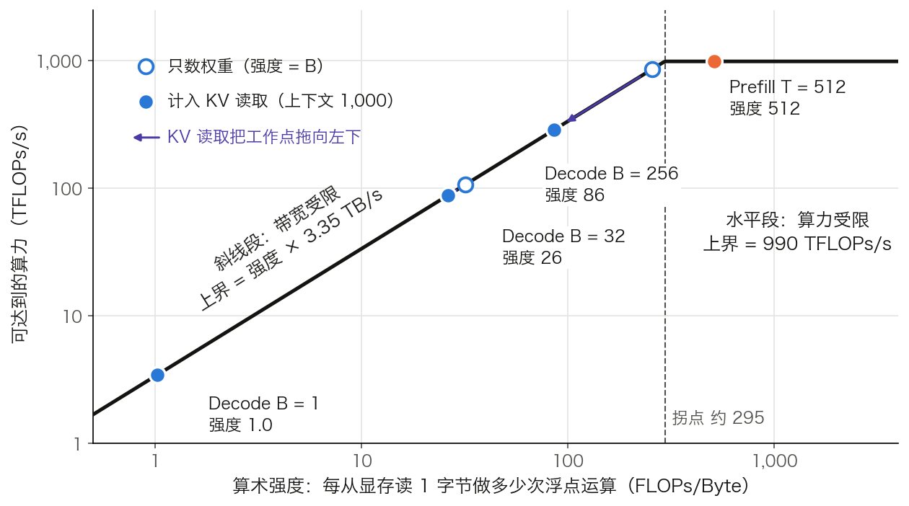
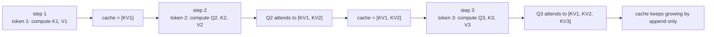
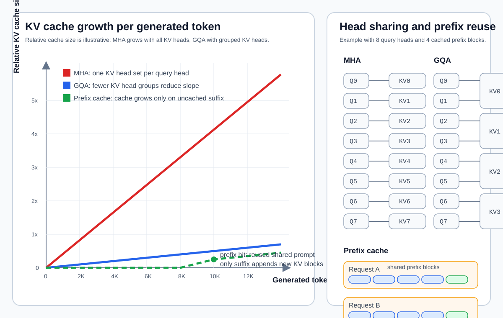
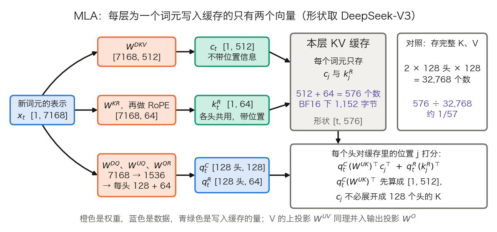
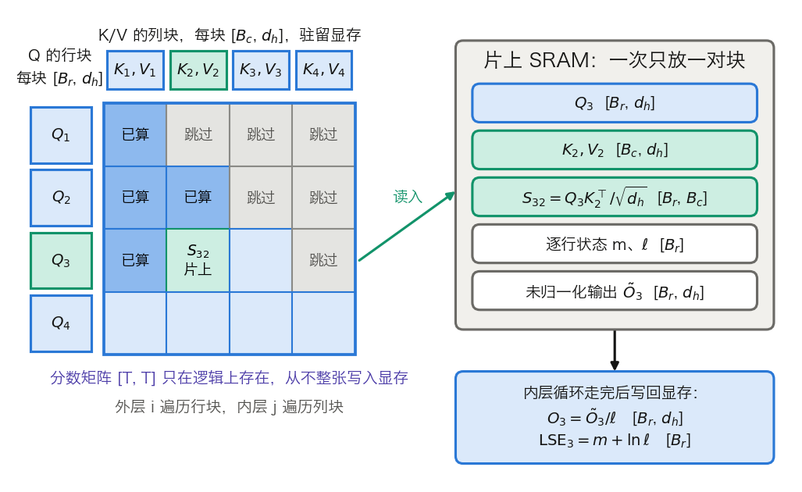
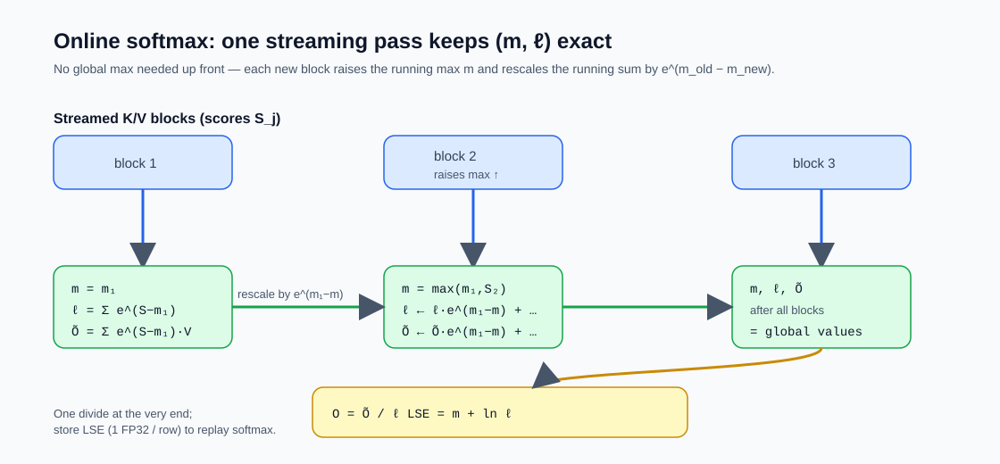
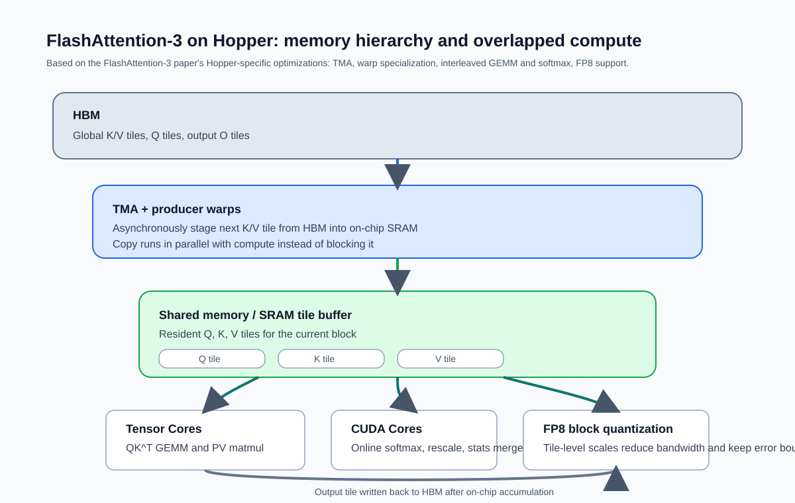
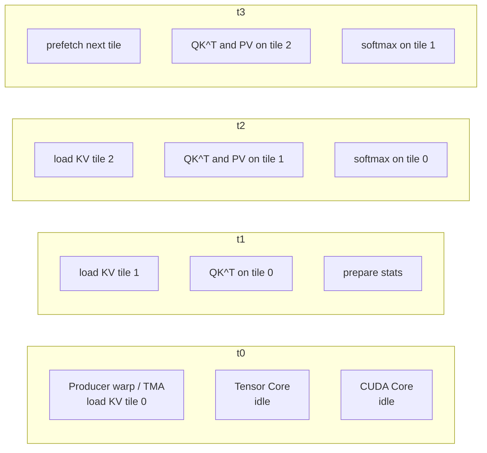
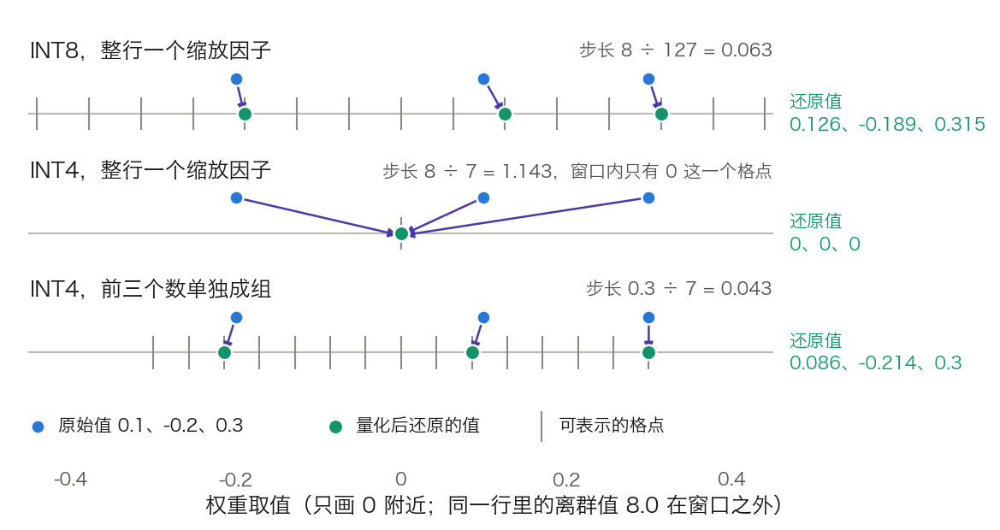
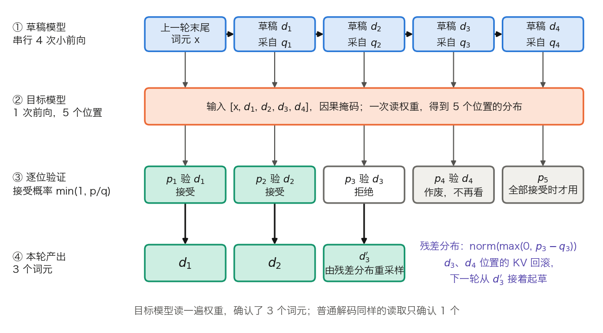

# 第十章：推理优化：第一性原理的分析

训练好的模型需要在用户请求时快速生成响应。在生产环境中，推理延迟和吞吐量直接影响用户体验和运营成本。本章从推理瓶颈的第一性原理分析出发，系统介绍 KV 缓存、FlashAttention、量化、剪枝、蒸馏和投机解码等核心优化技术。

本章依次回答五个问题：

- 推理的瓶颈到底在算力还是在访存？为什么 Prefill 和 Decode 的答案不一样？（[10.1 节](10.1_bottleneck.md)）
- KV 缓存凭什么值得占掉那么大一份显存和带宽？（[10.2 节](10.2_kv_cache.md)）
- K 和 V 压小之后，算一次注意力为什么还是慢？（[10.3 节](10.3_flash_attention.md)）
- 把模型压小有两条路：压每个数的位宽，还是直接减少参数的数量？（[10.4 节](10.4_quantization.md)、[10.5 节](10.5_pruning_distillation.md)）
- 一个权重都不改，能让每次前向多产出几个词元吗？（[10.6 节](10.6_speculative_decoding.md)）

## 1. 推理瓶颈分析：计算密集还是访存密集

推理优化要先回答一个问题：时间花在计算上，还是花在搬数据上。本节把 prefill 与 decode 分开算账，用 Roofline 模型把“访存密集”变成一个可以代数判断的条件，再由它推出批大小能推多远、各类优化分别移动哪个量。第九章末尾把扩散语言模型的收益归结为“瓶颈转换，而不是计算量下降”；判断一次优化转换了什么瓶颈，需要的就是这把尺子。算例沿用 [3.8 节](../03_components/3.8_gpt_inference_flow.md)表 3-27 的 Llama 3 8B，硬件取 H100 SXM 80 GB。

### 1.1 两个阶段的不同特性

一次请求的推理分成两个阶段（逐步手算见 3.8.3 与 3.8.6）。

**预填充阶段**（Prefill）一次处理 Prompt 的全部 T 个词元，产出首词元并写好 KV 缓存。每个线性层做的是矩阵乘矩阵：`X[T, d_model] × W[d_model, d_out] → [T, d_out]`。读一遍权重，换来 T 行结果，算力是瓶颈，因此是**计算密集型**（compute-bound）。

**生成阶段**（Decode）每轮只送进一个新词元，读取此前全部 K/V，产出下一个词元。每个线性层退化为向量乘矩阵：`x[1, d_model] × W[d_model, d_out] → [1, d_out]`。同样读一遍权重，只换来一行结果，显存带宽是瓶颈，因此是**访存密集型**（memory-bound）。

两个阶段各对应一个延迟指标。TTFT（Time To First Token，首词元时间）是从请求到达到首词元产出的时间，由排队时间加 prefill 时间决定。TPOT（Time Per Output Token，每输出词元时间）是相邻两个输出词元的间隔，等于 decode 的单步时间。吞吐是单位时间内所有请求产出的词元总数，批大小为 B 时约为 `B ÷ TPOT`。表 10-1 把两个阶段并排。

| 项目 | Prefill | Decode |
| --- | --- | --- |
| 一次前向送入的词元数 | T（整个 Prompt） | 每个请求 1 个 |
| 线性层的形状 | `[T, d] × [d, d_out]` | `[1, d] × [d, d_out]` |
| 注意力分数的形状（每头） | `[T, T]` | `[1, t]`，t 为已有长度 |
| 从显存读什么 | 全部权重 | 全部权重，加本请求全部 K/V |
| 往显存写什么 | 每层 T 行 K/V | 每层 1 行 K/V |
| 瓶颈 | 算力 | 显存带宽 |
| 决定的指标 | TTFT | TPOT 与吞吐 |

表 10-1：Prefill 与 Decode 的形状、访存与瓶颈对照。

### 1.2 访存瓶颈的数学解释

**Decode 一步读什么。** 一轮 decode 逐层执行。第 ℓ 层先把本层的注意力权重和 MLP 权重从显存读到计算单元，再读本层缓存的 t 行 K/V，算出新位置的表示，并向缓存追加一行 K/V。32 层走完，全部权重恰好被读过一遍，KV 缓存也被读过一遍。嵌入表是例外：每步只取一行。

**一格算术。** Llama 3 8B 的参数量 N 约为 8.03 B，BF16 下权重 `8.03 B × 2 = 16.06 GB`。H100 的显存带宽为 3.35 TB/s，BF16 稠密峰值约 990 TFLOPs/s。单请求、暂不计 KV：

- 访存：`16.06 GB ÷ 3,350 GB/s ≈ 4.8 ms`，单请求的速度上限约 209 词元/秒。
- 计算：每个参数参与一次乘加，约 `2N = 16.06 GFLOPs`，`16.06 G ÷ 990 T ≈ 0.016 ms`。

990 取 [NVIDIA 规格表](https://www.nvidia.com/en-us/data-center/h100/) BF16 Tensor Core 一栏 1,979 TFLOPs/s 的一半：该栏标注含稀疏加速，稠密口径折半，与 10.3.4 引用的“740 TFLOPs/s 为 75% 利用率”一致。

访存时间是计算时间的约 295 倍。计算单元有 99% 以上的时间在等数据，这就是“访存密集”的含义。嵌入表 1.05 GB 每步并不整张读，把它扣掉，访存时间只缩短 6.5%，不改变结论。

单卡放不下的模型同理。70B 的 BF16 权重约 140 GB，超过单张 H100 的 80 GB；H100 NVL 的 94 GB 同样放不下，H200 的 141 GB 只够放权重而放不下 KV 缓存，所以都要配合量化或多卡。即使不受容量限制，`140 GB ÷ 3.35 TB/s ≈ 42 ms` 也把单请求速度压到约 24 词元/秒。多卡张量并行把每张卡要读的权重降为 `1/p`，代价是每层两次 all-reduce，通信账见 [11.8 节](../11_serving/11.8_multi_gpu_inference.md)。

#### 把算术强度放进 Roofline 图

上面的比值 295 不是巧合，它是硬件的一个常数。**算术强度**（arithmetic intensity）记作 $I$，定义为一段计算的 FLOPs 除以它从显存读取的字节数。**Roofline 模型**把硬件抽象成两条上界：$I$ 小时，可达到的算力被带宽卡住，上界是斜线 $I \times B_{\text{peak}}$；$I$ 大时被算力卡住，上界是水平线 $F_{\text{peak}}$。两线的交点称为**拐点**（ridge point）：

$$
I_{\text{ridge}} = \frac{F_{\text{peak}}}{B_{\text{peak}}} = \frac{990\ \text{TFLOPs/s}}{3.35\ \text{TB/s}} \approx 295\ \text{FLOPs/Byte}
$$

工作点在拐点左侧，瓶颈是带宽；在右侧，瓶颈是算力。单请求 decode 每读 2 字节的 BF16 权重做约 2 次浮点运算，$I \approx 1$，比拐点低两个多数量级。图 10-1 画出这条 Roofline 和四个工作点。



图 10-1：H100 的 Roofline 与 Llama 3 8B 的四个工作点（[生成脚本](https://github.com/yeasy/llm_internals/blob/main/tools/figures/ch10_roofline.py)）。空心点只数权重读取，实心点计入上下文 1,000 个词元的 KV 读取。

**Prefill 为什么在水平段。** T 个词元共用一次权重读取，FLOPs 约 `2N × T`，读取字节约 `2N`，所以 $I \approx T$。`2N` 把嵌入查表也当成了乘加：Llama 3 8B 真正参与矩阵乘的是 32 层里的 `2 × 32 × 218,103,808 ≈ 1.396 × 10¹⁰` 次运算，只有 `2N = 1.606 × 10¹⁰` 的 0.87 倍，所以 $I \approx 0.87T$，T 超过约 340 才越过拐点（逐项的账见 [11.3.4](../11_serving/11.3_scheduler_loop.md)）。这也说明分块 prefill（见 [11.2 节](../11_serving/11.2_continuous_batching.md)）的块为什么取几百到几千个词元：再小就掉回带宽受限的斜线段，白读一遍权重。

#### 批大小能推多远

**批处理为什么有效。** B 个请求的当前一步合进同一次前向，权重只读一遍，FLOPs 变为 `B × 2N`。只数权重时 $I \approx B$，工作点沿斜线向右移动，这是连续批处理提高吞吐的根本原因。令计算时间等于访存时间，得到临界批大小：

$$
\frac{B^{*}\cdot 2N}{F_{\text{peak}}} = \frac{N b_{\text{elem}}}{B_{\text{peak}}}
\quad\Longrightarrow\quad
B^{*} = \frac{F_{\text{peak}}}{B_{\text{peak}}}\cdot\frac{b_{\text{elem}}}{2}
$$

其中 $b_{\text{elem}}$ 是每个数的字节数。BF16 下 `b_elem = 2`，$B^{*} \approx 295$，就是拐点换了单位。权重量化到 4 比特时 `b_elem ≈ 0.5`，$B^{*}$ 降到约 74：量化省下的访存时间，使算力更早成为瓶颈。这条式子假设每词元恰好做 `2N` 次运算、每步读 `N × b_elem` 字节；按 10.1.2 只数矩阵参数的口径，Llama 3 8B 的实际临界批大小是 `295 × 1.606 ÷ 1.396 ≈ 340` 而不是 295。

**KV 读取不被摊薄。** 权重是 B 个请求共用的，K/V 是每个请求各读各的。Llama 3 8B 每个词元的 KV 为 `2 × 32 × 8 × 128 × 2 = 131,072 B = 128 KiB`（算法见 [10.2 节](10.2_kv_cache.md)）。每步读取的字节数是 `16.06 GB + B × t × 128 KiB`，第二项随 B 线性增长。表 10-2 取上下文 1,000 个词元，把注意力的 `4tdL` 次运算也计入。

| 批大小 B | 每步 FLOPs | 每步读取 | 算术强度 | 步时下界 | 吞吐上限 |
| ---: | ---: | ---: | ---: | ---: | ---: |
| 1 | 16.6 G | 16.19 GB | 1.0 | 4.8 ms | 约 207 词元/秒 |
| 32 | 530.7 G | 20.25 GB | 26 | 6.0 ms | 约 5,300 词元/秒 |
| 256 | 4,245.7 G | 49.61 GB | 86 | 14.8 ms | 约 17,300 词元/秒 |

表 10-2：Llama 3 8B 在 H100 上的 decode 工作点，上下文 1,000 个词元。步时下界取访存时间与计算时间中较大者，三行都由访存决定。

B 从 1 增到 256，算术强度只到 86，而不是 256；步时从 4.8 ms 升到 14.8 ms。批处理摊薄的只是权重读取，注意力部分的算术强度不随 B 改善。由此得到两个临界量：

- **KV 读取追平权重读取**：`B × t = 16.06 GB ÷ 128 KiB ≈ 12.3 万`个词元。`B = 32` 时对应 `t ≈ 3,800`。超过这条线，每步时间主要花在读 KV 上。
- **显存容量先见顶**：80 GB 去掉权重剩 `80 − 16.06 = 63.94 GB`。上下文 4,096 时每个请求占 `4,096 × 128 KiB = 0.5 GiB`，即 0.537 GB，并发上限 `63.94 ÷ 0.537 ≈ 119`，低于 $B^{*} \approx 295$。长上下文下，工作点到不了拐点，显存就满了。

**延迟的代价。** 连续批处理下请求不必等待凑批，TPOT 变差的原因是单步时间随 B 增大。远离拐点时增幅很小：表中 B 从 1 到 32，吞吐提高约 26 倍，TPOT 只从 4.8 ms 升到 6.0 ms。吞吐与延迟的取舍，在 Roofline 图上就是工作点向右推多远。Prefill 本来就在水平段，加大批只会按比例拉长时间；两个阶段对批大小的敏感度不同，是把它们拆开调度的依据（见 [11.9 节](../11_serving/11.9_disaggregated_serving.md)）。

### 1.3 优化方向

按“动的是哪个量”分类，本章与第 11 章的优化技术落在四类里，见表 10-3。

| 类别 | 改变的量 | 技术 | 位置 |
| --- | --- | --- | --- |
| 减少每步读取的字节 | 权重字节 `N × s`，或每词元 KV 字节 | 量化、剪枝、蒸馏出的小模型；GQA、MLA、KV 量化 | 10.4、10.5、10.2 |
| 让一次读取服务更多词元 | 算术强度的分子 | 批处理、投机解码 | 11.2、10.6 |
| 减少片上与显存之间的往返 | 中间结果的读写字节 | FlashAttention、算子融合 | 10.3 |
| 避免重复计算 | FLOPs 总量 | KV 缓存、前缀缓存 | 10.2 |

表 10-3：推理优化技术按所改变的量分类。

前两类针对 decode 的斜线段：要么缩小分母，要么放大分子。第三类针对 prefill 和训练里 `[T, T]` 矩阵的读写。第四类用显存换计算，它省下的 FLOPs 最多，同时制造了 KV 读取这项新开销。

#### 怎样量出来

`nvidia-smi` 的 GPU-Util 不能区分两类瓶颈。NVIDIA 文档对它的定义是采样周期内“有一个或多个内核在执行”的时间占比；计算单元在等数据时，它同样显示接近 100%。可用的是两个比值。

**MBU**（Model Bandwidth Utilization，模型带宽利用率）由 Databricks 提出，定义为实际达到的带宽除以峰值带宽，实际带宽取 `(权重字节 + KV 字节) ÷ TPOT`。假设单请求实测 150 词元/秒、上下文 1,000，则 TPOT 为 6.67 ms，`MBU = (16.06 + 0.13) GB ÷ 6.67 ms ÷ 3,350 GB/s ≈ 72%`。MBU 接近 100%，说明 decode 已贴近斜线，继续优化内核没有空间，只能换类别。

**MFU**（Model FLOPs Utilization）是实际 FLOPs/s 除以峰值算力，用在水平段，即 prefill 和训练。Decode 的 MFU 天然很低：单请求时只有 `1 ÷ 295 ≈ 0.3%`，这不代表实现差。

### 1.4 另一层瓶颈：执行中的空转

前面讨论的是单卡内部的瓶颈：计算单元等显存送数据。真实集群里还有一层性质不同的浪费：GPU 处在“执行中”，功耗很高，可见的活动却接近零。一项对学术 AI 集群的实测研究（[Lei 等，2026](https://arxiv.org/abs/2604.04745)）把这个状态命名为 **execution-idle**（执行时空转）。它与 CPU 的差异在于，GPU 在可见活动几乎为零时仍可能维持高功耗，这段时间既不产出，也不省电。

该研究对一个学术 AI 集群做了逐秒遥测，覆盖 756 张 NVIDIA GPU（200 张 A6000、52 张 RTX 6000 Ada、408 张 L40(S)、64 张 A100、24 张 H100、8 张 B200），历时 31 天。总体口径是：execution-idle 占在执行时间的 19.7%、能耗的 10.7%。论文另在单张 L40S 上回放五组公开 trace，采用 replay-specific accounting，与上面的集群遥测是两组实验，见表 10-4。

| 负载 | 时间占比 | 能耗占比 |
|------|---------:|---------:|
| Azure Chat | 29% | 17% |
| BurstGPT Chat | 72% | 52% |
| Azure Code | 76% | 65% |
| Qwen Reason | 18% | 8% |
| Qwen Chat | 14% | 7% |

表 10-4：五组回放 trace 中 execution-idle 的时间与能耗占比。

分化的主因是请求到达模式，而不是任务类别：Azure Code（76%/65%）远高于 Qwen Chat（14%/7%），同为 chat 的 BurstGPT 也高达 72%/52%。空转的成因与 10.1.1 的阶段划分直接相关：prefill 和 decode 交替越频繁、请求间隔越不规则，GPU 越常回到“通电但没活干”的状态。

这一层瓶颈的解法不在本章。本章的量化、剪枝、KV 缓存优化的是单次计算的成本，空转要靠调度消除：让请求之间不留空隙（连续批处理，[11.2 节](../11_serving/11.2_continuous_batching.md)），让 prefill 和 decode 不互相拖累（分离式服务，[11.9 节](../11_serving/11.9_disaggregated_serving.md)）。两层合起来才完整：单卡把每次计算做到硬件上界，调度层保证卡不空转。

> 上表是该研究在其特定集群与回放 trace 下的快照，不是所有部署的通用比例；论文本身也报告了跨五组回放 7%–65% 的能耗区间。引用时应连同集群构成和负载类型一起说明（见附录 A.4 参考文献，以及附录 A.5 对新近论文快照数字的记录要求）。

### 1.5 前提与失效情形

10.1.2 的账建立在几个前提上。前提不成立时，结论要相应修正。

**稠密模型。** MoE 模型每个词元只激活部分专家。DeepSeek-V3 总参数 671B，每词元激活 37B，单请求 decode 每步要读的权重按 37B 算。批变大后，不同词元路由到不同专家，被读到的专家数随之增加。V3 每层 256 个路由专家、每词元选 8 个；假设路由均匀，B 个词元后某个专家至少被选中一次的概率是 $1-(1-8/256)^{B}$，`B = 32` 时为 64%，`B = 128` 时为 98%。批足够大时，MoE 每步的读取量趋近全量权重，批处理对它的摊薄效果弱于稠密模型。

**上下文不长。** 上下文增长时，KV 读取先追平、再超过权重读取，见 10.1.2 的两个临界量。此时压缩 KV（10.2 节）比压缩权重更有效。

**GPU 内核时间占主导。** 小模型、小批的单步 GPU 时间只有几毫秒，而一步要启动数百到上千个内核。CPU 侧的调度和内核启动开销此时可与 GPU 时间相当，瓶颈既不在算力也不在带宽，见 [11.1 节](../11_serving/11.1_engines_overview.md)对 CPU 段的讨论。CUDA Graph 把一步的内核启动合并成一次提交，见 [11.10 节](../11_serving/11.10_vllm_internals.md)的 11.10.5。

**只数权重和 KV。** 上面的访存账没有计入中间激活的读写。Decode 的激活很小，可以忽略；prefill 的标准注意力要把 `[T, T]` 的分数矩阵写进显存再读回，这笔开销会把工作点从水平段拖回斜线段。[10.3 节](10.3_flash_attention.md)处理这个问题，在此之前先看 KV 缓存的账（[10.2 节](10.2_kv_cache.md)）。

## 2. KV 缓存：为什么能避免重复计算

KV 缓存把已经算过的 Key 和 Value 留在显存里，后续每步只追加、不重算。10.1.2 算 decode 的访存账时，“读本请求全部 K/V”是直接列出的一项：它为什么随长度线性增长、每个词元占多少字节、凭什么值得占这份带宽，都还没有交代。本节先算它省下的计算，再算它换来的显存账，然后沿账里的各个因子看五条压缩路线。逐行手算见 [3.8.6](../03_components/3.8_gpt_inference_flow.md)。本节沿用全书的 $n_{kv}$ 记 KV 头数，用 $t$ 记前缀已有的位置数（3.8.6 把这个量记作 `s`），用 $b_{\text{elem}}$ 记每个数的字节数。

可运行对照见 [A.6 的 KV Cache 实验](../appendix/a6_practice_path.md)：复用同一个两层双头模型，比较完整前缀、逐词元与分块输入的 logits，并检查每层缓存维度。

### 2.1 重复计算的问题

自回归解码每产出一个新词元，都要用到前缀中全部位置的 K 和 V。不缓存，就得把整个前缀重新送进模型：每层的 QKV 投影、注意力、MLP 都对前缀的 t 个位置重算一遍。

**算一步。** 线性层的计算量约为每个词元 `2N` FLOPs（N 为参数量）。以 Llama 3 8B、前缀已有 `t = 1,000` 个位置为例：

- 不缓存：`2N × 1,000 = 16.06 TFLOPs`；注意力按 3.8.8 的 `2t²dL` 计，另有 262 GFLOPs。
- 缓存：只算新位置，线性层 `2N = 16.06 GFLOPs`；注意力为 `4tdL ≈ 0.5 GFLOPs`。

线性层差 1,000 倍，注意力差 500 倍。大头在线性层，不在注意力：重复的主要是“把旧词元再过一遍所有权重”。

**算累计。** 连续生成 T 个词元，不缓存时线性层合计 $2N\sum_{k=1}^{T}k \approx N T^{2}$，随 T 平方增长；缓存后为 `2NT`，线性增长。`T = 1,000` 时两者相差约 500 倍。注意力部分则从累计 $O(T^{3}d)$ 降到 $O(T^{2}d)$。

### 2.2 KV 缓存的原理

缓存成立的依据是因果掩码：位置 i 的 K、V 只依赖位置 1 到 i 的输入，后来的词元不会改变它们。因此每层的 K、V 算出一次即可保留，形状为 `K_cache[B, n_kv, t, d_h]`，V 同形。每生成一个新词元，每层做四件事：

1. 为新位置算 Q、K、V：`x[1, d_model] × W_K[d_model, n_kv·d_h] → k[1, n_kv·d_h]`，Q、V 同理。
2. 把新的 K、V 追加到缓存：`K_cache[B, n_kv, t, d_h] → [B, n_kv, t+1, d_h]`。
3. 用新位置的 Q 对缓存里全部 K 打分：`q[1, d_h] × Kᵀ[d_h, t+1] → 分数[1, t+1]`。
4. Softmax 后对缓存里全部 V 加权求和：`权重[1, t+1] × V[t+1, d_h] → context[1, d_h]`。

旧位置的 Q 用不到，所以不缓存。完整的一层仍要为新词元计算 QKV 投影、输出投影和 MLP，每步成本不是常数，只是不再随 t 重复线性层。



图 10-2：KV 缓存随解码步追加增长，历史 K/V 只需计算一次。

### 2.3 KV 缓存的显存代价

省下的计算换成了显存。对 $L$ 层、$n_{kv}$ 个 KV 头、每头宽度 $d_h$、每个数 $b_{\text{elem}}$ 字节的模型，$B$ 个并发序列各缓存 $t$ 个词元需要：

$$
\text{KV 缓存大小} = 2 \times B \times L \times n_{kv} \times d_h \times t \times b_{\text{elem}}
$$

**先算每词元字节数。** 去掉 B 和 t，剩下的 $2Ln_{kv}d_hb_{\text{elem}}$ 是一个词元占的字节，有了它就能心算任意长度。Llama 2-70B（80 层、8 个 KV 头、每头 128 维、FP16）为 `2 × 80 × 8 × 128 × 2 = 327,680 B = 320 KiB`；4,096 个词元是 `320 KiB × 4,096 = 1.25 GiB`。若它用标准 MHA（64 个 KV 头），每词元 2.5 MiB，同样长度要 10 GiB。表 10-5 逐列给出。

<!-- numeric-claim: kv-cache -->
| 配置 | B | 层数 L | KV 头 Hkv | 头维 dh | 词元 t | 字节 | KV 缓存 GiB |
| --- | ---: | ---: | ---: | ---: | ---: | ---: | ---: |
| Llama 2-70B GQA | 1 | 80 | 8 | 128 | 4096 | 2 | 1.25 |
| Llama 2-70B MHA | 1 | 80 | 64 | 128 | 4096 | 2 | 10.00 |

表 10-5：按 $2BLn_{kv}d_htb_{\text{elem}}$ 逐列重算的 FP16 KV 缓存（GiB，$b_{\text{elem}}=2$ 字节；表头的 Hkv 即 $n_{kv}$）。这里使用二进制 GiB；批量、层数、KV 头数、头维和上下文长度中的任一项翻倍，缓存也线性翻倍。

**再算并发。** 8 张 80 GB 的卡放 70B 的 BF16 权重，权重占 140 GB，剩约 500 GB。上下文 4,096 时每个请求占 1.25 GiB，即 1.34 GB，并发上限 `500 ÷ 1.34 ≈ 372`；换成 MHA 只有约 46。KV 缓存的大小直接决定一组卡能同时服务多少请求，这是它值得压缩的原因。带宽一侧的账见 10.1.2：每步要把 `B × t` 个词元的 KV 读一遍，不被批处理摊薄。

公式里有五个可压缩的因子：$n_{kv}$、$L$、每词元的表示宽度（$n_{kv}d_h$ 整体）、$t$ 和 $b_{\text{elem}}$。后面各小节各对应一个。

### 2.4 GQA 如何减小 KV 缓存

[2.3 节](../02_attention/2.3_multi_head.md)的多头注意力中，每个头有独立的 Q、K、V 投影。**分组查询注意力**（Grouped-Query Attention，GQA）让多个查询头共用一组 K、V 头；所有查询头共用一组时称**多查询注意力**（Multi-Query Attention，MQA）。Llama 2-70B 有 64 个查询头、8 个 KV 头，每 8 个查询头共用一组，KV 缓存是 MHA 的 1/8。Hugging Face 的模型配置里，这两个数是 `num_attention_heads` 与 `num_key_value_heads`；计算时把每组 K、V 沿头维复制或广播给组内各查询头，缓存只存 $n_{kv}$ 份。

#### 多头共享为什么不损性能

[GQA 原论文](https://arxiv.org/abs/2305.13245)给了两方面的证据。

**KV 头之间有冗余。** 论文把已训练 MHA 模型的多个 KV 头做均值池化（mean pooling）合并，再用原预训练计算量的 5% 续训（uptrain），质量基本恢复。独立的 KV 头若各自携带不可替代的信息，池化后不可能用这么少的计算补回来。

**实测的取舍。** 表 10-6 摘自该论文表 1，模型是 T5-XXL，MQA 与 GQA 只用在解码器的自注意力和交叉注意力上。

| 方案 | KV 头数 | KV 缓存（相对 MHA） | 每样本推理时间 | 七项任务平均分 |
| --- | ---: | ---: | ---: | ---: |
| MHA | 64 | 1× | 1.51 s | 47.2 |
| GQA-8 | 8 | 1/8 | 0.28 s | 47.1 |
| MQA | 1 | 1/64 | 0.24 s | 46.6 |

表 10-6：T5-XXL 上 MHA、GQA-8、MQA 的推理时间与质量，取自 GQA 论文表 1。推理时间为每个 TPUv4 芯片上的每样本耗时。MHA 的 64 取自该论文图 6 的横轴：分组数从 1 到 64，64 组即 MHA。

GQA-8 的质量与 MHA 相差 0.1 分，耗时接近 MQA；MQA 的耗时再少 14%，质量多掉 0.5 分。查询头各自保留独立的 Q 投影，仍能从共享的 K、V 里读出不同的模式，这一点可作为直觉，论文没有单独验证。这组数字来自编码器-解码器模型和 TPU，解码器模型上的幅度随负载与实现变化，方向一致。

GQA 只减少了 KV 头数。10.2.3 的乘积里，层数、每词元宽度、词元数量和字节数它都没有碰。

### 2.5 前缀缓存：跨请求复用 KV 缓存

默认情况下，KV 缓存只在单个请求内部使用，每个新请求都要从头执行 prefill。若两个请求的开头相同（如同一段系统提示词），后一个请求可以直接复用前一个请求已算好的 KV，跳过这段 prefill。这就是**前缀缓存**（Prefix Caching）。商业 API 对缓存命中的输入词元收取更低的费用，原因是这部分省掉了 prefill 计算；缓存本身仍占显存或下层存储，命中后仍要被每步 decode 读取。

**能复用的只有从头开始的相同前缀。** 位置 i 的 K、V 依赖位置 1 到 i 的全部输入和位置编号。两个请求只要在某个位置出现不同词元，此后的 K、V 就都不同。一段文档出现在两个 Prompt 的不同位置，它的 KV 不能复用。匹配因此从序列起点开始，到第一个不同的词元为止。编排 Prompt 时应把不变的内容（系统提示词、文档）放前面，变化的内容（用户输入）放末尾。

**怎样匹配。** 两种主流做法都以块为单位。vLLM 的自动前缀缓存把词元序列切成定长块，对“父块哈希 + 本块词元”做链式哈希，哈希相同即命中同一个物理块。SGLang 的 RadixAttention 把已缓存的序列组织成基数树，沿树匹配最长公共前缀。显存不足时，两者都按最近最少使用（LRU）淘汰没有请求引用的块。两条路线的细节与命中率的账见 [11.5 节](../11_serving/11.5_prefix_reuse.md)。

收益显著的场景有四类：

- **长系统提示词**：智能体、RAG 管道、工具调用每次请求都携带相同的长前缀。
- **代码补全**：相同的数千行代码作为共享上下文反复传入。
- **文档问答**：用户提问之前的文档内容不变。
- **多轮对话**：每轮都重复此前的全部消息，对话越长，命中的前缀越长。

KV 量化（如 FP8）让同样的显存存下更多缓存条目，读取也更快，前缀缓存和分离式架构都因此受益。图 10-3 把线性增长、GQA 的斜率下降和前缀复用画在一起。



图 10-3：KV 缓存增长，以及 MHA、GQA 与前缀缓存的对比。

### 2.6 PagedAttention：解决显存碎片化

GQA 缩小了每个词元的 KV，高并发下还要解决怎样分配的问题。传统做法为每个请求预留一段能容纳最大生成长度的连续显存，实际长度通常远小于最大值。[vLLM 团队的测量](https://blog.vllm.ai/2023/06/20/vllm.html)是，现有系统因碎片和过度预留浪费 60%–80% 的 KV 显存。

**PagedAttention**（[Kwon 等，2023](https://arxiv.org/abs/2309.06180)）借用操作系统的分页：

- **物理块池**：每层一个大张量，形如 `[num_blocks, block_size, n_kv, d_h]`，K、V 各一份。块按需分配，物理上不必相邻。
- **块表**（block table）：每个请求一张，形如 `[max_num_blocks_per_seq]` 的整数数组，第 k 项是逻辑第 k 块对应的物理块号。位置 i 的 K/V 在物理块 `block_table[i // block_size]` 的第 `i % block_size` 个槽里。
- **内核**：注意力内核按块表间接寻址，逐块读出 K、V 完成打分，逻辑上仍是一段连续的 `[t, d_h]`。

浪费只出现在每个请求的最后一块，最多 `block_size − 1` 个槽，平均是它的一半。`block_size = 16` 时每条序列平均浪费 7.5 个槽，平均长度 200 时占 `7.5 ÷ 207.5 = 3.6%`，平均长度 2,000 时降到 0.37%，与 vLLM 报告的“低于 4%”一致；逐格见 [11.4 节](../11_serving/11.4_kv_memory_management.md)表 11-12。块表还让多个请求共享同一物理块（前缀缓存、并行采样），写入时再复制。块大小的取舍、写时复制与换出见 [11.4 节](../11_serving/11.4_kv_memory_management.md)，调度见 [11.2 节](../11_serving/11.2_continuous_batching.md)。

### 2.7 新型 KV 缓存压缩：MLA（多头隐向量注意力）

GQA 让若干头共用 K、V，头数一减，可用的 K、V 表示也跟着变少。**多头隐向量注意力**（Multi-head Latent Attention，MLA）换一个思路：不减头数，而是把所有头的 K、V 压成一个低维隐向量，缓存里只存这个隐向量。它出自 [DeepSeek-V2](https://arxiv.org/abs/2405.04434)，V3 沿用。

**缓存里存什么。** 以 DeepSeek-V3 的公开配置为例（`hidden_size = 7168`、`num_attention_heads = 128`、`kv_lora_rank = 512`、`qk_nope_head_dim = 128`、`qk_rope_head_dim = 64`、`v_head_dim = 128`），按本书的行向量写法，新词元的表示 $x_t$ 经两条路写入缓存：

$$
\begin{aligned}
c_t &= x_t W^{DKV} && [1, 7168] \times [7168, 512] \to [1, 512] \\
k^{R}_t &= \operatorname{RoPE}\left(x_t W^{KR}\right) && [1, 7168] \times [7168, 64] \to [1, 64]
\end{aligned}
$$

$c_t$ 是不带位置信息的压缩隐向量；$k^{R}_t$ 是带 RoPE 的键分量，128 个头共用。完整的 K、V 由上投影得到：$k^{C}_t = c_t W^{UK}$、$v^{C}_t = c_t W^{UV}$，各为 `[1, 128 × 128]`。它们不进缓存。每层每个词元只存 `512 + 64 = 576` 个数，而全部头的 K、V 共 `2 × 128 × 128 = 32,768` 个数，约为 1/57，相当于只有 2.25 组的 GQA（`576 ÷ (2 × 128)`）。图 10-4 画出这条数据流。



图 10-4：MLA 中一个词元的数据流，写入缓存的只有 $c_t$ 与 $k^R_t$（[生成脚本](https://github.com/yeasy/llm_internals/blob/main/tools/figures/ch10_mla_dataflow.py)）。形状取 DeepSeek-V3 的配置。

**吸收投影。** 推理时不必把 $c_j$ 解压回完整的 K。某个头对位置 j 的打分是：

$$
q^{C}_t \left(k^{C}_j\right)^{\top} = \left(x_t W^{Q}\right)\left(c_j W^{UK}\right)^{\top} = x_t\, W^{Q}\left(W^{UK}\right)^{\top} c_j^{\top}
$$

$W^{Q}(W^{UK})^{\top}$ 可以预先合并成一个矩阵，查询直接与 512 维的 $c_j$ 做点积。$W^{UV}$ 同理并入输出投影 $W^{O}$。

**那 64 维从哪来。** RoPE 是与位置相关的旋转，必须作用在 q 与 k 之间。对键施加 RoPE 后，打分式里 $W^{Q}$ 与 $W^{UK}$ 之间多出一个随位置变化的旋转矩阵；矩阵乘法不可交换，两者无法再合并。[DeepSeek-V2 论文](https://arxiv.org/abs/2405.04434)指出，这样一来推理时必须为所有前缀词元重算键，压缩的收益被抵消。解法是解耦：位置信息走一条单独的、不压缩的旁路，即每头一份的查询 $q^{R}_{t}$ 配一个所有头共用的键 $k^{R}_t$；压缩的那一路完全不带位置。576 里的 64 就是这条旁路的宽度。为保住吸收投影，必须多存一份不压缩的键；让它只有 64 维且各头共用，是把这笔开销压到最小。

**每词元字节数。** 表 10-7 的三个数出自 DeepSeek 的 [ISCA 2025 论文](https://arxiv.org/abs/2505.09343)表 1，均可由公开配置复算。

| 模型 | 注意力 | 每词元 KV（BF16） | 算式 | 相对 V3 |
| --- | --- | ---: | --- | ---: |
| DeepSeek-V3（671B） | MLA | 70,272 B | `61 × 576 × 2` | 1× |
| Qwen-2.5 72B | GQA，8 个 KV 头 | 327,680 B | `2 × 80 × 8 × 128 × 2` | 4.66× |
| Llama-3.1 405B | GQA，8 个 KV 头 | 516,096 B | `2 × 126 × 8 × 128 × 2` | 7.34× |

表 10-7：三个模型的每词元 KV 缓存。后两个模型本身已用 GQA；V3 若用标准 MHA，每词元为 `61 × 32,768 × 2 ≈ 3.8 MiB`。最后一列由前一列相除得到；论文表 1 把 Llama-3.1 405B 一行记作 7.28×，与它自己给出的字节数相除所得的 7.34× 略有出入。

**代价。** MLA 是用计算换带宽。吸收之后，decode 时每个头对每个缓存位置的点积宽度是 `512 + 64 = 576`，是 128 维 GQA 头的 4.5 倍，头数还是完整的 128 个。Decode 在访存受限的斜线段（10.1.2），多出的计算有空闲算力承担，少读的字节直接缩短单步时间，这笔交换划算。Prefill 和训练在算力受限一侧，实现上通常把 K、V 展开成完整形状，走普通的多头注意力内核。同一个模型因此有两种计算形态，推理引擎要各写一套内核。vLLM 的 MLA 后端在源码注释里把它们称为两条路径：compute friendly 用于 prefill，data-movement friendly 用于 decode。

### 2.8 沿时间轴压缩：面向百万词元的混合注意力

MLA 压缩的是每个词元的宽度，词元数量不变。上下文到百万词元时这条轴不够用：每词元 70,272 B，一百万词元仍是约 70 GB。另一条正交的思路是沿时间轴压缩词元数量，再叠加稀疏选择。

DeepSeek-V4（见 [13.3 节](../13_decoder_models/13.3_deepseek_gemini.md)）的混合注意力是这条路线的代表，由两个部件组成：

- **压缩稀疏注意力**（Compressed Sparse Attention，CSA）：先把每 $m$ 个词元的 KV 合并成一个条目，再在压缩条目上做稀疏的 Top-k 选择，内部使用 DeepSeek 稀疏注意力 DSA 加速。
- **高度压缩注意力**（Heavily Compressed Attention，HCA）：使用远大于 $m$ 的压缩率 $m'$，把每 $m'$ 个词元的 KV 合并为一个条目，在合并后的条目上保持稠密注意力。

CSA 以适中的压缩率保留细节，靠稀疏选择省算力；HCA 以极高的压缩率提供粗粒度的全局视野。官方技术报告给出的效果是：百万词元上下文下，DeepSeek-V4-Pro 相比 DeepSeek-V3.2 只需 27% 的单词元推理浮点运算量（以等效 FP8 计）和 10% 的 KV 缓存。滑动窗口与注意力汇等只保留部分词元的做法见 [14.7 节](../14_future_trends/14.7_long_context.md)。

### 2.9 沿层轴共享：跨层复用 KV

还剩层数 $L$ 这个因子。**跨层注意力**（Cross-Layer Attention，CLA）只让一部分层计算并缓存 K、V，其余层复用前面某个产出层的 K、V；每一层仍计算自己的 Q，各层的注意力模式依旧不同。公式中的 $L$ 换成“实际产出 KV 的层数”，每两层共享一份，缓存减半。

这与 GQA 是同一个想法用在不同维度上：GQA 是头间共享，CLA 是层间共享，两者可以叠加。代价也同源：被共享的层失去独立的 KV 投影，模型容量下降。[CLA 的原始论文](https://arxiv.org/abs/2405.12981)（Brandon 等，2024）在 MQA 基础上共享相邻层的 K、V，在 1B 与 3B 规模从零训练的实验中报告：KV 缓存再降 2 倍，准确率与未修改的 MQA 基本持平，在显存与准确率的权衡上取得帕累托改进。

这条轴的部署成熟度低于其他几条。GQA 在现代解码器中普遍采用，MLA 有 DeepSeek 系列的规模化生产验证，层间共享目前主要见于研究与端侧小模型。各家对“共享 KV”的措辞也不统一：某些厂商所称的 unified 或 shared Keys and Values 指同一层内部的合并，不是跨层复用。判断某个模型是否采用层间共享，应以技术报告或模型卡的架构描述为准。

### 2.10 五个因子与失效情形

把各条路线放回 10.2.3 的乘积，每条路线各压一个因子：

- GQA/MQA 减少头数 $n_{kv}$。
- CLA 减少产出 KV 的层数 $L$。
- MLA 把每层每词元的 $2n_{kv}d_h$ 整体换成 $d_c + d^{R}$，V3 为 576。
- CSA/HCA 压缩词元数量 $t$。
- KV 量化减少每个数的字节 $b_{\text{elem}}$，见 [10.4 节](10.4_quantization.md)与 11.4.6。

作用在不同因子上，倍数可以相乘。

KV 缓存不是在所有情形下都划算，也不是总能复用：

- **短输出、短上下文**：缓存很小，收益也小，但没有理由关掉它；真正的问题出现在另一端。上下文足够长时，KV 超过权重成为显存和带宽的大头，Llama 3 8B 在 `B × t` 约 12.3 万词元时两者相等（10.1.2）。
- **前缀不是从头相同**：模板里先放时间戳或用户名，再放长文档，前缀缓存一个词元都命中不了。
- **结构性压缩要在训练时定下**：GQA、MLA、CLA 改的是模型结构，已发布的 MHA 模型只能靠续训转换或改用 KV 量化。
- **量化误差长期存在**：K/V 的量化误差写进缓存后，被此后每一步读取，上下文越长影响越大。

这些路线压缩的都是留在显存里的那份 K 和 V。算一次注意力要在显存上来回搬多少中间结果，不在这个乘积里，[10.3 节](10.3_flash_attention.md)处理它。

## 3. FlashAttention：IO 感知的算法设计

标准注意力实现的瓶颈不在浮点计算量，而在访存模式。上一节压缩的都是留在显存里的那份 K 和 V；算一次注意力要在显存上来回搬多少中间结果，不在 10.2.3 的那个乘积里。本节先算标准实现搬了多少，再写出 FlashAttention 的分块循环、在线 Softmax 与反向重算，然后看它从 FA2 到 FA4 怎样随硬件重写，最后对到 decode 形态与框架入口。

### 3.1 为什么标准注意力慢

标准实现分三步，每一步都把一个 `[T, T]` 的矩阵写进显存（HBM），下一步再读回来（T 为序列长度，$d_h$ 为每头宽度；FlashAttention 系列论文把这两个量记作 N 与 d，与全书 N 表示非嵌入参数量、d 表示 $d_{\text{model}}$ 冲突，本节按全书记号写）：

1. `Q[T, d_h] × Kᵀ[d_h, T] → S[T, T]`，写 S。
2. 读 S，逐行 Softmax 得 `P[T, T]`，写 P。
3. 读 P，`P[T, T] × V[T, d_h] → O[T, d_h]`，写 O。

**这张矩阵有多大。** `T = 8,192`、32 个头、每头 128 维、FP16 时，单层的 S 为 `8,192² × 32 × 2 B = 4 GiB`，P 同样大。同一层的 Q 只有 `8,192 × 32 × 128 × 2 B = 64 MiB`，K、V、O 同。`T = 32,768` 时 S 是 64 GiB，单卡放不下。训练时 P 还要留到反向传播。

Softmax、掩码、dropout 都是逐元素运算，每读 1 字节只做几次浮点运算，算术强度远低于 10.1.2 的拐点，时间全花在读写这两张矩阵上。FlashAttention 论文的图 1 给出 A100 上两级存储的差距：片上 SRAM 约 20 MB、带宽 19 TB/s，HBM 40 GB、带宽 1.5 TB/s。

### 3.2 FlashAttention 的核心思想

[FlashAttention](https://arxiv.org/abs/2205.14135)（Dao 等，2022）用两个办法让 `[T, T]` 的矩阵不落显存。**分块计算**（tiling）：把 Q、K、V 切成能放进 SRAM 的小块，逐对块在片上算完。**重计算**（recomputation）：前向不保存 P，反向时按块重算。它保持标准稠密注意力的数学定义，不引入稀疏或低秩近似；浮点归约次序和融合方式仍会造成数值差异。[PyTorch SDPA 文档](https://docs.pytorch.org/docs/stable/generated/torch.nn.functional.scaled_dot_product_attention.html)也明确说明，不同后端的输出可能不同。替换内核时应按数据类型、输入尺度与目标任务验证数值误差和质量；FP8 路径还需单独评估量化误差。

**分块前向。** 下面按 FlashAttention-2 的循环次序写出单个头的前向，方括号里标出每个量驻留的位置。

```text
输入：Q、K、V [T, d_h]，驻留 HBM；块大小 B_r（行）、B_c（列）
把 Q 切成 n_r = ⌈T / B_r⌉ 个行块，把 K、V 各切成 n_c = ⌈T / B_c⌉ 个列块
for i = 1 .. n_r:                               # 外层：Q 的行块
    读入 Q_i [B_r, d_h]                          # HBM → SRAM
    初始化 m = −∞ [B_r]，ℓ = 0 [B_r]，Õ = 0 [B_r, d_h]  # SRAM
    for j = 1 .. n_c:                           # 内层：K/V 的列块
        若第 j 块整块被因果掩码遮住：跳过
        读入 K_j、V_j [B_c, d_h]                 # HBM → SRAM
        S = Q_i × K_jᵀ / √d_h                    # [B_r, B_c]，只在 SRAM
        m_new = max(m, rowmax(S))
        ℓ = ℓ · e^(m − m_new) + rowsum(e^(S − m_new))
        Õ = Õ · e^(m − m_new) + e^(S − m_new) × V_j
        m = m_new
    写回 O_i = Õ / ℓ [B_r, d_h]，LSE_i = m + ln ℓ [B_r]  # SRAM → HBM
```

图 10-5 画出某一时刻的状态：第 3 个行块与第 2 个列块在片上，其余都在显存。



图 10-5：FlashAttention 分块前向的循环结构与各变量的驻留位置（[生成脚本](https://github.com/yeasy/llm_internals/blob/main/tools/figures/ch10_flash_tiling.py)）。示意取 4 × 4 个块与因果掩码。

**块多大。** 设 SRAM 能放 M 个数；FA1 论文称 M 的典型值约 100 KB，下面取 `M = 10⁵`。片上要同时放下 Q、K、V、O 各一块，每块约 `B × d_h` 个数，所以 FA1 取 $B_c = \lceil M/(4d_h) \rceil$、$B_r = \min(B_c, d_h)$。`d_h = 64` 时，$B_c = 391$，$B_r = 64$；分数块 `[64, 391]` 只有约 2.5 万个数。

**省了多少访存。** FA1 论文的定理 2 给出 HBM 访问量：标准注意力为 $\Theta(Td_h + T^{2})$，FlashAttention 为 $\Theta(T^{2}d_h^{2}/M)$。直观推导：每个列块约 M 个数，K、V 共切成 $\Theta(Td_h/M)$ 块；每处理一块要把 Q 和 O 过一遍，读写 $\Theta(Td_h)$ 个数；相乘得 $\Theta(T^{2}d_h^{2}/M)$。与 $T^{2}$ 相比少了约 $M/d_h^{2}$ 倍：`d_h = 64`、`M = 10⁵` 时约 24 倍，`d_h = 128` 时约 6 倍。论文还证明，M 在 $d_h$ 与 $Td_h$ 之间时，任何精确注意力算法都无法在渐近意义上做得更好。

**FLOPs 反而更多。** 表 10-8 是 FA1 论文图 2 对 GPT-2 medium 前向加反向的实测。

| 指标 | 标准注意力 | FlashAttention | 变化 |
| --- | ---: | ---: | --- |
| 计算量 | 66.6 GFLOPs | 75.2 GFLOPs | 多 13%（反向重算） |
| HBM 读写 | 40.3 GB | 4.4 GB | 少到约 1/9 |
| 运行时间 | 41.7 ms | 7.3 ms | 快 5.7 倍 |

表 10-8：标准注意力与 FlashAttention 的计算量、HBM 读写与运行时间，取自 FlashAttention 论文图 2（GPT-2 medium，序列长 1,024，头宽 64，16 头，批 64，A100）。

计算量多了 13%，时间少到 1/5.7：决定运行时间的是 HBM 读写量，不是 FLOPs。FlashAttention 降低的是 IO 和中间矩阵的显存占用，稠密注意力的 FLOPs 仍随序列长度平方增长。论文报告相对优化过的基线通常快 2–4 倍。

#### 关键支撑：Online Softmax 的增量计算

分块有一个数学障碍：Safe Softmax 要先得到整行的最大值 m，才能算分母 $\sum_j e^{x_j - m}$，而每个块只看得到局部。**Online Softmax**（[Milakov 与 Gimelshein，2018](https://arxiv.org/abs/1805.02867)）在遍历中维护两个状态：已见部分的最大值 $m$，以及以 $m$ 为基准的指数和 $\ell$。读入新元素 $x_i$ 时：

$$m_{\text{new}} = \max(m_{\text{old}},\; x_i)$$

$$\ell_{\text{new}} = \ell_{\text{old}} \cdot e^{m_{\text{old}} - m_{\text{new}}} + e^{x_i - m_{\text{new}}}$$

修正因子 $e^{m_{\text{old}} - m_{\text{new}}}$ 把以旧最大值为基准的累积量换算到新基准下。最大值没被刷新时因子为 1，直接累加。FlashAttention 对未归一化的输出 $\tilde O = \sum_j e^{S_j - m} V_j$ 做同样的修正，循环结束时只需一次 $O = \tilde O / \ell$。

**手算：最大值不刷新。** 一行分数 `[1, 3, 2]`，对应的 V 取标量 `[10, 20, 30]`，分两块 `[1, 3]` 与 `[2]`。用到的常数是 `e⁻² ≈ 0.1353`、`e⁻¹ ≈ 0.3679`。

- 第一块：`m = 3`，`ℓ = e⁻² + e⁰ = 1.1353`，`Õ = 0.1353 × 10 + 1 × 20 = 21.353`。
- 第二块：最大值仍是 3，修正因子为 1。`ℓ = 1.1353 + e⁻¹ = 1.5032`，`Õ = 21.353 + 0.3679 × 30 = 32.390`。
- 结果：`O = 32.390 ÷ 1.5032 = 21.547`。

**手算：最大值被刷新。** 把分块换成 `[1, 2]` 与 `[3]`。

- 第一块：`m = 2`，`ℓ = e⁻¹ + e⁰ = 1.3679`，`Õ = 0.3679 × 10 + 1 × 30 = 33.679`。
- 第二块：最大值从 2 升到 3，修正因子 `e^(2−3) = 0.3679`，同时乘到 ℓ 和 Õ 上。`ℓ = 1.3679 × 0.3679 + e⁰ = 1.5032`，`Õ = 33.679 × 0.3679 + 1 × 20 = 32.390`。
- 结果：`O = 21.547`，与上一种分块相同。

一次性计算的 Softmax 权重是 `[0.090, 0.665, 0.245]`，加权和同为 21.547。分块次序不影响结果。



图 10-6：Online Softmax 单遍流式维护 $(m, \ell, \tilde O)$，每遇更大的最大值就用 $e^{m_{\text{old}} - m_{\text{new}}}$ 重缩放历史累积量，结尾一次除法得到 $O$ 并存下 LSE

#### LSE：进一步压缩的状态变量

每个 Q 行的 Softmax 状态要写回显存留给后续使用。FlashAttention-2 指出不必同时存 $m$ 与 $\ell$，只存一个数：

$$\text{LSE} \;=\; m + \ln \ell$$

由它可恢复 $P_i = e^{S_i - \text{LSE}}$，“减最大值再除以分母”合成一次“减 LSE 再取指数”。上例的 `LSE = 3 + ln 1.5032 = 3.4076`。LSE 的价值在可合并：两段 K 各自算出的 $\text{LSE}_1$、$\text{LSE}_2$ 满足 $\text{LSE} = \ln(e^{\text{LSE}_1} + e^{\text{LSE}_2})$，两段的输出按 $e^{\text{LSE}_k - \text{LSE}}$ 加权即得整体输出。反向重算、沿 K 方向切分的 decode 内核（10.3.7）、跨卡的 Ring Attention（10.3.5）都靠这条性质。

#### 反向与重计算

标准实现为反向保存 `P[T, T]`。FlashAttention 前向只保存 `O[T, d_h]` 和每行一个 LSE。`T = 8,192`、32 头时，LSE（FP32）共 `8,192 × 32 × 4 B = 1 MiB`，对比 P 的 4 GiB，激活显存从 $O(T^{2})$ 降到 $O(T)$。反向时再按同样的分块读入 $Q_i$、$K_j$、$V_j$，在片上重算 $S_{ij}$ 与 $P_{ij} = e^{S_{ij} - \text{LSE}_i}$，用完即弃。代价是多做一遍前向的注意力 FLOPs，即表 10-8 里多出的 13%；换来的是不读写 `[T, T]` 的矩阵，总时间更短。这与 [7.5 节](../07_distributed_training/7.5_activation_checkpointing.md)的激活检查点是同一种取舍，只是粒度在内核内部。

### 3.3 FlashAttention 2：并行度与效率的提升

FA1 只达到 A100 理论最大 FLOPs/s 的 25–40%。[FlashAttention-2](https://arxiv.org/abs/2307.08691) 论文把原因归结为线程块与 warp 之间的工作划分不佳。读 FA2 到 FA4 的论文需要表 10-9 的词汇，取自 FlashAttention-3 论文 2.2 节对 H100 的描述。

| 层级 | 并行单位 | 对应的存储 | 容量与带宽（H100） |
| --- | --- | --- | --- |
| 芯片 | grid | GMEM，即 HBM | 80 GiB，3.35 TB/s |
| GPC | threadblock cluster | L2 缓存 | 50 MiB，12 TB/s |
| SM（streaming multiprocessor） | threadblock，即 CTA | SMEM，片上共享内存 | 每 SM 228 KiB，全卡 31 TB/s |
| 线程 | thread | RMEM，寄存器 | 每线程至多 256 个寄存器 |

表 10-9：GPU 的线程层级与存储层级，取自 FlashAttention-3 论文表 1 与 2.2 节。32 个线程组成一个 warp，4 个相邻 warp 组成一个 warpgroup；同一 CTA 内的线程可直接寻址 SMEM。

执行单元分两类：Tensor Core 专做矩阵乘（论文称 MMA 指令），CUDA Core 负责其余的逻辑、整数与浮点运算。前文的“片上 SRAM”对应 SMEM。FA2 的三项改动都落在这套层级上：

1. **减少非矩阵乘 FLOPs**：调整在线 Softmax 的计算次序，去掉中途多余的缩放，只在行块结束时除一次 ℓ，让更多时间花在 Tensor Core 擅长的矩阵乘上。
2. **沿序列长度并行**：单个头的注意力也分到不同线程块上，10.3.2 的外层循环各行块互不依赖，可以同时执行，长序列下 SM 的占用率更高。
3. **调整 warp 间的工作划分**：FA1 把 K/V 切给同一线程块内的各 warp，各 warp 的中间结果要经共享内存交换再求和。FA2 改为让每个 warp 处理 Q 的不同行块，K/V 由各 warp 共用，省掉这部分共享内存读写。

FA2 在 A100 上达到理论最大 FLOPs/s 的 50–73%，约为 FA1 的 2 倍；端到端训练 GPT 类模型时每张 A100 达到 225 TFLOPs/s（72% 的模型 FLOPs 利用率）。此后它成为主流训练与推理框架的默认注意力实现之一，但这组利用率只对 Ampere 成立。

### 3.4 FlashAttention 3：面向 Hopper 架构的深度优化

同一份 FA2 内核搬到 H100（Hopper）上，利用率只有 35%。[FlashAttention-3](https://arxiv.org/abs/2407.08608)（Shah 等，2024）用三项技术适配 Hopper。

#### 异步流水线

Hopper 有独立于计算单元的**张量内存加速器**（Tensor Memory Accelerator，TMA），可在 GMEM 与 SMEM 之间异步搬运数据。它的 Tensor Core 经 warpgroup 级的 `WGMMA` 指令调用，同样是异步的，并能直接从共享内存取输入。FA3 据此做 **warp 特化**（warp specialization），把一个 CTA 内的 warp 分成两种角色：

- **生产者 warp**：只发数据搬运指令，经 TMA 把下一块 K、V 从 HBM 装入 SMEM 的环形缓冲。
- **消费者 warp**：只发计算指令，对已就位的块做矩阵乘。

计算与搬运因此全程重叠，FA2 里“加载、计算、加载、计算”的串行等待消失。Hopper 还允许用 `setmaxnreg` 在 warpgroup 之间重新分配寄存器，让做矩阵乘的 warp 分到更多。

#### GEMM-Softmax 交错执行

每个块的处理本有严格次序：先做 $QK^{\top}$ 的矩阵乘（GEMM），再做 Softmax，最后乘 V。Softmax 的指数与归一化用不上 Tensor Core。FA3 把当前块的 Softmax 与下一块的 GEMM 交错：Tensor Core 算下一块矩阵乘时，CUDA Core 处理上一块的 Softmax，两类单元并行工作。

#### FP8 低精度支持

Hopper 的 Tensor Core 支持 FP8，每个 SM 的吞吐是 FP16 或 BF16 的 2 倍。FA3 用两项技术控制精度损失：

- **块级量化**（block quantization）：对每个小块的 Q、K、V 激活独立计算缩放因子，避免整张量共用一个缩放带来的动态范围问题。
- **非相干处理**（incoherent processing）：量化前对 Q、K 乘一个随机正交矩阵（随机 ±1 对角阵与 Hadamard 矩阵之积），把异常值分散到更多维度。因为 $(QM)(KM)^{\top} = QK^{\top}$，结果不变。



图 10-7：FlashAttention 3 在 Hopper 上的分层内存与异步数据路径

三条流水线在时间上错开重叠，见图 10-8。



图 10-8：FlashAttention 3 将 TMA 搬运、Tensor Core GEMM 与 CUDA Core Softmax 交错执行

#### 性能表现

| 精度 | 吞吐量 | H100 利用率 | 论文给出的对比 |
|------|--------|------------|---------|
| FP16 | 最高约 740 TFLOPs/s | 约 75% | 比 FA2 快 1.5–2.0× |
| FP8 | 接近 1.2 PFLOPs/s | 未给出 | 数值误差降到基线 FP8 注意力的 1/2.6 |

表 10-10：FlashAttention-3 在 H100 上的性能，取自该论文摘要。

由 FA3 的 740 TFLOPs/s 对应 75% 可反推 H100 的稠密峰值约为 `740 ÷ 0.75 ≈ 990 TFLOPs/s`，即 10.1.2 所用的数。FP8 的 1.2 PFLOPs/s 约为 FA2 FP16 吞吐（`0.35 × 990 ≈ 350 TFLOPs/s`）的 3–4 倍，这个比值是推算，论文没有直接给出。Blackwell 的 FP4 支持见 [11.12 节](../11_serving/11.12_hardware.md)。

### 3.5 序列并行：超长上下文的分布式注意力

单卡显存放不下超长序列的 KV 时，要把注意力沿序列维分到多张卡上，称**序列并行**（sequence parallelism）。第七章称这条路线为上下文并行（[7.4 节](../07_distributed_training/7.4_pipeline_hybrid.md)），与 7.3.6 只切 LayerNorm 与 dropout 区域的序列并行不是一回事。Llama 3 8B 的 100 万词元上下文，KV 为 `10⁶ × 128 KiB ≈ 131 GB`，超过单张 80 GB 的卡。

**Ring Attention**（[Liu 等，2023](https://arxiv.org/abs/2310.01889)）把 10.3.2 的分块思路扩展到多卡：Q、K、V 沿序列维切成 P 段，第 p 张卡常驻第 p 段；内层循环的“读入下一个 K/V 块”换成从环上的前一张卡接收，算完再把手里的块传给下一张卡，P − 1 轮后每段 Q 都见过全部 K/V；各轮的部分结果用 LSE 合并（10.3.2），保持单卡稠密注意力的数学定义，但浮点合并次序可能改变数值结果。片上换成卡间，SRAM 换成显存，HBM 读写换成网络传输，重叠的对象从“加载与计算”变成“收发与计算”。

这条路线的完整账归 [14.7.2 节](../14_future_trends/14.7_long_context.md)：通信与计算的重叠条件能解出一个块长下界，因果掩码下连续切分让各卡工作量相差几倍（[Striped Attention](https://arxiv.org/abs/2311.09431) 与 Llama 3 的首尾配对各给出一种配平办法），按头切分的 [DeepSpeed-Ulysses](https://arxiv.org/abs/2309.14509) 用两次 all-to-all 换掉环传、代价是并行度不能超过 KV 头数。

序列并行解决的是放不下的问题。精确稠密注意力的总计算量仍随序列长度平方增长，实际延迟还取决于设备数、网络带宽和批大小。

### 3.6 FlashAttention 4：面向 Blackwell 的协同设计

[FlashAttention-4](https://arxiv.org/abs/2603.05451)（Zadouri、Hoehnerbach、Shah、Liu、Thakkar、Dao，2026 年 3 月）面向 NVIDIA Blackwell 重新设计。论文报告：B200 上 BF16 相比 cuDNN 9.13 最高快 1.3 倍，相比 Triton 实现最高快 2.7 倍，最高达到 1,613 TFLOPs/s，约为理论峰值的 71%。

#### 不对称扩展的工程挑战

论文把问题归结为**不对称的硬件扩展**（asymmetric hardware scaling）：从 Hopper 到 Blackwell，Tensor Core 的吞吐翻倍，共享内存带宽和指数单元的提升慢得多或保持不变。指数单元（exponential unit）是执行 $e^{x}$ 的专用单元，原文指令名为 `MUFU.EX2`。FA3 的设计搬到 Blackwell 上，共享内存流量和指数运算的耗时超过矩阵乘 25–60%，Softmax 里的 $e^{x}$ 成为新瓶颈。Hopper 的部分矩阵乘指令在 Blackwell 上也不向前兼容，内核必须重写。

#### Tensor Memory 与新的存储层级

Blackwell 新增片上存储 **Tensor Memory（TMEM）**，每个 SM 256 KB，用来存放 Tensor Core 的中间结果。矩阵乘的分块也从 Hopper 的 64 × 128 增大到 128 × 128。Tensor Core 的操作完全异步，并可直接写 TMEM。矩阵乘的输出因此可以直接作为下一次矩阵乘的输入，不经寄存器和共享内存中转。Hopper 上这类结果写入寄存器，寄存器压力很大。论文摘要把 TMEM 的主要用途放在反向传播：配合 2-CTA MMA 模式，减少共享内存流量和原子加。

#### 更细粒度的角色分工

FA3 引入了 warpgroup 级的生产者与消费者分工。FA4 针对完全异步的矩阵乘和更大的分块重新设计流水线，把 K/V 加载、矩阵乘、Softmax、累积修正、输出写出分给不同的 warp 角色。具体的角色数量随硬件配置调整，目标一致：让每类硬件单元都接近各自的最大吞吐。

#### 软硬协同的超越函数计算

指数单元不够用时，FA4 用软件模拟分担一部分 $e^{x}$：整数部分 $2^{\lfloor x \rfloor}$ 用整数 ALU 指令对浮点数的指数位做移位和加法，小数部分用多项式逼近，由 FMA 单元计算。全部改用软件模拟会增加寄存器压力并引发溢出（spill），抵消收益；论文只对每个 Softmax 行中 10–25% 的元素用软件模拟，其余仍走硬件指数单元，比例按矩阵乘与指数运算的吞吐比经验调定。

#### 演进规律

| 版本 | 目标架构 | 主要瓶颈 | 关键新原语 |
|:-----|:---------|:---------|:-----------|
| FA1 | SM75-80 (Turing–Ampere) | HBM 反复读写 T×T 注意力矩阵 | `mma.sync` 矩阵乘 |
| FA2 | SM80 (Ampere) | 非矩阵乘 FLOPs 占比、SM 并行度不足 | `cp.async` 异步加载 |
| FA3 | SM90 (Hopper) | 加载与计算串行、异步单元闲置 | TMA、WGMMA、warp 特化 |
| FA4 | SM100-110 (Blackwell) | 共享内存带宽与指数单元的 $e^{x}$ 吞吐跟不上 Tensor Core | TMEM、2-CTA MMA 模式、`tcgen05.mma`、更细粒度异步 |

表 10-11：FlashAttention 各代面向的架构、主要瓶颈与所用的硬件原语。第二列的架构编号与第四列的指令名取自 [NVIDIA PTX ISA 文档](https://docs.nvidia.com/cuda/parallel-thread-execution/)，不是论文用语：`cp.async` 要求 sm_80 及以上，`tcgen05.mma` 面向 sm_100a 与 sm_110a。

四代的算法骨架没有变，变的是 10.3.2 那个循环怎样映射到硬件上。每一代新硬件引入的原语都不是即插即用的，要重新安排整条计算流水线才能用上；反过来，一份注意力内核在新架构上的利用率，不能由旧架构的数字外推。

### 3.7 Decode 形态与分页 KV

Decode 时查询长度为 1，分数只有一行 `[1, t]`，不存在 `[T, T]` 的矩阵，10.3.1 的问题并不出现。此时的瓶颈是把长度为 t 的 K、V 从显存读一遍（10.1.2），FlashAttention 省 IO 的收益小得多。内核的优化点随之不同：

- **沿 K 方向并行。** 10.3.2 的并行在 Q 的行块之间展开，decode 只有一行 Q，这种并行无事可做。[Flash-Decoding](https://crfm.stanford.edu/2023/10/12/flashdecoding.html) 把 K/V 沿长度方向切成若干段，各段并行算出局部输出，并为每行每段多写一个 LSE 标量，最后按 10.3.2 的合并公式归约。上下文很长而批很小时，这一改动才能把计算单元用满。
- **按块表寻址。** KV 缓存按 10.2.6 的分页方式存放时，内核要接受块表，逐块间接读取 K、V。`flash_attn` 包的 `flash_attn_with_kvcache` 即接受形如 `[batch_size, max_num_blocks_per_seq]` 的 `block_table`，此时 `k_cache` 的形状为 `[num_blocks, page_block_size, nheads_k, headdim]`。
- **就地追加。** 同一个内核还负责把新词元的 K、V 写入缓存的对应槽位，省掉一次单独的拷贝。

### 3.8 对到框架，以及适用边界

**三个入口。** PyTorch 的 `torch.nn.functional.scaled_dot_product_attention` 在 FlashAttention-2、Memory-Efficient Attention 与 C++ 数学实现三种后端之间自动选择，可用上下文管理器 `torch.nn.attention.sdpa_kernel` 限定后端。融合后端不满足输入约束时会给出警告并退回数学实现。Hugging Face Transformers 在加载模型时用 `attn_implementation` 参数选择实现，如 `"sdpa"` 或 `"flash_attention_2"`。`flash_attn` 包直接提供 `flash_attn_func`、`flash_attn_varlen_func` 与 `flash_attn_with_kvcache`。

**变长拼批。** 真实服务里各请求长度不同，填充到等长会浪费计算。`flash_attn_varlen_func` 把一批序列首尾相接拼成 `[total_tokens, n_h, d_h]`，另传累计长度数组 `cu_seqlens_q` 与 `cu_seqlens_k`，形状 `[batch_size + 1]`；三条长度 3、5、2 的序列对应 `[0, 3, 8, 10]`。内核据此保证各序列互不可见。连续批处理的混合批（[11.2 节](../11_serving/11.2_continuous_batching.md)）就建立在这种形态上。

**适用边界。**

- 序列很短时，`[T, T]` 本来就小，分块的收益有限；收益随 T 增大而增大。
- 它不改变平方级的 FLOPs。要降低计算量，得改注意力本身，如稀疏或线性注意力（[14.1 节](../14_future_trends/14.1_efficient_attention.md)）。FlashAttention 保持原注意力的数学定义，通常不需要重新训练；替换后仍须按 10.3.2 的口径验证数值误差与任务质量。
- 自定义的注意力偏置或掩码若不在内核支持的形态内，会退回标准实现，`[T, T]` 重新落到显存。
- FP8 注意力的收益依赖头宽与掩码。FA3 论文与 cuDNN 的对比是：头宽 64 时 FP8 领先；头宽 128 与 256 时，无因果掩码持平，有因果掩码落后。Llama 系模型的头宽正是 128，启用前应在目标形状上实测。

分块与在线 Softmax 本身不要求改变权重或激活的位宽；FA3 的 FP8 路径是在其上再叠加低精度计算。减少每个数所占的字节是另一类手段，见 [10.4 节](10.4_quantization.md)。

## 4. 模型量化：用更少的位数表示权重与激活值

**量化**（Quantization）把权重、激活值或 KV 缓存从 16 位浮点换成 8 位、4 位的整数或低位浮点。10.1.2 的账表明，decode 的单步时间约等于每步读取的字节数除以显存带宽；前两节压缩了 KV 和中间结果，占大头的权重字节还没有动。本节回答四个问题：一个数怎样被量化，能省多少、快多少，难点在哪里，怎样对到实现。10.3.4 提到的块级量化针对的是注意力内核里 Q、K、V 激活的小块，与本节的权重分组是同一思想用在不同对象上。

### 4.1 量化的基本原理

**一个数怎样被量化。** 最常用的是对称、按最大绝对值定标（absmax）的均匀量化。对一组权重 w，取 b 位有符号整数：

$$
s = \frac{\max|w|}{2^{b-1}-1},\qquad
q = \operatorname{clip}\left(\operatorname{round}\left(\frac{w}{s}\right),\ -(2^{b-1}-1),\ 2^{b-1}-1\right),\qquad
\hat{w} = s \cdot q
$$

$s$ 称**缩放因子**（scale），以高精度保存；$q$ 是实际存储的整数；$\hat{w}$ 是计算时还原出的近似值。非对称量化再加一个**零点**（zero-point）$z$，$\hat{w} = s\,(q - z)$，适合分布不以 0 为中心的数据。

**手算一行。** 取 `w = [0.1, −0.2, 0.3, 8.0]`，最后一个是离群值。

- INT8：`s = 8 ÷ 127 = 0.063`。`w ÷ s = [1.59, −3.18, 4.76, 127]`，取整得 `q = [2, −3, 5, 127]`，还原为 `[0.126, −0.189, 0.315, 8.0]`。
- INT4：`s = 8 ÷ 7 = 1.143`。`w ÷ s = [0.09, −0.18, 0.26, 7]`，取整得 `q = [0, 0, 0, 7]`，还原为 `[0, 0, 0, 8.0]`。前三个数全部丢失。
- INT4，前三个数单独成组：`s = 0.3 ÷ 7 = 0.043`，`q = [2, −5, 7]`，还原为 `[0.086, −0.214, 0.3]`。

这个例子给出量化的两条基本事实。误差的上界是半个步长 `s/2`，步长由组内最大值决定，所以一个离群值会毁掉同组其他数的精度。把共用缩放因子的范围缩小，是最直接的补救。图 10-9 画出三种方案的格点。



图 10-9：同一行权重在三种量化方案下落到的格点（[生成脚本](https://github.com/yeasy/llm_internals/blob/main/tools/figures/ch10_quant_grid.py)）。只画 0 附近的窗口，离群值 8.0 在窗口之外。

**什么时候量化。** **训练后量化**（Post-Training Quantization，PTQ）在训练完成后直接转换，只需少量校准数据，是 LLM 部署的主流。**量化感知训练**（Quantization-Aware Training，QAT）在训练中模拟量化误差，让模型适应低精度，精度更好，但要付出训练成本。

### 4.2 省了多少，快了多少

**有效位宽。** 缩放因子也占空间。每 g 个权重一组、每组一个 FP16 的缩放因子时，有效位宽是 `b + 16/g`。`b = 4`、`g = 128` 时为 `4 + 16 ÷ 128 = 4.125` 位；再带 4 位零点是 4.156 位。表 10-12 按含元数据的口径列出。

| 格式 | 有效位宽 | 相对 16 位的压缩 | 70B 权重 | 精度损失 |
| --- | ---: | ---: | ---: | --- |
| BF16/FP16 | 16 | 1× | 140 GB | 基准 |
| INT8，每输出通道一个缩放因子 | 约 8.0 | 2.0× | 70.0 GB | 极小 |
| MXFP8（32 个数一组，E8M0 缩放） | 8.25 | 1.94× | 72.2 GB | 极小 |
| NVFP4（16 个数一组，E4M3 缩放） | 4.5 | 3.56× | 39.4 GB | 小，依赖硬件与校准 |
| INT4，`g = 128`，FP16 缩放 | 4.125 | 3.88× | 36.1 GB | 小到中等，依方法与规模 |
| INT3/INT2 | 低于 4 | 高于 4× | 低于 35 GB | 中到大 |

表 10-12：不同量化格式的有效位宽与 70B 模型的权重大小。有效位宽 = 数据位宽 + 每组元数据位数 ÷ 组大小；精度损失一列是定性判断，随模型、方法与任务变化。

“INT4 压缩 4 倍”是不计元数据的说法，`g = 128` 时实际是 3.88 倍。

**快了多少，取决于在 Roofline 的哪一段。** 只量化权重（weight-only，如 W4A16）时，矩阵乘仍以 16 位进行，内核先把权重还原再相乘。它减少的是每步读取的字节。

- Decode 在斜线段（10.1.2）。Llama 3 8B 的权重全部按 4.125 位计是 4.14 GB，读一遍 1.24 ms，单请求上限从 209 提到约 809 词元/秒，即 3.88 倍。实际部署中 LM head 常保留 16 位，嵌入表每步只读一行。LM head 与嵌入表各为 `128,256 × 4,096 × 2 B = 1.05 GB`；扣掉嵌入表，BF16 下每步读 `16.06 − 1.05 = 15.01 GB`。线性层按 4.125 位、LM head 留 BF16，每步读 `(15.01 − 1.05) × 4.125 ÷ 16 + 1.05 ≈ 4.65 GB`，约 3.2 倍。
- Prefill 在水平段，瓶颈是算力。W4A16 不减少 FLOPs，还多一步还原，通常不快，甚至略慢。
- 批变大后 decode 也向拐点移动，weight-only 的收益随之缩小：10.1.2 算过，4 位权重的临界批大小降到约 74。[Marlin](https://github.com/IST-DASLab/marlin) 内核的说明是，它能在批大小 16–32 以内保持接近理想的 4 倍加速。

同时量化权重与激活（W8A8、FP8）才用得上低精度的矩阵乘单元，水平段的上界随之抬高：Hopper 的 FP8 Tensor Core 吞吐是 BF16 的 2 倍（10.3.4）。代价是激活难量化，见 10.4.4。

### 4.3 实际部署中的量化选择

常见的组合有四种。

- **W8A16 或 W4A16**：只量化权重。部署简单，对单请求或小批的 decode 收益最大；显存受限时用 4 位，配合 GPTQ 或 AWQ 控制损失。
- **W8A8 或 FP8**：权重与激活都量化。Prefill 与大批 decode 都能加速，需要处理激活离群值和校准。FP8 是高端 GPU 上的重要路线。
- **KV 缓存量化**：与权重量化独立，提高并发与上下文容量，见 10.4.6。
- **混合**：权重 4 位，KV 用 FP8，敏感层保留 16 位。

INT8 weight-only 通常几乎无损。W8A8 在未处理激活离群值时会明显掉点，这正是 SmoothQuant 一类方法存在的原因。INT4 的损失与模型规模、方法、任务都有关，小模型与代码、数学、多语种等长尾能力更敏感。评估不能只看困惑度：应同时看目标任务集、长上下文和长尾能力的回归。

### 4.4 粒度、离群值与主流方法

共用一个缩放因子的范围称**粒度**。粒度越细，离群值波及的范围越小，元数据越多。

- **张量级**（per-tensor）：整个权重矩阵或整个激活张量共用一个缩放因子。
- **通道级或词元级**：权重 `W[d_in, d_out]` 每个输出通道（每列）一个缩放因子，称 per-channel；激活 `X[T, d_in]` 每个词元（每行）一个缩放因子，称 per-token。
- **组级或块级**（per-group）：在一行或一列内部，每 g 个数一组。GPTQ、AWQ 的 `g = 128`，MXFP8 的 32，NVFP4 的 16，都属于这一类。

**缩放因子要能提到求和号外面。** 低精度矩阵乘要快，内层必须是纯整数的乘加。输出的一格是 $y_{tj} = \sum_k x_{tk} w_{kj}$。激活按词元、权重按输出通道量化时，$x_{tk} \approx s^{x}_{t} q^{x}_{tk}$，$w_{kj} \approx s^{w}_{j} q^{w}_{kj}$，于是：

$$
y_{tj} \approx s^{x}_{t}\, s^{w}_{j} \sum_{k} q^{x}_{tk}\, q^{w}_{kj}
$$

两个缩放因子都不依赖求和下标 k，可以提到外面，求和号里是整数运算。若激活按输入通道量化，缩放因子变成 $s^{x}_{k}$，随 k 变化，无法提出，整数矩阵乘就做不成。激活的离群值恰恰集中在少数通道上，最需要的粒度在硬件上用不了。这是 W8A8 的核心矛盾。

#### 激活离群值与 SmoothQuant

[LLM.int8()](https://arxiv.org/abs/2208.07339) 的观察是：幅值可达其他维度 20 倍的特征先出现在约 25% 的层里，随规模增大向其他层扩散；到约 6.7B 参数时发生相变，所有层、75% 的序列位置都受影响。这些离群值高度系统化，在 6.7B 规模上集中在全模型仅 6 个特征维度。该方法把这些维度拆出来用 16 位计算，其余 99.9% 以上的数走 8 位矩阵乘。这种混合精度分解能保住精度，速度收益有限。

[SmoothQuant](https://arxiv.org/abs/2211.10438) 不拆分，而是把量化难度从激活迁到权重。对每个输入通道 j 取平滑系数 $s_j$，做数学等价变换：

$$
Y = \left(X \operatorname{diag}(s)^{-1}\right)\left(\operatorname{diag}(s)\, W\right),\qquad
s_j = \frac{\max|X_j|^{\alpha}}{\max|W_j|^{1-\alpha}}
$$

$\alpha$ 称迁移强度，论文称 0.5 是把难度均分给两侧的平衡点。$\operatorname{diag}(s)^{-1}$ 可以并入前一层的归一化参数，推理时没有额外开销。

**两通道小例。** 激活两个通道的最大幅值为 `[64, 1]`，权重对应两行的最大幅值为 `[1, 1]`。取 `α = 0.5`，`s = [√64, √1] = [8, 1]`。变换后激活为 `[8, 1]`，权重为 `[8, 1]`。按张量做 INT8 量化时，变换前激活的步长是 `64 ÷ 127 ≈ 0.504`，变换后是 `8 ÷ 127 ≈ 0.063`。幅值为 1 的通道能用上的格点数等于幅值除以步长：变换前 `1 ÷ 0.504 ≈ 2` 个，变换后 `1 ÷ 0.063 ≈ 16` 个。权重一侧的动态范围从 1 倍变成 8 倍，但权重是静态的，可以用按通道的缩放因子吸收。

#### GPTQ 与 AWQ

两者都是 weight-only 的训练后量化，常用 4 位、`g = 128`，出发点不同。

[GPTQ](https://arxiv.org/abs/2210.17323) 逐层最小化输出误差 $\lVert WX - \hat{W}X \rVert_2^2$，X 是校准数据在该层的输入。它按列依次量化权重；每量化一列，用该目标的 Hessian 逆（由 $XX^{\top}$ 得到）把产生的误差补偿到尚未量化的列上。实现上以 128 列为一批更新，并用 Cholesky 分解保证数值稳定。论文报告约 4 个 GPU 小时可把 175B 模型量化到 3 或 4 位。

[AWQ](https://arxiv.org/abs/2306.00978)（Activation-aware Weight Quantization）的观察是：只保护约 1% 的显著权重通道，量化误差就大幅下降，而判断“显著”应看激活幅值，不看权重幅值。它不把这些通道留在 16 位，论文明确指出混合精度对硬件不友好；做法是量化前把显著通道的权重放大 $s$ 倍、对应的激活缩小 $s$ 倍。放大后的权重相对同一个步长更大，相对误差缩小。$s$ 取激活幅值的 $\alpha$ 次幂，$\alpha$ 在校准集上网格搜索。全部权重仍是同一位宽，不需要反向传播。

两者都依赖校准数据。校准集与目标领域差异大时，GPTQ 的逐层重构更容易过拟合校准集，这是 AWQ 论文给出的对比理由。

#### 数值格式：整数、FP8 与微缩放

**INT8 与 FP8。** INT8 的格点均匀分布，适合幅值集中的数据。FP8 有两种编码：E4M3（4 位指数、3 位尾数，最大值 448）和 E5M2（5 位指数、2 位尾数，最大值 57,344），格点按对数分布，靠近 0 处密、远处疏，对离群值更宽容。[FP8 格式的提案](https://arxiv.org/abs/2209.05433)建议权重与激活用 E4M3，梯度用 E5M2。训练一侧的用法见 [7.6 节](../07_distributed_training/7.6_mixed_precision.md)。

**微缩放**（microscaling）把组级量化做进硬件格式：一小块数共用一个缩放因子，块内每个数用低位浮点。[MX 格式](https://arxiv.org/abs/2310.10537)规定块大小 32、缩放因子为 8 位的 E8M0（只有指数，即 2 的整数次幂），MXFP8 的有效位宽为 `8 + 8 ÷ 32 = 8.25` 位。[NVFP4](https://developer.nvidia.com/blog/introducing-nvfp4-for-efficient-and-accurate-low-precision-inference/) 的块大小为 16，块缩放因子是 E4M3 的 FP8 数，可取非 2 的幂的值，整个张量另有一个 FP32 的二级缩放因子，有效位宽约 `4 + 8 ÷ 16 = 4.5` 位。这些格式与 Blackwell 及之后的硬件、框架和内核支持强相关，不能作为所有推理环境的默认选择；硬件一侧见 [11.12 节](../11_serving/11.12_hardware.md)。

### 4.5 组件敏感度层次

模型各部分对量化的敏感度不同，工程上分开配置。

1. **线性层权重**：最不敏感，是 INT4、GPTQ、AWQ 的目标。
2. **线性层的输入激活**：有离群通道，需要 SmoothQuant 一类的处理，或改用动态范围更大的浮点格式。
3. **KV 缓存**：误差会被后续词元反复读取，见 10.4.6。
4. **注意力敏感路径**：logits、Softmax、归一化和输出层通常保留 BF16 或 FP16。

线性层当中，最前面和最后面的层也常保留较高精度，它们直接影响输入表示和词表分布。

### 4.6 KV 缓存量化

KV 缓存量化与权重量化相互独立，作用在 10.2.3 公式里的字节数 $b_{\text{elem}}$ 上（本节的 $s$ 是缩放因子，两者无关）。BF16 换 FP8，每词元 KV 减半，同一个显存池的并发翻倍，每步读取的 KV 字节也减半；容量与带宽的账见 11.4.6。

它的特殊之处有两点。第一，误差长期存在：权重的量化误差只影响当次计算，K/V 的误差写进缓存后被此后每一步读取，上下文越长，累积影响越大。第二，K 与 V 的分布不同。[KIVI](https://arxiv.org/abs/2402.02750) 的统计结论是：Key 的离群值集中在固定的少数通道上，应按通道分组量化；Value 没有这种结构，应按词元分组量化。按通道量化 Key 需要攒够一组词元才能确定缩放因子，最近的若干词元因此要先以高精度保留。

### 4.7 对到实现，以及失效情形

**权重怎样存。** 4 位权重打包存放，两个拼成一个字节，或如 AutoGPTQ 的 `qweight` 那样八个拼成一个 32 位整数；缩放因子与零点另存为小张量。Llama 3 8B 的 `down_proj[14336 → 4096]` 用 `g = 128` 时，每个输出通道的 14,336 个输入权重分成 112 组，缩放因子形状为 `[4096, 112]`，FP16 下 0.92 MB；打包后的权重 29.4 MB，BF16 原始大小是 117.4 MB。

**内核。** Weight-only 的收益要靠融合内核兑现：还原与矩阵乘在同一个内核里完成，还原出的 16 位权重不写回显存。先整体还原、再调用普通矩阵乘，读写的字节反而更多。

**框架入口。** Hugging Face Transformers 通过 `from_pretrained` 的 `quantization_config` 参数加载或生成量化模型，如 `GPTQConfig(bits=4, ...)`。vLLM 用 `--quantization` 指定权重量化方法，用 `--kv-cache-dtype` 指定 KV 缓存的存储类型，取值 `auto` 时沿用模型的数据类型，`fp8` 等价于 `fp8_e4m3`。

**失效情形。**

- **批大、上下文短**：工作点接近拐点，weight-only 量化不提速，只省显存。
- **组内有离群值而粒度太粗**：如 10.4.1 的手算，同组的小值全部归零。
- **W8A8 未处理激活离群通道**：精度明显下降，规模越大越明显。
- **校准集与业务分布不一致**：GPTQ、AWQ、SmoothQuant 的参数都从校准数据得出，领域漂移时应重新校准并在业务数据上评估。
- **硬件不支持目标格式**：没有对应的低精度矩阵乘单元时，FP8 或 FP4 只能模拟，既不省时间也未必省显存。

量化改的是每个参数的位宽，参数的数量没有变。直接减少参数是另一条路，见 [10.5 节](10.5_pruning_distillation.md)。

## 5. 剪枝与知识蒸馏：模型瘦身的两条路

上一节的量化压的是每个数的位宽，参数量一个也没少。本节换一条路，直接减少参数的数量。**剪枝**（Pruning）删掉已训练模型中贡献小的参数或结构；**知识蒸馏**（Knowledge Distillation）用大模型的输出分布训练一个更小的模型。两者要回答的问题相同：删掉或缩小之后，10.1.2 那笔每步读取的字节数是否真的变少，质量靠什么补回来。

### 5.1 剪枝

**两种形态。** **非结构化剪枝**把单个权重置零，矩阵形状不变。**结构化剪枝**删掉整个注意力头、MLP 的中间通道、隐藏维度或整层，矩阵真正变小。介于两者之间的是**半结构化稀疏**，如 2:4：每 4 个相邻权重恰好保留 2 个。

**按什么删。** 三种代表性准则，信息量依次增加。

- **幅值剪枝**：删 $|w|$ 最小的权重。不看数据，对 LLM 效果差，原因与 10.4.4 的离群通道相同：小权重若乘在大激活上，贡献并不小。
- **[Wanda](https://arxiv.org/abs/2306.11695)**：重要性取 $|W_{ij}| \cdot \lVert X_j \rVert_2$，即权重幅值乘以对应输入特征在校准数据上的范数，并在每个输出内部比较而不是全层比较。不重训，也不更新保留下来的权重。
- **[SparseGPT](https://arxiv.org/abs/2301.00774)**：把剪枝写成逐层的稀疏回归，删掉一部分权重后，用 Hessian 逆更新其余权重来补偿输出误差。这与 10.4.4 的 GPTQ 同源，两者可以联合使用。

SparseGPT 报告：OPT-175B 与 BLOOM-176B 可在 4.5 小时内一次性剪到 50%–60% 的非结构化稀疏，困惑度几乎不变。这个结论有规模限定，论文同时指出大模型更容易压缩，较小的模型在同样稀疏度下损失明显。

#### 稀疏为什么不一定快

非结构化稀疏首先是一个压缩与质量保持的结果，不自动带来加速。

**稠密内核下没有收益。** 零也要从显存读出，也要参与乘法。不换存储格式和内核，50% 稀疏的模型每步读取的字节与稠密模型一样多。

**稀疏格式有索引开销。** 以 CSR 类格式存 FP16 权重，每个非零值要附一个列号。列号按 16 位计，50% 稀疏时每个原始权重平均占 `0.5 × (16 + 16) = 16` 位，与稠密相同；75% 稀疏时 8 位，90% 稀疏时 3.2 位。稀疏度不够高，连存储都省不下来，不规则访存还会拖慢内核。

**2:4 是硬件认可的折中。** 每组 4 个权重存 2 个值，外加每个值 2 位的组内位置。FP16 下一组是 `2 × 16 + 2 × 2 = 36` 位，平均每个权重 9 位，压缩 1.78 倍，不是直觉上的 2 倍。[NVIDIA 的论文](https://arxiv.org/abs/2104.08378)给出同样的账（64 位变 36 位，约省 44%），并报告 Ampere 的稀疏 Tensor Core 对矩阵乘最高约 2 倍加速。代价是掩码受约束，同样 50% 的稀疏度，2:4 的质量损失大于非结构化。表 10-13 汇总三种形态。

| 形态 | 删什么 | 每权重位数（FP16，50% 稀疏） | 加速靠什么 | 质量损失 |
| --- | --- | ---: | --- | --- |
| 非结构化 | 任意单个权重 | 16（CSR，16 位列号） | 专用稀疏内核，高稀疏度才有收益 | 最小 |
| 2:4 半结构化 | 每 4 个留 2 个 | 9 | 硬件稀疏矩阵乘单元 | 居中 |
| 结构化 | 头、通道、层 | 8（矩阵直接变小） | 不需要特殊支持 | 最大，通常要重训恢复 |

表 10-13：三种剪枝形态的存储、加速条件与质量对比。

#### LLM 的结构化剪枝

结构化剪枝得到的仍是一个稠密的小模型，所有推理引擎都能直接运行，10.1.2 的权重字节按比例下降。代价是损失大，必须接一段训练来恢复，通行做法是剪后蒸馏。

[Minitron](https://arxiv.org/abs/2407.14679) 给出了完整流程：先用少量校准数据，依据激活计算每一层、每个注意力头、每个 MLP 神经元和每个隐藏维度的重要性并排序；再按目标尺寸沿深度（层数）和宽度（头、MLP 中间维、隐藏维）裁剪；最后以原模型为教师蒸馏重训。论文从 15B 模型得到 8B 与 4B 模型，每个模型所需训练词元最多比从头训练少 40 倍；并发现宽度剪枝优于深度剪枝，但这一优势要在重训之后才显现。Meta 对 [Llama 3.2 1B 与 3B](https://ai.meta.com/blog/llama-3-2-connect-2024-vision-edge-mobile-devices/) 的说明是同一条路线：从 Llama 3.1 8B 一次性结构化剪枝，再以 Llama 3.1 8B 与 70B 的 logits 为词元级目标做蒸馏来恢复性能。

深度方向还有一个经验发现：[删掉靠后的一段连续层](https://arxiv.org/abs/2403.17887)，再做少量微调修复，一些开放权重模型在常见问答基准上删到接近一半的层才明显退化。边界在于评测口径：该结论来自问答基准，不能直接推广到需要多步推理的任务。

### 5.2 知识蒸馏

**知识蒸馏**让小模型（学生）学习大模型（教师）的输出概率分布，而不只是数据里的正确答案。教师给出的是整个词表上的分布：哪些候选词元次优但合理，哪些完全不可能。这些候选词元之间的相对可能性称“暗知识”（dark knowledge），硬标签里没有。

**温度软化。** [Hinton 等人](https://arxiv.org/abs/1503.02531)（2015）把教师与学生的 logits 都除以温度 $T > 1$ 再做 Softmax，让被压扁的小概率显现出来。以 logits `[4, 2, 0]` 为例：

| 温度 | 第 1 项 | 第 2 项 | 第 3 项 |
| ---: | ---: | ---: | ---: |
| `T = 1` | 0.867 | 0.117 | 0.016 |
| `T = 2` | 0.665 | 0.245 | 0.090 |
| `T = 4` | 0.506 | 0.307 | 0.186 |

表 10-14：同一组 logits 在不同温度下的 Softmax 概率。

`T = 1` 时第 2、3 项合计只有 0.13，对损失的贡献很小；`T = 4` 时两者的相对大小清楚可见，学生能学到“第 2 项比第 3 项更合理”。蒸馏损失通常是硬标签与软标签的加权和：

$$\mathcal{L}_{\text{KD}} = (1-\alpha)\,\underbrace{\text{CE}(y,\, p_S)}_{\text{硬标签}} + \alpha\, T^2\,\underbrace{\text{KL}\!\left(p_T^{(T)} \,\|\, p_S^{(T)}\right)}_{\text{软标签}}$$

其中 $p^{(T)}$ 是温度为 $T$ 的软化分布。系数 $T^{2}$ 的来历是：软目标产生的梯度幅值按 $1/T^{2}$ 缩小，乘回 $T^{2}$ 才能让两项的相对权重不随温度变化。

按信号来源，蒸馏分三类：

- **响应蒸馏**（response-based）：匹配教师的输出分布，即上式，最常用。
- **特征蒸馏**（feature-based）：额外匹配中间层的隐状态或注意力图。
- **序列级蒸馏**（sequence-level）：让学生学习教师生成的整条序列，出自 [Kim 与 Rush](https://arxiv.org/abs/1606.07947)（2016）。

DistilBERT 是早期的代表案例：相对 BERT-base，参数少 40%，推理快 60%，保留 97% 的语言理解性能。

#### LLM 蒸馏的工程形态

生成式模型的蒸馏有几处不同于分类任务。

**分布太大，只能存一部分。** 词元级蒸馏要在每个位置拿到教师的词表分布。Llama 3 的词表有 128,256 项，FP16 下每个词元 256.5 KB，10 亿词元就是约 257 TB。离线保存教师输出时通常只留概率最高的 k 项；在线蒸馏让教师与学生同时前向，省了存储，多了教师的推理成本。

**前向 KL 还是反向 KL。** 上式的 $\text{KL}(p_T \| p_S)$ 是前向 KL：教师有概率的地方学生都要覆盖。学生容量不足时，它会把概率摊到教师的各个模式之间，生成教师不会说的内容。反向 KL $\text{KL}(p_S \| p_T)$ 只惩罚学生把概率放在教师认为不可能的地方，学生会集中到少数主要模式上。[MiniLLM](https://arxiv.org/abs/2306.08543) 据此主张生成式模型的蒸馏用反向 KL。

**在学生自己的轨迹上学。** 用固定语料蒸馏时，学生训练时看到的前缀来自数据，推理时的前缀来自自己，两者分布不一致，即曝光偏差。**在线策略蒸馏**（on-policy distillation）让学生先采样，再由教师对这些序列逐词元给出分布作为监督；[GKD](https://arxiv.org/abs/2306.13649) 是这一做法的代表，并允许在前向 KL、反向 KL 之间选择。

**词表不一致。** 词元级蒸馏要求教师与学生共用词表。词表不同，或教师只开放文本接口时，只能做序列级蒸馏：用教师生成的文本做监督微调。它拿不到分布，信息量小于词元级蒸馏。

**容量差距。** 教师不是越强越好。[Mirzadeh 等](https://arxiv.org/abs/1902.03393)的实验表明，师生差距过大时学生的表现反而下降，可以用中等规模的模型逐级传递。教师的错误和偏见也会原样传给学生。

蒸馏也不只是事后压缩，它已进入预训练：[Gemma 2](https://arxiv.org/abs/2408.00118) 的技术报告说明，其 2B 与 9B 模型用知识蒸馏取代下一词元预测来训练。

### 5.3 怎样选择与组合

三种手段改变的量不同，可以叠加，见表 10-15。

| 手段 | 改变的量 | 需要的训练 | 对 decode 每步读取字节的影响 | 主要风险 |
| --- | --- | --- | --- | --- |
| 量化 | 每个参数的位数 | 无，或少量校准 | 按位宽比例下降 | 离群值、长尾能力回归 |
| 非结构化、2:4 剪枝 | 非零参数的个数 | 无，或少量校准 | 依赖稀疏格式与内核 | 没有内核支持则不提速 |
| 结构化剪枝加蒸馏 | 矩阵形状与层数 | 十亿到千亿词元（Minitron 为 940 亿） | 按参数量比例下降 | 训练成本、推理类任务退化 |
| 从头蒸馏小模型 | 整个模型 | 完整预训练 | 按参数量比例下降 | 成本最高，受容量差距限制 |

表 10-15：量化、剪枝与蒸馏的对比。

常见的顺序是先结构化剪枝并蒸馏恢复，得到稠密小模型，再量化。SparseGPT 论文也展示了 50% 稀疏与 4 位量化的联合。失效情形集中在三处：把非结构化稀疏度当作加速比；只用困惑度验收剪枝或蒸馏的结果，漏掉推理、代码等能力的回归；蒸馏数据的分布与业务不一致。

蒸馏得到的小模型还有一个用途：给大模型当草稿模型。这类方法不改目标模型的任何权重，见 [10.6 节](10.6_speculative_decoding.md)。

## 6. 投机解码：为什么“先猜后验”能加速

**投机解码**（Speculative Decoding）让一个便宜的**草稿模型**先猜若干后续词元，再由大的**目标模型**一次前向并行验证。10.4 与 10.5 改的都是模型本身：位宽、参数量，或换一个蒸馏出的小模型。本节的方法不改目标模型的任何权重，改的是每读一遍权重能确认几个词元，即 10.1.3 分类里“让一次读取服务更多词元”的那一类。先给算法和它不改变输出分布的证明，再算能快多少，最后对到实现与工程约束。

### 6.1 无损性保证

“先猜后验”不是拿质量换速度。[Leviathan 等](https://arxiv.org/abs/2211.17192)与 [Chen 等](https://arxiv.org/abs/2302.01318)各自提出的 speculative sampling，输出分布与目标模型逐词元采样完全相同。

**一轮的流程。** 记草稿长度为 $\gamma$，目标模型在某位置的分布为 $p$，草稿模型的为 $q$。

1. 草稿模型自回归地跑 $\gamma$ 步，逐个采样出 $d_1, \ldots, d_\gamma$，并记下每步的分布 $q_1, \ldots, q_\gamma$。
2. 目标模型对 `[x, d_1, …, d_γ]` 做一次因果前向，得到 $\gamma + 1$ 个位置的分布 $p_1, \ldots, p_{\gamma+1}$。
3. 从左到右逐个验证。对草稿词元 $d_k$，以概率 $\min\left(1,\ p_k(d_k)/q_k(d_k)\right)$ 接受。
4. 第一次拒绝发生在第 k 位时，从残差分布 $\operatorname{norm}\left(\max(0,\ p_k - q_k)\right)$ 重新采样一个词元，丢弃其后的全部草稿，本轮结束。
5. $\gamma$ 个全部接受时，用 $p_{\gamma+1}$ 再采样一个词元，本轮共产出 $\gamma + 1$ 个。

每轮至少产出 1 个词元，所以最坏情况与普通解码一样快，只是多付了草稿的开销。图 10-10 画出 `γ = 4`、第 3 个草稿被拒的一轮。



图 10-10：投机解码的一轮，草稿 4 个词元、第 3 个被拒后重采样（[生成脚本](https://github.com/yeasy/llm_internals/blob/main/tools/figures/ch10_spec_round.py)）。

**为什么不改变分布。** 对单个位置，词元 x 被输出有两条路径：被草稿采到并接受，概率为 $q(x)\min(1, p(x)/q(x)) = \min(p(x), q(x))$；或草稿被拒后从残差分布采到。总拒绝概率为 $1 - \sum_x \min(p(x), q(x))$，它恰好等于 $\sum_x \max(0, p(x) - q(x))$，即残差分布的归一化常数。于是：

$$
P(\text{输出 } x) = \min(p(x), q(x)) + \max(0,\ p(x) - q(x)) = p(x)
$$

**三词元手算。** 词表只有 3 个词元，草稿分布 `q = [0.6, 0.3, 0.1]`，目标分布 `p = [0.4, 0.4, 0.2]`。

- 接受概率 `min(1, p/q) = [0.667, 1, 1]`。总接受率 `Σ min(p, q) = 0.4 + 0.3 + 0.1 = 0.8`，拒绝率 0.2。
- 残差 `max(0, p − q) = [0, 0.1, 0.1]`，归一化为 `[0, 0.5, 0.5]`。
- 词元 1：`0.6 × 0.667 = 0.4`。词元 2：`0.3 × 1 + 0.2 × 0.5 = 0.4`。词元 3：`0.1 × 1 + 0.2 × 0.5 = 0.2`。

输出分布为 `[0.4, 0.4, 0.2]`，正是 `p`。草稿把词元 1 估高了，多出的部分以 1/3 的概率被拒，转给了被估低的词元 2 和 3。

**接受率是一个可度量的量。** 单个位置的接受率为 $\sum_x \min(p(x), q(x)) = 1 - \text{TV}(p, q)$，TV 是两个分布的全变差距离，上例为 `1 − 0.2 = 0.8`。草稿质量的含义因此很具体：草稿分布离目标分布越近，接受率越高。

**贪心解码是特例。** 温度为 0 时 $p$ 是独热分布，规则退化为“草稿词元等于目标模型的 argmax 才接受，否则改用 argmax”，输出与普通贪心解码逐词元相同。并非所有变体都保持同分布：Medusa 提出的 typical acceptance 有意放宽接受条件换取更长的接受长度，输出分布不再与目标模型严格一致。是否无损，要看具体的验证规则。

### 6.2 为什么有效

**多数词元容易猜。** 常见词组、语法词、标点、代码里的样板片段，小模型与大模型的分布很接近，这些位置的接受率接近 1。难的位置被拒，由目标模型的分布决定，质量不受影响。

**能快多少。** 假设各位置的接受率独立同分布，均值为 $\alpha$。一轮产出的词元数是上限为 $\gamma + 1$ 的截断几何分布，期望为：

$$
E[\text{每轮词元数}] = \frac{1 - \alpha^{\gamma+1}}{1 - \alpha}
$$

设草稿模型跑一步的时间是目标模型的 $c$ 倍。一轮耗时 $\gamma c + 1$ 个目标步，前提是验证 $\gamma + 1$ 个位置与普通一步同样快。Leviathan 等的定理 3.8 由此给出期望加速比：

$$
\text{加速比} = \frac{1 - \alpha^{\gamma+1}}{(1 - \alpha)(\gamma c + 1)}
$$

**代入数字。** 表 10-16 取 `c = 0.05`，以 `α = 0.8`、`γ = 4` 为例：`1 − 0.8⁵ = 0.672`，`0.672 ÷ 0.2 = 3.36` 个词元；一轮耗时 `4 × 0.05 + 1 = 1.2` 个目标步；`3.36 ÷ 1.2 = 2.80` 倍。

| $\alpha$ | $\gamma$ | 每轮期望词元数 | 加速比 |
| ---: | ---: | ---: | ---: |
| 0.6 | 4 | 2.31 | 1.92× |
| 0.8 | 4 | 3.36 | 2.80× |
| 0.8 | 8 | 4.33 | 3.09× |
| 0.9 | 4 | 4.10 | 3.41× |

表 10-16：不同接受率与草稿长度下的期望产出与加速比，取 `c = 0.05`。

从表中读出三点。第一，$\alpha$ 比 $\gamma$ 重要：$\alpha$ 从 0.8 升到 0.9 的收益，超过 $\gamma$ 从 4 加到 8。第二，$\gamma$ 的收益递减并有最优值：`α = 0.8` 时加速比在 `γ = 8` 附近见顶（3.09 倍），再长反而下降；`α = 0.6` 时最优值在 `γ = 4`。第三，每轮词元数的上界是 $1/(1-\alpha)$，`α = 0.8` 时是 5 个，草稿再长也越不过去。原论文在 T5-XXL 上实测到 2–3 倍：英德翻译、T5-small 作草稿、`γ = 7` 时，贪心解码下 `α = 0.75`、加速 3.4 倍，温度 1 下 `α = 0.62`、加速 2.6 倍。

**“验证与一步同样快”何时成立。** 这是 10.1.2 的直接推论。验证 $\gamma + 1$ 个位置，相当于把目标模型这一步的算术强度乘以 $\gamma + 1$。按 [11.3.4](../11_serving/11.3_scheduler_loop.md) 的口径，Llama 3 8B 每个位置过一遍矩阵参数是 `1.396 × 10¹⁰` 次运算，验证位置都要出 logits，再加 LM head 的 `1.05 × 10⁹` 次，合 `1.50 × 10¹⁰`；读一遍权重是 4.79 ms。单请求验证 5 个位置只算 `5 × 1.50 × 10¹⁰ ÷ 990 TFLOPs/s = 0.08 ms`，工作点仍深在斜线段，多出的计算不占时间。批大小为 B 时，一步送入 $B(\gamma + 1)$ 个位置，计算追平读权重的门槛是 `4.79 ms × 990 TFLOPs/s ÷ 1.50 × 10¹⁰ ≈ 316` 个位置（11.3.4 里 340 那个门槛针对不出 logits 的 Prefill 词元，所以略高）。`B = 64`、`γ = 4` 是 320 个位置，刚好越过：计算 4.85 ms，已超过读权重的 4.79 ms，验证不再免费。判据是 $B(\gamma + 1)$ 与这条门槛的比较。投机解码用的是 decode 阶段闲置的算力；批处理已经把这部分算力用掉时，它就没有余量可用。它改善的是单请求的生成速度，不是高并发下的总吞吐。

### 6.3 实际部署

**验证一步在实现里的形态。** 目标模型的输入是 `[B, γ+1]` 个词元，与一段短的 prefill 同形：$\gamma + 1$ 个新位置之间用因果掩码，每个位置都能读到缓存里的全部历史 K/V，输出 `logits[B, γ+1, n_vocab]`。验证之前，这 $\gamma + 1$ 个位置的 K、V 已写入缓存；第 k 位被拒后，第 k 位及其后草稿位置的 K/V 失效，要把缓存长度截回去，分页缓存下则释放多占的块。草稿模型自己的 KV 缓存同步回滚。同一批里各请求的接受长度不同，下一步各自的起点也不同，调度器要按请求记录。

**草稿从哪来。** 几条路线的差别在草稿的来源和形状。

- **独立的小模型**：与目标模型同词表、同系列的小模型，常由蒸馏得到（10.5.2）。实现最直接，要多维护一份权重和一份 KV 缓存。
- **挂在目标模型上的草稿头**：[Medusa](https://arxiv.org/abs/2401.10774) 在最后一层隐状态上加若干解码头，第 k 个头直接预测后面第 k 个位置。[EAGLE](https://arxiv.org/abs/2401.15077) 在倒数第二层的特征空间里做自回归，再经原模型的 LM head 得到词元。两者都不需要独立的草稿模型。
- **多词元预测**（Multi-Token Prediction，MTP）：[DeepSeek-V3](https://arxiv.org/abs/2412.19437) 训练时带一个预测第二个后续词元的 MTP 模块，推理时拿它当自带的草稿头。技术报告给出第二个词元的接受率为 85%–90%，解码速度约为原来的 1.8 倍。这相当于 `γ = 1`：每步期望产出 `1 + α ≈ 1.85–1.9` 个词元。模型结构见 [13.3 节](../13_decoder_models/13.3_deepseek_gemini.md)。
- **无模型的草稿**：从 Prompt 或已生成文本里查找与当前末尾 n-gram 相同的片段，把它后面的词元当草稿。代码编辑、摘要、带引用的问答等输出与输入高度重叠的任务上接受率很高，草稿成本近乎为零。[Lookahead Decoding](https://arxiv.org/abs/2402.02057) 则让目标模型自己并行生成并验证 n-gram 候选。

**树状草稿与树注意力。** 线性草稿在第一次拒绝处作废。Medusa 与 EAGLE 每个位置保留多个候选，组成一棵树，一次前向同时验证树上的所有路径，最后取被接受的最长路径。关键是注意力掩码：每个节点只能看到自己的祖先。设上一轮末尾词元为 r，它的两个候选续写为 a、b，a 之后又有候选 c、d，五个节点按 `[r, a, b, c, d]` 排成一行，掩码如表 10-17。

| 查询＼可见 | r | a | b | c | d |
| --- | :-: | :-: | :-: | :-: | :-: |
| r | 1 | 0 | 0 | 0 | 0 |
| a | 1 | 1 | 0 | 0 | 0 |
| b | 1 | 0 | 1 | 0 | 0 |
| c | 1 | 1 | 0 | 1 | 0 |
| d | 1 | 1 | 0 | 0 | 1 |

表 10-17：五节点候选树的注意力掩码，1 表示可见；各节点另可看到缓存中的全部历史。

b 看不到 a，c 与 d 互相看不到，所以一次前向同时算出了 `r→a→c`、`r→a→d`、`r→b` 三条路径。位置编码按节点在树中的深度取，不按它在这一行里的下标。代价是验证的位置数变多，更早碰到 10.6.2 的门槛判据。

**并行产出整块草稿。** 小草稿模型与 EAGLE 系列的草稿是自回归、逐词产出的，草稿开销随 $\gamma$ 近似线性增长，草稿器只能做得很浅；[DFlash](https://arxiv.org/abs/2602.06036)（ICML 2026）的对照实验里，EAGLE-3 的草稿器只有一层 Transformer。DFlash 改用块扩散，让草稿器一次前向并行产出整块草稿，草稿开销不再随长度线性增长。论文对此有两处限定：“在中等 block 规模下”“对 $\gamma$ 基本不敏感”，不宜读成与长度完全无关。由此草稿器可以做深：论文报告，五层的 DFlash 草稿器生成 16 个词元，在延迟和接受长度上同时优于生成 8 个词元的 EAGLE-3。开销的瓶颈是串行度而不是计算量时，把它改写成硬件能并行执行的形式，比继续压缩它更有效。

DFlash 的第二个设计点是用目标模型的状态约束草稿器。EAGLE 已在目标模型的特征空间里起草；DFlash 进一步取出目标模型的上下文隐藏状态，经草稿器自己的 KV 投影后写入草稿器每一层的 KV 缓存，论文称 KV injection。换掉的是被投影的那份表示的来源，不是让草稿器直接复用目标模型的 KV。草稿质量在很大程度上取决于草稿器能看到多少目标模型的上下文。

**框架入口。** vLLM、TensorRT-LLM 与 SGLang 都支持投机解码。以 vLLM 为例，通过 `--speculative-config` 传入一个 JSON：`method` 选草稿来源，文档列出的常用取值有 `draft_model`、`ngram`、`suffix`、`mtp`、`eagle3`、`dflash`；`model` 指定草稿模型；`num_speculative_tokens` 即本节的 $\gamma$。`ngram` 方法另有 `prompt_lookup_min` 与 `prompt_lookup_max` 控制匹配窗口。

### 6.4 性能因素与工程约束

实际加速取决于 10.6.2 公式里的三个量。

1. **草稿成本 $c$**：草稿不是免费的。只有平均接受长度足以覆盖草稿开销与验证开销，整体才会加速。`α = 0.8`、`γ = 4` 时，$c$ 从 0.05 升到 0.2，加速比从 2.80 倍降到 1.87 倍。
2. **草稿长度 $\gamma$**：某个草稿词元被拒，其后全部作废。对逐词产出草稿的方案（小草稿模型、EAGLE、MTP），草稿开销随长度线性上升，应取短而命中率高的草稿；这条经验依赖“草稿是串行产出的”这一前提，对并行块草稿不直接适用。
3. **接受率 $\alpha$**：要区分两个量。经典分析假设各位置的条件接受率近似相同，随深度下降的是累计存活概率 $\alpha^{k}$，`α = 0.8` 时第 4 位为 0.41，第 8 位为 0.17。在特征空间起草的方案里，草稿器的输入误差逐步累积，条件接受率本身也会随深度下降。

工程上还有三类约束。

- **采样温度**：温度越高，目标分布越平，草稿越难贴近，接受率下降。上文 T5-XXL 的实测里，温度从 0 升到 1，$\alpha$ 从 0.75 降到 0.62。创意写作等高温场景收益明显缩水。
- **内容领域**：草稿模型在不同主题上的准确度不同，接受率随之变化。草稿模型的训练数据应贴近业务分布。
- **批大小**：按 10.6.2 的判据，$B(\gamma + 1)$ 越过约 316 个位置后验证不再免费。

由批大小的约束得出“高并发下应禁用投机解码”是过度简化。DeepSeek 等生产系统更早的做法是退回更短的静态草稿，如 MTP-1（每步只多预测 1 个词元），而不是关掉投机。随负载恶化的是静态的多词元草稿，不是投机本身。[DSpark](https://arxiv.org/abs/2607.05147)（DeepSeek，2026）把这个静态选择换成连续的调节量。草稿器额外输出一个置信度头，估计每个草稿词元通过验证的条件概率，整块的存活概率是它们的累积乘积。再用 Sequential Temperature Scaling 做一次保序的校准，把估计对齐到真实接受率。调度器据此为每个请求、每一步分配验证预算。验证长度随负载平滑下降，不在某个阈值突然关停。有两点要注意：单个请求的预算下界是 0 而不是 1，负载或置信度足够低时可以退化到不验证；负载很轻时裁剪几乎没有收益，这是高并发下才兑现的优化。论文报告，在 DeepSeek-V4 的线上流量中，相同吞吐下单用户生成速度比 MTP-1 基线高 60%–85%。

找到合适的投机配置要在目标流量上实测：草稿来源、$\gamma$、树的形状、温度和批大小都影响结果。各项技术之间还相互牵制：量化 KV 缓存缓解了分离式架构里的传输与容量瓶颈，批因此可以开得更大；批越大，可用于投机验证的空闲算力越少。这类取舍不落在任何单项技术内部，要由统一的运行时在每一步裁决，见[第 11 章](../11_serving/README.md)。
