# 第十一章：推理引擎与生产部署

第十章的 KV 缓存、量化、投机解码都是单项技术；把它们整合成一个能同时服务成百上千个请求的运行时，是从研究走到产品的一步。本章拆开这个运行时：调度器每一轮怎样选请求，KV 显存怎样分块、共享与回收，前缀怎样跨请求复用，多个 LoRA 适配器与语法约束怎样挤进同一次前向，模型怎样切到多张卡、Prefill 与 Decode 怎样分到两组机器；随后把这些机制对到 vLLM 与 SGLang 的源码上，最后落到硬件选型与上线后的指标。

本章在技术全景图中连接推理执行、模型服务与底层资源。十四节按“机制—扩展—实例—工程”四组排列，各自回答一个问题。对应的 A.7 服务实验提供 vLLM 与 SGLang 的本地启动、统一负载和指标核对步骤；框架配方与已经实测的 CPU 实验分开标明。

机制：

- 直接用 `model.generate()` 上生产会卡在哪里？（11.1 节）
- 同一批请求的生成长度差异巨大，怎么不让短请求陪着长请求空等？（11.2 节）
- 每一轮谁参加、各算几个词元；显存不够时牺牲谁、怎样恢复？（11.3 节）
- KV 池有多大，块怎样分配、共享与回收，装不下时换出还是重算？（11.4 节）
- 两个请求开头一段词元相同时，怎样找到并复用这一段的 KV？（11.5 节）

扩展：

- 一个基座挂着几十个 LoRA 适配器，怎样在同一批里一次算完？（11.6 节）
- 怎样在几毫秒内算出“此刻哪些词元合法”，让输出必然合乎语法？（11.7 节）
- 模型放不进一张卡时怎么切，每种切法每个词元要通信多少？（11.8 节）
- Prefill 计算密集、Decode 访存密集，挤在同一张 GPU 上错配在哪里？（11.9 节）

实例：

- 上面这些机制在 vLLM 与 SGLang 的源码里各自是哪些模块、哪些参数？（11.10 节、11.11 节）

工程：

- GPU、TPU 还是其他加速器，该按什么指标选型？（11.12 节）
- 一套上线的服务，靠哪些指标判断它够不够好？（11.13 节）
- 张量操作怎样经 CUDA、Triton 内核与 NCCL 通信落到 GPU，融合与计算图各减少什么开销？（11.14 节）

## 1. 推理引擎架构概览

本节回答三个问题：为什么不能直接拿 `model.generate()` 上线；一个推理引擎由哪些部件组成，请求怎样穿过它们；几款主流引擎各自把力气花在哪里。

第 10 章给出的 KV 缓存、量化、投机解码都是单项技术。10.6.4 末尾留下一对相互牵制的取舍：批越大，可用于投机验证的空闲算力越少。这类取舍不落在任何单项技术内部，只能由一个统一的运行时在每一轮前向之前裁决。本节先给出这个运行时的全貌，机制细节留给后面各节。

### 1.1 为什么需要专用推理引擎

3.8 节的三次前向只服务一个请求。线上同时有成百上千个请求，长度各异，随时到达，随时结束。`model.generate()` 能把一批输入一起算，但缺四样东西：

- **迭代级的批处理**：它以“一批请求”为单位执行，整批进、整批出，不能在两次前向之间换入新请求、换出已结束的请求。
- **KV 缓存的生命周期管理**：它会用 KV 缓存，但不负责分页、回收、跨请求共享、租户隔离和碎片治理。
- **调度策略**：长短请求混在一起时，谁先算、每轮算多少词元、显存不够时牺牲谁，都没有决策者。
- **服务层治理**：流式输出、取消与超时、限流、可观测性、失败恢复和安全边界，需要另外集成。

第一样东西值多少，可以直接算出来。沿用 3.8.8 的口径：Decode 每一轮要把权重完整读一遍，再把批内每个请求的 KV 缓存各读一遍，时间下界是“要读的字节数 ÷ 显存带宽”。取 Llama 3 8B（配置见表 3-25）、BF16 权重、H100（带宽 3.35 TB/s），每个请求的上下文已有 1,000 个词元。设定与 10.1.2 的 Decode 工作点表相同，这里多列 B = 8 与 128 两行：

- 权重：参数约 80.3 亿个，每个 2 字节，合 16.06 GB。其中每层约 2.18 亿，32 层合 69.8 亿，外加输入、输出两张各 5.25 亿的嵌入表，逐项分解见 11.3.4。
- KV 缓存：每词元 `2 × 32 × 8 × 128 = 65,536` 个数，每个 2 字节，合 128 KiB；1,000 个词元约 0.131 GB。
- 批大小为 B 时，每轮要读 `16.06 + 0.131 × B` GB。B = 32 时是 `16.06 + 4.19 = 20.25` GB，除以 3.35 TB/s 得 6.05 ms；这一轮产出 32 个词元，吞吐上界是 `32 ÷ 6.05 ms ≈ 5,290` 词元/秒；表中各行按未舍入的字节数与时间算，B = 32 这一行记 5,293。

| 批大小 B | 每轮要读的字节 | 每轮时间下界 | 吞吐上界（词元/秒） | 每读 1 字节做几次运算 |
| ---: | ---: | ---: | ---: | ---: |
| 1 | 16.19 GB | 4.83 ms | 207 | 1.0 |
| 8 | 17.11 GB | 5.11 ms | 1,566 | 7.8 |
| 32 | 20.25 GB | 6.05 ms | 5,293 | 26 |
| 128 | 32.84 GB | 9.80 ms | 13,058 | 65 |

表 11-1：Llama 3 8B 在 H100 上的 Decode 吞吐上界随批大小的变化。只数了权重与 KV 缓存的读取，未计激活读写、内核启动和 CPU 开销，实测值低于此数；可信的是各行之间的比值。最后一列的计算量与 10.1.2 同口径，取每词元 `2 × 80.3 亿 + 4 × 1,000 × 4,096 × 32 ≈ 165.8 亿` 次；B = 32 时是 `32 × 165.8 亿 ÷ 20.25 GB ≈ 26`。

逐个请求串行是 207 词元/秒。32 个请求合成一批是 5,293 词元/秒，约 25.6 倍，而每轮只慢了 1.2 ms。倍数不到 32，是因为 KV 缓存各读各的，批处理摊薄的只有权重（3.8.8 的瓶颈三）。B = 128 时 KV 缓存的读取量（16.78 GB）已超过权重，每轮时间翻倍；最后一列仍远低于 H100 约 295 的拐点，瓶颈始终在带宽而不在算力。

这张表给出引擎的两项首要任务。其一，让每一轮前向里始终有足够多的请求，请求一结束就补位，这是连续批处理（11.2 节）。其二，批大小受限于显存里放得下多少请求的 KV 缓存，必须把这块显存管到几乎不浪费，这是 PagedAttention（11.2 节、11.4 节）。批越大单个请求的每一步越慢，吞吐与延迟之间的取舍由调度器掌握（11.3 节）。

### 1.2 引擎的组件与一个请求的路径

图 11-1 是各家引擎共有的骨架。上排每个请求只走一遍，中排的循环每产出一个词元就转一圈，称一轮迭代（iteration）。引擎转一轮，运行中的每个请求前进一步；11.2、11.3 节按步计数时，一步就是这里的一轮。

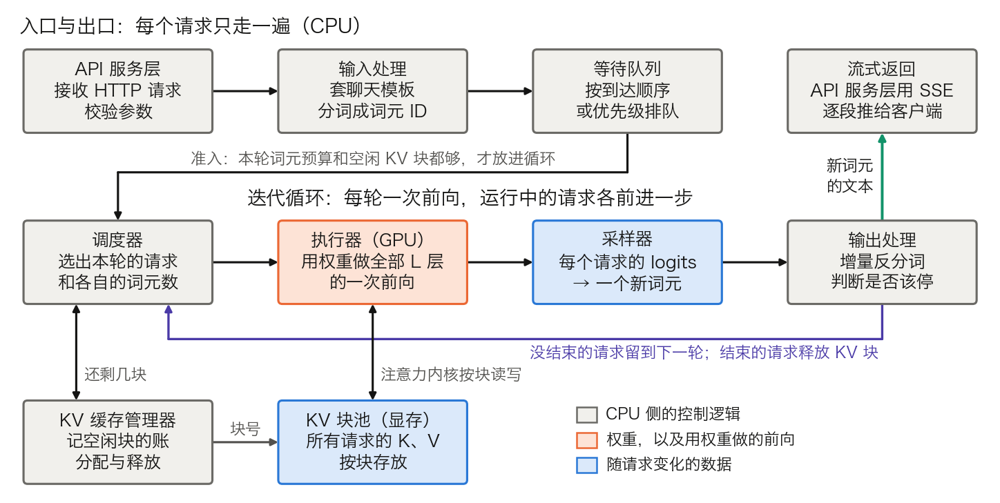

图 11-1：推理引擎的组件与一个请求的路径（[生成脚本](https://github.com/yeasy/llm_internals/blob/main/tools/figures/ch11a_engine_components.py)）。灰色是 CPU 侧的控制逻辑，橙色是权重和用权重做的前向，蓝色是随请求变化的数据。KV 缓存管理器只记块号的账，不搬动 K、V 本身；块里的数据由注意力内核读写。

一个请求依次经过八步：

1. **API 服务层**接收 HTTP 请求，校验采样参数与长度上限。接口多与 OpenAI 的格式兼容。
2. **输入处理**套用聊天模板并分词，得到词元 ID 序列（3.8.2）。
3. 请求进入**等待队列**，此时还不占显存。
4. **调度器**在每一轮开始时决定两件事：本轮让哪些请求参与，每个请求算几个词元。已在 Decode 的请求各算 1 个；新请求算整个 Prompt 或其中一段。放行新请求要同时满足两个预算：本轮词元总数不超上限，**KV 缓存管理器**手里的空闲块够用。
5. **执行器**把选中的词元拼成一个批，连同各请求的位置与块号送上 GPU，做全部 L 层的一次前向。多卡部署时每张卡一个工作进程，各持一份权重切片，同步执行（11.8 节）。
6. **采样器**取每个请求最后一行的 logits，按该请求自己的温度、top-p 等参数选出一个词元（第 9 章）。约束解码的词元掩码也在这一步施加（11.7 节）。
7. **输出处理**把新词元增量反分词成文本，并判断是否该停：选中 EOS、达到最大长度，或命中停止字符串。
8. 文本经 API 服务层以 SSE（Server-Sent Events）流回客户端。未结束的请求留到下一轮，回到第 4 步；结束的请求释放全部 KV 块。

准入取决于还剩多少空闲块，所以 KV 缓存管理器是调度器的依据，不在执行器下游；执行器拿到的只是一张块号表。

第 4 到 7 步每产出一个词元就要走一遍，其中只有第 5 步在 GPU 上。一轮迭代的时间因此分成两段：

$$
t_{\text{轮}} = t_{\text{CPU}}(\text{调度、拼批、采样后处理}) + t_{\text{GPU}}(\text{前向})
$$

两段若串行执行，GPU 在 CPU 段里空等，空等占比为 $t_{\text{CPU}} / (t_{\text{CPU}} + t_{\text{GPU}})$。表 11-1 中 B = 32 的 GPU 段下界约 6 ms。假设 CPU 段为 2 ms，GPU 就有 `2 ÷ (2 + 6) = 25%` 的时间无事可做。模型越小、卡越快，GPU 段越短，这个比例越高。SGLang 团队的[说法](https://lmsys.org/blog/2024-12-04-sglang-v0-4/)是，未经优化的引擎可能把一半时间花在 CPU 开销上。这与 10.1.4 的 execution-idle 不是一回事：后者按秒采样，要求连续数秒近零活动，量的是请求之间的空档；每轮几毫秒的 CPU 段在那种遥测里看不见。

对策有两类，都不改变上面八步的逻辑顺序。**CUDA Graph** 把一轮前向里逐个内核的启动合并成一次回放，压缩 GPU 段内部的空隙（见 11.10 节）。**重叠调度**让 CPU 在 GPU 计算第 n 轮时提前准备第 n+1 轮的输入，把 CPU 段藏进 GPU 段（见 11.11 节）。

### 1.3 主流引擎的定位

连续批处理、分页的 KV 缓存、前缀复用、分块 Prefill、量化与多卡并行，面向 GPU 服务器的几款开源引擎现已全部具备。功能清单分不出高下，差别在三处：KV 复用用什么数据结构，前向怎样执行，覆盖哪些硬件。表 11-2 按这三处对比。

| 引擎 | 出身与定位 | KV 复用的数据结构 | 执行方式 | 硬件范围 |
| --- | --- | --- | --- | --- |
| vLLM | 出自加州大学伯克利分校，是 PagedAttention 论文的实现，后成为社区项目；通用的在线服务 | 按块哈希：块的键由父块哈希、本块词元和额外键算出，只缓存写满的块 | PyTorch 模型默认经 `torch.compile` 编译，加分段与整图的 CUDA/HIP Graph；`--enforce-eager` 才退回即时执行 | NVIDIA、AMD、Intel 的 GPU 与多种 CPU；TPU、Gaudi、昇腾等经插件支持 |
| SGLang | 起于“LLM 程序”的执行：前端语言加运行时，面向多次调用、分支与结构化输出 | 前缀树（RadixAttention）：请求结束后 KV 留在树里，按 LRU 淘汰 | PyTorch 运行时，CPU 调度与 GPU 计算重叠 | NVIDIA、AMD 的 GPU，Intel CPU、TPU、昇腾等 |
| TensorRT-LLM | NVIDIA 官方；围绕自家 GPU 的内核与 FP8、FP4 低精度 | 分页 KV 缓存，带块复用 | PyTorch 后端直接加载模型 checkpoint；旧版 TensorRT engine 路径见下文 | 只支持 NVIDIA GPU |
| llama.cpp | 本地与边缘部署；纯 C/C++ 实现，无外部依赖。Ollama 以它为后端 | 服务端按槽位（slot）处理并发；`cache_prompt` 默认开启，新请求与槽位里上一次的 Prompt 比较，只重算不同的后缀 | GGUF 格式的整数量化权重（1.5 到 8 比特）；CPU 与 GPU 混合推理 | x86 与 ARM CPU、Apple Silicon、各类 GPU |

表 11-2：主流推理引擎的定位与设计取舍。各项均取自项目的论文、README 或设计文档；版本相关的细节见 11.10、11.11 节。

**哈希块表与前缀树。** 两者复用的都是词元级完全一致的前缀，区别在记账方式。vLLM 给每个写满的块算一个哈希，存进一张平坦的表，查找与淘汰都以块为单位。SGLang 把所有请求的词元序列组织成一棵前缀树，分叉点就是树的内部节点，淘汰从叶子开始。树保留了“谁和谁共享到哪里”的结构，调度器可据此优先安排共享前缀长的请求；代价是树的维护落在 CPU 的关键路径上，这也是 SGLang 要做重叠调度的原因之一。数据结构、命中率算例与失效情形见 11.5 节。

**结构化输出。** [SGLang 论文](https://arxiv.org/abs/2312.07104)的另一项贡献是压缩有限状态机：语法里只有一种合法续写的片段（例如 JSON 的固定键名）一次前向吐完，不必逐词元解码。这条路线今天已不为一家独有，机制见 11.7 节。

**已退居历史的两个名字。** TGI（Text Generation Inference）是 Hugging Face 用 Rust、Python 和 gRPC 写的推理服务器。它内置连续批处理，README 称用于其生产环境。项目现已转入维护模式，[README](https://github.com/huggingface/text-generation-inference) 建议改用 vLLM、SGLang 或 llama.cpp 等本地引擎。DeepSpeed-FastGen 提出 Dynamic SplitFuse（机制见 11.2.5）。其[论文](https://arxiv.org/abs/2401.08671)报告有效吞吐最高 2.3 倍、平均延迟减半、词元级尾延迟最多降到 1/3.7。基线是当时的 vLLM，那一版一次前向要么全做 Prefill、要么全做 Decode。vLLM 此后也加入了分块 Prefill，这组数字不宜外推。

vLLM 是应用很广的开源引擎，但大型闭源服务商的内部部署栈通常不公开，不应据此推断其生产环境用的是哪一款。

<a id="tensorrt-llm"></a>

#### TensorRT-LLM：从权重到服务

**输入与产物。** 起点是受支持模型的完整权重、模型配置与分词器；量化模型还要有匹配的量化配置和缩放因子。[官方快速入门](https://nvidia.github.io/TensorRT-LLM/latest/quick-start-guide.html)允许 `LLM` 加载本地 Hugging Face 模型目录或受支持的量化 checkpoint，在线服务入口是 `trtllm-serve`。训练时的优化器分片与恢复状态不属于这个输入契约；训练框架应先导出推理权重，见 A.7.3。

不要从名称推断它必然需要预先编译 engine。[后端迁移指南](https://nvidia.github.io/TensorRT-LLM/latest/legacy/tensorrt-backend-removal.html)已移除 TensorRT engine 后端，PyTorch 路径直接加载 checkpoint。旧版资料中的“原始权重 → TensorRT-LLM checkpoint → 构建 engine → 运行”是[历史构建流程](https://nvidia.github.io/TensorRT-LLM/latest/legacy/architecture/workflow.html)；engine 是推理执行产物，不是可续训的检查点。维护旧服务时，必须使用相同版本的示例与运行库，不能把旧版转换脚本拼接到新入口。

**启动与请求路径。** 启动时加载权重，确定精度与并行布局，并配置 KV 容量、最大批量和词元预算，参数含义见[服务入口](https://nvidia.github.io/TensorRT-LLM/latest/commands/trtllm-serve/trtllm-serve.html)。运行时每个 rank 有一个 `PyExecutor` 工作进程：它从队列取请求，由 `Scheduler` 选本轮工作、`KVCacheManager` 准备缓存块、`ModelEngine` 执行前向、`Sampler` 从 logits 选词元，再更新输出并处理结束请求。[架构说明](https://nvidia.github.io/TensorRT-LLM/latest/developer-guide/overview.html)把这些职责分开；CUDA Graph 与重叠调度优化的是这个循环，不改变请求的输入输出契约。分页、调度和多卡通信的原理分别见 11.3、11.4、11.8 节。

**优化与验收。** 先用受支持的高精度配置核对分词、聊天模板、停止条件和保留集质量，再逐项加入量化、多卡或前缀复用。量化的权重格式、缩放方式与可用内核必须匹配，不能只改一个 `dtype` 就把普通权重变成量化 checkpoint，见[量化说明](https://nvidia.github.io/TensorRT-LLM/latest/features/quantization.html)。模型支持也不代表所有优化可同时使用，应查[功能组合矩阵](https://nvidia.github.io/TensorRT-LLM/latest/features/feature-combination-matrix.html)。例如，单卡已能容纳权重时，先测单卡基线，再比较两卡 TP 与两份单卡副本；是否值得切模型，取决于延迟目标、KV 容量和通信代价，不能只按卡数判断。

**故障边界。** 加载失败先查架构、权重格式与软件/硬件支持；启动 OOM 查权重、工作区和 Graph 的预算；长请求或高并发才出现容量问题，再查 KV 块、准入与抢占。输出异常先对齐输入词元、模板和采样参数，随后查量化误差。性能验收仍按 11.13 节重放相同负载，报告质量、错误率与 TTFT/TPOT；框架名称不能代替对照实验。

### 1.4 选型：先看请求形态，再看引擎

选型按四步收窄，顺序不宜颠倒：

1. **硬件定候选集。** 只有 NVIDIA GPU 时四款都可选；AMD、TPU 或昇腾上先查表 11-2 的最后一列；笔记本与边缘设备基本只剩 llama.cpp 一系。
2. **请求形态定侧重点。** 共享前缀多（长系统提示、多轮对话、智能体反复调用）时，前缀复用的命中率决定成本（11.5 节）。长 Prompt 与交互式对话混跑时，看分块 Prefill 与分离式部署（11.2.5、11.9 节）。一个基座挂许多适配器，看多 LoRA 的批处理（11.6 节）。输出必须合乎 JSON Schema，看约束解码的开销（11.7 节）。
3. **SLO 定指标。** 不只看单卡词元/秒，要同时看并发峰值下的 TTFT（首词元时间）与 TPOT（每输出词元时间）的 P95、P99，以及 KV 缓存的压力、量化的精度损失、可观测性和安全隔离能力。指标的定义与测法见 11.13 节。
4. **用自己的流量压测。** 公开基准的结论随引擎版本、模型和长度分布而变，只能当起点。

### 1.5 本章路线图

表 11-3 把图 11-1 的部件对到后面各节。11.2 节先给出四个核心想法的概念层，11.3 到 11.8 节逐个展开机制，11.9 节讨论跨机器的拆分，11.10、11.11 节把机制对到两款引擎的源码，最后两节落到硬件与运维。

| 图 11-1 的部件 | 要回答的问题 | 小节 |
| --- | --- | --- |
| 调度器 | 每一轮选谁、算多少词元；显存不够时牺牲谁 | 11.2、11.3 |
| KV 缓存管理器与块池 | 显存预算怎么分；块表、写时复制、换出与重算 | 11.2、11.4 |
| KV 块的跨请求共享 | 哈希块与前缀树怎样找到可复用的前缀 | 11.5 |
| 执行器里的权重 | 多个 LoRA 适配器怎样同批计算 | 11.6 |
| 采样器 | 怎样保证输出合乎语法 | 11.7 |
| 执行器跨多张卡 | 张量并行、流水线并行、专家并行怎样切 | 11.8 |
| 整个循环拆到两组机器 | Prefill 与 Decode 分开部署何时划算 | 11.9 |
| 全部部件的真实实现 | 模块、参数与默认值 | 11.10、11.11 |
| 引擎之下与之上 | 选什么硬件；上线后看哪些指标 | 11.12、11.13 |

表 11-3：第 11 章的路线图。

## 2. 连续批处理与 PagedAttention

11.1.1 的表说明，Decode 的吞吐上界几乎随批大小线性增长。要把批撑大并一直撑住，得先解决三个问题：请求长短不一时，怎样不让短的陪长的空转；KV 缓存怎样分配才不浪费显存；长 Prompt 到来时，怎样不挡住正在出词元的请求。

本节给出对应的四个想法：迭代级调度、分页的 KV 缓存、前缀缓存、分块 Prefill。每个想法只讲到“为什么成立、值多少、代价在哪”；调度器的状态机、块表与换出、哈希块与前缀树的细节分别见 11.3、11.4、11.5 节。

### 2.1 静态批处理浪费了多少

**静态批处理**（Static Batching）把一批请求打包送进模型，等这一批全部生成完，才处理下一批。一批要跑多少步，由其中最长的请求决定；先结束的请求占着位置空转。

设一批有 4 个请求，输出长度分别是 10、50、200、2,000 个词元。这一批要跑 2,000 步，共 `4 × 2,000 = 8,000` 个“请求·步”的位置，真正产出词元的只有 `10 + 50 + 200 + 2,000 = 2,260` 个：

$$
\text{有效占比} = \frac{\text{各请求输出长度之和}}{\text{批大小} \times \text{最长输出长度}} = \frac{2{,}260}{8{,}000} = 28.25\%
$$

这个比值就是“平均输出长度 ÷ 最长输出长度”。输出长度的分布越偏，浪费越重；线上对话的输出从几个词元到几千个词元不等，分布通常很偏。

另有两笔代价不在这个比值里。其一是排队：新请求哪怕只晚到一步，也要等整批结束，上例中最多等 2,000 步。其二是输入侧的填充：Prompt 长短不一，要补齐到同一长度才能堆成 `[B, T, d_model]` 的张量，补上去的位置白算。

### 2.2 连续批处理：迭代级调度

**连续批处理**（Continuous Batching）把调度的粒度从“一批请求”降到“一次前向”。这个想法出自 [Orca](https://www.usenix.org/conference/osdi22/presentation/yu)，原文称**迭代级调度**（iteration-level scheduling）。调度器每次只让执行器跑一步（11.1.2 的一轮迭代），跑完立刻重新决定下一步的批里有谁。每一步做三件事：

1. 把上一步已经结束的请求（选中 EOS、达到最大长度或命中停止字符串）移出批，释放它的 KV 缓存。
2. 在预算之内放行等待队列里的请求。预算有两项：本步词元总数的上限，和还能分给 KV 缓存的显存。
3. 对选中的全部请求做一次前向。新放行的请求这一步做 Prefill，其余请求各做一步 Decode。

图 11-2 用 8 个请求对比两种做法。静态批处理要 14 步，56 个位置里有用的占 64%，请求 E 到第 9 步才开始；连续批处理只要 12 步，有用的占 75%，E 在第 3 步就开始。后者尾部的空位来自队列已空；只要队列里一直有请求，每个位置一空就被补上，占比趋近 100%。对 11.2.1 的 4 请求例子，这相当于同样步数下多产出 `1 ÷ 0.2825 ≈ 3.5` 倍的词元。

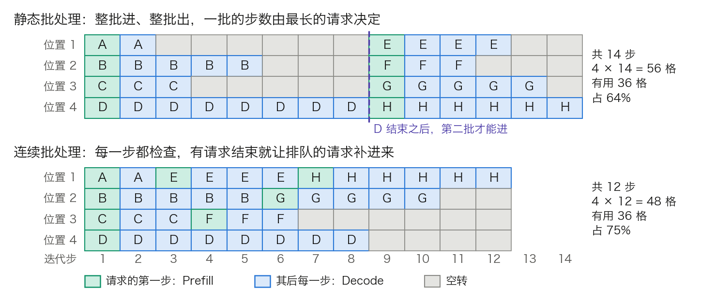

图 11-2：同样 8 个请求，静态批处理与连续批处理各占用多少步（[生成脚本](https://github.com/yeasy/llm_internals/blob/main/tools/figures/ch11a_batching_gantt.py)）。各请求占用的步数为 A2、B5、C3、D8、E4、F3、G5、H6，合计 36 格。图中画成 4 行只为便于比较：真实引擎约束的是每轮词元数和空闲 KV 块数，不是固定的行数。

公开论文里的加速倍数取决于和谁比，不能互相换算。Orca 报告在 GPT-3 175B 上、同等延迟下吞吐是 FasterTransformer 的 36.9 倍；[vLLM 论文](https://arxiv.org/abs/2309.06180)报告相对 Orca 提高 2 到 4 倍，Orca 已有迭代级调度，这部分增益来自 11.2.3 的显存管理；相对 FasterTransformer 最高 22 倍，其中含调度的差异。

**不同阶段的请求怎样放进同一次前向。** 第 3 步里有个形状上的难题。同一步里，R1 在做 Prefill，要算 5 个词元；R2、R3 在做 Decode，各算 1 个词元，缓存里分别已有 7 行和 3 行。三者堆不成 `[B, T, d_model]`。Orca 的解法叫**选择性批处理**（selective batching），主流引擎沿用的仍是这个思路，形状变化见图 11-3：

- **摊平**：把本步要算的全部词元排成一个没有批维度的矩阵，行数是各请求本步词元数之和：`X[5 + 1 + 1, 4096] = X[7, 4096]`（形状按 Llama 3 8B）。
- **带权重的层**：7 行一次算完。线性层、归一化、激活函数都是逐行独立的，不需要知道哪一行属于哪个请求。
  - `X[7, 4096] × W_Q[4096, 4096] → Q[7, 4096]`
  - `X[7, 4096] × W_K[4096, 1024] → K[7, 1024]`
  - MLP 的第一个矩阵：`[7, 4096] × [4096, 14336] → [7, 14336]`
  - 新算出的 K、V 各自追加到所属请求的缓存里。
- **注意力**：各请求对着自己的 K、V。每个头上，R1 是 `Q[5, 128] × Kᵀ[128, 5] → 分数[5, 5]`，带因果掩码；R2 是 `q[1, 128] × Kᵀ[128, 8] → 分数[1, 8]`；R3 是 `q[1, 128] × Kᵀ[128, 4] → 分数[1, 4]`。K 的行数各不相同，只能分开算，结果再拼回 `[7, 4096]`。
- **LM head**：只取每个请求的最后一行，`[3, 4096] × W_vocab[4096, n_vocab] → logits[3, n_vocab]`，采样出 3 个新词元。

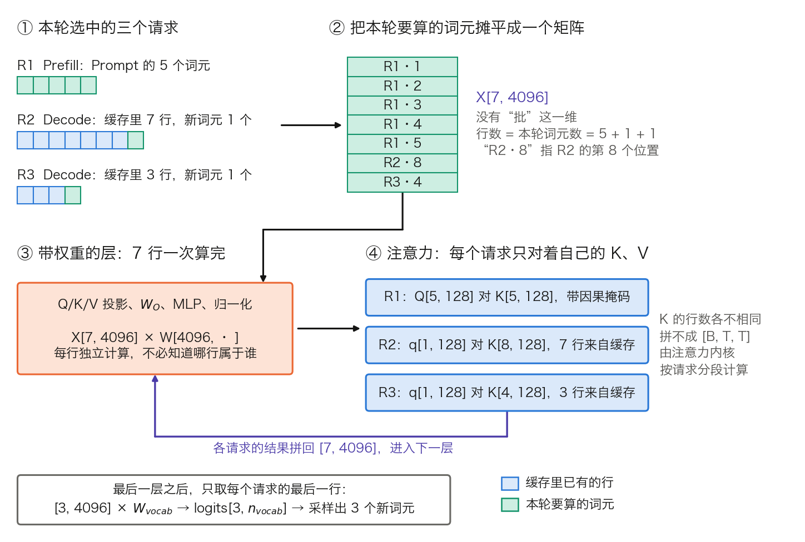

图 11-3：一轮迭代里的混合批（[生成脚本](https://github.com/yeasy/llm_internals/blob/main/tools/figures/ch11a_mixed_batch_shapes.py)）。③ 与 ④ 在每一层里交替出现：Q/K/V 投影在注意力之前，`W_O` 与 MLP 在注意力之后，图中合画为一个方框。

注意力不合批并不吃亏。批处理的收益来自“读一遍权重，服务多行数据”，而注意力这一步没有权重，它读的是各请求自己的 K、V，合不合批要读的字节数一样。Orca 论文给的正是这个理由。实现上，这一步交给支持变长输入的注意力内核：一次启动处理全部请求，各请求的边界由一个累计长度数组给出（FlashAttention 变长接口里的 `cu_seqlens`，形状 `[请求数 + 1]`）。

连续批处理不保证任何时刻都满载。到达率低时队列是空的；显存用尽时新请求进不来，甚至要牺牲已在运行的请求（11.3 节）；一个长 Prefill 会让同批的 Decode 全部陪着变慢（11.2.5）。批越大每一步越慢也仍然成立：11.1.1 的表里，B 从 32 升到 128，每步时间下界从 6.05 ms 升到 9.80 ms。

### 2.3 PagedAttention：按块分配 KV 缓存

连续批处理让批里的位置不空转，批能开多大则取决于显存里放得下多少请求的 KV 缓存。分页之前的系统为每个请求**预分配**一段连续显存，长度按最大序列长度取。vLLM 论文把由此产生的浪费分成三类：为尚未生成的词元预留的空位，按最大长度超配而最终用不上的内部碎片，以及分配器产生的外部碎片。大头是前两类，KV 显存里真正存着词元状态的只是其中一小部分，论文对当时几个系统的逐个实测见 11.4.2。

**同一个 KV 池，两种分法能放多少请求。** 取 Llama 3 8B 和一张 80 GB 的卡。11.4.1 算出的预算是：显存按九成可用为 72 GB，扣掉 16.06 GB 权重，再留 2 GB 给激活与其他开销，剩 53.94 GB 作 KV 池（未舍入为 53.9395 GB）。每词元 KV 是 131,072 字节（11.1.1），于是：

$$
\text{KV 池容量} = \frac{53.9395 \times 10^{9}}{131{,}072} \approx 411{,}525 \ \text{个词元}
$$

- 预分配到最大长度 8,192：每个请求占 `8,192 × 128 KiB = 1 GiB`，只能同时放 `⌊411,525 ÷ 8,192⌋ = 50` 个。若请求的实际长度平均 1,000 个词元，显存利用率是 `1,000 ÷ 8,192 ≈ 12.2%`。
- 按 16 个词元一块、用多少分多少：每个请求只在最后一块里浪费平均 `(16 − 1) ÷ 2 = 7.5` 个词元（11.4.2），能同时放 `⌊411,525 ÷ (1,000 + 7.5)⌋ = 408` 个，是预分配的 8.2 倍；浪费降到 `7.5 ÷ 1,000 = 0.75%`。

并发数翻 8 倍，吞吐不会跟着翻 8 倍。按 11.1.1 的口径，B = 50 时每步读 22.61 GB，下界 6.75 ms，吞吐上界约 7,407 词元/秒；B = 408 时每步读 69.54 GB，下界 20.76 ms，吞吐上界约 19,655 词元/秒。吞吐是 2.7 倍，每个请求的每一步却慢到 3.1 倍。分页提供的是“能把批开到多大”的上限，开到多大仍由延迟目标决定。

**做法。** [PagedAttention](https://arxiv.org/abs/2309.06180) 借用操作系统分页的思路，论文的类比是：块相当于页，词元相当于字节，请求相当于进程。

1. 启动时把留给 KV 缓存的显存一次性切成大小相同的**块**（block），每块容纳固定个数词元的 K、V。
2. 每个请求持有一张**块表**（block table），把“第 0、1、2……个逻辑块”映射到物理块号。物理块不必相邻。
3. 请求每写满一块，才向管理器再要一块。
4. 请求结束，归还全部块。

块大小相同，所以没有外部碎片；按需分配，所以没有预留，内部碎片只剩每个请求最后一块里的空位。分页之前的浪费另有一个博客口径的数字，见 10.2.6，它与论文的利用率口径互为补数；分页之后剩下的只有上面那 0.75% 一类，随块大小和序列长度在百分之几的范围内浮动，通式见 11.4.2。

这只是类比。GPU 上并没有用到硬件的虚拟内存，映射关系是引擎自己维护的一张整数表；注意力内核算到某个请求时，按这张表到各个物理块里取 K、V。图 11-4 给出一个两请求的例子；块表的形状、KV 池的张量布局见 11.4 节。

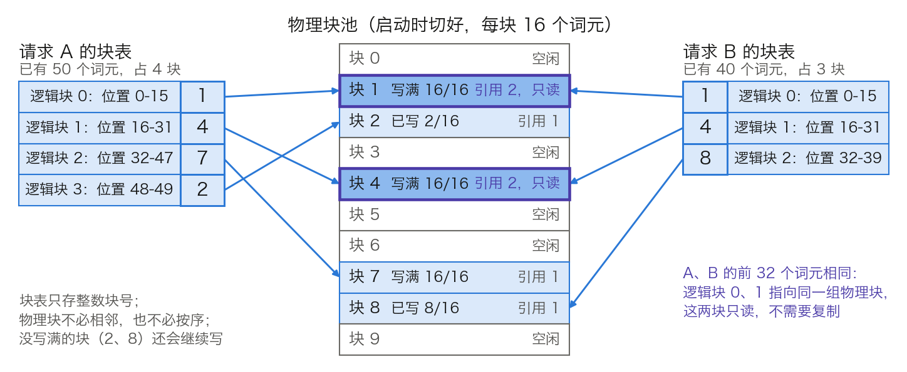

图 11-4：两个请求的块表指向同一个物理块池（[生成脚本](https://github.com/yeasy/llm_internals/blob/main/tools/figures/ch11a_block_table_mapping.py)）。请求 A 已有 50 个词元，占块 1、4、7、2；B 已有 40 个词元，占块 1、4、8；前两块写满、只读、引用计数 2。

**代价有两笔。** 其一，内核多了一层间接寻址。查块表、多出的分支和变长处理使注意力内核慢于高度优化的连续内存实现，论文微基准里的具体幅度见 11.4.3；这只影响注意力一个算子，端到端仍因批更大而胜出。其二，块大小两头受限：太小，内核读 KV 时用不满 GPU 的并行度；太大，内部碎片变大，能共享的机会变少。取值的依据与各引擎的差异见 11.4.2。

**共享。** 块表允许多个逻辑块指向同一个物理块，管理器给每个物理块记引用计数。这带来两种不同的共享，不要混为一谈：

- **同一请求内**的并行采样与束搜索：多条输出序列共享 Prompt 的全部块。只有最后那个没写满的块需要**写时复制**（Copy-on-Write）：某条序列要往引用计数大于 1 的块里写新词元时，先复制这一块，再写。省下的显存随 Prompt 与输出的长度比变化，从百分之几到六成以上，逐档的实测见 11.4.4。
- **跨请求**共享相同的前缀：共享的是已经写满、不再变化的块，只读加引用计数即可，用不到写时复制。这就是下一小节的前缀缓存。

### 2.4 前缀缓存：共享只读的满块

因果注意力下，一个位置的 K、V 只取决于它和它左边的词元。两个请求只要开头一段词元完全相同，这一段的 KV 就逐字节相同，后到的请求可以直接引用，跳过这一段的 Prefill。适用场景与提示词的排布原则见 10.2.5，这里只说它怎样接在分页之上。

分页之后，“一段前缀的 KV”就是若干个写满的块。让这些块可以按内容查找，就得到**前缀缓存**（Prefix Caching）。vLLM 的做法是给每个满块算一个哈希，输入是父块的哈希、本块的词元和一组额外键；请求结束后，它的块不立即清空，而是留在可淘汰的队列里，等新请求命中或被挤掉。SGLang 走另一条路，把词元序列组织成前缀树。两条路线的数据结构与淘汰策略见 11.5 节。

收益可以直接算。设系统提示加共享文档共 2,010 个词元，用户输入 200 个，块大小 16。只有写满的块才能共享，命中 `⌊2,010 ÷ 16⌋ = 125` 块，即 2,000 个词元；需要 Prefill 的词元从 2,210 个降到 210 个，线性层的计算量降到 9.5%。Prefill 受算力限制，TTFT（首词元时间）里的计算部分近似按同一比例下降。显存也省：125 块在所有命中它的请求之间只存一份。

复用的前提是**词元级完全一致**，差一个词元，其后的块全部失效。哈希键里除了词元，还须纳入一切会改变 KV 或改变可见性的因素：模型与版本、LoRA 适配器、多模态输入的内容哈希，以及区分租户或权限域的盐值。默认不应跨租户、跨权限或跨私有语料复用；命中与否会反映在 TTFT 上，跨边界复用等于把别人的上下文变成可探测的侧信道。

分离式架构里，前缀 KV 还可以下沉到主机内存或 SSD 组成的共享池，供多个实例取用，见 11.9 节。

### 2.5 分块 Prefill：防止队头阻塞

连续批处理里，新请求的 Prefill 和别人的 Decode 挤在同一次前向里。Prompt 很长时，这一步的时间由 Prefill 决定，同批所有 Decode 请求都要等它算完，这是一种**队头阻塞**（Head-of-Line blocking）。

**挡多久。** 设 32 个请求正在 Decode，平时每步约 6 ms（11.1.1）。这时来了一个 32,768 个词元的 Prompt。按 3.8.8 的算法，Llama 3 8B 的 Prefill 计算量是：

- 与权重相乘：每词元约 `2 × 69.8 亿`（32 层的参数量），乘 32,768，约 `4.574 × 10¹⁴`。
- 打分与读取：每层 `2T²d`，即 `2 × 32,768² × 4,096 × 32`，约 `2.815 × 10¹⁴`。
- 合计约 `7.39 × 10¹⁴` 次。H100 的 BF16 稠密峰值是 990 TFLOPs/s，全部用满也要 0.75 s；按 50% 的利用率是 1.5 s。

这 32 个用户会看到输出停顿 0.75 到 1.5 秒，相当于平时的 125 到 250 步。[Sarathi-Serve](https://arxiv.org/abs/2403.02310) 在当时的 vLLM 上实测到持续数秒的生成停顿。这种停顿在 TPOT（每输出词元时间，请求内的平均值）里会被摊薄，要看相邻两个词元的间隔，即 TBT（time-between-tokens）的高分位；两个指标的定义见 11.13 节。

**做法。** **分块 Prefill**（Chunked Prefill）把长 Prompt 切成若干块，每一步只放进一块，并让正在 Decode 的请求搭在同一次前向里。用的就是 11.2.2 的混合批。Decode 没有暂停，每一步照常出词元；Prompt 的最后一块算完，这个请求才产出首词元。每一步的词元总数有一个上限，称**词元预算**（token budget）：先装下全部 Decode 词元，剩下的留给 Prefill 块。图 11-5 对比两种时间线。

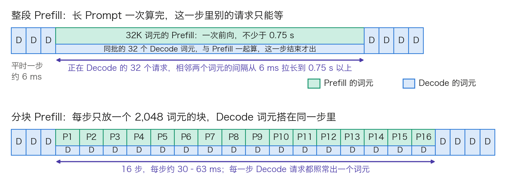

图 11-5：整段 Prefill 与分块 Prefill 的时间线（[生成脚本](https://github.com/yeasy/llm_internals/blob/main/tools/figures/ch11a_chunked_prefill_timeline.py)）。时间轴为示意，未按比例；毫秒数取自正文算例，按峰值算力估算。上排的 32 个 Decode 词元与整段 Prefill 同在一步里，只在这一步结束时才各出一个。

同一个例子按每块 2,048 个词元切，要 `32,768 ÷ 2,048 = 16` 步，每步 30 到 63 ms。第 k 块的注意力要对着前面已算的 `past` 个词元打分，计算量为 `2 × d × L × ((past + C)² − past²)`，C 是块长；线性部分每块固定为 `2 × 69.8 亿 × 2,048 ≈ 2.86 × 10¹³`。第 1 块 `past = 0`，注意力 `2 × 4,096 × 32 × 2,048² ≈ 1.1 × 10¹²`，整块约 `2.97 × 10¹³`，峰值算力下约 30 ms；第 16 块 `past = 30,720`，注意力 `2 × 4,096 × 32 × (32,768² − 30,720²) ≈ 3.41 × 10¹³`，整块约 `6.27 × 10¹³`，约 63 ms。同批 Decode 请求的词元间隔因此被限制在几十毫秒，而不是一次停顿 0.75 秒。搭载的 32 个 Decode 词元只给 2,048 行的矩阵多添 1.6% 的行，权重反正要读一遍，它们几乎不花额外时间。11.3.4 把 Decode 词元也计入预算，预算 2,048 时块为 2,016 个词元，同一个 Prompt 要 17 步；逐块的账见表 11-7。

**代价。** 三条都由预算的大小决定，算例见 11.3.4。

- 长请求自己的 TTFT 变长：各块的计算量之和与整段相同，但要分多步走完，每一步还捎带别人的 Decode。
- 后面的块比前面的贵，前面各块的 KV 被反复读出；块越小，重读越多，矩阵乘法的效率也越低。
- 预算是一个旋钮：调小，TBT 更稳，TTFT 与效率变差；调大则相反。

Sarathi-Serve 报告的收益以“满足 P99 TBT 目标的前提下可承载的负载”计。Mistral-7B 单张 A100 为 2.6 倍，Yi-34B 两张 A100 最高 3.7 倍，均相对当时的 vLLM。Falcon-180B 加流水线并行的 5.6 倍是相对 Orca 的数字；相对 vLLM 的同一混合并行配置，严格 SLO 下为 3.6 倍，宽松 SLO 下为 1.48 倍。三组数字对应三种部署，最后一组还包含流水线气泡减少的收益，不宜读成一个连续的区间。DeepSpeed-FastGen 的 [Dynamic SplitFuse](https://github.com/deepspeedai/DeepSpeed/tree/master/blogs/deepspeed-fastgen) 是同一思路：长 Prompt 拆到多步；短 Prompt 拼起来凑满预算；每一步前向的词元数因此大致恒定。

分块缓解了阻塞，没有消除争用：Prefill 块和 Decode 词元仍共用同一张卡的算力与带宽。把两者放到两组机器上，是 11.9 节的分离式架构。

### 2.6 缓存感知路由

前缀缓存是每个实例各管各的。集群里有多个实例时，路由方式直接决定命中率。以多轮对话为例：上一轮的 KV 留在某一个实例上，若下一轮随机路由，8 个实例时落回原实例的概率只有 `1 ÷ 8 = 12.5%`，其余情况要把整段历史重新 Prefill。

**缓存感知路由**让网关按前缀的亲和性分发：

- 对可复用的前缀计算词元级哈希。语义向量只适合做结果缓存或负载聚类，不能证明 KV 前缀可复用。
- 把请求发给已缓存该前缀的实例。
- 没有任何实例缓存该前缀时，选 KV 缓存占用率最低的实例。

两种情形下它会失效。一是亲和性与负载均衡冲突：热点前缀把流量压向同一个实例，排队时间吃掉省下的 Prefill，路由必须在命中与负载之间折中。二是网关的索引与实例里的真实缓存不一致：前缀已被实例淘汰，请求仍被送过去，既没命中又没均衡。路由算法与实例侧的缓存感知调度见 11.5 节。

### 2.7 四个想法的边界与后续入口

表 11-4 汇总本节的四个想法，各自留下的问题由后面的小节接手。

| 想法 | 消掉的浪费 | 代价与失效情形 | 展开于 |
| --- | --- | --- | --- |
| 迭代级调度 | 短请求陪长请求空转；新请求等整批结束 | 每步都有 CPU 调度开销（11.1.2）；队列空或显存满时仍不满载；批越大每步越慢 | 11.3 |
| 分页的 KV 缓存 | 按最大长度预留，内外碎片 | 注意力内核多一层间接寻址；块大小两头受限；块用完时只能抢占，被抢占的请求要么丢弃 KV 之后重算，要么换出到主机内存，两者都表现为 TBT 的毛刺 | 11.3、11.4 |
| 前缀缓存 | 相同前缀的重复 Prefill 与重复存储 | 只认词元级一致的前缀；键必须含隔离因素；缓存占着的块要和新请求争显存 | 11.5 |
| 分块 Prefill | 长 Prompt 造成的队头阻塞 | 长请求自己的 TTFT 变长；块太小则效率下降；同卡争用仍在 | 11.3、11.9 |

表 11-4：连续批处理、分页、前缀缓存与分块 Prefill 各自的收益、代价与后续小节。

还有一个前提贯穿全节：每一层都保留全部词元的 K、V，所以所有层可以共用同一张块表。滑动窗口或混合注意力的模型（10.2.8）各层需要的缓存长度不同，这个前提不再成立，块要按层的类型分组管理。

## 3. 调度循环与抢占：一个请求在引擎里的全过程

11.2 节给出了四个想法：迭代级调度、KV 缓存分页、前缀缓存、分块 Prefill。前缀缓存留给 11.5 节，其余三个都靠同一个部件落地：**调度器**（scheduler）。它在每次前向之前决定哪些请求参加、各算几个词元。本节回答四个问题：一个请求经过哪些状态；每一步调度器按什么顺序做决定；显存不够时牺牲谁、怎样恢复；到达率、批大小与延迟之间是什么数量关系。

算例沿用 3.8.7 表 3-25 的 Llama 3 8B，权重与 KV 缓存按 BF16 存放；硬件取 10.1 节的 H100，稠密 BF16 峰值算力约 990 TFLOPs/s，显存带宽 3.35 TB/s。KV 块怎样分配与回收归 11.4 节，本节只把 KV 空间当作一个按词元计数的池子。

### 3.1 请求的四个状态

从调度器看，一个请求只有四种状态，图 11-6 画出了它们之间的全部转移。

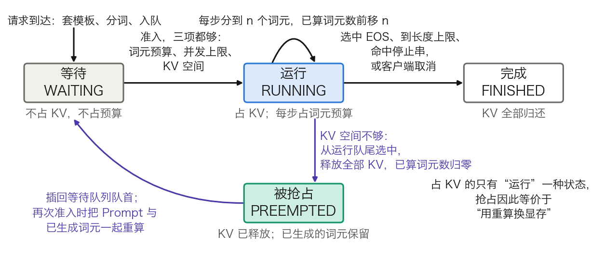

图 11-6：一个请求在调度器里的状态机（[生成脚本](https://github.com/yeasy/llm_internals/blob/main/tools/figures/ch11_3_request_states.py)）。方框下方的灰字是该状态占用的资源；紫色是显存不足时才走的路径。

- **等待**（waiting）：已分词，排在等待队列里。不占 KV 空间，也不占每步的计算量。
- **运行**（running）：已被准入。它的 KV 留在显存里，每步至少分到一个词元的计算量。
- **被抢占**（preempted）：原本在运行，因 KV 空间不够被调度器中止。KV 全部释放，已生成的词元保留，请求插回等待队列的队首。
- **完成**（finished）：选中 EOS、到达长度上限、命中停止串，或客户端取消。KV 全部归还，结果流回用户。

调度器并不区分“Prefill 阶段”和“Decode 阶段”。每个请求只记两个数：应算词元数（Prompt 加已生成的词元）和已算词元数（KV 已写入缓存的词元）。每一步的任务是让后者追上前者。差距是整条 Prompt 时，这一步就是 Prefill；差距是 1 时，就是 Decode；差距大于本步能分到的量时，就是分块 Prefill。vLLM 调度器源码的注释写的正是这一点。调度器里没有 decoding phase，也没有 prefill phase，只有 `num_computed_tokens` 追赶 `num_tokens_with_spec`。前缀缓存命中（11.5 节）相当于已算词元数的初值不为 0，投机解码相当于差距大于 1，同一套记账都能容纳。

### 3.2 一步迭代：调度器做的六件事

[Orca](https://www.usenix.org/conference/osdi22/presentation/yu) 把调度粒度从“一个请求”改成“一次迭代”：调度器选出本步要跑的请求，执行一次前向，收回结果，再选下一步。现代引擎沿用这个循环，每一步依次做六件事。

1. **回收**。上一步完成或被取消的请求移出运行队列，KV 归还池子。
2. **先排运行中的请求**。按队列顺序，给每个请求分配“应算减已算”个词元，但不超过剩余的**词元预算**（token budget，一步最多处理的词元总数）。Decode 请求各拿 1 个；Prefill 未完成的请求拿走尽量大的一块。
3. **为这些词元申请 KV 空间**。申请失败就触发抢占（11.3.5），腾出空间后重试。
4. **准入等待队列里的请求**。前提是本步没有发生抢占。每准入一个都要同时满足三项：词元预算还有剩余，运行中的请求数未到并发上限，KV 空间放得下。队首不满足就停止，不跳过它去看后面的请求。
5. **执行前向**。所有被选中的词元摊平成一个一维序列，一起过线性层；注意力按各请求自己的长度分别计算。这就是 Orca 的 selective batching。
6. **采样与状态更新**。已算词元数追平应算词元数的请求各采样一个词元，其余请求（Prompt 还没算完）不采样。检查停止条件，更新计数，进入下一步。

设一步里有 32 个 Decode 请求，外加某个新请求的 2,016 个 Prompt 词元，摊平后是 `n = 32 + 2,016 = 2,048` 行。各层的形状见 11.2.2 与图 11-3：线性层对 `X[2048, 4096]` 一次算完，注意力按请求分开。LM head 只取要采样的行：32 个 Decode 各一行，那条 Prompt 若在本步算完再加 1 行。线性层的计算量只与 `n` 有关，与这 `n` 个词元来自几个请求无关。词元预算约束的因此是“一步多长”，并发上限与 KV 空间约束的是“显存里同时放几条序列”，三者各管一件事。

第 2 步与第 4 步的先后是一个设计选择。表 11-5 对比三种排法。

| 排法 | 每步怎样组批 | 首词元延迟 | Decode 的词元间隔 |
| --- | --- | --- | --- |
| 请求级批处理 | 一批全部结束才换下一批 | 要等整批结束 | 稳定，但批越跑越空 |
| Prefill 优先 | 有新请求就先做完整 Prefill，Decode 暂停 | 短 | 每来一个长 Prompt 就停顿一次 |
| Decode 优先加分块 Prefill | 先排全部 Decode，再排未完成的 Prefill，最后用剩余预算准入新请求 | 长 Prompt 要分几步 | 有上界，由词元预算决定 |

表 11-5：三种组批顺序的取舍。第三行是 [Sarathi-Serve](https://arxiv.org/abs/2403.02310) 提出的 stall-free batching，第二行是该文记录的 vLLM 早期做法，它造成的停顿被称为 generation stall。

本节后文都按第三种排法。它把“新请求要不要打断老请求”这个矛盾，换成了一个可调的数：词元预算。

### 3.3 玩具轨迹：11 步走完四个请求

图 11-7 用一组很小的数字把六件事走一遍：词元预算 12，KV 池 48 个词元，并发上限 4。请求 A、B 在第 1 步前到达，C 在第 2 步前到达，D 在第 4 步前到达。Prompt 与输出长度依次为 A 6/8、B 8/5、C 20/8、D 8/5。最后一个采样出的词元不再送回模型，也就不写入 KV。

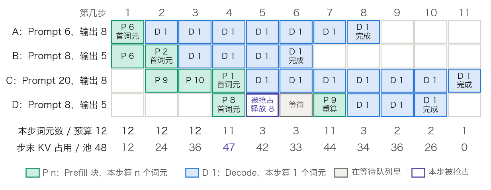

图 11-7：玩具调度器的 11 步轨迹（[生成脚本](https://github.com/yeasy/llm_internals/blob/main/tools/figures/ch11_3_schedule_trace.py)，脚本内含调度器并打印同一份轨迹）。格内数字是该请求本步分到的词元数；下方两行是本步用掉的预算与步末的 KV 占用。

- **第 1 步**：A 拿 6 个词元，Prompt 算完，采样出首词元。预算剩 6，B 的 Prompt 有 8 个词元，只能先算 6 个，这一步不采样。KV 占用 `6 + 6 = 12`。
- **第 2 步**：先排运行中的请求。A 是 Decode，拿 1 个；B 拿剩下的 2 个并出首词元。预算还剩 `12 − 1 − 2 = 9`，准入 C，它的 20 个词元先算 9 个。
- **第 3、4 步**：C 再算 10 个、1 个，共三步完成 Prefill，其间 A、B 每步照常前进一个词元。第 4 步预算剩 `12 − 3 = 9`，池子空闲 `48 − 39 = 9`，D 的 8 个词元放得下，准入。步末 KV 占用 47。
- **第 5 步**：四个请求各需要 1 个新位置，池子只剩 1 个。A 拿走后，B 申请失败，调度器抢占运行队列的队尾 D，释放 8 个词元，B、C 得以继续。D 回到等待队列队首，它在第 4 步生成的那个词元保留。本步发生了抢占，不再准入。
- **第 6 步**：D 需要 `8 + 1 = 9` 个词元的空间，池子空闲 `48 − 42 − 3 = 3`，仍在等待。B 在步末完成，归还 `8 + 4 = 12` 个词元：第 5 个输出词元未写入 KV。
- **第 7 步**：D 重新准入，把 Prompt 与已生成的 1 个词元合成 9 个词元一次重算，随即采样出第 2 个词元。

D 的首词元在第 4 步就已流出，第二个词元却到第 7 步才出现。正常间隔是 1 步，这里是 3 步，多出的停顿就是抢占在用户侧的表现。第 4 步准入 D 时调度器只检查了“此刻放得下”，没有为 A、B、C 下一步的增长留余量，这是 11.3.5 要讨论的准入口径问题。

### 3.4 词元预算：一步放多少词元

问题：一步里多放一些 Prefill 词元，这一步会变长多少？按 10.1 节的 Roofline，一步的耗时有两个下界，取大者：

$$
t_{\text{step}} \ge \max\left(\frac{\text{本步读出的字节}}{B_{\text{peak}}},\ \frac{\text{本步的 FLOPs}}{F_{\text{peak}}}\right)
$$

先备好 Llama 3 8B 的三个常量。

- **权重字节**。一层的矩阵参数为 `4096 × 4096 × 2 + 4096 × 1024 × 2 + 3 × 4096 × 14336 = 218,103,808`。加上词嵌入、LM head 与归一化，共 `32 × 218,103,808 + 2 × 128,256 × 4096 + 65 × 4096 = 8,030,261,248` 个参数：词嵌入与 LM head 各一份、不共享，词表 128,256 行见 3.8.7 表 3-27 的注（表格单元里的 128,000 是论文口径）；每层两个归一化加末尾一个，共 65 个，各 4,096 个参数。BF16 下 16.06 GB。读一遍要 `16.06 GB ÷ 3.35 TB/s = 4.79 ms`，记作 `a`。
- **每词元计算量**。Llama 的 MLP 有三个矩阵，3.8.8 的 `24d²` 不再适用，直接按“每个矩阵参数 2 次运算”计：`2 × 32 × 218,103,808 ≈ 1.396 × 10¹⁰` FLOPs，折合 `14.1 µs`。要采样的位置再加 LM head 的 `2 × 4096 × 128,256 ≈ 1.05 × 10⁹`。
- **每词元 KV**。`2 × 8 × 128 × 32 = 65,536` 个数（见 3.8.8），BF16 下 131,072 字节，即 128 KiB。

两个下界相等时，`n × 14.1 µs = 4.79 ms`，得 `n ≈ 340`。一步少于约 340 个词元时，耗时由读权重决定，多加词元几乎不花时间；超过之后，步长随词元数线性增长。Sarathi-Serve 对 A100 给出的理论值是约 200 个词元，并指出张量并行度较高时，实测因固定开销会推迟到 500 至 600 个，量级一致。

11.2.5 已算过 32,768 词元的 Prompt 按 2,048 分块时首块与末块的耗时；这里换成 8,192 词元的 Prompt，补上预算大小与各块耗时的关系。以“32 个 Decode 请求、各有 1,000 个词元上下文”为底，向同一步加入一个 Prefill 块，结果列在表 11-6。先算一格：块大小 2,016。

$$
\begin{aligned}
\text{块的线性部分} &= 2016 \times 1.396\times10^{10} = 2.814\times10^{13} \\
\text{块的注意力} &= 2 \times 4096 \times 32 \times 2016^2 = 1.07\times10^{12} \\
\text{32 个 Decode} &= 32 \times (1.396\times10^{10} + 1.05\times10^{9} + 4\times1000\times4096\times32) = 4.97\times10^{11} \\
t_{\text{cmp}} &= 2.970\times10^{13} \div 9.9\times10^{14} = 30.0\ \text{ms}
\end{aligned}
$$

注意力一项用 3.8.8 的 `2T²d`（逐层、因果折半）；Decode 的打分与读取按每层 `4sd`。访存一侧是 `16.06 GB + 32 × 1000 × 131,072 B = 20.25 GB`，合 6.05 ms，小于 30.0 ms，这一步由算力决定。

| 同步加入的 Prefill 词元 | 访存下界（ms） | 算力下界（ms） | 步长（ms） | 相对纯 Decode |
| ---: | ---: | ---: | ---: | ---: |
| 0 | 6.05 | 0.50 | 6.05 | 1.0 倍 |
| 224 | 6.05 | 3.67 | 6.05 | 1.0 倍 |
| 480 | 6.05 | 7.33 | 7.33 | 1.2 倍 |
| 992 | 6.05 | 14.75 | 14.75 | 2.4 倍 |
| 2,016 | 6.05 | 30.00 | 30.00 | 5.0 倍 |
| 8,192 | 6.05 | 133.78 | 133.78 | 22.1 倍 |

表 11-6：同一步里的 Prefill 词元数怎样拉长步长。Llama 3 8B、H100、理想 Roofline 下界；真实引擎的算力利用率达不到峰值，绝对值更大，倍数关系的形状不变。

最后一行是不分块的后果：一个 8,192 词元的 Prompt 整段进入，同批 32 个用户的下一个词元要等 134 ms，而平时只要 6 ms。这个间隔称为 **TBT**（time between tokens，相邻两个输出词元的间隔）。它在一个请求内的平均值是 TPOT（time per output token，每输出词元时间）。两者的正式定义见 11.13 节。Sarathi-Serve 在 A100 上实测，不分块的混批使 TBT 最多升到纯 Decode 批的 28.3 倍，与表 11-6 同一量级。

词元预算把最后一行切开。表 11-7 让同一个 8,192 词元的 Prompt 在不同预算下完成 Prefill，每步先扣掉 32 个 Decode 词元。第 k 块的注意力按 `2 × 4096 × 32 × ((已算 + 块)² − 已算²)` 计，已算为前 k − 1 块的词元数；线性部分与 32 个 Decode 的算法同上。分块之后，访存一侧要另加长请求已写入的 KV：第 k 步多读 `已算词元数 × 131,072 B`。预算 256 的第 37 步已算 `36 × 224 = 8,064` 个词元，多读 `8,064 × 131,072 B = 1.06 GB`，访存下界由 6.05 ms 升到 6.36 ms。

| 词元预算 | 每步 Prefill 词元 | 步数 | 最长一步（ms） | 长请求的 Prefill 总时长（ms） |
| ---: | ---: | ---: | ---: | ---: |
| 256 | 224 | 37 | 6.4 | 229.5 |
| 512 | 480 | 18 | 9.3 | 147.6 |
| 1,024 | 992 | 9 | 18.4 | 138.9 |
| 2,048 | 2,016 | 5 | 36.5 | 139.3 |
| 4,096 | 4,064 | 3 | 70.9 | 139.5 |
| 不分块 | 8,192 | 1 | 133.8 | 133.8 |

表 11-7：词元预算对 TBT 上界与长请求 Prefill 时长的影响（口径同表 11-6，另计前面各块的 KV 读取）。预算 2,048 时，`8192 ÷ 2016 = 4.06`，需要 5 步，各步依次为 30.0、32.2、34.3、36.5、6.4 ms；最后一步只剩 128 个词元，由访存决定，同样是 6.36 ms。

从表中读出三点。

- **预算就是 TBT 的上界**。预算在拐点以上时，每减半，最长一步大致减半：表中 4,096 到 512 的三次减半各为 1.9 至 2.0 倍。到 256 只剩 1.45 倍，原因见第三点。同批用户感受到的最大停顿随最长一步一起变短。
- **后面的块比前面的贵**。第 4 块要对前 3 块的 KV 打分，注意力一项为 `2 × 4096 × 32 × (8064² − 6048²) = 7.46 × 10¹²`，是第 1 块的 7 倍，步长因此从 30.0 ms 升到 36.5 ms。前面各块的 KV 还要被反复读出：分成 N 块时，第 1 块的 KV 被读 N − 1 次。
- **预算不能低于拐点**。预算 256 时每步只有 3.67 至 4.60 ms 的计算（第 1 块到第 36 块，后面的块多了对已算 KV 的打分），却要付 6.05 至 6.36 ms 的访存，37 步平均 6.20 ms，Prefill 总时长从 139 ms 涨到 230 ms。预算的合理下限是让一步恰好越过约 340 个词元的拐点。

分块的代价不止于此。Sarathi-Serve 报告过一个内核层面的现象：个别情形下，块大小 257 的 Prefill 时间比 256 高出 32%，原因是矩阵维度不能被 GPU 的分片大小整除。预算取 2 的幂可避开这类情形，具体数值再按 TBT 的目标用一次离线压测确定。

### 3.5 显存不足：抢占谁，怎样恢复

问题的根源是输出长度事先未知。准入一个请求时，调度器要为它将来的 KV 留多少空间？设 KV 池为 400,000 个词元，合 `400,000 × 128 KiB ≈ 48.8 GiB`。11.4 节按显存预算算得约 41 万，这里取整。请求的输入为 1,000 个词元，输出上限 1,000 个。表 11-8 对比三种准入口径。

| 准入口径 | 每请求按多少词元计 | 可并发请求数 | 风险 |
| --- | ---: | ---: | --- |
| 悲观：按输入加输出上限预留 | 2,000 | 200 | 无抢占；实际输出较短时空间闲置 |
| 按稳态平均占用 | 1,500 | 266 | 负载波动时偶发抢占 |
| 乐观：只看 Prompt 放不放得下 | 1,000 | 400 | 各请求继续增长，必然抢占 |

表 11-8：三种准入口径下的并发数。第二行假设各请求的进度均匀错开，平均已生成 500 个词元。

Orca 属于第一种：请求首次被调度时按 `max_tokens` 预留全部槽位，保证此后不会缺空间。[vLLM 论文](https://arxiv.org/abs/2309.06180)选了另一头：KV 按需分配，空间用尽时再抢占。同样的显存，后两种口径能多放 33% 到 100% 的请求，代价是要有一套抢占与恢复的机制。

**何时触发**。运行中的请求每步至少需要一个新的 KV 位置。11.3.2 的第 3 步申请失败，就是触发点。

**牺牲谁**。先到先服务之下，牺牲最晚到达的请求：它已投入的计算最少，也最不该排在别人前面。vLLM 论文的规则是：最早到达的请求最先服务，最晚到达的最先被抢占。实现上取运行队列的队尾；启用优先级时，取优先级最低、同级中到达最晚的那个。

**整条释放**。一条序列的全部 KV 在每一步都会被读到，留下一半没有用处。vLLM 论文称之为 all-or-nothing：要么全留，要么全放。

**怎样恢复**有两条路：**重算**（recomputation）丢弃 KV，再次准入时把 Prompt 与已生成的词元拼成一条新 Prompt，一次 Prefill 算回来；**换出**（swapping）把 KV 拷到主机内存，恢复时拷回。两条路的耗时对比，以及 vLLM 的 V1 引擎为何只保留重算，见 11.4.5。本节后文按重算讨论：已生成的词元不会丢，用户看到的只是一次停顿。

重算要花多少？设被抢占的请求已生成 600 个词元，需要重算 1,600 个：

$$
1600 \times 1.396\times10^{10} + 2\times4096\times32\times1600^2 = 2.30\times10^{13}\ \text{FLOPs},\quad 2.30\times10^{13} \div 9.9\times10^{14} = 23.2\ \text{ms}
$$

按峰值算力，单次重算约等于 4 个 Decode 步；按 11.4.5 的 0.5 利用率折算，约 46 ms。真正的代价有两项。其一是停顿：被抢占者要等到池子里腾出整条序列的空间才能回来，图 11-7 里 D 空等了第 5、6 两步，线上可以是数秒。其二是预算被挤占：若 10% 的请求各被抢占一次，每个请求平均多占 `0.1 × 1600 = 160` 个词元的预算，相对基线的 2,000 个词元多出 8%；比例升到 30% 时多出 24%，系统在重复劳动中空转。

防止抢占连锁发生，靠四道闸。

- 发生抢占的那一步不准入新请求（11.3.2 第 4 步的前提）。vLLM 论文的换出方案更严：被抢占的序列全部完成之前不再接收新请求。
- 准入时检查整条 Prompt 放得下，而不是只看第一块。
- 准入时保留一段**水位线**（watermark）：空闲 KV 低于总量的某个比例就停止准入，把余量留给运行中请求的增长。图 11-7 若设 4 个词元的水位线，第 4 步 D 就不会被准入，也就没有第 5 步的抢占和第 7 步的重算；代价是 D 的首词元从第 4 步推迟到第 7 步，完成从第 10 步推迟到第 11 步。
- 压低并发上限，从源头减少同时增长的序列数。

这个对照也说明抢占不总是坏事：图中重算用掉的是第 7 步原本闲置的预算，乐观准入反而让 D 更早完成。预算每步都被填满时，重算才会挤占别的请求。

判断是否需要动这些闸，看抢占计数。等待队列里有请求而抢占计数长期为 0、KV 占用率又偏低，说明准入偏保守；抢占计数持续上升，说明准入过于乐观。KV 占用率贴顶不等于用足了显存：抢占频繁时，有效吞吐反而下降（11.4.7）。还有一种抢占救不了的情形：单个请求的 Prompt 加输出上限超过整个池子，它永远无法完成，应在入口处按长度直接拒绝。

### 3.6 排队论视角：到达率、批大小与延迟

问题：每秒到达 λ 个请求，稳态下同批有多少请求在 Decode，TPOT 是多少？纯 Decode 步由访存决定，步长随批大小线性增长：

$$
t_{\text{step}}(B) = a + bB,\qquad a = \frac{\text{权重字节}}{B_{\text{peak}}},\quad b = \frac{\text{每请求的 KV 字节}}{B_{\text{peak}}}
$$

这里 `B` 是同批的请求数，`B_peak` 是显存带宽。设输入 1,000、输出 `N = 500` 个词元，Decode 期间平均上下文为 `1000 + 250 = 1,250`，则 `b = 1250 × 131,072 B ÷ 3.35 TB/s = 0.0489 ms`，`a = 4.79 ms`。

**批大小与吞吐**。吞吐为 `B ÷ (a + bB)`，随 `B` 增大趋于 `1/b ≈ 20,447` 词元/秒，到不了更高：这是 3.8.8 的瓶颈三，批处理摊薄的只有权重。吞吐达到渐近线一半的位置是 `B = a/b ≈ 98`，此时全批的 KV 字节恰好等于权重字节。过了这一点，批再加大，吞吐的增量越来越小，TPOT 却照旧线性上升：`B = 98` 时 9.6 ms，`B = 320` 时 20.4 ms，吞吐只从 10,222 升到 15,652 词元/秒。

**到达率与批大小**。Little 定律说，稳态下在途请求数等于到达率乘以平均驻留时间。一个请求要在 Decode 批里驻留 `N` 步，故

$$
B = \lambda \cdot N \cdot (a + bB)
\quad\Longrightarrow\quad
B = \frac{\lambda N a}{1-\lambda N b},\qquad
\text{TPOT} = a + bB = \frac{a}{1-\lambda N b}
$$

分母 `1 − λNb` 与单服务台排队公式里的 `1 − ρ` 是同一个形状：`ρ = λNb` 可读作“带宽被各请求的 KV 读取占去的比例”。以 `λ = 20` 为例，`ρ = 20 × 500 × 0.0000489 = 0.489`，`B = 20 × 500 × 0.004794 ÷ 0.511 = 93.8`，`TPOT = 4.794 ÷ 0.511 = 9.38 ms`。其余到达率见表 11-9。

| 到达率 λ（请求/秒） | ρ = λNb | 稳态批大小 B | TPOT（ms） | 每步 Prefill 词元 | 算力下界（ms） | KV 占用（词元） |
| ---: | ---: | ---: | ---: | ---: | ---: | ---: |
| 5 | 0.122 | 13.7 | 5.46 | 27 | 0.60 | 17,069 |
| 10 | 0.245 | 31.7 | 6.35 | 63 | 1.40 | 39,663 |
| 20 | 0.489 | 93.8 | 9.38 | 188 | 4.13 | 117,292 |
| 30 | 0.734 | 270.0 | 18.00 | 540 | 11.88 | 337,444 |

表 11-9：到达率怎样决定批大小与 TPOT。每步 Prefill 词元为 `p = λ × 1000 × t_step`；KV 占用为 `B × 1,250`；算力下界为 `((B + p) × 1.396 × 10¹⁰ + B × (1.05 × 10⁹ + 4 × 1250 × 4096 × 32)) ÷ 9.9 × 10¹⁴`，略去了 Prefill 块自身的注意力。`λ = 20` 一行：`B + p = 93.8 + 187.7 = 281.5`，`(281.5 × 1.396 × 10¹⁰ + 93.8 × 1.705 × 10⁹) ÷ 9.9 × 10¹⁴ = 4.13 ms`。

算力下界一列用来核对前提。它按每步平均的 Prefill 词元算，各行都小于 TPOT：平均而言，各步由访存决定。Prefill 实际成块到达。`λ = 20` 时平均每步到达 `20 × 0.00938 ≈ 0.19` 个请求；整段 1,000 词元落进同一步时，把 `p` 换成 1,000，再加块自身的注意力 `2 × 4096 × 32 × 1000² = 2.62 × 10¹¹`，这一步的算力下界约为 15.8 ms，大于 9.38 ms，转由算力决定。TPOT 的均值因此略高于表中值，尖峰有多高由词元预算决定（11.3.4）。

到达率从 20 升到 30，只多了一半，批大小却从 94 涨到 270，TPOT 接近翻倍。图 11-8 画出了这两条关系。

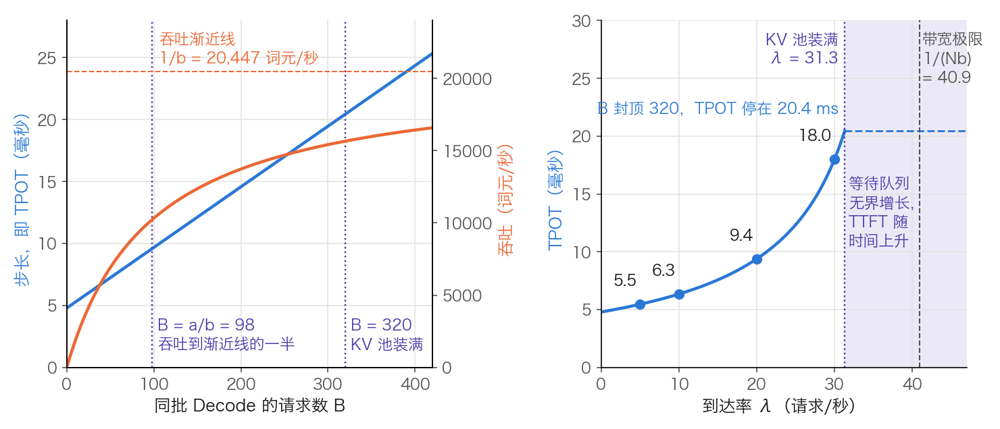

图 11-8：左，步长随批大小线性上升，吞吐趋于饱和；右，TPOT 随到达率按 `a ÷ (1 − λNb)` 上升，KV 池装满后 `B` 封顶 320、TPOT 停在 20.4 ms，多出的请求进入排队区（[生成脚本](https://github.com/yeasy/llm_internals/blob/main/tools/figures/ch11_3_batch_latency.py)）。

**容量墙**。批大小不能无限增长。400,000 个词元的池子按平均 1,250 个词元一条，装得下 `B_max = 320` 条；此时步长 20.44 ms，可承受的到达率为 `320 ÷ (500 × 0.02044) = 31.3` 请求/秒。公式里的带宽极限 `1 ÷ (Nb) = 40.9` 请求/秒并不会先到：先撞上的是显存容量。

**过墙之后**。到达率超过 31.3，多出来的请求只能留在等待队列。`λ = 35` 时队列每秒净增 3.7 个，一分钟后积压 222 个，新到的请求要排 `222 ÷ 31.3 ≈ 7.1` 秒才轮到 Prefill，而且这个数随时间线性增长，没有稳态。TTFT（首词元延迟）因此分两段：容量之内，它约等于“等当前一步结束”加自己的 Prefill 步数，是几十毫秒；容量之外，它由排队主导且无界。过载时要靠入口限流与尽早拒绝把队列截短，见 11.13 节。

**余量**。到达是随机的。若到达是泊松过程、各请求的驻留时间相互独立，在途请求数服从泊松分布（按 M/G/∞ 模型），`λ = 30` 时均值 270、标准差 `√270 ≈ 16`，均值加两倍标准差为 303，离 320 已经不远；步长随 `B` 变长还会放大这个波动。工作点因此要定在容量墙以下，留多少余量取决于到达的突发程度。

这套算式有三个前提。步长取的是访存下界，真实值更大，但线性形状不变，`a`、`b` 可以由两次不同批大小的压测反解出来。Prefill 被假定为搭载在 Decode 步里而不改变步长，这要求表中“算力下界”一列小于 TPOT，且只在平均意义上成立；输入很长、输出很短的负载不满足这一条，步长转由算力决定，应改用 11.3.4 的算法。各请求的长度取了平均值，长尾分布下容量墙会提前到来。

### 3.7 公平性与优先级

等待队列按什么顺序出队，决定了过载时谁受损。

**先到先服务**（FCFS）是默认选择。vLLM 论文给的理由是公平且不会饿死。它的弱点是队首阻塞：11.3.2 第 4 步规定队首放不下就停止准入，一个超长 Prompt 会挡住身后所有短请求，即使池子里的空间够后者用。

**最短作业优先**能把平均延迟压到最低，但输出长度事先未知。[一项排序学习的工作](https://arxiv.org/abs/2408.15792)指出，预测精确长度不可行，预测一批请求之间的相对长短却可行，据此近似最短作业优先。这类策略必须配防饿死机制：该文给每个请求记一个被跳过的次数，超过阈值就临时提升优先级。

**优先级调度**让请求自带一个优先级。等待队列由先进先出队列换成按“优先级、到达时间”排序的堆；抢占时牺牲优先级最低者。它的边界情形是低优先级请求被反复抢占：每次回来都要重算，重算完又被抢占，既拿不到进展，又消耗预算。应对办法是给低优先级流量单独限流，或限制单个请求的被抢占次数。

**多租户公平**针对的是另一个问题：某个租户大量发请求，按请求计数的 FCFS 会让其他租户一起排长队。按请求数限流又会在空闲时浪费容量。[VTC](https://arxiv.org/abs/2401.00588)（Virtual Token Counter）的做法是按词元记账：

- 每个租户一个计数器，记录已获得的服务量，输入词元与输出词元分别加权。该文实验取输入权重 1、输出权重 2，一个“输入 1,000、输出 500”的请求计 `1000 + 2 × 500 = 2,000`，一个“输入 200、输出 100”的请求计 400。
- 准入时，从计数器最小的租户那里取请求；每生成一个词元就更新计数，所以输出长度未知不成问题。
- 某租户从空闲转为活跃时，把它的计数器抬到不低于排队租户中的最小值，防止靠“攒额度”换取之后的独占。

VTC 只改变出队顺序，不拒绝放得下的请求，空闲容量不会被浪费。该文证明，两个持续有积压的租户所获服务量之差有上界，且与时间长度无关。

公平与吞吐并不总是一致。缓存感知的调度（11.5 节）倾向于让前缀命中的请求插队，这对吞吐有利，对先到的未命中请求不公平。两者怎样折中，是调度策略必须显式决定的事。

### 3.8 对到实现：vLLM 调度器的旋钮

词元预算、并发上限、分块开关、单请求块上限、出队策略五项对应的启动参数与默认值见 11.10 节的表 11-30。表 11-10 只列本节独有的机制与状态名、指标名。名称取自 v0.29.0 的 `vllm/config/scheduler.py`、`vllm/v1/core/sched/scheduler.py` 与 `vllm/v1/metrics/loggers.py`。

| 本节的机制 | vLLM 里的名字 | 说明 |
| --- | --- | --- |
| 水位线 | `watermark` | 准入时保持空闲的 KV 块比例 |
| 整条 Prompt 放得下才准入 | `scheduler_reserve_full_isl` | 防止分块 Prefill 下的过度准入 |
| 在途上限 | `max_num_queued_reqs`、`max_num_queued_tokens` | 前者限等待加运行的请求总数，后者限处于 Prefill 阶段的 Prompt 词元总量；超限的新请求直接返回 HTTP 503 |
| 状态机 | `RequestStatus.WAITING`、`RUNNING`、`PREEMPTED`、`FINISHED_*` | 被抢占时 `num_computed_tokens` 置 0 并放回等待队列，FCFS 下插在队首 |
| 观测 | `vllm:num_preemptions`、`vllm:num_requests_waiting`、`vllm:kv_cache_usage_perc` | 分别对应 11.3.5 的抢占计数、11.3.6 的排队区与容量墙 |

表 11-10：本节独有的调度机制与 vLLM 配置项、状态名、指标名的对应。名称随版本变动，使用前以所用版本的源码为准。

读完本节，应能不看正文回答下面五个问题；括号里是回看的位置。

1. 调度器为什么不需要区分 Prefill 与 Decode 两个阶段？（11.3.1）
2. 一步里先排运行中的请求、后准入新请求，换来了什么，代价是什么？（表 11-5）
3. 词元预算为什么既不能太大、也不能低于约 340 个词元？（11.3.4）
4. 被抢占的请求丢了什么、保留了什么，用户看到的现象是什么？（11.3.5）
5. 到达率只增加一半，TPOT 为什么会接近翻倍；再往上为什么 TTFT 会失去稳态？（11.3.6）

本节把 KV 空间当成一个按词元计数的池子，调度器只问“还剩多少词元的位置”。这个池子实际上由等长的块组成，块怎样分配、怎样在几条序列之间共享、装不下时换出还是重算，见 11.4 节。

## 4. KV 显存管理：块表、换出与重算

11.3 节的调度器每一步都要问同一个问题：显存里还放得下多少词元的 K/V。本节回答这个数从哪里来，一个词元的 K/V 具体写到显存的哪个位置，以及放不下时被抢占序列的 K/V 怎么处置。11.2 节只给了分页的想法，这里把它落到数据结构和账上；跨请求的前缀复用留给 11.5 节。

算例沿用 3.8.7 表 3-25 的 Llama 3 8B：`L = 32`、`d_model = 4096`、`n_kv = 8`、`d_h = 128`。BF16 每个数 2 字节，硬件是一张 80 GB 显存的 H100。容量用十进制 GB（10⁹ 字节），块的大小用 KiB、MiB（2¹⁰、2²⁰ 字节）。

### 4.1 显存预算：KV 池有多大

一张卡的显存分给三类东西：权重、一次前向的临时张量（激活）、KV 缓存。前两项在启动时就确定，剩余部分一次性划成 **KV 池**，服务期间不再增减：

$$
M_{\text{KV 池}} = M_{\text{显存}} \times u - M_{\text{权重}} - M_{\text{激活峰值}} - M_{\text{其他}}
$$

`u` 是允许引擎占用的显存比例，vLLM 的参数名是 `gpu_memory_utilization`；留出的 `1 − u` 给驱动、其他进程和分配器的碎片。

**权重。** 一层的矩阵逐个数：Q、O 投影各 `[4096, 4096]`，K、V 投影各 `[4096, 1024]`，合计 41,943,040 个数；MLP 的三个矩阵各 `[4096, 14336]`，合计 176,160,768 个数。一层共 218,103,808 个，32 层共 6,979,321,856 个。输入嵌入与 LM head 两张 `[128256, 4096]` 的表各 525,336,576 个；归一化向量每层 2 个、末尾 1 个，共 `65 × 4,096 = 266,240` 个。总数是 8,030,261,248，BF16 下占 16.06 GB。

**激活。** 推理不为反向传播保留中间结果，同一时刻只有当前一层的临时张量占着显存。假设一步最多处理 8,192 个词元，最大的一组临时张量是 MLP 的 gate、up 两路输出，各 `[8192, 14336]`，合计约 470 MB；256 条序列的 logits `[256, 128256]` 按 FP32 计约 131 MB。这一项的量级是 1 GB，远小于权重。vLLM 并不靠公式估它：启动时用最大批次的假输入跑一遍前向，实测峰值，再把剩余显存划给 KV 池（见 11.10 节）。

**KV 池。** 取 `u = 0.9`，激活与其他开销（CUDA Graph、通信缓冲）合留 2 GB，这个 2 GB 是算例的假设值：

$$
80 \times 0.9 - 16.06 - 2 = 53.94\ \text{GB}
$$

每个词元的 K/V 按 3.8.8 的算法是 `2 × n_kv × d_h × L` 个数，即 `2 × 8 × 128 × 32 = 65,536` 个。BF16 下合 131,072 字节，即 128 KiB。池的未舍入值是 53.939478 GB，下文的词元数都按它算：`53.939478 GB ÷ 131,072 B ≈ 411,525` 个词元。11.10 节用 vLLM 的默认比例和 GiB 口径重走同一条公式，取值不同，得数也不同。表 11-11 把这笔预算换成并发数。

| 项目 | Llama 3 8B（GQA，`n_kv = 8`） | 同样形状、`n_kv = 32` 的 MHA |
| --- | ---: | ---: |
| 每词元 KV | 131,072 B（128 KiB） | 524,288 B（512 KiB） |
| KV 池可存词元 | 411,525 | 102,881 |
| 每条序列 2,000 词元时的并发 | 205 | 51 |
| 每条序列 8,000 词元时的并发 | 51 | 12 |

表 11-11：53.94 GB 的 KV 池能同时容纳多少条序列。并发数按 16 个词元一块的整块计（11.4.3），每条序列占 125 块或 500 块：GQA 一列共 25,720 块，MHA 一列共 6,430 块。MHA 一列只把 `n_kv` 改回 32，注意力一侧与 GPT-3 6.7B 相同（表 3-25）；权重与池的大小仍按 Llama 3 8B。

从这张表读出两点。第一，KV 池的单位是词元，不是请求：并发数等于池容量除以平均驻留长度，请求越长，能同时服务的越少。第二，凡是缩小权重或每词元 KV 的手段，收益都能用这条公式换算。权重改用 FP8 省下 8.03 GB，池里多出约 61,300 个词元；GQA 把每词元 KV 缩到四分之一，并发直接变成 4 倍。

### 4.2 块大小：内部碎片与取舍

分页之前的做法是给每个请求预留一段连续显存，长度取最大序列长度。按 8,192 预留、实际只用到 2,000 个词元时，这段显存的利用率是 `2,000 ÷ 8,192 = 24.4%`。[PagedAttention 论文](https://arxiv.org/abs/2309.06180)对当时几个系统的实测是 20.4% 到 38.2%，其余被预留、内部碎片和外部碎片占掉。

把 KV 池切成等长的**物理块**（physical block）、按需分配之后，外部碎片消失，因为任何空闲块都能满足任何请求。剩下的浪费只有每条序列最后一块里没用上的槽位（slot）。设块大小为 `b` 个词元，序列长度除以 `b` 的余数近似均匀分布时，每条序列平均浪费 `(b − 1) / 2` 个槽位，浪费占比是：

$$
\text{浪费占比} = \frac{(b-1)/2}{\bar{\ell} + (b-1)/2}
$$

其中 $\bar{\ell}$ 是序列的平均长度。取 `b = 16`、平均长度 200，得 `7.5 ÷ 207.5 = 3.6%`。表 11-12 列出其余组合。

| 块大小 `b` | 平均浪费槽位 | 平均长度 200 时的浪费 | 平均长度 2,000 时的浪费 | 8,192 词元的块表项数 |
| ---: | ---: | ---: | ---: | ---: |
| 1 | 0 | 0% | 0% | 8,192 |
| 8 | 3.5 | 1.7% | 0.17% | 1,024 |
| 16 | 7.5 | 3.6% | 0.37% | 512 |
| 32 | 15.5 | 7.2% | 0.77% | 256 |
| 128 | 63.5 | 24.1% | 3.08% | 64 |
| 256 | 127.5 | 38.9% | 5.99% | 32 |

表 11-12：块大小与内部碎片。浪费占比按上式计算；最后一列是一条 8,192 词元的序列在块表里占的项数。

块越小浪费越少，跨请求共享的粒度也越细（11.5 节），但块大小不能一路取到 1。原因不在块表本身：512 项、每项按 4 字节整数计只有 2 KiB，256 条序列的块表 `[256, 512]` 也只有 512 KiB。代价在内核和传输上。注意力内核每跨一个块就多一次查表和一次不连续的读取，块太小时 GPU 的并行度用不满；换出时每个块是一次独立的小拷贝（见 11.4.5）。论文的消融实验给出的结论是：块太小不能充分利用 GPU 读取和处理 KV 的并行度，块太大则内部碎片上升、可共享的概率下降；对话数据上 16 到 128 表现最好，序列更短的指令数据上只有 16 和 32 表现好，默认值因此取 16。

块大小由此落在一个窄区间里：下限由内核效率决定，上限由负载里最短的那类序列决定。

### 4.3 块表：从逻辑位置到物理槽位

分页管理由四个数据结构组成：

- **物理块池**：每层一个大张量，按物理块号索引。同一个块号在 32 层里各对应一段，所以“一个块”指的是 32 层合起来的那一份。本例一个块在一层里占 `16 × 2 × 8 × 128 × 2 B = 64 KiB`，32 层合计 2 MiB；53.94 GB 的池共 25,720 块。
- **空闲队列**（free queue）：记录当前没人用的物理块号，分配和归还都是队列操作。
- **块表**（block table）：每个请求一张，第 k 项是逻辑块 k 对应的物理块号。
- **引用计数**（reference count）：每个物理块一个整数，记录有几张块表指向它，降到 0 时归还空闲队列。

张量的维度次序因实现而异。以 vLLM 的 FlashAttention 后端为例，一层的缓存张量是 `[块数, n_kv, 块大小, 2 × d_h]`，K 与 V 在最后一维并排。本例为 `[25720, 8, 16, 256]`，占 1.69 GB。其他后端和旧版本的次序不同，按块号索引这一点是共同的。

下面跟踪一个 50 词元的请求，位置从 0 开始编号，图 11-9 的上半幅画的就是它。

**第 1 步：Prefill 前分配。** 50 个词元需要 `⌈50 ÷ 16⌉ = 4` 块。调度器从空闲队列取出 4 个块号，假设是 7、2、11、5，块表即 `[7, 2, 11, 5]`，四个块的引用计数各为 1。块号的大小和顺序没有含义，只取决于当时哪些块空闲。

**第 2 步：写入。** 位置 `i` 的 K/V 写到哪里，由一次整除和一次取余决定：

$$
\text{槽位} = \text{块表}[\lfloor i / b \rfloor] \times b + (i \bmod b)
$$

位置 37 是 `37 ÷ 16 = 2 余 5`，块表第 2 项是 11，槽位为 `11 × 16 + 5 = 181`。引擎在每步前向之前为本步的每个词元算好槽位，排成一个一维数组（vLLM 里叫 `slot_mapping`）交给内核；每层算出 `K_new[50, 8, 128]` 和 `V_new[50, 8, 128]` 后，内核按这个数组把 50 行分散写进本层的池。

**第 3 步：Decode 读取。** 首个输出词元落在位置 50，即 `50 ÷ 16 = 3 余 2`，槽位为 `5 × 16 + 2 = 82`，仍在已有的第 4 块里，不需要分配。这一轮的注意力与 3.8.6 完全相同，每个头是 `q[1, 128] × Kᵀ[128, 51] → 分数[1, 51]`；差别只在 51 行 K 不是一段连续显存，内核按块表依次去块 7、2、11、5 里取，最后一块只取前 3 个槽位。内核为此多收两个输入：`块表[B, 最大块数]` 和每条序列的当前长度 `[B]`。

**第 4 步：块写满后追加。** 位置 51 到 63 继续填第 4 块。到位置 64，`64 ÷ 16 = 4 余 0`，块表没有第 4 项。调度器再取一个空闲块，假设是 9，块表变为 `[7, 2, 11, 5, 9]`。槽位为 `9 × 16 + 0 = 144`。一条序列每 16 步 Decode 才碰一次分配器。

**第 5 步：结束时归还。** 各块引用计数减 1，降到 0 的块号回到空闲队列；块里的数据不必清零，下一个使用者会覆盖。开启前缀缓存时，这些块的内容会留到被复用或被淘汰为止，机制见 11.5 节。

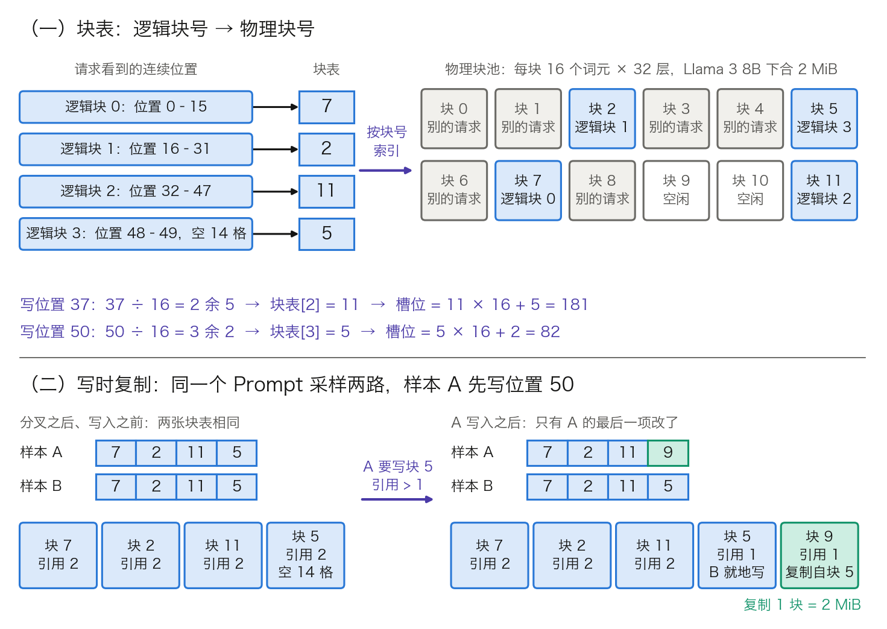

图 11-9：块表寻址与写时复制（[生成脚本](https://github.com/yeasy/llm_internals/blob/main/tools/figures/ch11_4_block_table_cow.py)）。上：50 词元的请求经块表 `[7, 2, 11, 5]` 落到物理块池，位置 37 和位置 50 的槽位按整除与取余算出。下：两路并行采样先共用全部 4 块，样本 A 写位置 50 时把块 5 复制到空闲块 9，只改自己块表的最后一项。

间接寻址的代价落在注意力内核上。论文的微基准里，分页内核比 FasterTransformer 的连续内存实现慢 20% 到 26%，来源是查块表、多出的分支和变长序列的处理；这只影响注意力算子，不影响各个线性层。换来的是 KV 池里的浪费降到接近零，同样的显存装下更多请求；论文报告的端到端吞吐，在延迟相当的条件下是此前系统的 2 到 4 倍。

### 4.4 写时复制：并行采样与束搜索

并行采样（同一个 Prompt 采 `n` 个回答）和束搜索的各路序列共用一段前缀。块表让共享不需要任何额外机制：几张块表的前几项写同一组物理块号，引用计数记下共享者的数量。需要处理的只有一种情形，即某一路要往共享块里写。

沿用上面的请求，采样两路，过程见图 11-9 的下半幅：

1. Prefill 只算一遍。样本 A、B 的块表都是 `[7, 2, 11, 5]`，四个块的引用计数都是 2。
2. 样本 A 要写位置 50，目标是块 5。块 5 的引用计数大于 1，不能直接写，否则 B 的位置 50 会被 A 的内容覆盖。
3. 调度器取空闲块 9，把块 5 的内容在显存内复制过去（32 层合计 2 MiB），A 的块表改为 `[7, 2, 11, 9]`，块 5 的引用计数降为 1。
4. 样本 B 写位置 50 时，块 5 的引用计数已是 1，就地写入。

这就是**写时复制**（Copy-on-Write）。每次分叉至多复制 `n − 1` 个块，而且只涉及 Prompt 末尾那个不满的块；Prompt 长度恰好是 16 的倍数时一次也不用复制。

**省多少。** 设 Prompt 长 `p`、每路输出长 `o`。不共享要 `n × ⌈(p + o) / b⌉` 块。共享后是 `⌊p / b⌋ + n × (⌈(p + o) / b⌉ − ⌊p / b⌋)` 块。取 `p = 2,010`、`o = 200`、`n = 4`。每路 `⌈2,210 ÷ 16⌉ = 139` 块，Prompt 占满 125 块，末块有 10 个词元。不共享是 `4 × 139 = 556` 块，合 1,112 MiB；共享后是 `125 + 4 × 14 = 181` 块，合 362 MiB，省 67.4%，代价是 3 次 2 MiB 的复制。输出变长，收益随之变薄：`o = 2,000` 时是 1,004 块对 629 块，省 37.4%。论文实测的并行采样节省量在指令数据上只有 6.1% 到 9.8%，在对话数据上是 16.2% 到 30.5%。论文没有解释这个差别。按上式，能一直共享的只有 Prompt 的满块：指令数据的 Prompt 平均 19 个词元，只有 1 个满块；对话数据平均 161 个词元，有 10 个（均值取自论文图 11）。

束搜索共享得更多。各束不仅共用 Prompt，还共用已生成部分的公共前缀；一个束被淘汰时，它独占的块引用计数归零、立即释放，存活的束分叉时再触发写时复制。论文对束搜索测得 37.6% 到 55.2%（指令数据）和 44.3% 到 66.3%（对话数据）的节省。

**实现上的变化。** 写时复制并不是唯一做法。vLLM 重写后的架构把 `n > 1` 的请求[拆成 n 个 `n = 1` 的子请求](https://github.com/vllm-project/vllm/pull/10980)，Prompt 的共享交给前缀缓存。满块按内容哈希共用，末尾不满的块由各子请求各自重算。上例中每路多算 10 个词元，约 `10 × 2 × 6.98 × 10⁹ ≈ 1.4 × 10¹¹` 次运算。相对 2,010 词元的 Prefill，这可以忽略。引擎则少维护一条分叉与复制的路径。

### 4.5 显存不足时：换出还是重算

KV 池用尽而运行中的序列还要写新词元时，调度器必须抢占一部分序列。抢占谁、为什么整条释放、恢复有哪两条路，11.3.5 已经说明；这里补上两条路在显存管理一侧的做法，再算耗时。按论文的设计，同一请求下共享块的几条序列（11.4.4）要一起进出。

- **换出**：块经 PCIe 拷到主机内存，块表改指主机侧的块号，恢复时再拷回来。主机侧需要一个对应的块分配器和一段锁页内存。被换出的块数不会超过 GPU 上的块数，所以主机内存的需求以 KV 池大小为上界。
- **重算**：直接释放这些块。恢复时走一次 Prefill，全部位置的 K/V 在一次前向里得到，不必逐个词元重走 Decode。

两者的耗时都能算。设序列长 `T`，每词元 KV 为 `m` 字节，PCIe 单向带宽为 `W`；各层矩阵参数共 `P` 个，GPU 峰值算力为 `F`，利用率为 `η`：

$$
t_{\text{换出+换入}} = \frac{2\,T\,m}{W},\qquad
t_{\text{重算}} \approx \frac{2PT + 2T^{2} d_{\text{model}} L}{F\,\eta}
$$

重算的分子就是 3.8.8 的 Prefill 计算量：与权重相乘的部分每词元约 `2P` 次运算，打分与读取的部分是每层 `2T²d`。带宽取标称值。PCIe 5.0 每通道每方向 32 GT/s，x16 链路单向是 `32 × 16 ÷ 8 = 64 GB/s`。扣除 128b/130b 编码后约 63 GB/s。NVIDIA 的 [H100 规格页](https://www.nvidia.com/en-us/data-center/h100/)标的 128 GB/s 是两个方向之和。换出、换入各走一个方向，按单向 64 GB/s 计；Gen4 每通道 16 GT/s，减半为 32 GB/s。算力沿用 10.1 节的 H100 BF16 稠密峰值约 990 TFLOPs/s，利用率假设为 0.5。11.3.5 的重算例按峰值算力计，给的是耗时下界；这里要与换出比大小，改按 0.5 折算，同一条序列的耗时是下界的 2 倍。

**Llama 3 8B，`T = 2,000`。** 这条序列的 KV 是 `2,000 × 131,072 B = 262 MB`。换出再换入在 Gen5 下是 `2 × 262 MB ÷ 64 GB/s = 8.2 ms`，Gen4 下是 16.4 ms。重算的权重项是 `2 × 6.98 × 10⁹ × 2,000 = 2.79 × 10¹³`。注意力项是 `2 × 2,000² × 4,096 × 32 = 1.05 × 10¹²`。两项合计 `2.90 × 10¹³` 次，除以 `990 × 10¹² × 0.5`，得 58.5 ms。

| 配置 | 每词元 KV | 序列 KV | 换出+换入，Gen5 | 换出+换入，Gen4 | 重算 | 持平带宽 |
| --- | ---: | ---: | ---: | ---: | ---: | ---: |
| Llama 3 8B，`T = 2,000` | 128 KiB | 262 MB | 8.2 ms | 16.4 ms | 58.5 ms | 9.3 GB/s |
| Llama 3 8B，`T = 32,000` | 128 KiB | 4,194 MB | 131 ms | 262 ms | 1,445 ms | 9.3 GB/s |
| GPT-3 6.7B，`T = 2,000` | 512 KiB | 1,049 MB | 32.8 ms | 65.5 ms | 54.2 ms | 40.3 GB/s |

表 11-13：换出与重算的耗时，按标称带宽和 0.5 的算力利用率计算。持平带宽只计重算的权重项，等于 `m × F × η ÷ P`：实际单向带宽高于它时换出更快，低于它时重算更快。GPT-3 6.7B 每层注意力 `4d²`、MLP `8d²` 个参数，`P = 12 × d² × L = 6.44 × 10⁹`。这对应 3.8.8 的每层 `24Td²` 次运算。

图 11-10 把两种模型的耗时按序列长度展开。

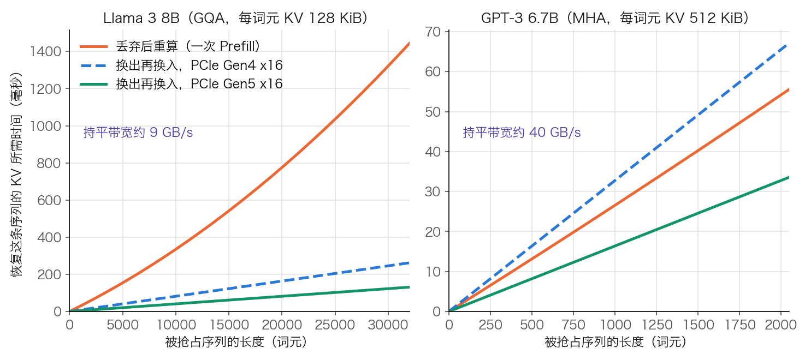

图 11-10：恢复一条被抢占序列的 K/V 要多久（[生成脚本](https://github.com/yeasy/llm_internals/blob/main/tools/figures/ch11_4_swap_vs_recompute.py)）。口径同表 11-13。左：GQA 模型的 KV 小，标称带宽下换出始终更快，重算还随长度按平方上翘。右：MHA 模型的 KV 是 4 倍，重算落在 Gen4 与 Gen5 两条线之间。

从持平带宽的表达式 `m × F × η ÷ P` 可以读出谁更划算取决于什么。

- **每词元 KV。** `m` 越小，换出越划算。GQA 把 `m` 缩到四分之一，Llama 3 8B 的 `P` 又略大（6.98 × 10⁹ 对 6.44 × 10⁹）。持平带宽因此从 40.3 GB/s 降到 9.3 GB/s，低于 Gen4 和 Gen5 的 x16 标称带宽。MHA 模型则相反：GPT-3 6.7B 的形状在 Gen4 上是重算更快，在 Gen5 上才轮到换出。
- **模型规模。** 模型越大，换出越划算。Llama 3 70B（配置见表 3-25）的矩阵参数是 6.85 × 10¹⁰，为 8B 的 9.8 倍；每词元 KV 是 `2 × 8 × 128 × 80 × 2 B = 320 KiB`，只是 2.5 倍。持平带宽降到约 2.4 GB/s。70B 要多卡张量并行才放得下，算力与 PCIe 链路数同比增加，比值不变。
- **序列长度。** 序列越长，重算越吃亏。重算含 `T²` 项，`T = 32,000` 时注意力项已占重算计算量的 37.5%；换出与长度成正比。

按标称数字，换出对当前的 GQA 模型全面占优，vLLM 却默认重算。它的[优化文档](https://docs.vllm.ai/en/v0.29.0/configuration/optimization.html)写明默认的抢占方式是重算，[V1 说明](https://docs.vllm.ai/en/v0.29.0/usage/v1_guide.html)把 GPU 与 CPU 之间的 KV 换出列为已移除的功能。原因在公式之外：

1. **有效带宽。** 它远低于标称值。一条 2,000 词元的序列散在 125 个块里，每块每层是独立的一段，换出要拷 `125 × 32 = 4,000` 片、每片 64 KiB。论文 7.3 节的实测是：块小的时候，大量小传输压低了 PCIe 的有效带宽，换出开销过大；重算的开销与块大小无关；块大小在 16 到 64 之间时，两者的端到端性能相当。
2. **总线共享。** 同一台主机上的多张卡、网卡，以及分离式部署里的 KV 传输（11.9 节）都走 PCIe。
3. **路径复用。** 重算不需要新路径：恢复的序列就是一个普通的 Prefill 请求，可以分块、可以与 Decode 混排。开启前缀缓存时，刚释放的块若还没被别的请求覆盖，恢复时可以直接命中，实际重算量小于公式给出的值。
4. **发生频率。** 抢占应当是少数事件，为它维护主机侧分配器、锁页内存和两个方向的拷贝调度，复杂度与收益不相称。

重算也有代价：那 58.5 ms 的算力取自同一张卡，挤占的是 11.3 节所说的每步词元预算；被抢占请求的词元间隔会出现一次明显的尖峰。抢占频繁说明 KV 池配小了或准入放得太宽，应当回到 11.4.1 的预算去调整，而不是指望恢复手段足够快。

主机内存没有因此退出，只是换了角色：不再保存被抢占序列的现场，而是充当前缀缓存的第二级。写满的块另存一份到主机内存，显存里那份被淘汰后仍能命中，经 PCIe 取回，省掉一次 Prefill。取回是否划算，用的还是表 11-13 这笔账。

### 4.6 KV 量化：同一个池装下更多词元

KV 池的字节数由 11.4.1 定死，每个数占的字节减少，池里的词元数就按同样的倍数增加。表 11-14 沿用 53.94 GB 的池。

| KV 的存储格式 | 有效位宽 | 每词元 KV | 可存词元 | 2,000 词元序列的并发 |
| --- | ---: | ---: | ---: | ---: |
| BF16 | 16 | 131,072 B | 411,525 | 205 |
| FP8，每张量一个缩放因子 | 8 | 65,536 B | 823,051 | 411 |
| INT4，每 32 个数一组，每组 FP16 的缩放因子与零点 | 5 | 40,960 B | 1,316,881 | 658 |

表 11-14：KV 量化对容量的影响。有效位宽 = 数据位宽 + 每组元数据位数 ÷ 组大小。INT4 一行是 `4 + 32 ÷ 32 = 5`，所以容量是 BF16 的 3.2 倍而不是 4 倍。

**容量之外还有带宽。** 3.8.8 的瓶颈三指出，批处理摊薄的只是权重，KV 仍是每条序列各读各的。批大小 64、每条 2,000 词元时，一步 Decode 要读的 KV 是 `64 × 2,000 × 131,072 B = 16.78 GB`。这已超过 16.06 GB 的权重。按 H100 的 3.35 TB/s 显存带宽，单步的访存下界是 `(16.06 + 16.78) ÷ 3,350 = 9.8 ms`。KV 改用 FP8 后要读 8.39 GB，下界降到 7.3 ms。

**代价。** 误差常驻缓存、K 与 V 的分组方向不同，见 10.4.6；分组越细元数据越多，有效位宽按表 11-14 表题的算式上升。此外收益要靠内核兑现：注意力内核必须能直接读低精度的 K/V，在内核内部反量化或直接用低精度计算；若要先把整段缓存还原成 BF16 再算，带宽上的好处就没有了。

KV 量化与 10.2 节的结构性压缩作用在不同的因子上：GQA、MLA 由模型结构决定，训练时就定下；量化是部署时的选择。两者的倍数相乘。

### 4.7 边界与常见误解

**分页不减需求。** 分页消除的是碎片。一条 128,000 词元的请求要 8,000 块，合 16.78 GB，占掉本例 KV 池的 31.1%，块表对此无能为力。要降低的是每词元的字节数（10.2 节、11.4.6）或驻留的词元数。

**症状是抢占，不是溢出。** 池的大小在启动时定死，运行中 KV 再多也不会越界；KV 不够时表现为排队和抢占。占用率贴顶而抢占频繁时，算力花在重算上，有效吞吐反而下降。监控因此不能只看池的占用率，还要看抢占次数和等待队列长度，判据见 11.3.5。运行期若出现显存溢出，要查的是预留之外的临时张量，可调的是 `u` 和每步词元上限，与 KV 管理无关。

**混合结构。** “每层每词元一样大”只是全注意力模型的性质。滑动窗口层只需保留窗口内的块，窗口之外的可以提前释放；状态空间层和线性注意力层的状态大小与序列长度无关；DeepSeek 的 MLA 每词元每层只存 576 个数（512 维隐向量加 64 维位置键，10.2.7 节）。混合结构的模型因此要把层分组管理，同一条序列在各组里占的块数不同，池的容量不能再用“块数 × 块大小”一个乘积表示。

**多卡。** 块号只由调度器分配一次，随调度结果下发给各卡，每张卡据此维护自己那份块表。张量并行把 `n_kv` 个头分到各卡，每张卡的池按同样的块号存自己那几个头，每词元每卡的字节数除以并行度。切法与限制见 11.8 节。

块表解决了一个请求内部的寻址和一个请求派生的几条序列之间的共享。两个互不相识的请求带着相同的系统提示词到来时，怎样发现它们的块可以共用，是 11.5 节的问题。

## 5. 前缀复用：哈希块与前缀树

11.4 节的块表让两个请求可以指向同一个物理块，却没有回答另一半问题：引擎怎样知道两个请求的某一块内容相同。本节回答这个问题。先说明为什么只有前缀的 K/V 能跨请求复用，再讲两种索引结构，即按块链式哈希与前缀树；然后算命中能省多少 Prefill；最后讲调度、路由，以及哪些因素必须进入缓存的键。

前缀缓存的动机见 10.2 节，本节只讲它怎样实现、怎样算账。

### 5.1 能复用的只有前缀

**K/V 由什么决定。** 按 3.8.3 节的第 4 步，因果掩码让位置 i 只读位置 1 到 i。第 1 层的 `kᵢ`、`vᵢ` 由第 i 个词元和它的位置算出。第 2 层的 `kᵢ`、`vᵢ` 由第 1 层位置 i 的输出算出，而这个输出已经混入位置 1 到 i 的内容。逐层类推，任何一层位置 i 的 K/V 都只是“前 i 个词元、它们的位置、模型权重”的函数，与位置 i 右边的内容无关。

由此得到复用的条件：两个请求的前 P 个词元逐个相同，这 P 个位置在全部 L 层的 K/V 就相同，可以共用一份。条件里的每一项都不能放松：

- 中间相同不算。同一篇文档出现在两个请求的不同偏移处，位置不同；即使偏移相同，只要左边的内容不同，第 2 层起的 K/V 就不同。
- 文本相同不算，词元相同才算。同一段文字经不同的聊天模板或不同的切分，得到的词元序列可以不同。
- 语义相近不算。向量相似只能用于结果缓存，不能证明 K/V 可复用。

采样参数不在条件里。温度、top-p、随机种子只作用于 logits 之后（见第九章），不改变任何位置的 K/V。

**命中之后算什么。** 设命中 P 个词元，剩下的后缀有 S 个词元，`T = P + S`。Prefill 只对后缀做，形状介于完整 Prefill 与 Decode 之间。以 Llama 3 8B（表 3-27：`d_model = 4096`，`d_h = 128`）的一个头为例：

- 投影：`X[S, 4096] × W_Q[4096, 128] → Q[S, 128]`。K、V 同理，新算出的 S 行追加在缓存的 P 行之后。
- 打分：`Q[S, 128] × Kᵀ[128, P + S] → 分数[S, P + S]`，K 的前 P 行读自缓存。
- 读取：`权重[S, P + S] × V[P + S, 128] → context[S, 128]`。

`P = 0` 时退回完整 Prefill 的 `[T, T]`，`S = 1` 时退回 Decode 的 `[1, s]`。分块 Prefill 的第二块及以后（见 11.3 节）也是这个形状：两者都是“带着已有前缀做 Prefill”。

### 5.2 路线一：按块链式哈希

分页之后，K/V 以块为单位存放。最直接的做法是给每个写满的块算一个键，用哈希表记录“键 → 物理块”。vLLM 的[自动前缀缓存](https://docs.vllm.ai/en/latest/design/prefix_caching/)走这条路线。

**键怎样构造。** 一个块可以复用，要求块内词元相同，并且它左边的全部词元也相同。若把左边的全部词元直接放进键，第 k 块要哈希 `k × B` 个词元（B 为块大小），整条序列合计 `O(T²/B)`。**链式哈希**（chained hash）改为把父块的键放进子块的键：

$$
h_k = H\big(h_{k-1},\ \text{第 } k \text{ 块的 } B \text{ 个词元},\ \text{额外键}\big),\qquad h_{-1}=\text{固定种子}
$$

块从 0 编号。忽略哈希碰撞，`h_k` 相同等价于第 0 块到第 k 块的词元与额外键全部相同。每块只哈希 B 个词元和一个定长的父键，整条序列合计 `O(T)`。额外键放词元 ID 之外、又会改变 K/V 的因素，11.5.7 展开。

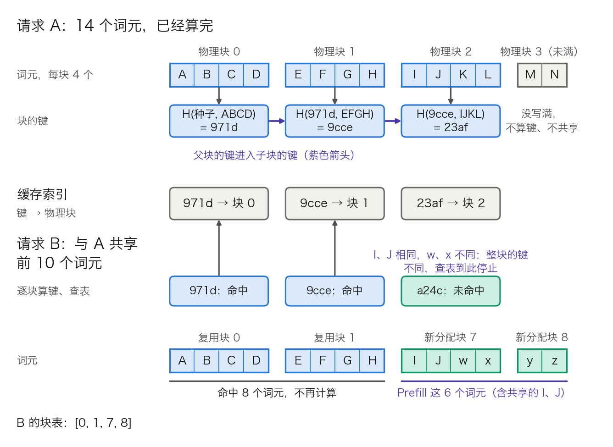

图 11-11：按块链式哈希怎样匹配前缀，教学设定为每块 4 个词元（[生成脚本](https://github.com/yeasy/llm_internals/blob/main/tools/figures/ch11_5_block_hash_chain.py)）。蓝色是已在缓存里的块，青绿色是本次新分配的块；键取 SHA-256 的前 4 位十六进制，仅作示意。

**一次查找的步骤。** 新请求到达后：

1. 把 Prompt 按 B 切块，从第 0 块起逐块算键。
2. 逐块查哈希表。命中则把该物理块的引用计数加 1，写进本请求的块表；遇到第一个未命中即停止，链式构造保证后面的块不可能再命中。
3. 为其余词元分配新块，只对它们做 Prefill。
4. 新块一写满就算键入表，同一批里的其他请求立刻可以复用。Decode 阶段写满的块同样入表，模型的输出因此也能成为后续请求的前缀。

图 11-11 中，请求 B 与 A 共享前 10 个词元。前两块命中 8 个词元；第 3 块里 I、J 相同而 w、x 不同，键不同，整块未命中。B 要 Prefill 6 个词元，其中 2 个本可复用。只有写满的块才有键，A 的最后一块只有 M、N 两个词元，不参与共享。按块哈希的命中长度总是 B 的整数倍，每个请求最多损失 `B − 1` 个词元。

**引用计数与淘汰。** 请求结束时，它的每个块引用计数减 1。减到 0 的块不清空，保留键，挂到空闲队列的尾部。这时它既是可分配的空闲块，又是可命中的缓存块。分配新块时从队首取；取到的块若还带着键，就从哈希表里删掉这个键，这一步就是淘汰。队首是最久未用的块，所以策略是 LRU（least recently used，最近最少使用）。再次命中的块会被移出空闲队列，免于淘汰。

同一请求的块按逆序入队，最后一块排在前面、先被淘汰。vLLM 文档给的理由是：越靠后的块，键里概括的词元越多，被别的请求命中的可能越小。从查找规则还能推出第二个理由：查找遇到第一个未命中就停，父块一旦被淘汰，子块即使还在也够不着，只是占着显存等淘汰。先淘汰尾部，就不会留下这种块。

**两个实现细节。** 其一，Prompt 整条命中时仍要重算最后一个词元。缓存里只有 K/V，没有最后位置的 logits，而首个输出词元要由它选出。vLLM 把可命中长度的上限设为 `T − 1`，再向下对齐到块边界：`T = 2000`、`B = 16` 时，上限 1,999 对齐为 1,984，最后一整块 16 个词元重算。其二，哈希碰撞的后果不在性能而在正确性与隐私：两个不同的前缀得到同一个键，后来者会读到别人的 K/V。vLLM 文档为此把默认哈希函数设为 SHA-256，并提醒换用更快的非密码学哈希会抬高碰撞风险，多租户环境下可能泄露信息。

### 5.3 路线二：前缀树（RadixAttention）

[SGLang 论文](https://arxiv.org/abs/2312.07104)提出的 **RadixAttention** 把全部缓存组织成一棵**基数树**（radix tree），即压缩的前缀树。普通前缀树每条边只带一个词元；基数树把没有分叉的一串边合并成一条，一条边可带任意长的词元序列，节点数只随分叉数增长。

**节点里存什么。** 每个节点对应一段词元，存这段词元、它们的 K/V 在显存池里的位置下标、引用计数和最近访问时间。从根走到某个节点，沿途的词元连起来就是一条已缓存的前缀。K/V 本身仍放在分页的显存池里；论文取页大小为 1 个词元，所以树可以在任意词元处分叉。

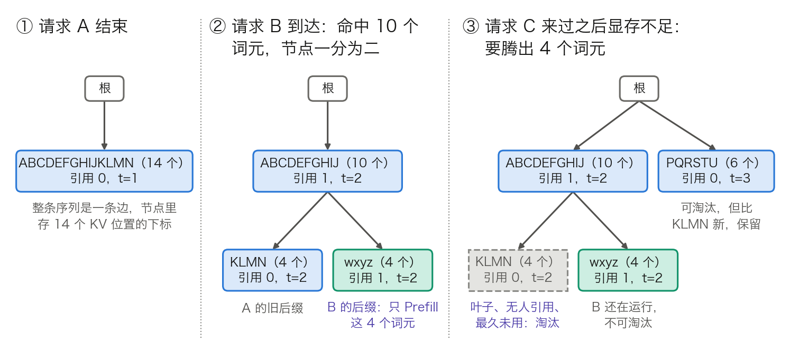

图 11-12：前缀树的匹配、拆分节点与从叶子淘汰，请求 A、B 与图 11-11 相同（[生成脚本](https://github.com/yeasy/llm_internals/blob/main/tools/figures/ch11_5_radix_tree_ops.py)）。每个节点第一行是这条边上的词元，第二行是引用计数与最近访问时刻 t；青绿色是本次新建的叶子，灰色虚框是被淘汰的节点。② 中 `KLMN` 的 t 也变成 2：匹配经过的节点在拆分前已刷新访问时刻，拆出的下半段沿用它。

**四个操作。** 图 11-12 画出了前三个。

- 匹配：从根出发，按下一个词元找子节点，沿边逐词元比较，走到不一致或 Prompt 用尽为止。走过的长度就是命中长度 P。
- 拆分：匹配若停在一条边的中间，把该节点拆成两段，上半段成为新的父节点，代表公共部分，下半段留作子节点。K/V 不搬动，只是下标数组一分为二。图中请求 B 在第 10 个词元之后与 A 分开，`ABCDEFGHIJKLMN` 被拆成 `ABCDEFGHIJ` 与 `KLMN`，B 命中 10 个词元，比按块哈希多 2 个。
- 插入：分两次。SGLang 的实现在 Prefill 完成后先把 Prompt 插入树，未命中的部分成为新叶子，运行中的请求因此也能被后到者命中。请求结束时再把输出补进同一条路径，多轮对话的下一轮因此能命中上一轮的输出。
- 淘汰：显存不足时，在引用计数为 0 的叶子里选最久未用的一个，释放它的 K/V。父节点若因此变成叶子且无人引用，就加入候选。重复到腾出足够空间。

**为什么从叶子淘汰。** 一个节点的 K/V 只有在祖先全部存在时才有用，先删中间节点会让整棵子树作废。从叶子删起，公共祖先留到最后，而系统提示、few-shot 示例这类公共祖先正是命中最多的部分。

**引用计数保护整条路径。** 运行中的请求要读它命中的全部 K/V，所以加引用时从命中的最深节点一路加到根，释放时同样一路减回去。图中 ③ 的 `wxyz` 与 `ABCDEFGHIJ` 引用计数都是 1，都不可淘汰。

**共用显存池。** 缓存与运行中的请求共用一个显存池，论文没有给缓存划固定配额。空闲时缓存尽量多留；等待的请求足够多时，缓存会被全部淘汰，换取更大的批。前缀缓存因此是拿闲置显存换计算，不挤占运行中请求的空间；代价是高负载时缓存留不住。

树放在 CPU 内存里。论文在没有任何复用机会的 ShareGPT 负载上测过开销：100 个请求共运行 74.3 秒，维护树的时间是 0.2 秒，不到 0.3%。

### 5.4 两条路线的取舍

表 11-15 从七个维度对比两条路线。

| 维度 | 按块链式哈希 | 前缀树 |
| --- | --- | --- |
| 索引结构 | 哈希表“键 → 物理块”；块的父子关系只隐含在键里 | 显式的树：父子指针，每个节点一段词元 |
| 命中粒度 | 块大小 B 的整数倍，每请求最多损失 `B − 1` 个词元 | 页大小为 1 时精确到词元；页更大时同样向下对齐 |
| 查找开销 | 逐块算哈希并查表，`O(T)` | 沿树逐词元比较，`O(T)` |
| 分叉 | 无需处理，分叉点所在的块整块未命中 | 拆分节点 |
| 淘汰 | 取空闲队列队首；靠逆序入队近似“先叶子” | 显式地只淘汰叶子 |
| 调度器能看到什么 | 某个请求命中了几块 | 整棵树：各等待请求的命中长度、哪些请求在同一分支上 |
| 跨进程使用 | 键是定长摘要，可直接当作外部索引的键 | 要同步树结构，或维护一棵近似的副本 |

表 11-15：两种前缀索引的对比。

两者不是对立的算法，而是同一件事的两种索引：K/V 都放在分页的显存池里，都靠引用计数防止误删，默认都用 LRU。差别在粒度，以及调度器能拿到多少信息。块哈希实现简单，与块表天然契合。前缀树在分叉多、分叉点不落在块边界的负载上命中更足，例如树状搜索、多层 few-shot、并行采样之后再追问；它还直接给出 11.5.6 的缓存感知调度所需的信息。SGLang 的实现也支持大于 1 的页大小，此时匹配长度向下对齐到页的整数倍，粒度上的差别随之消失。

### 5.5 算账：命中率与省下的 Prefill

**命中率**（cache hit rate）按 SGLang 论文的定义，是命中的 Prompt 词元数除以 Prompt 词元总数。它按词元计，不按请求计。

**算例一：共享系统提示。** 沿用 11.2.4 的设定，补上完整的计算量与显存账。模型为 Llama 3 8B，权重与 K/V 均为 FP16。系统提示加共享文档共 2,010 个词元，对所有请求相同；用户输入 200 个词元；块大小 16（vLLM 的默认值，见 11.4.2）。

先算命中长度。`2010 ÷ 16 = 125` 余 10，前 125 块共 2,000 个词元命中。第 126 块里有 10 个共享词元和 6 个用户词元，键不同，未命中。于是 `P = 2000`，`S = 210`，命中率 `2000 ÷ 2210 = 90.5%`。前缀树按词元匹配，`P = 2010`，`S = 200`。

再算计算量，口径同 3.8.8 节：`[a, b] × [b, c]` 记 `2abc` 次。配置取 3.8.7 表 3-27：`n_kv = 8`，MLP 中间层 14,336，32 层；词表取发布权重的 128,256 行，而不是表格单元里论文口径的 128,000（见该表的注）。Llama 3 8B 用 GQA 和三个矩阵的 SwiGLU，每层与权重相乘的部分不再是 `24d²`，要按实际形状重数。每个词元、每层：

- Q 投影与 `W_O`：`[1, 4096] × [4096, 4096]`，各 `2 × 4096 × 4096` 次。
- K、V 投影：`[1, 4096] × [4096, 1024]`，各 `2 × 4096 × 1024` 次，其中 `1024 = 8 × 128`。
- MLP 的三个矩阵：各 `2 × 4096 × 14336` 次。

合计 `2 × 4096 × (4096 + 4096 + 2 × 1024 + 3 × 14336) = 2 × 4096 × 53,248`，约 4.36 亿次；32 层约 139.6 亿次，正是这些矩阵的参数量（约 69.8 亿）的 2 倍。打分与读取一项，后缀的第 i 个位置要对 `P + i` 行 K/V 各算一次。每行约 `4d` 次。打分 `q·k` 每头 `2 × 128` 次，32 个头合计 `2d`；读取同为 `2d`。两项合起来就是 3.8.8 中 Decode 的 `4sd` 每行的份额。S 个位置相加，每层约 `4dPS + 2dS²`。`P = 0` 时它退回 3.8.8 的 `2T²d`。表 11-16 列出三种情形的计算量。

| 项目 | 无缓存：`P = 0`，`S = 2210` | 按块哈希：`P = 2000`，`S = 210` | 前缀树：`P = 2010`，`S = 200` |
| --- | ---: | ---: | ---: |
| 与权重相乘，32 层 | 约 30.85 万亿次 | 约 2.93 万亿次 | 约 2.79 万亿次 |
| 打分与读取，32 层 | 约 1.28 万亿次 | 约 0.232 万亿次 | 约 0.221 万亿次 |
| LM head（只算最后一行） | 约 10.5 亿次 | 约 10.5 亿次 | 约 10.5 亿次 |
| 合计 | 约 32.1 万亿次 | 约 3.16 万亿次 | 约 3.01 万亿次 |
| 相对无缓存 | 100% | 9.8% | 9.4% |

表 11-16：Llama 3 8B 在 2,210 个词元的 Prompt 上，命中与未命中的 Prefill 计算量。第一行是 `139.6 亿 × S`；第二行是 `(4dPS + 2dS²) × 32`，例如中间一列为 `(4 × 4096 × 2000 × 210 + 2 × 4096 × 210²) × 32`；LM head 为 `2 × 4096 × 128,256`。

从表中读出三件事。

第一，与权重相乘的部分严格按 `S ÷ T` 缩小，`210 ÷ 2210 = 9.5%`。

第二，打分与读取只降到 18%。省掉的是前缀自己的 `[P, P]` 那块三角；后缀读前缀的 `4dPS` 一项省不掉，中间一列里它占 0.220 万亿次。令 `4dP` 等于每词元每层与权重相乘的 `2 × 4096 × 53,248`，得 `P = 26,624`。前缀超过约 2.7 万个词元后，后缀每个词元读前缀的开销就超过它过一遍权重的开销。长文档问答的命中收益因此低于按词元比例估计的值。

第三，换算成时间要看瓶颈。Prefill 受算力限制（3.8.8 的瓶颈一），时间近似与计算量成正比。按 10.1 节的 H100 峰值 990 TFLOPs/s，并假设利用率为 40%（示意值），有效算力为 `990 × 0.4 = 396` 万亿次/秒。无缓存约 `32.1 万亿 ÷ 396 万亿/秒 ≈ 81 ms`，命中后约 `3.16 万亿 ÷ 396 万亿/秒 ≈ 8 ms`，省下约 73 ms。这个比例不能继续外推。权重约 16 GB（约 80 亿参数 × 2 字节），命中后每字节只有 `3.16 万亿 ÷ 16 GB ≈ 200` 次运算，已低于 10.1 节 295 的拐点。时间不再随 S 按比例缩短，下界是读一遍权重的 `16 GB ÷ 3.35 TB/s ≈ 5 ms`。实际系统里这 210 个词元会与别的请求合成一批。TTFT（首词元延迟，分解见 11.13.1）中的排队、分词和网络几项不受影响。

**显存那一笔。** Llama 3 8B 每个词元的 K/V 是 `2 × 8 × 128 × 32 = 65,536` 个数（3.8.8），FP16 下 128 KiB，2,000 个词元的前缀约 250 MiB。100 个并发请求各存一份，合计 `100 × 2210 × 128 KiB`，约 27.0 GiB；共享前缀后是 `(2000 + 100 × 210) × 128 KiB`，约 2.8 GiB。省下的显存可以装更多请求，批变大，Decode 的吞吐随之上升（3.8.8 的瓶颈二）。共享只减少容量占用：标准内核下每轮 Decode 仍要为每个请求各读一遍前缀的 K/V，读取量不变。共享前缀专用的内核能把这部分读取合并，属例外，例如 vLLM 默认关闭的 cascade attention。

**算例二：多轮对话。** 系统提示 1,000 个词元，每轮用户输入 100 个、模型输出 300 个，共 10 轮。忽略模板词元、块对齐，以及每轮末个输出词元（它被采样出来后没有再进模型，尚无 K/V）。第 k 轮的 Prompt 长 `1000 + 400(k − 1) + 100`。无缓存时十轮合计 Prefill `10 × 1100 + 400 × (0 + 1 + … + 9) = 11,000 + 18,000 = 29,000` 个词元，随轮数按平方增长。有缓存且这条会话的 K/V 没被淘汰时，首轮 1,100 个，其后每轮只有新输入的 100 个。合计 `1100 + 9 × 100 = 2,000` 个，命中率 `27,000 ÷ 29,000 = 93.1%`。上一轮的输出不需要 Prefill，它的 K/V 在 Decode 时已经写好。代价是会话空闲期间占着显存：第 10 轮结束时这条会话有 5,000 个词元，约 625 MiB；用户迟迟不回复，它就成为 LRU 的淘汰对象。

**其余场景。** 以下几类都是这两种模式的组合。

- few-shot 与批量评测：1,500 个词元的示例加 100 个词元的题目，1,000 道题。Prefill 从 160 万个词元降到 `1500 + 1000 × 100 = 101,500` 个，命中率 93.7%。SGLang 论文在 MMLU 上复用 5-shot 示例；HellaSwag 上示例是第一层共享，同一道题的多个选项共享题干，是第二层。
- 智能体：每一步把工具返回追加到历史后重新请求，等同于轮数为几十的多轮对话。系统提示与工具定义是各轨迹共享的第一层，单条轨迹的历史是第二层。
- 并行采样与树状搜索：同一个 Prompt 分出多条分支，与 11.4 节的写时复制是同一份共享；有了前缀索引，不同时刻到达的请求也能自动共享。

线上的命中率低于这些理想值。SGLang 论文给出在 Chatbot Arena 部署一个月的数据：LLaVA-Next-34B 的命中率为 52.4%，Vicuna-33B 为 74.1%。后者的首词元延迟平均缩短为原来的 1/1.7。

### 5.6 缓存感知调度与路由

**实例内：先跑谁。** 缓存容量有限时，执行顺序决定命中率。两组前缀不同的请求若交替执行，而显存只够留一组的前缀，每次切换都要淘汰再重算，论文称之为缓存抖动（cache thrashing）。SGLang 论文的调度器先让等待队列里的每个请求各做一次匹配，再按命中长度从长到短排序。这个顺序称为最长共享前缀优先（longest-shared-prefix-first）。实现里对应 `lpm` 策略，默认并非此项（见 11.11.4）。论文证明：离线批处理、缓存不小于最长请求时，这个顺序等价于对这批请求构成的前缀树做深度优先遍历，命中率最优。在线场景下它只是近似。论文的各基准上，实际命中率平均为最优值的 96%。代价是公平性：前缀冷门的请求可能一直排在后面，论文把防饥饿留作后续工作。与先来先服务相比，这是拿尾延迟换吞吐；调度策略的一般讨论见 11.3 节。

**实例间：送到哪。** 缓存是每个实例私有的。N 个副本轮询分发时，会话的下一轮落回同一实例的概率只有 `1/N`，8 个副本时是 12.5%（同 11.2.6 的算例），算例二的 93% 无从谈起。**缓存感知路由**（cache-aware routing）让网关按前缀亲和性选实例。以 SGLang 网关的 `cache_aware` 策略为例：

1. 网关为每个实例维护一棵近似前缀树，只根据自己转发过的请求更新，不查询实例的真实缓存。树里存原始字符而不是词元，省掉分词。
2. 新请求到达，求它与各实例的树的匹配比例。最高比例超过阈值，送往该实例；否则送往树最小的实例，那里空余的缓存最多。
3. 同时监视各实例的待处理请求数。最大值与最小值之差超过绝对阈值，且最大值超过最小值的给定倍数时，判定负载失衡，改按最短队列分发，不再看前缀。
4. 后台定期按 LRU 淘汰近似树的叶子，限制树的大小。

第 3 步针对亲和与均衡的冲突：所有请求共享同一段系统提示时，只看前缀会把流量全压到一个实例上。取舍可以估算：亲和值得，当且仅当省下的 Prefill 时间大于在目标实例上多排的队。算例一省下约 73 ms，目标实例前面多一个长 Prefill 就抵消了。前缀越长，亲和越值得；系统提示这类短而普遍的前缀，每个实例很快各存一份，无需亲和。

近似索引还有第二种失效：网关的树与实例的真实缓存不一致。实例因显存压力淘汰了某段前缀，网关并不知道，请求仍被送来，既未命中又多排了队。SGLang 论文的数据并行方案让实例把淘汰事件异步回报给路由器，属于弱一致；[Preble](https://arxiv.org/abs/2407.00023) 则把 K/V 复用与负载均衡放进同一个调度目标里联合优化。

### 5.7 键里放什么：失效与隔离

11.5.1 的结论是：凡影响 K/V 的因素都必须进键，不影响的不应进键。表 11-17 逐项对照。

| 因素 | 是否进键 | 原因与做法 |
| --- | --- | --- |
| 词元 ID 及其顺序 | 是 | K/V 的直接输入；链式哈希与树的路径都保证顺序和位置一致 |
| 采样参数（温度、top-p、种子、最大长度） | 否 | 只作用于 logits 之后；放进键只会无谓地降低命中率 |
| LoRA 适配器 | 是 | 适配器改动它所挂接的投影矩阵（见 8.4 节、11.6 节），同样的词元算出不同的 K/V。vLLM 把适配器名放进额外键；SGLang 的树用一个命名空间键把不同适配器的分支隔开 |
| 多模态输入 | 是，用内容哈希 | 图像在词元序列里只是一串相同的占位词元，真正的输入是编码器给出的嵌入。vLLM 把图像哈希放进含占位符的各块的额外键；SGLang 论文同样以图像哈希作树的键 |
| 租户或信任域 | 视部署而定 | 见下文“隔离” |
| 模型、精度与并行切分 | 实例内隐含 | 一个引擎实例只服务一份权重。K/V 一旦存到实例之外（见 11.9 节），这些也要进键 |

表 11-17：哪些因素进入前缀缓存的键。

**隔离。** 共享缓存会泄露“某段前缀是否已有人问过”：命中时 TTFT 明显变短，攻击者可以据此逐段试探别人的 Prompt。vLLM 允许请求携带 `cache_salt`，盐进入第 0 块的键；链式构造使其后所有块的键随之改变，只有同盐的请求互相命中。缓存因此可以在一个信任域内共享，在域之间隔离，代价是跨域的公共前缀各存一份。

**常见误解与失效情形。**

- 命中不加速 Decode。省掉的只是 Prefill，每轮 Decode 仍要读全部 K/V，TPOT（每输出词元时间）不变。收益体现在 TTFT，以及共享省下的显存换来的更大批。
- Prompt 开头的可变内容让命中率归零。时间戳、请求 ID、顺序不固定的工具列表若放在最前面，第 0 块的键就变了，其后全部失效。稳定的内容放前面，变化的放后面。
- 重新分词可能破坏多轮命中。客户端把上一轮输出的文本拼回 Prompt 再分词，得到的词元未必等于模型当时生成的词元；从第一个不一致处起，其后全部未命中。
- 需要 Prompt 各位置输出的请求不能命中。例如要求返回 Prompt 的对数概率时，vLLM 跳过缓存查找：缓存里只有 K/V，没有那些位置的 logits。
- 命中率不是单一的优化目标。为命中而重排队列会造成饥饿，为亲和而集中路由会造成热点，高负载时缓存还要让位给运行中的请求。

两个引擎里对应的模块与启动参数见 11.10 节和 11.11 节，Prompt 排布原则见 10.2.5，命中率等监控指标见 11.13.7。

## 6. 多 LoRA 服务：一份基础权重，许多适配器

11.2 到 11.5 都默认一台引擎只服务一个模型。微调打破了这个前提：同一个基座按租户、任务、语言各训练一个 LoRA 适配器（adapter），上线时面对的是几十到几千个“模型”，其中多数流量稀疏。本节回答三个问题：这些适配器为什么不能像单模型部署那样合并进权重；不合并时每层多算什么，同一批里的不同适配器怎样一起算；适配器本身的显存怎样管理。LoRA 的原理见 8.4 节，这里只用它的形状。

算例沿用 3.8.7 表 3-25 的 Llama 3 8B（`d_model = 4096`，32 层，`n_kv = 8`，MLP 中间层 14,336），FP16 每个数 2 字节，一次 `[a, b] × [b, c]` 的矩阵乘记 `2abc` 次浮点运算。基座共 8,030,261,248 个参数，FP16 下 16.06 GB，推导见 11.4.1；词表按发布权重的 128,256 行计。

### 6.1 适配器有多大，为什么不能合并

**记号。** 本书按行向量书写，线性层是 `x[1, d_in] × W[d_in, d_out] → y[1, d_out]`。LoRA 给 `W` 加一个低秩增量：

$$
y = xW + xAB,\qquad A\in\mathbb{R}^{d_{in}\times r},\quad B\in\mathbb{R}^{r\times d_{out}}
$$

8.4 节按列向量写作 $W_0 + \frac{\alpha}{r}BA$，两种写法互为转置，`A` 都是降到 `r` 维的那一个。缩放系数 $\alpha/r$ 是常数，加载时可以一次乘进 `B`，推理时不再出现。

**适配器的大小。** 一个投影上的适配器有 `r × (d_in + d_out)` 个数。表 11-18 列出 Llama 3 8B 一层里的七个线性投影。

| 投影 | `W` 的形状 | `d_in + d_out` | 基座每词元 FLOPs | `r = 16` 的增量 FLOPs | 比值 |
| --- | --- | ---: | ---: | ---: | ---: |
| `W_Q`、`W_O` | `[4096, 4096]` | 8,192 | 33,554,432 | 262,144 | 0.78% |
| `W_K`、`W_V` | `[4096, 1024]` | 5,120 | 8,388,608 | 163,840 | 1.95% |
| `W_gate`、`W_up` | `[4096, 14336]` | 18,432 | 117,440,512 | 589,824 | 0.50% |
| `W_down` | `[14336, 4096]` | 18,432 | 117,440,512 | 589,824 | 0.50% |
| 一层合计（七个） | 218,103,808 个数 | 81,920 | 436,207,616 | 2,621,440 | 0.60% |

表 11-18：Llama 3 8B 一层七个线性投影上的 LoRA 开销。`W_Q` 等是各头打包后的形状（见 3.8.7 的表 3-26）；FLOPs 两列在 11.6.2 用到。

七个投影的 `d_in + d_out` 之和是 `2 × 8,192 + 2 × 5,120 + 3 × 18,432 = 81,920`。取 `r = 16` 并覆盖全部七个投影，一层是 `16 × 81,920 = 1,310,720` 个数，32 层共 41,943,040 个，FP16 下 83.9 MB，是基座 80.3 亿参数的 0.52%。同一口径下 `r = 8` 是 41.9 MB，`r = 64` 是 335.5 MB；只加在 `W_Q`、`W_V` 上的 `r = 16` 适配器只有 13.6 MB。

**合并的代价之一：副本。** 合并指离线算出 `W' = W + AB`，得到一个与基座同形状的新权重，推理时没有额外开销。单个适配器这样做最好。N 个适配器各自合并，就是 N 份完整权重。Llama 3 8B 一份 16.06 GB，80 GB 的显存最多放 4 份，合 64.2 GB，剩下不到 16 GB 给 KV 缓存。第 5 个适配器就要另加一张卡。不合并时只存一份基座，N 个适配器另占 `N × 83.9 MB`：100 个共 8.4 GB，连同基座 24.5 GB。

**合并的代价之二：批拆散了。** 3.8.8 指出 Decode 每生成一个词元都要把权重完整读一遍，却只算一行，批处理靠多个请求共用同一遍权重读取来摊薄它。合并之后，不同适配器的请求面对的是不同的 `W'`，`X × W'` 无法共用，批只能按适配器拆开。[LoRA 论文](https://arxiv.org/abs/2106.09685)在局限一段里写明了这一点：把 `A`、`B` 吸收进 `W` 之后，不同任务的输入难以在一次前向里组成一批。

**边用边换也不行。** 论文给过一个折中：只留一份权重，切换任务时减去旧的 `AB`、加上新的。32 层线性权重共 `32 × 218,103,808 × 2 B = 13.96 GB`，每层的参数个数见表 11-18 合计行。切换一次要读一遍再写一遍，访存 27.9 GB。按 10.1 节的 H100 显存带宽 3.35 TB/s，至少 8.3 毫秒。一个投影的 `A[d_in, 16] × B[16, d_out]` 是 `2 × 16 × d_in × d_out` 次运算。七个投影、32 层相加，一个适配器的全部 `AB` 需 `2 × 16 × 218,103,808 × 32 ≈ 2,230 亿`次。新旧各算一次也不到 4,500 亿次，不是主要开销。真正的问题是同一时刻只有一个适配器在位，其余适配器的请求只能排队，批依然凑不大。[S-LoRA](https://arxiv.org/abs/2311.03285) 的消融实验印证了这一点：只有一个适配器时合并更快，超过两个之后因频繁切换而落后于不合并的方案。

由此得到判据：流量集中在一两个适配器上，就合并后独占实例；适配器多而流量分散，就保持不合并，让所有请求共用基座的那一次大矩阵乘。

### 6.2 不合并时，一层多出两次小矩阵乘

不合并时从不真正算出 `AB`。`A × B` 的结果是 `[d_in, d_out]` 的满尺寸矩阵，算它等于做了一次合并。实际的顺序是先降维、再升维，中间结果只有 `r` 列：

- 基座：`x[1, 4096] × W_Q[4096, 4096] → [1, 4096]`
- 降维：`x[1, 4096] × A[4096, 16] → v[1, 16]`
- 升维：`v[1, 16] × B[16, 4096] → [1, 4096]`，与基座结果逐格相加

GPT-3 Small 上同理：`x[1, 768] × A[768, 8] → v[1, 8]`，再 `× B[8, 768] → [1, 768]`。

**FLOPs。** 以 `W_Q`、`r = 16` 为例，降维是 `2 × 4,096 × 16 = 131,072` 次，升维同样是 131,072 次，合计 262,144 次。基座是 `2 × 4,096 × 4,096 = 33,554,432` 次，增量占 0.78%。表 11-18 的后三列对七个投影逐一算出：一层合计 2,621,440 次，对基座的 436,207,616 次，占 0.60%。参数量与 FLOPs 都正比于 `r × (d_in + d_out)`，所以这个比例与参数占比同一量级。

**0.6% 不是延迟开销。** FLOPs 低估了实际代价，原因有两条。第一，每个投影多出降维、升维两次内核调用，7 个投影、32 层，一步 Decode 多出 `7 × 32 × 2 = 448` 次内核启动（推算值，非实测），启动开销与矩阵大小无关。把 Q/K/V、gate/up 打包成一次调用的实现能减少这个数，但量级不变。第二，这些小矩阵乘每读 1 字节只做约 1 次运算（11.6.4 给出算式），与 Decode 的大矩阵乘一样卡在显存带宽上。[Punica](https://arxiv.org/abs/2310.18547) 在单张 A100 上做了实测，批大小上限 32。带 `r = 16` 适配器的 Llama 2 7B 在各种负载下都是 1,044 词元/秒；只跑基座的 vLLM 在单适配器负载下是 1,140 词元/秒，相差约 8%。13B 上是 693 对 789，约 12%。两个数出自不同系统，不全是 LoRA 的开销，但量级足以说明：多 LoRA 的代价是百分之几到十几，不是千分之六。

### 6.3 同一批里的不同适配器：按段分别算

11.3 节的调度器每步交出一批词元 `X[B, d_in]`，每行可能属于不同的适配器。基座一路照旧：`X[B, d_in] × W[d_in, d_out]`，一次大矩阵乘，全批共用。难点在增量一路，每行要乘的 `A`、`B` 不同，秩也可能不同。三种直接的做法各有缺陷：

- **逐个适配器循环。** 每个适配器挑出自己的行，单独调用一次矩阵乘。批里有 n 个适配器，内核启动次数就乘以 n；每个适配器一行时退化为 n 次批大小 1。
- **先聚合再批量矩阵乘。** 按行把各自的 `A` 复制进一个 `[B, d_in, r]` 的连续张量，再调用通用的批量矩阵乘（BMM）。Punica 的分析指出，复制与重读使这种做法比直接读原地权重多出 `2 × B × d_in × r` 个数的访存，而这一路本来就卡在访存上。
- **填充到最大秩。** 通用 BMM 要求各行的矩阵同形状，秩不同就得补零到最大秩，11.6.6 给出它的代价。

Punica 的做法是写一个专用内核，称为 **SGMV**（Segmented Gather Matrix-Vector Multiplication，分段聚合矩阵向量乘）。它分三步：

1. **排序。** 把同一适配器的词元排到相邻位置，批被切成若干段，每段对应一个适配器。
2. **建索引。** 记下各段的起点。索引每步只建一次，供全部 32 层、每层 7 个投影复用。
3. **一次启动，各段并行。** 内核按段号找到该段适配器权重的显存地址，原地读取，不做复制；段内是一次 `[段长, d_in] × A[d_in, r]` 的小矩阵乘。降维（shrink）与升维（expand）各启动一次，两者的输入输出宽窄相反，线程划分方式不同。

图 11-13 画出一个 8 个词元的 Decode 批：3 个词元用适配器 a（`r = 16`），2 个用 b（`r = 8`），2 个用 c（`r = 64`），1 个不用适配器。

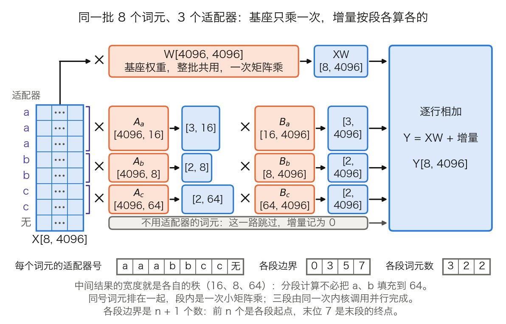

图 11-13：同一批 8 个词元、3 个适配器的一次线性投影，形状按 Llama 3 8B 的 `W_Q` 标注（[生成脚本](https://github.com/yeasy/llm_internals/blob/main/tools/figures/ch11_6_segmented_lora_batch.py)）。橙色是权重，蓝色是数据；基座一路对整批只乘一次，增量一路按段计算，各段中间结果的列数等于各自的秩。底部的“各段边界”是 n + 1 个数，末位 7 是末段的终点。

图中三段的中间结果分别是 `[3, 16]`、`[2, 8]`、`[2, 64]`，没有任何一段被填充到 64。不用适配器的词元不进入增量一路。

**Prefill 与 Decode 混在一批里。** 分段的单位是词元而不是请求。一个 Decode 请求贡献 1 行；一个正在 Prefill 的请求贡献一整段，段长等于本步分给它的词元数，段内是真正的矩阵乘矩阵。S-LoRA 为此准备了两个内核：Prefill 用 MBGMM（Multi-size Batched Gather Matrix-Matrix Multiplication），Decode 用 MBGMV（矩阵乘向量）。名字里的 Multi-size 指同一批内秩可以不同。

**对到实现。** vLLM v0.29.0 的 [`LoRAKernelMeta`](https://github.com/vllm-project/vllm/blob/v0.29.0/vllm/lora/ops/triton_ops/lora_kernel_metadata.py) 保存的正是图 11-13 底部的几张索引。`token_lora_mapping` 是每个词元的适配器号，`num_tokens_per_lora` 是各段词元数，`lora_token_start_loc` 是它带前导 0 的前缀和，即各段边界。vLLM 不搬动词元，而是用 `token_indices_sorted_by_lora_ids` 记下排序后的行号，内核据此间接取行。降维与升维对应同一目录下的 `lora_shrink_op.py` 与 `lora_expand_op.py`，由 `vllm/lora/punica_wrapper/` 封装后供各线性层调用。

### 6.4 批处理的收益为何还在

混批是否划算，用 3.8.8 的方法算：每从显存读 1 字节，做多少次浮点运算。场景是 Llama 3 8B 的一步 Decode，每个请求的上下文里已有 1,000 个词元，适配器取 `r = 16`、覆盖七个投影。

每个词元的计算量有三项。第一项是与权重相乘：32 层线性层 `32 × 436,207,616`（表 11-18 合计行）加 LM head `2 × 4,096 × 128,256`，约 150.1 亿次。Llama 的 MLP 有三个矩阵，这里不能套 3.8.8 的 `24d²`。第二项是打分与读取，`4 × 1,000 × 4,096 × 32`，约 5.2 亿次。第三项是 LoRA 增量，`2 × 41,943,040`，约 0.84 亿次。要读的字节也有三项：权重 16.06 GB，全批一份；KV 缓存每个词元 131,072 字节（3.8.8 的 65,536 个数），每个请求 131 MB；适配器每个 83.9 MB，批里出现几个就读几个。表 11-19 按这两组量列出七种情形。

| 情形 | 计算量 | 要读的字节 | 每字节运算次数 | H100 带宽下界 |
| --- | ---: | ---: | ---: | ---: |
| 批 1，无适配器 | 155 亿 | 16.19 GB | 0.96 | 4.8 ms |
| 批 1，一个适配器 | 156 亿 | 16.28 GB | 0.96 | 4.9 ms |
| 批 32，无适配器 | 4,971 亿 | 20.25 GB | 24.5 | 6.0 ms |
| 批 32，同一个适配器 | 4,998 亿 | 20.34 GB | 24.6 | 6.1 ms |
| 批 32，8 个适配器各 4 条 | 4,998 亿 | 20.93 GB | 23.9 | 6.2 ms |
| 批 32，32 个不同适配器 | 4,998 亿 | 22.94 GB | 21.8 | 6.8 ms |
| 不混批：32 个适配器各跑批 1，共 32 步 | 4,998 亿 | 520.8 GB | 0.96 | 155 ms |

表 11-19：Llama 3 8B 一步 Decode 的访存账。“带宽下界”是要读的字节除以 3.35 TB/s，只反映显存带宽这一项。第六行的 22.94 GB 由权重 16.061 GB、KV 缓存 `32 × 131.072 MB = 4.194 GB`、适配器 `32 × 83.886 MB = 2.684 GB` 相加得到，`16.061 + 4.194 + 2.684 = 22.939`。“每字节运算次数”是计算量除以要读的字节。

最坏的情形是 32 个请求各用各的适配器。此时适配器一共多读 2.68 GB，每字节运算次数从 24.5 降到 21.8，损失约 11%。对照组是最后一行：不能混批时，每个适配器只能以批大小 1 运行，凑齐同样的 32 个词元要把权重读 32 遍，访存是混批的 22.7 倍。批处理的收益来自共用那 16.06 GB 的基座权重，适配器只占其中一小块，所以收益基本保住。

**增量一路自身的算术强度。** Punica 给出了 SGMV 的账。设批里共 `s_n` 个词元、`n` 个不同的适配器，权重形状 `[h_i, h_o]`：

$$
\text{FLOPs} = 2\,s_n h_i h_o,\qquad \text{访存字节} = 2\left[s_n (h_i + h_o) + n\,h_i h_o\right]
$$

方括号里前一项是输入与输出，后一项是读到的权重。代入降维的 `h_i = 4096`、`h_o = 16`、`s_n = 32`：计算量恒为 4,194,304 次。32 个适配器各不相同时访存 4,457,472 字节，每字节 0.94 次；8 个适配器时 3.20 次；全批同一个适配器时 394,240 字节，10.64 次。结论是：适配器越集中，增量一路越接近普通的批量矩阵乘；各不相同时，加大批并不提高这一路的算术强度，但它的绝对访存量小，拖不动全局。

这个式子还给出一个上限。段长趋于无穷时权重一项可以忽略，每字节运算次数趋于 `h_i h_o / (h_i + h_o)`；`r` 远小于 `d` 时约等于 `r`。`r = 16` 的降维上限是 `4096 × 16 ÷ 4112 ≈ 15.9`；代入一段 1,000 个词元的 Prefill，得 15.7。两者都远低于 10.1 节给出的 H100 拐点 295。低秩矩阵乘的输入输出与计算量同阶，增量一路即使在 Prefill 里也卡在访存上。这是它的实际开销高于 FLOPs 占比的根本原因。

### 6.5 适配器的显存：槽位、分页与换入换出

适配器数量可以远多于显存装得下的数量，因此分三级存放：全部适配器在磁盘或对象存储里，已注册的常驻主机内存，只有当前批用到的在显存里。S-LoRA 据此指出，可服务的适配器总数受主机内存限制，而不受显存限制。64 GB 主机内存放得下 762 个上述 83.9 MB 的适配器。

**换入很便宜。** PCIe 4.0 x16 的单向带宽按规范标称值是 `16 GT/s × 16 × 128/130 ÷ 8 ≈ 31.5 GB/s`。取 Gen4 是为了与 Punica 的 A100 实测对照；11.4 节用的 32 GB/s 是未扣编码开销的标称值，H100 的 Gen5 再翻一倍。83.9 MB 的适配器传 2.7 毫秒，不到一步 Decode；`r = 64` 的 335.5 MB 传 10.6 毫秒。Punica 给出的量级相同：PCIe Gen4 x16 上加载一层约 50 微秒，整个适配器约 2 毫秒。相比之下，整份基座 16.06 GB 要传 0.51 秒，还不算从磁盘读出的时间。因此多 LoRA 系统的冷启动只是一次小拷贝。Punica 的做法是：新请求的适配器不在显存里时，发起一次异步的主机到设备拷贝，当前批照常计算，这一步算完时拷贝也已结束，新请求自然并入下一批。S-LoRA 更进一步，在算当前批时按等待队列预测下一批要用的适配器，提前取来。

**显存里怎么放，有两种设计。** 图 11-14 把两者并排画出。

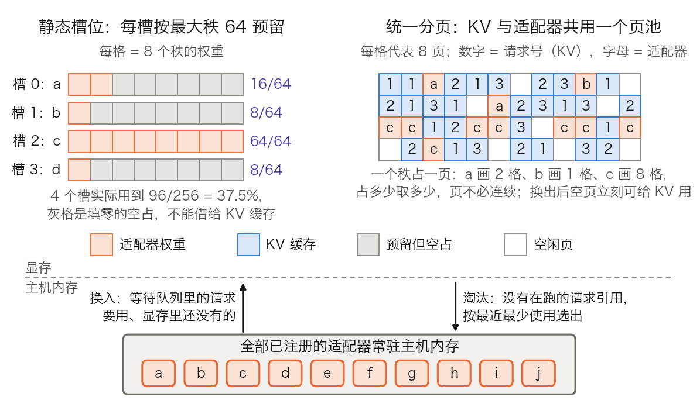

图 11-14：适配器权重在显存里的两种放法（[生成脚本](https://github.com/yeasy/llm_internals/blob/main/tools/figures/ch11_6_adapter_memory.py)）。左：静态槽位按最大秩预留，灰格是填零的空占。右：统一分页，适配器与 KV 缓存从同一个页池取页。下：全部适配器常驻主机内存，按需换入，不被引用时淘汰。为便于画出，右图每格代表 8 页，S-LoRA 实际是一个秩一页。

**静态槽位。** 启动时为每个加了 LoRA 的线性层预分配固定形状的张量，每个槽放一个适配器。vLLM v0.29.0 的 [`create_lora_weights`](https://github.com/vllm-project/vllm/blob/v0.29.0/vllm/lora/layers/base_linear.py) 为每层分配两组全零张量，打包层（`qkv_proj`、`gate_up_proj`）每个切片一份。`lora_a_stacked` 的形状是 `[max_loras, 1, max_lora_rank, d_in]`，`lora_b_stacked` 是 `[max_loras, 1, d_out, max_lora_rank]`。`set_lora` 把适配器的 `A`、`B` 拷进某个槽的左上角。vLLM 按“输出 × 输入”存放，行列与本书相反。这种设计的好处是形状固定：内核只需要“基地址加槽号”，地址和形状不随请求变化，便于配合 CUDA Graph 这类要求静态形状的机制。代价是 11.6.6 要算的空占。

**统一分页。** S-LoRA 注意到适配器权重与 KV 缓存很像：大小各异，随请求到来而分配、离开而释放，并且有一维同为隐藏宽度 `H`。它把 11.4 节的分页推广为 Unified Paging：除基座权重与临时张量外，剩余显存是一个页池，每页存一个 `H` 维向量。长度为 `S` 的 KV 张量占 `S` 页，秩为 `R` 的 LoRA 矩阵占 `R` 页，两者交错存放、不要求连续。按这个口径算一个例子：`H = 4096` 的多头注意力模型（形状同 GPT-3 6.7B），一页 8,192 字节。`r = 16`、加在 `W_Q`、`W_K`、`W_V`、`W_O` 上的适配器，每层 `4 × 2 × 16 = 128` 页，32 层 4,096 页，合 33.6 MB。同一模型里一个词元的 KV 是每层 K、V 各一页，共 64 页。这个适配器换出后腾出的页，正好够 64 个词元的 KV 用。代价在内核一侧：权重不再连续，内核要按页表逐页取数，这正是 MBGMM、MBGMV 名字里 Gather 的含义。

**调度约束。** 同一批里能出现的适配器个数有上限。vLLM 的[调度器](https://github.com/vllm-project/vllm/blob/v0.29.0/vllm/v1/core/sched/scheduler.py)在接纳等待请求时检查：批里已有 `max_loras` 个不同的适配器、而新请求用的是另一个时，跳过它。后果是冷门适配器的请求可能被热门适配器挡在队列里，首词元延迟变长。调大 `max_loras` 可以缓解，代价是槽位显存：一个 `r = 16`、覆盖七个投影的槽是 83.9 MB，折合 `83,886,080 ÷ 131,072 = 640` 个词元的 KV 缓存。另一条路是在路由层把用同一批适配器的请求送到同一实例，让每个实例面对的适配器集合变小。

**淘汰。** 有正在运行的请求引用的适配器不能换出；其余的按最近最少使用（LRU）淘汰。vLLM 用两级 LRU：`max_loras` 是显存槽位数，`max_cpu_loras` 是主机内存里保留的适配器数，后者不得小于前者。

### 6.6 秩不同、目标模块不同：填充的代价

真实负载里的适配器并不整齐：秩从 8 到 64 甚至更大，有的只加在 `W_Q`、`W_V` 上，有的覆盖全部线性层。凡是要求“同形状”的实现，都要为这种不整齐付出填充。

**秩不同。** 设一批 32 个请求，24 个用 `r = 8`，6 个用 `r = 16`，2 个用 `r = 64`。有用的秩总和是 `24 × 8 + 6 × 16 + 2 × 64 = 416`；全部填充到 64 后是 `32 × 64 = 2,048`。有效计算只占 20.3%，实际计算量是有用部分的 4.9 倍。显存一侧按秩算：一个秩在七个投影、32 层上是 `81,920 × 32 × 2 B = 5,242,880 B`，恰为 `5,242,880 ÷ 131,072 = 40` 个词元的 KV 缓存。32 个槽按 `r = 64` 预留，共 2,048 个秩，`2,048 × 5,242,880 B = 10.74 GB`；实际权重是 `416 × 5,242,880 B ≈ 2.18 GB`。空占的秩是 `2,048 − 416 = 1,632`，合 8.56 GB，折合 `1,632 × 40 = 65,280` 个词元的 KV 缓存。按每请求 1,000 个词元计，是 65 个并发请求的容量。

静态槽位的实现同时付这两笔。vLLM 的降维内核从堆叠张量的形状读出秩，即 `max_lora_rank`，所以每个适配器都按最大秩计算，不足的部分乘的是零。它的[文档](https://github.com/vllm-project/vllm/blob/v0.29.0/docs/features/lora.md)因此建议把 `--max-lora-rank` 设为实际用到的最大秩：适配器的秩是 16、32、64 时设 64，而不是 256。分段内核加统一分页的设计两笔都不付，换来的是更复杂的内核和不固定的形状。介于两者之间的工程做法，是按秩把适配器分到不同实例，每个实例内部接近整齐。

**目标模块不同。** 只加在 `W_Q`、`W_V` 上的 `r = 16` 适配器是 13.6 MB，只占全模块槽位的 16.2%。引擎若为七个投影都挂上增量一路，这个适配器在其余五个投影上是全零矩阵：零照样参与计算，结果为零，除非内核按模块跳过。vLLM 提供 `--lora-target-modules`，在部署时把增量一路限制在指定的模块上，例如只保留 `o_proj` 与 `qkv_proj`，未列出的模块不挂增量一路。

### 6.7 边界与常见误解

- **“LoRA 推理零开销”只对合并后的单适配器成立。** 多 LoRA 服务必然不合并，代价是 11.6.2 算过的百分之几到十几的吞吐。
- **适配器会使前缀缓存失效。** 适配器改了 `W_K`、`W_V`，同一段前缀算出的 K、V 就不同。即使只改 `W_Q`、`W_O`，第 1 层的输出也变了，第 2 层起的 K、V 随之不同。不同适配器的请求因此不能共享 KV，缓存键里必须带上适配器标识。后果是同一段系统提示词在 N 个适配器上要各 Prefill 一次，缓存里也要各存一份。键的做法见 11.5.7 的表 11-17。
- **量化基座不能无损合并。** 基座是 4 比特权重、适配器是 FP16 时，`W + AB` 的结果无法无损放回 4 比特的格点。要么反量化后再合并，放弃量化省下的显存；要么走不合并的路径，即使只有一个适配器。
- **统一分页的“整页”前提不总成立。** S-LoRA 的一页是一个 `H` 维向量，隐含 KV 与适配器的那一维都等于 `H`。Llama 3 8B 的 K、V 宽度是 1,024，为 `H/4`；`W_down` 的 `A` 每个秩有 14,336 个数，合 3.5 页。S-LoRA 论文的脚注说明，其 70B 实验没有采用 GQA。对 GQA 模型和 MLP 上的适配器，页的大小要重新设计。
- **多卡下适配器也要切分。** 基座按张量并行切开后，`A`、`B` 的切法决定增量一路多出多少通信。S-LoRA 让增量一路的通信落在 `r` 维的小张量上，并与基座的 all-reduce 融合。vLLM 默认只对增量一路的一半计算做切分，打开 `fully_sharded_loras` 后改用完全切分的层。张量并行本身见 11.8 节。
- **多 LoRA 不是多模型。** 本节的全部收益来自“共用基座”。基座不同的模型之间没有可共用的大矩阵乘，只能分实例部署或分时复用显存。

表 11-20 把上述机制对到 vLLM 的配置项。

| 机制 | 决定它的量 | vLLM v0.29.0 的配置项 |
| --- | --- | --- |
| 同一批里最多几个不同的适配器 | 显存槽位数 | `max_loras`，默认 1 |
| 槽位按多大的秩预留 | 填充开销（11.6.6） | `max_lora_rank`，默认 16 |
| 主机内存里保留几个适配器 | 换入命中率 | `max_cpu_loras`，缺省等于 `max_loras` |
| 哪些线性层挂增量一路 | 内核启动次数与槽位显存 | `target_modules`（命令行 `--lora-target-modules`） |
| 张量并行下适配器怎么切 | 增量一路的通信量 | `fully_sharded_loras`，默认关闭 |

表 11-20：本节各机制在 vLLM v0.29.0 的 [`LoRAConfig`](https://github.com/vllm-project/vllm/blob/v0.29.0/vllm/config/lora.py) 中对应的配置项；启用多 LoRA 的总开关是 `--enable-lora`。引擎的整体结构见 11.10 节。

多 LoRA 服务把“一个基座、许多变体”的成本压到接近单模型，但前提是变体之间只差一个低秩增量，且增量的形状大体整齐。变体改动了词表、用了不同的基座版本，或者秩大到与 `d_model` 同量级时，本节的账不再成立，需要回到分实例部署。

## 7. 约束解码：让输出必然合乎语法

11.3 到 11.6 各节管的是谁参加这一步、各算多少词元、用哪份权重；本节管的是算出的 logits 在进采样器之前还要过一道什么。9.4 节给出了约束解码的定义：每一步把不合法词元的概率清零，在合法集合上重新归一化。那一节没有回答引擎怎样知道“此刻哪些词元合法”。语法写在字符上，模型吐的是词元，词表有十几万项，判断必须在一轮 Decode 的几毫秒内完成，还要同时服务一整批语法各异的请求。本节先讲语法怎样编译成自动机，字符级自动机怎样变成词元级掩码，每步开销多大、怎样缓存。随后讲确定性片段怎样一次吐出，约束与采样、投机解码、批处理相遇时的次序，以及它对输出质量的代价。

### 7.1 约束落在哪一步：logits 上的一行掩码

约束解码不改前向计算。权重、注意力、KV 缓存都照旧，改动只在 LM head 之后、采样之前：给 logits 加一张掩码，合法词元加 0，不合法词元加 −∞。形状按 3.8.5 的写法是：

- GPT-3 Small：`logits[B, 50257] + M[B, 50257] → [B, 50257]`
- Llama 3 8B：`logits[B, 128256] + M[B, 128256] → [B, 128256]`

这与 3.8.3 第 4 步的因果掩码是同一种运算，只是那里遮的是位置，这里遮的是词表。Softmax 之后 −∞ 变成概率 0，其余词元自动重新归一化，正是 9.4 节的公式。`M` 的每一行属于一个请求，由该请求自己的语法和自己走到的状态决定，行与行互不相同。

掩码只有“留”和“遮”两种取值，一个词元用 1 比特即可，整行压成一张**位图**（bitmask）。[XGrammar](https://github.com/mlc-ai/xgrammar/blob/main/python/xgrammar/matcher.py) 的约定是 `bitmask[B, ⌈n_vocab/32⌉]`，元素为 int32，由 CPU 填好后拷到 GPU，再由一个内核就地改写 logits。算一行的大小：

- GPT-3 Small：`⌈50,257 / 32⌉ = 1,571` 个 int32，共 `1,571 × 4 = 6,284` 字节。
- Llama 3 8B：`⌈128,256 / 32⌉ = 4,008` 个 int32，共 16,032 字节，约 16 KB。

若用 float32 存整行掩码，Llama 3 8B 是 `128,256 × 4 = 513,024` 字节，是位图的 32 倍。`B = 64` 时，位图每轮的主机到设备拷贝量是 `64 × 16,032 = 1,026,048` 字节，约 1 MB；按 11.4 节的 PCIe 单向 32 到 64 GB/s，拷贝约 0.02 到 0.03 ms，可以忽略。这里的宽度取嵌入表的 128,256 行，而不是论文口径的 128,000（见 3.8.7 表 3-27 的注）。掩码必须盖住 logits 的每一列，否则多出的 256 个特殊词元不受约束。其中既有保留 ID，也有 `<|end_of_text|>`、`<|eot_id|>` 两个停止词元，漏掉它们，模型就能在半截 JSON 上结束。

GPU 一侧的开销因此很小，难点全在 CPU 一侧：怎样在几十微秒内，为每个请求填好这 4,008 个整数。

### 7.2 从字符级自动机到词元级索引

**问题。** 正则表达式和 JSON Schema 定义在字符（字节）上，模型的字母表却是词元。一个词元是一到十几个字节的串，词元边界与语法边界并不对齐。最直接的做法是每一步把词表里的每个词元拿来试走：从自动机的当前状态出发，逐字节转移，中途走进死状态就判为不合法。这要每步做 `n_vocab × 平均词元长度` 次转移，11.7.4 会算出它为什么不可接受。

**想法。** 正则语言对应**确定有限自动机**（Deterministic Finite Automaton，DFA），状态数有限。于是可以在请求开始前，对每个状态、每个词元各试走一次，把结果存成一张表；运行时只按当前状态取一行。这就是 [Outlines 论文](https://arxiv.org/abs/2307.09702)提出的词表索引：建表代价是 `|Q| × n_vocab` 次试走，只付一次；运行时是一次查表，平均 O(1)。

**一个可手算的例子。** 要求输出形如 `{"age": 12}` 的 JSON，整数不许有前导零。对应的正则是：

```text
\{"age": (0|[1-9][0-9]*)\}
```

编译分三步。第一步按 Thompson 构造得到**非确定有限自动机**（Nondeterministic Finite Automaton，NFA）。每个字符或字符类生成 2 个状态和 1 条边，`|` 与 `*` 各再加 2 个状态，用不读字符的 ε 边接线。本例有 12 个字符或字符类（10 个字面字符，加 `[1-9]`、`[0-9]`）、一个 `|`、一个 `*`，共 `12 × 2 + 2 + 2 = 28` 个 NFA 状态。第二步是子集构造：读完某个前缀后 NFA 可能同时处在的状态集合，算作 DFA 的一个状态。本例得 13 个：`q0` 到 `q8` 的链 9 个，读过 `0`、读过 `[1-9]`、循环内读过 `[0-9]`、读过 `}` 各 1 个。第三步合并等价状态：`[1-9]` 之后与 `[0-9]*` 循环之内的两个集合出边完全相同，并成一个，剩 12 个。读不下去时进入的死状态不计在内。

这 12 个状态是：`q0` 到 `q8` 依次吃掉 `{"age": ` 这 8 个字符；`|` 使 `q8` 分叉，读到 `0` 去 `q9`，读到 `1-9` 去 `q10`；`*` 成为 `q10` 上的自环，读到数字留在原地；`q9`、`q10` 读到 `}` 去接受状态 `q11`。教学词表取 16 个词元，见表 11-21，其中特意放了多字符词元、同一字符串的不同切法，以及横跨两个语法成分的词元。

| ID | 0 | 1 | 2 | 3 | 4 | 5 | 6 | 7 | 8 | 9 | 10 | 11 | 12 | 13 | 14 | 15 |
| --- | --- | --- | --- | --- | --- | --- | --- | --- | --- | --- | --- | --- | --- | --- | --- | --- |
| 词元 | EOS | `{` | `"` | `{"` | `a` | `ge` | `age` | `":` | `:` | 空格 | `0` | `1` | `12` | `01` | `}` | `2}` |

表 11-21：教学词表，16 个词元。

建索引就是对 12 个状态、15 个非 EOS 词元各试走一次，共 `12 × 15 = 180` 次；EOS 不走自动机，只在接受状态合法。以状态 `q8` 为例，走三个词元：

- 词元 `01`：`0` 把 `q8` 带到 `q9`；`q9` 没有读 `1` 的出边，走进死状态，不合法。
- 词元 `12`：`1` 到 `q10`，`2` 留在 `q10`，合法，落点 `q10`。
- 词元 `2}`：`2` 到 `q10`，`}` 到 `q11`，合法，落点 `q11`。

同一个 `01` 从 `q10` 出发则两步都留在 `q10`，是合法的。一个词元合不合法取决于状态，这正是掩码必须逐步重算的原因。图 11-15 画出完整的自动机和算出的索引。

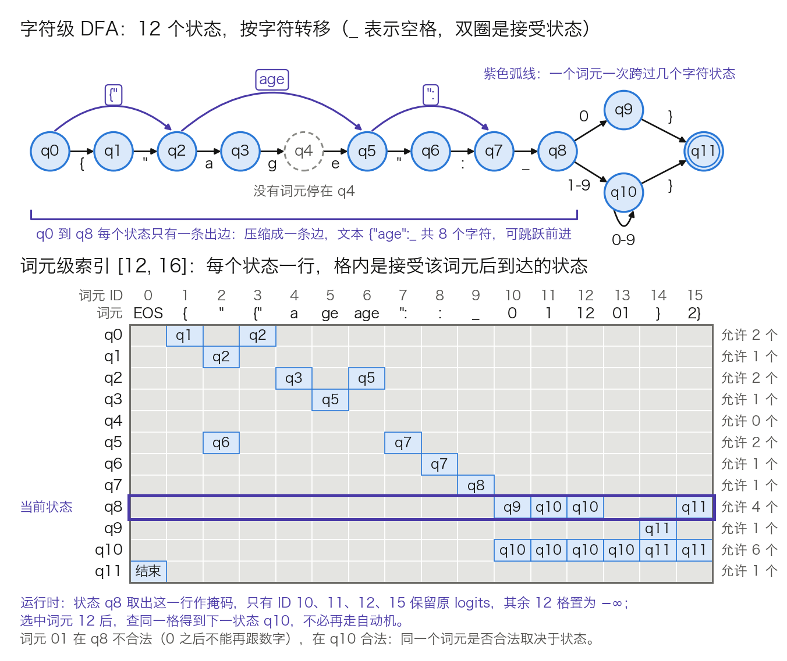

图 11-15：正则 `\{"age": (0|[1-9][0-9]*)\}` 的字符级 DFA，以及对 16 个词元预计算出的词元级索引 `[12, 16]`（[生成脚本](https://github.com/yeasy/llm_internals/blob/main/tools/figures/ch11_7_token_index.py)）。蓝格内是接受该词元后的落点状态，灰格不合法；紫框是第 5 步用到的那一行。

从这张索引能读出三件事：

1. **词元跨过状态。** `{"` 从 `q0` 直达 `q2`，`age` 从 `q2` 直达 `q5`。`q4` 没有任何词元停留，词元级自动机实际可达的只有 11 个状态。
2. **同一字符串的各种切法都合法。** `q0` 既允许 `{"`，也允许 `{` 再接 `"`。索引只管字符串是否合乎语法，不偏向分词器的规范切法，11.7.7 会讲这带来的风险。
3. **EOS 只在接受状态合法。** 这一条保证生成不会在半截 JSON 上自行结束。

表 11-22 是生成 `{"age": 12}` 的完整轨迹。每一步做两次查表：按当前状态取一行作掩码，采样后按选中的词元取落点状态。

| 步 | 状态 | 掩码（ID 0 到 15） | 合法词元数 | 选中 | 落点 |
| ---: | --- | --- | ---: | --- | --- |
| 1 | `q0` | `0101000000000000` | 2 | `{"` | `q2` |
| 2 | `q2` | `0000101000000000` | 2 | `age` | `q5` |
| 3 | `q5` | `0010000100000000` | 2 | `":` | `q7` |
| 4 | `q7` | `0000000001000000` | 1 | 空格 | `q8` |
| 5 | `q8` | `0000000000111001` | 4 | `12` | `q10` |
| 6 | `q10` | `0000000000111111` | 6 | `}` | `q11` |
| 7 | `q11` | `1000000000000000` | 1 | EOS | 结束 |

表 11-22：逐步轨迹。7 步里只有第 5、6 步存在语义上的选择，其余各步的候选要么唯一，要么只是同一字符串的不同切法，11.7.5 利用的就是这一点。

**还原到真实规模。** 建表的试走次数是 `|Q| × n_vocab`：一个 100 状态的正则配 Llama 3 的词表，要试走 `100 × 128,256`，约 1,283 万次；每次试走按 `5 字节 × 5 ns = 25 ns` 计（假设值，见 11.7.4），约 0.3 秒。这是一次性开销，但必须缓存。存储上，若每个状态存一张 16 KB 的位图，1,000 个状态就是 16 MB。落点那张表可以不存：选中词元的字节在字符级 DFA 上重走约 5 步即得。若存成稠密的 int32 表，是 `1,000 × 128,256 × 4 ≈ 513 MB`，为位图的 32 倍；outlines-core 的 `Index` 取折中，只为合法词元存落点，大小随合法词元数增长。字节级 BPE 的词表含全部 256 个单字节词元（见 3.1 节），所以任何合法字符串总有一种切法走得通，索引不会出现“语法允许、词表却拼不出”的死路。

### 7.3 嵌套结构：下推自动机与上下文独立词元

**为什么 DFA 不够。** 有限状态记不住任意深的嵌套：`[[[1]]]` 要求右括号与左括号数目相等，层数无上限时没有哪个有限状态集能数清。不含递归、嵌套层数固定的 JSON Schema 可以先展开成正则，[outlines-core](https://github.com/dottxt-ai/outlines-core) 即走此路（`build_regex_from_schema`）。自引用的 `$ref` 在这条路上只能按固定深度展开（`max_recursion_depth`，默认 3），正则大小随深度指数增长。Schema 引用自身且深度不设限，或要接受任意 JSON，就需要**上下文无关文法**（Context-Free Grammar，CFG）。对应的机器是**下推自动机**（Pushdown Automaton，PDA），即在有限状态之外加一个栈。进入子规则时把返回位置压栈，子规则结束时弹栈回到上层。

**困难。** PDA 的完整状态是“当前节点加整个栈”，栈深不设上限，状态无法枚举，11.7.2 的整表预计算做不下去。退回每步试走全词表，又太慢。

**XGrammar 的拆分。** [XGrammar 论文](https://arxiv.org/abs/2411.15100)按“只看栈顶能否判定”把词元分成两类。词元从栈顶节点出发逐字节匹配，过程只有三种情形：进入子规则（压栈）、在当前规则内前进、走到当前规则末尾并返回上层（弹栈）。前两种只依赖栈顶节点，称**上下文独立词元**（context-independent token），可以对每个节点预先判好、存入缓存；第三种要看栈里压着什么，称**上下文依赖词元**（context-dependent token），留到运行时带着完整的栈去执行。

举一个例子。当前位于 JSON 字符串内部，候选词元是 `"}`：引号结束字符串，属于弹栈；紧随的 `}` 是否合法，取决于外层是对象还是数组。前缀是 `{"k": "ab` 时合法，前缀是 `["ab` 时不合法。栈顶节点相同，结论不同，它就是上下文依赖词元。同一位置的候选词元 `cd` 只在字符串内部前进，不论外层是什么都合法。

论文对 Llama 3.1 的词表和 JSON 文法给出的数字是：上下文依赖词元 1,134 个，不到 128k 词表的 1%；再用“上下文扩展”预先算出每条规则返回上层后可能接上的字符串，提前排除注定失败的词元，可降到 120 个。运行时要带着栈执行的词元，由整张词表缩到百余个的量级，其余直接取自缓存。缓存的存法也按节点自适应：合法词元少就存合法列表，不合法词元少就存不合法列表，两者相当才存整张位图。该文报告 JSON 文法的缓存由此从 160 MB 降到 0.46 MB。

**栈要能回退。** 检查一个词元要顺着它的字节压栈弹栈，查完须恢复原状再查下一个；投机解码和跳跃前进也要撤销已接受的词元。论文用**持久化栈**（persistent stack）解决：各时刻的栈组织成一棵共享前缀的树，回退只是把指针挪回旧节点，耗时为常数。

**另一条路线是不预计算。** [llguidance](https://github.com/guidance-ai/llguidance) 用 Earley 解析器配一个基于正则导数的词法器，运行时沿词表的前缀树（trie）遍历，共享前缀的词元只走一次；其文档给出的量级是 128k 词表下每张掩码约 50 微秒的单核 CPU 时间，且几乎没有启动开销。两条路线的取舍在于把成本放在编译期还是每一步：语法固定、请求量大时，预计算摊得开；每个请求的 Schema 都不同时（例如工具列表随请求变化），编译缓存命中率低，运行时路线更稳。

### 7.4 每步掩码的开销与缓存

约束解码有三笔开销：编译语法（每种语法一次）、生成掩码（每请求每步一次）、施加掩码（GPU 上一次逐元素运算）。第三笔可忽略，前两笔都在 CPU 上。

**每步的预算是多少。** 沿用 10.1 节的口径，Llama 3 8B 的 BF16 权重是约 80 亿参数 × 2 字节 ≈ 16 GB，H100 的显存带宽为 3.35 TB/s，单轮 Decode 的下界是：

$$
t_{\text{fwd}} \approx \frac{16\ \text{GB}}{3.35\ \text{TB/s}} \approx 4.8\ \text{ms}
$$

掩码若要不拖慢生成，整批请求的掩码必须在这 4.8 ms 内算完。

**朴素做法超出多少。** 假设词元平均 5 字节、一次状态转移 5 ns（一次查表的量级，两者均为假设值），每请求每步是 `128,256 × 5 × 5 ns ≈ 3.21 ms`。`B = 32` 时串行算完要 `32 × 3.21 ≈ 103 ms`，是前向的 20 多倍，GPU 绝大部分时间在等 CPU。

**有索引或缓存之后。** 每张掩码降到几十微秒。XGrammar 论文在其测试环境下报告 JSON Schema 与 JSON 文法每词元低于 40 微秒。llguidance 文档给出约 50 微秒。取 50 微秒，`B = 32` 时一轮是 `32 × 50 = 1,600` 微秒，即 1.6 ms。

**重叠。** 本轮掩码只依赖已经生成的词元，本轮前向也只依赖已经生成的词元，两者没有先后关系，可以让 CPU 与 GPU 同时开工，在采样之前同步一次。图 11-16 比较三种排法。

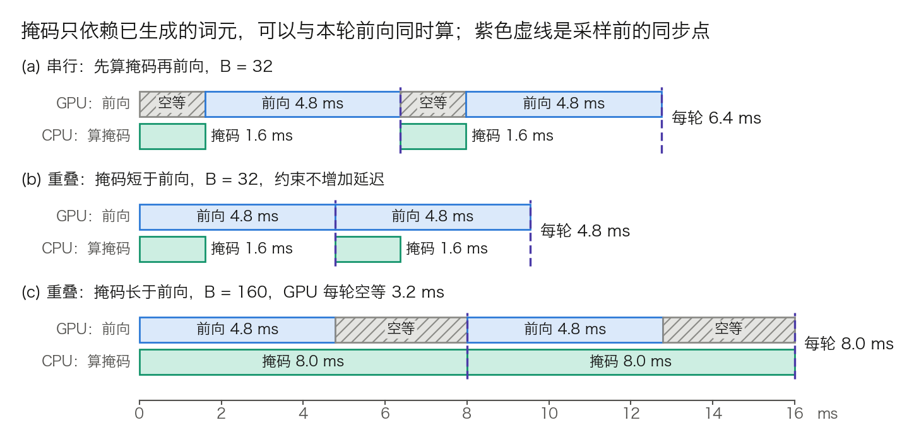

图 11-16：掩码计算与前向的时序，时间按比例（[生成脚本](https://github.com/yeasy/llm_internals/blob/main/tools/figures/ch11_7_mask_overlap.py)）。前向统一取 4.8 ms 的下界，掩码取每请求 50 微秒、单线程。(a) 串行时每轮 `1.6 + 4.8 = 6.4` ms；(b) 重叠后掩码藏在前向之内，每轮 4.8 ms；(c) `B = 160` 时掩码要 8.0 ms，GPU 每轮空等 3.2 ms。

由此得到一条判据：

$$
\frac{B_{\text{约束}} \times t_{\text{mask}}}{\text{线程数}} \le t_{\text{fwd}}
$$

左边小于右边，约束对延迟没有影响；超过，掩码就落在关键路径上，每轮时间由 CPU 决定。代入 50 微秒和 4.8 ms，单线程能容纳约 96 个约束请求。批变大时前向也会变长（KV 读取增加，见 3.8.8 的瓶颈三），所以 96 偏保守；再往上靠多线程并行填各行，XGrammar 的 `BatchGrammarMatcher` 即为此而设。这条数据依赖还有一个推论：掩码必须等上一步的采样结果，凡是让 CPU 提前一轮准备输入的调度优化，遇到约束请求都要在这里多等一次；vLLM 的异步调度见 11.10 节，SGLang 的重叠调度见 11.11 节。

**编译缓存。** 编译结果按“语法加分词器”缓存，同一 Schema 的后续请求直接复用。[SGLang 论文](https://arxiv.org/abs/2312.07104)的消融实验显示，若每个请求都重做预处理，吞吐降为原来的 1/2.4。首个请求的编译时间计入它的 TTFT（首词元延迟），可与 Prefill 重叠来遮掉一部分。

### 7.5 跳跃前进：确定性片段不必逐词元解码

表 11-22 的前 4 步没有任何信息量：语法已经规定输出以 `{"age": ` 开头，模型却仍要做 4 轮前向，把这 8 个字符“生成”出来。**跳跃前进**（jump-forward）省掉这些前向。

**机制。** SGLang 论文的压缩有限状态机（compressed FSM）先在字符级自动机上找单出边：源状态只有一个后继，且边上只有一个可接受字符。一条边之后若接着连续的单出边，就与它们合并成一条压缩边，边上的文本是各字符的拼接。图 11-15 里 `q0` 到 `q8` 的 8 条边全是单出边，压成一条，文本为 `{"age": `。运行时走到压缩边的起点，引擎直接把整段文本追加到序列里，用分词器切成词元，交给一次多行的前向补齐 KV，不再经过采样。

压缩必须在字符级做。词元级的 `q0` 有 `{` 和 `{"` 两条出边，看上去并不确定；在字符级它只有一条。

**省了多少。** 不跳跃时，Prefill 给出第 1 个词元，其后 6 个词元各需一轮 Decode。跳跃时，4 个强制词元直接并入 Prefill，模型只需生成 `12` 和 `}`。其后的 EOS 是终态唯一合法的词元，引擎可以直接结束，Decode 由 6 轮降到 1 到 2 轮。按上一小节的口径，省下的 4 轮约 `4 × 4.8 ≈ 19` ms；代价是 Prefill 多算 4 行，而 Prefill 处在算力瓶颈一侧（见 3.8.8），多几行几乎不增加耗时。

强制片段出现在序列中间时同理。设片段长 k 个词元：不跳跃要 `k + 1` 轮单行前向，才能得到片段之后第一个自由词元的 logits；跳跃时是一轮 `k + 1` 行的前向，省 k 轮。llguidance 的[文档](https://github.com/guidance-ai/llguidance/blob/main/docs/fast_forward.md)把它概括为“推测 100% 正确的投机解码”。SGLang 论文在 JSON 解码基准上测得压缩状态机使吞吐提高到 1.6 倍。字段名越长、自由取值越短的 Schema，收益越大。

**代价。** 第一，跳跃的这一轮不再是“每请求一行”的 Decode，而是一次小的 Prefill，调度器要把它当作分块 Prefill 那样混排（见 11.3 节）。第二，强制文本要重新分词。SGLang 论文的做法是把此前的全部文本连同压缩边的文本一起重新切分，保证序列与模型训练时见到的切法一致（引擎当前是否启用见 11.11.5）；若重切使末尾几个已生成的词元发生合并，这些词元的 KV 要作废重算，语法状态也要同步回退。第三，强制到哪里为止并不显然，见 11.7.7 的词元边界问题。

### 7.6 与采样、投机解码、批处理的交互

**采样：掩码先于截断。** Top-k、Top-p、Min-p（见 9.3 节）都按概率高低丢弃词元。若先截断再加掩码，合法词元可能已被全部丢掉。设某一步只有四个词元有概率：三个不合法，分别为 0.5、0.3、0.15；一个合法，为 0.05。Top-p 取 0.9，按概率从大到小累计是 0.5、0.8、0.95，到第三个才过线，核内三个全不合法。再加掩码，整行都是 −∞，Softmax 得到 NaN。先加掩码则不会：0.05 先归一化为 1，Top-p 再在合法集合内部截断。温度与掩码的先后无关，因为 −∞ 除以任何正数仍是 −∞；贪心解码就是在合法集合里取 argmax。

**批处理：前向共享，状态分管。** 同一批里可以混着不同语法的请求和无约束的请求。前向是同一次，批处理的收益不受影响；每个约束请求各有一个匹配器，保存自己的自动机状态，并对应位图里的一行。无约束的行全填 1，或者像 XGrammar 的 `apply_token_bitmask_inplace` 那样用 `indices` 参数只处理指定的行。连续批处理每一轮都有请求进出，行号与请求的对应关系要每轮重建。KV 缓存与前缀缓存不受影响：掩码作用在 LM head 之后，同一串词元的 K、V 与有无约束无关，前缀复用照常（见 11.5 节）。

**投机解码：γ + 1 张掩码与回退。** 设草稿长度为 $\gamma$、草稿词元为 $d_1,\dots,d_\gamma$（记号同 10.6 节），目标模型一次前向验证 `γ + 1` 个位置。每个位置的合法集合不同：第 0 个位置用当前状态的掩码，第 i 个位置用“依次接受 $d_1,\dots,d_i$ 之后”的掩码。匹配器因此要沿草稿前进 $\gamma$ 步，产出 `bitmask[γ+1, ⌈n_vocab/32⌉]`；验证结束后，按被拒绝的词元数回退。若 $d_i$ 本身不在第 $i-1$ 张掩码里，它在约束后的目标分布下概率为 0，必被拒绝，其后的草稿一并作废。三个后果：

- CPU 开销乘以 `γ + 1`，11.7.4 的判据相应收紧。
- 无损性仍成立，但对象是“加掩码后的目标分布”。
- 草稿一侧最好也加同一张掩码，否则草稿频繁越出语法，接受率下降。

XGrammar 为此提供 `rollback` 和处理树状草稿的 `traverse_draft_tree`。跳跃前进与投机解码省的是同一类词元：确定性片段正是草稿最容易猜对的部分，两者的收益有重叠，不是简单相加。

### 7.7 质量风险：分布扭曲与词元边界

9.4.5 已指出逐步掩码会改变分布。本小节把它落到 11.7.2 的例子上，再讲 9.4 没有展开的词元边界问题。

**风险一：分布扭曲。** 沿用上面的正则，词表换成真实词表，`1`、`2`、`.`、`}` 各是一个词元。设模型走到 `q8`，只看两条路径。模型认为答案是 1.5：首选 `1`，概率 0.6，其后想接小数点的概率是 0.9，接 `}` 的概率只有 0.1；次选 `2`，概率 0.4，其后接 `}` 的概率是 0.9。语法只许整数，小数点不合法。按 9.4.5 的记法，选 `1`、选 `2` 之后落在语法内的总概率 F 分别是 0.1 与 0.9。

- 理想结果是原分布限制在合法输出上的条件分布。两条合法路径的联合概率是 `0.6 × 0.1 = 0.06` 和 `0.4 × 0.9 = 0.36`，归一化后输出 `1` 的概率是 `0.06 / 0.42 ≈ 0.14`，输出 `2` 的概率约 0.86。
- 逐步掩码的结果不同。第一步 `1` 和 `2` 都合法，概率仍是 0.6 和 0.4；选了 `1` 之后，第二步小数点被遮掉，`}` 的 0.1 被归一化成 1。输出 `1` 的概率是 0.6，被高估约 4.2 倍。

原因在于掩码只看“这一步能否走通”，没有把 F 乘进去。模型本想写 1.5，被迫截成 1，而不是改选它自己更认可的整数。精确修正为何一般不可行，见 9.4.5 对 Grammar-Aligned Decoding 的介绍。工程上的对策是减少掩码真正出手的次数：

- 让语法贴合模型要说的话，可能出现小数的字段就声明为 `number`。
- 把 Schema 同时写进 Prompt。掩码对模型不可见，llama.cpp 的[文法文档](https://github.com/ggml-org/llama.cpp/blob/master/grammars/README.md)特别提醒，Schema 只用于约束输出，不会自动注入 Prompt。
- 监控未加掩码时的 argmax 被遮掉的比例。比例高，说明 Prompt 与语法在互相冲突。

**风险二：词元边界。** 字符级自动机接受同一字符串的所有切法，模型却只在训练中见过规范切法。三种情形会把模型推到陌生的词元序列上：

- 强制片段的切法不规范。同一份 llguidance 文档的例子：Schema 有 `orderId` 和 `orderName` 两个可选字段，采到 `{"` 之后语法强制 `order`。Llama 3 的词表里 `orderId` 是一个词元，`orderName` 不是。若此时强行填入词元 `order`，模型几乎必选 `Name`，因为训练数据里 `order` 后接 `Id` 的序列极少见。安全的做法是只强制到规范切法确定的位置为止，把悬而未决的尾部留给模型。
- 实现把词元对齐到语法终结符，不允许一个词元横跨两个成分。表 11-21 的 `":` 与 `2}` 这类词元会被误判为不合法，模型只得改用罕见的拆分。[DOMINO](https://arxiv.org/abs/2403.06988) 一文称之为**词元错位**（token misalignment），并实测到下游准确率显著下降。11.7.2 那种按字节试走的索引天然接受这类词元，没有这个问题。
- 语法允许任意多的空白时，模型可能一直输出空白直到长度上限。OpenAI 的[结构化输出文档](https://developers.openai.com/api/docs/guides/structured-outputs)对 JSON 模式有同样的提醒；对策是在语法里收紧空白，并在 Prompt 中明确要求输出 JSON。

**风险三：格式限制拖累推理。** [Let Me Speak Freely?](https://arxiv.org/abs/2408.02442) 一文比较了自由作答与受格式限制的作答，观察到推理类任务在格式限制下明显变差，限制越严下降越多。常见的缓解办法是在 Schema 里把推理字段排在答案字段之前，或先自由作答、再用第二次调用转成结构化输出。

**保证的边界。** 前缀合法不等于输出完整、语法合法不等于语义正确、各实现只支持 JSON Schema 的子集，这三条见 9.4.6。补一个实现细节：llama.cpp 的文档写明不支持的特性会被静默跳过，此时实际约束比预期弱，却不会报错。

### 7.8 对到实现

表 11-23 汇总几种公开实现的路线，可据此读各自的源码与文档。

| 实现 | 语法怎样表示 | 掩码怎样得到 | 取舍 |
| --- | --- | --- | --- |
| Outlines（outlines-core） | 正则编译为 DFA；JSON Schema 先转成正则 | 预计算 `Index`：状态到合法词元、词元到下一状态 | 运行时只查表；建表时间与内存随状态数增长；递归只能按固定深度截断 |
| XGrammar | CFG（含 JSON Schema、正则）编译为字节级 PDA | 上下文独立词元预计算，上下文依赖词元运行时执行 | 缓存命中时每步只补判少量词元；编译要对每个节点过一遍词表，依赖编译缓存 |
| llguidance | CFG，Earley 解析器加正则导数词法器 | 运行时沿词表前缀树遍历，不预计算 | 几乎无启动开销，适合 Schema 逐请求变化 |
| llama.cpp（GBNF） | GBNF 文法，显式栈的字符级解析器 | 运行时逐个检查候选词元，不预计算 | 文档提示个别写法（如大量重复的可选项）会使采样极慢；JSON Schema 只支持子集 |

表 11-23：约束解码的几种公开实现。

读 XGrammar 的 Python 接口时，可按本节的顺序对号入座：`GrammarCompiler` 负责编译并自带缓存（`compile_json_schema`、`compile_regex`、`compile_grammar`）；每个请求一个 `GrammarMatcher`，`fill_next_token_bitmask` 对应 11.7.1 的填位图，`accept_token` 对应采样后的状态转移，`find_jump_forward_string` 对应 11.7.5，`rollback` 对应 11.7.6。其匹配器的实现基于 Earley 解析器，与论文的显式栈不同；“按位置预计算掩码、运行时补判其余”的骨架不变。vLLM 与 SGLang 都把这些库当作可替换的后端，接线方式与配置项分别见 11.10 节和 11.11 节。

## 8. 多卡推理：张量并行、流水线并行与专家并行

前面各节都假定模型放得进一张卡。Llama 3 70B 按 BF16 存放要 141 GB，一张 80 GB 的卡装不下，DeepSeek-V3 这类 MoE 模型更要几十上百张卡。本节回答三个问题：模型怎样切到多张卡上，每种切法每个词元要通信多少，KV 缓存跟着怎样切。训练侧的并行见第七章，Prefill 与 Decode 分池部署见 11.9 节，这里只讲一个模型副本内部的切分。

算例沿用 3.8.7 表 3-25 的 Llama 3 70B：80 层，`d_model = 8192`，64 个 Q 头，8 个 K/V 头，每头 128 维，MLP 中间层 28,672。MoE 部分用 [DeepSeek-V3 技术报告](https://arxiv.org/abs/2412.19437)公开的配置。全部数字可用计算器复核。

### 8.1 两个理由：装不下，读得慢

**先算权重。** Llama 3 70B 每层的注意力投影是 `8192 × 8192`（Q）、两个 `8192 × 1024`（K、V）和 `8192 × 8192`（`W_O`），合 1.510 亿；SwiGLU 的三个矩阵各 `8192 × 28672`，合 7.046 亿。每层 8.556 亿，80 层 684.5 亿；嵌入表与 LM head 各 `128256 × 8192`，合 21 亿。总计 705.5 亿个参数，BF16 每个 2 字节，141.1 GB。

**第一个理由是容量。** 141.1 GB 超过 80 GB，何况显存还要留给 KV 缓存。

**第二个理由是速度。** 3.8.8 算过，Decode 每步至少把权重读一遍。H100 的显存带宽是 3.35 TB/s（见 10.1 节），假如有一张装得下的卡，每步的下界是 `141.1 GB ÷ 3.35 TB/s = 42.1 ms`。嵌入表只查行、不整读，这个数略高估约 1.5%。把权重平分到 8 张卡，每卡只读 17.6 GB，下界降到 5.3 ms。多卡把显存带宽也加了起来，所以单卡装得下的模型，为了压低每词元时延也会切开。

切法有三种。**张量并行**（Tensor Parallelism，TP）在层内切，每张卡拿每个矩阵的一部分。**流水线并行**（Pipeline Parallelism，PP）按层切，每张卡拿连续的若干层。**专家并行**（Expert Parallelism，EP）只用于 MoE，每张卡拿一部分专家。三者之外还有整份复制，即多个副本各自服务不同的请求，副本之间不通信。

与训练相比，推理有三点不同。没有反向传播，不必同步梯度和优化器状态。多了一份随请求增长的状态，即 KV 缓存，它也要切。指标从整体吞吐变成每个词元的时延，通信的固定延迟因此比带宽更要紧，11.8.4 给出算例。

### 8.2 张量并行：列切与行切配对

**要解决的问题。** 一次 `X × W` 的矩阵乘法怎样分给 t 张卡，使每张卡只存 `1/t` 的权重，结果在数学上又与单卡相同。切法有两种，两卡手算例见 7.3.2，这里只述结论。**列切**（column parallel）把 `W` 按列分块，每张卡拿完整的 `X`，算出结果的一段列。**行切**（row parallel）把 `W` 按行分块，每张卡只拿输入的对应一段，算出的是完整形状的**部分和**，各卡逐格相加才是结果。把各卡的部分和逐格相加、并让每张卡都拿到总和的操作，叫 **all-reduce**（全归约，第七章写作 AllReduce）。

**为什么先列切、后行切。** MLP 的两个矩阵一列一行配对。第一个列切，中间结果的每一格只属于一张卡，逐格的激活函数各算各的；第二个行切，它需要的输入恰好是本卡手里的那一段。整个 MLP 只在末尾通信一次。反过来先行切，激活之前每张卡拿到的是同一格的一部分，而 `ReLU(a + b) ≠ ReLU(a) + ReLU(b)`，激活之前就得多通信一次，数字反例见 7.3.2。[Megatron-LM 论文](https://arxiv.org/abs/1909.08053)正是据此把两个矩阵配成一列一行，使每个子层的前向只剩一次 all-reduce。

**真实形状。** 图 11-17 按 Llama 3 70B、`t = 2` 画出一层的数据流，`t` 表示 TP 度。下面的清单给出 `t = 8` 时每张卡上的形状，`T` 是本次前向的词元数。

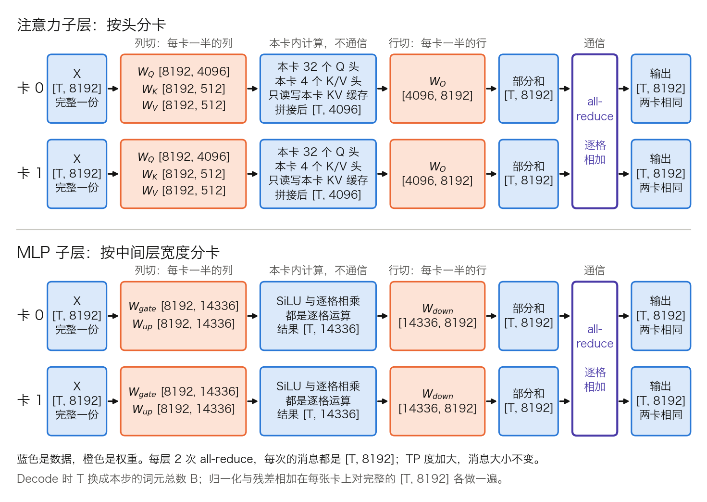

图 11-17：一层 Transformer 在张量并行下的数据流，形状取 Llama 3 70B、TP = 2（[生成脚本](https://github.com/yeasy/llm_internals/blob/main/tools/figures/ch11_8_tp_layer.py)）。蓝色是数据，橙色是权重，紫色竖条是 all-reduce。

- **注意力的 Q/K/V 投影**（列切，等于按头分卡：每卡 8 个 Q 头、1 个 K/V 头）
  - `X[T, 8192] × W_Q[8192, 1024] → Q[T, 1024]`
  - `X[T, 8192] × W_K[8192, 128] → K[T, 128]`，V 同理
- **本卡内的注意力**（只读写本卡的 KV 缓存，不通信）
  - 8 个头各自打分、读取，拼接后是 `[T, 1024]`
- **输出投影**（行切），然后第一次 all-reduce
  - `[T, 1024] × W_O[1024, 8192] → 部分和[T, 8192]`
- **MLP 的 gate 与 up**（列切），SiLU 与逐格相乘在本卡完成
  - `X[T, 8192] × W_gate[8192, 3584] → [T, 3584]`，`W_up` 同理
- **MLP 的 down**（行切），然后第二次 all-reduce
  - `[T, 3584] × W_down[3584, 8192] → 部分和[T, 8192]`

注意力天然适合这样切，因为各头之间本来就不交换数据（3.8.7 表 3-24）。归一化和残差相加的计算量很小，每张卡对完整的 `[T, 8192]` 各做一遍。嵌入表和 LM head 沿词表维切：每卡算出 `128256 ÷ 8 = 16,032` 个词元的 logits，再收集成完整的一行。

**对到实现。** Megatron-LM 把两种切法写成 `ColumnParallelLinear` 和 `RowParallelLinear` 两个模块。vLLM 的 Llama 实现沿用同一思路：

- 列切：`qkv_proj` 是 `QKVParallelLinear`，`gate_up_proj` 是 `MergedColumnParallelLinear`。
- 行切：`o_proj` 和 `down_proj` 是 `RowParallelLinear`，all-reduce 在它的末尾。
- 词表维切：嵌入是 `VocabParallelEmbedding`，输出是 `ParallelLMHead`。

读到这几个类名，就能判断一个矩阵是列切还是行切、all-reduce 发生在哪里。

**边界：相同只到数学为止。** 浮点加法不满足结合律。单卡把一行的各项依次加完，多卡先各自加出部分和再相加，次序不同，末位可能不同。同一个模型换一个 TP 度，logits 会有微小差异；贪心解码下，两个候选分数极近时，个别词元可能因此分叉。

### 8.3 每层两次 all-reduce：通信量怎么算

**消息有多大。** 每次 all-reduce 的消息就是部分和 `[T, d_model]`，与 TP 度无关；训练侧每层 4 次的账见 7.3.5，这里算推理侧每层 2 次：

$$
\text{单次消息} = T \times d_{\mathrm{model}} \times \text{每个数的字节数}
$$

Llama 3 70B 按 BF16，每个词元是 `8192 × 2 = 16,384` 字节，即 16 KiB。每层 2 次，一次前向 `2 × 80 = 160` 次，每个词元合计 `160 × 16 KiB = 2.5 MiB`。嵌入与 LM head 处另有各一次集合通信，相对 160 次可忽略。

**每张卡实际收发多少。** 常用的环形算法把 all-reduce 拆成两段。前一段各卡把消息切成 t 份，沿环传 `t − 1` 步，每步传一份并累加，结束时每张卡握有一份的总和。后一段再传 `t − 1` 步，把各份总和传遍所有卡。合计 `2(t − 1)` 步，每步传 `1/t`：

$$
\text{每卡发送量} = \frac{2(t-1)}{t} \times \text{单次消息}
$$

`t = 2` 时系数是 1，`t = 8` 时是 `14 ÷ 8 = 1.75`，t 再大也不超过 2。表 11-24 按 `t = 8` 算两个场景。

| 项目 | Prefill：一条 8,192 词元的 Prompt | Decode：64 个请求各走一步 |
| --- | ---: | ---: |
| 本次前向的词元数 | 8,192 | 64 |
| 单次 all-reduce 的消息 | 128 MiB | 1 MiB |
| 160 次合计 | 21.5 GB | 0.17 GB |
| 每卡发送量（乘 1.75） | 37.6 GB | 0.29 GB |
| 只算带宽的耗时，NVLink 单向 450 GB/s | 84 ms | 0.65 ms |
| 只算带宽的耗时，PCIe Gen5 单向 64 GB/s | 587 ms | 4.6 ms |
| 环形算法的通信步数 | `14 × 160 = 2,240` | 2,240 |

表 11-24：Llama 3 70B、TP = 8、BF16 下一次前向的 all-reduce 通信量。以 Prefill 一列为例：单次消息 `8192 × 16 KiB = 128 MiB`，160 次是 20,480 MiB 即 21.5 GB，乘 1.75 得 37.6 GB，除以 450 GB/s 得 84 ms。NVIDIA 标称 H100 的第四代 NVLink 为[每卡双向 900 GB/s](https://www.nvidia.com/en-us/data-center/technologies/hopper-architecture/)，并称这是 PCIe Gen5 的 7 倍以上；[PCIe Gen5 标称 128 GB/s](https://www.nvidia.com/en-us/data-center/h100/)，`900 ÷ 128 = 7.03`，按此推算，128 GB/s 也是双向口径，表中各按单向一半计。

这笔账可以与公开数字对照。[NVIDIA 的一篇技术博客](https://developer.nvidia.com/blog/nvidia-nvlink-and-nvidia-nvswitch-supercharge-large-language-model-inference/)称，Llama 3.1 70B 处理 8K 输入、256 输出的一个请求，每张卡要传出最多约 20 GB 的 TP 同步数据。按上式取 `t = 2`、共 8,448 个词元：`8448 × 16,384 × 160 = 22.1 GB`，即 20.6 GiB，量级吻合。

**通信占多大比例。** 按 3.8.8 的记法，与权重相乘的部分每个词元约 `2 × 参数量` 次运算，注意力的打分与读取每层约 `2T²d` 次。这条 Prompt 的 Prefill 中，前者是 `2 × 684.5 亿 × 8192 = 1.12 × 10¹⁵` 次。后者是 `2 × 8192² × 8192 × 80 = 0.09 × 10¹⁵` 次。两项合 `1.21 × 10¹⁵` 次。8 张 H100 按稠密 BF16 峰值 990 TFLOPs、50% 利用率估，约 0.31 s。NVLink 上通信 84 ms，约为计算的四分之一；PCIe 上 587 ms，是计算的 1.9 倍，多出来的卡大半时间在等数据。TP 通常只在同一个 NVLink 域内使用，原因在此；这个域有多大，取决于硬件（见 11.12 节）。

### 8.4 Prefill 看带宽，Decode 看延迟

表 11-24 的 Decode 一列里，带宽项只有 0.65 ms，远小于每步 5.3 ms 的读权重下界。只看带宽，Decode 的通信似乎可以忽略。实际并非如此，因为一次 all-reduce 的耗时有两项：

$$
\text{一次 all-reduce 的耗时} \approx \text{步数} \times \alpha + \frac{\text{每卡发送量}}{\text{带宽}}
$$

α 是每个通信步的固定开销，含内核启动、各卡对齐和链路延迟，与消息大小无关。Prefill 的消息是 128 MiB，第二项占绝对多数。Decode 的消息只有 1 MiB，第二项每次约 4 微秒，剩下的全是第一项。

第一项的关键是次数。环形算法每次 14 步，一个 Decode 步就是 2,240 个串行的通信步，固定开销合计 2,240α。α 取 10 微秒（示意值，实际取决于互连和通信库）时是 22.4 ms，约为读权重下界 5.3 ms 的 4 倍。这些步骤卡在每层的关键路径上，前一层的 all-reduce 没做完，后一层就不能开始，无法靠重叠隐藏。

由此得到三条推论。

- **小消息要换算法。** 环形算法省带宽，步数却随 t 增长。Decode 用的是步数固定的算法：各卡一次把自己的部分和发给所有卡，或借助交换芯片做多播。NVIDIA 在介绍 TensorRT-LLM MultiShot 的[博客](https://developer.nvidia.com/blog/3x-faster-allreduce-with-nvswitch-and-tensorrt-llm-multishot/)中把两者并列：环形是 `2N − 2` 步，MultiShot 恒为 2 步。`t = 8` 时 2,240 步降到 `2 × 160 = 320` 步，固定开销从 2,240α 降到 320α，是原来的七分之一。推理引擎为小消息自带定制的 all-reduce 内核，原因相同；vLLM 的定制内核只接管小于设定上限的消息，更大的仍走通用通信库。
- **TP 度加大，收益递减。** 计算时间按 `1/t` 缩短，all-reduce 的次数却固定为每层 2 次。t 从 4 加到 8，读权重下界从 10.5 ms 降到 5.3 ms，省下 5.2 ms；通信一项不降反升。批越小、模型越小，通信占比越高。
- **跨节点 TP。** Decode 对它最不宽容。跨节点网络的 α 比节点内高，每步再乘上 160 次。Prefill 跨节点损失的是带宽，还能靠大消息摊薄；Decode 损失的是延迟，无处可摊。

同一组卡做 Prefill 和做 Decode，合适的并行度因此不同。两个阶段分池部署后各选各的并行度，见 11.9 节。

### 8.5 KV 缓存跟着怎样切

**TP 下按 K/V 头切。** 11.8.2 的清单里，每张卡只算自己那几个头的 K 和 V，也就只缓存这几个头。Llama 3 70B 每个词元的 KV 缓存是 `2 × 8 × 128 × 80` 个数，BF16 下 327,680 字节，即 320 KiB。表 11-25 列出不同 TP 度下每张卡分到多少。

| TP 度 | 每卡的 K/V 头数 | 每卡每词元的 KV | 全组每词元合计 |
| ---: | ---: | ---: | ---: |
| 1 | 8 | 320 KiB | 320 KiB |
| 2 | 4 | 160 KiB | 320 KiB |
| 4 | 2 | 80 KiB | 320 KiB |
| 8 | 1 | 40 KiB | 320 KiB |
| 16 | 1（复制） | 40 KiB | 640 KiB |

表 11-25：Llama 3 70B 的 KV 缓存在不同 TP 度下的切分（BF16）。每卡每词元的 KV 等于 `2 × 每卡头数 × 128 × 80 × 2` 字节。

**边界一：头数上限。** 头是最小的切分单位，TP 度超过 K/V 头数就只能复制。`t = 16` 时 8 个 K/V 头不够分，每个头要在两张卡上各存一份，每卡的 KV 不再缩小，全组总量翻倍。vLLM 的注意力层按这条规则处理：K/V 头数不小于 TP 度时整除切分，小于时复制，每卡至少保留 1 个头。GQA 把 K/V 头数压到 8，也就把“KV 随 TP 等比缩小”的上限定在了 8。

**边界二：MLA。** MLA 无法按头切。DeepSeek-V3 的 MLA 每层只缓存一个 512 维的压缩向量和一个 64 维的位置分量（见 10.2 节），61 层合 `576 × 61 × 2 = 70,272` 字节，约 69 KiB。这个向量不分头，TP 组里每张卡都得存完整的一份：`t = 8` 时全组每词元 549 KiB，八分之七是重复的。SGLang 为此给 DeepSeek 模型的注意力部分改用数据并行，[其 v0.4 发布说明](https://lmsys.org/blog/2024-12-04-sglang-v0-4/)的理由正是 TP 会造成 KV 缓存重复。做法是每张卡各管一批请求、各存各的 KV，进 MoE 层之前再把词元汇到一起。

**PP 下按层切。** 每张卡只有自己那些层，也只缓存那些层的 K 和 V。`p = 4` 时每卡 20 层，每词元 80 KiB，与 `t = 4` 相同。

**容量的账。** 多卡不只是把权重摊薄，还把 KV 池合并了。以 8 张 80 GB 的 H100 部署 Llama 3 70B 为例，显存按 90% 可用（每卡 72 GB）、不计激活与工作区；GB 取 10⁹ 字节，KiB 取 1,024 字节：

- 两个 `t = 4` 的副本：每卡权重 35.3 GB，剩 `72 − 35.3 = 36.7 GB`，每词元 80 KiB。每个副本放 `36.7 × 10⁹ ÷ (80 × 1024) ≈ 44.8 万`个词元，两个副本合计 89.6 万。
- 一个 `t = 8` 的副本：每卡权重 17.6 GB，剩 `72 − 17.6 = 54.4 GB`，每词元 40 KiB，可放 `54.4 × 10⁹ ÷ (40 × 1024) ≈ 132.8 万`个词元。

同样 8 张卡，`t = 8` 的 KV 容量是前者的 1.48 倍，因为权重只存了一份。`t = 2` 则不可行：每卡权重 70.6 GB，只剩 1.4 GB。KV 池的块怎样分配见 11.4 节。

### 8.6 流水线并行：通信最少，时延不降

**机制。** 把 80 层平分给 p 张卡，每张卡称为一级。第 1 级算完自己的层，把 `[T, d_model]` 的中间表示发给第 2 级，依此类推；最后一级过 LM head 并采样。一次前向只有 `p − 1` 次点对点发送，没有集合通信。实现里常同时传隐藏状态与残差两个张量（vLLM 的 Llama 实现即如此），通信量翻倍，量级不变。

**通信量。** 每一级对每个词元只发一次 16 KiB；`p = 4` 时全组 3 次，合计 48 KiB。11.8.3 中 `t = 8` 是每卡 `1.75 × 2.5 MiB = 4.4 MiB`，合 `1.75 × 160 = 280` 个 16 KiB，是 PP 每卡发送量的 280 倍。PP 因此可以跨节点，也适合没有 NVLink 的机器。vLLM 的[并行与扩展文档](https://docs.vllm.ai/en/latest/serving/parallelism_scaling/)给出同样的建议：单节点放得下用 TP，放不下再叠加 PP；卡间没有 NVLink 时用 PP 代替 TP。

**代价一：时延。** 单个请求的时延不降：一个词元仍要依次走完全部 80 层，各级只是接力。`p = 4` 时每级读 35.3 GB 权重，下界 10.5 ms，四级合计 42.1 ms（按未舍入值 `4 × 10.53`），与 11.8.1 中单卡的数字相同；同样 4 张卡做 `t = 4`，每步是 10.5 ms 加通信。PP 换来的是容量和吞吐，TP 换来的是时延。

**代价二：气泡。** 流水线里若只有一个批，任一时刻只有一级在算，其余空转，如图 11-18 上半幅。自回归让情况更糟：批 A 的下一步要等上一步走完最后一级、采样出词元才能开始（3.8.1），无法提前进入第 1 级。

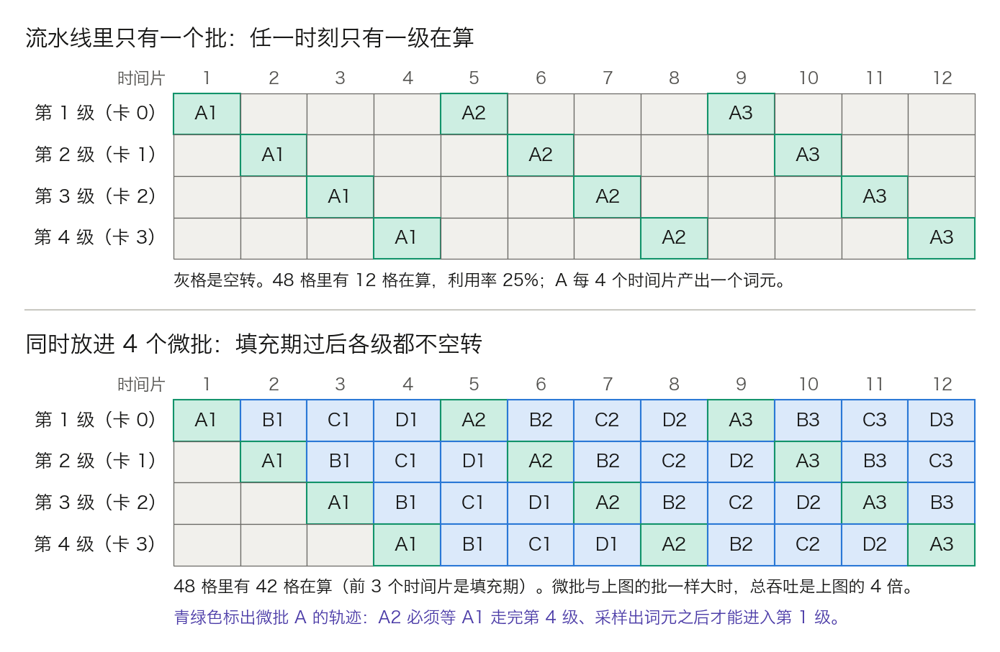

图 11-18：4 级流水线做 Decode 时，每个时间片里各级在为哪个微批计算（[生成脚本](https://github.com/yeasy/llm_internals/blob/main/tools/figures/ch11_8_pp_timeline.py)）。“A2”表示微批 A 的第 2 个 Decode 步；灰格是空转。

办法是同时放进多个**微批**（micro-batch）：把正在运行的请求分成 m 组，错开一个时间片依次进入。7.4 节给出一轮 m 个微批的气泡占比：

$$
\text{气泡占比} = \frac{p-1}{m+p-1}
$$

`p = 4` 时，`m = 1` 是 `3 ÷ 4 = 75%`，`m = 4` 是 `3 ÷ 7 = 43%`，`m = 16` 是 `3 ÷ 19 = 16%`。在线服务是连续运行的，图 11-18 下半幅中 4 个微批循环进入，填充期只出现一次，此后各级都不空转。每个微批的一步仍是 4 个时间片。每个微批若与上半幅的批一样大，总吞吐是上半幅的 4 倍；并发数受 KV 池限制时，微批只能取原来的 1/4 大小，Decode 的时间片又几乎不随批变小而缩短，收益相应缩小。

**边界：微批要等长。** 下半幅成立的前提是每格耗时相同。某个微批若混入一段 2,048 词元的 Prefill，它所在的那一格远长于纯 Decode 的格子，后面各级只能等，气泡重新出现。PP 因此依赖 11.3 节的词元预算和分块 Prefill，把各微批的工作量压到相近。m 个微批同时在途，KV 池要同时容纳它们，这就是上文吞吐收益打折的来源。

### 8.7 专家并行：把词元送到专家所在的卡

**机制。** MoE 层的每个词元由路由器选出 k 个专家（见 14.2 节）。EP 把专家分散到各卡，每张卡持有若干个完整的专家。一个 MoE 层的前向分三步：

1. **分发**（dispatch）：每张卡按路由结果，把词元的隐藏向量发给所选专家所在的卡。
2. **专家计算**：每张卡用本卡的专家处理收到的词元。
3. **合并**（combine）：把专家的输出发回词元原来所在的卡，按路由权重加权求和。

dispatch 和 combine 都是 **all-to-all**（全交换）：每张卡向其余每张卡各发一份内容不同的数据。它与 all-reduce 有两点不同：每一对卡之间的数据量由路由结果决定，事先不知道；各卡收到的总量也不相等。图 11-19 用一个 4 卡的例子画出这两点。

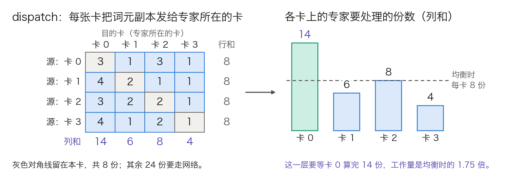

图 11-19：专家并行中一次 dispatch 的收发矩阵与各卡负载（[生成脚本](https://github.com/yeasy/llm_internals/blob/main/tools/figures/ch11_8_ep_all_to_all.py)）。示意设定：4 张卡各有 4 个词元，每个词元选 2 个专家；数值为手工设定。

**通信量。** DeepSeek-V3 的 `d_model = 7168`，61 层里后 58 层是 MoE 层，每层 256 个路由专家，每个词元选 8 个。DeepEP 的说明文档按 FP8 dispatch、BF16 combine 的口径测试，下面沿用。

- dispatch：每个词元最多发 8 份，每份 7,168 字节，合 57,344 字节，即 56 KiB。
- combine：8 份各 `7168 × 2` 字节，合 112 KiB。
- 每层 168 KiB，58 层合 `168 KiB × 58 = 9.5 MiB`。

这是上界：所选专家在本卡的部分不走网络，缩放因子等元数据未计入。与 Llama 3 70B 在 `t = 8` 下每词元 4.4 MiB 同一量级。

**延迟与带宽。** 结论与 11.8.4 相同：Decode 受延迟限制，Prefill 受带宽限制，只是原语换成了 all-to-all。

Decode 一侧，DeepEP 的[旧版说明](https://github.com/deepseek-ai/DeepEP/blob/main/docs/legacy.md)给出一组低延迟内核的实测：H800 加 400 Gb/s InfiniBand，每卡每批 128 个词元。每张卡的 dispatch 消息是 `128 × 56 KiB = 7 MiB`。8 卡 EP 下 dispatch 耗时 77 微秒、combine 114 微秒，256 卡 EP 下是 194 和 360 微秒。通信若不与计算重叠，乘 58 层，每个 Decode 步分别占 `191 微秒 × 58 = 11.1 ms` 和 `554 微秒 × 58 = 32.1 ms`。

Prefill 一侧，取同页常规内核的测试设定，每卡每批 4,096 个词元。dispatch 的消息是 `4096 × 56 KiB = 224 MiB`，combine 是 448 MiB。按该网卡约 50 GB/s 的带宽，每层约 `4.7 + 9.4 = 14.1 ms`，瓶颈回到带宽。DeepSeek-V3 报告的做法是同时处理两个微批，让一个微批的通信与另一个微批的计算重叠。

**为什么专家用 EP 而不用 TP。** DeepSeek-V3 的单个专家是三个 `7168 × 2048` 的矩阵，4,404 万参数，FP8 下 44 MB。用 `t = 8` 去切，中间层只剩 256 维，矩阵太窄，算不满运算单元。EP 保持专家完整，还把更多卡上的词元汇到同一个专家。平均每个专家分到“全组词元总数 × 8 ÷ 256”，即总数的 1/32：全组一步只有 64 个词元时，每个专家平均 2 个，读 44 MB 权重只为算 2 行；全组 8,192 个词元时每个专家 256 个。EP 组越大，全组词元越多，专家的矩阵乘法越接近算力受限。

**访存的账。** EP 还压低 Decode 的访存：每张卡每层要读的专家权重，上限是本卡专家数乘 44 MB。EP8 时每卡 `256 ÷ 8 = 32` 个专家，本卡专家全被选中时每层读 `32 × 44 MB = 1.41 GB`；按 H100 的 3.35 TB/s 是 0.42 ms，58 层合 24.4 ms。EP320 时每卡只放一个专家，每层读 44 MB，58 层合 0.76 ms。道理与 11.8.1 相同：卡数增加，显存带宽也加了起来。该报告在 Decode 用 EP320，每卡只放一个专家。其 3.4.2 指出，此时每个专家的批很小（通常不超过 256 词元），瓶颈在访存而非计算；MoE 部分只需加载一个专家的参数，访存开销极小，因此只给通信分配少量 SM 也不影响整体性能。Prefill 用 EP32，为的是上一段所说的专家批大小。两个部署单元的构成见 11.9 节的 11.9.6。

**边界：负载不均。** 图 11-19 中卡 0 收到 14 份，平均只有 8 份。combine 要等所有卡算完，这一层的耗时由最慢的卡决定。专家计算受算力限制时（如 Prefill），耗时与份数成正比，约为均衡时的 `14 ÷ 8 = 1.75` 倍。训练时的负载均衡手段只约束长期平均，管不了某一步的某一批。部署侧的补救是**冗余专家**：把高负载专家多放几份。DeepSeek-V3 报告在两个阶段都设了冗余专家，并按线上统计定期调整，数目见 11.9.6。运行时的均衡手段见 14.2.5。

### 8.8 怎样组合：一张对照表与三步判断

表 11-26 把四种方式并列；TP 与 PP 的通信量按每卡发送量计，EP 按每个词元收发的总量计。

| 方式 | 切什么 | 通信 | 每词元每次前向的通信量（算例） | 降低单请求时延 | 主要限制 |
| --- | --- | --- | --- | --- | --- |
| TP | 层内每个矩阵；KV 按头 | 每层 2 次 all-reduce，在关键路径上 | 每卡 4.4 MiB（Llama 3 70B，`t = 8`） | 是，按 `1/t` 缩短计算 | 通信延迟；头数要能被 t 整除；t 超过 K/V 头数后 KV 复制 |
| PP | 按层；KV 按层 | 级间点对点，`p − 1` 次 | 每卡 16 KiB（`p = 4` 时全组合计 48 KiB） | 否 | 气泡；微批要等长 |
| EP | MoE 层的专家 | 每个 MoE 层 2 次 all-to-all | 上界 9.5 MiB（DeepSeek-V3） | 部分：每卡要读的专家权重变少，Decode 每步访存下降；代价是每层两次 all-to-all 的延迟 | 负载不均；Decode 受延迟限制 |
| 副本 | 不切，整份复制 | 无 | 0 | 否 | 每份都要装得下 |

表 11-26：四种多卡方式的对照。通信量取自本节各算例。

确定并行度可按三步走。

1. **先保证装得下。** 每卡显存要容纳“权重 ÷ (t × p)”加上目标并发所需的 KV。用 11.8.5 的方法算出 KV 池能放多少词元，再除以每个请求的平均长度，得到并发数。
2. **再看时延目标。** 每词元时延达不到目标时加大 t，但不超出一个 NVLink 域，也尽量不超过 K/V 头数。需要的卡数超出一个域时，域内用 TP，域间用 PP。MoE 模型的专家层用 EP，注意力层用 TP 或数据并行。
3. **剩下的卡做副本。** 时延已达标后，继续加大 t 只会增加通信。多开副本可线性提高吞吐，故障影响面也更小。

vLLM 的参数与这几种方式一一对应：

- `--tensor-parallel-size`：TP 度。
- `--pipeline-parallel-size`：PP 度。
- `--data-parallel-size`：数据并行度，稠密模型下即副本数。
- `--enable-expert-parallel`：打开后专家层用 EP，EP 度等于 `TP × DP`；不打开时，专家层在同一个 `DP × TP` 组内按张量并行切。

各参数在引擎内部对应的组件见 11.10 节。

四个常见误解：

- “TP 加倍，速度加倍。” 只有计算时间按 `1/t` 缩短；通信次数不变，每次的步数或延迟还可能增加（11.8.4）。
- “PP 能降低每词元时延。” 每个词元仍要走完所有层，PP 只增加容量和吞吐（11.8.6）。
- “通信只看带宽。” Decode 的消息只有 MiB 量级，时间花在次数和固定延迟上；带宽数字只对 Prefill 有意义。
- “一个 TP 组里的卡彼此独立。” 组内各卡每层同步两次，任何一张卡变慢或出故障，整个副本都受影响；TP 组是调度和容错的最小单位。

上下文长到单卡连一个请求的 KV 或注意力计算都放不下时，还要沿序列维再切一刀，见 10.3 节的 10.3.5。

读完本节，应能不看正文回答下面五个问题；括号里是回看的位置。

1. MLP 的第一个矩阵为什么按列切、第二个按行切？反过来会多出什么？（11.8.2）
2. Llama 3 70B 在 `t = 8` 下，64 个请求各走一步 Decode，单次 all-reduce 的消息多大？这一步的通信时间为什么几乎与带宽无关？（表 11-24、11.8.4）
3. t 从 8 加到 16，每卡的 KV 为什么不再缩小？MLA 模型的注意力为什么改用数据并行？（11.8.5）
4. 同样 4 张卡，PP 与 TP 的每词元时延下界各是多少？差别从哪里来？（11.8.6）
5. EP 的一个 MoE 层耗时由哪张卡决定？冗余专家解决的是哪个问题？（11.8.7）

三种切法都在一个模型副本内部做文章，切完之后，Prefill 与 Decode 仍共用同一组卡、同一个并行度。这一层错配要靠把两个阶段分到两组实例上解决，见 11.9 节。

## 9. 分离式 Prefill-Decode 架构

11.3 节的分块 Prefill 让长 Prompt 不再独占一次前向，但 Prefill 块与 Decode 词元仍挤在同一张卡的同一步里，争同一份算力和带宽。**分离式推理**（Disaggregated Prefill-Decode）把两个阶段放到两组实例上，中间靠网络搬运 KV 缓存。本节回答三个问题：同卡混跑的代价有多大，搬 KV 要花多久，什么条件下分离才划算。

算例沿用 3.8.7 表 3-25 的 Llama 3 70B：80 层、`d_model = 8192`、`n_kv = 8`、`d_h = 128`，权重按 FP16 为 141.1 GB（逐项账见 11.8.1）。一个实例取 4 张 H100 做张量并行（TP4，见 11.8 节），4 卡显存带宽合计 `4 × 3.35 = 13.4 TB/s`。耗时都是上界口径的估算。Decode 按“每步读一遍权重和 KV”计。Prefill 按单卡稠密 BF16 峰值 990 TFLOPS（10.1 节）乘 40% 的利用率假设计，有效算力 `4 × 990e12 × 0.4 ≈ 1.58e15` FLOPs/s。通信与内核效率不计。

### 9.1 同卡混跑的代价

单实例架构里，一个请求的 Prefill 和 Decode 在同一组 GPU 上执行，由此带来三个问题：

1. **瓶颈不同**。Prefill 是计算密集型，算力先用满；Decode 是访存密集型，显存带宽先用满（3.8.8 的账）。同一张卡无法同时为两者选最优的批大小与并行度。
2. **延迟互相干扰**。一个 Prefill 块进入某一步，这一步里所有 Decode 请求都要等它算完。
3. **扩容粒度绑死**。长输入压的是 Prefill 算力与 KV 容量，长输出压的是 Decode 带宽与 KV 驻留时间；单实例只能整体加副本，不能只补短板。

**干扰有多大。** 设实例上有 32 条 4K 上下文的序列在 Decode。每个词元的 KV 是 `2 × 80 × 8 × 128 × 2 = 327,680` 字节，即 320 KiB；每条序列 `4096 × 320 KiB ≈ 1.34 GB`。纯 Decode 的一步要读 `141.1 + 32 × 1.34 ≈ 184 GB`，耗时 `184 GB ÷ 13.4 TB/s ≈ 13.7 ms`，其中权重读取 `141.1 ÷ 13.4 ≈ 10.5 ms`，KV 读取 `32 × 1.34 ÷ 13.4 ≈ 3.2 ms`。这就是这 32 个请求的词元间隔（TBT，定义见 11.13.1）。

现在让一个 2048 词元的 Prefill 块进入同一步。块的计算量约 `2 × 70e9 × 2048 ≈ 2.9e14` FLOPs，耗时 `2.9e14 ÷ 1.58e15 ≈ 181 ms`。这一步的耗时按“块的计算时间加 KV 读取”计：线性层的权重只读一遍，10.5 ms 的读取被 181 ms 的计算遮住；32 条序列的 Decode 注意力要各自读 KV，这 3.2 ms 不与块的矩阵乘法重叠。合计约 184 ms。表 11-27 列出不同块大小的结果。

| 同一步里的 Prefill 块 | 块的计算时间 | 这一步的耗时 | 相对纯 Decode |
| --- | ---: | ---: | ---: |
| 无 | — | 13.7 ms | 1 倍 |
| 512 词元 | 45 ms | 48 ms | 3.5 倍 |
| 2048 词元 | 181 ms | 184 ms | 13.5 倍 |
| 8192 词元 | 724 ms | 727 ms | 53 倍 |
| 32K 词元，不分块 | 3.78 s | 3.78 s | 277 倍 |

表 11-27：Prefill 块与 32 条 4K 序列的 Decode 同批时，一步被拉长多少（Llama 3 70B FP16、4 张 H100、利用率 40% 的上界估算）。“这一步的耗时”= 块的计算时间 + 3.2 ms 的 KV 读取，权重读取被计算遮住；11.3 节的表 11-6 按 Roofline 取计算与访存的较大值，口径略有不同。512 到 8192 三行只计线性项 `2 × 70e9 × 词元数`，块自身的因果注意力项分别占 0.5%、2%、8%，未计入。32K 一行计入了注意力的平方项：线性部分 `2 × 70e9 × 32768 ≈ 4.59e15`，因果注意力 `2 × 32768² × 8192 × 80 ≈ 1.41e15`，合计约 `6.0e15` FLOPs。

分块 Prefill 只能把干扰切碎，不能消除。若 TBT 上限定为 50 ms，块最大为 `(50 − 3.2) ms × 1.58e15 ÷ 1.4e11 ≈ 530` 词元。一个 32K 的 Prompt 只按线性项要 62 步、约 3.1 秒，比不分块的 2.9 秒多 7%；计入注意力项后块要随前缀变长而缩小，约 81 步、4.05 秒，比不分块的 3.78 秒同样多 7%。分块几乎不拉长 Prefill，代价落在 Decode 上。只要 Prefill 负载不断，每一步都带着块，32 个请求就长期按 50 ms 出词元（每流 20 词元/秒），而不是 13.7 ms（每流 73 词元/秒）。分离式架构要拿回的就是这一段差距。

### 9.2 分离后的一次请求：时序与交接

分离式架构把集群划成两个池：Prefill 池只做 Prefill，Decode 池只做 Decode。下面以 **Prefill 首词元直返**用户的实现为例，按五步说明；图 11-20 对应这一返回策略。

1. **选一对实例**。全局调度器为请求同时选定一个 Prefill 实例和一个 Decode 实例。Mooncake 把这个角色称为 Conductor，选择时兼顾三件事：能复用多少已有的前缀 KV、各实例的负载、TTFT 与 TBT 的 SLO（三个指标的定义见 11.13.1）。
2. **Prefill**。Prefill 实例对未命中前缀的部分做 Prefill，逐层写出 KV，并由最后一个位置的 logits 选出首词元（3.8.1）。代理在此策略下立即转发首词元，不等待 KV 交接完成。
3. **传输 KV**。KV 从 Prefill 实例搬到 Decode 实例。传输可以与计算重叠：第 ℓ 层的 KV 算完就发出，后面的层继续算。Splitwise 对短 Prompt 整体一次发送，对长 Prompt 逐层发送；Mooncake 则逐层流式写入目的节点。
4. **Decode 侧准入**。Decode 实例先为这个请求分配 KV 块（11.4 节），KV 收齐后请求进入连续批处理的运行队列。Mooncake 的本地调度器此时会再检查一次 TBT 的 SLO；若负载已变、无法满足，请求被拒绝，已做的 Prefill 作废。
5. **Decode**。此后与单实例无异，每步出一个词元，流式返回。

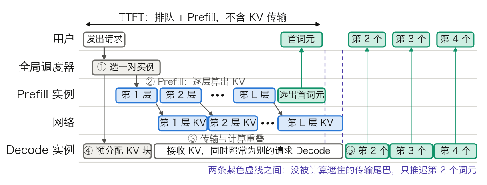

图 11-20：Prefill 首词元直返策略下的请求时间线（[生成脚本](https://github.com/yeasy/llm_internals/blob/main/tools/figures/ch11b_disagg_timeline.py)）。图中假设逐层传输能跟上 Prefill 计算且 Decode 侧无额外排队，因此传输的可见尾部落在第二个词元之前。

两个实现细节决定了这条时间线的形状。

**推还是拉。** Prefill 侧算完就推，Decode 侧可能被突发流量灌满显存。DistServe 改为由 Decode 实例按需拉取，把 Prefill 实例的显存当作排队缓冲；Prefill 实例保留这份 KV 直到被取走，其间照常处理别的 Prefill。

**传输开销落在哪个词元上。** 在首词元直返策略下，第二个词元要等 KV 到齐。Splitwise 的实测是：逐层传输时，未被计算遮住的传输时间在 A100 上约 8 ms、H100 上约 5 ms，第二个词元的延迟增加 16.5%；整体一次发送时增加 64%。这不是所有代理的通用行为：[LMCache 的 NIXL 1P1D 示例](https://docs.lmcache.ai/disaggregated_prefill/nixl/1p1d.html)先等待 Prefill 响应确认传输完成，再从 Decode 侧流出完整响应；此时交接就落在客户端 TTFT 内。压测和排障须同时记录返回策略与客户端计时边界。

传输失败时 Decode 侧有两种处理。以 vLLM 的 NIXL 连接器为例，`kv_load_failure_policy` 默认取 `fail`，直接让请求报错；取 `recompute` 则由 Decode 实例在本地重算这部分 Prefill。文档对后者给出警告：Decode 实例按低延迟配置，临时插入的 Prefill 会拖慢同批的所有 Decode，等于把 11.9.1 的干扰请了回来。

### 9.3 KV 传输要多久，和 Prefill 比贵不贵

**公式。** 传输时间等于 KV 字节数除以链路带宽，KV 字节数等于词元数乘每词元 KV 字节：

$$
t_{\text{传}} = \frac{T \times 2 \times L \times n_{kv} \times d_h \times \text{字节}}{W_{\text{net}}}
$$

**算例。** 32K 词元的 Prompt，Llama 3 70B：`32768 × 327,680 ≈ 10.7 GB`，即 10 GiB（FP16）；KV 用 FP8 存放则为 5 GiB。表 11-28 给出不同链路上的理想线速时间。

| 链路 | 单向带宽 | FP16 KV（10.7 GB） | FP8 KV（5.4 GB） |
| --- | ---: | ---: | ---: |
| 10 GbE | 1.25 GB/s | 8.6 s | 4.3 s |
| 100 GbE | 12.5 GB/s | 0.86 s | 0.43 s |
| 400 Gb/s InfiniBand，1 口 | 50 GB/s | 215 ms | 107 ms |
| 400 Gb/s InfiniBand，4 口并行 | 200 GB/s | 54 ms | 27 ms |
| 节点内 NVLink（H100，单向 450 GB/s） | 450 GB/s | 24 ms | 12 ms |

表 11-28：32K 词元的 KV 在不同链路上的传输时间，按理想线速计，未计协议开销。H100 的 NVLink 标称 900 GB/s 为双向合计，单向取一半。

**与 Prefill 本身比。** 同一个 32K 的 Prompt，Prefill 计算量约 `6.0e15` FLOPs（表 11-27 的注），4 张 H100 约 3.78 秒。单口 400 Gb/s 传 FP16 的 KV 要 215 ms，占 Prefill 的 5.7%；TP4 的四张卡各走一口网卡时是 54 ms，占 1.4%。换成 10 GbE 则是 8.6 秒，超过 Prefill 的两倍，分离的收益被传输吃光。DistServe 在 OPT-175B 上的实测与这个量级一致：KV 传输不到总延迟的 0.1%，95% 以上的请求传输时间低于 30 ms。

**速率判据。** 更通用的判据是比速率，不比单次时间。Prefill 实例每秒产生多少字节的 KV，网络就要每秒搬走多少：

$$
W_{\text{net}} \ge \text{Prefill 吞吐（词元/秒）} \times \text{每词元 KV 字节}
$$

本例 Prefill 吞吐约 `1.58e15 ÷ 1.4e11 ≈ 11,300` 词元/秒，乘 327,680 字节，约 3.7 GB/s，即 30 Gb/s。10 GbE 不够，100 GbE 有 3 倍余量，400 Gb/s 有 13 倍余量。链路速率高于这个值，逐层传输就能跟上计算，用户只会在末尾看到几毫秒的尾巴。DistServe 用同一种算法说明过这一点：OPT-66B 不用 GQA，512 词元的 KV 就有 1.13 GiB，10 请求/秒时要 90 Gbps 才能让传输不可见。

由此也能看出哪些模型结构天然适合分离。每词元 KV 字节越小，对网络的要求越低。Llama 3 70B 靠 GQA 降到 320 KiB。DeepSeek-V3 靠 MLA（10.2 节）每层只存 `512 + 64 = 576` 个数，61 层、BF16 合 `576 × 61 × 2 = 70,272` 字节，约 69 KiB，不到前者的四分之一；32K 词元只有 2.3 GB。

**工程手段。** 生产系统用下面几类做法压低传输开销：

- **RDMA 与 GPU 直通**：用 InfiniBand、RoCE 或节点内 NVLink，让数据从一侧显存直达另一侧显存，不经过 CPU 内存拷贝和内核协议栈。DistServe 在跨节点带宽不足的集群上，要求 Prefill 与 Decode 实例的同一流水段落在同一台机器里，KV 走节点内的 NVLink；上文“95% 低于 30 ms”的实测就出自这种放置。
- **逐层或分块流式传输**：见 11.9.2 的第 3 步，用计算时间遮住传输时间。
- **压缩 KV**：FP8 的 KV 让传输量减半；近期词元保留高精度、较早词元压到低精度的混合方案同理，收益按压缩比折算（KV 量化见 10.4 节）。
- **前缀 KV 池**：常见前缀的 KV 预先放在可共享的存储里，新请求只算、只传增量。Mooncake 用各节点的 CPU 内存和 SSD 组成全局 KVCache 池，Prefill 实例先从池里把命中的前缀载入显存，再对剩余部分做增量 Prefill。前缀复用的机制见 11.5 节。

### 9.4 两个池各配多少卡

分离之后，两个池的规模要按流量分别算。算错配比，一侧排队、另一侧空转，这是分离式架构最主要的运维代价。

**Prefill 池。** 单个请求占满一个实例，实例近似一个先到先服务的单服务台队列。DistServe 用 M/D/1 队列给出平均 TTFT，其中 D 是单请求的 Prefill 时间，R 是到达率，`RD` 是利用率：

$$
\text{TTFT}_{\text{avg}} = D + \frac{R D^{2}}{2\,(1 - R D)}
$$

第二项是排队时间，利用率趋近 1 时发散。因此 Prefill 实例不能按满负荷规划。

**Decode 池。** 约束是 KV 容量。在途序列数由 Little 定律给出：在途数 = 到达率 × 每请求的 Decode 时长 = 到达率 × 输出长度 × 每步耗时。在途数除以单实例能容纳的序列数，就是实例数。

**算例。** 到达率 10 请求/秒，平均输入 4000 词元、输出 500 词元。

- Prefill：单请求计算量 `2 × 70e9 × 4000 + 2 × 4000² × 8192 × 80 ≈ 5.8e14` FLOPs，`D ≈ 0.367 s`。利用率上限取 0.7，每实例可承接 `0.7 ÷ 0.367 ≈ 1.91` 请求/秒，需要 `⌈10 ÷ 1.91⌉ = 6` 个实例。此时实际利用率 0.61，平均 TTFT 为 `0.367 + 0.61 × 0.367 ÷ (2 × 0.39) ≈ 0.655 s`。
- Decode：KV 池为 `4 × 80 × 0.9 − 141.1 − 20 ≈ 127 GB`（显存利用率 0.9，每卡留 5 GB 工作区）。一条序列在途期间的平均长度是 `4000 + 500 ÷ 2 = 4250` 词元，合 1.39 GB，满池 `127 ÷ 1.39 ≈ 91` 条（向下取整）。满池时一步读 `141.1 + 127 ≈ 268 GB`，约 20 ms，每流 50 词元/秒。在途数 `10 × 500 × 0.020 = 100` 条，需要 `⌈100 ÷ 91⌉ = 2` 个实例。

配比是 6 : 2。把流量换成输入 500、输出 2000，同样的算法得到 Prefill `D ≈ 0.044 s`、1 个实例即可；Decode 每条平均 1500 词元、合 0.49 GB，满池 `127 ÷ 0.49 ≈ 258` 条，在途 `10 × 2000 × 0.020 = 400` 条，需要 2 个实例。配比翻成 1 : 2。

流量形态一变，最优配比就跟着变，固定配比迟早失衡。Mooncake 的公开实验给出了失衡的样子。同样 4 个实例，3 个 Prefill 加 1 个 Decode 的配置在满足 SLO 的前提下吞吐高于 vLLM 基线。2 加 2 的配置 TBT 更低，TTFT 却不如前者，也不如基线，论文给的原因正是两侧负载不均。生产系统因此需要能在运行时增减两侧的实例数；NVIDIA Dynamo 称之为运行时可重配置的 xPyD。

**收益的来源。** DistServe 的图 1 是一个干净的例子：13B 模型、单张 A100，合置时满足 SLO 的最大到达率是 1.6 请求/秒；只做 Prefill 的卡可达 5.6，只做 Decode 的卡可达 10。配 2 张 Prefill 加 1 张 Decode，三张卡共 10 请求/秒，每卡 3.3，是合置的 2.1 倍。这里的收益以 **Goodput**（满足 SLO 的最大到达率，见 11.13.2）计，不是原始吞吐。

**选卡。** 两个池买的不是同一种资源。Prefill 受算力约束，买的是 FLOPS；Decode 受访存约束，买的是显存带宽与容量。11.12 节的表 11-35 里，H100 与 H200 的稠密算力同为约 990 TFLOPS。H200 的升级全部落在显存上：80 GB、3.35 TB/s 变为 141 GB、4.8 TB/s。这部分溢价对 Prefill 几乎不兑现，对 Decode 直接兑现：把 H200 投给 Decode 池，Prefill 池用算力达标的卡即可。Splitwise 由此更进一步，主张 Decode 不需要最新一代的算力，可以用上一代的卡或限功耗运行，其异构方案用 H100 做 Prefill、A100 做 Decode。

这条法则针对的是同代之内的溢价。B200 相对 H100，稠密算力 2250 对 990 TFLOPS，带宽 8 对 3.35 TB/s，两样同时翻倍有余，两个池都适用；这时要比的是单位成本下各自的算力与带宽（算法见 11.12.7）。L40S 这类卡显存 48 GB、带宽 864 GB/s，只适合较小的模型。

### 9.5 什么时候不该分离

分离不是免费的：多一次 KV 传输，多一层调度，而且 Prefill 池的显存不参与 Decode。下面几种情形，合置加分块 Prefill 更好。

- **并发很低**。两个池各自都有空转，合置实例没有传输和池间碎片的开销。
- **要的是吞吐而不是尾延迟**。vLLM 文档对这一点说得很直接：分离式 Prefill 不提升吞吐，它的用处是分别调 TTFT 与词元间隔，并压住词元间隔的尾部。
- **Decode 侧的 KV 容量才是瓶颈**。此时把 GPU 划给 Prefill 池，总服务能力反而下降，除非延迟上的收益抵得过这些 GPU。
- **网络达不到 11.9.3 的速率判据**。

**条件分离。** 同一个集群里，不同请求可以走不同路径。**条件分离**（Conditional Disaggregation）由路由器逐请求决定走哪条。一条是“Prefill 实例 → Decode 实例”；另一条是直接发给 Decode 实例，由它在本地做完 Prefill 再 Decode。NVIDIA Dynamo 的判据可以概括为三条：

- **看有效输入长度**。有效输入长度 = Prompt 长度 − 所选 Decode 实例上已缓存的前缀长度。它低于一个绝对阈值，且占 Prompt 长度的比例低于一个比例阈值时，在 Decode 实例本地做 Prefill（`isl_bounding` 策略）：要算的很少，11.9.1 的干扰很小，还省掉一次传输。多轮对话和智能体负载的前缀大多已在 Decode 实例上，最适合这条路径。
- **看 Prefill 池是否繁忙**。所选 Prefill 实例的负载超过阈值时改走本地（`prefill_load` 策略）；`isl_or_load` 策略把这一条与有效输入长度的条件取或。
- **看 Decode 实例是否繁忙**。所选 Decode 实例的 KV 占用超过阈值时，不再往它身上加本地 Prefill，请求回到远端 Prefill 的常规路径。

阈值必须按自己的流量分布调，文档建议以有效输入长度的分位数为起点。Dynamo 的架构文档同时提醒，Prefill 的饱和点随模型、量化、GPU 和长度分布变化，不应写死成一个通用的词元数。

**判据小结。** 分离划算，需要同时满足四个条件。TBT 的 SLO 紧到分块 Prefill 也压不住（表 11-27）。网络速率高于 Prefill 的 KV 产生速率并留有数倍余量。规模足够大，两个池各自都能保持较高利用率。流量形态稳定，或有能力动态调整配比。

### 9.6 两侧用不同的并行度

分离之后，两个池可以各选并行策略，Prefill 与 Decode 的张量并行度不必相同。vLLM 的连接器兼容性文档把这种配置记作 Hetero TP。

**各自偏好什么。** Decode 每步要读完整的权重，加大 TP 等于把带宽和显存成倍加起来，KV 池也更大，能容纳更多在途序列。Prefill 的情形取决于负载。DistServe 用上面的 M/D/1 公式比较了两种 2 路并行。到达率低时，执行时间是主项，层内并行（张量并行）把 D 缩短到 `D/K`（`1 < K < 2`，通信使加速不完美），TTFT 更低。到达率高时，排队是主项，层间并行（流水线并行）把服务率近似翻倍，反而更优。“Prefill 用低 TP、Decode 用高 TP”因此只是常见结果，不是定则。

**KV 要重新分片。** 张量并行按头切分 KV（11.8.5 的表）：Llama 3 70B 在 TP4 下每卡 2 个 KV 头、每词元 80 KiB，TP8 下每卡 1 个头、40 KiB。Prefill 用 TP4、Decode 用 TP8 时，Prefill 侧每张卡上的 KV 要按头拆成两半，分别发往 Decode 侧的两张卡；传输层因此必须知道两侧的切分方式，KV 在块内的维度排列也要允许按头切开。TP 超过 `n_kv` 后 KV 头只能复制，Decode 侧靠加大 TP 扩 KV 池的做法以 `n_kv = 8` 为上限。MLA 的压缩 KV 不分头，每张卡各存一份完整副本，两侧 TP 不同也无须拆头，接收侧只读一份即可。

**专家并行在两个阶段的差别。** MoE 模型还要选专家并行度。两个阶段的路由规则相同，都是逐词元独立选专家；差别在每一步的词元数。按 11.8.7 的账，DeepSeek-V3 每个词元过一遍 58 个 MoE 层要搬约 10 MB。Prefill 一步处理 32K 词元，全组要搬 300 GB 以上，受带宽约束；Decode 一步若只有 256 个词元，总量约 2.6 GB，却分成 116 次 all-to-all，每次消息很小，受延迟约束。

DeepSeek-V3 技术报告公开的部署正是按这一差别分别设计的，见表 11-29：

| 项目 | Prefill | Decode |
| --- | --- | --- |
| 最小部署单元 | 4 节点、32 张 GPU | 40 节点、320 张 GPU |
| 注意力部分 | TP4 加序列并行，DP8 | TP4 加序列并行，DP80 |
| MoE 部分 | EP32 | EP320，每卡只放 1 个专家 |
| 冗余专家 | 32 个，每卡在原有 8 个专家之外多放 1 个 | 64 张卡专门承载冗余专家与共享专家 |
| all-to-all 路径 | 跨节点走 IB，节点内走 NVLink 转发 | 经 IB 点对点直连，并用 IBGDA 压低延迟 |

表 11-29：DeepSeek-V3 技术报告 3.4 节公开的推理部署单元。

第一，EP32 与 EP320 的取舍见 11.8.7 的“访存的账”：Prefill 要让每个专家分到足够大的批，Decode 要让每张卡只读一个专家的权重。第二，两侧的注意力都只用 TP4。Prefill 侧报告给的理由是小 TP 限制通信开销；Decode 侧同样取 TP4，且 MLA 的 KV 在 TP 组内每卡各存一份（11.8.5），加大 TP 也扩不了 KV 池。第三，冗余专家（11.8.7）按线上统计的专家负载定期调整（报告举例为每 10 分钟一次），把高负载专家多放几份，否则最忙的那张卡决定整步的耗时。

### 9.7 对到实现

- **vLLM**：分离式 Prefill 的实现是两个 vLLM 实例加一个连接器（connector）。启动参数 `--kv-transfer-config` 里，`kv_connector` 选连接器，`kv_role` 取 `kv_producer`（Prefill 实例）或 `kv_consumer`（Decode 实例）。连接器分成两半：与调度器同进程的一半决定传哪些块，各 worker 进程里的一半执行传输，并与注意力层配合实现逐层存取。请求级的交接信息放在 `kv_transfer_params` 里，如 `do_remote_decode`、`do_remote_prefill`。文档标明该特性仍为实验性质。
- **NVIDIA Dynamo**：路由由 `PrefillRouter` 编排，KV 经 NIXL 在两侧显存之间直传，由它选用 NVLink、InfiniBand 等可用的传输。各后端的交接元数据不同：vLLM 传块 ID 与远端连接信息，SGLang 传用于 RDMA 握手的 `bootstrap_info`。
- **Mooncake**：全局调度器 Conductor、每节点一个负责传输的 Messenger 进程，以及由 CPU 内存和 SSD 组成的 KVCache 池。过载时采用基于预测的早拒绝，见 11.13.4。

连接器清单、参数名与默认阈值变化很快，以各项目当前文档为准。

## 10. 实例剖析：vLLM

11.2 到 11.9 节逐个讲了机制：调度循环、KV 块、前缀复用、多 LoRA、约束解码、多卡并行、分离式部署。本节把它们对到一个真实引擎上，回答三个问题。一个请求从 HTTP 接口到吐出词元要经过哪些组件；每种机制落在哪个模块、哪个数据结构里；启动参数各自调的是哪一个机制。机制本身不再重讲，只给出处。

文中的模块名、参数名和默认值均取自 vLLM v0.29.0（标签对应提交 `98dff2a`）的[源码](https://github.com/vllm-project/vllm/tree/v0.29.0)，指的是其 V1 引擎，即 `vllm/v1/` 目录。vLLM 内部结构变动很快，换一个版本，名字和默认值都可能不同；数据流和取舍则稳定得多，读别的版本时按职责去找对应物即可。算例沿用 3.8.7 表 3-25 的 Llama 3 8B：32 层、`d_model = 4,096`、`n_kv = 8`、`d_h = 128`，权重与 KV 缓存均为 BF16。硬件取一张 H100，显存总量按 80 GiB 计，启动参数只加 `--max-model-len 32768`。

### 10.1 三类进程：一个请求经过哪里

`vllm serve` 启动的不是一个进程，而是三类：API 服务进程、引擎核心进程、GPU worker 进程。图 11-21 画出它们各自的组件和一个请求的往返路径。

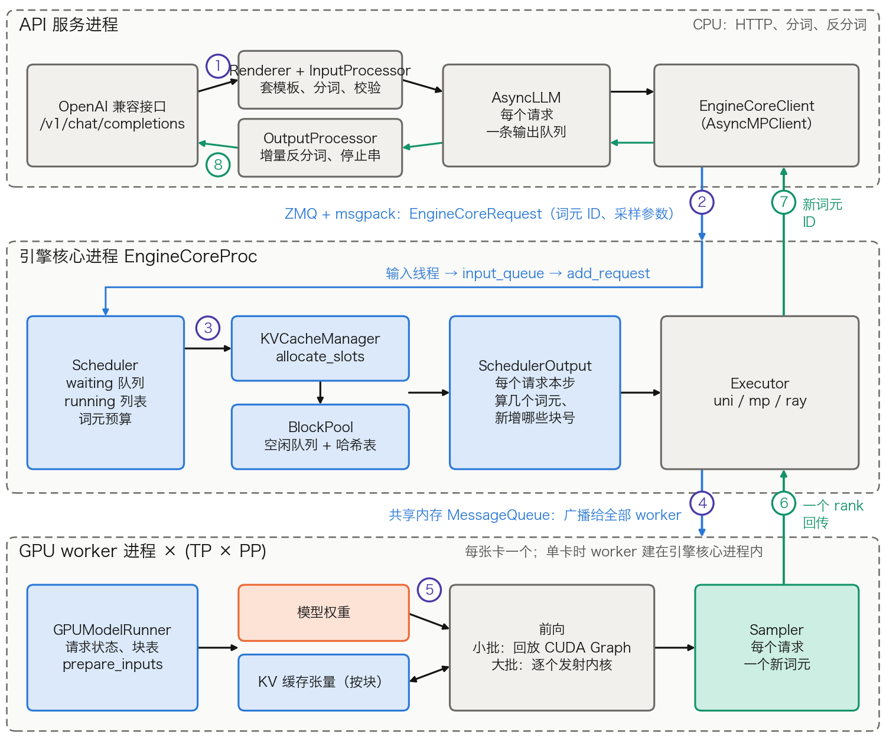

图 11-21：一个请求在 vLLM 三类进程之间的路径（[生成脚本](https://github.com/yeasy/llm_internals/blob/main/tools/figures/ch11_10_vllm_request_path.py)）。蓝色是随请求变化的数据与管理它的结构，橙色是权重，青绿色是本步新产出的词元及其回程；编号对应下文的八步。

1. **输入处理。** API 服务进程收到 HTTP 请求，由 `Renderer`（`vllm/renderers/`，`render_chat`）套聊天模板并分词（见 3.8.2），得到词元 ID 序列。`InputProcessor` 校验采样参数、LoRA 与长度，组装成 `EngineCoreRequest`。
2. **跨进程提交。** `AsyncLLM` 为请求建一条输出队列，`EngineCoreClient` 把 `EngineCoreRequest` 用 msgpack 序列化，经 ZMQ 套接字发给引擎核心进程。过线的是词元 ID、采样参数、可选的 LoRA 与缓存盐，不含文本。
3. **调度。** 引擎核心的输入线程把请求放进 `input_queue`，主线程的忙循环 `run_busy_loop` 取出它交给 `Scheduler.add_request`。此后循环反复执行一步：`schedule()`、`execute_model()`、`update_from_output()`。默认开启异步调度，这一步是 `step_with_batch_queue()`，否则是 `step()`。`schedule()` 向 `KVCacheManager` 申请块，产出一份 `SchedulerOutput`。
4. **下发。** `Executor` 把 `SchedulerOutput` 交给 worker。多卡时默认用 `MultiprocExecutor`，经共享内存消息队列一次广播给全部 worker；单卡时默认用 `UniProcExecutor`，worker 直接建在引擎核心进程内，没有这次传递。
5. **前向与采样。** 每个 worker 的 `GPUModelRunner` 更新本地的请求状态与块表，拼出一批输入，跑前向，为每个请求采样一个新词元（11.10.5）。
6. **回传。** 张量并行的各 rank 结果相同，只有最后一个流水级的 TP rank 0 把 `ModelRunnerOutput` 传回。
7. **更新。** `update_from_output()` 把新词元记到请求上，检查 EOS、停止词元和长度上限，释放已结束请求的块；新词元 ID 经输出线程和 ZMQ 回到 API 服务进程。
8. **反分词与流式输出。** `OutputProcessor` 做增量反分词，匹配停止字符串，把文本放进该请求的输出队列，由 HTTP 层流式返回。

**为什么拆进程。** 分词、反分词和 HTTP 序列化都是 CPU 工作，与 GPU 前向无关。拆出去后，引擎核心的忙循环里只剩调度与收发；官方架构文档给的理由是分离职责、提高吞吐。代价是多一次序列化和进程间传递，所以过线的对象都很小。[官方架构文档](https://github.com/vllm-project/vllm/blob/v0.29.0/docs/design/arch_overview.md)给出的进程数是“API 服务数 + 引擎核心数 + GPU 数”。`-tp 4` 的单机部署为 `1 + 1 + 4 = 6` 个。数据并行时每个 DP rank 一个引擎核心，另加一个协调进程，`-tp 2 -dp 4` 为 `4 + 4 + 8 + 1 = 17` 个。物理核数少于进程数时，吞吐和延迟都会明显变差；引擎核心的忙循环对 CPU 饥饿最敏感（见[优化文档的 CPU 资源一节](https://github.com/vllm-project/vllm/blob/v0.29.0/docs/configuration/optimization.md#cpu-resources-for-gpu-deployments)）。

### 10.2 启动时：KV 池有多大

11.4 节给出显存预算的算法，vLLM 把它做成启动时的一次实测，顺序固定：

1. 加载权重。
2. 用假输入跑一次最大批的前向（`profile_run`，批内有 `max_num_batched_tokens` 个词元），记录显存峰值。
3. 算出能给 KV 的字节数，换成块数。
4. 一次性分配全部块。
5. 捕获 CUDA Graph 并预热。

第 3 步由 `gpu_worker.py` 的 `determine_available_memory` 完成，算的是：

$$
M_{\mathrm{KV}} = u \cdot M_{\mathrm{total}} - M_{\mathrm{weights}} - M_{\mathrm{peak}} - M_{\mathrm{graph}}
$$

其中 u 是 `gpu_memory_utilization`，默认 0.92；后两项是实测的前向峰值和 CUDA Graph 的显存估计。用实测而不用公式，是因为前向峰值取决于具体内核的工作区、编译后的算子融合和采样器的缓冲区，静态估算既难写全，也会随版本失效。实测一次最大批，得到的就是运行时前向峰值的上界。块数再由 `kv_cache_utils.py` 取整：

$$
N_{\mathrm{blocks}} = \left\lfloor \frac{M_{\mathrm{KV}}}{2 \times n_{kv} \times d_h \times \text{每数字节} \times \text{块大小} \times L} \right\rfloor
$$

代入 Llama 3 8B：

- **权重。** 8,030,261,248 个参数（逐项见 11.4.1），BF16 下 16,060,522,496 字节，即 14.96 GiB。
- **每块字节数。** `2 × 8 × 128 × 2 字节 × 16 词元 × 32 层 = 2,097,152` 字节，即 2 MiB；折合每词元 131,072 字节，正是 3.8.8 算出的 65,536 个数乘 2 字节。
- **KV 池。** 可用上限 `0.92 × 80 = 73.6 GiB`。后两项要看实测，这里示意取 2.64 GiB，则 `73.6 − 14.96 − 2.64 = 56 GiB`，`56 × 1024 ÷ 2 = 28,672` 块，可容纳 `28,672 × 16 = 458,752` 个词元。11.4.1 的 411,525 个词元用的是十进制 80 GB、`u = 0.9`、留 2 GB；这里按 vLLM 日志的口径用 GiB 和默认的 0.92。

启动日志会打印这两个数。一是 `GPU KV cache size: 458,752 tokens`。二是 `Maximum concurrency for 32,768 tokens per request: 14.00x`，即 `28,672 ÷ (32,768 ÷ 16)`。调容量先看这一行。

四点容易看错：

- `gpu_memory_utilization` 是本实例可用显存占总量的比例，权重也算在内，不是 KV 池占比。启动时空闲显存不足这个数，直接报错退出。
- `max_num_batched_tokens` 越大，`profile_run` 的峰值越高，留给 KV 的越少。
- `14.00x` 是所有请求都跑满 32,768 个词元时的下限；实际并发由真实长度决定，并受 `max_num_seqs` 封顶。
- `--kv-cache-dtype fp8` 让每块降到 1 MiB，块数翻倍到 57,344；`--kv-cache-memory-bytes` 可跳过上式直接指定字节数。

### 10.3 调度器：没有阶段，只有“还差几个词元”

调度器不分 Prefill 与 Decode 阶段，每个请求只记已算与应算两个词元数，字段名与源码注释见 11.3.1。

`Scheduler.schedule()` 的顺序就是 11.3.2 的第 2 到第 4 步，抢占谁、怎样恢复见 11.3.5。实现上多出四处细节：

- **要块。** `running` 里每个请求取 `min(差额, 剩余预算)` 个词元，再调 `KVCacheManager.allocate_slots`。返回 `None` 即抢占一个请求后重试，循环到块够用，或被抢占的就是自己为止。
- **接纳 `waiting` 队列。** 除请求数上限 `max_num_seqs` 外，还检查同批 LoRA 数上限 `max_loras`。首次调度的请求先查前缀缓存，命中的词元直接记入已算词元数，不占预算。
- **全量与增量。** `SchedulerOutput` 里，新请求带全量数据 `NewRequestData`（词元 ID、采样参数、块号），老请求只带增量 `CachedRequestData`（新增块号、已算词元数）。
- **词元留在 worker。** 不用流水线并行时，采样出的词元在 worker 上留有一份，调度器不必随 `SchedulerOutput` 把它送回去。

11.3 节的状态机在 `RequestStatus` 里有对应的枚举。排队的状态有四种：

- `WAITING`：普通排队。
- `WAITING_FOR_STRUCTURED_OUTPUT_GRAMMAR`：等语法编译。
- `WAITING_FOR_REMOTE_KVS`：等远端 KV 传完（分离式部署，11.9 节）。
- `WAITING_FOR_STREAMING_REQ`：等流式输入的下一段。

后三种状态的请求被调度器临时跳过，不会挡住排在后面的普通请求。在批里的只有 `RUNNING`，被抢占的是 `PREEMPTED`。其后的取值都表示结束，并记录停止原因：遇到停止词元、达到长度上限、被客户端中止、出错等。

因此同时生效的约束有三个：每步词元预算 `max_num_batched_tokens`、请求数 `max_num_seqs`、空闲块数。vLLM 里没有固定槽位。前两项的默认值按显存分三档（在线服务入口）：

- 不低于 160 GiB：16,384 / 1,024。
- 不低于 70 GiB 且不是 A100：8,192 / 1,024。
- 其余：2,048 / 256。

**算例。** 本节的 GPU 落在中间一档。设 `running` 里有 40 个 Decode 请求，新到一个 20,000 词元的请求，前 4,096 个词元（256 块）命中前缀缓存。

- **准入。** `scheduler_reserve_full_isl` 默认开启，要求整条序列放得下：`⌈20,000 ÷ 16⌉ = 1,250` 块，减去命中的 256 块，需要 994 个空闲块。命中的块若引用计数为 0，也得从空闲队列里摘走，同样计入需求。
- **第 1 步。** 40 个 Decode 用掉 40，预算剩 `8,192 − 40 = 8,152`；新请求差额 `20,000 − 4,096 = 15,904`，取 8,152。分配 `⌈(4,096 + 8,152) ÷ 16⌉ − 256 = 766 − 256 = 510` 块。本批 8,192 个词元、41 个请求。
- **第 2 步。** 剩余 `15,904 − 8,152 = 7,752`，加 40 个 Decode，共 7,792 个词元；Prefill 完成，采出首词元。
- **第 3 步起。** 41 个 Decode，每步 41 个词元。

首词元等 2 步；没有前缀命中则是 `⌈20,000 ÷ 8,152⌉ = 3` 步。代价落在那 40 个老请求上：这两步各是一次约 8,000 词元的前向，它们的词元间隔被拉长到同样的时间。`max_num_batched_tokens` 调大，首词元和吞吐受益，词元间隔的抖动变大；调小则相反。`long_prefill_token_threshold` 可以单独限制一个请求每步最多占多少预算。

**抢占。** 只走重算，原因见 11.4.5。被抢占请求写满的块带着哈希留在空闲队列尾部；再次调度时按前缀命中拿回，实际重算量常远小于整条序列。`--kv-offloading-size` 走 KV connector，给前缀缓存加一层主机内存，不是抢占路径。

**异步调度。** `async_scheduling` 默认开启，遇到不兼容的配置自动关闭。第 N 步的前向还在 GPU 上跑，调度器就开始排第 N+1 步。做法是给每个 Decode 请求记一个输出占位（`num_output_placeholders`），假定它会再产出一个词元；真实的词元 ID 留在 worker 的 GPU 上供下一步直接使用。收益是消除两步之间 GPU 等 CPU 的空隙。代价是请求若在第 N 步结束，第 N+1 步为它预排的位置作废，其输出被 `update_from_output` 跳过；长度上限可以预知，调度器会跳过这种多余的一步。

约束解码（11.7 节）也接在这个循环上。每一步先以非阻塞方式发出 `execute_model`；GPU 算前向的同时，引擎核心在 CPU 上算本步的词元掩码（`get_grammar_bitmask`），前向结束后随 `sample_tokens` 一起送到 worker。语法尚未编译完的请求停在 `WAITING_FOR_STRUCTURED_OUTPUT_GRAMMAR` 状态，不进批。

### 10.4 KV 块管理：一条队列兼做分配器与 LRU

11.4 节的块表和 11.5 节的链式哈希，在 vLLM 里落在同一组数据结构上（`vllm/v1/core/block_pool.py` 与 `kv_cache_utils.py`）：

- `KVCacheBlock`：块号 `block_id`、引用计数 `ref_cnt`、块哈希，以及前后两个空闲链表指针。它只是元数据，存在引擎核心进程的 CPU 内存里；KV 张量在 worker 的显存里，两边只靠块号对应。
- `FreeKVCacheBlockQueue`：空闲块的双向链表，指针直接长在块对象上，从中间摘除一块是 O(1)。Python 自带的 deque 做不到这一点，这是自己实现链表的原因。
- `cached_block_hash_to_block`：块哈希到块的映射。
- `null_block`：0 号块，启动时就从队列取走，只作占位，所以可分配的是 `N_blocks − 1` 块。

关键设计是：引用计数归零的缓存块不另行存放，就留在空闲队列里，“空闲”和“已缓存”不互斥。由此，前缀缓存不额外占显存，用的是暂时没人要的块；淘汰也没有单独的流程，分配器从队首取到带哈希的块，把哈希从表里删掉，就完成了淘汰。图 11-22 用 9 个块走一遍。

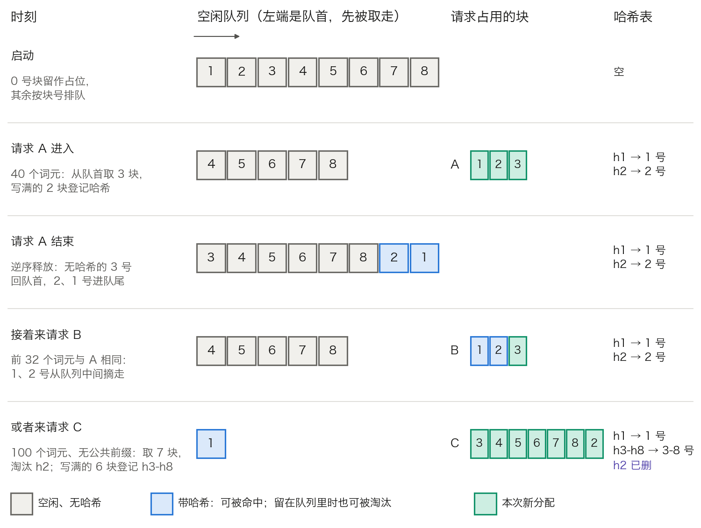

图 11-22：空闲块队列兼做分配器与前缀缓存的 LRU（[生成脚本](https://github.com/yeasy/llm_internals/blob/main/tools/figures/ch11_10_vllm_free_queue.py)）。块大小 16 个词元；每一行的队列内容由脚本按 `BlockPool` 的规则算出，最后两行是“请求 A 结束”之后的两种走向。

淘汰顺序由三条规则决定，前两条的理由见 11.5.2：

- **逆序释放。** 链尾先入队；图中 2 号排在 1 号之前，请求 C 淘汰的是 `h2`，公共前缀 `h1` 保住了。
- **入队位置。** 带哈希的块追加到队尾；无哈希的块不可能被命中，插回队首先复用，免得淘汰有用的缓存。
- **命中即 `touch`。** 引用计数加 1，块若还在队列里就从中间摘走；图中请求 B 拿回 1、2 号，只新取 3 号一块。

哈希键由 `hash_block_tokens` 计算，输入是三元组“父块哈希、本块词元、附加键”，首块的父哈希是一个固定种子。哪些因素进附加键、`cache_salt` 怎样隔离租户、默认为何是 `sha256`，见 11.5.7 的表 11-17 与“隔离”一段。这个版本另把 prompt embeds 的哈希放进附加键，并提供更快但不抗碰撞的 `xxhash` 选项。只有写满的块进哈希表，命中上限按块对齐（11.5.2）：图中请求 A 的 40 个词元只能被命中 32 个。请求要 prompt logprobs 时跳过缓存读取，它需要每个位置的 logits。

**worker 侧的块表。** `BlockTables`（`vllm/v1/worker/gpu/block_table.py`）持有两组预分配的张量。一是 `block_tables[max_num_reqs, 每请求最大块数]`（int32），每个 KV 组一张，纯全注意力模型只有 1 组。本例为 `[1024, 2048]`：`max_num_seqs = 1,024`，`⌈32,768 ÷ 16⌉ = 2,048`，占 `1,024 × 2,048 × 4 字节 = 8 MiB`。二是 `slot_mappings[KV 组数, max_num_batched_tokens]`（int64）。每个词元的写入槽位是“块号 × 块大小 + 块内偏移”，由 Triton 内核 `_compute_slot_mappings_kernel` 在 GPU 上算出。设某请求块表行为 `[7, 3, 12]`：位置 37 落在第 `⌊37 ÷ 16⌋ = 2` 个逻辑块（从 0 数起）、块内偏移 `37 − 32 = 5`，槽位为 `12 × 16 + 5 = 197`。新算出的 K、V 按槽位写入，注意力内核按块表读取。

### 10.5 worker 的一步与 CUDA Graph

**拼批。** 默认的 model runner 是第二套（`vllm/v1/worker/gpu/model_runner.py`，与引擎的 V1 编号无关，见 11.10.7）。它的 `prepare_inputs` 把全部请求本步的词元摊平成一维：`input_ids[N]`、`positions[N]`、`slot_mapping[N]`，外加 `query_start_loc[请求数 + 1]` 标出每个请求的起止。线性层对 `[N, d_model]` 统一计算；注意力按 `query_start_loc` 和块表分请求计算，这就是 11.2 节说的迭代级批处理。LM head 只取每个请求最后一个词元那一行（`logits_indices`；无投机解码时每请求 1 行，`total_num_logits = num_reqs`）。上文第 1 步的形状是：

- 各层：`hidden[8192, 4096]`
- 取行：`hidden[8192, 4096] → [41, 4096]`
- LM head：`[41, 4096] × W_vocab[4096, 128256] → logits[41, 128256]`

Prefill 尚未完成的请求也占 logits 的一行，采样计数记 0，结果不记入请求，这样批内不必分支。从调度器看，这就是 11.3.2 第 6 步的“不采样”。

**CUDA Graph 解决什么。** Decode 一步的 GPU 计算量很小（3.8.8 表 3-29：GPT-3 Small 每读 1 字节只做约 1 次运算）。一次前向仍要 CPU 逐层逐个发射内核，小批时发射开销占比很高。**CUDA Graph** 把一次前向的内核序列连同参数和显存地址录下来，之后一次调用整体回放，CPU 开销近乎常数。前提是形状和地址固定，由此带来两个做法：

- 输入写进预分配的静态缓冲区，多余位置填占位值。上面的 `input_ids`、`slot_mapping` 都是这种缓冲区。
- 只为有限个批大小各录一张图，实际的批向上取到最近的已录尺寸，填充的行白算。

默认尺寸表是 `[1, 2, 4]`，加 8 到 248 每隔 8 一个，再加 256 起每隔 16 一个，上限为 `min(2 × max_num_seqs, 512)`（数据中心级 Blackwell 上是 1,024）。本例共 `3 + 31 + 17 = 51` 个尺寸；默认模式下纯 Decode 的整图与混合批的分段图各录一套，图的张数约为尺寸数的两倍。41 个 Decode 请求用 48 的图，`7 ÷ 48 ≈ 14.6%` 的行是填充；300 个请求用 304 的图，填充只占 1.3%。超过 512 个词元的批不用图，算例的前两步即是；那时单个内核的运行时间远大于发射开销，录图没有收益。

`cudagraph_mode` 默认为 `FULL_AND_PIECEWISE`：纯 Decode 的批回放整图，注意力也在图内；混合批回放分段图，注意力算子留在图外。原因是注意力的元数据随批的组成变化，不少注意力后端只在纯 Decode 下支持整图（见[官方 CUDA Graphs 设计文档](https://github.com/vllm-project/vllm/blob/v0.29.0/docs/design/cuda_graphs.md)）。代价有两项：每张图占显存，即 11.10.2 公式的末项；捕获会拉长启动时间。`--enforce-eager` 关掉全部图，启动快、省显存，小批 Decode 的延迟变差。

**多卡时调度器看到什么。** 调度器不知道张量并行的存在。每个 worker 各自测出能放多少块，引擎核心取各 rank 的最小值作为统一的块数。此后所有 rank 用同一套块号，各自保存自己那一份 K/V 头（11.8 节）。以 `-tp 2` 为例，每卡只存 4 个 K/V 头，每块降到 `2 × 4 × 128 × 2 × 16 × 32 = 1,048,576` 字节，即 1 MiB；权重也约减半，每卡 7.48 GiB。前向峰值仍示意取 2.64 GiB，则每卡 KV 池为 `73.6 − 7.48 − 2.64 = 63.48 GiB`，合 65,003 块、1,040,048 个词元，是单卡的 2.27 倍。卡数翻倍，KV 容量不止翻倍，因为省下的权重显存也让给了 KV；代价是每层两次 all-reduce，11.8 节有通信量的账。

### 10.6 启动参数与机制对照

| 参数 | v0.29.0 默认值 | 调的是什么 | 机制出处 |
| --- | --- | --- | --- |
| `--gpu-memory-utilization` | 0.92 | 本实例可用显存占总量的比例，决定 KV 池大小 | 11.4 节、11.10.2 |
| `--kv-cache-dtype` | `auto`（随模型精度） | KV 每个数的字节数；`fp8` 使块数翻倍 | 11.4 节 |
| `--block-size` | 16 | 每块词元数：内部碎片与前缀命中的粒度 | 11.4 节 |
| `--max-num-batched-tokens` | 按硬件分档，本例 8,192 | 每步词元预算：首词元、吞吐与词元间隔抖动的取舍 | 11.3 节、11.10.3 |
| `--max-num-seqs` | 按硬件分档，本例 1,024 | 每步请求数上限，也决定 CUDA Graph 尺寸上限 | 11.3 节 |
| `--enable-chunked-prefill` | 模型支持即开启 | 关闭后，放不进剩余预算的 Prompt 整条等下一步 | 11.2 节、11.3 节 |
| `--long-prefill-token-threshold` | 0（不限） | 单个请求每步最多占用的预算 | 11.3 节 |
| `--scheduling-policy` | `fcfs` | 排队顺序与抢占对象；`priority` 按请求优先级 | 11.3 节 |
| `--enable-prefix-caching` | 模型支持即开启 | 块哈希表是否启用 | 11.5 节、11.10.4 |
| `--prefix-caching-hash-algo` | `sha256` | 哈希的速度与抗碰撞性 | 11.5 节 |
| `--async-scheduling` | 兼容即开启 | 调度与前向重叠 | 11.10.3 |
| `--compilation-config` 的 `cudagraph_mode` | `FULL_AND_PIECEWISE` | 哪些批回放整图或分段图 | 11.10.5 |
| `--enforce-eager` | 关 | 关掉全部 CUDA Graph | 11.10.5 |
| `--tensor-parallel-size`、`--pipeline-parallel-size`、`--enable-expert-parallel` | 1、1、关 | TP、PP、EP；worker 数为 `TP × PP` | 11.8 节 |
| `--enable-lora`、`--max-loras`、`--max-lora-rank` | 关、1、16 | 同一批内的适配器数与秩上限 | 11.6 节 |
| `--structured-outputs-config` | 后端 `auto` | 语法掩码由哪个后端计算 | 11.7 节 |
| `--kv-transfer-config` | 无 | KV connector：分离式部署与 KV 卸载共用的通路 | 11.9 节 |
| `--speculative-config` | 无 | 草稿来源与每步草稿数 | 10.6 节 |

表 11-30：vLLM v0.29.0 的主要启动参数、默认值与对应机制。默认值取自 `vllm/config/` 下各配置类与 `vllm/engine/arg_utils.py`；“按硬件分档”的规则见 11.10.3。

### 10.7 边界与常见误解

- **并发不是槽位数。** 请求能否进批，取决于词元预算、`max_num_seqs` 和空闲块三者；只调大 `max_num_seqs` 而 KV 池不变，换来的是更频繁的抢占。
- **KV 使用率不含缓存块。** `BlockPool.get_usage()` 按 `1 − 空闲块 ÷ 总块` 计算，躺在空闲队列里的缓存块算空闲。使用率低不代表前缀缓存是空的，使用率高也不代表缓存把池子占满了。
- **抢占是容量信号。** 每次抢占都丢掉一个请求已算的 KV，其中未被缓存保住的部分要重算。持续出现时，该做的是扩大 KV 池（提高 `gpu_memory_utilization`、用 FP8 KV、加张量并行）或压低 `max_num_seqs`；`--watermark` 可以在接纳新请求时预留一部分空闲块，减少刚接纳就抢占的情形。
- **时序。** 前缀缓存不改变输出，但改变时序：命中与未命中的请求首词元延迟差一个 Prefill，按平均首词元延迟做容量规划会失准。
- **职责不变。** 这个版本的默认 model runner 已是第二套（`vllm/v1/worker/gpu/`，设计文档 `docs/design/model_runner_v2.md`）；第一套 `gpu_model_runner.py` 仍在树里，供尚不支持的特性回退。读其他版本时，按“谁排词元、谁管块号、谁持有张量、谁录图”去找对应的模块。

## 11. 实例剖析：SGLang

11.10 节把本章的机制对到了 vLLM 的模块上，本节对 SGLang 做同样的事。要回答三个问题：11.5 节的前缀树落到代码里是哪几张表；调度器怎样用这棵树；它与 vLLM 在哪些地方做了不同的取舍。机制本身不再重讲，只讲实现。

凡模块名、参数名和默认值，均取自 [SGLang v0.5.20](https://github.com/sgl-project/sglang/tree/v0.5.20) 的源码和随该版本发布的文档；对比用的 vLLM 取 v0.29.0。SGLang 的目录调整频繁，换一个版本，文件可能已经搬家。读源码时按机制找代码，不要按路径找。

### 11.1 两层结构：前端语言与后端运行时

[SGLang 论文](https://arxiv.org/abs/2312.07104)描述的系统分两层：一门嵌在 Python 里的**前端语言**，和一个独立的**后端运行时**（源码目录 `python/sglang/srt`）。

**前端。** 一个 SGLang 程序是加了 `@function` 装饰器的 Python 函数，用几个原语操作“提示状态” `s`。`s += 文本` 追加内容，`gen` 生成一段，`select` 在给定选项里选一个。`fork(n)` 把当前状态复制成 n 份并行推进，`join` 再合并。解释器把每个提示状态当作一条异步流：`gen` 提交后立即返回，Python 代码继续往下走，读取结果时才阻塞。几条分支因此能同时向后端发请求。

**后端。** 后端是一个普通的推理服务，提供原生的 `/generate` 接口和 OpenAI 兼容接口。前端只是它的客户端之一：`RuntimeEndpoint` 把原语翻译成 HTTP 请求。不写前端程序、只把后端当服务用，前缀复用照样生效。

**分工的依据是谁掌握什么信息。** 前端知道程序结构，例如 `fork(3)` 之后必有三个请求共享当前前缀；后端知道缓存里有什么。论文定的原则是前端总是发送完整的 Prompt，匹配与复用全由后端完成；前端走的也是同一个 `/generate` 接口。

例外只有一处，论文称为**前端提示**（frontend hint）。三条分支若同时到达，树里还没有公共前缀，三个请求都未命中，会在同一批里把同一段前缀各算一遍。前端的做法是先把前缀单独提交一次。实现上，`StreamExecutor.fork` 在分支数大于 1 时先提交一条 `SglCommitLazy`。`RuntimeEndpoint` 把它翻译成一个 `max_new_tokens = 0` 的 `/generate` 请求：只做 Prefill，不生成任何词元，唯一的作用是把前缀写进树。设前缀 2,000 个词元、三条分支各追加 50 个：不提示要 Prefill `3 × 2,050 = 6,150` 个词元，提示后是 `2,000 + 3 × 50 = 2,150` 个。论文的消融实验里，关掉前端提示或前端并行，性能都会下降。

后端对同一问题另有一道防线，见 11.11.4 的批内前缀检查。

### 11.2 一个请求经过哪些进程

后端由三个组件构成，彼此用 ZMQ 做进程间通信（见 `entrypoints/engine.py` 的说明）。

| 组件 | 所在进程 | 职责 |
| --- | --- | --- |
| `TokenizerManager` | 主进程，与 HTTP 服务同在 | 分词，把词元 ID 发给调度器；收到文本后返回客户端 |
| `Scheduler` | 子进程 | 收请求、组批、执行前向、处理结果；持有前缀树、显存池、语法管理器 |
| `DetokenizerManager` | 子进程 | 把输出词元 ID 增量还原成文本，发回 `TokenizerManager` |

表 11-31：SGLang 后端的三个组件（v0.5.20）。

分词与反分词是纯 CPU 工作。把它们放进独立进程，调度循环就不与它们争用同一个 Python 解释器。调度循环决定 GPU 何时拿到下一批，不能被它们拖住。

`Scheduler` 的主循环每轮做四件事：收请求、决定下一批、执行前向、处理结果。对应的方法依次是 `ingest_requests`、`get_next_batch_to_run`、`run_batch`、`process_batch_result`。状态机与 11.3 节一致，有两点不同。

第一，一轮要么是 Prefill 批，要么是 Decode 批。`get_next_batch_to_run` 先尝试从等待队列组一个 Prefill 批，组得出来就先跑它，组不出来才让运行中的请求 Decode 一步。源码注释写的是“Run prefill first if possible”。

第二，Prefill 在 SGLang 里叫 **extend**：只为未命中的后缀计算，前缀的 K/V 从缓存读。设请求 B 的 Prompt 有 1,380 个词元，其中 1,200 个命中。以 Llama 3 8B 为例，每头宽度 `d_h = 128`（表 3-27）。每个头的打分是：

```text
Q[180, 128] × Kᵀ[128, 1380] → 分数[180, 1380]
```

Q 只有新算的 180 行，K 有 1,380 行：前 1,200 行读自缓存，后 180 行是本次写入的。它介于 3.8.3 的 Prefill（Q、K 行数相同）与 3.8.6 的 Decode（Q 只有 1 行）之间，两者都是它的特例。

### 11.3 RadixAttention 的实现：三张表

先澄清一个名字。源码里的 `RadixAttention` 类（`layers/radix_attention.py`）只是模型定义中的注意力层。它把计算转交给选定的注意力后端，如 FlashInfer、FlashAttention、Triton。RadixAttention 不是一种注意力内核，前缀复用的全部逻辑在 `mem_cache/` 目录下，由三张表配合完成。

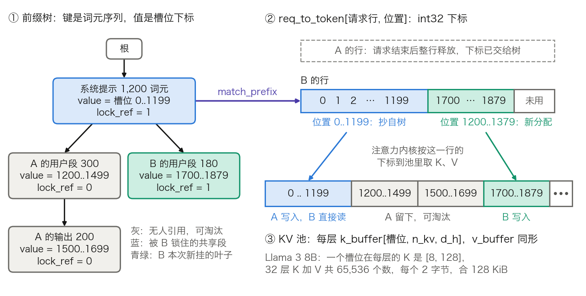

图 11-23：三张表怎样接在一起，画的是下文算例第 5 步结束的时刻（[生成脚本](https://github.com/yeasy/llm_internals/blob/main/tools/figures/ch11_11_sglang_three_tables.py)）。蓝色是被请求 B 锁住的共享段，青绿色是 B 本次新写入的部分，灰色无人引用、可以淘汰。

**KV 池。** `MHATokenToKVPool` 为每一层各分配一个 `k_buffer[N + page_size, n_kv, d_h]` 和同形的 `v_buffer`。一行是一个**槽位**，存一个词元在这一层的 K。`N` 是池的容量，多出的 `page_size` 行用作填充：填充的是 0 号槽位所在的一页，真实分配从它之后开始。沿用 11.4 节的 KV 池，`N = 411,525`。Llama 3 8B 的单层 `k_buffer` 是 `[411,526, 8, 128]`，BF16 下为 `411,526 × 8 × 128 × 2 ≈ 842.8 MB`。32 层、K 与 V 共 64 个缓冲区，合 53.94 GB。另有一个槽位分配器只管哪些行空闲，`alloc(n)` 返回 n 个下标。

**`req_to_token`。** `ReqToTokenPool` 持有一张 `req_to_token[请求数 + 1, 最大上下文]` 的 int32 表：一行对应一个运行中的请求，第 j 列是该请求第 j 个位置的槽位下标。它就是 11.4.3 的块表，只是块大小为 1。注意力内核拿到的是“这一行的前若干格”，据此到池里取 K、V。

**前缀树。** 节点类 `TreeNode` 的关键字段有五个。`key` 是这条边上的词元段。`value` 是一个与 `key` 等长的 int64 张量，存这些词元的槽位下标。`children` 是以子节点首个词元为键的字典。`lock_ref` 是引用计数，`last_access_time` 供淘汰排序。

三张表合起来，“共享前缀”的含义是：同一批整数同时出现在树节点的 `value` 和若干请求的 `req_to_token` 行里。K/V 只有一份，从不复制。

**页大小取 1 的代价。** 每缓存一个词元，树里多 8 字节下标，请求行里多 4 字节。两项合计 12 字节，而它的 K/V 是 131,072 字节，下标开销约为 0.009%。真正占地方的是稠密预分配的 `req_to_token`：256 个请求、131,072 的上下文上限时，它是 `257 × 131,072 × 4 = 134,742,016` 字节，约 134.7 MB。词元级粒度的约束来自内核一侧：部分注意力后端只支持固定的页大小。启用 FlashMLA 时 `page_size` 被强制为 64，TensorRT-LLM 的 MLA 后端只接受 32 或 64。页大于 1 时，`RadixKey.page_aligned` 把键截到页的整数倍，`children` 的键改为一页词元组成的元组。

**算例一：七步走完三张表。** 系统提示 1,200 个词元。请求 A 再带 300 个词元的用户输入，结束时共占 1,700 个槽位；请求 B 带同一段系统提示和另外 180 个词元。表 11-32 的每一行都由一个按 `radix_cache.py` 语义写的小脚本重放得到。槽位编号为示意，从 0 起写只为好算；与 11.5.5 一样，忽略末个输出词元尚无 K/V 的差一。

| 步 | 事件 | 树的变化 | 可淘汰 | 受保护 |
| ---: | --- | --- | ---: | ---: |
| 1 | A 到达，`match_prefix` 命中 0 | 无；分配 1,500 个槽位，Prefill 1,500 个词元 | 0 | 0 |
| 2 | A 的 Prefill 结束，`cache_unfinished_req` | 插入 1,500 的节点，`inc_lock_ref` | 0 | 1,500 |
| 3 | A 结束，`cache_finished_req` | `insert` 返回已有前缀 1,500，新挂 200 的叶子；`dec_lock_ref`，释放 A 的请求行 | 1,700 | 0 |
| 4 | B 到达，`match_prefix` 停在 1,500 节点的第 1,200 个词元 | `_split_node` 拆成 1,200 与 300 两段；返回 1,200 个下标，锁住 1,200 段 | 500 | 1,200 |
| 5 | B 的 Prefill 结束 | 在 1,200 段下新挂 180 的叶子，锁移到叶子 | 500 | 1,380 |
| 6 | 分配器缺 250 个槽位，`evict(250)` | 先淘汰 200 的叶子，其父 300 段变成叶子，再被淘汰 | 0 | 1,380 |
| 7 | A 的下一轮到达，Prompt 为历史 1,700 加新输入 150，共 1,850 | 只命中 1,200，需 Prefill 650 个词元；若无第 6 步，命中 1,700，只需 150 个 | — | — |

表 11-32：算例一的逐步记账。“可淘汰”“受保护”对应源码中的 `evictable_size_` 与 `protected_size_`，单位是词元。

从这张表读出四点。

- 拆分只切下标（见 11.5.3）。`_split_node` 对 `key` 和 `value` 切片，第 4 步前后槽位 0 到 1,699 的内容不变。
- 淘汰以节点为粒度。`evict` 把全部无锁的叶子按策略的优先级建成小顶堆，弹出一个就释放整个节点，累计够数才停。第 6 步要 250，实际释放 500。
- 淘汰是惰性的。分配器够用时树不动；不够时只补差额，调用的是 `evict(所需 − 空闲)`。
- 最先丢的是对话历史。第 6 步里 1,200 的公共段被 B 锁着；即便没锁，它不是叶子，也排在最后。代价落在第 7 步：A 的第二轮要多算 500 个词元。

还有一处细节表里没有体现。两个请求若同时 Prefill 同一段前缀，后完成的那个调用 `insert` 时会发现树里已有这段，返回的 `prefix_len` 大于它自己的 `cache_protected_len`。它随即释放自己重复占用的槽位，并把请求行里的下标改写成树里的那一份，池里不留重复的 K/V。

**淘汰策略与命名空间。** `--radix-eviction-policy` 可取 `lru`（默认）、`lfu`、`slru`、`priority`，差别只在堆的排序键。`lru` 用 `last_access_time`。`lfu` 用 `(hit_count, last_access_time)`。`slru` 把命中次数达到阈值（默认 2）的节点归入保护段，后淘汰。键的隔离靠 `RadixKey.extra_key`：它非空时，`children` 的键变成 `(extra_key, 词元)`，不同命名空间的请求从根开始就走不同的分支。带 LoRA 的请求由 `Req` 的构造函数把适配器 ID 拼进 `extra_key`；多租户隔离另有 `cache_salt`。这对应 11.5.7 的结论：凡是改变 K/V 的因素，都必须进键。

**读源码从哪里入手。** v0.5.20 的默认工厂返回的是 `UnifiedRadixCache`，它把全注意力、滑动窗口和 Mamba 状态三类缓存作为组件挂在同一棵树上。`radix_cache.py` 里的 `RadixCache` 实现同一套 `BasePrefixCache` 接口，只处理全注意力，不到一千行。上文的字段名和方法名均以它为准。`--enable-hierarchical-cache` 把主机内存接成第二级；再配 `--hicache-storage-backend`，外部存储成为第三级。节点的 K/V 可在主机内存留一份备份（`TreeNode.host_value`）。显存里那份被淘汰后节点仍留在树上，命中时再加载回显存。换出与重算的账见 11.4.5。

### 11.4 调度器怎样用这棵树：排序、准入与撤回

**排序。** `SchedulePolicy.calc_priority` 每轮给等待队列排序，策略分两类。感知缓存的有 `lpm`（最长前缀优先）、`dfs-weight`、`hrrn`；不感知的有 `fcfs`、`lof`（最长输出优先）、`random`、`routing-key`。

v0.5.20 的 `--schedule-policy` 默认值是 `fcfs`，不是论文里的最长前缀优先。用 `fcfs` 时前缀复用照常生效，因为匹配发生在准入那一刻；只是执行顺序不再为命中率服务。显式选 `lpm` 之后仍有一道保险：等待队列超过 128 个请求时，当轮退回 `fcfs`。两处都指向同一个代价：`lpm` 每轮要为每个等待请求做一次树匹配，并且会让冷门前缀的请求一直排在后面（见 11.5.6）。`hrrn` 是折中：按“入队以来系统已处理的 Prefill 词元数 ÷ 自己未命中的词元数”从大到小排序，命中多的请求优先，等得久的请求也会逐渐升上来。

**批内前缀检查。** `lpm` 与 `hrrn` 在排序前还多做一步。某个等待请求在真树里命中不超过 32 个词元时，调度器把它与一棵只由本轮等待队列构成的临时树比对。若它与排在前面的某个请求共享不少于 32 个词元，就暂时排到队尾：让前一个请求先跑、先把前缀写进树，其余请求下一轮再命中。这正是 11.11.1 里前端提示要解决的问题，后端在不知道程序结构的情况下，用这种办法补救。用默认的 `fcfs` 时，这一步不执行。

**准入。** `PrefillAdder` 逐个决定等待请求能否进入本轮 Prefill。它记三本账：显存一本，计算两本（`--max-prefill-tokens`，默认 16,384；`--chunked-prefill-size`）。显存这本账的余额是：

$$
R = N_{\text{空闲}} + N_{\text{可淘汰}} - \rho \sum_{r\,\in\,\text{运行中}} \min(m_r - o_r,\ 4096)
$$

`m_r` 是请求 r 的 `max_new_tokens`，`o_r` 是它已生成的词元数，4,096 是对超大 `max_new_tokens` 的截断。新请求要记的账是 `未命中的词元数 + min(max_new_tokens, 4096) + page_size`，小于 `R` 才接纳。

这条式子里有两个设计决定。第一，可淘汰的缓存算作空闲，缓存永远不挡新请求的路。第二，运行中的请求还会生成多少词元无从得知，调度器用一个系数 `ρ`（源码中的 `new_token_ratio`）下注。`ρ` 的初值为 `0.7 × schedule_conservativeness`，上限 1。此后每个没有发生撤回的 Decode 步线性下降一次，600 步降到下限，即初值的 0.14 倍。未发生撤回时，估计逐步趋于乐观。

**算例二。** 池里空闲 20,000 个槽位，可淘汰 30,000 个。运行中有 40 个请求，`max_new_tokens` 均为 1,024，各已生成 224 个。

- `ρ = 0.7`：预留 `40 × 800 × 0.7 = 22,400`，`R = 50,000 − 22,400 = 27,600`。
- 一个新请求未命中 2,000 个词元、`max_new_tokens = 1,024`、页大小 1，记账 `2,000 + 1,024 + 1 = 3,025`。只看显存这本账，可连续接纳 9 个，余 375。
- 若按 `max_new_tokens` 足额预留，相当于 `ρ = 1`：`R = 50,000 − 32,000 = 18,000`，只能接纳 5 个。
- `ρ` 降到下限 `0.7 × 0.14 = 0.098` 时：预留 3,136，`R = 46,864`。

**撤回。** 下注会输。某一步 Decode 前 `check_decode_mem` 发现槽位不够，`retract_decode` 就把一部分运行中的请求撤回等待队列。默认的 `--retraction-policy length` 先撤已生成词元最少的；同样少时，先撤输入最长的。撤回之后 `ρ` 按留下的请求重估为 `(已生成词元总数 + 20 × 请求数) ÷ (max_new_tokens 总数 + 1)`，上限同为 1。算例二若撤回 1 个，是 `(39 × 224 + 780) ÷ 39,937 ≈ 0.238`。重估值直接覆盖当前的 `ρ`，不与旧值取大。撤回前 `ρ` 若已降到下限 0.098，此例就是由 0.098 抬回 0.238。频繁撤回时，应调大 `--schedule-conservativeness`。撤回就是 11.3 节的抢占；SGLang 的特点在于用一个自适应系数，主动在“批更大”与“少撤回”之间取平衡。

**重叠调度。** 树匹配、排序、分配槽位、处理结果都是 CPU 上的 Python 代码。若每一轮都等它们做完再发射前向，GPU 每轮都要空等一段。不开流水线并行和分离式部署时，默认的主循环是 `event_loop_overlap`。它让调度器比 GPU 早一批：第 n+1 批的前向先发射，第 n 批的结果后处理，如图 11-24。

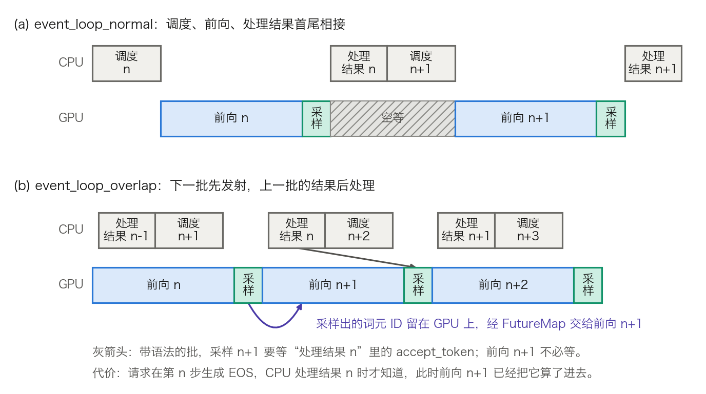

图 11-24：调度主循环的两种排法，时间为示意，不按比例（[生成脚本](https://github.com/yeasy/llm_internals/blob/main/tools/figures/ch11_11_sglang_overlap_loop.py)）。灰色是 CPU 上的调度与结果处理，蓝色是 GPU 前向，青绿色是采样。

难点是数据依赖：第 n+1 批的输入正是第 n 批采样出的词元，而 CPU 此时还没拿到它。做法是让这些词元 ID 留在 GPU 上，经 `FutureMap` 按请求行号直接交给下一批，不经 CPU 过手。只要 CPU 一轮的耗时短于 GPU 一步，GPU 就不再空等，前缀树的维护开销也被藏进前向的时间里。[SGLang v0.4 的发布说明](https://www.lmsys.org/blog/2024-12-04-sglang-v0-4/)报告这项改动使吞吐提高到 1.1 倍。

代价是 CPU 看到的状态晚一步。某请求在第 n 步已经生成 EOS，调度器处理第 n 步的结果时才知道，此时第 n+1 步的前向已经把它算了进去，多占一步的算力和一个槽位。`--disable-overlap-schedule` 可关闭重叠。

### 11.5 结构化输出的后端

`--grammar-backend` 可取 `xgrammar`、`outlines`、`llguidance`、`none`，不指定时用 `xgrammar`。几个库各自的路线见 11.7.8，这里只看接线。

1. **编译不阻塞调度循环。** 请求带有 `json_schema`、`regex`、`ebnf` 或 `structural_tag` 时，`GrammarManager` 以 `(类型, 语法字符串)` 为键查编译缓存。命中则复制一份匹配器；未命中则把编译任务交给线程池，请求带着一个 Future 进入 `grammar_queue`，不进等待队列。调度循环每轮把已编译完的请求移入等待队列。
2. **每步填掩码。** `SamplingBatchInfo.update_regex_vocab_mask` 分配 11.7.1 所说的位图 `[B, ⌈n_vocab/32⌉]`。每个带语法的请求填自己那一行，其余行保持全 1。位图放在锁页内存里，异步拷到 GPU，由一个 Triton 内核就地改写 logits。
3. **采样后推进状态。** 结果处理阶段对每个请求调用 `grammar.accept_token`。

第 3 步与重叠调度有冲突：第 n+1 批的掩码依赖第 n 批采样出的词元。SGLang 的处理是前向照常提前发射，采样推迟到上一批的结果处理之后（`launch_batch_sample_if_needed`）。被推迟的只有采样这一小步，不是整个前向。这是 11.7.4 里那条数据依赖的具体解法。

**跳跃前进的现状。** 论文的压缩有限状态机（见 11.7.5）在 v0.5.20 里只剩接口。各语法对象仍定义 `try_jump_forward` 与 `jump_and_retokenize`。但在 `python/sglang/srt` 下，`constrained/` 目录之外没有任何调用点。这个版本的约束解码是逐词元加掩码。读到“SGLang 靠跳跃前进加速 JSON 输出”的说法时，应先核对所用版本。

### 11.6 与 vLLM 的设计取舍

表 11-33 只列能在两边源码或文档里核实的差异。

| 维度 | SGLang v0.5.20 | vLLM v0.29.0 |
| --- | --- | --- |
| 前缀索引 | 基数树；节点存词元段与槽位下标 | 哈希表；键为 `hash(父块哈希, 本块词元, 额外键)` |
| 粒度 | `page_size` 默认 1，命中精确到词元；部分注意力后端会把它强制改为 64 | `block_size` 默认 16，只缓存写满的块 |
| 淘汰 | 对无锁叶子建堆，整节点释放；`lru`、`lfu`、`slru`、`priority` 可选 | 空闲块双向链表，队首即最久未用；请求释放时各块逆序入队，尾块先被淘汰 |
| 等待队列排序 | 默认 `fcfs`；可选 `lpm`、`dfs-weight`、`hrrn` 等 | `fcfs` 或 `priority` |
| 一步里放什么 | Prefill 批与 Decode 批分开，Prefill 优先；`--enable-mixed-chunk` 才混排 | 不区分阶段，每步按词元预算让各请求的已计算长度追上目标长度 |
| 显存不足时 | 准入时按 `ρ` 预留，Decode 前检查，不够则撤回 | 逐步分配，某步分配失败则抢占优先级最低的运行中请求 |
| 前端语言 | 有 | 无 |

表 11-33：SGLang 与 vLLM 的可核实差异。vLLM 一列取自其[前缀缓存设计文档](https://github.com/vllm-project/vllm/blob/v0.29.0/docs/design/prefix_caching.md)与 v0.29.0 的 `vllm/config/cache.py`、`vllm/v1/core/sched/scheduler.py`。

三点说明。

粒度的差别没有看上去大。1,210 个共享词元，页大小 1 时复用 1,210 个，块大小 16 时复用 1,200 个，页大小 64 时复用 1,152 个。每次匹配最多损失“页大小减 1”个词元。11.5.5 的算例（2,010 个共享词元）里，块大小 16 的 Prefill 计算量是无缓存时的 9.8%，按词元匹配是 9.4%。树的价值不在这十来个词元，而在它向调度器暴露了结构：哪些等待请求落在同一分支上。`dfs-weight` 按子树权重决定先后，批内前缀检查用一棵临时树找出同批请求的公共前缀，都直接用到这一点；按块哈希只能回答“某个请求命中了几块”。

两种淘汰都做到“先丢后缀、后丢前缀”：树靠结构保证，只有叶子可被淘汰；vLLM 靠入队顺序近似。代价不同。vLLM 取队首是 `O(1)`；SGLang 的 `evict` 每次调用都要对全部可淘汰叶子建堆，叶子多时这笔 CPU 开销落在调度循环里。

“Prefill 优先、两类批分开”使新请求的排队时间最短，代价是运行中的请求要停下来等 Prefill 批跑完，TPOT（每输出词元时间）出现抖动。分块 Prefill 限制的是每次停顿的上限。vLLM 的统一预算让每一步都带着 Decode 走，抖动小，但长 Prompt 要分更多步才能算完。两者对应 11.3 节里 TTFT（首词元延迟）与 TPOT 此消彼长的两端。

### 11.7 参数与机制对照、边界

| 启动参数 | 默认值 | 对应的机制 |
| --- | --- | --- |
| `--disable-radix-cache` | 关 | 关闭前缀树，请求结束即释放全部槽位 |
| `--page-size` | 1 | KV 池与树的粒度（11.11.3） |
| `--radix-eviction-policy` | `lru` | 淘汰堆的排序键（11.11.3） |
| `--enable-hierarchical-cache` | 关 | 在主机内存保留 K/V 备份；外部存储另需 `--hicache-storage-backend`（11.11.3） |
| `--schedule-policy` | `fcfs` | 等待队列排序（11.11.4） |
| `--schedule-conservativeness` | 1.0 | `ρ` 的初值系数（11.11.4） |
| `--chunked-prefill-size` | 按硬件自动确定 | 分块 Prefill 的块长；−1 为关闭 |
| `--enable-mixed-chunk` | 关 | 分块 Prefill 与 Decode 混排 |
| `--mem-fraction-static` | 按显存自动确定 | 权重与 KV 池占显存的比例（11.4.1 的 `u`） |
| `--disable-overlap-schedule` | 关 | 关闭重叠调度（11.11.4） |
| `--grammar-backend` | `xgrammar` | 约束解码后端（11.11.5） |

表 11-34：SGLang v0.5.20 的主要启动参数与本章机制的对应关系。

几处容易误读的地方：

- **论文与代码不是一回事。** 论文的运行时技术里，前缀树仍是核心；缓存感知排序成了可选项，默认关闭；压缩状态机在 v0.5.20 的调度路径里已不再调用。引用论文的加速比时要同时引用它的条件。
- **6.4 倍不是通用数字。** 论文摘要的“吞吐最高 6.4 倍”出自多调用、高共享的语言模型程序，对比的是论文写作时的 Guidance、vLLM 与 LMQL。同一篇论文也写明：多轮对话里输出较长时，会话之间共享少，时间主要花在 Decode 上，几乎没有加速。前缀复用只省 Prefill（见 11.5.5）。
- **命中不等于留得住。** 原因见 11.5.3 的“共用显存池”。算例一第 6 步那样的淘汰在高负载下频繁发生，多轮对话的历史最先丢。要留住它，靠分层缓存把 K/V 备份在主机内存或 L3 外部存储。缓存感知路由（见 11.5.6）解决的是另一件事：让同一会话回到存有其历史的实例。
- **多实例时每个实例各有一棵树。** 显存里的树和主机内存备份（HiCache 的 L1、L2）是各实例私有的。只有另配 `--hicache-storage-backend` 的 L3 外部存储才跨实例共享。不接 L3 时实例之间不共享缓存，SGLang 的网关用 `cache_aware` 策略维护近似的字符级前缀树来选实例，机制见 11.5.6。各项阈值的默认值随版本变动，以网关源码为准。

两节读下来，vLLM 与 SGLang 对同一批机制给出了两套代码形态：调度器、块表、前缀结构、LoRA 槽位与掩码位图都能在源码里一一对上。这些代码的上限由它跑在什么卡上决定，硬件一侧的账见 11.12 节。

## 12. 硬件选型：GPU、TPU 与专用加速器

11.10 节和 11.11 节把前面各节的机制对到了两个引擎的代码上，余下的问题是这些代码跑在什么硬件上。11.9 节已说明 Prefill 与 Decode 买的不是同一种资源。本节把这句话落到规格表上：给定模型和一张卡，单流最快能跑多快，能同时放下多少请求，每百万词元要花多少钱。三个问题分别由显存带宽、显存容量和“吞吐 ÷ 价格”回答，拿到任何一份数据手册都能照此算一遍。

算例沿用 3.8.7 表 3-25 的 Llama 3 70B 与 Llama 3 8B。耗时与吞吐都是上界口径：Decode 的一步只数权重和 KV 缓存的读取，不计激活访存、通信与内核效率，实测值低于这些数字。

<a id="gpu-hardware"></a>

### 12.1 读懂规格表：哪几行决定推理性能

推理性能主要由三行规格决定：显存容量决定放得下什么，显存带宽决定 Decode 多快，算力决定 Prefill 多快。表 11-35 把 NVIDIA 几代数据中心 GPU 的这三行放在一起，并按 10.1 节的 Roofline 模型算出**拐点** `I_ridge = 峰值算力 ÷ 峰值带宽`：每读 1 字节要配上这么多次浮点运算，算力和带宽才同时用满。

| 型号 | 架构 | 显存 | 显存带宽 | 稠密 FP16/BF16 算力 | 拐点（FLOPs/字节） | 适用场景 |
| --- | --- | ---: | ---: | ---: | ---: | --- |
| A100 80GB | Ampere | 80 GB | 2.04 TB/s | 312 TFLOPS | 153 | 上一代主力，离线批处理 |
| L40S | Ada | 48 GB | 0.864 TB/s | 362 TFLOPS | 419 | 小模型推理 |
| H100 | Hopper | 80 GB | 3.35 TB/s | 990 TFLOPS | 295 | 训练、Prefill |
| H200 | Hopper | 141 GB HBM3e | 4.8 TB/s | 990 TFLOPS | 206 | 大模型 Decode |
| B200 | Blackwell | 180 GB HBM3e | 8 TB/s | 2250 TFLOPS | 281 | 训练与推理 |
| B300 | Blackwell Ultra | 288 GB HBM3e | 8 TB/s | 2250 TFLOPS | 281 | 超大模型推理 |

表 11-35：NVIDIA 主要数据中心 GPU 的推理相关规格，算力统一为稠密口径。数值取自各型号的官方规格页；L40S 取规格页 FP16 Tensor Core 一栏的稠密值 362.05，拐点 `362.05 ÷ 0.864 ≈ 419`；B200 的显存与带宽由 DGX B200 整机的 1,440 GB、64 TB/s 除以 8 得到。B300 的带宽按 GB300 NVL72 规格页的 `576 TB/s ÷ 72 = 8 TB/s`；显存按该页的 `20 TB ÷ 72 ≈ 278 GB` 与 HGX B300 页的 `2.1 TB ÷ 8 ≈ 262 GB` 两种口径均低于沿用的单卡标称 288 GB。

读这类规格表有三个口径陷阱。

- **稀疏与稠密**。H100 规格页的 FP16 Tensor Core 一行写 1,979 TFLOPS，星号注明“With sparsity”；稠密值是它的一半，约 990。HGX B200 页面写 FP16/BF16 为 36 PFLOPS，脚注说明这是稀疏口径、稠密取一半，再除以 8 张卡，单卡稠密 2250。A100 页面则并列写出 `312 | 624`。把 B200 的 2250 与 H100 的 1979 直接相比，会得到 1.14 倍；同为稠密口径是 `2250 ÷ 990 ≈ 2.27` 倍。
- **单卡与整机**。HGX 是 8 卡，GB200 超级芯片是 2 卡，NVL72 是 72 卡。同一页的数字要先除以卡数。
- **单向与双向**。NVLink 的标称带宽是双向合计，H100 的 900 GB/s 单向为 450 GB/s。

拐点一列给出两条结论。第一，A100 到 H100，算力涨了 3.2 倍，带宽只涨 1.6 倍，拐点从 153 升到 295。Decode 的算术强度约等于批大小（10.1 节），要用满 H100 的算力，批得开到近 300。H200 只加带宽，拐点回落到 206。第二，低精度不改变这个临界批。10.1 节的临界批 `B* = 拐点 × 每参数字节 ÷ 2`（BF16 为 295，W4A16 为 74）在此仍适用；权重和计算同降到 FP8 时，峰值算力翻倍使拐点翻到 591，每参数字节却减半，`B*` 仍是 295。FP8 加快的是每一步，不是把算力用满所需的批。

### 12.2 从带宽算 Decode 速度上界

**单流上界。** Decode 每生成一个词元，至少要把权重完整读一遍：

$$
\text{词元/秒} \le \frac{\text{显存带宽}}{\text{权重字节}}
$$

以 Llama 3 70B 的 FP8 权重（70 GB）为例，H100 是 `3350 ÷ 70 ≈ 48` 词元/秒，H200 是 `4800 ÷ 70 ≈ 69`。表 11-36 列出三种权重配置的结果。

| 权重配置 | 权重字节 | A100 | L40S | H100 | H200 | B200 |
| --- | ---: | ---: | ---: | ---: | ---: | ---: |
| Llama 3 70B，FP8 | 70 GB | 29 | 装不下 | 48 | 69 | 114 |
| Llama 3 70B，INT4 | 35 GB | 58 | 25 | 96 | 137 | 229 |
| Llama 3 8B，FP16 | 16.06 GB | 127 | 54 | 209 | 299 | 498 |

表 11-36：单流 Decode 速度上界（词元/秒）= 显存带宽 ÷ 权重字节。只比较带宽，未检查 KV 与工作区是否放得下（见 11.12.3）。

同一行里任意两张卡之比就是带宽之比：H200 对 H100 是 `4.8 ÷ 3.35 ≈ 1.43`。NVIDIA 给 H200 标的推理加速是 Llama 2 70B 最高 1.9 倍、GPT-3 175B 约 1.6 倍，都高于带宽比；多出的部分可以由更大的显存放得下更大的批来解释。量化的收益也在这张表里：同一张卡上，INT4 的上界是 FP8 的两倍。

**加上批处理。** 批里有 B 条序列时，权重读一遍，每条序列的 KV 各读一遍：

$$
t_{\text{step}} = \frac{\text{权重字节} + B \times \text{每序列 KV 字节}}{\text{显存带宽}}
$$

H200、70B FP8、每条序列 4K 上下文（FP16 的 KV 为 `4096 × 327,680 ≈ 1.34 GB`）。`B = 1` 时每步读 71.3 GB，14.9 ms，67 词元/秒。`B = 32` 时每步读 `70 + 32 × 1.34 ≈ 112.9 GB`，23.5 ms，每流 42 词元/秒，总吞吐 `32 ÷ 0.0235 ≈ 1360` 词元/秒。吞吐是单流的 20 倍，每流速度降到 0.63 倍。图 11-25 的左图画出了整条曲线。

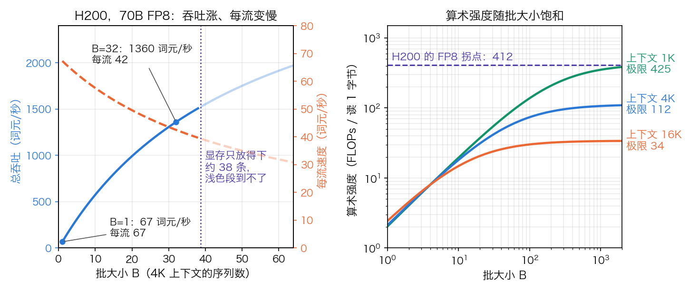

图 11-25：批处理对 Decode 的作用与极限（[生成脚本](https://github.com/yeasy/llm_internals/blob/main/tools/figures/ch11b_decode_batch_limit.py)）。左：H200 上 70B FP8 的总吞吐与每流速度，竖线是显存容量允许的最大批。右：算术强度随批大小饱和，横线是 H200 的 FP8 拐点。

**批处理推不过的那条线。** 批越大，每步读取里 KV 的占比越高，算术强度不再随批线性增长。计入注意力的运算量（3.8.8：每词元每层约 `4sd`，s 是上下文长度），

$$
I(B) = \frac{B\,(2N + 4 s d L)}{W + B \cdot s \cdot b_{kv}}
\;\xrightarrow{B \to \infty}\;
\frac{2N}{s \cdot b_{kv}} + \frac{2d}{n_{kv}\, d_h\, b}
$$

其中 N 是参数量，W 是权重字节，`b_kv = 2 × L × n_kv × d_h × b` 是每词元 KV 字节，b 是每个 KV 数的字节数。第二项由 `4sdL ÷ (s × b_kv)` 约去 s 与 L 得到。70B、FP16 KV（`b = 2`）、4K 上下文下的极限是 `1.4e11 ÷ (4096 × 327,680) + 2 × 8192 ÷ (8 × 128 × 2) ≈ 104 + 8 = 112`，低于 H200 的 FP8 拐点 412（图 11-25 右）。也就是说，上下文到了 4K，Decode 无论开多大的批都在带宽受限区；按这个公式反推，上下文要短于约 1,060 词元，极限才够得到拐点。第二项是注意力自身的算术强度：FP16 KV 下为 `8192 ÷ (8 × 128) = 8`，KV 用 FP8 则为 16。GQA 让 8 个 KV 头服务 64 个 Query 头，读 1 字节 FP16 的 KV 能换 8 次运算；普通多头注意力只有 1 次。

### 12.3 从显存算并发数

**先看权重放不放得下。** 权重显存的十进制 GB 下限是 `参数量（B）× 位宽（bit）÷ 8`。表 11-37 只拿权重与标称显存比较，用来审计数量级；“是”不代表可服务，实际部署还要给 KV 缓存、运行时工作区、通信缓冲、量化缩放因子和碎片留余量。

<!-- numeric-claim: weight-memory -->
| 模型配置 | 参数 B | 位宽 bit | 权重 GB | H100-80GB | H200-141GB | B200-180GB | B300-288GB |
| --- | ---: | ---: | ---: | --- | --- | --- | --- |
| 70B FP8 | 70 | 8 | 70 | 是 | 是 | 是 | 是 |
| 70B INT4 | 70 | 4 | 35 | 是 | 是 | 是 | 是 |
| 405B INT8 | 405 | 8 | 405 | 否 | 否 | 否 | 否 |
| 405B INT4 | 405 | 4 | 202.5 | 否 | 否 | 否 | 是 |

表 11-37：仅权重的十进制 GB 重算与理论单卡容纳关系。边界接近或刚好“是”的组合仍应按服务峰值做实测，并预留安全余量。B300 按每卡 262 GB 计，四行结论不变。

**再看还剩多少给 KV。** 可用于 KV 的显存 = 显存 × 利用率上限 − 权重 − 工作区；除以每条序列的 KV 字节，就是能同时驻留的序列数。取利用率 0.9、工作区 5 GB、70B FP8、每条 4K 上下文的 FP16 KV 为 1.34 GB：

- H100：`80 × 0.9 − 70 − 5 = −3 GB`。表 11-37 里的“是”在这里变成了不可服务。
- H200：`141 × 0.9 − 70 − 5 = 51.9 GB`，约 38 条；KV 改用 FP8 则约 77 条。
- B200：`180 × 0.9 − 70 − 5 = 87 GB`，约 64 条。

这就是 H200 相对 H100 的价值所在。同一颗计算芯片，多出的 61 GB 几乎全部变成 KV 池，70B 的 FP8 部署从“放不下”变成“单卡 38 路并发”，还省掉了多卡张量并行的通信。H100 要服务 70B，只能改用 INT4 权重（剩 `72 − 35 − 5 = 32 GB`，约 23 条），或者上多卡。

更大的模型同理推算。140B 的 FP8 权重是 140 GB，H200 单卡扣掉权重就没有余量，必须多卡。405B 的 INT8 权重 405 GB，超过表中任何单卡；INT4 的 202.5 GB 只有 B300 放得下，且所剩无几。大显存单卡对这类模型的意义不是单卡服务，而是减少张量并行的切分数，把省下的通信换成更大的批和更长的上下文。

### 12.4 多卡互连：NVLink 域有多大

单卡放不下时，互连成为选型的第四行规格。H100 规格页给出的两个数字足以说明差距：NVLink 为 900 GB/s，PCIe Gen5 为 128 GB/s，相差 7 倍。

**延迟而非带宽。** 张量并行对互连的要求是延迟。Decode 一步 160 次 all-reduce，批 32 时载荷合计只有约 84 MB，耗时由每次的固定开销决定，张量并行因此一般不跨节点（推导见 11.8.4）。读互连这行规格时，带宽决定 Prefill 侧大消息的通信时间，域的大小决定哪些卡之间能用低延迟的直连。

**NVLink 域的大小。** 它决定并行方式的上限。HGX 这类 8 卡服务器的 NVLink 域是 8 张卡。Blackwell 一代把单卡 NVLink 带宽提到 1.8 TB/s，并把域扩到机柜。**GB200 NVL72** 在一个液冷机柜里放 36 颗 Grace CPU 和 72 颗 Blackwell GPU，用 NVLink Switch 连成一个域，全域带宽 130 TB/s。对推理，域变大的意义是让大规模专家并行可行。11.9.6 里 DeepSeek-V3 的 Decode 用 EP320，all-to-all 走 InfiniBand。同样的通信放进 72 卡的 NVLink 域，每次 all-to-all 的延迟低得多。

Blackwell 的其余硬件变化也服务于这个方向。每颗 GPU 由两颗达到光罩尺寸上限的裸片经 10 TB/s 的片间互连封装而成，共 2080 亿晶体管。GB200 超级芯片把一颗 Grace CPU 与两颗 B200 用 NVLink-C2C 相连，CPU 与 GPU 之间的双向带宽为 900 GB/s。KV 换出到主机内存（11.4 节）的代价随之下降。

NVIDIA 为 GB200 NVL72 标称“万亿参数模型实时推理 30 倍于 H100”“MoE 架构 10 倍”。这两个数要连同脚注一起读：对照组是经 InfiniBand 扩展的 HGX H100；条件是输入 32,768、输出 1,024 词元，首词元 5 秒、每词元 50 ms；并注明为预测性能。NVIDIA 自己给的解释是 FP4 加第五代 NVLink；再加上每卡带宽是 H100 的 2.4 倍，这三项在一个对大 NVLink 域最有利的负载上叠加，不能外推到单卡上的稠密小模型。

### 12.5 低精度的硬件支持：NVFP4 的格式与代价

每降一档精度，权重字节和 Decode 每步的读取量同步下降（11.12.2 的表）。Blackwell 的 Tensor Core 原生支持 FP4，NVIDIA 为此定义了 **NVFP4** 格式。它是 10.4 节块级量化的一个硬件化实例，由三层组成：

1. **元素**：4 比特浮点 E2M1，即 1 位符号、2 位指数、1 位尾数。可表示的幅值只有 8 个：0、0.5、1、1.5、2、3、4、6。
2. **块缩放**：每 16 个元素共用一个 FP8（E4M3）缩放因子。
3. **张量缩放**：整个张量再乘一个 FP32 标量，把数值范围对齐到 E4M3 缩放因子表示得了的区间。

每个元素的有效位宽是 `4 + 8 ÷ 16 = 4.5` 比特，张量级标量可忽略。70B 的权重因此约 39.4 GB，相对 FP16 压缩 `16 ÷ 4.5 ≈ 3.56` 倍，相对 FP8 为 1.78 倍，与 NVIDIA 给出的“约 3.5 倍、1.8 倍”一致。表 11-38 对比三种 4 比特方案。

| 格式 | 元素 | 块大小 | 缩放因子 | 有效位宽 | 70B 权重 |
| --- | --- | ---: | --- | ---: | ---: |
| NVFP4 | E2M1 | 16 | FP8（E4M3），另加张量级 FP32 | 4.5 bit | 39.4 GB |
| MXFP4 | E2M1 | 32 | 2 的整数次幂（E8M0） | 4.25 bit | 37.2 GB |
| INT4 分组量化 | 4 位整数 | 128（常见取值） | FP16 | 4.125 bit | 36.1 GB |

表 11-38：三种 4 比特权重格式的开销。NVFP4 与 MXFP4 的结构取自 NVIDIA 技术博客；INT4 一行按分组 128、FP16 缩放因子、不含零点计算。

取舍在两处。其一，E2M1 的 8 个幅值间隔不均匀，小值处密、大值处疏，比 INT4 的等间隔网格更贴近权重与激活的钟形分布。其二，块越小、缩放因子越精细，量化误差越小，存储开销越大：NVFP4 用更小的块和带小数的缩放因子换精度，比 MXFP4 多花 0.25 比特。NVIDIA 报告的结果是 DeepSeek-R1-0528 在多项评测上由 FP8 转 NVFP4 的精度下降不超过 1%；这是特定模型上的厂商数据，其他模型要自行评测。

算力口径也要对齐：HGX B200 的 FP4 一行写 `144 | 72` PFLOPS（稀疏 | 稠密，8 卡），单卡稠密 9 PFLOPS，是稠密 BF16 的 4 倍。FP4 需要 Blackwell 及之后的硬件；FP8 自 Hopper 与 Ada 起普遍支持；INT4 的权重量化靠软件内核实现，跨平台最成熟。

### 12.6 TPU、AMD 与 SRAM 型芯片：不同的取舍

前两小节的算法不依赖厂商，规格表上有显存容量与带宽就能套用。

**Google TPU。** TPU 是 Google 为深度学习设计的加速器，只在 Google Cloud 上提供；Google 自家的 Gemini、PaLM 均在 TPU 上训练。TPU v6e（Trillium）相对 v5e 每芯片峰值算力提升 4.7 倍，HBM 容量、带宽与芯片间互连（ICI）带宽各翻一倍。第八代分成两款：TPU 8t 面向训练，216 GB HBM、6,528 GB/s；TPU 8i 面向推理，288 GB HBM、8,601 GB/s。按 11.12.2 的公式，70B FP8 在 TPU 8i 上的单流上界是 `8601 ÷ 70 ≈ 123` 词元/秒，与 B200 同档。TPU 的取舍在系统层：ICI 把大量芯片直接互连，可以一次申请到数千颗芯片的整片集群；代价是软件栈以 XLA 为中心，可用区域与型号受云厂商供给限制（可用性见附录 A.5）。

**AMD Instinct。** MI300X 为 192 GB HBM3、5.3 TB/s；新一代 MI355X（第 4 代 CDNA 架构）为 288 GB HBM3E、8 TB/s，并增加了 MXFP6、MXFP4 数据类型。同样的公式给出 70B FP8 的单流上界：MI300X 约 76 词元/秒，MI355X 约 114。规格与同代 NVIDIA 产品相当，差距在软件：vLLM、SGLang 都提供 ROCm 后端，但新内核、新量化格式的支持通常先出现在 CUDA 上。

**SRAM 型推理芯片。** Groq LPU、Cerebras 这一类芯片把权重放在片上 SRAM 里，不经过片外 HBM。按 11.12.2 的公式，带宽高一个量级，单流上界就高一个量级；Groq 自称其片上 SRAM 带宽在 80 TB/s 以上，约为 HBM 的 10 倍。代价在容量：SRAM 的单位面积容量远低于 HBM，一个模型要切到很多颗芯片上，KV 缓存同样要占片上存储。结果是单流延迟很低，而每个模型要占用的芯片数多、每芯片能承载的并发少。它适合为低延迟付溢价的场景，是否划算仍要用 11.12.7 的成本算式判断。

**CPU 推理。** 公式同样适用：主机内存带宽远低于 HBM，只有小模型加 4 比特量化才有可用的速度。llama.cpp 是这条路线上的代表实现，适合低并发、对成本敏感的本地部署；Intel 的 OpenVINO 与 ARM 的专用指令集也在优化 CPU 推理。

### 12.7 决策框架与成本算式

选型按下面的顺序做，每一步都对应前面的一个算式。

1. **定模型与精度，算权重字节**（表 11-37）。单卡放不下就要张量并行，互连进入选型（11.12.4）。
2. **定每流速度目标，反推带宽**。需要的带宽 = 目标词元/秒 × 每步读取字节。例：70B FP8、批 16、4K 上下文，每步读 91.5 GB；每流要 50 词元/秒，就要 `91.5 × 50 ≈ 4.6 TB/s`。H200 刚好够，H100 即使放得下也达不到。实时对话这类延迟敏感的场景，TPOT 由 Decode 侧的带宽决定，Decode 不能用低配卡。要再快，靠投机解码（10.6 节）让一次权重读取产出多个词元，或加大张量并行把带宽成倍加起来。TTFT 则取决于排队与 Prefill 算力（两个指标的定义见 11.13.1）。
3. **定并发，算 KV 容量**（11.12.3）。高吞吐的 API 服务要的是大批，显存容量与带宽同样重要。
4. **看输入输出分布**。长输入压 Prefill 的算力与 KV 容量，长输出压 Decode 的带宽与 KV 驻留时间；规模足够时可以分池配卡（11.9.4）。离线批处理不要求每流速度，用上一代的卡把批开大即可。
5. **算成本**。比较的对象是每百万词元的成本，不是卡的单价；算式见下。
6. **核对软件生态**。NVIDIA 平台上 vLLM、SGLang、TensorRT-LLM 的支持最完整；ROCm 次之；TPU 只在 Google Cloud 上可用。所选的量化格式与并行方式，要确认目标引擎在目标硬件上有对应的内核。

**成本算式。**

$$
\text{每百万词元成本} = \frac{\text{每卡时价格}}{\text{每秒词元数} \times 3600 \div 10^{6}}
$$

假设某张 H200 的卡时价格为 2 美元（示意值），70B FP8、4K 上下文：批 32 时 1360 词元/秒，成本约 0.41 美元/百万词元；批 1 时 67 词元/秒，约 8.3 美元。同一张卡相差 20 倍，差别只在批大小，代价是每流速度从 67 降到 42 词元/秒。成本优化因此首先是把批开大，其次才是换卡。量化对成本的作用也由此得出：权重从 FP16 降到 FP8 或 4 比特，字节数降到 1/2 或约 1/3.6，同一张卡上的单流上界按同样的倍数上升，省下的显存还能换成更大的批。云上按需与自建的价差随厂商和时间变化，应代入当时的报价来算。

### 12.8 下一代平台

Blackwell 之后是 Rubin。按 NVIDIA 规格页，单颗 Rubin GPU 为 288 GB HBM4、19.2 TB/s，稠密 FP16/BF16 算力 4 PFLOPS，互连为第六代 NVLink。用本节的算法读这几行：带宽是 B200 的 2.4 倍，70B FP8 的单流上界升到 `19200 ÷ 70 ≈ 274` 词元/秒；拐点为 `4000 ÷ 19.2 ≈ 208`，低于 B200 的 281，这一代带宽涨得比稠密算力快，对 Decode 有利。发布节奏与各云区域的实际可用性变化很快，见附录 A.5。

互连的方向与此一致：NVLink 域继续扩大，跨机柜则是 RoCE 以太网、InfiniBand 与光电混合交换并存。某种网络能否支撑目标规模的 all-reduce 或专家并行，取决于拓扑、拥塞控制、作业形态和软件栈，不能只由网络名称判断。

<a id="cluster"></a>

### 12.9 从 GPU 到集群：数据经过哪些部件

HBM 保存 GPU 正在使用的权重、激活与 KV；服务器还需要 CPU、主机内存、网卡和存储。CPU 执行主机侧程序并提交 GPU 工作，PCIe 连接主机与外设，NVLink 则承担支持该互连的设备之间的通信。主机内存、HBM 与磁盘是不同层次的存储，不能把总容量直接当作同速可用的显存。

沿数据路径看，模型文件和训练数据先从持久存储读入，可在主机内存或本地 NVMe 缓存，再按加载路径送往 GPU。共享存储让多个节点访问数据与检查点；本地缓存减少重复远程读取，却不能替代需要跨节点恢复的持久副本。[NVIDIA 的存储设计](https://docs.nvidia.com/dgx-superpod/reference-architecture-scalable-infrastructure-h100/latest/storage-architecture.html)因此同时讨论共享文件系统、节点缓存和检查点写入。

跨节点通信还要经过网卡与交换网络。RDMA 是远程直接内存访问机制；InfiniBand 提供支持 RDMA 的网络，RoCE 则在以太网上承载 RDMA。在硬件、拓扑和驱动支持时，[GPUDirect RDMA](https://docs.nvidia.com/cuda/gpudirect-rdma/)允许网卡直接访问 GPU 显存，减少经主机内存中转的复制，但仍需要正确的内存注册与同步。它不消除链路带宽和拥塞，也不把多台服务器变成一块统一显存。

排障应按路径分段：加载慢先查存储读取与缓存；GPU 等待输入，查主机侧处理和传输；单机正常、跨机变慢，再查通信拓扑与网络。取舍也对应这些边界：缓存换本地容量，卸载换传输时间，扩大并行换通信开销。定位哪一段在等待，比只看 GPU 利用率更能决定下一步测什么。

<a id="data-center"></a>

### 12.10 集群与数据中心：调度边界和物理边界

集群（Cluster）是节点及其管理、调度和通信形成的逻辑组织；数据中心是容纳设备的物理设施，提供机柜、供配电与散热。两者不是同义词，也不必一一对应：[Kubernetes 的多可用区部署](https://kubernetes.io/docs/setup/best-practices/multiple-zones/)就是一个集群跨越多个故障区域的例子。部署地图应分别标出“哪些资源一起调度”和“哪些设备共享物理依赖”。

供电、散热与空间约束共同决定能部署多少设备及机柜密度；[NVIDIA 的数据中心规划](https://docs.nvidia.com/dgx-superpod/design-guides/dgx-superpod-data-center-design-h100/latest/planning.html)还指出，降低机柜密度可能改变布线距离。即使程序和模型不变，功率限制或过热也可能触发降频，应结合 [nvidia-smi 的时钟事件原因](https://docs.nvidia.com/deploy/nvidia-smi/index.html)确认，不能直接归因为内核变慢。

故障域是可能被同一故障同时影响的一组资源，例如共享供电的设备。放置副本时应核对节点之外的机柜、供电与网络依赖；跨故障域分散副本可降低关联失效风险，却可能增加通信距离。紧耦合计算优先考虑互连，服务副本优先考虑故障隔离：两种需求必须在实际拓扑上共同评估。

## 13. 生产部署最佳实践

前面各节给出了引擎的机制和每一步的账。本节把它们变成运维上的判断：性能指标怎样定义、怎样测才算数，给定流量要几个实例，过载时该拒绝谁，看哪个指标判断哪种病。每条做法都回指它所依据的机制。

### 13.1 指标：定义、分解与相互关系

**首词延迟**（Time to First Token，TTFT）是从发出请求到收到第一个输出词元的时间。首词元由 Prefill 那一次前向直接选出（3.8.1），不需要再跑一步 Decode。在单实例直接返回首词元的路径上，它可以拆成几段：

$$
\text{TTFT} = \text{排队} + \text{套模板与分词} + \text{Prefill（未命中前缀的部分）} + \text{首包的网络时间}
$$

负载高时排队是主项（11.13.2 的图）；前缀缓存命中会直接缩短第三项（11.5 节）。分离式架构还要看代理的返回策略：若 Prefill 首词元直返用户，KV 交接主要推迟第二个词元；若等交接完成后统一从 Decode 侧返回，TTFT 就包含未被计算遮住的传输、Decode 侧排队与首输出准备时间。应按客户端收到首个内容块的实际路径计时，不能仅据“Prefill 已完成”判断 TTFT（11.9.2）。

**每词元输出时间**（Time Per Output Token，TPOT）是一个请求内除首词元外的平均出词间隔。vLLM 的定义是：

$$
\text{TPOT} = \frac{\text{端到端延迟} - \text{TTFT}}{N - 1}
$$

其中 N 是输出词元数。由此，端到端延迟 = TTFT +（N − 1）× TPOT。例：TTFT 为 0.4 秒，TPOT 为 40 ms，输出 500 词元，端到端是 `0.4 + 499 × 0.04 = 20.36` 秒。对长输出，决定总时长的是 TPOT；对短输出和智能体的多轮工具调用，决定总时长的是 TTFT。

**词元间隔**（Time Between Tokens，TBT；也称 Inter-Token Latency，ITL）是相邻两次输出之间的时间，每个间隔记一个样本。TPOT 是它在请求内的平均，会把偶发的长停顿抹平。设一个请求的 499 个间隔里，498 个是 30 ms，1 个是 1.5 秒（同批进来一个大的 Prefill 块，或请求被抢占后重算，见 11.3 节）。它的 TPOT 是 `(498 × 0.03 + 1.5) ÷ 499 ≈ 32.9 ms`，看不出异常；这个请求自己的 P99 TBT 也仍是 30 ms，因为 499 个样本里只有 1 个坏点。只有最大 TBT，或跨请求汇总后的高分位，才看得见那次 1.5 秒的卡顿。流畅度的 SLO 因此应当落在 TBT 的高分位上，TPOT 只适合估算总时长。投机解码下一次输出可能带出多个词元，TBT 与 TPOT 的差别更大（10.6 节）。

**吞吐量**（Throughput）按请求/秒或词元/秒计。输入词元与输出词元要分开计，两者的单位成本不同（11.13.8）。

**Goodput**（有效吞吐）是满足 SLO 的前提下能承接的最大到达率。DistServe 的定义是：在 SLO 达标率不低于目标值（例如 90%）时，每张 GPU 能服务的最大请求速率。原始吞吐衡量“机器忙不忙”，Goodput 衡量“有多少流量得到了合格的服务”；比较两种架构或两组参数，应比较 Goodput。

SLO 的数值随应用而定。常见的示例是 TTFT 几百毫秒到 1 秒、TPOT 50 ms。50 ms 对应每秒 20 个词元，面向的是人逐字阅读的场景；输出交给程序消费时（智能体、批量抽取），每流速度可以放宽，换更大的批和更低的成本（11.12.7）。

### 13.2 Goodput 与压测：怎样测才算数

**测法。** 固定一组 SLO 和达标率目标，从低到高扫到达率，每个到达率下统计 SLO 的达标率，取仍达标的最大到达率。

**一个可复核的例子。** 取 11.9.4 的 Prefill 实例：单请求 Prefill 时间 `D = 0.367 s`，先到先服务，近似 M/D/1 队列。SLO 为 TTFT 不超过 1 秒，达标率目标 90%。平均 TTFT 有闭式解 `D + RD² ÷ (2(1 − RD))`，分位数用仿真得到（表 11-39、图 11-26）。

| 到达率（请求/秒） | 利用率 | 平均 TTFT | P90 TTFT | TTFT ≤ 1 s 的达标率 |
| ---: | ---: | ---: | ---: | ---: |
| 0.5 | 0.18 | 0.41 s | 0.56 s | 99.6% |
| 1.0 | 0.37 | 0.47 s | 0.72 s | 97.2% |
| 1.5 | 0.55 | 0.59 s | 1.02 s | 89.3% |
| 2.0 | 0.73 | 0.87 s | 1.69 s | 70.2% |
| 2.5 | 0.92 | 2.41 s | 5.24 s | 29.4% |

表 11-39：M/D/1 队列在不同到达率下的 TTFT，`D = 0.367 s`。平均 TTFT 为闭式解；P90 与达标率为仿真值，取 3 个随机种子各 20 万个请求的平均，达标率 = 样本中 TTFT ≤ 1 s 的比例。利用率 0.92 一行的种子间波动约为 P90 ±0.1 s、达标率 ±0.5%，利用率越高，仿真收敛越慢。

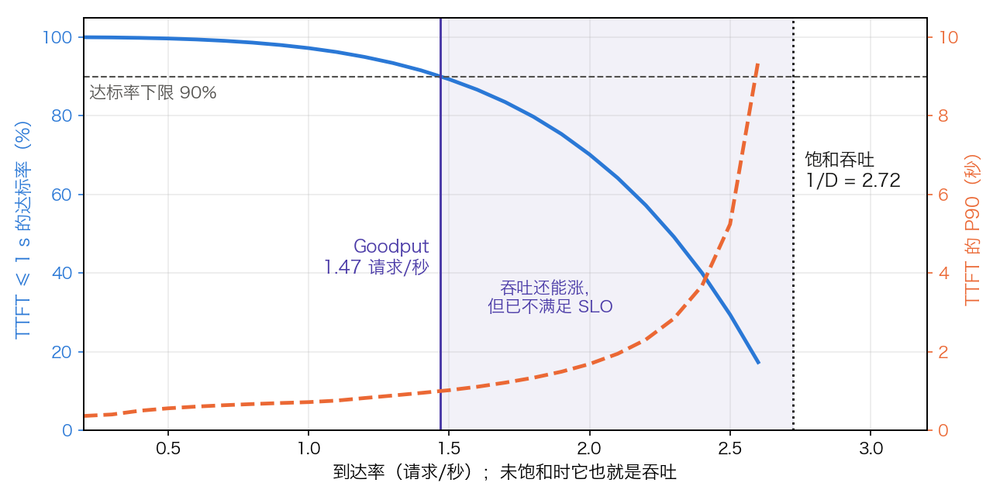

图 11-26：到达率升高时 TTFT 达标率与 P90 的变化（[生成脚本](https://github.com/yeasy/llm_internals/blob/main/tools/figures/ch11b_goodput_curve.py)）。这是排队模型，不是实测。

这台实例的饱和吞吐是 `1 ÷ 0.367 ≈ 2.72` 请求/秒，Goodput 只有 1.47，是前者的 54%。到达率从 1.5 升到 2.5，吞吐照涨，达标率从 89% 掉到 29%。只看吞吐做容量规划，会把工作点定在 SLO 早已失守的区间。

**压测的四个陷阱。**

- **闭环掩盖排队**。固定并发数的压测（闭环）里，上一个请求不返回，下一个就不发出，队列永远堆不起来，尾延迟被系统性低估。测延迟要用开环：按给定速率发请求，不管前面的有没有返回。vLLM 的 `vllm bench serve` 用 `--request-rate` 指定速率，默认按泊松过程到达，`--burstiness` 调突发程度；`--request-rate` 取默认的 `inf` 时所有请求同时到达，测的是最大吞吐，不是负载下的延迟。`--max-concurrency` 则是闭环的并发上限。
- **长度分布要取自真实流量**。表 11-39 的 D 由输入长度决定；KV 占用由输入加输出长度决定。用固定长度压测会同时错估两者。
- **预热与前缀命中**。带相同系统提示的合成请求会得到远高于线上的命中率；冷缓存又会低估稳态性能。压测要复现线上的前缀结构。
- **在客户端测**。TTFT 要含网关与网络。引擎自报的指标不含这两段。

### 13.3 容量规划：从到达率到实例数

容量规划把前面几节的账串成一条链：到达率 → 在途请求数 → KV 词元数 → 块数 → 实例数。中间一步靠 **Little 定律**：稳态下，在途请求数 = 到达率 × 平均逗留时间。

**算例。** Llama 3 8B，FP16，单张 H100 一个实例；到达率 10 请求/秒，平均输入 1000 词元、输出 500 词元；SLO 为 TTFT 0.4 秒、TPOT 40 ms。

1. **在途数**。逗留时间按 SLO 上限估：`0.4 + 499 × 0.04 = 20.36` 秒。在途数 `10 × 20.36 ≈ 204` 条。实际 TPOT 低于 SLO 时在途数更少，这是上界。
2. **KV 需求**。一条序列在途期间的平均长度是 `1000 + 500 ÷ 2 = 1250` 词元，合计 `204 × 1250 = 255,000` 词元。每词元 KV 为 128 KiB（3.8.8 的 65,536 个数乘 2 字节），每块 16 词元，约 15,900 块，31.1 GiB，合 33.4 GB。
3. **KV 供给**。沿用 11.4.1 的 KV 池：`80 × 0.9 − 16.06 − 2 = 53.94 GB`，约 411,500 词元、25,700 块。占用率 `255,000 ÷ 411,500 ≈ 62%`。
4. **Decode 时间**。一步读 `16.06 + 33.4 ≈ 49.5 GB`，H100 上 `49.5 ÷ 3.35 ≈ 14.8 ms`（11.12.2 的公式）。TPOT 40 ms 要求每秒 25 步，Decode 占用 `25 × 14.8 ms ÷ 1000 ms ≈ 36.9%` 的时间。
5. **Prefill 时间**。每秒 10,000 个输入词元，计算量 `2 × 8.03e9 × 10,000 ≈ 1.6e14` FLOPs/s；H100 按 40% 利用率可提供 `990e12 × 0.4 = 3.96e14`，占 40.6% 的时间。
6. **结论**。单实例在 10 请求/秒下 KV 用到 62%，时间用到 `36.9% + 40.6% ≈ 77%`；若以 80% 为水位线，时间已贴线。取峰值为均值的 2 倍，需要 2 个实例；再加 1 个冗余以容忍单实例故障，共 3 个。

两点说明。第 4、5 步把 Prefill 与 Decode 的时间简单相加，没有计混批时权重只读一遍的节省，偏保守；全部数字又是不计通信与内核效率的上界，偏乐观。两者不会恰好抵消，规划值必须用 11.13.2 的压测校准。这条链的价值在于指出哪种资源先到顶：本例时间先到顶，KV 紧随其后；输出更长的负载会先耗尽 KV，输入更长的负载会先耗尽 Prefill 的时间。

### 13.4 过载、取消与扩缩容

**过载时队列不能无界。** M/D/1 的排队项 `RD² ÷ (2(1 − RD))` 在利用率趋近 1 时发散；到达率超过服务率后，队列与 TTFT 随时间无限增长，排在后面的请求注定超时，却仍要占用 Prefill 算力。应对是准入控制：等待队列设上限，超出即返回过载错误，让客户端退避重试或由网关转去别的集群。

**拒绝要趁早。** 分离式架构下，请求可能在做完 Prefill 之后才被 Decode 侧拒收，已花的算力全部作废。Mooncake 的做法是**早拒绝**（Early Rejection）：请求到达时，调度器取 Prefill 池与 Decode 池中负载较高的一侧来决定是否接收。论文同时报告了副作用。按当前负载早拒绝，会让两个池的负载出现反相振荡，因为 Decode 侧的负载要等 Prefill 做完才体现。改为预测请求到达 Decode 时的负载后，振荡才得到缓解。

**取消必须立即回收 KV。** 客户端断开或超时后，引擎要中止该请求并释放它的块。否则这条序列继续生成到 `max_tokens`，白占 KV 与批内位置。网关层要把断连向后传到引擎，这是线上显存“缓慢泄漏”的常见来源。

**按什么信号扩容。** GPU 利用率不是好信号：它只表示有内核在运行，Decode 受带宽限制时读数同样很高（10.1 节）。可用的信号有三类：等待队列长度或排队时间，反映算力缺口；KV 缓存占用率与抢占次数，反映显存缺口；TTFT 与 TBT 的高分位，直接对应 SLO。扩容还受冷启动限制：新实例要拉取并加载权重、预热内核与 CUDA Graph，耗时以分钟计，来不及应对突发。突发只能靠预留余量和准入控制吸收。

### 13.5 AI 网关与词元感知路由

应用很少直接调用推理引擎的 API，两者之间通常有一层 **AI 网关**（如 LiteLLM、Kong 一类产品），承担下面几件事：

- **统一接口**：屏蔽不同供应商与自建集群的 API 差异，对上提供 OpenAI 兼容接口。
- **降级与熔断**：主集群故障或延迟激增时，把请求转到备用模型或云端 API。
- **灰度与 A/B**：按比例把流量切到新版本的模型或引擎。
- **计量与计费**：按输入、输出、缓存命中分别记录词元数，支持多租户计费。
- **安全控制面**：认证、授权、TLS/mTLS、请求校验、租户隔离、审计日志与密钥脱敏。

**负载均衡要感知词元。** 按连接数或 CPU 利用率均衡对 LLM 无效：一个 100 词元的请求与一个 100K 词元的请求，占用的 Prefill 时间和 KV 相差三个数量级。路由要用的是各实例的等待队列长度、KV 占用率，以及请求前缀在各实例上的缓存命中长度。把共享前缀的请求送到同一个实例，可以省掉重复的 Prefill；亲和与均衡相互冲突时怎样取舍，见 11.5 节。

Mooncake 把这一思路推到集群级。它以 KV 缓存为中心组织调度：全局调度器 Conductor 掌握 KV 块在各节点上的分布，为每个请求选择 Prefill 与 Decode 实例，并在有利时复制热块、换出冷块。[技术报告](https://arxiv.org/abs/2407.00079)给出的结果是：相对 4 个 vLLM 实例组成的基线（文中记为 vLLM-[4M]），在模拟的长上下文场景里，满足 SLO 的吞吐提升 50% 到 525%；在真实负载下，可多处理约 75% 的请求。前一组数字出自 16K 到 128K 词元输入的模拟数据。该实验里基线 vLLM 为避免长输入扰乱 Decode 而逐个处理请求、不合批，结果不能外推到短输入的负载。

### 13.6 流式输出

**流式输出**（Streaming）在每个词元生成后立即返回，不等整个回答完成。它不缩短任何一段计算，只是让用户感知的等待从端到端延迟变成 TTFT。引擎通常用 Server-Sent Events（SSE）推送；服务之间的高 QPS、双向流场景可以用 gRPC，面向浏览器的单向文本流用 SSE 更简单。协议本身的每词元开销要在自己的系统上测。

实现上有三个容易出错的地方。

- **增量反分词**。字节级 BPE（3.1 节）的一个词元未必是完整的字符：一个汉字的 UTF-8 编码占 3 字节，可能被切进两个词元。逐词元反分词再直接发出，会发出半个字符的乱码。正确做法是缓冲到字节序列能解码成完整字符再发。
- **停止字符串要回看**。停止条件是字符串时，它可能跨多个词元。引擎要扣住末尾“停止串长度减一”个字符暂不发出，确认没有命中才放行。
- **代理缓冲**。反向代理默认会攒够一块响应再转发，流式输出就变成一段一段地跳。以 nginx 为例，`proxy_buffering` 默认开启，需要在该路径上关闭，或由后端返回 `X-Accel-Buffering: no` 响应头。长 Prompt 或排队期间连接上没有数据，还要把各级代理的空闲超时调到大于最坏情况的 TTFT。

### 13.7 可观测性：看哪个指标判断哪种病

引擎把调度器的内部状态以 Prometheus 指标导出。以 vLLM 的 `/metrics` 端点为例，值得长期保留的有：

- 状态量：`vllm:num_requests_running`、`vllm:num_requests_waiting`、`vllm:kv_cache_usage_perc`。
- 计数器：`vllm:num_preemptions`、`vllm:prefix_cache_queries` 与 `vllm:prefix_cache_hits`（两者之比是命中率）、`vllm:prompt_tokens`、`vllm:generation_tokens`。
- 直方图：`vllm:time_to_first_token_seconds`、`vllm:inter_token_latency_seconds`、`vllm:request_time_per_output_token_seconds`、`vllm:request_queue_time_seconds`、`vllm:e2e_request_latency_seconds`。

vLLM 的设计文档对这两类指标的关系有一句概括：服务级指标用来解释请求级指标。表 11-40 把这句话展开成诊断表。

| 现象 | 同时看到 | 判断 | 处置 |
| --- | --- | --- | --- |
| TTFT 高分位上升 | 等待数上升，KV 占用不高 | Prefill 算力不足，请求在排队 | 加实例；提高前缀命中；长输入多时考虑分离 Prefill |
| TTFT 高分位上升 | 等待数上升，KV 占用贴顶 | KV 放不下，新请求无法准入 | 加实例或加大张量并行；KV 量化；限制最大长度 |
| TBT 高分位出现尖峰，TPOT 正常 | 抢占计数上升 | 块用尽后被抢占重算（11.3 节） | 降低并发上限；给 KV 池留余量 |
| TBT 高分位出现尖峰，TPOT 正常 | 抢占计数不变，有长输入到达 | Prefill 块拉长了这一步（11.9.1） | 调小每步词元预算；分离 Prefill |
| TPOT 整体偏高 | 运行数很大 | 批过大，每步读取的 KV 过多（11.12.2） | 限制并发上限；扩容 |
| 吞吐低、延迟也低 | 运行数很小，KV 占用低 | 流量不足或上游限流，批没开起来 | 合并流量；缩容 |
| 前缀命中率骤降 | 刚发布新的提示词模板或模型 | 缓存键变了，旧缓存全部失效 | 灰度发布；预热 |

表 11-40：由指标组合判断瓶颈所在。指标名取自 vLLM，各引擎的名称不同，含义相近。

引擎之外还要监控两类量。一是输入输出长度分布的漂移：11.13.3 的容量结论以长度分布为前提，分布一变，结论随之失效。二是质量与安全事件：拒答率、护栏拦截率、工具调用超时，这类问题在延迟指标上没有任何痕迹。

### 13.8 成本

**算式。** 每百万词元成本 = 每卡时价格 ÷（每秒词元数 × 3600 ÷ 10⁶），见 11.12.7。落到单个请求上，输入与输出要分开计价：

$$
\text{每请求成本} = T_{\text{in}} \times (1 - h) \times p_{\text{in}} + T_{\text{out}} \times p_{\text{out}}
$$

其中 h 是前缀缓存命中的比例，`p_in`、`p_out` 是输入、输出词元的单位成本。

**输出为什么比输入贵。** 同一张 H100、Llama 3 8B、卡时价格假设为 2 美元。Prefill 按 40% 利用率可达 `3.96e14 ÷ (2 × 8.03e9) ≈ 24,700` 词元/秒，`p_in = 2 ÷ (24,700 × 3600 ÷ 10⁶) ≈ 0.023` 美元/百万词元。Decode 在批 32、平均长度 1250 时，每步读 `16.06 GB + 32 × 1250 × 131,072 B ≈ 21.3 GB`，耗时 `21.3 ÷ 3.35 ≈ 6.4 ms`，约 5,000 词元/秒，`p_out` 约 0.11 美元，是输入的 4.9 倍。批开到 204 时每步读 49.5 GB、14.8 ms（11.13.3 的第 4 步），约 13,800 词元/秒，`p_out` 降到 0.040 美元，是输入的 1.8 倍。Prefill 能用满算力，Decode 被带宽卡住，这就是 API 定价里输出普遍贵于输入的原因；两者的比值取决于批能开多大。

**命中缓存的输入为什么能打折。** 11.13.3 的请求（输入 1000、输出 500），不命中时每请求约 `1000 × 0.023 + 500 × 0.040 ≈ 43` 微美元；命中率 0.8 时为 `200 × 0.023 + 500 × 0.040 ≈ 25` 微美元。命中部分不再消耗 Prefill 算力，只占 KV 块。

由算式可以直接读出各项优化的作用点：

- **量化**（10.4 节）：减少每步读取的字节，提高每秒词元数；同时腾出显存给更大的批。
- **选合适的模型**：成本与参数量近似成正比。能用小模型或蒸馏模型达标的任务，不必上大模型。
- **优先级与错峰**：在线流量按峰值配置，低谷时算力闲置。离线任务（批量清洗、评测）以低优先级填进空闲的批位，抬高全天的平均批大小。
- **提高前缀命中率**：稳定的系统提示放在最前，可变内容放在最后（11.5 节）。
- **语义缓存**：对语义相近的请求直接返回已有的回答，连 Decode 也省掉。缓存键与检索范围必须纳入租户、权限范围、模型与版本、系统提示、工具状态和 PII 标记；含私有文档、工具输出或 PII 的回答，默认禁止跨用户命中。语义向量相近只说明问题相似，不保证在另一个用户的上下文里答案同样正确。

### 13.9 安全与合规

生产服务要在引擎之外加**护栏**（Guardrails）。它同样服从本章的延迟账：输入侧的检查计入 TTFT，输出侧的检查若要等整段生成完再判定，就与流式输出冲突。

- **分层检测**。规则层成本最低，适合已知风险，例如 NeMo Guardrails 用 Colang 描述对话约束。分类层用专门的安全分类模型，如 Llama Guard；Llama Guard 3-8B 面向文本，Llama Guard 4-12B 面向多模态，选型要按模态、延迟、成本和误报漏报率评估。高风险输出再交给更强的模型裁决，或拒答后重新生成；这一层最贵，只用于前两层拿不准的样本。
- **流式输出下的折中**。输出侧检查可以按句或按固定词元数分段进行，代价是不合规内容可能已经发出一部分；高风险场景只能关闭流式，或延迟一个检查窗口再发。
- **数据隐私**。对输入里的 PII 做脱敏；日志、前缀缓存与语义缓存都是用户数据的副本，要纳入同一套留存与隔离策略。
- **速率限制**。限流按词元而不是按请求计：一个 100K 词元的请求消耗的资源抵得上上千个短请求。按用户、按密钥监控词元消耗速率。
- **评估闭环**。为越权工具调用、提示注入、数据外泄、误拒与高风险领域输出建立回归集；新模型、新提示词、新工具上线前跑一遍，上线后用真实事故样本持续补充。

### 13.10 多模态与长上下文的部署问题

**多模态输入。** 图像经视觉编码器变成一串嵌入向量，与文本词元一样进入 Prefill，一样占 KV 块；块大小与模态无关。部署上新增的问题有三个。第一，前缀缓存的键必须包含图像内容：文本词元相同而图片不同的两个请求不能共享 KV，块哈希要纳入图像内容的哈希（11.5 节）。第二，同一张图在多轮对话里不必反复处理。vLLM 有两层缓存：前端的多模态处理器缓存，缓存 HF 处理器的预处理结果，`vllm:mm_cache_queries` 与 `vllm:mm_cache_hits` 统计的是它的命中；调度器管理的编码器输出缓存（`EncoderCacheManager`），按输入项的哈希在请求间共享编码器输出。第三，视觉编码是计算密集的，与 LLM 的 Decode 同卡会造成 11.9.1 那样的干扰。图像或视频流量大时，可以把编码器拆成独立的池，把嵌入向量传给 LLM 实例。NVIDIA Dynamo 等系统提供了这种编码器分离的部署形态，它仍属较新的做法，收益取决于图像流量的占比。

**超长上下文。** 128K 到 1M 词元的上下文先耗尽的是 KV 容量：Llama 3 70B 每词元 320 KiB，100 万词元是 `1,000,000 × 327,680 ≈ 328 GB`（305 GiB，同 14.7.1 的口径），单个请求就超过任何单卡。可用的手段有三类：KV 量化与换出到主机内存（11.4 节）；模型侧的 MLA 或混合注意力（10.2 节）；沿序列维把注意力切到多卡的 Ring Attention（10.3 节称之为序列并行，也常称上下文并行）。最后一类能把长序列分到多卡，稠密注意力的计算量仍按长度的平方增长。能否以可接受的延迟支撑 1M 词元的生产流量，取决于模型结构、批大小、网络带宽与 SLO，要按 11.13.2 的方法实测。

## 14. GPU 软件栈：从张量到内核与通信

张量公式规定计算什么，GPU 软件栈决定如何执行。排查推理性能，需要把框架算子、设备程序、任务提交和跨卡通信分开：同一个矩阵乘法变慢，可能来自内核选择，也可能来自提交间隙或等待其他 GPU。

<a id="gpu-kernels"></a>

### 14.1 从 PyTorch 算子到 GPU

算子是加法、矩阵乘法等张量操作；内核（kernel）是在 GPU 上执行的设备函数，两者并非一一对应。PyTorch 的派发器依据张量设备和自动求导等状态选择实现；该实现可以调用已有计算库，也可以启动一个或多个内核。具体派发机制见 [PyTorch 官方教程](https://docs.pytorch.org/tutorials/advanced/dispatcher)。

在 NVIDIA 路径中，CUDA 是编程与执行平台。CUDA Runtime 提供内存管理、流和内核启动等接口，并依赖驱动；Driver API 提供更显式的上下文、模块与执行控制。流（stream）表达有序提交的工作，最终由 GPU 执行设备代码；框架也可直接使用 Driver API，并非每次调用都必须逐层穿过 Runtime。参见 [CUDA 平台说明](https://docs.nvidia.com/cuda/cuda-programming-guide/01-introduction/cuda-platform.html)和 [Runtime 与 Driver API 的区别](https://docs.nvidia.com/cuda/cuda-runtime-api/driver-vs-runtime-api.html)。

`torch.compile` 增加了编译路径：TorchDynamo 捕获计算图，默认后端 TorchInductor 优化并生成代码，GPU 路径使用 Triton 作为重要组件。这里的 Triton 是编写、编译 GPU 内核的语言与编译器；[NVIDIA Triton Inference Server](https://docs.nvidia.com/deeplearning/triton-inference-server/user-guide/docs/index.html)则是提供模型推理服务的软件，两者职责不同。编译也不意味着所有操作都会变成一个内核，见 [PyTorch 编译器文档](https://docs.pytorch.org/docs/main/user_guide/torch_compiler/torch.compiler.html)。

应据此区分两种图：框架计算图描述张量操作及数据依赖，供编译器分析和改写；CUDA Graph 描述设备工作的提交依赖，供运行时反复执行。捕获到框架图只是编译入口，并不能据此判断已经消除了中间张量，也不能证明服务请求的排队时间变短。

<a id="kernel-fusion"></a>

### 14.2 分块与融合：一次向量计算的账

设输入 `x`、`b` 是各含 1,000,000 个 FP32 元素的连续向量，输出为同长度的 `y = relu(x + b)`，其中 `relu(z) = max(z, 0)`。例如前三项为 `x = [-2, 1, 3]`、`b = [1, 2, -5]`，输出对应为 `[0, 3, 0]`。

按 [Triton 向量加法教程](https://triton-lang.org/main/getting-started/tutorials/01-vector-add.html)的分块方式，每个程序实例负责 1,024 个连续元素，共需 977 个实例；最后一个仅有 576 个有效元素，用掩码阻止越界读写。一个实例处理一块数据，不等于启动 1,024 个线程，线程映射由编译器与启动配置共同决定。

假设未融合时先执行加法内核，把中间向量 `t` 写回全局内存，再执行 ReLU 内核。忽略缓存、对齐和其他开销，逻辑读写量为：读取 `x`、`b`，写入 `t`，读取 `t`，写入 `y`，共 `5 × 1,000,000 × 4 = 20 MB`。融合内核在片上保留加法结果并立即取最大值，只读两个输入、写一个输出，共 `12 MB`，减少 40%，还少一次内核启动。这里 MB 按百万字节计，逻辑流量不等于实际 HBM 流量。

融合（fusion）因此改变计算的内核边界，消除中间读写；它不保证加速，收益取决于形状、缓存、寄存器压力和原有实现。[CUDA Graph](https://docs.nvidia.com/cuda/cuda-programming-guide/04-special-topics/cuda-graphs.html)则记录操作及依赖、实例化后重复提交，主要摊薄启动准备开销；它可以仍包含多个内核，不会仅因捕获就消除 `t`。两种优化可以组合，不能互相替代。

以 PyTorch 常见的捕获/重放（capture/replay）路径为例，应先在旁路流预热，再捕获形状、布局和控制流稳定的区域，并长期持有输入、输出缓冲区，保证重放使用同一内存地址。新请求可以把新 token 值复制到原输入缓冲区；改变值并不等于可以改变捕获时的批大小、布局或 Python 分支，见 [PyTorch CUDA Graph 使用说明](https://docs.pytorch.org/docs/main/notes/cuda.html#cuda-graphs)。

动态请求可按形状分桶，为各桶捕获图，并用填充适配实际批次。例如只捕获批大小 1、4、8，3 个请求填充到 4 后使用对应图，并正确屏蔽填充项；也可只捕获稳定子区域，对未覆盖形状或不支持的操作回退普通 eager 执行。参见 [PyTorch 动态形状说明](https://docs.pytorch.org/docs/main/user_guide/torch_compiler/torch.compiler_cudagraph_trees.html#dynamic-shape-support)、[局部捕获](https://docs.pytorch.org/docs/main/notes/cuda.html#partial-network-capture)和 [NVIDIA 批大小调优示例](https://nvidia.github.io/TensorRT-LLM/latest/blogs/tech_blog/blog20_Tuning_CUDA_Graph_Batch_Sizes_for_Higher_Output_Throughput.html)。维护多份图及长期缓冲区可能增加显存占用，填充增加无效计算，反复捕获也有成本；收益取决于形状复用率及 CPU 提交是否构成瓶颈。

上述条件针对常见框架路径。CUDA 底层还提供受约束的 [图更新](https://docs.nvidia.com/cuda/cuda-programming-guide/04-special-topics/cuda-graphs.html#updating-instantiated-graphs)和 [条件节点](https://docs.nvidia.com/cuda/cuda-programming-guide/04-special-topics/cuda-graphs.html#conditional-graph-nodes)，可修改部分节点参数或表达设备端分支、循环；不能据此断言所有 CUDA Graph 都只支持静态工作负载。

<a id="nccl"></a>

### 14.3 NCCL：让多张卡交换结果

NCCL 是 GPU 通信库，提供 AllReduce、AllGather、ReduceScatter 等集合通信，即参与设备共同完成约定的数据交换或归约。例如两张卡分别持有 `[1, 2]` 和 `[3, 4]`，求和 AllReduce 后两卡都得到 `[4, 6]`；张量并行为何需要这类操作，见 11.8 节。

NCCL 根据拓扑组织传输与计算；NVLink、PCIe、InfiniBand 等互连承载数据。通信库与硬件不是替代关系，安装 NCCL 不会让 PCIe 连接获得 NVLink 带宽。NCCL 支持节点内和跨节点通信，并与 CUDA 流集成，见 [NCCL 概览](https://docs.nvidia.com/deeplearning/nccl/user-guide/docs/overview.html)。

### 14.4 按等待位置诊断

先固定输入形状、精度和批量，核对输出，再区分首次编译与稳定执行。随后检查时间线：GPU 内核之间有空隙，追查 CPU 提交、同步和依赖；单个内核耗时长，比较计算量、访存量和实际吞吐；大量短内核连续出现，评估融合与 Graph；跨卡等待占主导，再核对通信量、拓扑及各卡到达集合操作的时间。先定位等待发生在哪一层，再改对应配置，避免把计算、启动和通信问题都归因于“GPU 不够快”。

前述算例给出了可检查的预期：融合后应少一个内核和中间张量读写；启用 Graph 后应检查提交开销是否下降，以及图覆盖的批次、重捕获与回退频率、填充比例和显存增量；调整多卡通信后应检查暴露在关键路径上的等待是否减少。最后回到相同负载下的端到端延迟与吞吐。局部流量减少是机制证据，整条请求变快才是服务收益，两项需要分别记录。
