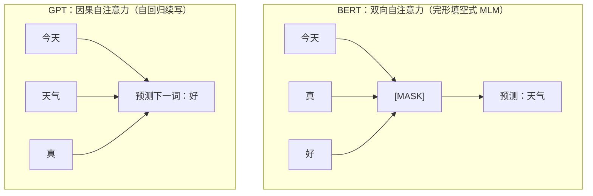
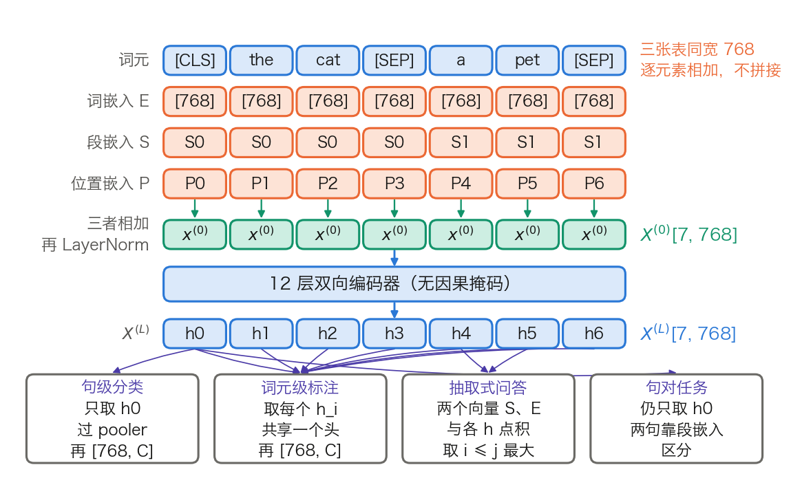
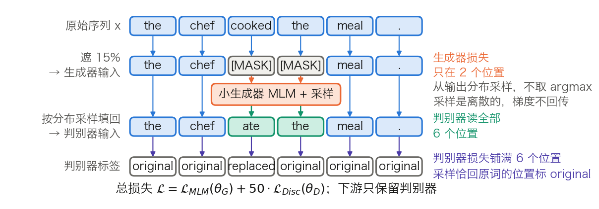
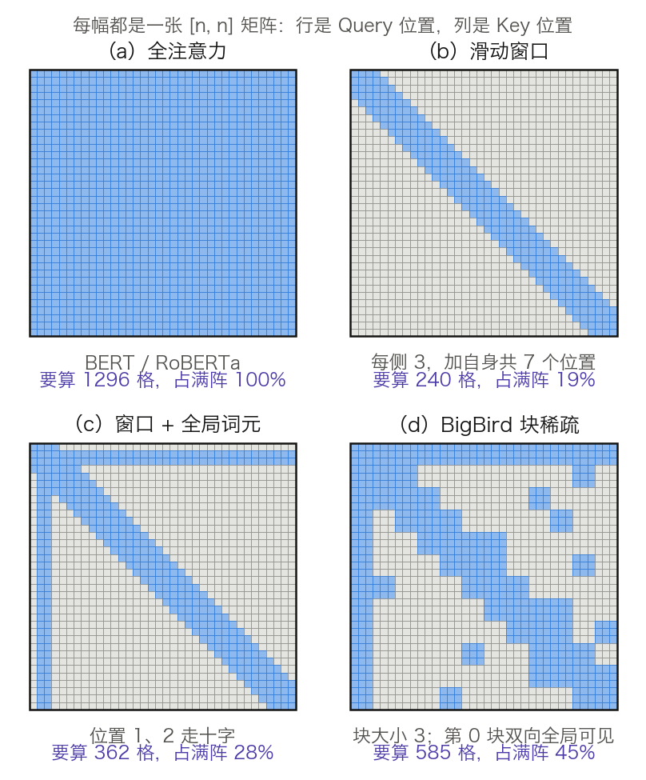
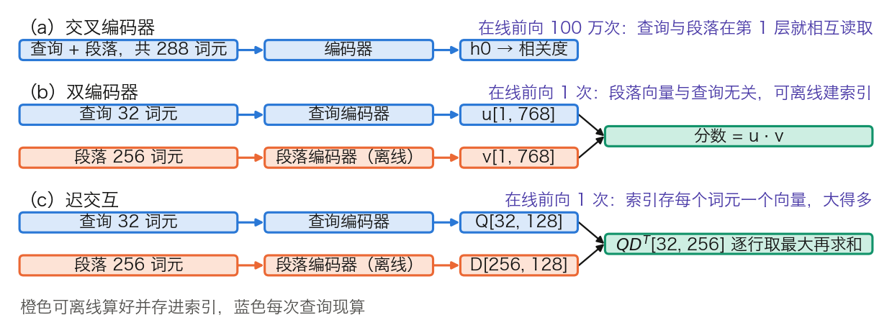

# 第十二章：编码器系列模型

第三部分的整套推理服务都架在“逐词元把回答生成出来”这个前提上。文本分类、关系抽取、语义相似度这类任务并不需要生成，只需要一份好的文本表示。去掉因果掩码、让每个位置都读到整句的编码器，正是为这件事设计的。

本章按“基线 → 定向修补”组织：[12.1 节](12.1_bert.md)的 BERT 是基线，后两节各自认领它留下的一笔账——[12.2 节](12.2_roberta_albert.md)处理预训练任务与参数量，[12.3 节](12.3_longformer_bigbird.md)处理 512 词元的长度上限。可顺序通读，也可只查用得上的那一节。

## 1. BERT：双向理解的突破

[5.2 节](../05_pretraining/5.2_masked_lm.md)讲清了掩码语言模型的目标与损失，但没有讲承载这个目标的模型长什么样：输入怎样拼、参数量怎样凑到 110M、微调时那个“任务相关的输出层”接在哪一个位置。本节补上这三件事，并给出一组可复核的参数量与计算量。读完应能对着 Hugging Face 的 `BertModel` 逐个模块认出它们，并说明 BERT 为什么不能拿来生成文本。

BERT（Bidirectional Encoder Representations from Transformers）出自 Google 2018 年的[论文](https://arxiv.org/abs/1810.04805)，把 Transformer 编码器与掩码预训练组合成一套可迁移的理解模型。

### 1.1 双向与因果：可见范围的差别

BERT 的自注意力不加因果掩码，每个位置都可以读全序列；GPT 的每个位置只能读自己和左边（见 [2.4 节](../02_attention/2.4_self_cross_causal.md)）。图 12-1 用同一句话对比两者的可见范围。

图 12-1：同一句话下，BERT 的被遮位置可同时利用左右上下文，GPT 预测下一词只能利用左侧上下文。

这条差别落到矩阵上只有一处：3.8.3 第 4 步的因果掩码 M 被去掉，`[T, T]` 的分数矩阵不再是下三角而是满阵。代价在 12.1.7 给出：没有因果结构，就没有可复用的 KV 缓存。

### 1.2 输入怎样构造：三张嵌入表与两个特殊词元

模型收到的不是一句话，而是一条词元序列加三张查表结果。单句写成 `[CLS] A [SEP]`，句对写成 `[CLS] A [SEP] B [SEP]`。`[CLS]` 固定排在第一位，它那一行的最终隐状态是句级任务的取向量处；`[SEP]` 是分隔符。分词用 WordPiece，论文口径是 30,000 个词元的词表，发布权重的 `vocab_size` 是 30,522。

每个位置查三张表再相加，不是拼接：

- **词嵌入**（token embedding）：按词元 ID 取一行，形状 `[30522, 768]`。
- **段嵌入**（segment embedding）：只有两行，标记该位置属于句 A 还是句 B，形状 `[2, 768]`。
- **位置嵌入**（position embedding）：可学习的绝对位置表，形状 `[512, 768]`，与 3.3 节的正弦方案和第四章的 RoPE 是三条不同路线。

三者逐元素相加，再过一次 LayerNorm，得到进入第 1 层的 `X⁽⁰⁾[T, 768]`。图 12-2 上半幅把这条链画在一条 7 个词元的句对上，下半幅是 12.1.5 要讲的四类任务头。

图 12-2：BERT 的输入怎样构造，以及四类任务头各自从哪些位置取向量（[生成脚本](https://github.com/yeasy/llm_internals/blob/main/tools/figures/ch12_bert_io.py)）。橙色是训练好就固定的权重表，蓝色是随输入变化的数据，青绿是本步新算出的表示；配色沿用 3.8 节。

三张表同宽 768，所以相加后宽度不变。段嵌入只有两行，意味着 BERT 天然只能区分两段；三段以上的输入要么截断，要么改用别的分隔约定。

### 1.3 模型规格与参数量：逐项算到 110M

论文给出两档规格。表 12-1 在层数、宽度、头数之外补上前馈宽度、每头宽度、词表与位置上限，并列出 Hugging Face `BertConfig` 里对应的键名，方便对着 `config.json` 读。

| 项目 | 配置键 | BERT-Base | BERT-Large |
| --- | --- | ---: | ---: |
| 层数 L | `num_hidden_layers` | 12 | 24 |
| 隐藏宽度 H | `hidden_size` | 768 | 1,024 |
| 注意力头数 A | `num_attention_heads` | 12 | 16 |
| 每头宽度 H/A | — | 64 | 64 |
| 前馈中间层宽度 | `intermediate_size` | 3,072 | 4,096 |
| 词表 | `vocab_size` | 30,522 | 30,522 |
| 位置表行数 | `max_position_embeddings` | 512 | 512 |
| 段嵌入行数 | `type_vocab_size` | 2 | 2 |
| 论文口径参数量 | — | 110M | 340M |

表 12-1：BERT 两档规格与对应的配置键。层数、宽度、头数与参数量取自 [BERT 论文](https://arxiv.org/abs/1810.04805)第 3 节，该节同时规定前馈宽度为 `4H`，即 `H = 768` 时 3,072、`H = 1024` 时 4,096；词表与位置上限取自 `google-bert/bert-base-uncased` 的 `config.json`。

110M 不必当成一个记住的结论。把表 12-1 代进 Post-LN 编码器的结构，可以逐项加出来。嵌入侧有四项：

$$
30522 \times 768 + 512 \times 768 + 2 \times 768 + 2 \times 768 = 23{,}837{,}184
$$

前两项是词表和位置表，第三项是段嵌入，第四项是嵌入层 LayerNorm 的两组参数。每一层有四项：

$$
\underbrace{4(768^2 + 768)}_{\text{Q/K/V/输出投影}} + \underbrace{768 \times 3072 + 3072}_{\text{前馈上投影}} + \underbrace{3072 \times 768 + 768}_{\text{前馈下投影}} + \underbrace{4 \times 768}_{\text{两个 LayerNorm}} = 7{,}087{,}872
$$

把这三块加起来，再补上 pooler 的 `768² + 768 = 590,592`：

| 组成 | 形状来源 | 参数量 | 占比 |
| --- | --- | ---: | ---: |
| 嵌入侧（词 + 位置 + 段 + LayerNorm） | `[30522, 768]` 等四项 | 23,837,184 | 21.8% |
| 编码器 12 层 | `12 × 7,087,872` | 85,054,464 | 77.7% |
| pooler | `[768, 768]` + 偏置 | 590,592 | 0.5% |
| 合计 | — | 109,482,240 | 100% |

表 12-2：BERT-Base 的参数量逐项。三行都由上面两个式子算出，可用计算器复核。同法把 `H = 1024`、`L = 24`、前馈 4,096 代进去，BERT-Large 得 335,141,888，与论文口径的 340M 差约 5M；论文给的是约数，逐项相加时不必硬凑。

这三个数可以和发布权重对账。`google-bert/bert-base-uncased` 是预训练权重，除本体外还带着两个预训练头，把下一小节的 MLM 头 622,650 与 NSP 头 `2 × 768 + 2 = 1,538` 加上，得 110,106,428，与该仓库张量元数据里的参数总数分毫不差。BERT-Large 同法得 336,226,108，同样对得上。

两条结论从表 12-2 直接读出。其一，嵌入表占了 Base 参数量的 21.8%，而它只是一张查找表、不参与任何矩阵乘法，这正是 [12.2.2 节](12.2_roberta_albert.md)里 ALBERT 要把它分解掉的动机。其二，把同一条每层公式套到 GPT-3 Small 上，`12 × 7,087,872 = 85,054,464` 一字不改，再加上 `50257 × 768 + 2048 × 768 = 40,170,240` 的词表与位置表（2,048 是 GPT-3 的上下文上限，见 [3.8.7 节](../03_components/3.8_gpt_inference_flow.md)），得 125,224,704，正是 GPT-3 论文的 125M。BERT-Base 与 GPT-3 Small 的躯干形状完全相同（对照 3.8.7 的表 3-27），差别只在掩码、位置方案与词表大小。

### 1.4 预训练：MLM 头的形状与 NSP 的失效

预训练目标有两个，损失是两项之和。掩码语言模型的比例、80/10/10 的改写与信号密度已在 [5.2 节](../05_pretraining/5.2_masked_lm.md)算过，这里只补模型侧的形状。

**MLM 头。** 编码器交出 `X⁽ᴸ⁾[T, 768]` 后，先过一个同宽的变换，再投回词表。按 3.8.5 的写法，两步是：

- 同宽变换：`X⁽ᴸ⁾[T, 768] × W₁[768, 768] → [T, 768]`，再逐元素过 GELU 与 LayerNorm。
- 投回词表：`[T, 768] × Eᵀ[768, 30522] → logits[T, 30522]`。

第二步的矩阵与词嵌入表共享权重，只额外学一个 `[30522]` 的偏置。于是 MLM 头新增的参数只有

$$
(768^2 + 768) + 2 \times 768 + 30522 = 622{,}650
$$

约为模型本体的 0.6%。在 `transformers` 里这三段分别是 `cls.predictions.transform.dense`、`cls.predictions.transform.LayerNorm` 和 `cls.predictions.decoder`。全部 T 个位置都算出 logits，只有被选中的约 15% 参与损失，其余丢弃。

**NSP 的构造。** 取两段文本 A 与 B，50% 的样本里 B 是 A 在原文中的下一段，标为 `IsNext`；另外 50% 从语料中随机抽一段，标为 `NotNext`。判别用 `[CLS]` 经 pooler 后接一个 `[768, 2]` 的线性层，即 `cls.seq_relationship`。

这个任务太容易。论文自己报告最终模型在 NSP 上达到 97% 到 98% 的准确率：随机抽来的负例多半来自完全不同的主题，靠词面主题就能分辨，模型并不需要学会句间连贯性。RoBERTa 的消融给出了后果：去掉 NSP 损失、改用同一文档内连续采样的 FULL-SENTENCES 之后，MNLI-m 从 84.0 升到 84.7，SQuAD 2.0 从 78.7 升到 79.1，即“持平或略升”，而不是“贡献为零”。[12.2.2 节](12.2_roberta_albert.md)里 ALBERT 的 SOP 是另一种回应：不换掉句间任务，而是把它变难。

**训练量。** 论文的配置是批 256 条序列、每条 512 个词元、训练 100 万步，即每批 128,000 个词元，按全程 512 计约 `1.31 × 10¹¹` 个词元位置，相当于在 33 亿词的语料上过约 40 遍。实际排布并非全程 512：论文附录 A.2 说明前 90% 的步数用的是 128 的长度，只有末 10% 用 512，按此重算只有 `4.26 × 10¹⁰`（见 [5.2.5 节](../05_pretraining/5.2_masked_lm.md)）。两个口径在 12.2.1 对比 RoBERTa 时都要用到。

### 1.5 微调：四类任务头各从哪里取向量

微调只做两件事：在 `X⁽ᴸ⁾` 之上接一个很小的输出层，然后让全部参数一起更新。差别全在“从哪一行取向量”，图 12-2 的下半幅画的就是这个。

- **句级分类**（情感、自然语言推理）：取位置 0 的 `h₀`，过 pooler 的 `Dense(768→768) + tanh`，再接 `[768, C]`。C 是类别数，新增参数只有 `768C + C`。
- **词元级标注**（命名实体识别、词性标注）：取每个位置的 `hᵢ`，共用一个 `[768, C]` 的头，不经 pooler。
- **抽取式问答**：新增两个向量 `S, E ∈ R⁷⁶⁸`。答案起点的分布是 `softmax_i(S · hᵢ)`，终点同理用 `E`；预测答案取使 `S · hᵢ + E · hⱼ` 最大且满足 `i ≤ j` 的一对。新增参数只有 `2 × 768 = 1,536`。
- **句对任务**：输入拼成 `[CLS] A [SEP] B [SEP]`，靠段嵌入区分两句，仍从 `h₀` 取向量。两句在第 1 层就开始相互读取，这一点在 [12.3.6 节](12.3_longformer_bigbird.md)会成为“交叉编码器”的定义。

任务头小到可以忽略：四类里最大的一个也不到 100 万参数，占 110M 的不足 1%。真正被更新的是那 109M 个预训练参数。这套做法在发布时刷新了 11 项任务的成绩，覆盖 GLUE 的各子任务、SQuAD v1.1 与 v2.0、SWAG。GLUE 本身是一个含多项任务的基准集，不应与“11 项”并列计数。

### 1.6 为什么是深层双向

“双向更好”这句话要放回它当时的对照组里才有意义。表 12-3 把四条路线按上下文、监督密度、能否生成三项并排。

| 路线 | 每个位置看到的上下文 | 每条序列的监督位置 | 能否增量生成 | 主要代价 |
| --- | --- | --- | --- | --- |
| ELMo（两个单向 LSTM 拼接） | 两个方向各自完整，但从不在同一层交互 | 全部位置 | 能（按单向模型用） | 浅层双向，表达力弱于深层双向 |
| GPT-1（单向 Transformer） | 只有左侧 | 全部位置，512 长度下 511 个 | 能，KV 缓存成立 | 理解任务上拿不到右侧上下文 |
| BERT（深层双向编码器） | 左右同时，逐层交互 | 只有被遮的约 15%，512 长度下约 77 个 | 不能 | 监督密度低，且预训练见 `[MASK]`、微调不见 |
| XLNet（置换语言模型） | 按采样出的顺序看到部分上下文 | 约 `1/K` 的位置，论文取 `K = 6`，512 长度下约 85 个 | 能 | 监督密度与 BERT 同量级，额外还要双流注意力 |

表 12-3：四条预训练路线的对照。监督位置数的算法见 [5.2.5 节](../05_pretraining/5.2_masked_lm.md)；ELMo 与深层双向的比较出自 [BERT 论文](https://arxiv.org/abs/1810.04805)第 1 节；XLNet 的 `K` 出自 [XLNet 论文](https://arxiv.org/abs/1906.08237)第 2.3 节与附录 A.4.1 的超参表。

表里只有 GPT-1 真的在全部位置上计损失。XLNet 同样只监督一个子集：为降低置换目标的优化难度，它只预测因式分解顺序里靠后的那部分词元，比例由超参 `K` 定，预训练取 `K = 6`，即约 1/6。论文第 2.6 节把两者并列称为 partial prediction。XLNet 换来的是去掉被遮位置之间的条件独立假设，不是更高的监督密度。

BERT 用监督密度换上下文：每次前向只在约 77 个位置上拿到梯度，自回归同长度能拿到 511 个。论文附录 C.1 的消融给出了这笔交换的实测结果：MLM 的收敛确实比从左到右的模型略慢，但绝对成绩几乎立刻反超。原因不难理解，77 个监督信号里每一个都用到了双向上下文，携带的约束更强。

### 1.7 边界与常见误解

**不能生成，根因不是“不是自回归”。** MLM 在被遮的各个位置上做的是条件独立的预测。对 `New [MASK] [MASK]`，两个位置各自最大化自己的边缘概率，模型没有建模它们的联合分布，因此可能一个位置填 `York`、另一个填 `Jersey`。要按自回归的方式逐个填，每填一个就得把整段重算一次。

**没有可复用的 KV 缓存。** 双向注意力下，序列末尾追加一个词元会改变所有位置的 Key 与 Value，缓存里的旧行全部失效。解码器能复用缓存，靠的正是“每个位置从不读右边”（见 [3.8.6 节](../03_components/3.8_gpt_inference_flow.md)）。这是 12.3.7 节里编码器推理特性的来源，也是它不适合逐词生成的工程理由。

**512 是硬上限，不是“效果变差”。** 位置嵌入表只有 512 行，第 513 个位置查不到向量，前向会直接越界。要支持更长的输入，必须先把这张表加长，[12.3 节](12.3_longformer_bigbird.md)的 Longformer 正是这样做的。

**未经微调的 `[CLS]` 不是句向量。** 这是最常见的误用。Sentence-BERT 的实测是：七个语义相似度数据集上，直接取原始 BERT 的 `[CLS]` 向量做余弦相似度，平均相关系数只有 29.19；对所有位置取平均是 54.81；而平均 GloVe 词向量能到 61.32。原因在 12.3.6 展开：`[CLS]` 是为 NSP 这个二分类任务优化的，不是为“相似句子靠得近”优化的。

**预训练与微调的输入分布不一致。** `[MASK]` 只在预训练出现，80/10/10 只是缓解，没有消除。ELECTRA 的消融量化了这笔账：把 `[MASK]` 换成生成器采样的真词后，GLUE 从 82.2 升到 82.4，提升很小（见 [12.2.3 节](12.2_roberta_albert.md)的表 12-6）。

**对到实现。** `BertModel` 的模块树是：`embeddings.{word,position,token_type}_embeddings` 与 `embeddings.LayerNorm`；`encoder.layer[i].attention.self.{query,key,value}`、`encoder.layer[i].attention.output.dense`、`encoder.layer[i].intermediate.dense`、`encoder.layer[i].output.dense`；以及 `pooler.dense`。归一化是 Post-LN（见 [3.6 节](../03_components/3.6_layer_norm.md)），激活是 GELU（见 [3.4 节](../03_components/3.4_feedforward.md)），位置是可学习的绝对位置表。这三项在 [12.3.5 节](12.3_longformer_bigbird.md)会被 ModernBERT 逐条替换掉。

## 2. RoBERTa、ALBERT 与 ELECTRA：BERT 的改进之路

12.1 把 BERT 的账留在了台面上：NSP 太容易、MLM 只在约 15% 的位置上计损失、嵌入表占掉两成多参数、序列长度卡在 512。本节处理前三项，512 那一条留给 [12.3 节](12.3_longformer_bigbird.md)。三条改进落在三条互不相干的轴上：RoBERTa 改训练配方，ALBERT 改参数的存放方式，ELECTRA 改预训练目标。读完应能说出每条改动动了哪一笔开销，以及它各自没有解决什么。

### 2.1 RoBERTa：把同一个架构训练充分

[RoBERTa](https://arxiv.org/abs/1907.11692)（Liu 等人，2019 年）一个模块都没改，只改训练配方。表 12-4 把两者并排。

| 项目 | BERT | RoBERTa | 改动带来什么 |
| --- | --- | --- | --- |
| 批大小 | 256 条序列 | 8,192 条序列 | 梯度估计更稳，可用更大的学习率 |
| 训练步数 | 1,000,000 | 500,000 | 见下文的词元总量算例 |
| 预训练数据 | 16 GB | 160 GB | 数据不再是重复过 40 遍的同一批 |
| 遮盖 | 静态，预处理时定好 | 动态，每次送进模型时现场生成 | 同一条序列不再反复做同一道填空 |
| 句间任务 | NSP，输入是两个片段 | 无 NSP，输入是连续采样的 FULL-SENTENCES | 去掉一个太容易的任务 |
| 分词 | WordPiece，词表 30K | 字节级 BPE，词表 50K | 不再产生未登录词，代价是参数变多 |

表 12-4：BERT 到 RoBERTa 的配方对照。批大小与步数取自 [RoBERTa 论文](https://arxiv.org/abs/1907.11692)第 5 节的汇总表（最终配置为 160 GB 数据、批 8K、50 万步），数据量与词表取自第 3.2 与 4.4 节。分词一行的两个口径指同一件事：BERT 论文第 3 节称其为 WordPiece，RoBERTa 第 4.4 节把它描述为“字符级 BPE，词表 30K”，都是 12.1.2 那张 30,522 行的表。

**训练词元总量。** 配方的差别用一个数就能收拢：批大小 × 序列长 × 步数。按每条序列 512 个词元估算，

$$
\text{BERT} = 256 \times 512 \times 10^6 = 1.31 \times 10^{11}
$$

$$
\text{RoBERTa} = 8192 \times 512 \times 5 \times 10^5 = 2.10 \times 10^{12}
$$

相差 16 倍。这是按 BERT 全程 512 计的口径。BERT 论文附录 A.2 说明前 90% 的步数实际用的是 128 的长度，按真实排布只有 `4.26 × 10¹⁰`（见 [5.2.5 节](../05_pretraining/5.2_masked_lm.md)）；RoBERTa 第 3.1 节则特意声明不用缩短的序列、全程满长度。按两边各自的真实排布，差距接近 49 倍。论文自己给了等价换算：BERT 的“批 256、100 万步”在计算量上等于“批 8K、3.1 万步”，而 RoBERTa 跑的是 50 万步。所以“训练更充分”不是修辞，是几十倍的计算预算。

**静态与动态遮盖。** 原版 BERT 在预处理阶段一次性生成遮盖并写进文件。为免每一遍都做同一道题，它把数据复制了 10 份、各遮一种，于是 40 遍训练中每种遮盖各被看到 4 次。RoBERTa 改为每次把序列送进模型时现场采样。这项改动是免费的，收益也小：论文表 1 的三列结果是 SQuAD 2.0 从 78.3 升到 78.7、MNLI-m 从 84.3 降到 84.0、SST-2 从 92.5 升到 92.9，论文的措辞是“相当或略好”。真正的理由是数据集更大、步数更多时，静态副本的重复率会变得无法接受。

**词表变大带来的参数量。** 换成 50,265 行的字节级 BPE 词表后，嵌入表从 `30522 × 768` 变成 `50265 × 768`，同时 `type_vocab_size` 从 2 降到 1、`max_position_embeddings` 从 512 变成 514。按 12.1.3 的同一套公式重算：

$$
\text{RoBERTa-base} = 124{,}645{,}632,\qquad \text{RoBERTa-large} = 355{,}359{,}744
$$

相对同形状的 BERT 分别多出 15,163,392 与 20,217,856 个参数，与论文“约多 15M 和 20M”的说法对得上。多出来的全在那张查找表里，与计算量无关：前向的矩阵乘法一次也没有变多。

**对到实现。** `RobertaModel` 与 `BertModel` 的模块树同构，配置上只有三处不同：`vocab_size=50265`、`type_vocab_size=1`、`max_position_embeddings=514`。514 不是笔误，位置编号从 `padding_idx + 1` 起算，头两个编号被占掉了。

### 2.2 ALBERT：省参数不等于省计算

[ALBERT](https://arxiv.org/abs/1909.11942)（Lan 等人，2019 年）针对的是另一笔账：同样的下游成绩，能不能少存一些参数。论文提了三项改动，前两项减参数，第三项换句间任务。

**嵌入分解。** 词嵌入是上下文无关的查表结果，隐状态是上下文相关的表示，两者没有理由等宽。ALBERT 把 `[V, H]` 的一张表拆成 `[V, E]` 与 `[E, H]` 两个矩阵，`E ≪ H`。取论文的 `V = 30000, E = 128`：

$$
H = 768:\quad 30000 \times 768 = 23{,}040{,}000 \;\longrightarrow\; 30000 \times 128 + 128 \times 768 = 3{,}938{,}304
$$

缩到 1/5.85。宽度越大收益越大，`H = 4096` 时从 122,880,000 降到 4,364,288，缩到 1/28.2。论文对 `E` 做过扫描，在全共享条件下 128 最好，此后固定用 128。

**跨层参数共享。** 12 层用同一套权重，于是只需存 1 层的 7,087,872 个参数。嵌入侧有一处容易算错：词表、位置表、段嵌入以及其后的 LayerNorm 全部在 `E = 128` 这个宽度上，只有末尾那层 `[128, 768]` 的投影把它抬到 H。把两项合起来算 ALBERT-base：

$$
\underbrace{3{,}840{,}000 + 65{,}536 + 256 + 256 + 99{,}072}_{\text{嵌入侧合 } 4{,}005{,}120\text{，末项是 } E \to H \text{ 投影}} + \underbrace{7{,}087{,}872}_{\text{只存 1 层}} + \underbrace{590{,}592}_{\text{pooler}} = 11{,}683{,}584
$$

与论文表 1 的 12M 吻合。相对 BERT-base 的 108M（论文口径），参数量缩到约 1/9。再加上 MLM 头的 158,688，得 11,842,272，与发布权重 `albert/albert-base-v2` 的张量元数据一致。

**省存储不省计算。** 这是最容易误解的一处：前向仍要依次走 12 次同一层，矩阵乘法一次不少，省下的只有存储与通信。论文表 2 的训练吞吐列把这一点摆得很明白（以 BERT-large 为 1.0）：

| 模型 | 参数量 | 层数 | 隐藏宽度 | 嵌入宽度 E | 训练吞吐（相对 BERT-large） | GLUE 等五项均值 |
| --- | ---: | ---: | ---: | ---: | ---: | ---: |
| BERT-base | 108M | 12 | 768 | 768 | 4.7× | 82.3 |
| BERT-large | 334M | 24 | 1,024 | 1,024 | 1.0× | 85.2 |
| ALBERT-base | 12M | 12 | 768 | 128 | 5.6× | 80.1 |
| ALBERT-large | 18M | 24 | 1,024 | 128 | 1.7× | 82.4 |
| ALBERT-xlarge | 60M | 24 | 2,048 | 128 | 0.6× | 85.5 |
| ALBERT-xxlarge | 235M | 12 | 4,096 | 128 | 0.3× | 88.7 |

表 12-5：ALBERT 与 BERT 的参数量、训练吞吐与下游均值，数值取自 [ALBERT 论文](https://arxiv.org/abs/1909.11942)的表 1 与表 2。均值一列是 SQuAD v1.1、SQuAD v2.0、MNLI、SST-2、RACE 的平均，表 2 的 Avg 列。

最后一行是关键：ALBERT-xxlarge 的参数量（235M）少于 BERT-large（334M），下游均值高出 3.5 分，训练吞吐却只有它的 0.3 倍。原因是它把省下来的参数换成了 4,096 的隐藏宽度，每层的矩阵乘法因此大了 16 倍。“大幅减小模型体积”这句话只在显存与分发的意义上成立，推理时间反而更长。

**共享的代价。** 论文对共享方式做过消融：全共享相对不共享，`E = 128` 时下游均值降 1.5 分，`E = 768` 时降 2.5 分；降幅主要来自共享前馈层，只共享注意力参数在 `E = 128` 下几乎没有损失（+0.1 分）。所以“共享是一种强正则化”这类说法要带上条件，它在给定参数预算下是划算的，在给定层数下是有损的。

**SOP。** 第三项改动是把 NSP 换成句序预测（Sentence Order Prediction）：正例是原顺序的相邻两段，负例是同样两段交换顺序。两个候选来自同一篇文档，主题完全相同，模型只能去学连贯性。论文的观察是 NSP 根本解不了 SOP，在 SOP 上只有随机基线水平；反过来 SOP 能在相当程度上解出 NSP。这正是对 12.1.4 中 NSP 失效原因的直接回应。

**对到实现。** `AlbertModel` 的配置键是 `embedding_size=128`（即 E）、`num_hidden_groups=1`（共享组数）、`inner_group_num=1`；`E → H` 的那层投影叫 `embeddings.embedding_hidden_mapping_in`，`vocab_size` 是 30,000，与 BERT 的 30,522 不同。

### 2.3 ELECTRA：把损失铺满每个位置

[ELECTRA](https://arxiv.org/abs/2003.10555)（Clark 等人，2020 年）动的是目标函数。它不再让模型填空，而是让模型判断每个位置的词是不是被换过。图 12-3 是完整的数据流。

图 12-3：ELECTRA 的生成器、采样与判别器数据流（[生成脚本](https://github.com/yeasy/llm_internals/blob/main/tools/figures/ch12_electra_flow.py)）。橙色是生成器一侧，蓝色是判别器读到的序列，青绿是被生成器改写过的位置；两处损失覆盖的位置数不同，这是全节的要点。

拆成六步，每一步都可以对到实现：

1. 随机选约 15% 的位置，换成 `[MASK]`，得到生成器的输入。
2. 一个**小生成器**在这些位置上做普通的 MLM，输出词表分布。
3. 从分布里**采样**填回原位，不取 argmax。采样保证了替换词是似是而非的，而不是永远最像的那个。
4. 采样结果与原词逐位比较：不同的标 `replaced`，相同的标 `original`。位置 4 那种“恰好采样回原词”的情形因此标为 `original`，而不是 `replaced`。
5. **判别器**读这条被改写过的序列，对全部 n 个位置做二分类。
6. 总损失是两项之和，`L = L_MLM(θ_G) + λ · L_Disc(θ_D)`，论文取 `λ = 50`。理由写在脚注里：判别器是二分类，损失天然远小于 3 万类的 MLM，不放大就淹没了。

有两处容易想歪。其一，生成器按最大似然训练，不是对抗训练：采样是离散操作，判别器的梯度回传不到生成器。论文试过用强化学习绕开，效果更差。其二，下游只保留判别器，生成器训练完就丢掉。

**生成器为什么要小。** 论文扫过生成器与判别器的宽度比，结论是生成器取判别器的 1/4 到 1/2 时最好。生成器太强，替换词就难以分辨，判别器不得不把参数花在建模生成器的分布上，而不是建模真实数据。

**“效率提升约 4 倍”是什么意思。** 这个说法来自论文摘要的口径：ELECTRA 在用不到 RoBERTa 与 XLNet 1/4 计算量的情况下达到相当性能，同等计算量下则超过它们。它不是由 `1 / 0.15 ≈ 6.7` 推出来的。论文表 5 的消融把收益拆开了：

| 预训练目标 | 损失覆盖的位置 | 输入里有没有 `[MASK]` | GLUE 分数 |
| --- | --- | --- | ---: |
| BERT | 15% | 有 | 82.2 |
| ELECTRA 15% | 15% | 无 | 82.4 |
| Replace MLM | 15% | 无 | 82.4 |
| All-Tokens MLM | 100% | 无 | 84.3 |
| ELECTRA | 100% | 无 | 85.0 |

表 12-6：ELECTRA 的目标函数消融，数值取自 [ELECTRA 论文](https://arxiv.org/abs/2003.10555)的表 5。ELECTRA 15% 是把判别器损失限制在被遮的位置上；Replace MLM 是把 `[MASK]` 换成生成器采样但仍做 MLM；All-Tokens MLM 是在全部位置上做 MLM。

这张表的读法很直接。消除 `[MASK]` 失配只值 0.2 分（82.2 到 82.4），把损失从 15% 铺到 100% 值 1.9 分（82.4 到 84.3），判别式目标本身再值 0.7 分（84.3 到 85.0）。论文自己的结论就是“大部分收益来自从所有词元学习”。这也解释了为什么收益不是 6.7 倍：每个位置上的二分类信息量，远小于一次 3 万类的预测。

**边界。** 判别器没有词表输出头，不能直接做填空或生成，要当 MLM 用得另接 `ElectraForMaskedLM`。生成器与判别器共享词嵌入，两者的训练进度要一起调度，生成器太弱或太强都会让判别任务退化。

**对到实现。** 在 `transformers` 里，判别器是 `ElectraForPreTraining`（二分类头叫 `discriminator_predictions`），生成器是 `ElectraForMaskedLM`。宽度比可以在发布配置里直接看到：`google/electra-base-discriminator` 的 `hidden_size` 是 768，配套的 `google/electra-base-generator` 是 256，恰是 1/3，落在论文建议的区间内；两者的 `embedding_size` 都是 768，对应“生成器与判别器共享词嵌入”。`google/electra-small-discriminator` 则把 `embedding_size` 设为 128、`hidden_size` 设为 256，用的是 12.2.2 那套嵌入分解。

### 2.4 DeBERTa：把内容与位置拆开算

[DeBERTa](https://arxiv.org/abs/2006.03654)（He 等人，2020 年）是这条改进线上更晚的一站，它改的是注意力本身。BERT 把词嵌入与位置嵌入相加成一个向量，位置信息从第 1 层起就和内容混在一起。DeBERTa 给每个词保留两个向量，一个编码内容、一个编码相对位置，分数由内容-内容、内容-位置、位置-内容三项相加得到，展开与略去位置-位置项的理由见 [4.4 节](../04_position_encoding/4.4_alibi_others.md)的 4.4.2。第二项改动叫增强掩码解码器：把绝对位置放到预测被遮词元的那一层再注入，而不是放在输入层。

这条路线与本节前三项正交：它既不改配方，也不改参数存放方式，也不改目标函数，改的是注意力怎样读位置。第四章讨论的各种相对位置方案与它是同一族问题的不同解法。

### 2.5 三条轴的横向对照

| 模型 | 改了什么 | 没改什么 | 参数量（base） | 预训练目标 | 计损失的位置 | 主要代价 |
| --- | --- | --- | ---: | --- | --- | --- |
| BERT | — | — | 110M | MLM + NSP | 约 15% | 监督密度低，NSP 太易 |
| RoBERTa | 批、步数、数据、遮盖、词表 | 架构与目标（除去 NSP） | 125M | MLM | 约 15% | 计算预算高出十几倍 |
| ALBERT | 嵌入分解、跨层共享、SOP | 层结构与 MLM | 12M | MLM + SOP | 约 15% | 省存储不省计算，同层数下精度有损 |
| ELECTRA | 预训练目标 | 架构 | 110M | 替换词检测 | 100% | 要同时训练两个模型，判别器不能填空 |

表 12-7：三条改进的横向对照。参数量按 12.1.3 与 12.2.1 的公式算出的近似值；ALBERT 的 12M 见表 12-5。

三条轴可以叠加，但收益不相加。RoBERTa 的配方后来成了默认起点，ELECTRA 的判别式目标被 [DeBERTaV3](https://arxiv.org/abs/2111.09543) 继承并与 DeBERTa 的注意力合并，ALBERT 的跨层共享则基本止步于此：它换来的推理成本，在 12.3.7 节那种高吞吐场景里恰恰最不能接受。

## 3. 长文本编码器：Longformer 与 BigBird

12.2 的三条改进分别落在训练配方、参数量和预训练目标上：更充分的训练、把参数换个方式存、把损失铺满所有位置。模型一次能看多长的输入，三条都没有碰过。本节先处理这一条，再交代编码器今天真正的用武之地。前半讲稀疏注意力怎样把 512 推到 4,096，代价是什么，以及为什么这条路线没有成为长上下文的主流；后半讲句向量、检索与重排序，并给出编码器相对解码器的成本账。

### 3.1 512 的两个来源

BERT 的 512 有两个不同性质的来源，混在一起会得出错误的结论。

硬上限来自位置嵌入表：`max_position_embeddings` 是 512，第 513 个位置根本查不到向量。这是一个越界错误，不是“效果变差”。

当初为什么选 512，才轮到二次开销。按 3.8.8 的记法，一层的计算量约为 `24Td² + kT²d`，其中 T 是词元数、d 是 `d_model`。因果掩码下只需算下三角，`k = 2`；编码器的注意力是满阵，`k = 4`。代入 BERT-Base 的 `d = 768`、12 层、`T = 512`：

$$
\text{权重项} = 24 \times 512 \times 768^2 \times 12 = 87.0\ \text{GFLOPs}
$$

$$
\text{注意力项} = 4 \times 512^2 \times 768 \times 12 = 9.7\ \text{GFLOPs}
$$

一次前向共约 96.6 GFLOPs，注意力只占 10%。把 T 翻到 4,096，权重项线性涨到 8 倍、注意力项按平方涨到 64 倍，两项分别是 696 和 618 GFLOPs，注意力从 10% 升到 47%。后一个数由未取整的 9.664 乘 64 得 618.5，用四舍五入后的 9.7 去乘会差 0.4%。这才是二次项开始咬人的地方，也是 Longformer 与 BigBird 要动它的理由。

`24Td²` 只数六个权重矩阵，不含偏置与两个 LayerNorm。[12.1.3 节](12.1_bert.md)表 12-2 的每层 7,087,872 比 `12d²` 多 9,984，按 `2 × 85,054,464 × 512` 算得 87.1 GFLOPs，比这里的 87.0 高 0.14%。后文表 12-10 用的是后一种口径，两者在三位有效数字上几乎不可分。

### 3.2 Longformer：窗口加十字

[Longformer](https://arxiv.org/abs/2004.05150)（Beltagy 等人，2020 年）把满阵的注意力换成两种模式的叠加。图 12-4 把四种模式画在同一张 `[n, n]` 矩阵上，与 [2.4 节](../02_attention/2.4_self_cross_causal.md)的掩码家族图可以对照着看。

图 12-4：四种注意力模式在同一张 `[n, n]` 矩阵上的形状（[生成脚本](https://github.com/yeasy/llm_internals/blob/main/tools/figures/ch12_sparse_patterns.py)）。为了画得出来取 n = 36，窗口宽度与块大小相对序列长度按比例放大；第四幅的全局与随机块为画面清晰各只取 1 块，真实配置是 3 个窗口块加 2 个全局块加 3 个随机块，见 12.3.3。真实配置整体稀疏得多，见表 12-8。蓝色格表示这一对要算分数。

**滑动窗口。** 每个位置只看自己两侧各 `w/2` 个位置。Longformer-base 取 `w = 512`，即每侧 256，配置键是 `attention_window`，它是一个每层一个值的列表，发布权重里 12 层全是 512。

**全局注意力。** 少数位置看所有人，同时被所有人看，在矩阵上是一个十字。要紧的是这个十字对称：全局词元既读全序列，也被全序列读到，信息才能双向汇聚。全局位置按任务选：分类任务给 `[CLS]`，问答任务给全部问题词元。全局注意力另用一套投影 `Q_g / K_g / V_g`，与窗口注意力的 `Q_s / K_s / V_s` 分开学，论文说明这一点对下游成绩关键。

**分数个数怎么算。** 取 `n = 4096`，一个头一层：

| 模式 | 每头的分数个数 | 相对全注意力 | 12 头 fp16 的单层分数矩阵 |
| --- | ---: | ---: | ---: |
| 全注意力 | `4096² = 16,777,216` | 1 | 384.0 MiB |
| 滑动窗口 `w = 512` | `4096 × 513 = 2,101,248` | 1/7.98 | 48.1 MiB |
| BigBird 块稀疏（含全局查询块） | `2,547,712` | 1/6.59 | 58.3 MiB |

表 12-8：`n = 4096` 时三种模式要算多少个注意力分数。窗口那一行按每个位置看 `w + 1 = 513` 个键计（含自身，边界位置略少）；BigBird 那一行包含首尾全局查询块及边界块，完整算式见 12.3.3。显存一列是 `分数个数 × 12 头 × 2 字节`，只数分数本身，按 1 MiB = 1,048,576 字节折算（全注意力那格是 402,653,184 字节），不代表内核执行时的峰值显存。

在这个长度下，纯滑动窗口的分数数量约缩小 8 倍；BigBird 还要付出全局查询读完整序列的开销，不能把普通内部查询块的 512 个键套到所有位置。

**多层堆叠的感受野。** [Longformer 论文 3.1 节](https://arxiv.org/html/2004.05150v2#S3.SS1)给出的 `L × w` 是左右两侧合计的感受野宽度近似，不是单向传播距离。纯局部、无空洞时，每层最多向一侧传播 `w/2 = 256` 个位置；12 层最多传播 `12 × 256 = 3072` 个位置，仍不足以连接长度 4,096 序列的两端。两端相距 4,095，最少需要 `ceil(4095 / 256) = 16` 跳。每一跳都经过一次加权平均，连通也不保证远距离信息被完整保留。加入全局词元后，任意位置的信息可先汇入全局位置，再在下一层传给其他位置，形成两跳捷径。论文在自回归语言建模那一组实验里还用了两个补充手段：低层用小窗口、高层用大窗口，并在高层的少数头上加空洞（dilation）。这两项没有用在预训练的编码器上：论文报告在少数头上加空洞反而掉点，推测是与 RoBERTa 的预训练权重不兼容。

**从 RoBERTa 续训。** 这是工程上最有价值的一点。Longformer 不从头训练，而是从 RoBERTa 权重出发：窗口取 512，使每层的计算量与 RoBERTa 相当；位置嵌入表从 512 行扩到 4,096 行，新行不随机初始化，而是把原来的 512 行**复制**若干次。理由是已有分析表明 BERT 的注意力头强烈偏好局部上下文，复制初始化在除分界处之外的所有地方都保住了这种局部结构。之后只需少量 MLM 续训。发布配置里 `max_position_embeddings` 是 4,098，比 4,096 多两行，与 RoBERTa 的位置偏移约定一致。

### 3.3 BigBird：块稀疏与随机图

[BigBird](https://arxiv.org/abs/2007.14062)（Zaheer 等人，2020 年）在窗口与全局之外加了第三种模式：每个位置随机看若干个远处位置。三种模式叠起来就是图 12-4 的第四幅。

**为什么要随机。** 论文把自注意力看成一张有向图，稀疏化就是图的稀疏化问题。Erdős–Rényi 随机图只要有 `Θ̃(n)` 条边，任意两点间的最短路径就是节点数的对数量级，谱性质上也逼近完全图。随机注意力的作用是把“任意两点相隔很远”这种情形压掉，让信息混合得快。窗口负责局部性，随机负责短路径，全局负责枢纽。

**块稀疏怎样落到矩阵乘法。** 逐个位置做随机查表，在 GPU 上是最坏的访存模式：碎片化的小跨度读取用不上合并访存。BigBird 的做法是把查表按块对齐，论文称之为 blockify。发布配置 `google/bigbird-roberta-base` 的参数是 `block_size = 64`、`num_random_blocks = 3`，论文表 8 的 BigBird-itc 一列同时给出全局 `g = 2 × b`、窗口 `w = 3 × b`。普通内部查询块的每个词元读取

$$
(\underbrace{3}_{\text{窗口块}} + \underbrace{2}_{\text{全局块}} + \underbrace{3}_{\text{随机块}}) \times 64 = 512 \text{ 个键}
$$

这不是所有查询块的统一开销。[Hugging Face 的 BigBird 实现](https://github.com/huggingface/transformers/blob/main/src/transformers/models/big_bird/modeling_big_bird.py)把查询分为五段：首尾两个全局块各读全部 4,096 个键；紧邻首尾的两个块因窗口与全局块重合，各读 `(4 + 3) × 64 = 448` 个键；其余 60 个内部块各读 512 个键。因此每头的分数总数为

$$
2 \times 64 \times 4096 + 2 \times 64 \times 448 + 60 \times 64 \times 512 = 2{,}547{,}712
$$

相对满阵缩小约 6.59 倍，得到表 12-8 的 58.3 MiB。论文摘要中的“可处理 8 倍长度”是相对原有长度限制的能力比较，不能直接当成这一配置的分数数量缩减比。对齐之后，稀疏注意力变成一串稠密的小矩阵乘法，能直接喂给张量核。

**理论结果要归对位置。** 论文证明 BigBird 是序列函数的通用逼近器并且图灵完备，但摘要把理论分析的收获点名归给了 `O(1)` 个全局词元（例如 `[CLS]`），不是随机注意力：证明依赖的是含星形结构的稀疏图。

**论文自己给了反例。** 第 3.4 节“Limitations”构造了一个任务：全注意力 `O(1)` 层可解，而在标准复杂度假设下，任何每层只有 `Õ(n)` 条边的稀疏注意力都需要 `Ω̃(n)` 层。所以“表达力等价”只在不限层数时成立；同等深度下，稀疏注意力严格弱于全注意力。把图灵完备读成“没有全注意力能做而 BigBird 不能做的事”，忽略了层数这个代价。

**短序列上会自动退回。** 块稀疏要成立，序列必须长到放得下所有块。`transformers` 的实现里这个门槛是 `(5 + 2 × num_random_blocks) × block_size`，默认值下等于 704；低于它就打印一条警告并把 `attention_type` 切回 `original_full`。这也说明了稀疏注意力的适用区间：短序列上它只有开销，没有收益。

### 3.4 稀疏注意力的代价，以及这条路线的去向

稀疏模式省的是理论计算量，不是自动省的墙钟时间。三条代价依次出现。

**要自己写内核。** 用掩码把不需要的格子置 `-∞`，算得一点不少。Longformer 先后给出三种实现：纯 PyTorch 的循环版省显存但慢到只能测试用，分块版支持非空洞的情形、用于预训练与微调，以及一个用 TVM 生成的自定义 CUDA 核，用在语言建模实验上。BigBird 走的是块对齐这条路。两者都说明同一件事：稀疏注意力的收益要靠专门的实现兑现。

**FlashAttention 改变了对照组。** FlashAttention 分块计算注意力，不把 `[n, n]` 的分数矩阵落回显存，显存占用从平方降到线性，计算量仍是平方（见 [10.3 节](../10_inference_optimization/10.3_flash_attention.md)）。它省掉的正是表 12-8 里那 384 MiB。在 8K 以内，全注意力配 FlashAttention 往往比稀疏注意力更快也更简单，因为后者的分支与索引开销不小。Ring Attention（见 [10.3 节](../10_inference_optimization/10.3_flash_attention.md)的 10.3.5）则是另一件事：它把二次开销切开摊到多卡上，改变的是谁来承担，不是总量。

**主流改成了层间交替。** 与其让每一层都稀疏，不如让多数层局部、少数层全局，两者叠加后既有局部分辨率又有全局通路。这正是 12.3.5 的 ModernBERT 的做法，解码器一侧的滑动窗口混合层是同一思路（见 [14.1 节](../14_future_trends/14.1_efficient_attention.md)）。

**对到实现。** `LongformerConfig.attention_window` 是每层一个值的列表，前向另收一个 `global_attention_mask` 指定哪些位置走全局。`BigBirdConfig.attention_type` 取 `"block_sparse"` 或 `"original_full"`，配合 `block_size` 与 `num_random_blocks`；`google/bigbird-roberta-base` 的 `max_position_embeddings` 是 4,096、`vocab_size` 是 50,358。

### 3.5 ModernBERT：把解码器时代的部件搬回编码器

[ModernBERT](https://arxiv.org/abs/2412.13663)（Warner 等人，2024 年）把 BERT 的每一处旧部件逐条换掉。表 12-9 逐项对照，第三列是 ModernBERT 发布配置里的实际取值，第四列是对应的配置键。

| 部件 | BERT-Base | ModernBERT-base | 配置键 |
| --- | --- | --- | --- |
| 位置编码 | 可学习绝对位置表，512 行 | RoPE，全局层 θ = 160,000、局部层 θ = 10,000 | `global_rope_theta`、`local_rope_theta` |
| 归一化位置 | Post-LN | Pre-LN，并在嵌入层后补一个 LayerNorm | — |
| 前馈 | GELU，中间层 3,072 | GeGLU，中间层 1,152、GLU 上投影 2,304 | `intermediate_size` |
| 偏置项 | 各线性层都有 | 除最后的解码线性层外全部关闭 | `attention_bias`、`mlp_bias`、`norm_bias` |
| 注意力 | 每层都是全注意力 | 每 3 层一层全局，其余为 128 词元的局部滑动窗口 | `global_attn_every_n_layers`、`local_attention` |
| 层数与宽度 | 12 层 / 768 | 22 层 / 768 | `num_hidden_layers` |
| 词表 | 30,522 | 50,368（64 的倍数，含 83 个预留位） | `vocab_size` |
| 序列长度 | 512 | 8,192 | `max_position_embeddings` |
| 句间任务 | NSP | 无 | — |
| 遮盖率 | 15% | 30% | — |
| 训练词元量 | 约 `1.31 × 10¹¹`（按全程 512 计） | `2 × 10¹²` | — |

表 12-9：ModernBERT-base 相对 BERT-Base 的逐项替换。ModernBERT-base 一列取自 [ModernBERT 论文](https://arxiv.org/abs/2412.13663)第 2 节与表 4，并与 `answerdotai/ModernBERT-base` 的 `config.json` 逐键核对过；BERT-Base 一列见 12.1.3 与 12.1.4，其训练词元量按全程 512 计，按实际排布只有 `4.26 × 10¹⁰`。论文自报 base 149M、large 395M（22 层与 28 层）。

149M 可以复核。一层是四个无偏置的线性层加两个只有权重的 LayerNorm：`Wqkv[768, 2304]`、`Wo[768, 768]`、GeGLU 的上投影 `Wi[768, 2304]`（输出切成两半，一半过激活、一半当门，见 [3.4 节](../03_components/3.4_feedforward.md)）与下投影 `[1152, 768]`，合 5,015,040。

$$
\underbrace{22 \times 5{,}015{,}040 - 768}_{\text{22 层，第 1 层少一个 LayerNorm}} + \underbrace{50368 \times 768 + 768}_{\text{嵌入与其后的 LayerNorm}} + \underbrace{768}_{\text{末尾的 LayerNorm}} = 149{,}014{,}272
$$

减去的那个 768 是实现细节：第 1 层的注意力前置归一化是恒等映射，因为嵌入层后面已经归一化过一次。词嵌入与解码矩阵共享，再加上 MLM 头的 590,592 与解码偏置 50,368，得 149,655,232，与 `answerdotai/ModernBERT-base` 的张量元数据一致。

三条设计值得单独说。其一，遮盖率从 15% 提到 30%，论文的依据是“15% 已被证明并非最优”，引的是 Wettig 等人 2023 年的[遮盖率研究](https://arxiv.org/abs/2202.08005)。其二，去填充（unpadding）把一个批里的变长序列拼成一条连续序列再算，省掉填充位置的全部计算。其三，注意力混用两代内核：全局层用 FlashAttention 3、局部层用 FlashAttention 2，因为当时的 FA3 还不支持滑动窗口。

收益不是全面碾压，要分场景读。论文表 2 给的是 RTX 4090 上的吞吐，单位是千词元每秒。定长短序列上 BERT-base 为 180.4、ModernBERT 为 148.1，BERT 更快。换成变长短序列，BERT 降到 90.2，ModernBERT 只降到 147.3，去填充的收益在这里兑现。长序列一栏 BERT 直接不支持。最大批大小则是 1,096 对 1,604。所以“更快”这句话的准确说法是：在变长输入和长序列上明显更快，在定长短序列上不一定。

### 3.6 句向量与检索：编码器今天的主战场

前面五个小节都在讲模型本身。真正让编码器在今天仍然大量部署的，是检索、重排序与分类这一类负载。这一小节交代它们怎样从 `X⁽ᴸ⁾` 得到可比较的向量，以及三种结构的成本差别。

**池化。** 要把 `[T, 768]` 压成一个 `[768]`。最常用的两种做法是取 `[CLS]` 那一行，和对所有非填充位置取平均。[12.1.7 节](12.1_bert.md)已经给出结论：未经针对性微调时，两者都不好用。Sentence-BERT 在七个语义相似度数据集上的平均相关系数是 `[CLS]` 29.19、平均池化 54.81，而平均 GloVe 词向量是 61.32。原因是 `[CLS]` 只被 NSP 这个二分类任务训练过，MLM 从未要求任何一个位置去概括整句。

平均池化有一处必须按掩码来：`u = (Σᵢ mᵢ hᵢ) / Σᵢ mᵢ`，`m` 是注意力掩码。把填充位置一起平均进去，同一句话在不同批次里会因为填充长度不同而得到不同的向量，是这一步最常见的实现错误。`sentence-transformers` 把池化做成独立模块，用 `1_Pooling/config.json` 配置。发布模型 `sentence-transformers/all-MiniLM-L6-v2` 里 `pooling_mode_mean_tokens` 为真、`pooling_mode_cls_token` 为假，后面还串一个 L2 归一化模块，使余弦相似度与内积等价。

微调之后差别会缩小。[Sentence-BERT](https://arxiv.org/abs/1908.10084)（Reimers 与 Gurevych，2019 年）的池化消融是：在 NLI 上训练、STS 基准上评测，平均池化 80.78、`[CLS]` 79.80、最大池化 79.07。差距不到 1 分，平均池化略优，是它的默认配置。ModernBERT 的 `classifier_pooling` 默认值也是 `mean`。[DPR](https://arxiv.org/abs/2004.04906) 则用 `[CLS]` 并取得了当时最好的检索成绩。结论是池化方式远不如“有没有为这个目标训练过”要紧。

**孪生结构与对比学习。** Sentence-BERT 把同一个编码器用两次（权重共享，即孪生网络），各自得到句向量 `u`、`v`，再按可用的标注选目标：分类数据上拼成 `(u, v, |u − v|)` 接 softmax，回归数据上直接优化余弦相似度。两座塔也可以不共享，DPR 用的就是两个独立的 BERT-base，分别编码问题与段落。

更通用的目标是 InfoNCE。落到形状上，一个批就是一次矩阵乘法：`Q[B, 768] × Dᵀ[768, B] → S[B, B]`。`S` 的对角线是正例分数，同一行其余 `B − 1` 个都当负例用，损失对每一行做一次带温度的交叉熵：

$$
\mathcal{L} = -\frac{1}{B}\sum_{i} \log \frac{\exp(S_{ii}/\tau)}{\sum_{j} \exp(S_{ij}/\tau)}
$$

`B = 1024` 时这次乘法只有 1.61 GFLOPs。编码这一批的两侧要贵得多：按表 12-10 的口径，查询侧 32 词元一次前向 5.5 GFLOPs，段落侧 256 词元一次前向约 46.0 GFLOPs，`1024 × (5.5 + 46.0) ≈ 52.7` TFLOPs。打分不到编码开销的万分之一。批内负例因此几乎是白送的。问题出在它们的质量，而这一点可以直接算。取正例余弦 0.9、随机负例 0.1、`τ = 0.05`：1,023 个随机负例给出的损失是 0.0001，正例概率已经 0.9999，梯度基本为零，这一批等于白训。把其中一个负例换成余弦 0.8 的**难负例**（hard negative），损失跳到 0.1270，是前者的 1,100 倍。

温度在同一笔账里。同一组分数改用 `τ = 0.2`，加不加那条难负例，损失只从 2.9825 变到 3.0119：softmax 太平，1,022 条随机负例的合力把难负例的信号淹掉了。`τ` 越小越接近只惩罚最难的那个负例，但前提是批里真有难的。小温度与难负例是配套的，单独调小温度只会让梯度更集中在噪声上。

难负例因此是这类训练的主要工程量。两类常见来源：从 BM25 的高位结果里取，或用上一轮模型自己检出的近邻。[ANCE](https://arxiv.org/abs/2007.00808) 的做法是在训练中周期性地用当前模型重建全库索引再挖负例，代价是每隔若干步把整个语料重编码一遍。[DPR](https://arxiv.org/abs/2004.04906) 的最佳配置是两者的组合：同一批里其他问题的正例当负例，外加一条 BM25 负例；论文同时报告再加第二条 BM25 负例不再有收益。

**三种结构的形状。** 图 12-5 把它们并排，形状按 `N = 1,000,000` 段落、查询 32 词元、段落 256 词元取值。

图 12-5：三种检索结构的形状与在线前向次数（[生成脚本](https://github.com/yeasy/llm_internals/blob/main/tools/figures/ch12_retrieval_shapes.py)）。橙色可以离线算好并存进索引，蓝色每次查询都要现算。

- **交叉编码器**：查询与段落拼成 `[CLS] q [SEP] d [SEP]` 共 288 个词元，一起过编码器得 `[288, 768]`，再由 `h₀[1, 768] × W[768, 1] → 分数`。两侧从第 1 层起就相互读取，段落侧的任何中间结果都依赖于查询，一个也存不下来。
- **双编码器**：`q[32, 768] → 池化 → u[1, 768]`，`d[256, 768] → 池化 → v[1, 768]`，分数是 `u[1, 768] × vᵀ[768, 1]`。段落侧不看查询，可以离线算成 `D[1000000, 768]`；查询时只剩一次 `u[1, 768] × Dᵀ[768, 1000000] → [1, 1000000]`。
- **迟交互**：两侧都不池化，各保留每个词元一个低维向量，`Q[32, 128]` 与 `D[256, 128]`。打分是 `Q[32, 128] × Dᵀ[128, 256] → [32, 256]`，每行取最大值再把 32 行相加，即 MaxSim。交互被推迟到打分这一步，但仍是词元级的。

代价差多少，算一笔就清楚。以 BERT-Base 为骨干，按 `2 × 非嵌入参数 × 词元数` 加上注意力的 `4T²dL` 估算一次前向：

| 结构 | 在线前向次数 | 在线编码 | 在线打分 | 索引大小 | 交互发生在哪里 |
| --- | ---: | ---: | ---: | ---: | --- |
| 交叉编码器 | 1,000,000 | 52.0 PFLOPs | 并入编码 | 不能预计算 | 第 1 层 |
| 双编码器 | 1 | 5.5 GFLOPs | 1.54 GFLOPs | 2.86 GiB（fp32）/ 1.43 GiB（fp16） | 最后一次点积 |
| 迟交互（ColBERT） | 1 | 5.5 GFLOPs | 2.10 TFLOPs | 61 GiB（fp16） | 打分时的 `[32, 256]` 矩阵 |
| 双编码器召回 100 条 + 交叉编码器重排 | 101 | 5.5 GFLOPs + 5.2 TFLOPs | 1.54 GFLOPs | 同双编码器 | 前 100 条上是第 1 层 |

表 12-10：三种检索结构在 100 万段落上的一次查询成本，按 BERT-Base 的 85,054,464 个非嵌入参数估算，`N = 10⁶` 是段落数。打分一列都按暴力全库计：双编码器是 `2 × N × 768`，迟交互是 `2 × N × 256 × 128 × 32`，前面的 2 是一次乘加算两次浮点运算。索引按双编码器每段 768 维、迟交互每段 256 个词元 × 128 维。52.0 PFLOPs 在一张 H100 上按 990 TFLOP/s 峰值、50% 利用率折算约 105 秒。

三行的读法各不相同。交叉编码器的 52.0 PFLOPs 说明它不能直接扫全库，这正是它只出现在重排位的原因。迟交互那一行要看第四列：它的在线编码与双编码器一样便宜，贵在打分，全库暴力算 MaxSim 比双编码器的内积扫描重 1,365 倍。所以 ColBERT 不这样做，而是先在词元向量上做近似最近邻检索，把候选剪到几千条再算 MaxSim；论文报告的“快 170 倍、少 14,000 倍 FLOPs”是重排序场景下相对 BERT 交叉编码器的口径。[Sentence-BERT](https://arxiv.org/abs/1908.10084) 给的是同一笔账的另一种说法：在 1 万个句子里找最相似的一对，交叉编码器要做约 5,000 万次前向、约 65 小时，改成先编码再算余弦相似度约 5 秒。

三者的分工由此确定：双编码器从全库召回，交叉编码器在召回的几十到几百条上重排，迟交互介于两者之间，保留了词元级匹配，代价是索引大一个数量级以上。

**向量检索这一步。** 双编码器把打分变成了内积。100 万条 768 维向量的暴力扫描约为 1.54 GFLOPs，计算量低于查询编码的 5.5 GFLOPs，却不能据此判断延迟更低：单查询还要读取约 `1000000 × 768 × 4 = 3.072 GB` 的 FP32 向量，算术强度只有约 `0.5 FLOP/byte`，容易受内存带宽限制。是否采用近似最近邻索引，要结合延迟与吞吐目标、批量、硬件带宽和可接受的召回损失，而不是只看向量数。[Faiss 官方选型指南](https://github.com/facebookresearch/faiss/wiki/Guidelines-to-choose-an-index)也给出了低于百万及百万至千万规模的近似索引方案；实践中先以 Flat 精确搜索建立质量与性能基线。两类常见做法：倒排加乘积量化先用聚类把候选缩到少数几个桶，再用压缩码算近似距离；HNSW 建一张分层的近邻图，从稀疏层逐层下降做贪心搜索。两者都用召回率衡量质量，即“近似检出的前 k 条里，有多少条也在精确前 k 条里”。这是一个要显式调的旋钮：探查的桶数或搜索宽度越大，召回率越高、延迟越长。把它当成没有代价的加速，是这一步最常见的误解。

**边界。** 检索质量受两处截断限制，与模型无关。其一是召回率：重排序器再准，也只能在召回给的候选里挑。其二是分块：长文档必须切成段落再编码，切点落错地方会把答案切断；ModernBERT 一类的长上下文编码器把这一步的压力减轻了，但没有消除。

### 3.7 编码器为什么没有被解码器取代

上下文窗口从 4K 涨到 128K 之后，长文本处理已经不是编码器的专属领地。但嵌入、重排、分类这类负载仍然以编码器为主，理由是经济性，可以直接算。

**成本差距是多少。** 12.3.1 已经算过，BERT-Base 读 512 个词元一次前向是权重项 87.0 加注意力项 9.7，共 96.6 GFLOPs。Llama 3 8B 的前馈是 SwiGLU 三矩阵、注意力是 GQA，套不上 `24Td²` 那个式子，改按 `2 × 非嵌入参数 × 词元数` 算。按 [3.8.7 节](../03_components/3.8_gpt_inference_flow.md)表 3-25 的配置（32 层、`d_model` 4,096、8 组 K/V、中间层 14,336）逐项相加，每层是 `4096² + 2 × 4096 × 1024 + 4096² + 3 × 4096 × 14336 + 2 × 4096 = 218,112,000`。五项依次是 Q 投影、K 与 V 两个投影、输出投影、SwiGLU 的三个矩阵，以及两个 RMSNorm。32 层再加末尾的一个 RMSNorm，得 6,979,588,096 个非嵌入参数。读 512 个词元，权重项 `2 × 6,979,588,096 × 512 = 7,147` GFLOPs，因果掩码下注意力项 `2T²dL = 69` GFLOPs，合计约 7,216 GFLOPs，是前者的 75 倍。这类任务的共同特征是吞吐极高、单次输出极小：每天过上亿篇文档，每次只输出一个向量或一个分数。在这种负载下 75 倍是直接的账单差距，而质量差距远没有这么大。

**编码器的推理特性和解码器不一样。** 表 12-11 把差别列出来，可以与第 10、11 章的解码器服务对照。

| 方面 | 编码器（BERT 类） | 解码器（GPT 类） |
| --- | --- | --- |
| 一次请求的前向次数 | 1 | 1 次 Prefill + 每个输出词元 1 次 Decode |
| KV 缓存 | 没有，双向注意力下追加词元会改变所有位置 | 有，是 Decode 廉价的前提 |
| 瓶颈类型 | 计算受限，形同只有 Prefill | Prefill 计算受限，Decode 带宽受限 |
| 批处理的作用 | 直接提高算力利用率 | 主要用于摊薄权重读取 |
| 变长输入 | 去填充与序列打包收益大 | 连续批处理按请求维度调度 |
| 延迟构成 | 一次前向的时间 | TTFT 加上输出长度乘 TPOT |

表 12-11：编码器与解码器在推理侧的差别。解码器一侧的三个瓶颈见 [3.8.8 节](../03_components/3.8_gpt_inference_flow.md)与 [10.1 节](../10_inference_optimization/10.1_bottleneck.md)，调度与显存管理见 [11.2 节](../11_serving/11.2_continuous_batching.md)和 [11.4 节](../11_serving/11.4_kv_memory_management.md)。

一次前向、没有 Decode 阶段、没有 KV 缓存，意味着编码器服务里 3.8.8 的瓶颈二和瓶颈三都不存在。留下的只有瓶颈一：把算力喂饱。做法也因此简单得多，加大批、去填充、上 FlashAttention 就够了，不需要 PagedAttention 那一整套。

**用解码器做嵌入要补三件事。** 这条路走得通，但要处理三个由架构带来的问题：

- **池化位置。** 解码器是因果的，只有最后一个位置读过整句，所以最朴素的做法是取末位隐状态。代价是这个表示天然偏向句尾，它是为预测下一个词优化的，不是为概括整句优化的。
- **因果掩码带来的不对等。** 前面的位置读不到后面的内容，各位置表示的信息量不对等，直接平均会把这种不对等一起平均进去。一类做法是在续训时解除因果掩码，把解码器改造回双向模型。
- **训练目标不匹配。** 语言建模优化的是下一个词的概率，检索需要的是“相似的文本靠得近”。两者没有必然联系，所以几乎所有把解码器改成嵌入模型的方案都要再接一轮对比学习。

**所以主流为什么倒向解码器。** 答案不在表征质量上，而在三处。其一是监督密度：自回归在全部位置上计损失，MLM 只在约 15% 的位置上计（见 [5.2.5 节](../05_pretraining/5.2_masked_lm.md)）。其二是 KV 缓存：它让增量生成的边际成本接近常数，而双向注意力下每加一个词都要整段重算。其三是任务形式：分类、抽取、问答都能改写成生成，一个模型加一段提示就能覆盖，不必每个任务各训一个头。这三条都与“能不能同时看到左右文”无关。反过来，在只要一个向量或一个分数的高吞吐场景里，这三条优势一条也用不上，成本差距却是照付的。编码器留在这里的理由，就是这个不对称。
