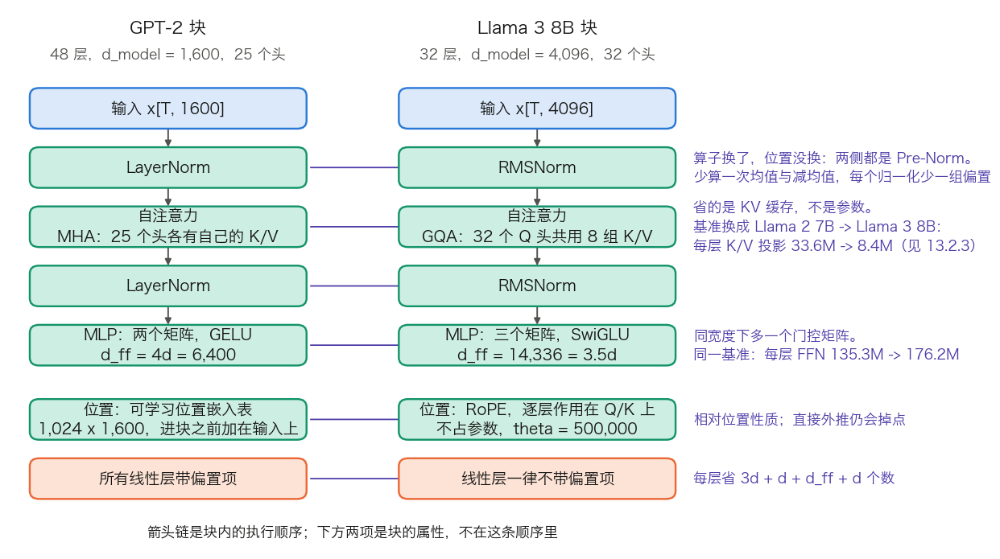
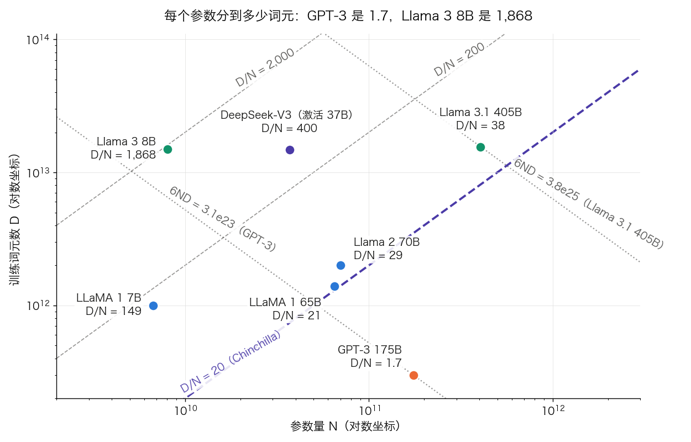

# 第十三章：解码器系列与主流 LLM

仅解码器（Decoder-Only）的 Transformer 架构已成为当代大语言模型的绝对主流。本章深入剖析从 GPT 到 Llama、DeepSeek 的技术演进，以及编码器-解码器模型（T5、BART）的设计选择。

本章按谱系而非难度排列：13.1 节到 13.3 节沿时间线走，从 GPT 的规模扩展，到 Llama 确立的“标准配方”，再到 DeepSeek、Gemini、Claude 这一批前沿模型；13.4 节单列编码器-解码器这条并行路线。可顺序通读，也可当模型手册按需跳读。

## 1. GPT 系列：从语言模型到通用能力平台的扩展之路

同一种仅解码器架构，从 1.17 亿参数走到不再公开规模的产品平台。本节回答三个问题：每一代到底改了哪个部件，改动换来什么、付出什么；公开配置怎样一项项加成标称的参数量与训练算力；哪些数字从 GPT-4 起已经不可考。算例沿用 3.7.7 节的 $12Ld^2$ 与 $6ND$ 两条速算，口径与 3.8 节的 GPT-3 Small 一致。

### 1.1 三代配置：把公开数字读成参数量

GPT-1（Radford 等人，2018 年）是一个 12 层的仅解码器模型，在 BooksCorpus 上做自回归预训练，再对每个下游任务微调。它与 BERT 几乎同时出现，选了相反的方向：BERT 用双向编码器做理解，GPT 用因果解码器做生成。三代之间规模改了三个数量级，架构只改了几处。

**改了哪几处。** GPT-2 把 LayerNorm 从子层之后移到子层之前，并在最后一个块之后补一次归一化（Pre-Norm，见 3.6 节）。论文的原话是归一化“was moved to the input of each sub-block”，另在最后一个自注意力块之后加一次。这一改让残差路径成为一条纯加法通道，深层梯度不再被逐层重新缩放，代价是残差流范数随深度增长、末端必须补那一次归一化。此后的 GPT 系与 Llama 系都沿用这一放置，它不是某一家的改动。同一代还把上下文从 512 扩到 1,024；词表从 40,478 扩到 50,257；残差路径上的权重按 $1/\sqrt{N}$ 缩放初始化，$N$ 是残差层数。GPT-3 沿用 GPT-2 的全部设定，只把注意力改成稠密与局部带状稀疏交替，上下文扩到 2,048。论文原话是与 GPT-2 用同样的模型和架构，“with the exception that we use alternating dense and locally banded sparse attention patterns”。也就是说，从 1 亿到 1750 亿，架构本身几乎没动。

**怎样把配置加成参数量。** 一个 GPT 块的权重分两部分：注意力的 Q、K、V、输出四个方阵共 $4d^2$，MLP 的两个矩阵共 $2d \cdot d_{ff}$。三代都取 $d_{ff} = 4d$，于是每层 $12d^2$，$L$ 层共 $12Ld^2$。再加词嵌入 $V \cdot d$ 与可学习位置嵌入 $n_{ctx} \cdot d$；归一化与偏置项只有千分之一量级，估规模时可忽略，逐位对账时要补回来。

GPT-1 代入 $L = 12$、$d = 768$、$V = 40{,}478$、$n_{ctx} = 512$：

$$
12 \times 12 \times 768^2 = 84{,}934{,}656
$$

$$
40{,}478 \times 768 = 31{,}087{,}104,\qquad 512 \times 768 = 393{,}216
$$

三项相加 116,414,976，再加 24 个 LayerNorm 各有权重与偏置的 $2 \times 24 \times 768 = 36{,}864$ 个数，与各线性层的 $12 \times 9 \times 768 = 82{,}944$ 个偏置（每层 `c_attn` 的 $3d$、`c_proj` 的 $d$、MLP 两个矩阵的 $4d$ 与 $d$，合计 $9d$），得 116,534,784，即常说的 1.17 亿。这个数可以逐项核对：Hugging Face 上 `openai-community/openai-gpt` 的张量总数是 119,680,512，差出来的 3,145,728 正好是 12 层各存一份 $512 \times 512$ 的因果掩码缓冲，不是参数。

GPT-3 代入 $L = 96$、$d = 12{,}288$：

$$
12 \times 96 \times 12{,}288^2 = 173{,}946{,}175{,}488
$$

$$
50{,}257 \times 12{,}288 = 617{,}558{,}016,\qquad 2{,}048 \times 12{,}288 = 25{,}165{,}824
$$

三项相加 174,588,899,328。GPT-3 的归一化与偏置按同样口径展开：193 个 LayerNorm（每层 2 个，末尾再 1 个）各有权重与偏置，$2 \times 193 \times 12{,}288 = 4{,}743{,}168$ 个数，各线性层的 $96 \times 9 \times 12{,}288 = 10{,}616{,}832$ 个偏置，合计 15,360,000。总计 174,604,259,328，与论文表 D.1 的 174,600M 相符。表 13-1 把三代并排。

| 项目 | GPT-1 | GPT-2 XL | GPT-3 175B |
| --- | ---: | ---: | ---: |
| 层数 $L$ | 12 | 48 | 96 |
| $d_{model}$ | 768 | 1,600 | 12,288 |
| Q 头数 $n_h$ | 12 | 25 | 96 |
| 每头宽度 $d_h$ | 64 | 64 | 128 |
| 上下文 $n_{ctx}$ | 512 | 1,024 | 2,048 |
| 词表 $V$ | 40,478 | 50,257 | 50,257 |
| 块参数 $12Ld^2$ | 84.9M | 1,474.6M | 173.9B |
| 嵌入（词 + 位置） | 31.5M | 82.0M | 0.64B |
| 参数量合计 | 116.5M | 1,557.6M | 174.6B |
| 嵌入占比 | 27.0% | 5.3% | 0.4% |
| 训练词元 $D$ | 未公开 | 未公开 | 300B |
| 训练算力 $6ND$ | — | — | $3.14 \times 10^{23}$ |
| 词元/参数 $D/N$ | — | — | 1.7 |

表 13-1：GPT 三代的配置与参数量对账。GPT-1、GPT-2 的层数、宽度、词表、上下文取自两篇论文与 `openai-community` 的 `config.json`；GPT-3 取自 [GPT-3 论文](https://arxiv.org/abs/2005.14165)表 2.1，训练词元与算力取自该文表 D.1。参数量由本节的算式复算，GPT-1 与 GPT-2 XL 已与 Hugging Face 检查点的张量数逐位对上。

这张表里有三条可以直接带走的结论。

**嵌入从 27% 掉到 0.4%。** 小模型的参数有四分之一花在查表上，这正是 GPT-1、GPT-2 绑定输入嵌入与输出投影的收益所在（权重绑定见 3.7.6 节）；到 GPT-3 这一项已无足轻重，绑不绑都只影响千分之几。

**宽度比深度涨得快。** 层数从 12 到 96 涨 8 倍，宽度从 768 到 12,288 涨 16 倍，而参数量随 $d^2$ 走，所以规模主要来自加宽。

**GPT-3 的训练词元远低于后来的共识。** $6ND$ 代入 $N = 1.746 \times 10^{11}$、$D = 3 \times 10^{11}$ 得 $3.14 \times 10^{23}$ FLOPs；除以 1 PF-day 的 $8.64 \times 10^{19}$ 得约 3,640 PF-days，与论文表 D.1 的 3.64E+03 一致。每个参数只分到 $300/175 = 1.7$ 个词元，而 Chinchilla 的算力最优配比约是 20。GPT-3 按今天的标准属于严重欠训练，这正是 13.2 节 Llama 路线的出发点。

### 1.2 零样本：GPT-2 的发现与它的限度

GPT-2 的发现是：足够大的语言模型不微调也能做多种任务。这句话常被读过头。论文自己报告的零样本翻译成绩是 WMT-14 英译法 5 BLEU，“slightly worse than a word-by-word substitution with a bilingual lexicon”；法译英 11.5 BLEU，仍远低于当时最好的无监督翻译系统的 33.5 BLEU。准确的说法是零样本能力初现且随规模上升，不是能正确完成任务。

### 1.3 少样本与上下文学习：示例在哪一步起作用

GPT-3 把这条线索做成了主张：只在提示里给几个示例，不改一个权重，模型就能完成任务。三种设置的区别只在提示里放什么。

- **零样本**（zero-shot）：任务描述加输入。
- **单样本**（one-shot）：任务描述加 1 个“输入 → 输出”示例，再加待解的输入。
- **少样本**（few-shot）：同上，示例增至 10 到 100 条，受上下文长度限制。

**机制上这三者没有区别，都是 Prefill。** 按 3.8.3 的轨迹，示例被拼进 Prompt，一次前向为每个位置算出 K 与 V 并写入缓存；随后生成答案的每一步，新位置的 Query 都能读到示例那些行。示例对模型的作用，就是让答案位置的注意力权重落在这些 K 上，进而改变读出的上下文向量。权重自始至终没有梯度，也没有更新，所以**上下文学习**（in-context learning）不是学习的一种，而是一次推理内部的条件化。

代价随之确定。示例占上下文，$K$ 条示例各长 $\ell$ 个词元，Prefill 的计算量按 $K\ell$ 线性增长，KV 缓存也按 $K\ell$ 占显存；同一批示例反复用时，前缀缓存可以把这笔 Prefill 省掉（见 11.5 节）。相对微调，上下文学习省掉训练，却要在每次请求里重付一遍示例的账。

> [!NOTE]
> “涌现”是否真实存在仍有争议。[一项对涌现能力的再分析](https://arxiv.org/abs/2304.15004)指出，许多被报告的涌现能力可能是评测指标选择的产物：用准确率、精确匹配这类非线性、不连续的指标衡量时，能力看似在某个规模“突然”出现；改用每词元交叉熵这类平滑连续的指标，模型表现其实随规模平滑、可预测地提升。谈“涌现”时应说清是在哪种指标下观察到的。

### 1.4 从 GPT-3 到 ChatGPT：补上的是后训练

GPT-3 是一个续写模型，给它一条指令，它可能续写出更多同类指令。从续写到助手，靠的不是加大规模，而是一条后训练流水线。[InstructGPT](https://arxiv.org/abs/2203.02155) 把它写成三步：用人工示范数据做监督微调（SFT）；收集同一提示下多个输出的人工排序，训练一个奖励模型（RM）；再以该奖励模型为奖励函数，用 PPO 微调 SFT 模型。

这条链路的说服力在一个对照：该文报告 1.3B 的 InstructGPT 在人工评测中优于 175B 的 GPT-3，参数量差 100 倍。也就是说，把预训练模型对齐到指令分布，其收益可以抵过两个数量级的规模。机制与实现见 8.1 节与 8.2 节，本节只需记住顺序：预训练决定能力上限，后训练决定这份能力以什么形式被取用。ChatGPT 是这条流水线加上对话格式与产品化的结果。

### 1.5 GPT-4 之后：哪些是公开事实，哪些不是

GPT-4（2023 年）支持文本与图像输入，在多项专业考试上接近人类水平。它同时是一条分界线：从这一代起，OpenAI 不再披露架构。[GPT-4 技术报告](https://arxiv.org/abs/2303.08774)第 2 节的原话是，鉴于竞争格局与安全考虑，“this report contains no further details about the architecture (including model size), hardware, training compute, dataset construction, training method, or similar”。

这句话给出了一条判据，读二手资料时可以直接套用：GPT-4 及以后的参数量、层数、是否 MoE、专家数、训练词元数，均**无一手来源**。网络上流传的具体数字来自推测或转述，本书不采信，也不据此计算。能够核实的只有接口侧的事实：模型支持哪些模态的输入输出、上下文与最大输出长度、有哪些工具能力，这些由官方模型页给出，属于快变事实，登记在 A.5 快变事实核验表。

同一条判据也适用于成本方向的叙述。小模型以远低于旗舰的价格提供接近的能力，这是 API 定价的可观察事实；但“它是用知识蒸馏加架构优化做出来的”属于对未披露训练方法的归因，没有来源。真正可核实的替代表述是：同一家厂商同期提供多个能力与价格档位，选型应按任务实测，而不是按档位名推断内部做法。

### 1.6 推理模型：收益怎么算，账单怎么算

**收益一侧。** o1 系列（2024 年）把计算从预训练挪到推理：回答之前先生成一段不对用户展示的推理过程。[o1 发布文](https://openai.com/index/learning-to-reason-with-llms/)给出的规模效应是，性能随强化学习（训练时计算）与思考时间（推理时计算）一起提升。AIME 2024 的成绩必须连口径一起引用，否则会夸大一倍：GPT-4o 平均解出 12%（1.8/15）；o1 单样本 74%（11.1/15），64 样本多数表决 83%（12.5/15），用学到的打分函数对 1,000 个样本重排序 93%（13.9/15）。把 83% 写成“正确率”会把多数表决的收益记到单次作答上。多采样与重排序本身的算式见 9.5 节。

**账单一侧。** 推理词元在接口上的语义有三条，都能在 [OpenAI 推理指南](https://developers.openai.com/api/docs/guides/reasoning)里查到：它们对 API 不可见；它们占用上下文窗口；它们按输出词元计费。用量对象里 `output_tokens_details.reasoning_tokens` 给出这一次用了多少。三条合起来决定了成本结构。

算一例。设一次请求输入 2,000 个词元，模型产生 8,000 个推理词元与 500 个可见词元。计费按 8,500 个输出词元，而不是 500；上下文占用是 $2{,}000 + 8{,}500 = 10{,}500$ 个词元；延迟由 8,500 轮解码决定，与可见输出只有 500 个词元无关。闭源模型的每轮耗时无从查证，只能借同量级的口径估：9.5.3 节按显存带宽算出 Llama 3 8B 每轮约 5 毫秒，8,500 轮即约 43 秒。换了模型这个数就不成立，能带走的是“延迟随推理词元数走”这条关系。推理词元是串行生成的，无法像并行采样那样靠批处理摊薄（见 10.1 节的访存瓶颈）。

**边界。** 该指南点明了两种失效情形。其一，生成的词元撞上上下文上限或 `max_output_tokens` 时，响应状态为 `incomplete`，此时可能一个可见词元都没产出，而输入与推理词元照样计费；指南建议起步时为推理和输出预留至少 25,000 个词元。其二，简单问题上的过度思考：`reasoning.effort` 提供 `none` 到 `max` 的若干档，调的是思考预算，不是策略类型；支持哪几档随模型而定，默认值也随模型而定。延迟敏感的路径应显式调低这一档并设上限，而不是依赖默认值。解码期强制预算的做法见 9.5.4 节，长思维链 RL 的训练侧见 14.6 节。

### 1.7 gpt-oss：一份可逐项复算的 OpenAI 配置

GPT-2 之后，OpenAI 主线模型的权重与配置不再公开，13.1.5 那条判据因此一直生效。gpt-oss（2025 年，120b 与 20b 两档）是主线之外的一个例外：权重与完整 `config.json` 都放了出来。它的价值不在能力排名，而在于让前面几节的“不可考”换回“可逐项复算”。

**架构六条，每条都有对应的取舍。** 残差流宽度 2,880，注意力与 MoE 块之前各做一次 RMSNorm，模型卡称这一放置沿用 GPT-2 的 Pre-LN。MoE 层每块 128 个专家（20b 为 32 个），每词元选 4 个，激活函数是 SwiGLU。注意力按 GPT-3 的做法在带状窗口与全稠密之间逐层交替，窗口宽 128；每层 64 个 Query 头、每头 64 维，配 8 个 K/V 头的 GQA；位置用 RoPE，稠密层再用 YaRN 把上下文扩到 131,072。每个注意力头在 softmax 分母上多一个可学习的偏置，即**注意力汇**（attention sink），作用是允许某个位置“谁也不看”。分词器是 `o200k_harmony`，201,088 个词元。MoE 权重量化为 MXFP4，每个参数 4.25 比特，这让 120b 能装进单张 80GB 显卡。

**复算模型卡的参数表。** 取 $d = 2{,}880$、专家中间宽度也是 2,880、$L = 36$。每层注意力的四个投影是

$$
2{,}880 \times 4{,}096 + 2 \times 2{,}880 \times 512 + 4{,}096 \times 2{,}880 = 26{,}542{,}080
$$

其中 4,096 是 $64 \times 64$ 的 Query 总宽，512 是 $8 \times 64$ 的 K/V 总宽；再加 8,000 个偏置与 64 个汇偏置，乘 36 层得 0.96B。每个专家是 SwiGLU 的三个矩阵 $3 \times 2{,}880^2 = 24{,}883{,}200$，128 个专家加路由器与各自的偏置，乘 36 层得 114.71B。嵌入与反嵌入 $2 \times 201{,}088 \times 2{,}880 = 1.16\text{B}$。三项相加 116.83B，与模型卡表 1 逐项相符。两档模型的分项、激活参数与每词元 KV 列在表 13-2。

| 部件 | gpt-oss-120b | gpt-oss-20b |
| --- | ---: | ---: |
| MLP（专家） | 114.71B | 19.12B |
| 注意力 | 0.96B | 0.64B |
| 嵌入 + 反嵌入 | 1.16B | 1.16B |
| 总参数 | 116.83B | 20.91B |
| 每词元激活参数 | 5.13B | 3.61B |
| 激活比 | 4.4% | 17.3% |
| 每词元 KV（BF16，全稠密口径） | 72 KiB | 48 KiB |

表 13-2：gpt-oss 两档模型的参数分解。前五行与 [gpt-oss 模型卡](https://arxiv.org/abs/2508.10925)表 1 一致，由本节算式复算；激活比与 KV 一行由前几行算出。激活参数按模型卡口径计入反嵌入、不计入嵌入。

**交替注意力省的是什么。** 36 层若全部稠密，每词元 $2 \times 36 \times 8 \times 64 \times 2 = 73{,}728$ 字节，131,072 个词元的单序列要 9.66 GB。实际只有 18 个稠密层按全长缓存，另外 18 个带状层每层只需留 128 行，合计 $4.83\text{ GB} + 4.72\text{ MB} \approx 4.84$ GB，正好减半。稀疏与滑动窗口的代价是带状层看不到远处的词元，只能靠稠密层传递全局信息；相关取舍见 14.7 节。

### 1.8 GPT-5 一代与版本细节的去处

GPT-5 之后，OpenAI 的迭代周期缩短到以月计，产品线按能力与成本分档，推理与非推理合流到同一主线模型族。对读者有长期价值的只有三件事：接口从 Chat Completions 迁向 Responses；推理预算成为一个显式参数；上下文与最大输出由模型页逐型号给出，不能跨型号套用。

具体的型号、发布日期、上下文长度、价格与退役公告都是快变事实，一律以 A.3 模型速查与 A.5 快变事实核验表为准。台账同时记录了一条易错的区分：ChatGPT 产品侧下线某个型号，不等于该型号的 API 已经退役，两者要分开写。

## 2. Llama 家族：开放权重如何改变 LLM 格局

13.1 节的账只能算到 GPT-3，再往后配置就不公开了。Llama 把账重新打开：权重、配置、论文都能拿到，参数量、KV 缓存、训练算力可以逐项复算。本节先把一份 `config.json` 读成这三笔账，再看每一代改动换来什么、付出什么，最后解释 Llama 最反直觉的一个选择：把小模型训到远超算力最优。

### 2.1 从 GPT-2 块到 Llama 块：五处改动各换来什么

Llama（2023 年）没有发明新结构，它把当时已被验证的五项改进装进同一个块，这套组合后来成为开放模型的共同起点。图 13-1 把两种块并排。

图 13-1：GPT-2 块与 Llama 3 8B 块的逐项对照（[生成脚本](https://github.com/yeasy/llm_internals/blob/main/tools/figures/ch13_block_diff.py)）。青绿标出改动的部件，橙色标出偏置项这一处删减。竖直箭头是块内的执行顺序，两侧相同：归一化在前，再读上下文，再逐位置加工。下方两项是块的属性而非流程步骤：位置嵌入表在进入第一个块之前就加到输入上，偏置项是所有线性层的共同设定。

五处改动的收益与代价列在表 13-3。

| 部件 | GPT-2 的做法 | Llama 的做法 | 换来什么 | 代价与备选 |
| --- | --- | --- | --- | --- |
| 位置 | 可学习位置嵌入表，加在输入上 | RoPE，每层作用在 Q、K 上 | 相对位置性质；不占参数；换上下文长度不必换表 | 直接外推到训练长度数倍会掉点，需位置内插、NTK 或 YaRN（见 4.3 节）；备选是 ALiBi |
| 归一化 | LayerNorm，放在子层之前 | RMSNorm，放在子层之前 | 少算一次均值与减均值，每个归一化少一组偏置 | 去掉中心化在部分任务上略有损失 |
| 激活 | 两个矩阵，GELU | 三个矩阵，SwiGLU | 同宽度下门控带来更强的表达 | FFN 从 $2d \cdot d_{ff}$ 变成 $3d \cdot d_{ff}$，须调小 $d_{ff}$ 才能持平（见 3.4 节） |
| 注意力 | MHA，每个头各有 K/V | GQA，若干 Q 头共用一组 K/V | KV 缓存按 $n_h / n_{kv}$ 成比例缩小 | K/V 表示变少，容量下降；参数几乎没省，省的是缓存 |
| 偏置项 | 各线性层都带 | 一律不带 | 每层少 $3d + d + d_{ff} + d$ 个数，实现更简洁 | 对表达能力的影响在这个规模下可忽略 |

表 13-3：Llama 块相对 GPT-2 块的五处改动。GPT-2 的做法取自 [GPT-2 论文](https://cdn.openai.com/better-language-models/language_models_are_unsupervised_multitask_learners.pdf)与 `openai-community/gpt2-xl` 的配置，Llama 的做法取自 [LLaMA 论文](https://arxiv.org/abs/2302.13971) 2.2 节与 [Llama 3 论文](https://arxiv.org/abs/2407.21783)表 3。

归一化这一行只换了算子，没换位置：Pre-Norm 从 GPT-2 起就是 GPT 系的做法（见 13.1.1），Llama 继承下来，改的是 LayerNorm 到 RMSNorm。把 Pre-Norm 记成 Llama 的收益是一处常见误读。

**SwiGLU 的宽度要重新取。** 三个矩阵而非两个，若仍取 $d_{ff} = 4d$，FFN 参数会多出一半。LLaMA 论文的做法是取 $\frac{2}{3} \times 4d$：

$$
\frac{8}{3} \times 4{,}096 = 10{,}922.67
$$

向上取到 256 的倍数得 11,008，正是 Llama 1 与 Llama 2 的 7B 在 `config.json` 里的 `intermediate_size`。Llama 3 8B 偏离了这条规则，取 14,336，即 $3.5d$，是 $8/3$ 规则的 1.31 倍。下一小节会看到这笔加宽的钱从哪来。

### 2.2 读懂 config.json：以 Llama 3 8B 为例

一份 `config.json` 里真正决定形状的只有七八个字段。表 13-4 把它们逐个对到 Hugging Face `LlamaDecoderLayer` 的模块名与权重形状，形状写法与 3.8.3 一致。

| 字段 | 取值 | 决定什么 | 对应模块与权重形状 |
| --- | ---: | --- | --- |
| `num_hidden_layers` | 32 | 块重复几次 | `model.layers.0` 到 `.31` |
| `hidden_size` | 4,096 | 残差流宽度 $d$ | 每个位置的向量 `x[T, 4096]` |
| `num_attention_heads` | 32 | Q 头数 $n_h$，$d_h = 4096/32 = 128$ | `self_attn.q_proj.weight[4096, 4096]` |
| `num_key_value_heads` | 8 | K/V 头数 $n_{kv}$，决定 KV 缓存 | `self_attn.k_proj.weight[1024, 4096]`、`v_proj` 同形 |
| `intermediate_size` | 14,336 | FFN 中间宽度 $d_{ff}$ | `mlp.gate_proj`、`up_proj` 各 `[14336, 4096]`，`down_proj[4096, 14336]` |
| `vocab_size` | 128,256 | 词表行数 | `model.embed_tokens.weight[128256, 4096]` |
| `tie_word_embeddings` | `false` | 输出投影是否复用嵌入表 | 另有 `lm_head.weight[128256, 4096]` |
| `rms_norm_eps` | 1e-05 | 归一化的数值下限 | `input_layernorm`、`post_attention_layernorm` 各 `[4096]` |
| `rope_theta` | 500,000 | RoPE 的基频 | 不占参数，逐层作用在 q、k 上 |
| `max_position_embeddings` | 8,192 | 训练时的上下文上限 | Llama 3.1 起改为 131,072 |

表 13-4：Llama 3 8B 的关键配置字段。取值与 `config.json` 一致，也与 [Llama 3 论文](https://arxiv.org/abs/2407.21783)表 3 的 8B 一列相符（论文的词表写作 128,000，发布权重的嵌入表另含特殊词元，共 128,256 行）。Hugging Face 的权重按 `[输出维, 输入维]` 存放，与本书 `[行, 列]` 的数据流写法互为转置。

注意 `num_attention_heads` 与 `num_key_value_heads` 是两个数。把它们混为一谈，KV 缓存会算大 4 倍，13.2.4 会给出这笔账。

### 2.3 参数量逐项对账：8.03B 是怎样加出来的

把表 13-4 的字段代进去。一层里有两块权重。

**注意力。** 四个投影，Q 与输出是方阵，K 与 V 因为只有 8 个头而变窄：

$$
\underbrace{4096 \times 4096}_{q\_proj} + \underbrace{2 \times 4096 \times 1024}_{k\_proj,\ v\_proj} + \underbrace{4096 \times 4096}_{o\_proj} = 41{,}943{,}040
$$

**FFN。** SwiGLU 的三个矩阵同宽：

$$
3 \times 4{,}096 \times 14{,}336 = 176{,}160{,}768
$$

两个 RMSNorm 各 4,096 个数。每层合计 $41{,}943{,}040 + 176{,}160{,}768 + 8{,}192 = 218{,}112{,}000$，32 层是 6,979,584,000。嵌入与 LM head 不绑定，各 $128{,}256 \times 4{,}096$，合计 1,050,673,152；再加最后一个 RMSNorm 的 4,096。总计：

$$
6{,}979{,}584{,}000 + 1{,}050{,}673{,}152 + 4{,}096 = 8{,}030{,}261{,}248
$$

即标称的 8.03B。这个数与 Hugging Face 检查点的张量总数完全一致，可以逐位复核。同法可得另外两档，列在表 13-5。

| 模型 | 注意力/层 | FFN/层 | 每层合计 | FFN 占比 | 嵌入 + LM head | 总参数 |
| --- | ---: | ---: | ---: | ---: | ---: | ---: |
| Llama 2 7B（MHA，$d_{ff}=11{,}008$，$V=32{,}000$） | 67.11M | 135.27M | 202.38M | 66.8% | 262.14M | 6,738,415,616 |
| Llama 3 8B（GQA，$d_{ff}=14{,}336$，$V=128{,}256$） | 41.94M | 176.16M | 218.11M | 80.8% | 1,050.67M | 8,030,261,248 |
| Llama 3.1 405B（126 层，$d=16{,}384$，$d_{ff}=53{,}248$） | 570.43M | 2,617.25M | 3,187.70M | 82.1% | 4,202.69M | 405,853,388,800 |

表 13-5：三档 Llama 的参数量逐项对账。配置取自各模型的 `config.json` 与 Llama 3 论文表 3，数值由本节算式复算；前两行与 Hugging Face 检查点的张量总数逐位一致。

三条结论从这张表直接读出。

**GQA 省下的参数很少。** 7B 到 8B，K/V 投影从每层 33.55M 降到 8.39M，每层只省 25.17M；同期 FFN 增加 40.89M，净增 15.73M。GQA 的意义不在参数。

**FFN 是每层的大头，且占比还在升。** 从 66.8% 升到 82.1%。两个原因：$d_{ff}/d$ 从 2.69 提到 3.5；而 GQA 下 K/V 投影的宽度固定为 $n_{kv} d_h = 1{,}024$，不随 $d$ 增长，注意力那一项因此相对缩水。13.2.1 那笔“加宽的钱从哪来”的答案就在这里：GQA 省下的参数被挪给了 FFN。

**大词表对小模型是真开销。** 8B 的嵌入与 LM head 占总量 13.1%，405B 只占 1.0%。词表从 32K 扩到 128K 换来更好的压缩率。Llama 3 论文报告英文样本从每词元 3.17 个字符提高到 3.94，相当于同样算力下多读约 24% 的文本。这笔收益由全系共享，代价却由小模型承担得更重。

### 2.4 GQA 省的是缓存不是参数：每词元多少字节

KV 缓存每词元要存的数是“K 与 V 两份 × K/V 头数 × 每头宽度 × 层数”，与 3.8.7 的算法一致。按 BF16 每个数 2 字节：

$$
\text{每词元字节} = 2 \times L \times n_{kv} \times d_h \times 2
$$

Llama 3 8B 代入 $L = 32$、$n_{kv} = 8$、$d_h = 128$：

$$
2 \times 32 \times 8 \times 128 \times 2 = 131{,}072 \text{ 字节} = 128 \text{ KiB}
$$

表 13-6 给出四档模型与一个反事实对照。

| 模型 | $L$ | $n_{kv}$ | 每词元 KV | 128K 上下文单序列 |
| --- | ---: | ---: | ---: | ---: |
| Llama 2 7B（MHA） | 32 | 32 | 512 KiB | 64.0 GiB |
| Llama 3 8B（GQA） | 32 | 8 | 128 KiB | 16.0 GiB |
| Llama 2 70B（GQA） | 80 | 8 | 320 KiB | 40.0 GiB |
| Llama 3.1 405B（GQA） | 126 | 8 | 504 KiB | 63.0 GiB |
| Llama 3.1 405B 若用 MHA | 126 | 128 | 8,064 KiB | 1,008.0 GiB |

表 13-6：每词元 KV 缓存与 128K 上下文下单条序列的占用，BF16 口径，$d_h = 128$。最后一行是反事实：把 405B 的 K/V 头数改回 128 会发生什么。405B 一行的 504 KiB 即 516,096 字节，与 10.2.7 节表 10-7 是同一个数，那里直接记作 516,096 B。

最后一行说明了 GQA 为什么必须在训练时就定下来。405B 若用 MHA，一条 128K 的序列要 1,008 GiB 缓存，单机装不下；改成 8 个 K/V 头后降到 63 GiB，仍然可观，但已进入分页管理与多卡切分能处理的范围（见 11.4 节）。反过来，已发布的 MHA 模型无法事后改成 GQA，只能靠续训转换或 KV 量化。

一个常见的误用：拿 70B 与 405B 的参数比 $70/405 = 17.3\%$ 去推断部署成本。这个比值适用于权重显存与每词元 FLOPs，不适用于 KV 缓存：后者之比是 $320/504 = 63\%$，因为缓存只随层数走，与宽度无关。

### 2.5 为什么把小模型训到远超 Chinchilla 最优

Chinchilla 回答的是：给定训练算力，$N$ 与 $D$ 怎样分配最省。LLaMA 论文换了一个问题。该文引言写明，Chinchilla 的目标“disregards the inference budget”，而在大规模服务时，首选的模型不是训得最快的那个，而是推理最快的那个；虽然把大模型训到某个水平可能更便宜，“a smaller one trained longer will ultimately be cheaper at inference”。该文举的例子是：Chinchilla 建议 10B 模型配 200B 词元，而他们发现 7B 模型训到 1T 词元后仍在继续变好。

这条论点的量化形式就是 $D/N$。图 13-2 把历代模型画在同一张对数图上。

图 13-2：参数量 $N$ 与训练词元数 $D$ 的对数图，斜虚线是 $D/N$ 等值线，点线是等算力线 $6ND = C$（[生成脚本](https://github.com/yeasy/llm_internals/blob/main/tools/figures/ch13_tokens_per_param.py)）。各点的数值取自对应论文，脚本文档注释里逐条标注了出处。落在同一条斜虚线上的模型，每个参数分到的词元数相同。

图里每个点背后的两个数与由它们算出的 $D/N$、$6ND$ 列在表 13-7。

| 模型 | 参数量 $N$ | 训练词元 $D$ | $D/N$ | $6ND$ |
| --- | ---: | ---: | ---: | ---: |
| GPT-3 175B | 174.6B | 300B | 1.7 | $3.14 \times 10^{23}$ |
| LLaMA 1 7B | 6.7B | 1.0T | 149 | $4.0 \times 10^{22}$ |
| LLaMA 1 65B | 65.2B | 1.4T | 21 | $5.5 \times 10^{23}$ |
| Llama 2 70B | 70B | 2.0T | 29 | $8.4 \times 10^{23}$ |
| Llama 3 8B | 8.03B | 约 15T | 约 1,868 | $7.2 \times 10^{23}$ |
| Llama 3.1 405B | 405.9B | 15.6T | 38 | $3.8 \times 10^{25}$ |

表 13-7：各代模型的词元/参数比与训练算力。LLaMA 1 的两行取自 [LLaMA 论文](https://arxiv.org/abs/2302.13971)表 2（7B 与 13B 训 1.0T，33B 与 65B 训 1.4T）；Llama 2 的 2T 取自 [Llama 2 论文](https://arxiv.org/abs/2307.09288) 2.1 节；405B 的 15.6T 与 $3.8 \times 10^{25}$ 取自 [Llama 3 论文](https://arxiv.org/abs/2407.21783)，该文用 $6ND$ 复算得 $3.79 \times 10^{25}$；8B 的 15T 按该文“a corpus of about 15T multilingual tokens”的语料口径记为约数。

**代价写在明面上。** Llama 3 8B 的 $D/N$ 约 1,868，是 Chinchilla 口径的九十多倍；$6ND$ 达到 $7.2 \times 10^{23}$，已经和 65B 级别的模型相当。换句话说，这笔训练算力花在了一个远非算力最优的模型上。Llama 3 论文对此有明确表述：他们的规模定律外推到 $3.8 \times 10^{25}$ FLOPs 建议训一个 402B 的模型配 16.55T 词元，而小模型被“train for much longer than is compute-optimal”，因为“the resulting models perform better than compute-optimal models at the same inference budget”。判据换成了每次推理的成本，训练那一笔一次性多付。

**这条选择对谁成立。** 只对推理量远大于训练量的场景成立。模型要服务数十亿次请求时，把 8B 训到 15T 换来的每次推理便宜是划算的；只跑几次实验的研究场景则相反，算力最优才是对的目标。

### 2.6 版本演进：每一代改的是哪一处

把前面几节的账按时间排开，每一代动的是不同的部件，表 13-8 按这条线索列出七代。

| 版本 | 参数规格 | 训练词元 | 上下文 | 改动的部件 |
| --- | --- | --- | --- | --- |
| Llama 1（2023） | 7B/13B/33B/65B | 7B、13B 为 1.0T；33B、65B 为 1.4T | 2K | 确立 RoPE + Pre-Norm/RMSNorm + SwiGLU 的组合；按推理预算选规模 |
| Llama 2（2023） | 7B/13B/70B | 2T | 4K | RLHF 后训练；70B 引入 GQA |
| Llama 3（2024） | 8B/70B | 约 15T | 8K | 词表 32K → 128K；全系 GQA；`rope_theta` 提到 500,000 |
| Llama 3.1（2024） | 8B/70B/405B | 405B 为 15.6T | 128K | 405B 为稠密 126 层；上下文靠继续预训练分六阶段扩到 128K |
| Llama 3.2（2024） | 1B/3B/11B/90B | — | 128K | 1B、3B 由 8B 一次性结构化剪枝得到，再用 8B/70B 的 logits 蒸馏；11B/90B 加视觉 |
| Llama 3.3（2024） | 70B | — | 128K | 后训练改进，使 70B 在若干基准上接近 3.1 405B |
| Llama 4（2025） | MoE 多档 | — | 因变体而异 | 从稠密转向 MoE |

表 13-8：Llama 系列版本演进，按“这一代改了哪个部件”组织。训练词元与上下文取自对应论文与模型卡；3.2、3.3、4 的词元数官方未给出完整口径，留空。各代的当前可用状态与型号列表属快变事实，见 A.5 快变事实核验表。

三处值得展开。

**405B 的规模是算出来的，不是拍的。** Llama 3 论文用 IsoFLOP 曲线拟合出 $N^{\star}(C) = AC^{\alpha}$，得 $(\alpha, A) = (0.53, 0.29)$，外推到 $3.8 \times 10^{25}$ FLOPs 的预算建议 402B 参数配 16.55T 词元，实际取 405B 与 15.6T。该文同时指出，算力预算越大，IsoFLOP 曲线在最低点附近越平坦，所以规模选得略有偏差影响不大。

**128K 上下文不是从头训的。** 8K 的标准预训练之后，再用约 800B 词元做继续预训练，分六个阶段逐级加长；每一级的通过判据有两条：短上下文评测完全恢复，且该长度下的“大海捞针”任务全对。这是上下文扩展的工程范式，见 14.7 节。

**选稠密而不是 MoE 是一个显式决策。** 该文在“Managing complexity”一节写明，选择标准稠密架构而非 MoE，是为了最大化训练稳定性；后训练也相应地只用 SFT、拒绝采样与 DPO，不用更复杂的算法。Llama 4 转向 MoE，正是这条取舍在新的约束下被重新做了一遍（MoE 的机制与各家配置见 14.2 节）。

**端侧模型的做法有公开记录。** Meta 的博客写明 1B、3B 由 Llama 3.1 8B 一次性结构化剪枝得到，再把 8B 与 70B 的 logits 作为词元级目标加进预训练阶段做蒸馏，蒸馏在剪枝之后用于恢复性能。这是剪枝与蒸馏组合使用的一个完整公开案例，方法本身见 10.5 节。

### 2.7 开放生态及其边界

Llama 1 的权重以研究许可发放后，数月内出现了大批微调衍生模型；Llama 2 改为宽松商用许可，把门槛进一步降低。它不是第一个开放的大模型，此前已有 OPT-175B 的研究申请制发放与完全开放的 BLOOM。但它是第一个在开放权重里同时具备强基础能力与宽松许可的系列，生态因此集中到这条线上。代表性工作包括斯坦福用 GPT-3.5 生成的 52K 条指令微调出的 Alpaca、基于用户分享的 ChatGPT 对话微调的 Vicuna，以及面向代码的 Code Llama。

这类工作的边界需要同样写清楚。

**“达到 ChatGPT 九成质量”的口径。** Vicuna 的这个说法来自以 GPT-4 为裁判、80 道题的初步评测，作者自己注明该方法不严谨。模型充当裁判有位置偏好、长度偏好等已知问题，评测方法见 8.6 节。

**模仿学到的可能只是风格。** [The False Promise of Imitating Proprietary LLMs](https://arxiv.org/abs/2305.15717) 的结论是，用闭源模型输出做模仿微调，能让输出风格迅速接近目标模型，却不能补上基础能力的差距；人工评分提升而知识密集型基准不动，正是这种情形的信号。

**许可约束随版本变化。** 能否用某个模型的输出训练别的模型，由该版本的许可条款决定，不同版本口径不同，选型时应直接读许可原文。

## 3. DeepSeek、Gemini 与其他前沿模型

13.2 节把一份稠密模型的配置读成了三笔账。稀疏模型要多算一笔：总参数与激活参数是两个数，显存按前者走，每词元 FLOPs 按后者走。本节以报告披露最充分的 DeepSeek 为主线，把“便宜”还原成可复核的因子；再看纯 RL 与蒸馏各自能把一个小模型推到哪里；最后对闭源两家只写已发表的方法，型号与版本一律指向台账。

### 3.1 DeepSeek-V2/V3：把成本拆成三笔账

DeepSeek-V2（2024 年）引入两项结构改动，V3（2024 年 12 月）沿用并放大。

- **多头隐向量注意力**（Multi-head Latent Attention，MLA）：不减少头数，而是把所有头的 K、V 压成一个低维隐向量，缓存里只存这个隐向量与一条带 RoPE 的旁路。机制与吸收投影见 10.2.7 节。
- **DeepSeekMoE**：用大量细粒度专家加共享专家，替代少量大专家。V2 是 160 个路由专家加 2 个共享专家，V3 是 256 个路由专家加 1 个共享专家、每词元选 8 个。路由与负载均衡见 14.2 节。

V3 的技术报告给出了完整的成本表，这让“只花了不到 600 万美元”第一次可以被逐项复算。表 13-9 把它拆开。

| 阶段 | H800 GPU 小时 | 按 2 美元/小时折算 | 这一笔买到了什么 |
| --- | ---: | ---: | --- |
| 预训练 | 2,664K | 532.8 万美元 | 14.8T 词元的主训练 |
| 上下文扩展 | 119K | 23.8 万美元 | 先扩到 32K，再扩到 128K |
| 后训练 | 5K | 1.0 万美元 | SFT 与 RL |
| 合计 | 2,788K | 557.6 万美元 | 一次完整训练运行 |

表 13-9：DeepSeek-V3 的训练成本，取自 [DeepSeek-V3 技术报告](https://arxiv.org/abs/2412.19437)表 1。2 美元/小时是该报告自设的租用单价假设，不是实际支出。报告同时写明，这个口径只包含 V3 的正式训练，不含此前在架构、算法、数据上的研究与消融实验。

**为什么能压到这个数。** 把预训练那一笔换算成算力就清楚了。按 $6ND$ 且 $N$ 取激活参数 37B：

$$
6 \times 3.7 \times 10^{10} \times 1.48 \times 10^{13} = 3.29 \times 10^{24} \text{ FLOPs}
$$

除以预训练消耗的 GPU 秒数 $2{,}664{,}000 \times 3600 = 9.59 \times 10^{9}$：

$$
\frac{3.29 \times 10^{24}}{9.59 \times 10^{9}} \approx 3.4 \times 10^{14} \text{ FLOPs/s}
$$

即每张卡平均约 340 TFLOP/s。这个结果把“便宜”分解成两个因子：其一，每词元只激活 37B 而不是 671B，$6ND$ 里的 $N$ 直接小一个数量级；其二，单卡有效算力不低，说明 FP8 训练与通信重叠确实生效了。作为对照，Llama 3.1 405B 的训练算力是 $3.8 \times 10^{25}$，是 V3 的 11.6 倍。这才是“成本差距”的可复核版本。

两处口径要写清。$6ND$ 忽略注意力，也不计 MTP 模块的额外前向，所以 340 TFLOP/s 是下界。把它换算成 MFU 需要 H800 的峰值算力规格，本书不给出未经一手核实的峰值数字，因此不写 MFU。

**激活比。** $37/671 = 5.51\%$。这个比值决定了权重显存与每词元计算量的分离：671B 参数按 FP8 存放也要约 671 GB，必须跨卡切分并配专家并行；而每词元的矩阵乘法只动其中 5.51%。批量小时大部分专家闲置，MoE 的效率优势在小批次下显著缩水（见 14.2.5）。

**MTP 的深度是 1。** V3 的多词元预测在下一个词元之外再多预测 1 个，报告的原话是“DeepSeek-V3 predicts the next 2 tokens through the MTP technique”；模块是顺序堆叠的，不是并行多头。报告给出第二个词元的接受率为 85%–90%，解码速度约 1.8 倍，推理时也可以直接丢弃 MTP 模块。把它当草稿头用于投机解码的算式见 10.6 节。

**每词元 KV。** V3 的 61 层每层只缓存 576 个数，每词元 70,272 字节；同配置若改用标准 MHA 是约 3.8 MiB，相差约 57 倍。数字与推导见 10.2.7 的表 10-7。

### 3.2 R1-Zero 与 R1：纯 RL 走到哪，蒸馏补上什么

DeepSeek-R1（2025 年 1 月）的贡献分两半：一个纯 RL 的实验结论，一条可复现的工程流水线。流水线四个阶段各自的输入、产出与样本量已在 14.6.3 节逐段列出并配图，本节不重复，只取与 DeepSeek 这条模型线索相关的三件事：纯 RL 能到什么程度、蒸馏做了什么、两者相比谁更划算。

**R1-Zero：不做 SFT，直接 RL。** 从 DeepSeek-V3-Base 出发，用 GRPO 做强化学习，奖励只有规则化的两项：答案是否正确，以及是否把思考过程写进 `<think>` 标签。[R1 论文](https://arxiv.org/abs/2501.12948)明确说明模板只约束格式，不约束内容，以便观察模型自发的变化。结果是 AIME 2024 的 pass@1 从 15.6% 升到 77.9%，再用自洽解码（即多数投票）取到 86.7%。训练中模型自发出现了自我反思、验证、动态调整策略等行为，论文称之为“顿悟时刻”。

这里有两处边界。其一，论文列举的涌现行为是 self-reflection、verification、dynamic strategy adaptation，不包括“对自身能力边界的认识”一类表述，转述时不要加码。其二，后续工作指出基座模型在 RL 之前已经会产生自我反思式输出，响应变长也部分来自目标函数的长度偏置，所以“顿悟”不宜当作定论（见 8.2.4 节）。

**GRPO 在这里落下的是一条数据要求。** GRPO 不训价值网络，而是对同一道题采一组回答，用组内均值与标准差把奖励标准化成优势；一格算术、零优势组与长度偏差都在 8.2.4 节，本节不重复。当组内**总奖励**完全相同时，标准差为 0；实现须在分母加小量或显式处理零方差，此时优势为零，奖励驱动的策略梯度消失。但 [R1 的目标函数](https://arxiv.org/html/2501.12948v1#S2.SS2.SSS1)另含 KL 正则项，KL 梯度仍可能非零；R1 还使用格式奖励，答案全对或全错不自动等于总奖励相同。数据难度应让模型有机会产生奖励可区分的回答，才能提供有效的相对优劣信号。R1 的四阶段流水线如何安排这批数据，见 14.6.3。

**蒸馏只做 SFT。** 论文用第三阶段那批约 80 万条样本直接微调 Qwen 与 Llama 的六个开源基座，得到 1.5B 到 70B 的蒸馏模型，并写明“for distilled models, we apply only SFT and do not include an RL stage”。这句话决定了这些模型的能力边界：它们继承的是 R1 的输出分布，没有经过自己的探索。

**自己 RL 不如被蒸馏。** 论文另做了一组对照回答“小模型能不能自己 RL 出来”：对 Qwen2.5-32B-Base 做超过 1 万步的大规模 RL，得到的 Qwen2.5-32B-Zero 在 AIME 2024 上 pass@1 为 47.0；而蒸馏得到的 DeepSeek-R1-Distill-Qwen-32B 是 72.6。结论是在这个规模上，从强模型蒸馏比自己 RL 更有效，也更省。这一条对开源小模型的做法有直接影响：有强教师可用时，先蒸馏再考虑 RL。

### 3.3 DeepSeek-V4：三项升级各解决什么

DeepSeek-V4（2026 年 4 月发布预览版，正式版 V4-Flash-0731 与 V4-Pro-0813 分别于 2026 年 7 月 31 日和 8 月 13 日发布，取代预览版）把重心转向百万词元上下文的效率。该系列包含两个 MoE 模型：V4-Pro 总参数 1.6T、每词元激活 49B，V4-Flash 总参数 284B、激活 13B，两者上下文长度均为 100 万词元，权重以 MIT 协议开放。预训练规模上，V4-Flash 用了 32T 词元，V4-Pro 用了 33T 词元。官方技术报告（[DeepSeek-V4: Towards Highly Efficient Million-Token Context Intelligence](https://arxiv.org/abs/2606.19348)）归纳为三项升级，每一项针对一个具体瓶颈。

- **混合注意力**，由压缩稀疏注意力（CSA）与高度压缩注意力（HCA）组合而成。它针对的是 MLA 解决不了的那一维：MLA 压缩每个词元的宽度，词元数量不变，百万词元时 70,272 字节乘一百万仍是约 70 GB。CSA 与 HCA 沿时间轴合并词元。效果是在百万词元设置下，V4-Pro 相比 DeepSeek-V3.2 只需 27% 的单词元推理浮点运算量（等效 FP8 口径）和 10% 的 KV 缓存。机制见 10.2.8 节。
- **流形约束超连接**（Manifold-Constrained Hyper-Connections，mHC），作用在相邻 Transformer 块之间的残差连接上。它针对的是深层堆叠下残差路径的信息混合方式，与 3.5 节讨论的残差流是同一条脉络。
- **Muon 优化器**，对大部分模块改用 Muon 以获得更快收敛与更好的训练稳定性，仅嵌入层、预测头、mHC 的静态偏置与门控因子以及 RMSNorm 权重保留 AdamW。这份模块清单本身说明了 Muon 的适用范围：它作用在矩阵形状的参数上，而嵌入表、归一化权重这类不构成矩阵乘法主体的参数仍交给 AdamW（见 6.1 节）。

从 V2 的 MLA、V3 的 FP8 与 MoE 规模化，到 V4 沿时间轴的压缩与 Muon，这条线索始终围绕同一件事：在既定算力预算下，把每一笔开销单独找出来压掉。

### 3.4 Gemini 与 Claude：公开了什么，没公开什么

公开资料没有给出这两家模型足以逐项复算参数与训练算力的完整配置，但“配置不完整”不等于“没有披露结构”。本节区分已经发表的设计事实与仍未公开的细节。

**Gemini：已披露的结构与长上下文评测。** [Gemini 1.5 报告第 3 节及模型卡](https://arxiv.org/html/2403.05530v5#S3)明确说明：1.5 Pro 使用稀疏 MoE Transformer；1.5 Flash 是稠密 Transformer 解码器，注意力与前馈分支并行计算，并接受来自 Pro 的在线蒸馏。这些是可讨论的架构选择，但不足以推算层数、专家数或参数总量。评测方面，报告给出三条结果：在跨模态的长上下文检索任务上接近满分；把上下文推到至少 1,000 万词元时，下一词元预测持续改善、检索召回仍高于 99%；同期对照的 Claude 3.0 是 20 万、GPT-4 Turbo 是 12.8 万词元。报告另给出一个不靠记忆的能力检验：给模型一本使用人数不足 200 人的 Kalamang 语语法手册，让它现场学习翻译。

要注意“标称上下文”与“有效上下文”是两个概念，长度上限不保证在全长范围内都能有效利用；评测方法与失效情形见 14.7 节。另一处常见误算：100 万词元不等于一百万行代码，实际能装下多少行取决于语言、注释密度与分词器。关于“原生多模态”与“后接视觉编码器”两种范式的比较见 14.4.4 节，未公开结构的模型不宜归入任何一侧。

**Claude：Constitutional AI 是一条两阶段流程。** [Constitutional AI](https://arxiv.org/abs/2212.08073) 把人类监督压缩成一份原则清单，其余环节由模型自己完成。监督阶段：从初始模型采样，让模型按原则对自己的回答生成批评与修订，再用修订后的回答微调原模型。RL 阶段：从微调后的模型采样出成对回答，用模型评判哪一个更好，以这份 AI 偏好数据训练偏好模型，再以它为奖励信号做 RL。论文称后半为 RLAIF。与 8.2 节的 RLHF 对照，唯一被替换掉的环节是偏好标注的来源，流程骨架不变。

**产品与版本细节的去处。** Claude Fable 5 与 Mythos 5 于 2026 年 6 月 9 日发布，6 月 12 日暂停访问后于 7 月 1 日恢复，但范围不同：Fable 5 已恢复全球访问；Mythos 5 仍非普遍可用，仅向 Project Glasswing 获批客户有限开放。型号列表、上下文与最大输出、当前代际、价格与 legacy 分组都会随官方模型页调整，一律以 A.5 快变事实核验表为准，不在正文枚举“当前阵容”。Artifacts 与 Computer Use 这类产品能力同理：它们改变的是模型被使用的方式，不改变本书讨论的计算结构；Computer Use 的机制归入智能体一章（见 14.5 节）。

### 3.5 稀疏模型的参数对账：为什么 8×7B 不是 56B

MoE 模型的标称参数常被误读。Mixtral 8x7B 的总参数是 47B 而非 56B，原因只有一个：复制的只有 FFN。按 `mistralai/Mixtral-8x7B-v0.1` 的配置（32 层、$d = 4{,}096$、32 个 Q 头配 8 个 K/V 头、专家中间宽度 14,336、8 个专家、每词元取 2 个、词表 32,000）逐项算。

每层注意力与 Llama 3 8B 同形，41,943,040；每个专家是一份 SwiGLU FFN，$3 \times 4{,}096 \times 14{,}336 = 176{,}160{,}768$；路由器 $4{,}096 \times 8 = 32{,}768$。每层合计：

$$
41{,}943{,}040 + 8 \times 176{,}160{,}768 + 32{,}768 + 8{,}192 = 1{,}451{,}270{,}144
$$

32 层是 46,440,644,608，加上不绑定的嵌入与 LM head $2 \times 32{,}000 \times 4{,}096 = 262{,}144{,}000$，再加最后一个 RMSNorm 的 4,096，得 46,702,792,704，即 46.70B，与检查点张量总数逐位一致。每词元只走 2 个专家，激活参数是 12,879,925,248，即 12.88B。各部件的分解与占比列在表 13-10。

| 部件 | 每层 | 32 层 | 占总量 |
| --- | ---: | ---: | ---: |
| 注意力（各层共用，不复制） | 41.94M | 1.34B | 2.9% |
| 8 个专家的 FFN | 1,409.29M | 45.10B | 96.6% |
| 路由器与 RMSNorm | 0.04M | 1.31M | 0.003% |
| 嵌入 + LM head | — | 0.26B | 0.6% |
| 总参数 | — | 46.70B | 100% |
| 每词元激活（Top-2） | 394.31M | 12.88B | 27.6% |

表 13-10：Mixtral 8x7B 的参数分解。配置取自官方 `config.json`，数值由本节算式复算，总数与 Hugging Face 检查点一致。

差额可以直接算出来。Mixtral 的稠密同门 Mistral 7B 在决定参数量的字段上与它逐项相同（宽度 4,096、32 层、32 个 Q 头配 8 个 K/V 头、`intermediate_size` 14,336、词表 32,000），只是每层一个 FFN 而非八个，参数量 7,241,732,096；八个这样的独立模型合计 57,933,856,768，即 57.93B，比 Mixtral 多出 11,231,064,064。多出来的几乎全是被复制了 7 遍的非 FFN 部件：注意力 $7 \times 32 \times 41{,}943{,}040 = 9{,}395{,}240{,}960$，嵌入与 LM head $7 \times 262{,}144{,}000 = 1{,}835{,}008{,}000$，两项合计 11,230,248,960；余下的 815,104 是归一化的七份副本扣掉只有 MoE 才有的路由器。MoE 只复制 FFN，其余部件仍只有一份。

这张表给出三条读稀疏模型标称值的规则。

**总参数决定显存，激活参数决定计算。** 46.70B 按 BF16 要约 93 GB，即约 87 GiB 权重显存（14.2 节按 GiB 记的就是这个数），而每词元的矩阵乘法只相当于 12.88B 的稠密模型。部署时前者定卡数，后者定吞吐。

**激活比随专家粒度变化很大。** Mixtral 是 27.6%（8 选 2），DeepSeek-V3 是 5.51%（256 选 8 加 1 个共享），gpt-oss-120b 是 4.4%（128 选 4）。细粒度路线把这个比值压得更低，代价是专家更多、All-to-All 通信更密。

**KV 缓存不随专家数变化。** Mixtral 与同形的稠密模型每词元 KV 完全相同，都是 $2 \times 32 \times 8 \times 128 \times 2 = 131{,}072$ 字节。MoE 省的是计算，不省缓存；要省缓存得动注意力那一侧，即 GQA、MLA 或沿时间轴压缩。

各家开放权重模型的专家数、Top-K、共享专家与总/激活参数列在 14.2 节的表 14-5；模型阵容随时间变化，当前口径见 A.5 快变事实核验表。引用参数量时只采用官方模型卡或技术报告的表述，不采用模型托管平台侧栏自动计算的元数据。

## 4. 编码器-解码器模型：T5 与 BART 的设计选择

13.1 到 13.3 沿仅解码器这一条线走完了三代模型，本节转向与它并行的另一条谱系。5.3 节已经讲过片段破坏与去噪自编码这两个预训练目标，以及三种注意力掩码形状的关系；此处不重复目标函数，只回答架构侧的三个问题：同样是“两个堆栈”，参数到底怎么分；推理时它比仅解码器多出哪一份缓存；在通用对话让位给仅解码器之后，它今天还在哪里现役。

### 4.1 两条线索的起点

**T5**（Text-to-Text Transfer Transformer，Raffel 等人，2019 年）把所有 NLP 任务统一成文本到文本，用任务前缀区分任务；预训练目标是片段破坏，输入里每段连续被破坏的词元换成一个哨兵，目标只生成被破坏的部分。**BART**（Lewis 等人，2020 年）把预训练视为序列去噪：对输入施加噪声，让解码器重建完整原文。两者的目标函数细节、哨兵样例与长度账见 5.3.2 与 5.3.3。

一处术语要分清，5.3 与本节沿用同一套译法。T5 的 Span Corruption 译作**片段破坏**，只生成被遮的片段；BART 的 Text Infilling 译作**文本填充**，每段换一个掩码词元且重建全文。两者都可以被叫成“填空”，但目标串长度差一个数量级，混用会让 5.3.3 的长度账失去意义。BART 论文里的掩码写作 `[MASK]`，fairseq 与 Hugging Face 实现中的词元是 `<mask>`。

BART 的五种噪声是消融对象而非配方。[BART 论文](https://arxiv.org/abs/1910.13461)表 1 给出的结论是：单独使用文档旋转或句子排列都明显变差，文本填充单独使用已接近最好；最终的大模型采用文本填充加句子排列，遮盖 30% 的词元并打乱全部句子。引用“组合效果最好”时应带上这个限定：句子排列的增益主要出现在摘要任务上。

### 4.2 参数怎么分：T5-Base 的 43 比 57

“编码器和解码器各占约一半参数”是一个流传很广的近似，它不准确。解码器每层比编码器每层多一组交叉注意力。按 `google-t5/t5-base` 的配置算（$d = 768$、$d_{ff} = 3{,}072$、12 个头每头 64 维、编码器与解码器各 12 层、词表 32,128，T5 的线性层不带偏置）。

一组注意力的四个投影：

$$
4 \times 768 \times 768 = 2{,}359{,}296
$$

T5 v1.0 的 FFN 是两个矩阵：

$$
2 \times 768 \times 3{,}072 = 4{,}718{,}592
$$

编码器每层是“一组注意力 + FFN + 两个归一化”，$2{,}359{,}296 + 4{,}718{,}592 + 1{,}536 = 7{,}079{,}424$。解码器每层多一组交叉注意力与一个归一化，$9{,}439{,}488$。12 层分别是 84,953,088 与 113,273,856，再各加一次堆栈的最终归一化与相对位置偏置表（检查点里编码器 1 张、解码器 2 张，每张 $32 \times 12$），得 84,954,240 与 113,275,392；共享嵌入 $32{,}128 \times 768 = 24{,}674{,}304$。三项相加 222,903,936，与检查点张量总数一致。

$$
\frac{84{,}954{,}240}{84{,}954{,}240 + 113{,}275{,}392} = 42.9\%
$$

编码器占两个堆栈的 42.9%，不是一半。交叉注意力这一项占总参数的 12.7%，与 [T5 论文](https://arxiv.org/abs/1910.10683)所说的“编码器-解码器注意力层的参数约占总量 10%”是同一件事，该文取的是跨多个规模的近似。

**“参数效率低”这句话要挑口径。** $L+L$ 层的编码器-解码器有 $2P$ 个参数、$M$ 的计算量，这条对照与表 5-4 的六组成绩都在 5.3.6 节，此处只补该节没有展开的一步：该文 3.2 节写明，编码器-解码器与单堆栈模型无法同时按参数量和计算量比较，$L+L$ 层在参数量上约等于 $2L$ 层的语言模型，在计算量上只约等于 $L$ 层。它因此另测了一行按参数量对齐的配置：两个堆栈共享参数，$P$ 个参数、$M$ 的计算量，成绩仍高于同为 $P$、$M$ 的仅解码器。两种口径下“参数效率低”都不成立。它真正多付的在推理侧：不共享参数时权重显存翻倍，另有一份交叉注意力缓存与整段重编码，见 13.4.3。

这条结论也不能反向外推到“编码器-解码器一定更强”。[Wang 等人的系统评估](https://arxiv.org/abs/2204.05832)在 5B 参数（编码器-解码器一档为 11B）、168B 词元的规模上给出了两面的结果：纯无监督预训练之后，因果仅解码器配自回归目标的零样本泛化最强，编码器-解码器明显落后；但接一轮多任务提示微调后，输入段带非因果可见性、用掩码目标预训练的模型最好。哪一半成立，取决于模型交付时是“预训练完直接提示”还是“先做多任务微调”。

### 4.3 推理时的两份缓存

仅解码器只有一份 KV 缓存，逐轮追加。编码器-解码器在增量生成时有两份，形态不同。

- **解码器自注意力的 K/V**：随生成长度增长，每生成一个词元追加一行，与 3.8.6 的 Decode 完全相同。T5-Base 每词元 $2 \times 12 \times 768 \times 2 = 36{,}864$ 字节。
- **交叉注意力的 K/V**：由编码器输出一次算好，长度等于输入长度，此后每一步都读同一份，不再变化。输入 512 个词元时是 $2 \times 12 \times 768 \times 512 \times 2 = 18{,}874{,}368$ 字节，约 18 MiB，与生成了多少个词元无关。

编码器整段只跑一次。对应到实现，Hugging Face 的 `T5ForConditionalGeneration` 在生成时把编码器结果放在 `encoder_outputs` 里跨步复用，把两份 K/V 一起放在 `past_key_values` 里；`generate` 内部只在第一步计算 `encoder_outputs`。

**多轮对话的累计处理量是真正的分水岭。** 仅解码器的历史前缀是因果的，它的 K/V 一次算好就永远有效，每轮只需 Prefill 新增的部分。编码器是双向的，输入每变长一次，所有位置的表示都会改变，整段必须重算。设 10 轮对话，每轮新增 500 个词元：

$$
\text{仅解码器：}10 \times 500 = 5{,}000
$$

$$
\text{编码器-解码器：}500 \times (1 + 2 + \cdots + 10) = 27{,}500
$$

相差 5.5 倍。仅解码器一侧随轮数线性增长，编码器-解码器一侧按平方增长，轮数越多差距越大。跨请求共享同一前缀的前缀缓存同样只对因果结构成立（见 11.5 节）。这一条比“参数效率”更接近仅解码器胜出的真实原因。

### 4.4 让仅解码器胜出的三条工程理由

5.3.7 已给出四条论据，其中缓存形态与系统简单性两条只到定性。这里把它们换成算过的量，并补上第三条。

**缓存复用。** 13.4.3 的 5.5 倍。通用助手的主要形态是多轮对话与长对话历史，这笔开销直接落在每一轮的首词元延迟上。

**统一的序列格式。** 示例、指令、工具返回结果、历史回复在仅解码器里都只是前缀，不需要区分“输入段”与“输出段”。编码器-解码器要为每一种新内容决定放进编码器还是解码器，而工具调用的结果在时间上晚于最初的输入，放进编码器就意味着整段重算。

**单一堆栈更好切。** 张量并行的切分、流水线的分段、推理引擎的调度都只需处理一种层（见 11.8 节）。两个形状不同的堆栈要各自调优，流水线分段还要处理编码器与解码器负载不均。

### 4.5 编码器-解码器今天在哪里

“被淘汰”是误判。它让出的是通用对话这个最大的场景。语音识别、机器翻译、固定模板的条件生成这三类任务仍以它为首选，共同特征与理由见 5.3.7 节末段。

本节要补的是第四类，也是与前三类形态不同的一类：**文生图与文生视频模型里的文本编码器**。提示词被编码成一组条件向量，交给扩散模型的交叉注意力反复读取，整个去噪过程读的是同一份编码结果。这类系统里 T5 的编码器常被单独取出使用，解码器弃置不用，因为需要的只是“把一段文本读成一组双向表示”这半个模型。这正好落在 13.4.3 那份交叉注意力缓存的优势侧：长度固定、算一次、读很多次。

后续工作也没有停。Flan-T5 把大规模指令微调加在 T5 上，走的正是 13.4.2 后半个结论所指的那条路径。[UL2](https://arxiv.org/abs/2205.05131) 提出混合去噪器（Mixture-of-Denoisers），把三类去噪任务合进同一次预训练：R 类是 T5 式的常规片段破坏，片段长 2 到 5、遮盖约 15%；S 类是严格顺序的前缀语言建模，把序列切成上下文与目标两段；X 类是极端去噪，遮盖约 50% 的输入，逼模型从有限信息生成长目标。下游使用时用一个模式切换词元指明套用哪一类，这就是**模式切换**（mode switching）。UL2 的意义不在某个模型，而在它把“架构”与“预训练目标”这两件常被混为一谈的事拆开了：同一种掩码形状可以配不同的目标，反之亦然。
