# 第十四章：架构创新与未来趋势

Transformer 并非终点。自注意力的 $O(n^2)$ 瓶颈、日益增长的模型规模和对更强推理能力的需求，推动着架构向多个方向演进。本章探讨高效注意力、混合专家模型、状态空间模型、多模态 Transformer 等前沿方向，深入分析 AI Agent 与工具调用如何让 LLM 从“对话”走向“行动”，介绍推理时计算扩展如何让模型学会深度思考，系统梳理长上下文技术从工程实现到有效利用的完整图景，走进机制可解释性、尝试打开模型权重这个“黑箱”，最后把各条线索连成一份展望，分清其中哪些已有机制解释、哪些仍是经验规律、哪些只是作者的判断。

本章要回答的问题是：把 softmax 换成一块固定大小的状态，能省掉什么、又会丢掉什么（[14.1 节](14.1_efficient_attention.md)）？模型凭什么不必用上全部参数（[14.2 节](14.2_moe.md)）？线性递推的状态空间模型与注意力按什么比例混合才划算（[14.3 节](14.3_ssm_hybrid.md)）？输入不再只是文本词元，图像该怎么变成词元（[14.4 节](14.4_multimodal.md)）？模型如何从“说”走到“做”（[14.5 节](14.5_agent_tool_use.md)）？“推理”这一步能做多厚（[14.6 节](14.6_test_time_scaling.md)）？有长上下文与用好长上下文差在哪（[14.7 节](14.7_long_context.md)）？不听模型自述，怎么读出它学到的算法（[14.8 节](14.8_interpretability.md)）？这些线索合起来，哪些问题已经收口、哪些还敞着（[14.9 节](14.9_outlook.md)）？

## 1. 高效注意力：突破平方复杂度的瓶颈

标准自注意力的 $O(n^2)$ 复杂度（[2.5 节](../02_attention/2.5_complexity_limits.md)已详细分析）是 Transformer 处理超长序列的根本瓶颈。本节回答三个问题：把 softmax 拿掉之后，注意力变成什么；变成的那个东西为什么只需要一块固定大小的状态；固定状态换来的效率，代价是丢了什么。

承接的缺口来自 [3.8 节](../03_components/3.8_gpt_inference_flow.md)的瓶颈三：KV 缓存随序列线性增长，先吃显存容量，再吃显存带宽。本节的两条路线分别从两个方向动它——稀疏注意力少读几块缓存，线性注意力用固定状态替代逐词元缓存。14.3 节将说明哪些状态空间模型可与门控线性注意力对应，以及这种对应的结构前提。

### 1.1 两类“高效”的分界

[2.5.6 节](../02_attention/2.5_complexity_limits.md)的表 2-13 已按“是否精确”把应对平方复杂度的思路分成四类。本节只取其中一条分界：改变注意力数学结构的方案（稀疏、线性、状态空间模型），与保持原算子数学定义、只动 IO 与缓存布局的实现优化（FlashAttention 见 [10.3 节](../10_inference_optimization/10.3_flash_attention.md)，PagedAttention 见 [11.4 节](../11_serving/11.4_kv_memory_management.md)）。MQA/GQA 改变头之间的参数共享，MLA 改变投影的参数化，属于模型结构设计（[10.2 节](../10_inference_optimization/10.2_kv_cache.md)），不能把已有 MHA 检查点直接换成它们并保持原结果；转换通常需要重新训练或续训。[GQA 论文](https://arxiv.org/abs/2305.13245)给出的正是从 MHA 检查点续训的方案。

这条分界的实际后果是训练成本与验证范围。FlashAttention 把中间的 `[n, n]` 分数矩阵留在片上，不改变稠密注意力的数学定义，通常不必重训，但仍须验证浮点误差与任务质量。块稀疏注意力改变参与 softmax 的位置，通常会改变输出；能否直接用于已训练模型、是否需要续训，要由具体方法与质量评测决定。本节讨论改变结构的路线。

### 1.2 线性注意力：从核化到递推状态

记号沿用第 3 章起的一套（见 [3.8.7 节](../03_components/3.8_gpt_inference_flow.md)表 3-28）：每头宽度记作 $d_h$，第 2 章的数学推导把同一个量记作 $d_k$。本节另需一个 $d_v$，它是线性注意力状态矩阵的第二维，即 Value 每头的宽度；真实配置里两者相等，分开写只为让状态矩阵的形状可读。

**问题。** 一次解码，softmax 注意力要把当前 Query 与缓存里的全部 Key 打分。缓存有多长，这一步就有多大。有没有办法把“历史”压成一块固定大小的东西，使每步开销与已有长度无关。

**第一步：把 softmax 写成通式。** 位置 $i$ 的输出是各位置 Value 的加权平均，权重由某个相似度函数给出（[Katharopoulos 等的线性 Transformer](https://arxiv.org/abs/2006.16236) 式 3；原式求和到 $N$，下式已按因果情形截到 $j \le i$，对应该文式 8）：

$$
y_i = \frac{\sum_{j=1}^{i}\operatorname{sim}(q_i, k_j)\, v_j}{\sum_{j=1}^{i}\operatorname{sim}(q_i, k_j)}
$$

取 $\operatorname{sim}(q,k) = \exp(q^Tk/\sqrt{d_h})$，这就是第 2 章的缩放点积注意力。分母正是 softmax 的行和。

**第二步：选择可分解的核。** 非负相似度可以用于上述加权平均，但非负并不足以保证它能写成共享特征映射的内积。本节选择具有可计算的有限维特征表示的核：$\operatorname{sim}(q,k) = \phi(q)^T\phi(k)$，并要求相似度非负、分母非零。记特征维度为 $r$，它不必等于输入头宽 $d_h$。代入后，$\phi(q_i)^T$ 与求和下标 j 无关，可以提到外面：

$$
y_i = \frac{\phi(q_i)^T \sum_{j\le i}\phi(k_j)v_j^T}{\phi(q_i)^T \sum_{j\le i}\phi(k_j)}
$$

两个和仍以 $i$ 为前缀上限，但不再需要为每个历史位置与当前 Query 单独打分。分子的和是一个 $[r, d_v]$ 的矩阵，分母的和是一个 $[r]$ 的向量。这两块概括了当前前缀。

**第三步：形状对照。** 图 14-1 的上半幅把同一核的两种相乘顺序并排画出，先不加因果掩码。按 Llama 3 8B 的单头宽度取 `d_h = d_v = 128`（见 3.8.7 的表 3-25），并为本算例选择 `r = d_h = 128`：

- 先算打分矩阵：`φ(Q)[n, 128] × φ(K)ᵀ[128, n] → 分数[n, n]`，再 `分数[n, n] × V[n, 128] → 分子[n, 128]`。
- 先算状态矩阵：`φ(K)ᵀ[128, n] × V[n, 128] → S[128, 128]`，再 `φ(Q)[n, 128] × S[128, 128] → 分子[n, 128]`。

两条路在数学上给出相同的分子，输出还须除以对应的归一化分母；括号打在哪里决定中间那块是 `[n, n]` 还是 `[128, 128]`。指数点积核也有特征内积表示，但通常需要无限维特征，无法直接压成这里的小型有限维状态。Performer 用有限随机特征近似指数核，因而引入近似误差；这与改选 ELU+1 特征定义另一种核是两条路线。

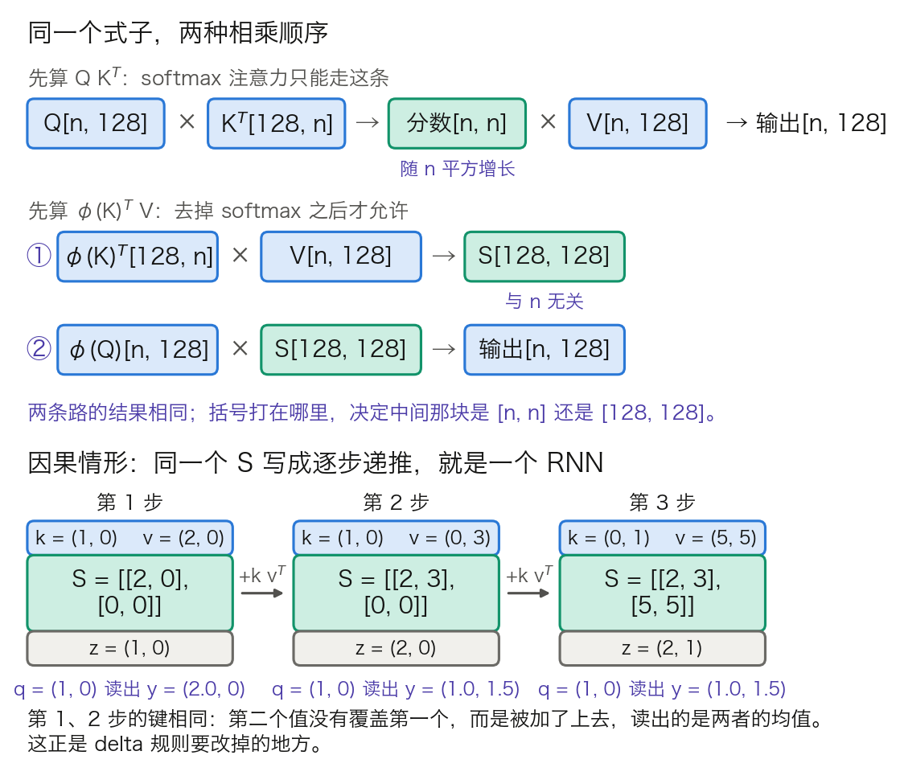

图 14-1：同一个式子的两种相乘顺序，以及因果情形下的递推状态（[生成脚本](https://github.com/yeasy/llm_internals/blob/main/tools/figures/ch14a_linear_state.py)）。上半幅的 Q/K 按核特征理解，展示分子计算，取 `r = 128`。蓝色是随输入变化的数据，青绿色是本轮新算出的中间量。上半幅第二条路上的 ① ② 标出相乘的先后；下半幅的数值即 14.1.2 第五步的三步手算。

**第四步：因果掩码把求和变成前缀和。** 因果情形下第 $i$ 步只加到 $j \le i$，于是两个和都是前缀和，可以增量维护（原论文式 16 到 20）：

$$
\begin{aligned}
S_t &= S_{t-1} + \phi(k_t)v_t^T && [r, d_v] \\
z_t &= z_{t-1} + \phi(k_t) && [r] \\
y_t &= \frac{\phi(q_t)^T S_t}{\phi(q_t)^T z_t} && [d_v]
\end{aligned}
$$

这三行就是一个 RNN：$(S, z)$ 是隐状态，每步读一次、写一次，形状不随 $t$ 变化。该论文的标题“Transformers are RNNs”说的正是这件事。$\phi$ 的常见取法是 $\phi(x) = \operatorname{elu}(x) + 1$（原论文式 7，选 elu 而非 relu 是为了避免负半轴梯度为 0）；Performer 改用随机特征去逼近指数核。

**第五步：三步手算。** 取 $r = d_h = d_v = 2$、$\phi$ 为恒等映射；本例的 Q/K 非负且读出分母非零。初始 $S_0 = 0$、$z_0 = 0$。三步的输入见图 14-1 下半幅：

- 第 1 步，$k_1 = (1,0)$、$v_1 = (2,0)$。外积 $k_1v_1^T$ 只有左上角非零，$S_1 = [[2,0],[0,0]]$，$z_1 = (1,0)$。用 $q = (1,0)$ 读出：分子 $(2,0)$，分母 $1$，$y = (2,0)$，正是刚写进去的值。
- 第 2 步，$k_2 = (1,0)$、$v_2 = (0,3)$。键与上一步相同。$S_2 = [[2,3],[0,0]]$，$z_2 = (2,0)$。同一个 $q = (1,0)$ 读出分子 $(2,3)$、分母 $2$，$y = (1, 1.5)$。
- 第 3 步，$k_3 = (0,1)$、$v_3 = (5,5)$。新键写进第二行，$S_3 = [[2,3],[5,5]]$。$q = (1,0)$ 只读第一行，$y$ 仍是 $(1, 1.5)$。

第 2 步是关键：两个值写在同一个键上，后来的没有覆盖先前的，而是被加了上去，读出的是两者的均值。分母 $z$ 只做归一化，改不了这一点。14.1.3 的 delta 规则正是冲着这里来的。

**第六步：账。** 沿用 Llama 3 8B 的配置（`d_model = 4096`、32 个 Query 头、8 个 KV 头、`d_h = 128`、32 层），对比的线性注意力仍取 `r = d_h = d_v = 128`：

- GQA 每层每词元的 KV 是 `2 × 8 × 128 = 2048` 个数，全模型 `2048 × 32 = 65,536` 个数，BF16 下 128 KiB/词元。
- 同宽的线性注意力每层要存 32 个头各一块 `[128, 128]` 的状态，即 `32 × 128 × 128 = 524,288` 个数，外加 `32 × 128 = 4096` 个数的分母。
- 交叉点 `524,288 ÷ 2048 = 256` 个词元。短于 256 时线性注意力反而更占显存，长于 256 才开始省；到 100 万词元时，KV 缓存是固定状态的 3906 倍。

计算量的账同样一边倒。单头解码一步，softmax 要对 $n$ 行各做一次打分和一次读取，约 $2nd_h$ 次乘加；线性注意力读一次状态、写一次状态，约 $2d_h^2$ 次，与 $n$ 无关。表 14-1 代入数字。

| 已有长度 n | softmax 每头乘加次数 | 线性注意力每头乘加次数 | 比值 |
| ---: | ---: | ---: | ---: |
| 256 | 65,536 | 32,768 | 2.0 |
| 4,096 | 1,048,576 | 32,768 | 32 |
| 131,072 | 33,554,432 | 32,768 | 1,024 |
| 1,048,576 | 268,435,456 | 32,768 | 8,192 |

表 14-1：单个注意力头解码一步的乘加次数，`d_h = 128`。softmax 一列按 $2nd_h$ 算，线性注意力一列按 $2d_h^2$ 算。这两列只数注意力本身；每层 FFN 与投影的开销两者相同，在总账里往往仍占大头（见 3.8.8）。

**第七步：代价在哪。** $S$ 是一个 `[128, 128]` 的矩阵，秩至多 128。往里写 $m$ 个键值对，只要 $m > 128$，这些特征键就不可能线性无关，不能保证任意键值关联都能独立保存、精确读回。softmax 注意力保留全部 $n$ 个位置的 KV，避开了这一固定状态瓶颈，但并不保证任意检索：在相同掩码和位置偏置下，两个相同 Key 的得分与权重相同，两个位置的 Value 会被混合；近似 Key 与有限精度也可能使区分更困难。

这不是工程缺陷，是维度决定的。固定状态越小，能无损记住的东西越少；一旦写入量超过容量，先丢的往往是久远且只出现过一次的内容。逐字复制长串、在长文里回头找一个具体编号，是最容易暴露的两类任务。14.3.6 会给出同一结论在 SSM 上的表述。

### 1.3 delta 规则与门控：把“累加”改成“改写”

14.1.2 第 2 步的毛病是：同一个键上的新值只会被累加。**delta 规则**（delta rule）的做法是先把该键上的旧值读出来减掉，再写新值。这里的 Key 先做 L2 归一化，满足 $\lVert k_t\rVert_2 = 1$；[Gated DeltaNet 的实现](https://github.com/fla-org/flash-linear-attention/blob/main/fla/layers/gated_deltanet.py)在内核中完成这一步：

$$
S_t = \left(I - \beta_t k_t k_t^T\right)S_{t-1} + \beta_t\, k_t v_t^T
$$

此处取 $r = d_h$，状态为 $S \in \mathbb{R}^{d_h \times d_v}$、读出为 $q_t^T S_t$；文献中常按转置约定写成 $S_{t-1}(I - \beta_t k_tk_t^T) + \beta_t v_tk_t^T$，两者等价。其中 $\beta_t \in [0,1]$ 是写入强度。$\beta_t = 0$ 表示这一步什么也不写；$\beta_t = 1$ 时，当前单位键方向满足 $k_t^T S_t = v_t^T$，但与它不正交的其他键的读出也可能改变。未归一化时这个保证不成立：标量 `k = 2`、`v = 3`、旧状态为 0，写入后状态为 6，按同一键读出是 12。把 14.1.2 的同一组单位键代进去（$\beta = 1$，记号按行读写，$k^T S$ 即该键上的旧值）：

- 第 1 步，旧值 $(0,0)$，减掉等于没减，$S_1 = [[2,0],[0,0]]$，读出 $(2,0)$。
- 第 2 步，先读出该键上的旧值 $(2,0)$ 并减掉，再写入 $(0,3)$，得 $S_2 = [[0,3],[0,0]]$。同一个 $q = (1,0)$ 读出 $(0,3)$，就是新值本身，不再是均值。
- 第 3 步换了键，旧值为 $(0,0)$，$S_3 = [[0,3],[5,5]]$，读第一行仍得 $(0,3)$。

对照 14.1.2 的 $(1, 1.5)$ 与这里的 $(0,3)$：累加得到的是历史平均，delta 规则在当前单位键方向恢复最近一次写入。本例不同键相互正交，所以第 3 步不影响第一个键；一般输入仍会有键间干扰。

**门控**（gating）解决另一半问题：旧内容该什么时候退场。做法是在递推里乘一个逐通道的衰减因子 $\alpha_t \in (0,1)$：

$$
S_t = \alpha_t \odot \left[\left(I - \beta_t k_t k_t^T\right)S_{t-1}\right] + \beta_t\, k_t v_t^T
$$

$\alpha_t$ 由当前输入算出，于是“忘多少”也成了随内容变化的决策。这一项与 14.3 节 Mamba 的 $\bar{A}_t = \exp(\Delta_t A)$ 是同一个东西，只是那边从连续系统离散化推出来，这边直接参数化。**Gated DeltaNet** 是这条路线的代表；Moonshot 的 **Kimi Delta Attention**（KDA，见 [Kimi Linear](https://arxiv.org/abs/2510.26692)）在其上引入更细粒度的门控。

**数值稳定性是真实代价。** KDA 的分块并行形式需要用累积衰减的倒数 $1/\Gamma$ 去缩放块内的键，而 $\Gamma$ 是一串 $(0,1)$ 区间内保留因子的乘积，其倒数可以无界增长，在有限精度下直接溢出。Kimi Linear 的对策是在对数空间计算相对衰减，并把块再切成 16 词元的次级小块，让非对角小块可以直接用稠密矩阵乘在 Tensor Core 上算；代价是对角小块仍需按位置对显式计算，成了块内的主要瓶颈。Kimi K3 在此基础上给衰减加了下界（lower-bounded decay）来约束数值范围（[arXiv:2607.24653](https://arxiv.org/abs/2607.24653)）。这是线性注意力落地时的典型代价：理论上省下的计算，要用额外的数值稳定性工程换回来。

### 1.4 稀疏注意力：从预设形状到学出来的选择

稀疏注意力不换数学结构，只让每个位置少看几个位置。早期方案的稀疏模式都是人手设计、与内容无关的。

**局部窗口注意力。** 每个词元只看前后固定窗口内的邻居，复杂度 $O(n\cdot w)$。代表是 Longformer（[12.3 节](../12_encoder_models/12.3_longformer_bigbird.md)）。

**分块注意力。** 序列切成固定大小的块，块内全注意力，块间选择性交互或完全不交互。与 FlashAttention 的分块无关：后者把稠密注意力拆成片上能放下的块，保留原数学定义，不属于稀疏注意力；浮点误差仍须验证。

**哈希注意力。** [Reformer](https://arxiv.org/abs/2001.04451) 用局部敏感哈希筛选相近的 Q 和 K，在候选位置上计算近似注意力，复杂度 $O(n\log n)$。其自注意力共享 Q/K 投影，并对 Key 归一化；这不排斥解码器自注意力：原论文按排序前的位置构造因果掩码，并验证了自回归下一词元预测。需要区分的是交叉注意力，其中 Query 来自解码器、Key 来自编码器，不能直接套用同一组输入的共享 Q/K 假设。实际收益还需计入哈希、排序与多轮候选计算的开销。

**可训练稀疏注意力。** 2025 到 2026 年的转向是把“看哪里”本身变成学出来、随内容变化的决策：模型自带一个轻量索引器，为每个查询挑出最相关的少数块，再只在这些块上做精确注意力。

MiniMax 的 [MiniMax Sparse Attention](https://arxiv.org/abs/2606.13392)（MSA）是一个清晰的样本。它建在 GQA 之上，分成两支：**索引分支**用一个极轻量的头为所有 KV 块打分，为每个查询、每个 GQA 组各自选出 Top-k 个块；**主分支**只在选中的块上做精确的块稀疏注意力。在 MiniMax-M3 的官方配置中，块大小为 128、每次保留 16 个块。

**选块的账。** 100 万词元的上下文按 128 切块，得 `1,000,000 ÷ 128 = 7813` 块。每个查询保留 16 块，即只看 `16 × 128 = 2048` 个 KV。论文式 12 把两支的计算量写成

$$
F_{\text{GQA}}(N) = 2n_h d_h N^2, \qquad F_{\text{MSA}}(N) = \underbrace{n_{kv} d_{\text{idx}} N^2}_{\text{索引分支}} + \underbrace{4n_h d_h N k B_k}_{\text{主分支}}
$$

式中 $n_h$ 与 $n_{kv}$ 是 Query 头数与 KV 头数（原文记作 $H_q$、$H_{kv}$），$d_{\text{idx}}$ 是索引头的宽度，$B_k$ 是块大小、$k$ 是每个查询保留的块数，即 MiniMax-M3 配置里的 128 与 16。其中 $F_{\text{GQA}}$ 的系数 2 已经把因果掩码折进去了。只比主分支那一项，缩减是 $N / (2kB_k) = 1{,}000{,}000 \div 4096 \approx 244$ 倍，与头数、头宽都无关。

论文报告的每词元注意力计算量只降 28.4 倍，不到 244 的八分之一。差额几乎全在索引分支：式 12 里只有它带 $N^2$，因为它要为每个查询给全部 7813 个块打分。用这两个数反推，主分支只占 MSA 注意力计算量的 `28.4 ÷ 244 ≈ 12%`，其余九成是索引分支付的。落到墙钟时间还要再打一次折，口径也换成端到端：该文在 H800 上配套内核的实测是预填充 14.2 倍、解码 7.6 倍，分母里这时还多了投影、FFN 与内核本身的开销。“理论压缩比”“每词元注意力 FLOPs 比”“端到端墙钟加速比”是三个不同的口径，读任何稀疏注意力论文都要先分清。

**训练难点是 Top-k 不可导。** 语言建模损失无法直接训练索引器的投影矩阵。MSA 的解法是给索引分支加一个 KL 对齐损失，让它去拟合主分支的注意力分布，并用梯度截断把这个信号与主干隔离。另一项是强制保留查询所在的局部块：它占掉 16 个名额中的一个（论文 3.2 节 Local Block），剩下 15 个才交给索引分支挑，以免选择退化成完全忽略邻域。因为占的是名额而不是额外预算，这一项不增加任何计算。代价是要额外设计一路训练信号来监督这个选择器。

### 1.5 混合比例：三笔账怎么合

纯线性注意力至今没有独占旗舰模型，落地的配方是混合：绝大多数层用线性注意力换效率，按固定比例插入少量全注意力层守住精确检索。Kimi Linear 用 KDA 与全注意力 MLA 按 3:1 逐层交替；Kimi K3（2.8T 总参 / 104B 激活）把同一配方推到旗舰规模，并在骨干末尾额外放一层 Gated MLA，确保最后一层一定是全局注意力。更多模型的层布局见 [14.3.7 节](14.3_ssm_hybrid.md)。

**为什么 3:1 能把 KV 缓存降 75%。** 仍按 Llama 3 8B 的口径。32 层全注意力时每词元 65,536 个数；3:1 混合后只有 8 层留 KV，每词元 `2048 × 8 = 16,384` 个数，降 `1 − 8/32 = 75%`。降幅只由留 KV 的层占比决定，与序列长度无关。

线性层的固定状态要另算，且这笔账在短序列上是倒着的。24 个线性层的状态共 `24 × 524,288 = 12,582,912` 个数，与 $n$ 无关，于是混合模型的 `16,384n + 12,582,912` 与纯注意力的 `65,536n` 持平于 `n = 256` 个词元，短于此混合反而更占显存。交叉点的一般算法与一份真实配置（Qwen3.5-397B-A17B，60 层、交叉点 1024 个词元）的逐步验算见 [14.3.7 节](14.3_ssm_hybrid.md)，此处不重复。

Kimi Linear 在 100 万词元上下文下报告 KV 缓存降低最多 75%、解码吞吐提升最多约 6 倍。前一个数正是上面的算式，后一个数还包含了内核与批大小的收益。

### 1.6 选型：四条路线的对照与失效情形

表 14-2 把四条路线按同一组维度并排。

| 维度 | 精确优化栈 | 块稀疏 | 线性 / 递推 | 混合（3:1） |
| --- | --- | --- | --- | --- |
| 结果是否精确 | 是 | 否 | 否 | 全注意力层是，其余否 |
| 解码每步与 n 的关系 | 线性 | 保留块数固定，但索引仍需扫全部块 | 常数 | 由全注意力层决定，线性但系数小 |
| 每词元缓存 | 随 n 线性增长 | 随 n 线性增长（块照存不误） | 固定 | 按留 KV 的层占比缩小 |
| 检索约束 | 保留全部 KV，但不保证精确检索 | 还取决于选块召回率 | 受固定状态容量约束 | 全注意力层缓解压缩损失，但不保证精确检索 |
| 是否需要专用内核 | 需要（FlashAttention） | 需要 | 需要 | 两套都要 |
| 训练是否需额外损失 | 否 | 是（索引器对齐） | 否 | 否 |

表 14-2：四条路线的对照。“块稀疏”一列的缓存不减，是最容易被忽略的一条：选块只减少读取量，被跳过的块仍然占着显存。

据此可以给出几条判断。

- **上下文短于几千词元**时，第一类方案基本无收益。表 14-1 里 n = 256 时线性注意力只快 2 倍，而 14.1.2 与 14.1.5 的两个交叉点都落在 256：更短的上下文上它连显存都不省。块稀疏在短序列下索引开销还可能反超。
- **需要逐字复制或精确定位**时，纯线性方案不可靠。状态秩的上界是硬约束，加多少门控也绕不过去。这正是所有落地方案都保留全注意力层的原因。
- **块稀疏解决不了显存问题**。它减的是计算量与读取量，不是容量。显存紧张时仍得靠 GQA、MLA、KV 量化与分页（[10.2 节](../10_inference_optimization/10.2_kv_cache.md)、[11.4 节](../11_serving/11.4_kv_memory_management.md)）。
- **任何“降低 N 倍复杂度”的说法都要问口径**：是理论计算量、每词元注意力计算量，还是端到端墙钟时间。14.1.4 的 244 / 28.4 / 14.2 三个数来自同一个方法。

本节讲的都是注意力层。每一层的 FFN 原样保留，每个词元仍要穿过它的全部参数——[14.2 节](14.2_moe.md)动的是这一层。

## 2. 混合专家模型：为什么不必激活所有参数

[14.1 节](14.1_efficient_attention.md)的稀疏、线性与混合方案，改的都是注意力层；每一层的 FFN 原样保留，每个词元仍要穿过它的全部参数。本节动的是这一层。

**混合专家模型**（Mixture of Experts，MoE）把一层 FFN 换成一组并行的 FFN，每个词元只走其中几个。它打破的直觉是：模型不必在每次前向中使用全部参数。本节先把一次 MoE 前向的六步与形状走一遍，再算清“总参与激活参数”这笔账，然后讨论路由与负载均衡的机制、算例和失效情形。推理侧的专家并行已在 [11.8.7 节](../11_serving/11.8_multi_gpu_inference.md)写完，本节只做衔接。

### 2.1 一次 MoE 前向：六步与形状

标准 FFN 是 $y = \text{FFN}(x)$，一个网络处理所有输入。MoE 层改成：

$$
y = \sum_{i \in \text{TopK}} g_i \cdot \text{Expert}_i(x)
$$

其中 $g_i$ 是路由器给第 $i$ 个专家的门控权重，TopK 是被选中的那几个专家。形式很短，但它省略了实现上最关键的一步——同一批词元选了不同的专家，怎样仍然用矩阵乘法算完。图 14-2 把六步逐一画出，形状按 DeepSeek-V3 的公开配置写（`hidden_size = 7168`、`moe_intermediate_size = 2048`、`n_routed_experts = 256`、`num_experts_per_tok = 8`）。

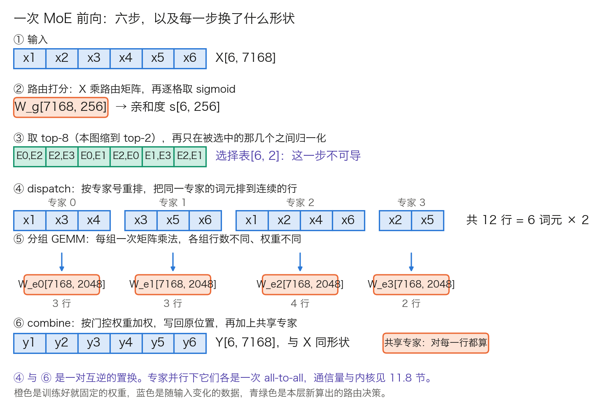

图 14-2：一次 MoE 前向的六步，以及每一步换了什么形状（[生成脚本](https://github.com/yeasy/llm_internals/blob/main/tools/figures/ch14a_moe_forward.py)）。示意设定为 6 个词元、4 个路由专家、top-2；每个词元的选择是手工设定的，用来说明置换。橙色是权重，蓝色是数据，青绿色是本层新算出的路由决策。

六步依次是：

1. **输入**：`X[T, 7168]`，与稠密层完全相同。
2. **路由打分**：`X[T, 7168] × W_g[7168, 256] → s[T, 256]`。DeepSeek-V3 对每一格取 sigmoid 得到亲和度，而不是对整行取 softmax（技术报告式 15）。
3. **取 top-k 并归一化**：每行留下最大的 8 个，其余置 0，再在这 8 个之间归一化得到门控权重（式 13、14）。这一步不可导，是后面一切均衡手段的根源。
4. **dispatch 置换**：按专家号重排，把同一专家的词元排到连续的行。`T` 个词元、top-8，重排后共 `8T` 行。
5. **分组 GEMM**：每个专家对自己那一组做一次矩阵乘法，`[m_i, 7168] × W_i[7168, 2048] → [m_i, 2048]`，再投回 7168 维。各组行数 $m_i$ 不同，权重不同，这是与稠密 FFN 唯一的实质差别。
6. **combine**：按门控权重加权，按第 4 步的逆置换写回原位置，再加上共享专家的输出，得 `Y[T, 7168]`。

第 4、6 两步是一对互逆的置换。单卡上它们是一次 gather 加一次 scatter；多卡专家并行下各是一次 all-to-all，通信量、内核与实测耗时见 [11.8.7 节](../11_serving/11.8_multi_gpu_inference.md)。

在实现里，这六步分别对到 HF `DeepseekV3MoE` 的 `gate` 与 `experts`、vLLM `FusedMoE` 的排序—分组—GEMM 三段内核。第 4 步之所以需要显式置换，是因为 GPU 上最快的路径仍是大矩阵乘法；Megablocks 一类 dropless 实现改用变长分组 GEMM，把置换和变长一起交给内核。

### 2.2 激活参数怎么算：以 DeepSeek-V3 为例

MoE 的核心价值在于解耦了两件事：总参数量决定模型能存多少知识，每词元激活参数量决定推理要算多少。“671B 总参、37B 激活”这句话常被引用，下面把它从公开配置一路算出来。

配置取自 DeepSeek-V3 的 `config.json` 与[技术报告](https://arxiv.org/abs/2412.19437) 4.2 节：`hidden_size = 7168`、`intermediate_size = 18432`、`moe_intermediate_size = 2048`、`n_routed_experts = 256`、`n_shared_experts = 1`、`num_experts_per_tok = 8`、`num_hidden_layers = 61`、`first_k_dense_replace = 3`。

**单个专家。** 采用 SwiGLU，一个专家是三个 `[7168, 2048]` 的矩阵：

$$
3 \times 7168 \times 2048 = 44{,}040{,}192 \approx 44.0\ \text{M}
$$

**一个 MoE 层。** 256 个路由专家加 1 个共享专家，共 257 个：`257 × 44.0M = 11.32B`。61 层里前 3 层是稠密 FFN，其余 58 层是 MoE 层，合计 `58 × 11.32B = 656.5B`。

**每词元激活多少。** 每个词元走 8 个路由专家加 1 个共享专家，共 9 个：`9 × 44.0M = 396.4M`。58 层合计 `58 × 396.4M = 22.99B`。注意分母是 257 而分子是 9，MoE 层只用了 `9/257 = 3.5%` 的专家参数。

**其余部分全部激活。** 前 3 层的稠密 FFN 每层 `3 × 7168 × 18432 = 396.4M`，共 1.19B。MLA 按报告 4.2 的取值（`n_h = 128`、`d_h = 128`、`d_c = 512`、`d_c' = 1536`、`d_h^R = 64`）每层约 187.1M，61 层共 11.41B。嵌入表与输出头各 `129,280 × 7168 = 926.7M`。

**汇总。** 四部分并排在表 14-3。

| 部分 | 总参数 | 每词元激活 |
| --- | ---: | ---: |
| 58 个 MoE 层的专家 | 656.5B | 22.99B |
| 前 3 层稠密 FFN | 1.19B | 1.19B |
| 61 层 MLA | 11.41B | 11.41B |
| 嵌入表 + 输出头 | 1.85B | 1.85B |
| 合计 | 671B | 37.4B |

表 14-3：DeepSeek-V3 的参数分布。总参与官方的 671B 吻合，激活与官方的 37B 吻合（本表未计入多词元预测模块）。激活占总参 5.6%；用官方取整的 37B/671B 算是 5.51%（[13.3 节](../13_decoder_models/13.3_deepseek_gemini.md)用的是后者），差别来自本表算到小数位的 37.4B。

这张表有两条可以推广的读法。第一，**稀疏只发生在专家上**：注意力、嵌入、输出头和稠密层全部参与每一次前向，它们在激活侧占了 14.4B，接近激活总量的四成。所以“总参 / 激活参数”的比值永远小于“专家总数 / 每词元专家数”的比值。第二，**显存按总参算，算力按激活参数算**：671B 即使在 FP8 下也需约 670 GB 权重显存，远超单卡容量，这是 MoE 部署的第一道门槛。

### 2.3 路由与负载均衡

#### 两种选择范式

**词元选择专家**（Token-Choice）：每个词元独立选 Top-K 个专家。Switch Transformer、Mixtral、DeepSeek 均采用，实现简单、推理路径确定，但不同词元可能扎堆选同一批专家，负载不均。

**专家选择词元**（Expert-Choice）：每个专家从批次中选固定数量的词元。负载天然均衡，代价是某些词元可能不被任何专家选中，也可能被多个专家重复选中。推理时它还破坏了“一个词元的输出只依赖于它自己”这个性质——同一批次里别的词元会影响它的路由结果。

实践中 Token-Choice 是主流，因为推理时计算图确定。

#### Top-K 的选择

- **Top-1**（Switch Transformer）：计算最省，但每个词元的表达受限于单个专家，训练容易不稳。
- **Top-2**（Mixtral 8x7B）：两个专家的加权组合提供更丰富的表示。
- **Top-K > 2**（DeepSeek-V3 的 8、Qwen3.5 的 10）：配合细粒度专家使用。专家数多且每个很小时，激活更多个仍然便宜。

#### 负载坍塌与两类对策

MoE 训练最棘手的问题是**负载坍塌**（routing collapse）：路由器把大部分词元送给少数几个专家，未被选中的专家梯度接近零、无法训练，形成“强者愈强”。

**辅助负载均衡损失**是最经典的对策，思想最早见于[稀疏门控 MoE 的开创性工作](https://arxiv.org/abs/1701.06538)与 GShard，[Switch Transformer](https://arxiv.org/abs/2101.03961) 给出了广为使用的简化形式：

$$
\mathcal{L}_{\text{balance}} = \alpha \cdot N \sum_{i=1}^{N} f_i \cdot p_i
$$

$f_i$ 是实际路由到专家 $i$ 的词元比例，$p_i$ 是路由器给专家 $i$ 的平均概率，$N$ 是专家数。

**一格算术。** 取 $N = 4$，某批的 $f = [0.7, 0.1, 0.1, 0.1]$、$p = [0.4, 0.2, 0.2, 0.2]$：

$$
\begin{aligned}
f_i p_i &= [0.28,\ 0.02,\ 0.02,\ 0.02] \\
\textstyle\sum_i f_i p_i &= 0.34 \\
N\textstyle\sum_i f_i p_i &= 4 \times 0.34 = 1.36
\end{aligned}
$$

完全均衡时 $f = p = [0.25, 0.25, 0.25, 0.25]$，每项 $f_ip_i = 0.0625$，$\sum_i f_ip_i = 4 \times 0.0625 = 0.25$，$N\sum_i f_ip_i = 4 \times 0.25 = 1$，取到最小值。全部塞给一个专家时该值为 $N = 4$，取到最大值。所以这个损失的取值范围是 $[1, N]$，1.36 表示“有点偏，但远未坍塌”。

这里还藏着一个设计要点：$f_i$ 由 top-k 的计数得到，不可导；$p_i$ 是 softmax 或 sigmoid 的输出，可导。梯度只经由 $p_i$ 回传，$f_i$ 充当一个“当前有多偏”的系数。某个专家越是超载，压它概率的力度就越大。

$\alpha$ 的调节非常敏感：过大会压制路由器的学习信号，迫使专家趋于同质；过小则不足以阻止坍塌。

**无辅助损失路由**是 DeepSeek-V3 的方案。它为每个专家维护一个偏置项 $b_i$，只在 top-k 比较时加上（技术报告式 16）：

$$
g'_{i,t} = \begin{cases} s_{i,t}, & s_{i,t} + b_i \in \operatorname{Topk}(\{s_{j,t} + b_j\},\ K_r) \\ 0, & \text{其他} \end{cases}
$$

关键在于偏置只用于路由；最终与专家输出相乘的门控值仍来自原始亲和度 $s_{i,t}$。$b_i$ 不是反向传播学出来的参数，而是按负载规则更新：每一步结束时监控全批的专家负载，超载的减去 $\gamma$，欠载的加上 $\gamma$。报告里 $\gamma$ 称为偏置更新速率，前 14.3T 词元取 0.001，最后 500B 词元取 0.0。

**“完全移除辅助损失”是不准确的说法。** 同一份报告在紧接着的小节里说明，为防止单条序列内部出现极端不均衡，仍保留一项序列级均衡损失（Complementary Sequence-Wise Auxiliary Loss），其系数 $\alpha$ 取 0.0001，明确标注为“极小值”。准确的表述是：不再依赖辅助损失作为主要手段。该报告的 4.5.3 小节还解释了为什么这样更好——偏置法在全批范围内配平，序列级辅助损失则强制每条序列内部均衡，后者妨碍专家按领域分化。

**节点受限路由。** V3 还限制每个词元最多发往 4 个节点（$M = 4$），节点按“该节点上专家的最高 $K_r/M$ 个亲和度之和”挑选。动机是通信：报告称 NVLink 带宽 160 GB/s，约为 IB 的 50 GB/s 的 3.2 倍，限制节点数即压低跨节点 IB 流量。这条约束是路由算法与网络拓扑协同设计的样本。

#### 容量因子与词元丢弃

上面讲的是“怎么让路由更均衡”，还有一问必须回答：在均衡尚未达成的那些步里，多出来的词元怎么办。分布式实现中每个专家的批大小必须静态确定，于是引入容量因子：

$$
\text{capacity} = \frac{\text{总词元数} \times K}{\text{专家数}} \times \text{capacity factor}
$$

这是 GShard 式的推广。Switch 原文的式 3 写作 `(tokens per batch / num experts) × capacity factor`，不含 $K$，因为它是 top-1。

**一格算术。** 批内 8192 个词元、64 个专家、top-2，则分派总数 `8192 × 2 = 16,384`，平均每专家 `16,384 ÷ 64 = 256` 个。容量因子取 1.25，每专家槽位 `256 × 1.25 = 320`。若某专家实际收到 500 个词元，丢弃 `500 − 320 = 180` 个——这些词元不经过这一层，残差连接让它们直接跳过去。反过来，若路由完全均匀，`64 × 320 = 20,480` 个槽位里有 4096 个空转，20% 的计算与通信白做。

[Switch Transformer 把这个取舍讲得很明确](https://arxiv.org/abs/2101.03961)：调小则丢词元、调大则烧算力，两头都是真实损失。近年的 dropless 实现改用变长分组 GEMM 避开静态上限，代价是内核复杂度。DeepSeek-V3 报告称，得益于有效的均衡策略，训练与推理全程都不丢弃词元。

这也给出了 MoE 训练该盯哪三个指标：**路由熵**（是否坍塌成少数几个专家）、**每专家的词元分布**（是否长尾）、**词元丢弃率**（容量因子是否合适）。只看最终损失不够——路由坍塌可以在损失曲线上潜伏很久，直到某几个专家事实上已经死掉才显现。

### 2.4 细粒度 MoE 与共享专家

传统 MoE（如 Mixtral 8x7B）用少量大专家，每个专家与标准 FFN 同宽。DeepSeek 系列开创的**细粒度 MoE** 把同样的参数量拆成大量小专家。

**组合空间的差别可以算出来。** 256 选 8 的组合数是

$$
\binom{256}{8} = 409{,}663{,}695{,}276{,}000 \approx 4.1\times10^{14}
$$

而 8 选 2 只有 $\binom{8}{2} = 28$。前者是后者的约 $1.5\times10^{13}$ 倍。组合数当然不等于有效表达能力——大量组合在训练中从未出现，专家之间也并非彼此独立——但它说明为什么细粒度设计能让路由器做出远更精细的区分。专家数多时统计上也更容易均衡。

代价在实现侧：专家越小，第 5 步的每个分组 GEMM 越窄。单个 `[m_i, 7168] × [7168, 2048]` 在 $m_i$ 很小时算不满 Tensor Core，退化为访存受限。这是 14.2.5 要展开的。

**共享专家**（Shared Expert）是另一项关键设计：每层留若干专家对所有词元始终激活，不参与路由。动机是并非所有知识都需要条件激活——基本语法、常见语义模式等通用能力应被所有输入共享，否则每个路由专家都要冗余地学一遍。图 14-3 把两类专家的分工画在一起。

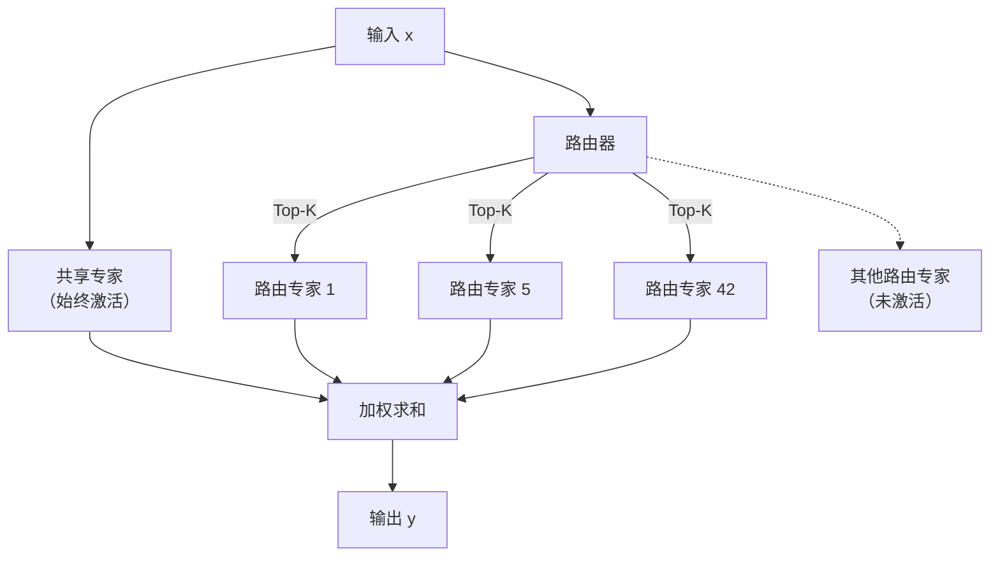

图 14-3：共享专家与路由专家的分工。共享专家不经过路由，对每个词元都算；路由专家只在被选中时参与。

在 DeepSeek-V3 中每个 MoE 层有 1 个共享专家和 256 个路由专家，每词元走共享专家加 top-8，共 9 个。共享专家与单个路由专家同宽，因此始终激活的开销只占激活量的 1/9。DeepSeek 系列的整体架构创新（MLA、多词元预测等）详见 [13.3 节](../13_decoder_models/13.3_deepseek_gemini.md)。

### 2.5 推理侧：显存、通信与小批量

MoE 推理面对的约束与稠密模型截然不同。

**显存按总参算。** 每个词元只激活少量专家，但所有专家的参数必须常驻显存或可快速访问。DeepSeek-V3 的 671B 参数即使在 FP8 下也需约 670 GB，远超单卡容量。

**通信来自第 4、6 两步的置换。** 多卡下每层两次 all-to-all，词元要送到选中专家所在的卡，算完再收回。[11.8.7 节](../11_serving/11.8_multi_gpu_inference.md)给出了完整的通信量算例、DeepEP 的实测耗时，以及为什么专家要用专家并行而不是张量并行切——这里不重复。该节的结论直接接到本节：单个专家是三个 `7168 × 2048` 的矩阵，FP8 下 44 MB，用 8 路张量并行切之后中间层只剩 256 维，矩阵太窄。表 14-4 只列出四种并行方式在 MoE 上各切什么，细节回 11.8 节。

| 并行策略 | 拆分维度 | 在 MoE 里的作用 |
| --- | --- | --- |
| 数据并行（DP） | 批次 | 提高吞吐；多副本各服务不同请求 |
| 张量并行（TP） | 权重矩阵 | 切注意力层；切单个专家只在专家足够宽时划算 |
| 专家并行（EP） | 专家集合 | 把不同专家放到不同卡，每层两次 all-to-all |
| 流水线并行（PP） | 层 | 跨节点分布层，通信最少但时延不降 |

表 14-4：MoE 推理中的四种并行方式。通信量、组合判据与命令行开关见 [11.8.8 节](../11_serving/11.8_multi_gpu_inference.md)。

**解码小批量**是 MoE 最吃亏的场景，而且可以算出多吃亏。平均每个专家分到的词元数是“全组词元总数 × K ÷ 专家数”，V3 即总数的 1/32。一个专家的三个矩阵在 FP8 下是 44 MB；它为 $b$ 个词元做的运算约 `2 × 44.04M × b` 次，于是算术强度是

$$
I = \frac{2 \times 44{,}040{,}192 \times b}{44{,}040{,}192\ \text{字节}} = 2b\ \text{FLOPs/Byte}
$$

按 [10.1 节](../10_inference_optimization/10.1_bottleneck.md)给出的 H100 拐点 295 FLOPs/Byte，要让这个 GEMM 算力受限，需要 $b \ge 148$。换算回全组：`148 × 32 = 4736` 个词元每步。全组一步只有 64 个词元时每个专家平均 2 个，算术强度只有 4，比拐点低近两个数量级——读 44 MB 权重只为算 2 行。

这就是“大专家并行 + 大批量”成为主流部署形态的原因：不是为了吞吐好看，而是不这样做，专家的 GEMM 根本喂不饱。同一道理下，小批次时 MoE 的效率不如同激活量的稠密模型，大批次时优势才显现。权重用 BF16 时字节数翻倍，$I = b$，门槛升到每专家 295 个词元——这也是 MoE 比稠密模型更依赖低精度权重的原因。

**MoE 特有的优化。** 专家预取（利用路由预测提前把即将激活的专家权重搬进显存）、专家缓存（热门专家常驻，冷门按需加载，类似页面缓存）、以及把选同一专家的词元合并处理。通过量化与专家卸载，部分 MoE 模型可以在少量 GPU 上以更高延迟换取可运行性；具体门槛取决于量化格式、上下文长度和框架实现。

#### 执行侧的负载均衡：不改路由，只改在哪儿算

前面的均衡手段都作用在路由本身。但即使路由分布已经很均匀，**执行**仍可能不均衡：专家分布在不同的 EP 卡上，某一批次的实际词元分布、冗余副本的放置方式，都会让某些卡成为拖慢整层的长板。于是在“训练期改路由”之外，还存在一层运行时的执行侧均衡。它的定义性约束是必须保持语义不变。

以 SGLang 中的两个机制为例（见 [Improving DeepEP MoE Load Balance in SGLang with Waterfill and LPLB](https://lmsys.org/blog/2026-06-26-waterfill-lplb)）：

- **Waterfill** 处理共享专家。共享专家对每个词元都生效，若固定绑在某张卡上就成了额外负担。Waterfill 把它变成可调度的槽位：路由专家选定之后，估计各 EP 卡的当前负载，再把共享专家的工作按空闲程度分配过去。
- **LPLB**（Linear-Programming-Based Load Balancer）处理冗余专家副本。它为每一层、每一批求解一个线性规划：在各物理副本之间切分该逻辑专家的词元，目标是最小化各卡负载的峰值。一条守恒约束保证它只重新分配已有流量，既不凭空制造也不丢弃词元。

两者都不改变路由器的 top-k 决策：Waterfill 只改共享专家由哪张卡执行，LPLB 只改词元落到同一逻辑专家的哪个副本上，模型选择的专家集合始终不变，输出不变。这是它能在推理阶段安全启用的原因。

收益的量级要说清楚。在该文公布的实测配置下（两台 Hopper 节点、16 卡、TP16-DP16-EP16），这类优化带来的是个位数百分比的吞吐改善，且 LPLB 需要确实配置了冗余专家，否则是纯额外开销。把它当成压榨最后几个百分点的手段是恰当的，当成数量级优化则不是。

### 2.6 公开模型的架构参数

表 14-5 把前面各节讨论的设计选择落到公开配置上：专家数、每词元路由几个、有没有共享专家、专家做到多窄。

| 模型 | 总参数 | 激活参数 | 路由专家数 | 每词元路由 | 共享专家 | 专家中间层宽度 |
| --- | ---: | ---: | ---: | ---: | ---: | ---: |
| Switch Transformer | 多种 | 多种 | 2 到 2048 | 1 | 无 | 与稠密 FFN 同宽 |
| Mixtral 8x7B | 46.7B | 13B | 8 | 2 | 无 | 14,336 |
| Mixtral 8x22B | 141B | 39B | 8 | 2 | 无 | — |
| DeepSeek-V2 | 236B | 21B | 160 | 6 | 2 | — |
| DeepSeek-V3 | 671B | 37B | 256 | 8 | 1 | 2,048 |
| Llama 4 Scout | 109B | 17B | 16 | 1 | 1 | 8,192 |
| Llama 4 Maverick | 400B | 17B | 128 | 1 | 1 | — |
| Qwen3.5-397B-A17B | 397B | 17B | 512 | 10 | 有 | 1,024 |

表 14-5：主流 MoE 模型的架构参数。Mixtral 8x7B 一行的专家数、top-k 与中间层宽度取自 `mistralai/Mixtral-8x7B-v0.1` 的 `config.json`（`num_local_experts = 8`、`num_experts_per_tok = 2`、`intermediate_size = 14336`）；DeepSeek-V3 一行取自其 `config.json` 与技术报告 4.2；Llama 4 Scout 一行取自其 `config.json`（`num_local_experts = 16`、`num_experts_per_tok = 1`、`intermediate_size = 8192`、`intermediate_size_mlp = 16384`），Llama 4 的 MoE 层在路由专家之外另有一个共享专家；Qwen3.5 一行取自其 `config.json`（`num_experts = 512`、`num_experts_per_tok = 10`、`moe_intermediate_size = 1024`）。Switch Transformer 一行为论文覆盖的范围：下界 2 来自附录 D 的图 12（该文写“as few as 2 experts produce compelling gains”），上界 2048 是 Switch-C。

“专家中间层宽度”一列比“粒度粗细”的标签更有信息量。DeepSeek-V3 的 2048 只有它稠密 FFN（18,432）的 1/9，Qwen3.5 的 1024 只有 `hidden_size`（4096）的 1/4，这两个才是典型的细粒度。Llama 4 Scout 的 8192 是其稠密 FFN（16,384）的一半，与 Mixtral 的 14,336 更接近，按宽度算并不算细——它的稀疏性来自“16 选 1”这个极低的 top-k，而不是把专家切小。把两种做法都笼统叫“细粒度”会掩盖这个差别。

从表中能读出两条演化路线。**Mixtral 路线**是少量大专家加 Top-2；**DeepSeek / Qwen 路线**是大量小专家加共享专家，路由空间大得多。Llama 4 Maverick 是第三种：128 个路由专家但每词元只进 1 个，加 1 个共享专家，不要把它误写成 Mixtral 式的 Top-2。

Mixtral 8x7B 当年证明了一件事：在相同激活参数量下，MoE 可以显著强于稠密模型。它以 13B 激活超过了 Llama 2 70B。这条结论成立有两个前提——总参数量大得多，且训练词元足够多；脱离前提照搬会得出错误结论。部署上它也给出了三条经验：46.7B 参数 BF16 下需约 87 GiB 显存而推理 FLOPs 只相当于 13B 稠密模型；MoE 对 GPTQ、AWQ 一类量化的容忍度较好；小批次不如稠密、大批次优势明显（原因见 14.2.5）。

### 2.7 趋势

三个方向值得关注。**动态路由**：按输入复杂度自适应调整激活专家数，简单输入少走几个。**与混合架构融合**：MoE 与 SSM 结合（见 [14.3 节](14.3_ssm_hybrid.md)），Jamba 已在 Mamba-Transformer 混合骨干上叠加 MoE，Qwen3.5 把线性注意力与 512 专家的 MoE 放在同一个模型里。**端侧 MoE**：边缘设备上用专家卸载换显存，瓶颈从算力转向存储带宽与调度延迟。

## 3. 状态空间模型与混合架构：注意力的挑战者

上一节的 MoE 拆开了“模型有多大”与“每个词元算多少”，671B 总参数只激活 37B。但它拆不开另一笔账：序列每长一个词元，KV 缓存就多一份，这笔开销与激活了几个专家无关。

**状态空间模型**（State Space Model，SSM）从另一个方向动这笔账：用一块固定大小的状态替代不断变长的缓存。[14.1.2 节](14.1_efficient_attention.md)已经从核化注意力推出过同一个递推形式。本节换一条路走到同一个地方：从连续系统的离散化出发。沿途回答三个新问题：为什么“选择性”这一步破坏了卷积形式，逼出并行扫描；固定状态在真实配置下到底多大；混合架构为什么收敛到 3:1。

### 3.1 从连续系统到递推：离散化那一格

SSM 源于控制理论中的线性时不变系统。连续形式把输入信号 $x(t)$ 经一个隐状态 $h(t)$ 映到输出 $y(t)$：

$$
h'(t) = A h(t) + B x(t), \qquad y(t) = C h(t)
$$

语言模型面对的是离散词元，因此要先把这个系统按步长 $\Delta$ **离散化**（discretization）。常用的零阶保持（Zero-Order Hold，ZOH）给出：

$$
\bar{A} = \exp(\Delta A), \qquad \bar{B} = (\Delta A)^{-1}\left(\exp(\Delta A) - I\right)\Delta B
$$

于是得到递推式，形状写在右侧（$N$ 是状态维，即 `d_state`）：

$$
\begin{aligned}
h_t &= \bar{A} h_{t-1} + \bar{B} x_t && [N] \\
y_t &= C h_t && [1]
\end{aligned}
$$

**一格算术。** $\Delta$ 的作用最容易被写成“步长”而看不出它管什么。取标量 $A = -1$，$\bar{A} = \exp(-\Delta)$，代入几个取值见表 14-6：

| $\Delta$ | $\bar{A} = e^{-\Delta}$ | 旧状态衰减到一半需要几步 |
| ---: | ---: | ---: |
| 0.01 | 0.9900 | 69.3 |
| 0.1 | 0.9048 | 6.9 |
| 1.0 | 0.3679 | 0.7 |
| 2.0 | 0.1353 | 0.3 |

表 14-6：离散化步长怎样决定遗忘速度。最后一列是 $\ln 2 / \Delta$。$\Delta$ 小则 $\bar{A}$ 接近 1，旧状态几乎原样留着；$\Delta$ 大则一两步就把历史冲掉，同时 $\bar{B}$ 把当前输入放大写入。所以 $\Delta$ 不是时间刻度，而是“保持”与“快进”之间的旋钮。

**S4**（Structured State Space for Sequence Modeling，Gu 等人）通过对 $A$ 的结构化参数化（HiPPO 初始化）解决了长距离建模的困难，首次在长序列基准上达到 Transformer 的水平。但 S4 的 $A$、$B$、$C$、$\Delta$ 都与输入无关，这正是下一步要改的地方。

### 3.2 选择性：为什么它逼出了并行扫描

**线性时不变的代价。** $A$、$B$、$C$ 固定时，把递推展开，整条序列可以写成一次卷积（[Mamba 论文](https://arxiv.org/abs/2312.00752)式 3）：

$$
K = (CB,\ C\bar{A}B,\ C\bar{A}^2B,\ \dots), \qquad y = x * K
$$

卷积核 $K$ 与输入无关，可以先算好，再用 FFT 一次算完整条序列。训练因此很快。代价是模型无法按内容决定记什么：同一个卷积核作用在每一个位置上。

**Mamba 的选择性机制**（selective mechanism，Gu & Dao）让 $B$、$C$、$\Delta$ 依赖于输入：

$$
B_t = f_B(x_t), \qquad C_t = f_C(x_t), \qquad \Delta_t = \tau_\Delta(f_\Delta(x_t))
$$

论文取 $f_B$、$f_C$ 为投到 $N$ 维的线性层，$f_\Delta$ 先投到 1 维再广播到全部通道，$\tau_\Delta$ 取 softplus。于是每个位置有自己的一套 $(\bar{A}_t, \bar{B}_t, C_t)$，模型可以按当前词元决定“保持”还是“快进”。

这一改，卷积形式当场失效：$K$ 不再固定，没有可以预先算好的核。论文对此给出的替代是**并行扫描**（parallel scan）。

**扫描的结合律算子。** 递推 $h_t = a_t h_{t-1} + b_t$ 可以把一段区间概括成一对数 $(a, b)$，表示“进来的状态乘 $a$ 再加 $b$”。两段相邻区间的合并是：

$$
(a_1, b_1) \circ (a_2, b_2) = (a_1a_2,\ a_2 b_1 + b_2)
$$

这个算子满足结合律，因此合并顺序可以任意。图 14-4 的下半幅用 8 个时间步展示树形归并：两两合并得 4 段，再合并得 2 段，再合并得 1 段。串行深度 8 被压成 3 层；$n = 100$ 万时串行深度 100 万，树形深度只有 20 层（上行）加 20 层（下行），总工作量约 $2n$。

**不物化中间状态。** 朴素实现要在显存里准备 `[B, L, d_inner, N]` 的扫描输入，读写量是 $O(BLDN)$，一眼就是访存受限。Mamba 的硬件感知实现只从显存读 $(\Delta, A, B, C)$，在 SRAM 里完成离散化、扫描和乘 $C$，只把 `[B, L, d_inner]` 的输出写回；反向传播需要的中间状态不保存，而是在反向时重算。论文明确说明，这使融合后的选择性扫描层与用 FlashAttention 的 Transformer 有相同的显存需求——思路与 [10.3 节](../10_inference_optimization/10.3_flash_attention.md)完全一致。

### 3.3 Mamba 块：形状怎样一步步变化

图 14-4 的上半幅按论文 3.4 节的块结构画出形状。取 `d_model = 4096`、扩张因子 $E = 2$（论文固定值），得 `d_inner = 8192`；状态维 $N = 16$（论文速度基准的取值），卷积核 `d_conv = 4`（官方实现 `mamba_ssm` 中 `Mamba` 的默认值，与 `d_state = 16`、`expand = 2` 同处）。

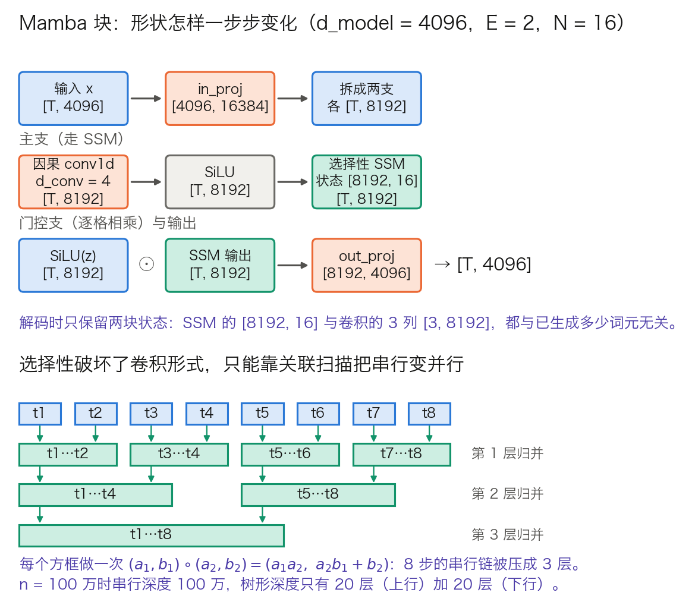

图 14-4：Mamba 块的形状流，以及选择性为什么逼出关联扫描（[生成脚本](https://github.com/yeasy/llm_internals/blob/main/tools/figures/ch14a_mamba_block.py)）。橙色是权重，蓝色是数据，青绿色是本层新算出的状态。

形状清单，与 3.8.3 同一写法：

- **输入投影**（一次矩阵乘法，同时产出主支与门控支）：`x[T, 4096] × W_in[4096, 16384] → [T, 16384]`，拆成两块 `[T, 8192]`。
- **因果卷积**（逐通道，核长 4）：`[T, 8192] → [T, 8192]`，解码时保留最近 3 列。
- **激活**（SiLU，逐格）：`[T, 8192] → [T, 8192]`。官方实现里它与卷积写在同一行（`mamba_simple.py` 的 `x = self.act(self.conv1d(x)[..., :seqlen])`）。
- **选择性 SSM**：`[T, 8192] → [T, 8192]`，内部状态 `[8192, 16]`。
- **门控**（逐格相乘）：`SiLU(z)[T, 8192] ⊙ SSM 输出[T, 8192] → [T, 8192]`。
- **输出投影**：`[T, 8192] × W_out[8192, 4096] → [T, 4096]`，与输入同形状。

块内参数绝大部分落在两个投影上：论文指出输入投影 $2ED^2$、输出投影 $ED^2$，合计 $3ED^2$，而 $\Delta$、$B$、$C$、$A$ 的投影小得多。$E = 2$ 时一个块是 $6D^2$，两个块叠起来正好对上 Transformer 一层“注意力加 MLP”的 $12D^2$。这就是为什么 Mamba 模型的层数通常是同宽 Transformer 的两倍。

在 `mamba_ssm` 库里，这些超参就是 `Mamba(d_model, d_state, d_conv, expand)` 四个构造参数，扫描内核是 `selective_scan_fn`；$\Delta$ 的低秩投影宽度由 `dt_rank` 控制。

### 3.4 状态账：固定状态对 KV 缓存，交叉点在哪

“不需要 KV 缓存”常被读成“不占显存”。真实情况是换了一块大小固定的显存。沿用 [14.1.2 节](14.1_efficient_attention.md)的 Llama 3 8B 口径（8 个 KV 头、`d_h = 128`）：

- Mamba 层每层的 SSM 状态是 `8192 × 16 = 131,072` 个数，外加卷积缓存 `3 × 8192 = 24,576` 个数，两者都与已生成多少词元无关。
- 同宽的 GQA 层每词元每层 `2 × 8 × 128 = 2048` 个数。
- 交叉点 `131,072 ÷ 2048 = 64` 个词元。序列短于 64 时 Mamba 层反而更占显存；之后每多一个词元，注意力侧就多 2048 个数，Mamba 侧一个不多。

状态维一变，交叉点就跟着变。Mamba 论文自己的消融给出一条前提：加大 $N$ 能显著改善困惑度，但只在 $B$、$C$ 也是选择性的时候成立（表 10）。[Mamba-2 的 SSD 内核](https://arxiv.org/abs/2405.21060)把速度限制放开，称可在几乎不减速的前提下把状态做到 Mamba 的 8 倍甚至更大；其消融的默认取值是 $N = 64$，关联召回实验一路测到 $N = 256$。对应的状态是 `8192 × 64 = 524,288` 与 `8192 × 256 = 2,097,152` 个数，交叉点分别是 256 和 1024 个词元。这是一条清晰的取舍：状态越大越能记住，也越晚开始省显存。

吞吐上的收益同样要看条件。Mamba 论文报告的是“比同规模 Transformer 高 4 到 5 倍的推理吞吐”，并说明了原因——没有 KV 缓存，因此可以用大得多的批。这不是每步更快，而是同一块显存能同时服务更多请求；把它读成“单请求延迟降 5 倍”是误读。

### 3.5 Mamba-2 与 SSD：和线性注意力是同一件事

**Mamba 2** 把选择性 SSM 与结构化矩阵联系起来，这层关系称为状态空间对偶（State Space Duality，SSD）。从零初始状态出发，把选择性 SSM 的递推按 $t$ 展开，位置 $t$ 的输出是

$$
y_t = \sum_{s \le t} C_t \left(\prod_{r=s+1}^{t}\bar{A}_r\right)\bar{B}_s x_s
$$

一般情况下，括号里的连乘仍是矩阵，不能提出为一个标量。[Mamba-2 论文](https://arxiv.org/abs/2405.21060)的关键限制是：每个头的状态转移从对角矩阵进一步简化为标量乘单位矩阵，即 $\bar{A}_t = a_t I$。这时令 $L_{ts} = \prod_{r=s+1}^{t} a_r$（$s \le t$，对角线为空积 1；$s > t$ 时为 0），才可得到 $y = (L \circ C\bar{B}^T)x$。其中 C 与 $\bar B$ 的每一行分别是该位置的读出向量与离散输入向量；保留横线是为了与 14.3.1 的离散化记号一致。

这个式子对应使用标量衰减门控、且不带归一化分母的线性注意力：$C$ 对应 Query，$\bar B$ 对应 Key，$x$ 对应 Value，$L$ 对应门控衰减的累积。它不等于 [14.1.3 节](14.1_efficient_attention.md)完整的 delta 更新；后者还包含依赖 Key 方向的状态改写。一般 SSM 也不能省略上述结构限制，直接套用这一标量门控形式。

对读者的实际意义有两条。第一，核对状态转移结构、门控粒度和归一化方式后，才能在相应模型之间转换记号。第二，这些模型可以共享分块并行训练、状态递推解码等实现思路；涉及累积衰减的倒数时，也要处理 14.1.3 提到的数值溢出问题。

### 3.6 固定状态的代价：什么任务会塌

[14.1.2 节](14.1_efficient_attention.md)第七步给出的秩上界，在 SSM 上是同一条：状态 `[d_inner, N]` 的容量固定，写入量超过容量后，旧内容只能被挤掉或被干扰。

具体到任务，最先塌的是两类。一是**逐字复制**：给一段随机串要求原样输出，所需状态随串长增长，而固定状态给不出。二是**关联召回**：文中先给出若干“键—值”对，末尾问其中某一个键对应什么。纯 SSM 在这两类任务上明显弱于注意力，也正是长文检索评测（“大海捞针”）里失分的来源。

反过来也解释了混合为什么有效。注意力层把全部 Key 原样留着，任何一个位置都能被精确寻址；只要每隔几层插一层，模型就有了“回头看原文”的通道，而大部分层仍走固定状态。代价是这几层的 KV 缓存照样随序列线性增长，长上下文下它们决定显存上限。

### 3.7 混合比例：公开配置里长什么样

混合架构已不是中等规模上的实验。表 14-7 汇总公开配置。

| 模型 | 序列层类型 | 比例 | MoE | 上下文 |
| --- | --- | --- | --- | --- |
| Jamba（AI21） | Mamba 与注意力交替 | 注意力 : Mamba = 1:7 | 每 2 层一个 MoE 层，16 专家 top-2 | 256K |
| Qwen3.5-397B-A17B（397B 总参 / 17B 激活） | 45 层线性注意力 + 15 层全注意力 | 3:1（`full_attention_interval = 4`） | 512 专家 top-10，另有共享专家 | — |
| Kimi Linear（48B / 3B 激活） | KDA 与全注意力 MLA 交替 | 3:1 | — | 1M |
| Kimi K3（2.8T / 104B 激活） | 每块 3 层 KDA 接 1 层 Gated MLA | 3:1，骨干末尾额外加一层 Gated MLA | 是 | — |
| NVIDIA Nemotron 3 Ultra（550B / 55B 激活） | Mamba-2 层与 MoE 层交替，保留少量注意力层 | 周期排布，间隔不均匀 | 是 | 1M |

表 14-7：公开混合架构的层布局。Jamba 一行取自[其论文](https://arxiv.org/abs/2403.19887)图 1 的配置（`l = 8`、`a : m = 1:7`、`e = 2`、`n = 16`、top-2），该文的消融显示 1:3 与 1:7 质量几乎无差，选 1:7 是因为更省算力。Qwen3.5 一行取自其 HF 仓库 `config.json` 的 `layer_types` 数组（45 个 `linear_attention`、15 个 `full_attention`）与 `num_experts`、`num_experts_per_tok` 等字段。Kimi 两行见 [14.1.5 节](14.1_efficient_attention.md)；Nemotron 3 Ultra 的参数量以 NVIDIA 官方模型卡为准。

**Qwen3.5 的缓存账。** 这份配置的数字全部公开，可以一路算到底：`num_key_value_heads = 2`、`head_dim = 256`，故每个全注意力层每词元的 KV 是 `2 × 2 × 256 = 1024` 个数。15 个全注意力层合计 `15 × 1024 = 15,360` 个数，BF16 下 30 KiB/词元。若 60 层全用全注意力，是 61,440 个数，即 120 KiB/词元，降幅恰是 `1 − 15/60 = 75%`。100 万词元上下文下，这是 29 GiB 对 114 GiB 的差别。

线性层的固定状态按 value 头计。Transformers 里 `Qwen3_5MoeGatedDeltaNet` 的递推状态形状是 `[batch, linear_num_value_heads, linear_key_head_dim, linear_value_head_dim]`，即每个 value 头一块 `[128, 128]` 的矩阵。`linear_num_key_heads = 16` 小于 `linear_num_value_heads = 64`，实现里把 Query 与 Key 按 4 倍 `repeat_interleave` 广播上去。这是 GQA 那套共享搬到线性侧，省的是投影参数，不是状态。所以每层是 `64 × 128 × 128 = 1,048,576` 个数，45 层合计 `45 × 1,048,576 = 47,185,920` 个数，与序列长度无关。$n$ 个词元下，混合模型合计占 `15,360n + 47,185,920` 个数，60 层纯全注意力合计占 `61,440n` 个数，两者持平于 `n = 47,185,920 ÷ (61,440 − 15,360) = 1024` 个词元，远低于这类模型的目标上下文。

其他模型的共同配方值得记住：以线性或状态空间层为主体承担长程效率，周期性插入少量全注意力层保住精确检索。Griffin（Google）走的是另一种组合：局部注意力加门控线性循环层。Zamba（Zyphra）则让多个 Mamba 块共享同一个注意力层，省的是参数而非缓存。

混合架构不是替代 Transformer，而是把“全模型只用一种注意力”这个隐含前提去掉。层与层之间用哪种算子，成了一个可以按缓存预算调的超参。

[14.4 节](14.4_multimodal.md)换一个方向：前面三节改的都是模型内部的算子，共享一个没被说破的前提——送进来的是一串文本词元。

## 4. 多模态 Transformer：统一不同模态的表示

前面三节改的都是模型内部的算子——注意力怎么算、把 FFN 换成一组专家、用状态空间模型替换注意力。三者共享一个没被说破的前提：送进来的是一串**文本**词元。本节拆的就是这个前提。

核心问题只有一个：图像、音频这类连续信号，怎样变成 Transformer 能和文本一起处理的向量序列。本节先把这条链路的每一步算清楚——一张图变成多少行、投影器有多少参数、这些行怎样插进序列——再讨论三种桥接方案的取舍、两种训练范式的差别，以及这条链路上系统性的失效点。

### 4.1 视觉编码器：从像素到向量

**Patch Embedding**（ViT 方案）是最基础的视觉词元化：图像切成固定大小的块，每块经线性投影变为一个向量。词元数由除法决定：

$$
\text{词元数} = \left(\frac{\text{边长}}{\text{patch 边长}}\right)^2
$$

ViT-L/14 处理 224×224 的图得 $(224/14)^2 = 256$ 个；处理 336×336 得 $(336/14)^2 = 576$ 个。ViT 还会在序列前加一个可学习的 `[CLS]` 词元，其最终表示可作为整图的全局特征；多模态模型通常丢弃它，只取 patch 特征。

**离散视觉词元**（Visual Tokenizer）是另一条路：用 VQ-VAE 一类方法把图像块编码为码本索引，使图像与文本在形式上完全统一，从而支持像生成文字一样逐个生成图像词元。Chameleon 的分词器把一张 512×512 的图编码成 1024 个离散词元，码本大小 8192；它的 BPE 词表共 65,536 项，其中就包含这 8192 个图像码本词元。

在多模态 LLM 中视觉编码器通常不从零训练，而复用已在大规模图文数据上预训练的模型。

**CLIP ViT**（OpenAI）通过对比学习在 4 亿图文对上训练，使图像与文本共享一个对齐的嵌入空间。优势是视觉特征天然与文本语义对齐，降低后续桥接难度。

**SigLIP**（Google）把对比损失从 Softmax 换成 Sigmoid。Softmax 对比损失需要在整个批次内归一化，限制了批大小；SigLIP 对每个图文对独立算二分类损失，消除批内全局依赖，训练可扩展到更大批次。

**InternViT**（上海 AI 实验室）是专为多模态大模型设计的 6B 参数视觉编码器，通过渐进式训练在更大规模图文数据上训练，细粒度视觉理解突出。三者并排见表 14-8。

| 编码器 | 参数量 | 训练数据 | 主要优势 | 典型应用 |
|-------|-------|---------|---------|---------|
| CLIP ViT-L | 304M | 4 亿图文对 | 文本-图像对齐好 | LLaVA、BLIP-2 |
| SigLIP SO400M | 400M | 数十亿图文对 | 更好的批大小扩展性 | PaliGemma、LLaVA-OneVision |
| InternViT-6B | 6B | 数十亿图文对 | 细粒度理解 | InternVL 系列 |

表 14-8：主流视觉编码器对比。

### 4.2 一张图变成多少行：三个算例

视觉词元数直接决定 LLM 要算多少，是整条链路上最需要先算清的一个量。

**固定分辨率。** LLaVA-1.5 用 CLIP ViT-L/14 @336，一张图 576 行。配一句 8 个词元的问句（其中一个是图像占位符），替换后序列是 `7 + 576 = 583` 行，视觉侧占 `576 ÷ 583 = 98.8%`。替换的过程见 14.4.4。

**动态分辨率切图。** InternVL 1.5 把图按长宽比切成若干 448×448 的块，训练时 1 到 12 块，测试可零样本扩到 40 块（约 4K 分辨率）。每块 $(448/14)^2 = 1024$ 个 patch，再经 pixel shuffle 压到四分之一，即每块 256 行。12 块加一张缩略图是 `13 × 256 = 3328` 行；40 块加缩略图是 `41 × 256 = 10,496` 行。

**视频。** 按 1 fps 采样、每帧 256 行，10 分钟就是 `600 × 256 = 153,600` 行。这个数已经超过多数模型的上下文上限，也说明为什么视频理解几乎必须配词元压缩。

三个算例合起来是一条完整的因果链：分辨率 → 词元数 → 预填充计算量与 KV 缓存。把 153,600 这个数带回 [3.8.8 节](../03_components/3.8_gpt_inference_flow.md)的账里，或带回 [2.5.3 节](../02_attention/2.5_complexity_limits.md)的平方项门槛，就能看出高分辨率与长视频为什么昂贵。

### 4.3 视觉-语言桥接：三种方案

视觉编码器的输出维度与 LLM 的嵌入维度通常不同，语义空间也有鸿沟。**桥接模块**（也称投影模块或适配器）负责弥合这一差距。图 14-5 给出它在整条链路里的位置。

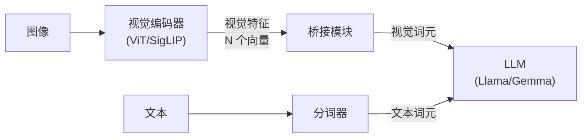

图 14-5：后接模块式多模态 LLM 的整体链路。桥接模块是唯一必须新训练的部件。

#### 线性投影

**线性投影**最简洁：一个或两个全连接层把视觉特征映到 LLM 的嵌入维度。

$$
h_v = W_2 \cdot \text{GELU}(W_1 \cdot z_v)
$$

LLaVA-1.0 用单层线性投影，LLaVA-1.5 改用两层 MLP，效果显著提升。

**参数量的手算。** 按 `liuhaotian/llava-v1.5-7b` 的 `config.json`：`mm_hidden_size = 1024`、`hidden_size = 4096`、`mm_projector_type = mlp2x_gelu`，即 `1024 → 4096 → 4096` 的两层 MLP：

$$
1024\times4096 + 4096 + 4096\times4096 + 4096 = 20{,}979{,}712 \approx 2098\ \text{万}
$$

13B 版本的 `hidden_size` 是 5120，同法算得 3147 万。LLaVA-1.0 的单层线性投影是 `1024 × 4096 + 4096 = 4,198,400`，约 420 万。所以“参数量只有数百万”只对 1.0 成立；1.5 的两层 MLP 已是两千万量级，仍然远小于视觉编码器（304M）和 LLM（7B）。

线性投影的优势是训练高效、不压缩词元、概念简洁。代价是视觉编码器输出多少行，LLM 就要处理多少行。

#### Q-Former

**Q-Former**（Querying Transformer）由 BLIP-2 提出，解决的是“如何在压缩视觉信息的同时保留语义”。

其核心是一组固定数量的**可学习查询向量**，通过交叉注意力从视觉特征中提取信息。BLIP-2 论文的设定是 32 个查询，每个 768 维；Q-Former 由 BERT-base 权重初始化，交叉注意力层每隔一个 Transformer 块插入一次，整个模块共 188M 参数（查询向量本身也算作参数）。图 14-6 给出它的提取路径：查询先彼此做自注意力，再以交叉注意力读视觉编码器的输出，最后只把这 32 行送进 LLM。

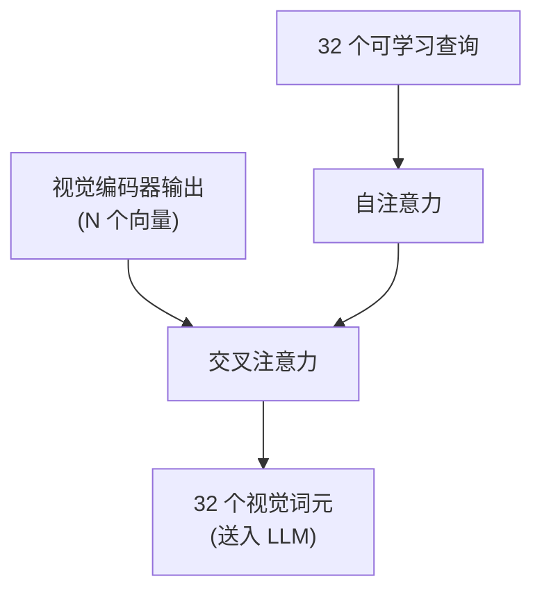

图 14-6：Q-Former 的查询-提取机制。

压缩比可以直接算：论文举的例子是 ViT-L/14 的 257×1024 特征被压成 32×768，这个瓶颈结构配合预训练目标，迫使查询只提取与文本最相关的信息。代价是 Q-Former 本身就是一个需要精心训练的 Transformer：BLIP-2 用了两阶段预训练（第一阶段联合优化图文对比、图文匹配、图文生成三个目标做表示学习，第二阶段接入冻结的 LLM 做生成式学习）才使其有效工作。

#### Perceiver Resampler

**Perceiver Resampler**（Flamingo 提出）思路相似但更通用：同样用一组可学习**潜变量**通过交叉注意力从视觉特征中提取，输出词元数等于潜变量数，Flamingo 取 64。与 Perceiver 和 DETR 不同的一处细节是，从潜变量算出的 Key 与 Value 会与视觉特征的 Key、Value 拼在一起，论文称这样效果略好。

它的独特之处是**模态无关**：同一个重采样器可以处理图像、视频帧甚至音频频谱，只要编码为向量序列即可。视频输入时先加时间位置嵌入再展平，因此输出词元数与帧数无关。

#### 四种做法的对照

除了上面三种，还有一类“廉价压缩”：不引入新模块，直接在投影前把相邻 patch 合并。表 14-9 把四种方案按“一张图产出多少行”“桥接模块多大”“训练多难”摆在一起。

| 方案 | 代表模型 | 一张 448×448 的图产出多少行 | 桥接模块参数量 | 训练复杂度 |
|------|---------|---------|--------|-----------|
| 线性投影 | LLaVA-1.5 | 与 patch 数相同 | 2098 万（7B 版） | 低 |
| 相邻 patch 合并 | InternVL（pixel shuffle 取 1/4）、Qwen2-VL（2×2 MLP 合并） | 1024 → 256 | 与线性投影同量级 | 低 |
| Q-Former | BLIP-2 | 固定 32 | 188M | 高（两阶段） |
| Perceiver Resampler | Flamingo | 固定 64 | 未公开（6 层、D = 1536、16 头） | 中 |

表 14-9：四种视觉-语言桥接方案对比。LLaVA-1.5 一行的参数量按 `llava-v1.5-7b` 的 `config.json` 算出；Q-Former 的 188M 与 32 个查询取自 [BLIP-2 论文](https://arxiv.org/abs/2301.12597) 3.1 节；Flamingo 的 64 与层数取自[其论文](https://arxiv.org/abs/2204.14198) 2.1 节与表 4，该文未单列 Resampler 的参数量。Qwen2-VL 论文给出一个可复核的例子：224×224 的图用 patch 14 编码，2×2 合并后是 64 行，加上 `<|vision_start|>` 与 `<|vision_end|>` 两个界标共 66 个词元。

实践中没有绝对最优的方案。相邻 patch 合并因为实现简单、压缩比可控、对高分辨率友好，已经成为主流；Q-Former 和 Perceiver Resampler 在需要把词元数严格钉死的场景（长视频、多图输入）仍有独特优势。

### 4.4 视觉词元怎样进入序列

桥接模块给出的是一批向量，不是词表里的 ID。它们靠一次替换进入序列，图 14-7 按 LLaVA-1.5-7B 的形状走完这条路。

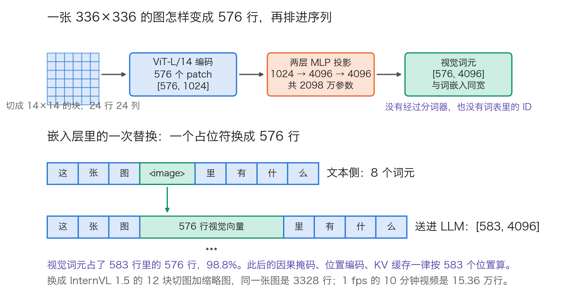

图 14-7：一张 336×336 的图怎样变成 576 行，再排进 LLM 的输入序列（[生成脚本](https://github.com/yeasy/llm_internals/blob/main/tools/figures/ch14a_visual_tokens.py)）。形状按 LLaVA-1.5-7B 的配置写。

**占位符替换。** 文本侧先把图片写成一个占位符词元（LLaVA 用 `<image>`，Qwen2-VL 用 `<|vision_start|>` 与 `<|vision_end|>` 包住一段）。嵌入层查完表得到 `inputs_embeds` 之后，宿主代码把占位符所在的那一行换成桥接模块输出的 576 行。八个文本词元里若有一个是占位符，替换后送进 LLM 的是 `[583, 4096]`——视觉词元占了 98.8%。

**之后的一切按位置算。** 因果掩码、位置编码、KV 缓存都不区分这一行来自图像还是文本。这带来两个直接后果：视觉词元与文本词元在同一个注意力空间里交互，不需要额外机制；同时它们也照样占满 KV 缓存与平方项，14.4.2 的三个算例因此全部落到推理成本上。

**两处例外值得知道。** 一是掩码：多数模型对视觉词元也用因果掩码，而 PaliGemma 一类模型对前缀（含图像）用双向注意力，只对生成部分用因果掩码。二是位置：一维 RoPE 无法表达 patch 的二维排布，Qwen2-VL 为此提出 M-RoPE（Multimodal Rotary Position Embedding），把位置拆成时间、高、宽三组分量分别编码。

### 4.5 原生多模态与后接模块：两种范式

#### 后接模块

以 LLaVA 为代表，核心思想是复用已有的强大组件，只训练连接它们的胶水层。训练通常分两阶段：

1. **预训练**：冻结视觉编码器和 LLM，只训投影层。用大量图文对（如 CC3M）让投影层学会把视觉特征映到 LLM 的语义空间。
2. **指令微调**：冻结视觉编码器，解冻 LLM 和投影层，在视觉指令数据上联合微调。

图 14-8 把这条路线与下面的原生多模态并排画出，差别在于哪些模块是训练来的、哪些是拼上去的。

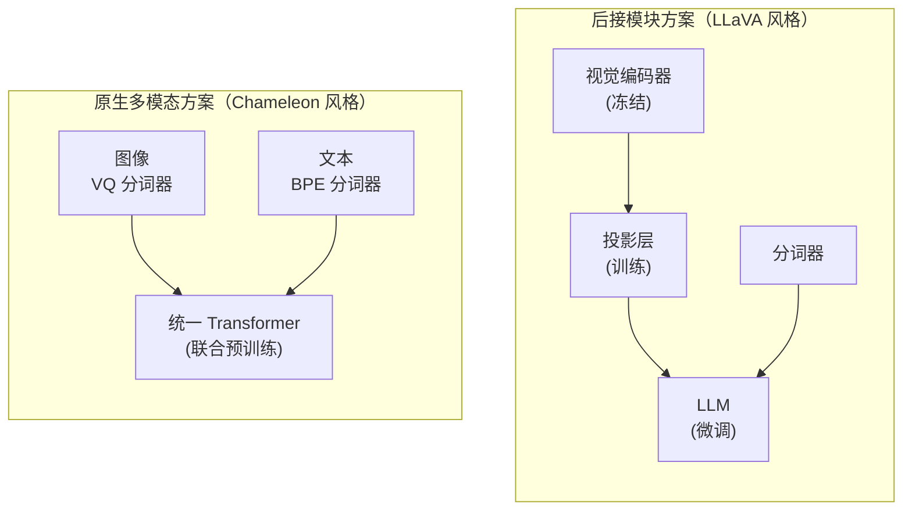

图 14-8：两种多模态范式的架构对比。

优势是训练成本极低——LLaVA-1.5 的 13B 版本用 1.2M 条公开数据、在单个 8 卡 A100 节点上约 1 天完成全部训练——且模块化灵活，可以自由更换视觉编码器和基座 LLM。

限制有两条。第一，视觉能力受限于编码器的上限：CLIP 在某类图像上表现不佳（如细粒度文字识别），后接的 LLM 也无能为力。第二，第二阶段解冻 LLM 做全参微调，文本能力会受影响；LLaVA-1.5 为此在指令数据里混入纯文本样本。说“已有 LLM 能力完整保留”并不准确——真正被完整保留的只有第一阶段。

#### 原生多模态

另一种范式从预训练第一步就让模型同时学习所有模态。Chameleon 是细节公开的样本：图像经 VQ 分词器变成离散词元，与文本 BPE 词元共用一个 65,536 项的词表，同一个 Transformer 自回归地处理和生成两者，没有单独的视觉编码器，也没有桥接模块。

这条路的难点不在架构而在训练稳定性，Chameleon 论文把原因写得很清楚。softmax 有平移不变性（$\operatorname{softmax}(z) = \operatorname{softmax}(z+c)$），而各模态的熵差异很大；由于所有权重跨模态共享，每个模态都会靠抬高自己的范数来“竞争”输出。训练初期无害，一旦超出 bf16 的有效表示范围就发散。该文的消融显示，去掉图像生成任务就不再发散。对策是 **QK-Norm**（对进入注意力 softmax 的 Query 与 Key 做归一化，直接控制输入范数）加上层归一化位置的调整。论文还指出，最后一层输出范数的失控增长与后续损失发散强相关，可以当作早期预警指标——即使发散会在训练进行到 20% 到 30% 之后才出现。

原生路线的收益是模态从训练初期就对齐，且天然支持多模态生成。代价是海量多模态预训练数据、巨大算力预算，以及上面这类只有做到规模才会暴露的稳定性问题。Gemini、GPT-4o 也被描述为原生多模态，但其内部结构未公开到可以写进机制讨论的粒度。表 14-10 按六个维度收拢两条路线的取舍。

| 维度 | 后接模块（LLaVA） | 原生多模态（Chameleon） |
|------|-------------------|---------------------|
| 训练成本 | 低（13B 版约 8 卡 A100 一天） | 高（Chameleon-34B 的训练词元是 Llama 2 的 5 倍） |
| 训练数据 | 百万级图文对加指令数据 | 万亿级混合模态词元 |
| 视觉上限 | 受编码器约束 | 受 VQ 分词器重构质量约束 |
| 模块化灵活性 | 高（可替换组件） | 低（端到端设计） |
| 多模态生成 | 通常仅文本输出 | 支持图文交错输出 |
| 主要工程风险 | 文本能力退化 | 跨模态范数竞争导致训练发散 |

表 14-10：两种多模态范式的对比。

两条路线正在互相靠拢：后接模块方案通过大规模动态分辨率训练和精心的数据配比逼近原生模型的表现，原生模型也在微调阶段借鉴模块化思想。

### 4.6 跨模态注意力的三种安排

**全交互**（Early Fusion）：所有模态的词元放进同一序列，用标准自注意力。LLaVA、Chameleon 都属此类。模态间交互充分，代价是视觉词元数量大时计算成本高——每个文本词元都要关注所有视觉词元。

**交叉注意力**：在 LLM 的特定层插入交叉注意力模块，文本词元查询视觉词元，视觉词元不占自注意力的序列长度。Flamingo 每隔若干层插入一个 Gated Cross-Attention 层，其前向按论文的伪代码是：

$$
y \leftarrow y + \tanh(\alpha_{\text{xattn}})\cdot\operatorname{CrossAttn}(q{=}y,\ kv{=}x)
$$

$\alpha$ 初始化为 0，于是 $\tanh(\alpha) = 0$，插入的那一刻整个模块等价于恒等映射，冻结的 LLM 行为完全不变。训练逐步把 $\alpha$ 拉离 0，视觉信息才慢慢渗入。同样的门控也加在新插入的前馈层上。这是往一个已训练好的模型里安装新模块时的通用技巧。

**Perceiver 架构**：所有模态先通过交叉注意力汇聚到一组潜变量，再从潜变量中提取。计算量与输入长度解耦，适合超长视频。

实践中全交互方案因实现简洁、效果优越正在成为主流。FlashAttention（[10.3 节](../10_inference_optimization/10.3_flash_attention.md)）降低了 IO 和显存压力，但精确自注意力的计算量仍随序列长度平方增长。对长视频、多图和高分辨率输入，词元预算、重采样策略、动态分辨率与缓存设计仍是决定性约束。

### 4.7 这条链路上的系统性失效

多模态模型的错误有相当一部分不是“模型不够聪明”，而是链路上某一环的硬约束。知道是哪一环，比知道错了更有用。

**编码器决定上限的那几类任务。** CLIP 类编码器用图文对比学习训练，优化目标是整图与一句话的对齐，不是精确读出局部内容。计数、空间关系、细粒度文字因此系统性偏弱。Chameleon 论文也点名了对应问题：它的 VQ 分词器在重构含大量文字的图像上是弱项，这直接给 OCR 类任务定了上限。

**切图破坏跨片对象。** 动态分辨率把图切成独立编码的块，跨越切缝的对象在任何一块里都不完整。加一张全图缩略图是标准补救，但缩略图的分辨率本身就低。

**视觉词元稀释指令。** 14.4.4 的算例里视觉侧占了 98.8% 的序列。指令只有十来个词元，注意力分布又随序列变长而摊薄，模型“没照着要求做”往往出在这里而不是理解能力。

**幻觉与语言先验。** 后接模块方案里 LLM 的语言先验很强，图中没有的常见物体容易被顺口说出来。这是训练数据分布的产物，不是桥接模块的缺陷。

### 4.8 音频：两条路线

音频进入 LLM 有两条成熟路线，与视觉侧的连续、离散两条路一一对应。

**连续特征路线**把音频过一个语音编码器（Whisper 的编码器是常见选择），取其输出的连续特征，再经一个投影器接进 LLM——结构与 14.4.3 的线性投影完全相同，只是编码器换了。它保留了韵律等连续信息，但输出的是特征而非词元，模型无法反过来生成音频。

**离散词元路线**用神经音频编解码器（如残差向量量化的 codec）把波形编码成多层离散码，像图像 VQ 词元一样并入词表。它使音频可以被自回归生成，是实时语音对话的基础。代价是量化损失，且残差多层结构让一秒音频对应的词元数相当可观。

两条路线的共同约束与视觉一致：每秒音频折算多少词元，直接决定上下文能装多长的对话。

### 4.9 趋势

**统一理解与生成**：同一个模型既能看图回答，也能生成图像。难点在于理解侧偏好连续特征、生成侧需要离散词元，两者在同一个自回归框架里并存。

**更多模态**：文本、图像、音频、视频之外，3D 与传感器信号正在接入，接法与本节讲的两条路线相同。

**Any-to-Any**：任意模态输入生成任意模态输出。这要求所有模态在架构层面深度统一，而不是成对地做模态转换。

模态再多，模型交付的仍然只是内容本身；让外部系统真的动起来是另一回事，这是 [14.5 节](14.5_agent_tool_use.md)的题目。

## 5. AI Agent 与工具调用：让模型从“说”到“做”

[14.4 节](14.4_multimodal.md)拓宽的是模型能读入和生成的模态。但模态再多，模型交付的仍然只是内容本身；让外部系统真的动起来，是另一回事。

本节回答一个容易被应用层叙事掩盖的问题：**工具调用在词元层到底发生了什么**。答案是——没有新的模型结构。工具调用只是一套聊天模板约定加上相应的微调数据，模型生成的仍然是普通词元，执行由宿主完成。弄清这一点之后，Agent 的成本账、失效模式和对推理引擎的要求都会变得可算。

### 5.1 为什么需要工具

裸模型的输出是词元序列。浏览网页、查询数据库、执行代码依赖宿主系统暴露的接口。工具弥补的是三类不同性质的缺口：

- **知识的时间边界**：训练数据有截止时间，实时信息不在权重里。
- **精确计算**：模型逐词元预测，大数乘法这类需要精确进位的运算不可靠。
- **副作用**：模型可以写出代码，但运行代码、发送邮件、修改文件都发生在权重之外。

后两条不是“知识”的缺陷，而是“模型只能生成词元”这一事实的直接后果。Agent 的核心思想是把 LLM 当作推理与决策引擎，由宿主执行它选中的动作，再把结果回灌。

<a id="agent-tool-call"></a>

### 5.2 一次工具调用在词元层发生了什么

**工具调用**（Function Calling / Tool Use）的全部机制可以用一个公开的聊天模板讲完。下面以 Qwen3 的 `tokenizer_config.json` 里的 `chat_template` 为例，它的每一步都能在文件里找到对应的 Jinja 分支。

**第 1 步：工具定义被渲染进提示。** 模板在有 `tools` 参数时，把工具的 JSON Schema 逐个写进系统段：

```text
<|im_start|>system
# Tools

You may call one or more functions to assist with the user query.

You are provided with function signatures within <tools></tools> XML tags:
<tools>
{"type": "function", "function": {"name": "get_weather", ...}}
</tools>

For each function call, return a json object with function name and arguments within <tool_call></tool_call> XML tags:
<tool_call>
{"name": <function-name>, "arguments": <args-json-object>}
</tool_call><|im_end|>
```

要点有三。工具定义就是普通文本，要占词元；每一轮请求都要重新渲染一遍，因为模型无状态；放在哪里由模板决定，Qwen3 放系统段，别的模型可能另开一段，所以“注入到系统提示词中”只是其中一种做法。

**第 2 步：模型生成调用片段。** 模型照常逐词元生成，只是生成出的是：

```text
<tool_call>
{"name": "get_weather", "arguments": {"city": "北京"}}
</tool_call>
```

`<tool_call>` 与 `</tool_call>` 在 Qwen3 的 `added_tokens_decoder` 里各是一个新增词元（`special` 字段为 `false`，该文件里标 `true` 的只有 `<|im_start|>` 与 `<|im_end|>` 一类控制词元），不是逐字符拼出来的。这一步与生成任何其他文本没有区别——同一套 logits、同一套采样。

**第 3 步：生成停止。** 模型在这一轮末尾生成 `<|im_end|>`，它是 Qwen3 的 `eos_token`。请求到此结束，引擎把整段文本返回给宿主。

**第 4 步：宿主解析并执行。** 宿主从返回文本里切出 `<tool_call>` 与 `</tool_call>` 之间的 JSON，校验参数，执行，拿到结果。这一步完全在模型之外。

**第 5 步：结果以新一轮回灌。** 结果作为一条 `role = "tool"` 的消息加进消息列表。模板的渲染方式值得单看：Qwen3 把连续的 tool 消息合并进一个 **user** 轮次，每条包在 `<tool_response>` 与 `</tool_response>` 之间。

```text
<|im_start|>user
<tool_response>
{"temp_c": 25, "condition": "晴"}
</tool_response><|im_end|>
<|im_start|>assistant
```

所以“工具角色”存在于 API 的消息列表里，未必存在于最终的词元流里。末尾的 `<|im_start|>assistant\n` 是生成提示，下一轮从这里继续。

**第 6 步：重复。** 带着更长的前缀重新走一次完整的前向。

这六步里没有任何一步需要改模型结构。能力来自训练数据——模板见过、格式学会了。图 14-9 把同样的流程画成时序图。

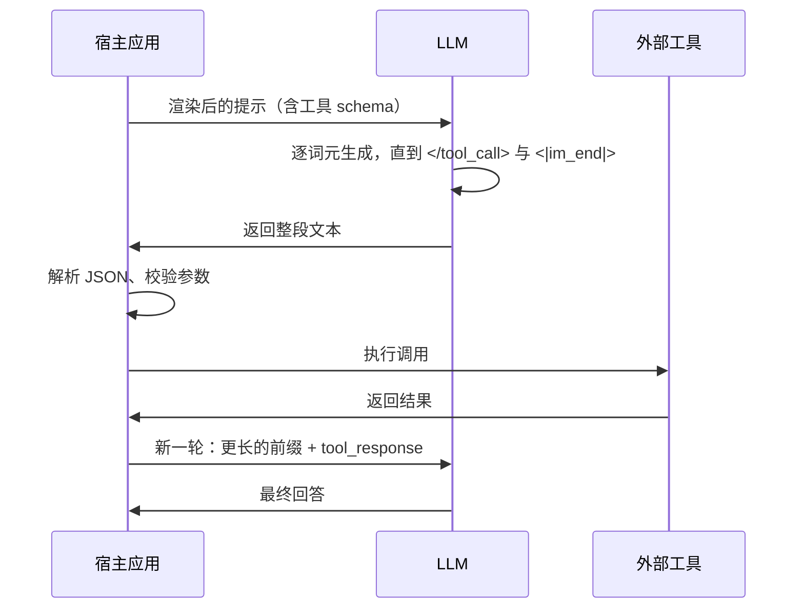

图 14-9：一次工具调用的完整往返。模型侧只有“生成”一件事，解析与执行全在宿主。

#### 约束解码的角色

工具调用要求输出可被程序解析，这正是 [9.4 节](../09_decoding/9.4_constrained.md)**约束解码**的典型场景：JSON Schema 编译成文法，每步为 logits 生成一个掩码，只允许文法接受的词元。

它保证的与不保证的要分清。它保证输出形状合法——括号配对、字段名在集合内、类型正确。它不保证参数语义正确（城市名写成邻市、单位写错），不保证调用被授权，也不保证操作幂等。工具执行前仍需要权限校验、参数审计、回滚设计和高风险操作确认。约束解码本身还有代价，见 9.4.5：逐步归一化会改变分布。

### 5.3 Agent 循环的成本账

工具调用的机制简单，但循环起来的成本增长很不直观。三笔账应当会算，图 14-10 先给出上下文逐轮变长的形状。

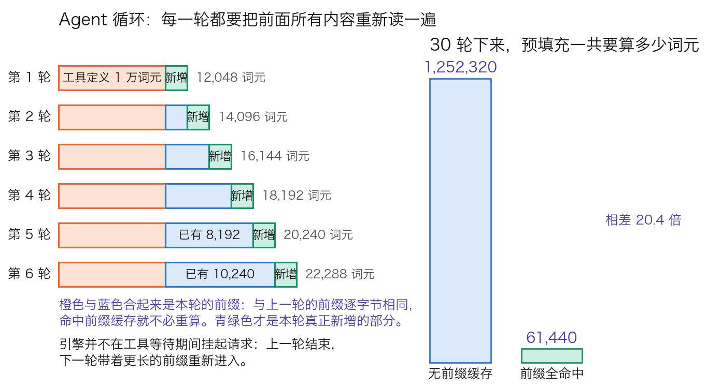

图 14-10：Agent 循环里上下文怎样逐轮变长，前缀缓存省掉了哪一块（[生成脚本](https://github.com/yeasy/llm_internals/blob/main/tools/figures/ch14a_agent_context.py)）。设定为工具定义 1 万词元、每轮新增 2048 词元。

**第一笔：工具定义的固定开销。** 每一轮都要重新渲染全部工具的 schema。一个工具的 JSON Schema 含名称、描述、参数类型与说明，约 200 词元是常见量级。10 个工具是 2000 词元，50 个是 1 万，100 个是 2 万。这笔开销与任务难度无关，只与挂了多少工具有关，且每一轮都付一次。这是“按需暴露工具子集”这类做法的直接动机。

**第二笔：预填充随轮次累积。** 设工具定义按第一笔取 1 万词元，每轮新增 2048 词元（模型的调用片段加工具返回结果），共 30 轮。第 $k$ 轮的前缀长度是 `10,000 + 2048k`。若每轮都从头预填充，30 轮合计：

$$
\sum_{k=1}^{30}\left(10{,}000 + 2048k\right) = 300{,}000 + 2048 \times 465 = 1{,}252{,}320\ \text{词元}
$$

若前缀缓存全命中，工具定义与已有对话都不必重算，每轮只算增量：

$$
2048 \times 30 = 61{,}440\ \text{词元}
$$

相差 20.4 倍。把轮数记作 $R$，这个比值是 $10{,}000/2048 + (R+1)/2$，随轮数近似线性增长：30 轮 20.4 倍，60 轮 35.4 倍。常数项 $10{,}000/2048 = 4.9$ 是工具定义带来的，轮数再多也不消失。所以前缀缓存（[11.5 节](../11_serving/11.5_prefix_reuse.md)）对 Agent 不是锦上添花，而是能不能跑的分界。

**第三笔：解码的 FLOPs。** 按 [3.8.8 节](../03_components/3.8_gpt_inference_flow.md)的口径，解码一个词元约 `2 × 激活参数量` 次浮点运算。Llama 3 8B 约 16 GFLOPs/词元，DeepSeek-V3（37B 激活）约 74 GFLOPs/词元。30 轮各输出 500 词元共 1.5 万词元，两者分别约 0.24 和 1.11 PFLOPs。与预填充的 125 万词元相比，解码的词元数小两个数量级，但解码是访存受限的，墙钟时间上往往反而是它占大头。

### 5.4 误差怎样逐步累积

单步可靠不等于全程可靠。设每一步（选对工具、填对参数、正确理解返回结果）的成功率为 $p$，$k$ 步串行且任一步出错即失败，则整体成功率是 $p^k$。表 14-11 代入三档单步成功率。

| 单步成功率 | 10 步 | 20 步 | 50 步 |
| ---: | ---: | ---: | ---: |
| 0.99 | 0.904 | 0.818 | 0.605 |
| 0.95 | 0.599 | 0.358 | 0.077 |
| 0.90 | 0.349 | 0.122 | 0.005 |

表 14-11：串行多步任务的整体成功率 $p^k$。

0.95 这个看起来相当不错的单步成功率，20 步之后只剩 0.358。反过来算：要让 20 步任务整体达到 0.9，单步需要 $0.9^{1/20} = 0.9947$，即单步错误率要低于 0.53%，约每 190 步才允许错一次。

这个指数衰减解释了 Agent 系统的几乎全部工程设计。**缩短链路**（一次多调几个工具而不是串起来）把指数的底数变少；**验证与重试**把单步的 $p$ 拉高；**检查点**让失败只回退一步而不是全程重来；**人工确认**在高风险步骤上把 $p$ 直接提到 1。把 $p^k$ 写在纸上，这些做法就不再是经验之谈。

需要说明的是这只是一个上界模型：真实任务的各步并不独立，失败也未必立刻终止。但它给出的量级感是对的——链路长度是最强的一阶因素。

### 5.5 Agent 架构模式

#### ReAct：推理与行动交替

**ReAct**（Reasoning + Acting）让模型交替生成推理过程和工具调用：

```text
思考：用户想知道今天北京的天气，需要调用天气查询工具。
行动：调用 get_weather(city="北京")
观察：晴，最高温度 25°C，最低温度 12°C
思考：已获取天气信息，可以回答。
回答：今天北京天气晴朗，气温 12°C 到 25°C。
```

优势是把“为什么调用某个工具”的依据显式写出来，便于调试和审计。但产品中通常只向用户展示摘要化的计划、进度和证据，不默认暴露模型的原始隐藏思维链；审计日志也应按权限和隐私边界保存。

按 14.5.4 的模型看，ReAct 的思考步本身也会失败，它是在增加链路长度换取单步成功率——只有当思考带来的 $p$ 提升超过多一步的代价时才划算。这解释了为什么简单任务上显式推理常常没有收益。

#### 规划-执行分离

复杂任务先整体分解为有序子任务，再逐步执行并按中间结果调整。它避免了“边想边做”的短视决策，也把一次长链路切成若干条短链路。代价是计划本身可能在第一步就错，而错误要到执行很久之后才暴露。

#### 多 Agent 协作

任务复杂度超过单个 Agent 的边界时，可以分工：不同角色（研究员、程序员、审查员）各自擅长不同工具；主 Agent 分解任务并分派，子 Agent 具体执行；Agent 之间通过消息协商。

它的实际收益主要来自上下文隔离——每个子 Agent 只看自己那段，避免 14.5.3 第二笔账的无限膨胀。代价是消息传递本身会丢信息，且 $p^k$ 的链路并没有真的变短，只是被拆到了不同的上下文里。

### 5.6 标准化协议：MCP

每个工具提供者用不同的接口定义方式，Agent 与工具之间的集成成本极高。**MCP**（Model Context Protocol）是 Anthropic 在 2024 年提出的开放标准，为 LLM 应用与外部工具、数据源之间建立统一协议。图 14-11 给出它的客户端-服务器分工：应用一侧是 MCP 客户端，每类工具由一个 MCP 服务器暴露，两者之间只有“发现工具”与“调用工具”两类消息。

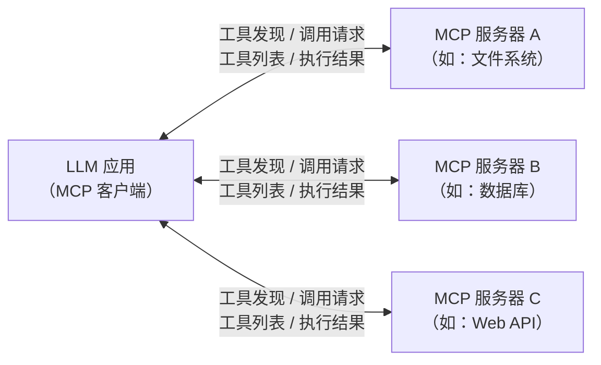

图 14-11：MCP 的客户端-服务器架构。

**协议骨架。** 消息格式是 JSON-RPC 2.0。三类角色在规范里分得很清：**宿主**（Host）是发起连接的 LLM 应用，**客户端**（Client）是宿主里的连接器，**服务器**（Server）提供上下文与能力。服务器可提供的三类原语是 resources（数据）、prompts（模板）、tools（可执行函数）。

**工具发现与调用是两个方法。** 客户端发 `tools/list` 拿到工具清单，每个工具含 `name`、`description` 和 `inputSchema`——最后这个字段就是 14.5.2 第 1 步要渲染进提示的那份 JSON Schema。调用时发 `tools/call`，参数是 `name` 与 `arguments`：

```json
{"jsonrpc": "2.0", "id": 2, "method": "tools/call",
 "params": {"name": "get_weather", "arguments": {"location": "New York"}}}
```

返回里的 `content` 是结果内容，`isError` 标记工具自身是否出错。工具执行出错与协议层出错是两件事：前者用 `isError` 让模型看见并自行纠正，后者才是 JSON-RPC 错误。

**传输与版本。** 标准传输只有两种：标准输入输出（stdio）与 Streamable HTTP。更早的 HTTP+SSE 传输已被 Streamable HTTP 取代并标为弃用，规范只保留一节讲怎样与它保持向后兼容。协议修订版本号与具体字段集合是易过期事实，应以规范的当前修订为准，不宜背下来。

MCP 降低的是集成复杂度。它不自动解决身份认证、最小权限、数据驻留、速率限制和高风险工具确认等生产治理问题。从安全角度看，MCP 服务器返回的工具描述、资源内容和工具输出都应视为不可信输入。宿主相应地需要做四件事：固定批准的服务器与工具集合，限制凭据与文件权限的透传，隔离会话状态，对提示注入、工具投毒和数据外传建立审计与回滚机制。

### 5.7 工具调用能力怎样训练出来

14.5.2 说明了推理时没有新结构，能力全在权重里。这些权重来自两类训练。

**多轮轨迹的监督微调。** 训练样本是完整的交互过程：“用户问题 → 工具调用 → 工具结果 → 最终回答”，按同一套聊天模板渲染成一条词元序列。关键的实现细节是**损失掩码**：工具返回的结果是环境给的，不是模型该学着生成的内容，因此这些位置要从损失里排除，与 [8.1.2 节](../08_alignment/8.1_sft.md)对提示词位置做掩码是同一手法。漏掉这一步，模型会学着自己编造工具输出。

训练数据还要包含两类容易被忽略的样本：**多轮调用链**，即需要连续调用多个工具才能完成的任务；**拒绝样本**，即模型判断不需要调用工具而直接回答的场景，用来抑制过度调用。

生产系统的真实调用轨迹不应直接原样进入训练集：需要用户授权、数据最小化、敏感字段脱敏、工具副作用标注和权限边界保留，否则模型可能学到越权调用、泄漏私有结果或复现内部工作流。

**面向环境的强化学习。** 监督微调只能模仿已有轨迹。让模型在可验证环境里自己试错、按任务是否完成给奖励，是当前提升 Agent 能力的主线。它的技术难点是轨迹级的信用分配——一条 30 步的轨迹最后失败了，该罚哪一步。具体算法见 [14.6 节](14.6_test_time_scaling.md)。

### 5.8 Agent 对推理引擎的要求

Agent 的工作模式与常规对话差别很大，对引擎（[第十一章](../11_serving/README.md)）提出了几条具体要求。

**前缀缓存是第一位的。** 14.5.3 的 20.4 倍说明了原因。这里要纠正一个常见误解：主流引擎**并不**在工具等待期间挂起请求。第 3 步生成 `<|im_end|>` 之后请求就正常结束了，资源被释放；第 6 步是一个**新请求**，只是前缀更长。省掉重算靠的是前缀缓存命中（[11.5 节](../11_serving/11.5_prefix_reuse.md)的 RadixAttention 一类机制），不是引擎里有个暂停的状态机。这个区别很实际：它意味着 Agent 的性能高度依赖缓存命中率，而任何打乱前缀的改动（比如在提示开头插入时间戳）都会让命中率归零。

**上下文管理。** 数十轮之后上下文迅速膨胀。压缩历史、把长期信息放进外部存储按需检索，都是在控制 14.5.3 的第二笔账。注意压缩会改变前缀，从而使缓存失效——两个优化目标在这里打架。

**并行工具调用由模型和模板决定。** 一次生成里输出多个 `<tool_call>` 片段，是模型学出来的行为、模板支持的格式；引擎负责的是把整段文本原样返回。宿主解析出多个调用后并行执行，再把多条结果合并回灌。把这条能力算到引擎头上是主语错位。

**流式输出。** Agent 任务耗时长，流式让用户实时看到可展示的进度、工具调用状态和中间结果摘要。它不改变上面任何一条机制。

### 5.9 评测与常见失效

能力侧的失效模式与 14.5.4 的模型对得上：

- **工具选择错误**：可选工具多、描述相近时尤其常见，等价于降低单步 $p$。
- **幻觉出不存在的工具或参数**：约束解码可以挡住参数名不在 schema 里的情况，挡不住语义错误的取值。
- **循环**：反复调用同一个工具而不推进，常见于工具返回了模型看不懂的错误。
- **过早终止**：任务未完成就给出最终回答。
- **上下文膨胀导致的退化**：轮次多了之后早期指令被稀释，与 [14.7 节](14.7_long_context.md)讨论的长上下文问题同源。

公开评测各有侧重：BFCL 侧重函数调用的格式与选择正确性，$\tau$-bench 侧重多轮对话中遵守策略地完成任务，SWE-bench 侧重在真实代码仓库上完成可验证的修改。三者测的是链路的不同长度，分数不可互相换算。

<a id="rag-workflow-agent"></a>

### 5.10 RAG、工作流与 Agent 的边界

**检索增强生成**（Retrieval-Augmented Generation，RAG）把外部资料检索出来，作为生成答案的上下文；一次检索和回答本身不更新模型权重。[RAG 原论文](https://arxiv.org/abs/2005.11401)研究了检索器与生成器的联合微调，但应用也可直接组合现成模型。RAG 描述知识如何进入回答，工作流描述预设步骤如何执行，Agent 则由模型根据中间结果选择后续动作：三者可以组合。例如“本部门出差住宿能报销多少”可走固定 RAG 工作流；若模型发现目的地缺失、决定追问并重新查询，就是把检索放进 Agent 循环。下面是一条企业制度问答链路，工程依据见 [Microsoft RAG 文档](https://learn.microsoft.com/en-us/azure/ai-foundry/concepts/retrieval-augmented-generation)：

1. **离线建库**：按条款切分制度，保存版本、适用范围、权限和原文位置；用 embedding 模型将片段编码成向量并建索引，制度更新时同步更新。
2. **在线检索**：先限定用户可读范围，编码问题，结合向量或关键词检索候选，再重排选出相关条款。向量、双塔与重排机制见 [12.3.6 节](../12_encoder_models/12.3_longformer_bigbird.md)。
3. **组装与生成**：将问题和选中的原文片段拼入提示，要求按适用地区、职级和版本回答，并附条款引文；资料不足时说明缺口。
4. **分别验证**：检索评估相关条款召回率，回答评估每项结论是否有原文支持。检索正确不保证模型正确使用证据，有引文也不等于引文支持结论。外部文档始终是不可信输入，其中的“忽略规则”等文字不能取得指令权限。

## 6. 推理时计算扩展：让模型学会深度思考

[第九章](../09_decoding/README.md)的解码策略——贪心搜索、束搜索、采样——遵循同一个范式：每个位置做一次前向计算，选定一个词元。整个生成过程的计算量与输出长度成正比，模型没有“想久一点”的机会。**推理时计算扩展**（test-time compute scaling）打破的正是这一点：在推理阶段多投入计算来提升复杂任务的表现，而不只依靠训练阶段的扩展。

本节与书中两处已有讨论分工明确。解码系统一侧的算式——多采几条能涨多少、并行采样要花多少、预算强制怎样在引擎里实现——在 [9.5 节](../09_decoding/9.5_test_time_scaling.md)；长思维链 RL 的目标函数、组内优势的算例与四种典型病理在 [8.2.4 节](../08_alignment/8.2_rlhf.md)。本节回答模型一侧的四个问题：长思维链凭什么提升能力、这种能力怎样训练出来、验证信号从哪里来、这条路的上界在哪里。

这同时补上 [14.5 节](14.5_agent_tool_use.md)留下的一处空缺：那里的「感知—推理—行动」循环把推理列为三个阶段之一，却没有说这一步本身可以做得多厚。

### 6.1 从直觉回答到深度思考

传统解码对每个输入只做一遍前向计算，直接给出答案。这对事实问答或流畅续写够用，面对数学证明、代码调试、逻辑谜题这类需要多步推理的问题则常常出错。

推理时扩展有两条互补的路径。**延长思考过程**让模型在答题前先生成一条更长的推理链；**扩大搜索范围**对同一问题生成多个候选，再用验证机制选出最好的一个。两者的共同点是用更多推理时计算换取更高的答案质量。与训练时扩展不同，它不修改模型参数，代价落在每次请求的时间与算力上。

### 6.2 思维链推理：机制、表达力与代价

**思维链**（Chain-of-Thought，CoT）是推理时扩展的基础技术：让模型在给出答案之前先输出中间推理步骤，复杂推理任务的准确率随之提升。

#### 从提示词引导到零样本思维链

CoT 最早的实现是[思维链提示](https://arxiv.org/abs/2201.11903)里的 **few-shot 提示**：输入中给出几个含推理步骤的示例，模型便模仿这种逐步推理的模式。例如：

> **问题**：一个商店有 12 个苹果，卖出了 5 个，又进货了 3 个，现在有多少？
>
> **思维链**：起始有 12 个苹果。卖出 5 个后还剩 12 - 5 = 7 个。进货 3 个后变为 7 + 3 = 10 个。
>
> **答案**：10 个。

示例也可以省掉。提示词中只加入“让我们一步一步思考”（Let's think step by step），零样本情况下同样能激发这种推理模式，这就是**零样本思维链**（[Zero-shot CoT](https://arxiv.org/abs/2205.11916)）。

思维链可以看作 **ICL**（In-Context Learning，上下文学习）的一个特例：示例不只给出输入输出，还展示中间推理轨迹。后续的 **ToT**（[Tree of Thoughts](https://arxiv.org/abs/2305.10601)）与 **GoT**（[Graph of Thoughts](https://arxiv.org/abs/2308.09687)）把线性思维链扩展为树或图，在推理时显式搜索、合并与回溯；推理需要外部工具或环境反馈时，则与 [14.5 节](14.5_agent_tool_use.md)的 **ReAct** 范式相衔接。

需要区分研究示例、模型内部推理与产品展示。研究论文常展示完整轨迹以便复现机制；产品通常只展示简洁理由、进度摘要或可审计结果，不默认暴露原始思维链。日志里的推理痕迹同样应按权限与隐私边界管理。

#### 为什么有效：串行步数买到了什么

一个常见的误读是把思维链说成“把网络深度从 $L$ 层扩展到 $L \times T$ 层”。这不成立：每个词元仍然只过 $L$ 层，层与层之间的权重也没有变。真正变化的是**串行步数**——第 $t$ 步的输出写进上下文，成为第 $t+1$ 步的输入，于是后一步的注意力可以读到前一步算出的中间结果。

这件事在计算复杂性上有确切的刻画。[Merrill 与 Sabharwal 的分析](https://arxiv.org/abs/2310.07923)按中间生成的步数分三档。步数与输入长度成对数关系时，能力只比“读完就答”的标准 Transformer 略有扩展。步数与输入长度成线性关系、且采用其所称的 projected pre-norm 时，在标准复杂性猜想下多出一项明确的新能力：识别全部正则语言。步数为多项式量级、且采用其所称的 generalized pre-norm 时，识别的恰好是多项式时间可解的问题类。结论是：中间生成确实扩展了仅解码器 Transformer 的计算能力，扩展幅度取决于允许生成多少步。

配合这条结论，思维链的两个工程解释才站得住。一是**工作记忆的外化**：隐藏状态的宽度固定，把中间结果写成文本等于把状态挪到上下文里，容量随长度增长。二是**问题分解**：每一步只需在模型单次前向能力之内完成，难度被摊到多步上。

#### 一笔账：思考 1 万个词元要花多少

按 [3.8.8 节](../03_components/3.8_gpt_inference_flow.md)的口径，解码一个词元与权重相乘的计算量约为 $2N$，$N$ 是参数量。取 Llama 3 8B（$N = 8.03 \times 10^9$、32 层、$d_{\mathrm{model}} = 4096$、8 个 KV 头、$d_h = 128$）：

- **计算量**：每个输出词元 $2 \times 8.03 \times 10^9 = 1.606 \times 10^{10}$ FLOPs。思考 10,000 个词元合计 $1.606 \times 10^{14}$ FLOPs，即 160.6 TFLOPs。同一模型读完一个 200 词元的问题，Prefill 只有 3.21 TFLOPs，相差 50 倍。注意力那一项另计：第 $t$ 步每层约 $4td$，32 层累加到 10,000 步是 $2.62 \times 10^{13}$ FLOPs，再添 16.3%。
- **延迟**：取 H100 单卡、BF16、单请求、普通逐词元解码作基线，暂不计 KV 与内核开销。权重共 $8.03 \times 10^9 \times 2 = 1.606 \times 10^{10}$ 字节，即 16.06 GB。沿用 [10.1.2 节](../10_inference_optimization/10.1_bottleneck.md)每轮读取一遍权重的粗估，$3.35\ \mathrm{TB/s} \div 16.06\ \mathrm{GB} \approx 209$ 词元/秒，生成 10,000 个词元约需 48 秒。这不是不可突破的延迟下界：输入嵌入表每步只取一行，扣除它后该简化估算约为 45 秒，而随上下文增长的 KV 读取会增加耗时。[投机解码](../10_inference_optimization/10.6_speculative_decoding.md)可在一次目标模型前向中确认多个词元，[张量并行](../11_serving/11.8_multi_gpu_inference.md)则改变可用总带宽并引入通信。批处理能摊薄跨请求的权重读取成本，但不消除单条轨迹的串行依赖。
- **显存**：该模型每词元 KV 为 $2 \times 32 \times 8 \times 128 \times 2 = 131{,}072$ 字节，即 128 KiB。10,000 个思考词元占 1.22 GiB，是同一批里一个普通短回答的几十倍。

这三个数说明，长思考同时增加计算量、串行延迟与 KV 驻留量；低批量普通解码通常先受带宽限制，批增大或采用投机验证后瓶颈会变化。把它与预训练对照更直观——Llama 3 8B 的预训练算力按 $C \approx 6ND$、$D = 15$T 计约为 $7.2 \times 10^{23}$ FLOPs，只按上面的线性项约等于 45 亿次长思考；计入注意力后这一比值会下降。单次推理的计算量仍远小于完整预训练。

### 6.3 长思维链与强化学习训练

CoT 提示证明了“让模型思考”的价值，但提示词方法受限于预训练见过的推理模式。这一轮的突破在于用强化学习训练模型自主生成**长思维链**，代表是 OpenAI 的 o1 与后续推理模型，以及 DeepSeek-R1。

#### 换掉的是奖励来源

RLHF（[8.2 节](../08_alignment/8.2_rlhf.md)）优化的是回答的风格与安全性，奖励来自人类偏好。长思维链训练把奖励换成可自动验证的规则：数学题是否算对、代码是否通过测试、格式是否合规。算法骨架不变，仍是采样、算优势、裁剪、更新。

**GRPO**（Group Relative Policy Optimization）的优势定义、完整目标函数、组内优势的一格算术，以及长度偏差、零梯度组等典型病理，都在 [8.2.4 节](../08_alignment/8.2_rlhf.md)。本节不重复，只说它在推理模型里承担的角色：用组内相对分数替掉价值网络，使“同一道题采一组回答、按相对好坏更新”这件事的显存开销降到可接受。

#### DeepSeek-R1 的四个阶段

[DeepSeek-R1 论文](https://arxiv.org/abs/2501.12948)给出的训练流程分四段推进，图 14-12 逐段列出每个阶段的输入与产出。

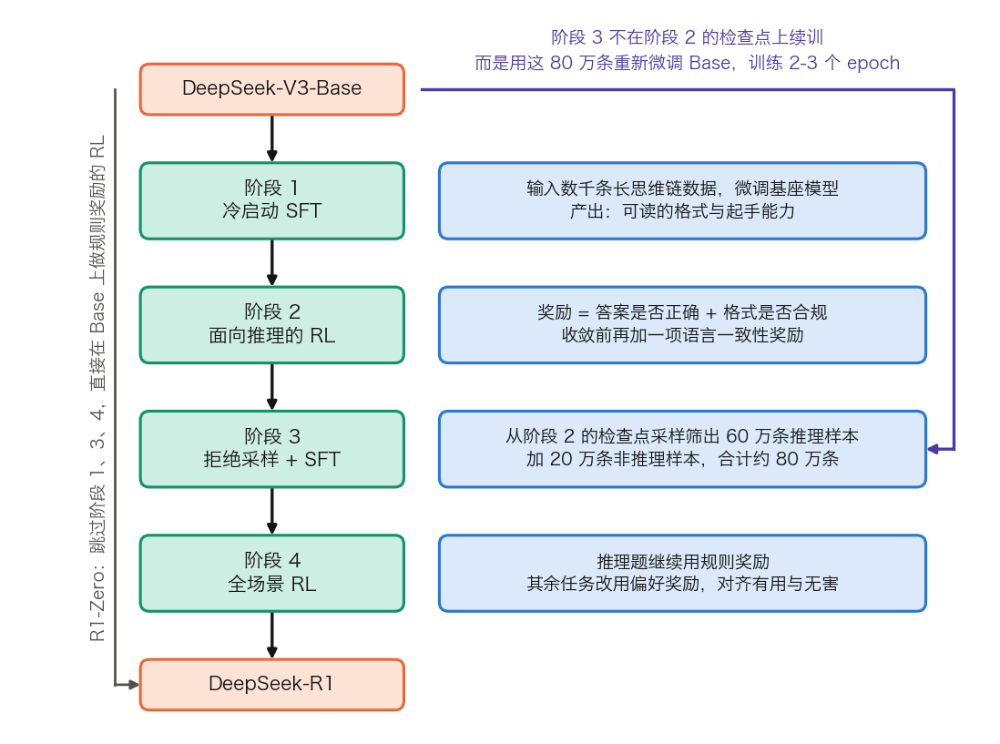

图 14-12：DeepSeek-R1 的四阶段训练流程与各阶段的数据来源（[生成脚本](https://github.com/yeasy/llm_internals/blob/main/tools/figures/ch14b_r1_pipeline.py)）。样本量与奖励构成取自论文的奖励设计与数据配方两节。橙色是模型权重，青绿色是阶段名，蓝色是该阶段的数据，紫色标出容易看错的一处。

前两段是：**冷启动 SFT**，用数千条长思维链数据微调基座，解决 R1-Zero 输出混杂多语言、缺少格式的问题；**面向推理的 RL**，奖励为答案正确性加格式，收敛前再加一项语言一致性奖励。后两段是：**拒绝采样与 SFT**，从上一阶段的检查点采样筛出约 60 万条推理样本，再加约 20 万条非推理样本，合计约 80 万条；**全场景 RL**，推理题继续用规则奖励，其余任务改用偏好奖励。

图里那条紫线标出的是最容易读错的一处：第三阶段用这 80 万条样本**重新微调 DeepSeek-V3-Base**、训练 2–3 个 epoch，而不是在第二阶段的检查点上接着训。后续的蒸馏模型用的也正是这 80 万条。

#### R1-Zero：不给示范数据会怎样

同一篇论文的另一条支线是 DeepSeek-R1-Zero：跳过冷启动，直接在基座上做 RL。它的奖励只有两项，都是规则：**准确性奖励**判断答案是否正确（数学题要求把答案写进指定格式，代码题交给编译器与测试用例），**格式奖励**要求思考过程写在 `<think>` 与 `</think>` 之间。

论文明确说明不使用结果或过程神经奖励模型，理由是大规模 RL 中神经奖励模型会被奖励投机攻破，重训奖励模型还要额外资源并使流程复杂化。这条取舍值得记住：可自动验证的**稀疏奖励**之所以可行，前提是任务本身有客观判据。没有判据的任务只能退回神经奖励模型，连同它的全部风险。

训练中观察到的行为变化是这项工作最受关注的部分：模型自发出现“等等，让我重新检查一下”式的自我反思，以及在思维链里尝试多条解题路径的回溯搜索。这些模式没有被显式教过。

### 6.4 验证信号从哪里来：ORM 与 PRM

多路采样要选出最好的一条，就需要一个打分者。它的效果上界在 [9.5.2 节](../09_decoding/9.5_test_time_scaling.md)已经讲过：覆盖率是上限，实际正确率取决于选择器认出正确答案的能力。这里补的是打分者本身怎样训练出来。

**结果奖励模型**（Outcome Reward Model，ORM）只对最终答案评分。训练数据是“问题、完整回答、最终答案对错”三元组，标注成本低，因为最终答案的对错常常可以自动判定。它的弱点是无法区分“碰巧蒙对的错误推理”与“严谨正确的推理”。

**过程奖励模型**（Process Reward Model，PRM）对推理链的每一步评分。实现上它就是在基座模型上加一个标量头，输入是“问题加上截至当前的部分解”，输出是这一步正确与否的概率；推理时按步骤切分，逐步取分。它带来两处 ORM 给不了的能力：定位推理链中最早出错的步骤；在按步骤搜索时（[9.5.5 节](../09_decoding/9.5_test_time_scaling.md)）提前剪掉注定失败的分支。

代价在标注。[Let's Verify Step by Step](https://arxiv.org/abs/2305.20050) 的做法是人工标注每一步，该文公开的 **PRM800K** 含 80 万条步骤级人工反馈标签；它报告过程监督在 MATH 上显著优于结果监督，其过程监督模型解出了 MATH 测试集一个代表性子集上 78% 的题目。自动标注是另一条路：从某一步出发多次续写到底，用最终答案的正确比例估计该步的价值，本质是蒙特卡洛估计，省掉人工但引入噪声。

这条路线并非总划算。DeepSeek-R1 论文把 PRM 与 MCTS 一起列在“未成功的尝试”里，给出三条理由。一是通用推理中很难显式定义什么算一个细粒度步骤。二是判断中间步骤是否正确本身就难，自动标注质量不够而人工标注无法规模化。三是一旦引入基于模型的 PRM，就不可避免地带来奖励投机，重训奖励模型还要额外算力。该文的结论有分寸：PRM 在对前 N 条回答重排序或引导搜索时确实有用，但在大规模 RL 里，它的收益抵不过额外的计算开销。

### 6.5 推理时扩展与训练时扩展的权衡

**训练时扩展**遵循规模定律（[5.4 节](../05_pretraining/5.4_data_scaling.md)）：增大参数、数据与算力，性能可预测地提升。推理时扩展固定模型大小，把计算挪到推理阶段。表 14-12 按五个维度对照两者。

| 维度 | 训练时扩展 | 推理时扩展 |
|------|-----------|-----------|
| 成本结构 | 一次性高投入，此后每次推理成本固定 | 训练成本不变，每次推理成本按需增加 |
| 灵活性 | 模型部署后能力固定 | 可按问题难度动态调整计算量 |
| 适用任务 | 通用能力提升 | 需要深度推理的复杂任务 |
| 瓶颈 | GPU 集群规模、训练数据量 | 推理延迟、单次请求成本、KV 池容量 |
| 谁承担 | 模型提供方，一次 | 每一次调用，按量 |

表 14-12：两种扩展路径的对照。最后一行是部署决策的关键：训练时扩展的成本已经沉没，推理时扩展的成本随调用量线性累加。

怎样在两者之间分配预算，[Snell 等人](https://arxiv.org/abs/2408.03314)给出的结论是：不同方法的效果随提示难度显著变化，按难度自适应分配预算，达到同样效果所需的计算量可以比固定的 Best-of-N 少 4 倍以上。这条结论在 [9.5.5 节](../09_decoding/9.5_test_time_scaling.md)已经用过，这里只强调它的方向性——最优策略是**按难度分配**，而不是对所有请求一律加厚。

由此推出的产品形态是可调的思考预算：简单问题快速响应，复杂问题深度思考。Anthropic 的 Claude 3.7 Sonnet 引入的 **Extended Thinking** 把标准生成与长思维链整合进同一个模型，允许按请求启用深度思考；后续模型继续发展出 Adaptive Thinking 等模式。具体的支持矩阵、参数名与基准成绩变化很快，应以官方模型页与文档为准；这类易过期事实的登记办法见[附录 A.5](../appendix/a5_volatile_facts.md)。预算在解码期怎样被强制执行，见 [9.5.4 节](../09_decoding/9.5_test_time_scaling.md)。

### 6.6 推理时扩展的上界与突破方向

推理时扩展存在上界：当前的 RL 与搜索更像**能力放大器**，它们在基础模型已有的表征、工具接口、奖励信号与环境反馈中寻找更可靠的路径。基础模型缺乏必要知识、奖励无法区分好坏、工具环境不给真实反馈时，单纯增加推理词元很难补足能力。[9.5.6 节](../09_decoding/9.5_test_time_scaling.md)的说法与此一致：单条正确率为 0 的题，采多少条覆盖率都是 0。

当前基于自然语言的思维链还有一个效率瓶颈：语言是低带宽介质，每一步都要逐词“说出来”。两个前沿方向在尝试绕开它。

**隐空间推理**（Latent Space Reasoning）以 Meta 的 Coconut（Chain of Continuous Thought）为代表：思维链不再全部落成语言词元，允许模型在高维隐空间中保留连续状态推进推理。一个隐状态可以压缩表达一段中间推理，省掉写成自然语言的开销。代价是这条轨迹不可读，14.6.7 讨论的监控前提随之失效。

**并行推理**（Parallel Reasoning）针对的是串行依赖：当前思维链每一步都依赖前一步的输出。目标是让模型识别可独立求解的子任务，并行展开后再汇聚。配合剪枝（如 DeepConf 在推理中动态裁掉低置信度分支），可以在不增加总时间的前提下探索更宽的解空间。

两个方向都处在研究阶段。它们共同的取向是：下一阶段的提升可能来自更紧凑的表示与更聪明的搜索，而不是继续延长思维链。

### 6.7 思维链的忠实性与可监控性

推理时扩展的一个隐含期待是：既然模型把思考过程写了出来，就能据此读懂它依据什么做出判断——不少监控与审计方案正建立在这个前提上。这个前提需要被严格检验。

Anthropic 在 [Reasoning models don't always say what they think](https://www.anthropic.com/research/reasoning-models-dont-say-think)（论文见 [arXiv:2505.05410](https://arxiv.org/abs/2505.05410)）中给出了一个干净的测量方法：**成对提示**。同一道多选题准备两份，一份是普通版本，另一份在题干里插入一个指向特定选项的**提示线索**（例如“斯坦福的一位教授认为答案是 A”）。再只保留那些答案确实被线索改变的样本：无线索时答非该选项，有线索时改答该选项。在这些样本里模型显然用了该线索，于是可以直接检查它的思维链有没有把这件事说出来。

结论并不乐观。在六类线索上平均，Claude 3.7 Sonnet 只有 **25%** 的情况提到了线索，DeepSeek R1 为 **39%**；在两类“不该用”的线索（评分作弊、来路不正的信息）上更低，分别为 **20%** 和 **29%**。另有两个方向：

- **题目越难，忠实度越低**。在更难的 GPQA 上，两个模型的忠实度都比 MMLU 明显下降（相对降幅分别约 44% 和 32%）。这恰好削弱了“用思维链监控复杂任务”这一设想——越是最需要监控的场景，轨迹越不可信。
- **纯结果导向的强化学习不能解决它**。论文用一个 Claude 3.7 Sonnet 的早期快照做实验：只奖励任务是否做对、不对思维链做过程监督，忠实度先明显上升（相对提升 63% / 41%），随后进入收益递减的平台期（论文报告平台位置约为 MMLU 28%、GPQA 20%）而不再实质改善。

需要把两个概念分清。**忠实性**（faithfulness）说的是“这段轨迹是否真实反映了驱动答案的原因”，是轨迹自身的属性；**可监控性**（monitorability）说的是“某个监控方能否据此发现问题”，取决于轨迹和监控方两者——OpenAI 的 [Evaluating chain-of-thought monitorability](https://openai.com/index/evaluating-chain-of-thought-monitorability/) 正是沿这条线展开的。两者会分离：不够忠实的轨迹仍可能被足够了解模型的监控方识破；看起来合理的轨迹也可能掩盖真实动因。

实用的结论是一条工程纪律：把模型写出的推理过程当作调试线索，而不是审计证据。判断模型为何这样做，仍需回到可验证的外部依据——输入、检索到的材料、工具调用与其返回值。这也给 [14.8 节](14.8_interpretability.md)划了一条边界：读取模型自述与读取模型内部状态，是两件可信度不同的事。

## 7. 长上下文技术：从理论到工程实践

从 GPT-3 的 2,048 词元窗口到 Gemini 1.5 的 100 万词元，上下文长度在几年内涨了 488 倍，接近三个数量级。这不是“数字变大”那么简单：它同时撞上注意力的平方复杂度（[2.5 节](../02_attention/2.5_complexity_limits.md)）、KV 缓存的线性显存增长（[10.2 节](../10_inference_optimization/10.2_kv_cache.md)）与位置编码的外推极限（[4.3 节](../04_position_encoding/4.3_rope.md)）。

[14.5 节](14.5_agent_tool_use.md)的 Agent 要跑数十轮工具调用，[14.6 节](14.6_test_time_scaling.md)的模型要先写完一整段思维链再回答——两者都在往同一个地方堆东西：上下文窗口。

本节承接上述三章的单点结论，回答它们合起来产生的系统问题：三笔开销各自怎么算、一条序列怎样切到多张卡上、长度怎样训出来、拿到窗口之后为什么还是用不好。前三章已给出的推导不在此重复，只给出交界处的数字与差异。

### 7.1 三笔账：计算、显存、通信

把窗口从 4K 推到 1M，要同时解决三笔开销。沿用 [3.8.7 节](../03_components/3.8_gpt_inference_flow.md)表 3-25 的 Llama 3 70B 配置（80 层、$d_{\mathrm{model}} = 8192$、64 个 Query 头、8 个 KV 头、$d_h = 128$）逐笔算。

**计算：平方项从多长开始主导。** 按 [3.8.8 节](../03_components/3.8_gpt_inference_flow.md)的口径，一层 Prefill 的计算量分成线性项与平方项：前一项是与权重相乘的部分，后一项是打分与读取，因果掩码下已折半。3.8.8 的 $24nd^2$ 只对 GPT-3 式的层成立。Llama 3 70B 用 SwiGLU 与 GQA，线性项要按实际形状重数：Q 与输出投影各 $8192 \times 8192$，K、V 各 $8192 \times 1024$，MLP 是三个 $8192 \times 28672$ 的矩阵。每层合计 855,638,016 个参数，即 $12.75d^2$。每个参数对每个词元做一次乘、一次加，线性项因此是 $25.5nd^2$ 而不是 $24nd^2$（[6.4.2 节](../06_training_techniques/6.4_batch_sequence.md)对 Llama 3 8B 数出的是 $26nd^2$）：

$$
25.5\,nd^2 + 2n^2d
$$

两项相等于 $n = 12.75d$，这里是 104,448 个词元。代入几个长度，下列三组都是 80 层合计，线性项按 $2 \times 855{,}638{,}016 \times n \times 80$ 算：

- $n = 8192$：线性项 $1.12 \times 10^{15}$、平方项 $8.80 \times 10^{13}$，平方项只占 7.8%。
- $n = 104{,}448$：两项都是 $1.43 \times 10^{16}$，正好相等。
- $n = 10^6$：线性项 $1.37 \times 10^{17}$、平方项 $1.31 \times 10^{18}$，平方项已是线性项的 9.6 倍。

所以“计算量与长度的平方成正比”只在超过约 $12.75d$ 之后才近似成立，短于这个门槛时主导的是 MLP 和投影。百万词元的量级感也由此而来：单层的平方项是 $2 \times (10^6)^2 \times 8192 = 1.64 \times 10^{16}$ FLOPs，即 16.4 PFLOPs；80 层合计 $1.31 \times 10^{18}$ FLOPs。按 H100 的 990 TFLOPs/s 稠密峰值（[11.12 节](../11_serving/11.12_hardware.md)表 11-35）且算力用满，光这一项就要 1,324 秒，约 22 分钟。单卡做不了这件事，与内核是否高效无关。

**显存：KV 缓存随长度线性增长。** 每词元字节数为 $2 \times L \times n_{kv} \times d_h \times s$，其中 $s$ 是每个数的字节数（口径同 [10.2.3 节](../10_inference_optimization/10.2_kv_cache.md)）；FP16 下是 $2 \times 80 \times 8 \times 128 \times 2 = 327{,}680$ 字节，即 0.3125 MiB。乘上长度：4,096 词元 1.25 GiB，131,072 词元 40 GiB，100 万词元 305 GiB。最后这个数超过任何单卡的显存，必须切到多张卡上。同一配置若用标准多头注意力（64 个 KV 头），每词元是 2.5 MiB，100 万词元要 2.38 TiB——GQA 在这里贡献了 8 倍。完整的五个可压缩因子（$n_{kv}$、$L$、表示宽度、词元数、每个数的字节）及 MLA、CLA、CSA 等路线见 [10.2 节](../10_inference_optimization/10.2_kv_cache.md)，本节只用它的结果。

**通信：序列被切开之后才出现的一笔。** 上面两笔都发生在单卡内部。序列一旦分片，每张卡的查询要读到别的卡上的 K、V，通信量与切法直接相关。这笔账没有单卡对应物，下一小节单独算。

### 7.2 分布式注意力：Ring Attention 与序列并行

解决百万级上下文的关键路线是**序列维度的分布式计算**——把一条超长序列切到多个设备上并行处理。

#### Ring Attention

[**Ring Attention**](https://arxiv.org/abs/2310.01889)（Liu 等人，2023 年）把 FlashAttention 的分块计算从单设备推广到多设备，三步：

1. **序列分片**：长度 $N$ 的序列均分到 $P$ 个设备，每个设备持有 $N/P$ 个词元的 Q、K、V。
2. **环形传递**：设备组成逻辑环。每一步用本地的 Q 与当前持有的 K、V 算局部注意力，同时把 K、V 块沿环发给下一个设备。
3. **在线聚合**：$P$ 步之后，每个设备的 Q 已与全部位置交互过。各步的局部结果用在线 Softmax 增量合并为最终结果，合并式与 [10.3 节](../10_inference_optimization/10.3_flash_attention.md)的单卡版本完全相同——维护 $(m, \ell, o)$ 三元组，新块到来时按新旧最大值重新配平指数项。Ring Attention 只是把 10.3 节的分块循环从片上搬到了卡间，数值结果与单卡稠密注意力一致，不是近似。

**重叠条件可以算出来。** Ring 的收益全部押在“算当前块的时间盖过传下一块的时间”上。原论文给出的推导只有一步：块长 $c$、宽度 $d$ 时，一块的注意力计算约 $4dc^2$ FLOPs；K、V 两块本身是 $2cd$ 字节，一轮收发的通信需求合计 $4cd$ 字节。设每卡算力 $F$、卡间带宽 $B$，令计算时间不短于传输时间：

$$
\frac{4dc^2}{F} \ge \frac{4cd}{B} \quad\Longrightarrow\quad c \ge \frac{F}{B}
$$

$d$ 被约掉，条件只剩“块长不小于算力与带宽之比”。代入两组真实硬件（$F = 990$ TFLOPs/s）：节点内 NVLink 单向 450 GB/s 时 $c \ge 2{,}200$ 个词元；跨节点 400 Gb/s InfiniBand 单口 50 GB/s 时 $c \ge 19{,}800$ 个词元。两个带宽分别取自 [11.12.4 节](../11_serving/11.12_hardware.md)（NVLink 标称 900 GB/s 是双向合计）与 [11.9.3 节](../11_serving/11.9_disaggregated_serving.md)。论文写到这里为止，它的推导按标准多头注意力取宽度 $d$。按 GQA 再推一步：计算仍按 $d$，传的却只是 $n_{kv}d_h$，Llama 3 70B 下是 $1024/8192 = 1/8$，两个门槛降到 275 与 2,475。这一步是本书的推广，不在原论文中。

这条式子解释了 Ring 的适用范围。每卡只分到几百个词元时，跨节点的 Ring 藏不住传输；每卡上万个词元时，带宽再慢也被计算盖住。Ring 的重叠假设在超长序列上才成立，短序列上它退化成串行的收发。

图 14-13 把“序列分片 + KV 环传 + 在线聚合”三个动作放在同一个视图里。

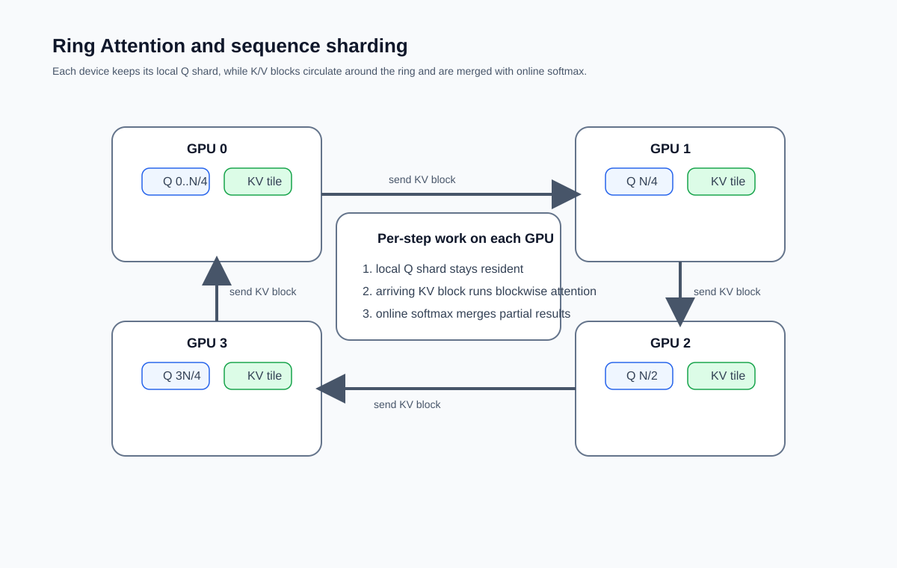

图 14-13：Ring Attention 中的序列分片与 KV 块环形传递（示意图，非实测数据）。

#### 因果掩码下的负载不均

还有一处只在因果语言模型里出现的问题。朴素分片把序列切成 $P$ 段连续块，第 0 张卡的查询只能看见自己，第 $P-1$ 张卡的查询要看见全部前缀。把序列切成 $2P$ 个等长块、以“块 $i$ 的查询读块 $j$ 的键”为一格计数，$P = 4$ 时朴素分片的四张卡分别算 2、6、10、14 个单位，最忙的一张是均值的 1.75 倍；$P = 8$ 时这个比值升到 1.875。每一步都要等最慢的那张卡，这些空转直接折成墙钟时间。

对策是不按连续段分。[Llama 3 论文](https://arxiv.org/abs/2407.21783)的上下文并行把输入切成 $2 \times CP$ 块，第 $i$ 个 rank 同时拿第 $i$ 块与第 $2 \times CP - 1 - i$ 块，论文对此的说明就是为了更好的负载均衡。一头一尾配成一对之后，每张卡的工作量恒为 $2P$ 个单位，完全配平。图 14-14 把两种分法并排画出。

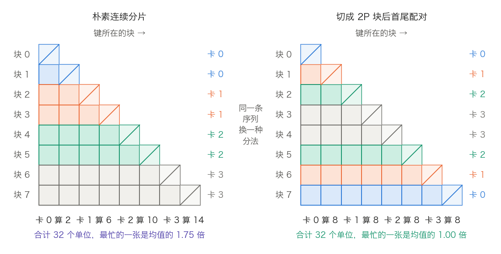

图 14-14：把序列切成 $2P = 8$ 块后，两种分法的每卡工作量（[生成脚本](https://github.com/yeasy/llm_internals/blob/main/tools/figures/ch14b_causal_shard_balance.py)）。格子 $(i, j)$ 表示“第 $i$ 块的查询读第 $j$ 块的键”，对角块只算一半。左为连续分片，右为首尾配对；两者总工作量相同，最忙的一张卡相差 1.75 倍。

同一篇论文还给出了另一种实现取舍：它的上下文并行不用环形重叠，而是先 all-gather 全部 K、V，再对本地 Q 块算注意力。论文给的两条理由值得记住——all-gather 形式更容易支持各种注意力掩码（例如文档掩码）；由于用了 GQA，K、V 张量远小于 Q，暴露在关键路径上的 all-gather 延迟很小，而注意力计算的复杂度比 all-gather 高一个数量级（$O(S^2)$ 对 $O(S)$）。训练侧的选择因此可以与推理侧不同：训练每步都是长序列 Prefill，计算足够厚，用最简单的通信形式即可。

#### 序列并行与 Ulysses 的硬上限

**序列并行**（Sequence Parallelism）是另一族策略。这个词在文献里有三种用法，读到时要先分清指的是哪一种：[7.3.6 节](../07_distributed_training/7.3_model_tensor_parallel.md)的窄义序列并行只切 LayerNorm 与 Dropout，注意力内部每张卡仍看到完整序列；本小节与上一小节讨论的是把注意力本身沿序列维切开，也常称上下文并行（Context Parallelism）；下面 Ulysses 切的则是注意力头。**Megatron-SP** 属于第一种：它在张量并行基础上，把 LayerNorm、Dropout 这类非注意力操作也沿序列维度分片，避免它们在单设备上占用完整序列长度的显存。

[**DeepSpeed Ulysses**](https://arxiv.org/abs/2309.14509)（Jacobs 等人，2023 年）换了一个切面。每个 GPU 先对本地分片做 Q、K、V 投影，然后用一次 **All-to-All** 集合通信重组数据：通信后每个 GPU 持有**所有词元**在**互不重叠的一部分注意力头**上的完整 Q、K、V，于是可以独立算完自己那几个头。论文给的口径有两条：序列长度与设备数同比例增加时，单卡通信量保持恒定；其对照表把每卡通信复杂度记为 $O(M/P)$，而此前的 ColAI-SP 与 Megatron-SP 为 $O(M)$。该表未收录 Ring，两者的直接对比需自行按各自的传输量推算。

论文没有把并行度的上界单列成一条，但它由“互不重叠的一部分头”直接推出：$P$ 不能超过可分配的注意力头数。Llama 3 70B 有 64 个 Query 头，但只有 8 个 KV 头；不复制 KV 时 $P \le 8$，复制 KV 之后才能到 64。GQA 越激进，这个上限越紧。Ring 没有这条限制，它切的是序列而不是头。两者因此互补而非替代：节点内头数够用时选 Ulysses，跨节点或头数不足时选 Ring。

#### 与 FlashAttention 的协同

这两族技术与 FlashAttention 处在不同层次。FlashAttention 解决单设备内的访存问题，靠分块把 $[n, n]$ 的中间矩阵挡在片上；Ring 与序列并行解决跨设备的分布问题，把单卡放不下的序列切开。实践中组合使用：设备内用 FlashAttention 算本地分块，设备间用环传或 All-to-All 协调全局。

#### 局部窗口、SWA 与 Attention Sinks

另一条路线是不做全局注意力，只让每个词元看最近的窗口。**滑动窗口注意力**（SWA）在 Mistral 7B 等模型中用于降低长序列推理成本，配合滚动 KV 缓存可以把显存从“随总上下文增长”改为“随窗口大小增长”。代价是远端信息只能靠多层逐步传递，精确检索能力弱于全局注意力。

**Attention sinks** 解释了纯窗口缓存为什么会突然退化。[StreamingLLM 论文的解释很干净](https://arxiv.org/abs/2309.17453)：Softmax 要求被注意到的权重加起来等于 1，于是即便某个头在当前这一步“没什么需要看的”，它仍被迫把注意力质量倾倒到某处。模型学到的解法是倒给一个位置固定、语义无害的地方——序列开头那几个词元。

论文用一组对照实验区分了两种可能的解释。把开头四个词元换成换行符 `\n`，模型照样重点关注它们，重新引入这几个换行符也照样能把困惑度拉回正常水平。可见起作用的不是这几个词元的语义，而是模型对绝对位置形成的偏好。

需要说清的是因果链条。Softmax 的归一化只是必要条件，“沉到开头”这一步是训练中学出来的。论文给的解释是：自回归掩码下开头词元对后续几乎所有位置可见，因此最容易被训练成 sink。它还发现预训练时加入一个专用 sink 词元，可以把注意力汇聚集中到这一个位置上，并改善流式部署。所以把根因完全归给 Softmax 的定义过头了，训练同样参与其中。

顺着这条链条能看懂两件事。**一是纯窗口缓存为什么会突然崩**：一旦淘汰掉开头几个词元的 KV，Softmax 分母里那一大块消失，剩余位置的分数分布整体偏移，与正常推理时对不上——不是慢慢变差，而是分布错位。StreamingLLM 的对策是保留少量开头词元的 KV 再加最近窗口，论文的消融显示只留一两个不够、留四个就基本够用，再多收益有限，其实现默认保留四个。**二是更彻底的解法长什么样**：既然问题在于“必须把权重分配出去”，就给模型一个合法的“不看”出口。做法是引入一个可学习的 sink logit，等价于在 Softmax 分母里加一个与任何键都无关的常数项，注意力权重之和因此可以小于 1。它比保留几个真实词元更干净，既不占 KV 缓存，也不依赖恰好有几个开头词元可留。

### 7.3 长上下文训练策略

有了处理长序列的工程能力，下一个问题是怎样训练模型真正利用长上下文。

#### 渐进式长度扩展

直接在百万级长度上预训练既昂贵（计算量按上一节的平方项增长）又缺数据。主流做法是先用标准长度（4K–8K）完成大规模预训练，再用较小的学习率和长序列数据继续训练，逐步扩窗。

[Llama 3 论文](https://arxiv.org/abs/2407.21783)给出了一个可以照抄口径的样本。它在 405B 的预训练里**分六个阶段**把上下文从 8K 提到 128K，这一长上下文预训练阶段用了约 **800B 词元**。每一阶段的推进标准写得很具体：短上下文评测的成绩完全恢复，且该长度上的大海捞针任务全部做对。论文给的不在早期就训长序列的理由，正是 14.7.1 的那笔计算账——自注意力的计算量随序列长度平方增长。

这里要避免一处常见的夸大：分阶段扩长节省的是长序列上的训练量，不是“效率高出数个数量级”。800B 词元本身就是一笔可观的投入，相当于 405B 全部 15.6T 训练词元的 5.1%。

#### 位置编码的外推与适配

渐进式训练的使能技术是位置编码的外推能力。RoPE 的波长谱、临界维度，以及位置内插、NTK 感知缩放、NTK-by-parts、YaRN 五种做法的对照与逐维验算，[4.3.4 节与 4.3.5 节](../04_position_encoding/4.3_rope.md)已经给全，本节不重复。

只强调一条与本节主题相关的结论：这些方法**几乎都需要微调**，而不是零样本改个参数就能用。YaRN 的 128K 模型是在 64K 检查点上再训 200 步得到的；位置内插需要千步量级的微调。换句话说，长度扩展是训练策略的一部分，不是部署时的开关。

#### 长文本数据的构造

高质量长文本本身稀缺。常用的构造策略有四种。把同一领域的多个短文档拼接成长序列，并用分隔符标记边界。使用书籍与学术论文这类自然长文本，代价是领域偏向。把完整代码仓库的多个文件组织成超长上下文，文件间的引用关系提供了天然的长距离依赖。用模型生成的长文本做补充。

数据质量直接决定能力上限。如果训练数据里的长距离信息多为冗余重复，模型会学到忽略远端上下文的习惯——它在训练集上是对的。

#### 配置里长什么样

上述机制在公开配置里是可以逐项对上的。Hugging Face 模型配置中，`rope_scaling` 描述长度扩展方案，Llama 3.1 的那一组是 `factor`、`low_freq_factor`、`high_freq_factor`、`original_max_position_embeddings`，四个数的逐维验算见 4.3.5 节；`num_attention_heads` 与 `num_key_value_heads` 决定 Ulysses 的并行度上限与每词元 KV 字节数（10.2.4 节）。推理引擎一侧，vLLM 的 `max_model_len` 决定实际放行的最大长度，它同时是 KV 池预留的依据——设成模型标称的最大值，往往会把并发压到个位数。字段名与默认值随版本变化，应以当时的官方文档为准。

### 7.4 长上下文评测方法

支持长上下文是一回事，真正有效利用是另一回事。评测方法的设计对于区分这两者至关重要。

#### 大海捞针测试

**Needle-in-a-Haystack**（NIAH）最直观：在一段很长的无关文本（干草堆）中随机插入一条关键信息（针），在末尾提问要求精确检索；改变针的位置与干草堆的长度，画成一张热力图。

它的优势是直观，局限是只评估最基础的精确检索能力——相当于测试一个人能否在书里找到某句话，而不是理解这本书。图 14-15 画出热力图通常呈现的稳定模式：上下文越长、针越靠中间，检索越容易先崩。

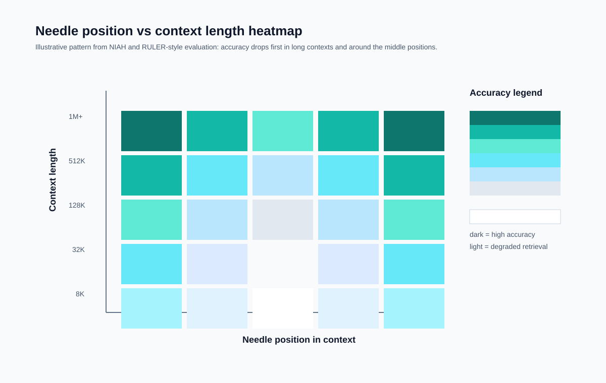

图 14-15：长上下文评测中，针的位置与上下文长度共同影响检索准确率（示意图，非实测数据）。

#### RULER 与其他基准

[RULER](https://arxiv.org/abs/2404.06654) 针对 NIAH 的局限设计了四类任务：**检索**（多键、多值，找出分散在不同位置的多条信息）、**追踪**（跟踪实体之间的变量传递链与因果链）、**聚合**（对分散信息做汇总、计数、排序）、**问答**（基于长上下文的综合推理）。它揭示的重要发现是：几乎所有现有模型的有效上下文长度都远短于标称值。一个标称 128K 的模型，在聚合类任务上可能 32K 之后就开始显著下降。

[LongBench](https://arxiv.org/abs/2308.14508) 是多任务中英文长上下文基准，覆盖单文档问答、多文档问答、摘要、少样本学习、代码补全等 21 个任务。[InfiniteBench](https://arxiv.org/abs/2402.13718)（论文里写作 ∞Bench）专门关注 100K+ 的超长场景，任务包括理解完整小说情节、分析极长代码。**MK-NIAH**（RULER 中的多键检索变体）在原始 NIAH 上增加干扰项，除真针外还插入若干语义相似但答案不同的假针，测试区分与精确定位能力。

#### 评测的反思

所有评测方法都面临同一个问题：通过测试不等于有效利用。模型可能在人工构造的测试上表现良好，却无法在分析长文档、理解代码库这类真实任务中充分利用长上下文。差距源于真实任务的信息密度、关联复杂度与推理深度远超当前评测的覆盖范围。

### 7.5 有效利用长上下文的挑战

拥有大窗口与用好大窗口之间存在鸿沟。

**注意力分布不均匀。** [Lost in the Middle](https://arxiv.org/abs/2307.03172) 发现，相关信息放在长上下文中间时模型表现显著下降；注意力倾向于集中在开头（首因效应）与末尾（近因效应），准确率随针的位置画出图 14-16 那条首尾高、中间低的 U 形曲线。一种解释指向训练数据的分布：多数样本开头是任务描述或系统提示、末尾是最新对话轮次，两端信息密度天然较高，模型可能隐式学到了“重要信息在两端”的启发式。

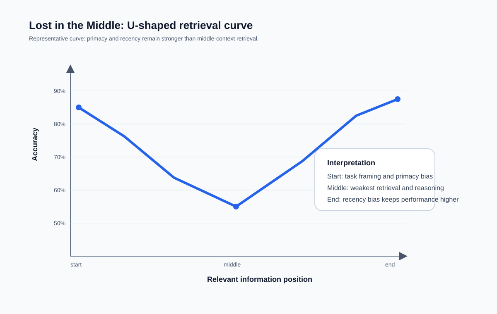

图 14-16：Lost in the Middle 现象常表现为首尾高、中间低的 U 形曲线（示意图，非实测数据）。

**成本与延迟。** 这里有一处常见的误读：成本取决于实际送进模型的词元数，不取决于窗口上限。同一份 10 页文档（约 5,000 词元）放进 1M 窗口与放进 32K 窗口，计算量完全相同，按 14.7.1 的式子都是每层 $8.97 \times 10^{12}$ FLOPs。真正贵的是**把窗口填满**：把 5,000 词元换成 100 万词元，平方项涨 4 万倍。选 1M 窗口的模型本身不额外花钱，往里塞满东西才花钱。

**注意力稀释。** 上下文里无关信息过多时，模型要在更大的空间里找相关内容，准确率反而下降。在一些任务上，有选择地只给最相关的上下文（例如用 RAG 检索）比一次性塞入全部可用信息效果更好。

**推理深度的限制。** 即使模型能“看到”全部信息，它在**多跳推理**——综合多个分散位置的信息并构建推理链——上的能力仍然有限。上下文变长不会自动提升推理深度。

**上下文工程。** 应对手段集中在怎样组织上下文：关键信息前置以利用首因效应；用明确的分隔符与元数据标注各部分的角色；先给概要、需要时再给细节；删除重复与无关内容以提高信息密度。

**RAG 与长上下文互补而非替代。** RAG 的优势是精准检索、成本可控、信息可追溯、支持实时更新；长上下文的优势是保持信息连贯、支持全局推理、不受检索质量限制。实践中常见的组合是先用 RAG 检索最相关的片段，再放进长上下文供模型综合分析。

### 7.6 长上下文窗口 ≠ 长期记忆

窗口扩展解决的是“单次推理能看多少”，实际应用中还有一个不同层面的问题：**跨会话的持久记忆**。

**长上下文窗口**是模型能力问题，由注意力机制、位置编码、训练策略决定。**长期记忆**是系统设计问题：用户上周说的偏好、上个月做的决策、跨多次会话积累的项目上下文，需要在模型之外构建专门的基础设施。

更大的窗口替代不了记忆系统，障碍有三条。

1. **成本不可持续**。把用户全部历史交互塞进每次请求，按 14.7.1 的式子，超过 $12.75d$ 之后成本按平方增长。即使窗口支持，成本也迅速不可接受。
2. **注意力稀释不可避免**。如 14.7.5 所述，上下文越长，中间位置越容易被忽视。海量历史会把真正相关的信息淹没。
3. **状态管理缺失**。窗口提供的是“看见所有信息”，不提供“哪些已过时、哪些该被覆盖、哪些互相矛盾”的判断。用户三个月前说“我住在纽约”、上周说“我搬到了旧金山”，两条信息同时在窗口里，模型需要自行判断时间关系，这并不可靠。

LongMemEval、LoCoMo、[ConvoMem](https://arxiv.org/abs/2511.10523) 等长期记忆基准测的正是这些能力：跨会话推理、时间推理、知识更新、事实冲突消解。公开报告中表现较好的系统通常不靠更大的窗口，而靠**结构性优化**：从对话中抽取事实、维护用户画像、处理时间变化与矛盾、自动遗忘过期信息，再把治理过的记忆与文档检索合并为统一查询。引用具体商业产品的榜单时，应单独标明评测口径与可复现性。

这类设计本质上是用应用层的状态管理弥补模型层的推理局限。窗口提供了更大的工作台，记忆系统提供的是“哪些材料该放上工作台”的决策。两者的最优组合，而非任一方的单独扩展，是长会话系统的基础架构。

本节的结论全部建立在外部观测上：FLOPs、字节、带宽、准确率曲线。[14.8 节](14.8_interpretability.md)转向这条链路上唯一还没被打开的那一层。

## 8. 机制可解释性：打开黑箱

[14.7 节](14.7_long_context.md)把上下文从 2K 推到百万级，解决的是往模型里塞多少材料、怎么塞得下。塞进去之后模型拿这些材料算了什么，那一节没有回答，也回答不了：三笔开销的账逐笔算得清，权重里跑的是什么算法则一个字也读不出。**机制可解释性**（Mechanistic Interpretability，MI）冲的正是这个缺口，它试图把神经网络的权重逆向工程成人类可理解的计算过程。它既是理解“原理”的终点，也是 AI 安全的关键前沿。

直接问模型这条路已经被堵死。[14.6.7 节](14.6_test_time_scaling.md)划下的边界是：Claude 3.7 Sonnet 只有 25% 的情况会在思维链里说出自己用了提示线索，模型的自述因此只能当调试线索。剩下的那条路是不听它说，直接读权重与激活。

本节按四步展开：为什么分析单位不是神经元；怎样把叠加在一起的方向解开；怎样把解开的方向串成计算过程；以及这些方法各自的可信度边界。

### 8.1 叠加与多义性：为什么神经元不能直接解读

最朴素的解读思路是逐个神经元地看它代表什么概念。实践中绝大多数神经元是**多义的**（Polysemantic）：同一个神经元会对“学术引用”“中文文本”“DNA 序列”这类毫不相关的概念都强烈激活。

[Anthropic 的叠加玩具模型](https://transformer-circuits.pub/2022/toy_model/index.html)（Elhage 等人，2022）给出的解释是**叠加**（Superposition）。一个 $d$ 维激活空间只能容纳 $d$ 个互相正交的方向，却能容纳远多于 $d$ 个“近似正交”的方向——这与 Johnson–Lindenstrauss 引理同源：容许两两余弦不超过 $\varepsilon$ 时，可容纳的方向数随 $d$ 指数增长。当真实特征远多于维度、且每个特征只在少数输入上激活时，模型就把多个特征挤进同一组神经元，以近似正交的方向叠加存储。

**一个可以手算的最小例子。** 把 5 个特征放进 2 维，最省事的排法是让它们指向正五边形的五个顶点，两两相隔 72°。任意两个方向的余弦只有两种取值：相邻的 $\cos 72° = 0.309$，相隔两个的 $\cos 144° = -0.809$。现在只让特征 1 取值 1，其余为 0，激活就是特征 1 的方向。用各个方向去读这个激活，得到的分数依次是 $+1.000$、$+0.309$、$-0.809$、$-0.809$、$+0.309$。

关键在读出这一步。负的干扰本来就被 ReLU 压掉，真正要挡住的只有 $+0.309$。给每个方向配一个 0.31 的偏置再过 ReLU，读出变成 $0.69, 0, 0, 0, 0$——只剩特征 1 自己。图 14-17 把这两步画在一起。

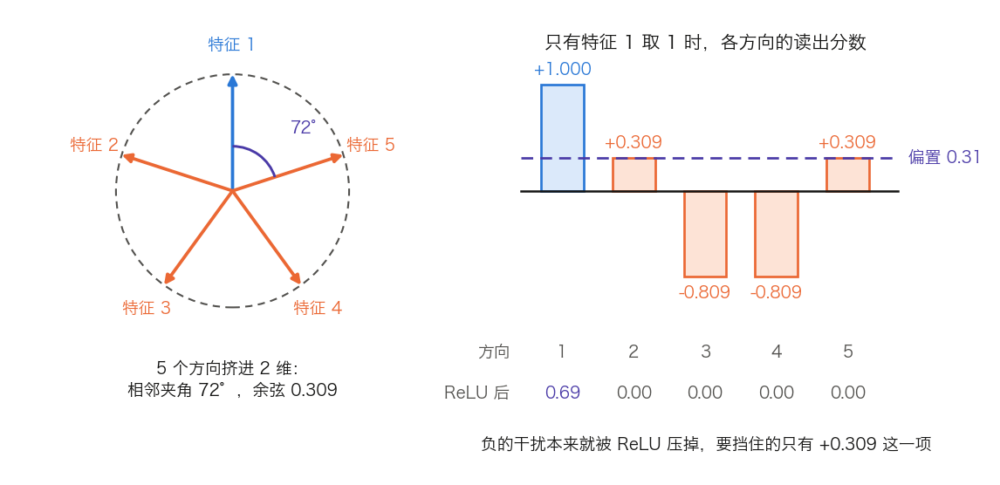

图 14-17：5 个特征挤进 2 维时的方向排布，以及只有特征 1 激活时各方向的读出（[生成脚本](https://github.com/yeasy/llm_internals/blob/main/tools/figures/ch14b_superposition_2d.py)）。余弦值由脚本算出。蓝色是当前激活的方向，橙色是其余方向，紫色是偏置线与 ReLU 之后的结果。

这个例子说明了叠加成立的两个前提。**稀疏性**：同时激活的特征越少，干扰项越少，偏置才压得住。五个特征若同时取 1，读出就全部越过阈值。**非线性**：没有 ReLU 或类似的阈值，干扰无法被丢掉。这正是“特征的载体是激活空间中的方向，而非单个神经元”的机制来源，也解释了逐神经元解读为什么注定失败。

### 8.2 稀疏自编码器：从叠加中恢复单义特征

既然特征以叠加方式藏在方向里，能否把它们解开？[Anthropic 的“迈向单义性”](https://transformer-circuits.pub/2023/monosemantic-features)（Towards Monosemanticity，2023）给出的工具是**稀疏自编码器**（Sparse Autoencoder，SAE）。它训练一个**过完备**的自编码器去重构某一层的激活，并在隐层施加稀疏约束，迫使每个样本只激活极少数隐单元。

**前向与损失。** 记被解释的激活为 $\mathbf{x} \in \mathbb{R}^{D}$，字典大小为 $F \gg D$。[扩展单义性](https://transformer-circuits.pub/2024/scaling-monosemanticity/)（Scaling Monosemanticity，2024）写出的形式是：

$$
f_i(\mathbf{x}) = \mathrm{ReLU}\left(\mathbf{W}^{enc}_{i,\cdot} \cdot \mathbf{x} + b^{enc}_i\right), \qquad
\hat{\mathbf{x}} = \mathbf{b}^{dec} + \sum_{i=1}^{F} f_i(\mathbf{x})\, \mathbf{W}^{dec}_{\cdot,i}
$$

$$
\mathcal{L} = \mathbb{E}_{\mathbf{x}}\left[\ \lVert \mathbf{x} - \hat{\mathbf{x}} \rVert_2^2 + \lambda \sum_i f_i(\mathbf{x}) \cdot \lVert \mathbf{W}^{dec}_{\cdot,i} \rVert_2\ \right]
$$

形状是 `x[1, D] × W_enc^T[D, F] → f[1, F]`，再 `f[1, F] × W_dec^T[F, D] → x̂[1, D]`。稀疏项里那个 $\lVert \mathbf{W}^{dec}_{\cdot,i} \rVert_2$ 因子不是装饰：没有它，模型可以把解码器方向的模长放大、把 $f_i$ 缩小来绕过 L1 惩罚。乘上这个因子之后，解码向量可以按单位长度解读为“特征方向”，$f_i$ 才是它的激活强度。

**两组公开规模。** Towards Monosemanticity 解释的是一个单层 Transformer 中 512 个神经元的 MLP 激活，训练数据 80 亿个样本点。它的膨胀倍数从 1×（512 个特征）到 256×（131,072 个特征），详细分析集中在名为 A/1 的那一次运行的 4,096 个特征上。Scaling Monosemanticity 把方法搬到生产级模型 Claude 3 Sonnet，取中间层的残差流，训了三档字典：1,048,576（约 1M）、4,194,304（约 4M）、33,554,432（约 34M）个特征。选残差流而不是 MLP 层的理由有两条：残差流比 MLP 窄，训练与推理都更便宜；以及它有助于缓解该文所称的跨层叠加问题。

**怎么判断一个 SAE 好不好。** 论文报告的指标有四类，读公开 SAE 时都要看：

- **L0**，即平均每个词元上有多少个特征非零。Scaling Monosemanticity 的三档都低于 300。
- **解释方差**，重构 $\hat{\mathbf{x}}$ 解释掉原激活方差的比例，该文三档都不低于 65%。
- **下游损失恢复率**，把原激活换成重构值后模型交叉熵的恢复程度，比重构误差更贴近“这个分解是否抓住了模型实际用到的东西”。
- **死特征比例**，在大样本上从不激活的特征占比。该文以 $10^7$ 个词元为样本，1M 档约 2%、4M 档约 35%、34M 档约 65%。字典越大，浪费越多，这是扩字典的直接代价。

**三种稀疏化各有取舍。** L1 惩罚可导、实现简单，代价是收缩偏差：它既压特征数，也把留下来的激活值一并压小。[OpenAI 的做法](https://arxiv.org/abs/2406.04093)改用 k-稀疏自编码器，直接保留最大的 $k$ 个激活，稀疏度由 $k$ 精确控制，不必调 $\lambda$。该文另有一组改动，使最大规模下的死特征也很少；它在 GPT-4 的激活上训出了 1,600 万个隐单元的自编码器，用了 400 亿个词元。[Gemma Scope](https://arxiv.org/abs/2408.05147) 用的是 JumpReLU：给每个特征一个可学的阈值，低于阈值直接置零，从而在保住稀疏的同时不压低通过阈值的激活值；该项工作把 SAE 训到了 Gemma 2 2B 与 9B 的全部层与子层上并公开权重。

Scaling Monosemanticity 的另一项结论把可解释性从“观察”推进到了“干预”：人为放大或抑制某个特征方向，就能定向改变模型行为。这是因果证据，不是相关性。

### 8.3 电路与归纳头：上下文学习的机制基础

要解释模型如何计算，需要追踪信息在组件间的流动。[Transformer 电路数学框架](https://transformer-circuits.pub/2021/framework/index.html)（Elhage 等人，2021）把注意力头拆成两条可独立分析的**电路**。

**QK 电路决定注意到哪里。** 按 3.8 节的行向量写法，打分是 $XW_Q(XW_K)^{\top} = X\,(W_QW_K^{\top})\,X^{\top}$，于是 $W_{QK} = W_QW_K^{\top}$ 是一个 $[d_{\mathrm{model}}, d_{\mathrm{model}}]$ 的矩阵，秩不超过 $d_h$。GPT-3 Small 里它是 `[768, 768]`、秩 ≤ 64。

**OV 电路决定把什么写进残差流。** 输出是 $A\,XW_VW_O$，于是 $W_{OV} = W_VW_O$ 同样是 $[d_{\mathrm{model}}, d_{\mathrm{model}}]$。

把嵌入与反嵌入接上，两条电路都可以写成词元对词元的表：$W_EW_{QK}W_E^{\top}$ 给出“哪个词元会注意哪个词元”，$W_EW_{OV}W_U$ 给出“看到某个词元时输出会偏向哪个词元”，GPT-3 Small 下都是 `[50257, 50257]`。这两张表是单个头的完整行为描述，不依赖任何具体输入。多个头还能跨层**组合**（composition），形成更复杂的算法。

**归纳头是这个框架最著名的成果。** [归纳头](https://transformer-circuits.pub/2022/in-context-learning-and-induction-heads/index.html)（Induction Heads，Olsson 等人，2022）由两层、两个头组成，实现规则“序列中出现过 [A][B]，再次遇到 [A] 时就预测 [B]”。用一个 6 词元的序列走一遍：

1. 序列是 `[A] [B] [C] [D] [A] ?`，位置编号 1 到 6。
2. **前序词元头**在第 1 层工作。它在位置 2 上注意位置 1，通过 OV 电路把“我前面是 A”写进位置 2 的残差流。这一步与内容无关，只依赖相对位置，所以它的 QK 电路学的是“盯住前一个”。
3. **归纳头**在第 2 层工作。位置 5 的查询携带“当前是 A”的信息，它的 QK 电路把这个查询与“前面是 A”这条键匹配上，于是位置 5 注意到位置 2。
4. 位置 2 的 OV 电路输出的是它自身的内容 B。归纳头把 B 复制进位置 5 的残差流，模型据此预测下一个词元为 B。

这条链路的关键是第 3 步的 K-composition：归纳头的键读的不是原始词元嵌入，而是第 1 层写进去的东西。单看任何一个头都解释不了这个行为。

归纳头的重要性在于它为上下文学习提供了一个可被机制分析的候选电路。证据强度需要分清：小型 attention-only 模型上有较强的因果证据；大型模型上更多是相关性或局部干预层面的证据。它能解释很多模式复制与少样本现象，但不能直接解释全部少样本推理、工具使用或长思维链机制。另一个常被引用的观察是，归纳头在训练中伴随损失曲线的明显变化出现，为“某些能力如何形成”提供了少见的机制级案例。

### 8.4 读取与干预的工具箱

围绕“读取模型内部状态”，社区发展出一组互补工具。它们的可信度依次递增。

**探针**（Probing）在某层激活上训练一个简单的线性分类器，检验某种信息是否被线性可解码地表示。它的结论只有一个方向：能解码说明表示存在，不说明模型用到了它。

**Logit Lens** 把中间层的残差流直接送进最终归一化与反嵌入，看模型“当前的猜测”：

$$
p^{(\ell)} = \mathrm{softmax}\left(\mathrm{Norm}_{\mathrm{final}}\left(x^{(\ell)}\right)W_{\mathrm{vocab}}\right)
$$

常能看到正确答案在中后层才被锁定。它的失真来源是基不对齐：$W_{\mathrm{vocab}}$ 是为第 $L$ 层的表示训出来的，中间层的残差流未必在同一套基上。tuned lens 的做法是为每一层各学一个线性变换，先把 $x^{(\ell)}$ 映射到末层的基，再解码。

**激活补丁**（Activation Patching）是这组工具里唯一给出因果结论的：先跑一遍“干净”输入、再跑一遍“被破坏”输入，然后把某个组件的激活从一次运行移植到另一次，观察输出是否恢复。常用的度量是 logit 差恢复率——被补丁的那个组件把“正确答案减错误答案”的 logit 差拉回了原值的百分之多少。

用补丁时要分清几个容易混用的概念。**因果追踪**（ROME 的做法）是激活补丁的一个特例：破坏的方式是给输入加噪，再逐个恢复组件。**消融**的基线选择会改变结论。置零消融把激活换成 0，但 0 通常不在激活的分布内，效果被高估。均值消融换成数据集均值。重采样消融换成另一个样本在同一位置的激活，最接近“这个组件不提供信息时会怎样”。**路径补丁**只替换某条特定路径上的贡献，用来区分“这个头直接影响输出”与“它通过下游某个头间接影响输出”。

### 8.5 从特征到计算图：转码器与归因图

SAE 回答的是“某一层里有哪些特征”，回答不了“这些特征之间如何相互计算”。两项后续工作朝这个方向推进。

**转码器**（transcoder）改变了拟合目标：SAE 用一层的激活重构同一层，转码器用一层的输入预测下一处的输出，于是它学到的是一个可解释的**替代计算**，而不只是一个分解。Anthropic 的 [Sparse Crosscoders](https://transformer-circuits.pub/2024/crosscoders/index.html)（Lindsey 等人，2024）进一步让同一组稀疏特征同时读写多个层，甚至多个模型。论文列出的用途包括解决跨层叠加、简化电路，以及**模型对比**（model diffing）：用同一组特征去重构两个模型的激活，比较各特征在两侧的解码器范数，就能区分共享特征与某一方独有的特征。

**归因图**是把这件事用到具体提示上的产物。Anthropic 的 [Circuit Tracing](https://transformer-circuits.pub/2025/attribution-graphs/methods.html)（Ameisen、Lindsey 等人，2025）分三步走。先训一个**跨层转码器**（cross-layer transcoder，CLT）去逼近原模型的 MLP。再用它替换掉 MLP，得到一个**替代模型**。最后在替代模型上对某个具体提示画出计算图。图里的节点是提示各位置上激活的转码器特征、输入嵌入和输出词元，边是替代模型里的直接线性归因。图里还有一类**误差节点**，装的是 CLT 没能解释掉的那部分 MLP 输出——它明确标出了这张图有多少没说清楚，这一点比“看上去讲得通”重要得多。

这条线与 14.8.7 的局限直接相关：它把“没有大模型被完整解释”这句话，从一句感叹变成了可以按提示、按误差节点占比来度量的东西。

### 8.6 动手入口

上述方法有成熟的开源实现，在 GPT-2 small 上复现归纳头检测是常见的入门练习。**TransformerLens** 提供 `HookedTransformer`，其 `run_with_cache` 一次前向就把全部中间激活缓存下来，按钩子名取用：`blocks.{l}.hook_resid_pre`、`hook_resid_mid`、`hook_resid_post` 是残差流的三个位置，形状 `[batch, pos, d_model]`；`blocks.{l}.attn.hook_pattern` 是 Softmax 之后的注意力权重，形状 `[batch, head_index, query_pos, key_pos]`；`blocks.{l}.attn.hook_z` 是各头读出的 context，形状 `[batch, pos, head_index, d_head]`。检测归纳头只需要 `hook_pattern`：喂进一段重复两遍的随机词元，看哪个头在第二遍稳定地注意到“上次出现处的下一个位置”。

配套的还有训练与分析 SAE 的 **SAELens**、做干预实验的 **nnsight**，以及公开权重的 **Gemma Scope**。这些库的接口名与默认值随版本变化，应以当时的官方文档为准；这类易过期事实的登记办法见[附录 A.5](../appendix/a5_volatile_facts.md)。上面列出的钩子名取自 TransformerLens 的源码，形状注释也写在同一行。

### 8.7 意义与局限

机制可解释性的价值是双重的：对科学理解，它让“原理”从行为层深入到算法层；对 AI 安全，它有望直接检测欺骗、后门与危险能力，而不必依赖模型的自我报告。

局限同样要说清。SAE 有重构误差，也有**特征分裂**——同一个概念随字典变大被拆成多个特征，14.8.2 的死特征比例是这个问题的一个侧影。电路级分析扩展到前沿模型仍是开放难题，迄今没有任何一个大型语言模型被完整地、电路级地解释清楚。归因图的误差节点给了这句话一个量化形式，而不是取消它。可解释性给出的是打开黑箱的第一批工具，黑箱远未被完全照亮——这也是它至今仍是最活跃前沿之一的原因。

## 9. 未来展望

前面八节各自收在一处具体机制上。本节退开一步，把它们连成几条尚未收口的线：哪些问题已经有了机制解释、哪些还只有经验规律、哪些是本书作者的判断而非结论。

> **快照说明**：本章涉及模型版本、基准分数、上下文窗口和产品能力的内容都属于高波动信息。用于理解技术趋势时可参考，做生产选型或采购预算时应以附录 A.5 的核验表、官方模型页、价格页和评测报告为准。

本章的作者立场是：未来几年的主线不会是单一架构替代 Transformer，而是围绕推理时计算、记忆形态、成本效率与可控行动的系统工程重组。下面几小节里，凡属判断而非引证的地方都会点明。

### 9.1 推理与行动：两处已经发生的质变

近一轮最显著的进展不在参数规模，而在两处。一是推理时计算扩展（[14.6 节](14.6_test_time_scaling.md)）从研究方案变成产品形态，模型可以按请求决定思考多久。二是模型从“只说不做”走向受控的工具协作（[14.5 节](14.5_agent_tool_use.md)）：在宿主授权与安全边界内调用代码执行、浏览器、文件与 MCP 工具。

由此推出的判断是，竞争点会从“模型能不能推理”转向“系统何时值得花钱推理”。14.6.2 的那笔账给了它具体形状：在 Llama 3 8B、BF16、H100 单卡单请求的逐词元解码假设下，生成 1 万词元的权重带宽粗估约为 48 秒，新增 KV 约占 1.22 GiB。前者不是延迟下界，投机解码、并行方式与缓存读取都会改变结果；后者也随模型结构和缓存精度变化。成熟系统需要在任务难度、风险等级与用户价值之间分配预算。

### 9.2 效率与规模：省下来的会被花掉

MoE（[14.2 节](14.2_moe.md)）让更大容量的模型在合理成本下可训，SSM 与混合架构（[14.3 节](14.3_ssm_hybrid.md)）降低长序列成本，量化从训练后走向原生低精度训练。

这里最容易被误读的是“效率技术会自动带来更便宜的智能”。更准确的判断是：效率改进会先被用来**扩大可用能力边界**，然后才部分转化为降价。更长的上下文、更高的并发、更深的推理、更多的模态，都是先变得经济可行，再谈单价。

因此评价一项效率技术不能只问它是否更快，还要问三件事：它降低的是训练成本、推理延迟、显存占用还是单位词元成本？它是否需要特殊硬件、内核或调度器才能兑现收益？它会不会把复杂度转移到路由、缓存管理或监控体系中？

### 9.3 多模态的原生化

下一阶段的基础模型不再是“文本模型加视觉插件”，而是从设计之初就统一理解与生成多种模态（[14.4 节](14.4_multimodal.md)）。

真正困难的部分不在于让模型接收图片、音频或视频，而在于跨模态保持一致的世界模型：同一对象在文本描述、截图、语音指令与工具状态之间应当指向同一个语义实体。差距更可能体现在长时间一致性、空间与时间推理、工具闭环和错误恢复上，而不是单张图片问答的演示效果。

### 9.4 幻觉：一个有下界的统计问题

幻觉曾长期被当作神秘现象。两条线索已经把它拉回可分析的范围，一条统计，一条电路。

**统计一侧给出了下界。** [Why Language Models Hallucinate](https://arxiv.org/abs/2509.04664) 把生成任务归约到一个二分类问题：判断“这是不是一个有效的模型输出”。生成比这个是非题更难，因为生成隐含地要对每个候选回答作出这一判断。由此，预训练阶段的错误率可以用训练语料本身的一个统计量卡住下界：**单例率**（singleton rate），即在训练数据中恰好出现一次的事实所占的比例。这个量沿用了 Turing 的缺失质量估计：只出现一次的样本比例，正是尚未出现的事件所占概率的估计。

该文举的例子可以直接引用：如果 20% 的生日事实在预训练数据中只出现过一次，那么基座模型在生日这类问题上的幻觉率至少是 20%。这条结论的分量在于它不是工程缺陷，而是**校准的语言模型在这种数据上的必然结果**：语料里没有可学的模式，模型又被要求给出流畅的答案。

该文对幻觉为何在后训练之后仍然存在给出的解释同样值得记住：多数评测按二元评分，答对得分、答错和弃答都是零分，于是不确定时猜一个严格优于承认不知道。模型被优化成好的应试者。它给的对策也因此不是再加一个幻觉评测，而是改掉主流榜单的评分方式。

**电路一侧给出了对应的机制。** Anthropic 的 [On the Biology of a Large Language Model](https://transformer-circuits.pub/2025/attribution-graphs/biology.html) 用 14.8.5 的归因图在 Claude 3.5 Haiku 上找到一条“默认拒答”回路：模型默认激活一组“答不上来”的特征；被问到它确实了解的事物时，另一组表示已知实体的特征把这组默认特征抑制掉，模型才给出信息性回答。该文的说法是，至少一部分幻觉可以归因于这条抑制回路的误触发。例如被问到某位作者写过哪些论文时，即使模型并不掌握这位作者的具体论文，也可能激活那些“已知答案”特征。

两条线索指向同一个工程结论：幻觉不会被某一个训练技巧一次性解决。现实的路径是分层治理：模型层减少胡编倾向，系统层提供可验证上下文（RAG、工具返回值），产品层限制高风险自动化，运营层保留审计与纠错通道。把幻觉当作单点算法缺陷，会低估它与数据、评测和产品责任之间的耦合。

### 9.5 知识住在哪里：上下文记忆与权重记忆

模型的知识载体分两类。

- **上下文记忆**存在于每次推理的输入序列中，即取即用、可动态扩展，推理结束即消失。它的成本要分开说：KV 显存随长度线性增长，注意力计算在超过一个与模型宽度成正比的门槛之后按平方增长（Llama 3 70B 是 $12.75d$，见 [14.7.1 节](14.7_long_context.md)），两者不是同一条曲线。
- **权重记忆**固化在参数里。前馈网络的权重可以看作一个巨大的键值存储（[3.4 节](../03_components/3.4_feedforward.md)）：$W_1$ 的行向量是“键”，$W_2$ 对应的列向量是“值”。模型发布的那一刻权重记忆就冻结了。

权重记忆能装多少，[Physics of Language Models 3.3](https://arxiv.org/abs/2404.05405) 提供了一条受控实验规律：在其事实数据、模型和充分训练的设置下，可提取的知识量约为 **2 比特每参数**，int8 量化后也能保持这一量级。按该比例外推，7B 参数对应 140 亿知识比特，约合 1.63 GiB；这里计量的是论文定义的知识信息量，不是权重文件大小，也不是自然语料的无损压缩率。它不能直接成为任意领域的容量上限：论文同时研究了训练时长、架构和数据信噪比对容量的影响。因此选型要区分“参数容量不足”与“已有容量尚未学满”，不能由这条规律推出“多训无用，只能加参数”。

扩展上下文那一侧已有成熟路径。**位置内插**（Position Interpolation）把位置号压缩回训练时见过的范围，$m \to m \cdot L/L'$，缩放比例由目标长度决定，并需要千步量级的微调；它与 NTK 感知缩放、YaRN 的对照见 [4.3.5 节](../04_position_encoding/4.3_rope.md)。真正的难题在权重记忆这一侧：预训练后知识冻结，模型无法在使用中持续吸收新知。

**持续学习**（Continual Learning）是突破这一限制的方向，核心障碍是**灾难性遗忘**。参数高效微调（[8.4 节](../08_alignment/8.4_peft.md)）中的 LoRA 等方法通过只更新低秩增量缓解了遗忘，但它们仍是离线的局部优化，不是在线持续学习。

本书更看好“上下文记忆 + 外部知识库 + 工具状态”的组合，理由很现实：外部记忆更容易更新、审计、回滚与隔离权限；权重更新一旦失控，很难解释某个行为变化从何而来。长期看持续学习仍是核心问题，但它要解决的不只是“学得进”，还包括“知道该学什么、忘什么、向谁负责”。

### 9.6 规模定律的边际与竞争格局

预训练规模定律（[5.4 节](../05_pretraining/5.4_data_scaling.md)）依然有效，边际递减也依然明显。把指数代进去就知道有多明显：Kaplan 等人给出的算力项指数是 $\alpha_C^{\min} \approx 0.050$，即 $L \propto C^{-0.050}$。算力翻十倍，这一项只乘 $10^{-0.05} = 0.891$，降 10.9%；要把它降一半，需要约 $10^{6}$ 倍算力。参数项的 $\alpha_N \approx 0.076$ 稍好，十倍参数降 16.1%。

这组数字解释了两件看似矛盾的事：规模定律没有失效，曲线依然平滑可预测；而继续堆算力的回报确实在变薄。它也解释了为什么推理时计算扩展在 2024 年之后受到关注：当训练侧的指数只有 0.05 时，把同样的算力挪到推理侧成为一个值得算的选项。

物理约束同时在逼近：电力供给、供应链，以及显存。显存这一项在本书里是可算的：[11.12.3 节](../11_serving/11.12_hardware.md)的算例显示，同一颗计算芯片上多出的 61 GB 可以让 70B 的 FP8 部署从“放不下”变成单卡数十路并发。这是大显存卡受追捧的一个具体原因，但它不是唯一原因：带宽对访存受限的解码同样关键（[10.1 节](../10_inference_optimization/10.1_bottleneck.md)）。

蒸馏（[10.5 节](../10_inference_optimization/10.5_pruning_distillation.md)）的普及压缩了技术领先的窗口期：较弱模型通过学习更强模型的输出分布能迅速逼近领先水平。开放权重模型在这一格局中提供了制衡（[13.2 节](../13_decoder_models/13.2_llama.md)）：当多数人都能获取相当能力的模型时，能力增长就不容易被少数组织独占。

作者的判断是：在模型能力普遍追平更快的阶段，独占、可持续、可合法使用的数据闭环比单点论文突破更难复制。领先者可能不是参数最多的团队，而是最会把真实任务反馈转化为训练、评测、产品与安全改进闭环的组织。这是判断，不是有出处的结论。

### 9.7 安全与对齐：从被动审计到主动差异检测

随着能力增强，对齐的挑战同步加深：更强的模型带来更大的滥用风险；RLHF/DPO 是否跟得上能力增长仍无定论；理解内部决策过程对安全审计至关重要；不同文化背景下“对齐”的目标本身也有差异。

传统安全评估是反应式的：评估已知风险，发现不了新出现的行为。一个更有力的方法是**模型行为对比**（model diffing），借鉴软件工程的 diff 思想，自动隔离两个模型之间的差异。

它的机制在 [14.8.5 节](14.8_interpretability.md)已经给出：用同一组稀疏特征同时重构两个模型的激活，再比较每个特征在两侧解码器方向上的范数。某个特征只在一侧有显著范数，它就是该模型独有的；两侧都有，则是共享的。Anthropic 的 [Sparse Crosscoders](https://transformer-circuits.pub/2024/crosscoders/index.html) 把模型对比列为这套方法的用途之一，并把适用范围设想到架构不同的独立模型。

实际做到跨架构的是 [Cross-Architecture Model Diffing with Crosscoders](https://arxiv.org/abs/2602.11729)（Jiralerspong 与 Bricken，2026）。该文指出标准 crosscoder 的一处不足：独有特征只能事后按两侧解码器范数的悬殊程度近似挑出，对侧范数几乎不会真正归零。**专用特征交叉编码器**（Dedicated Feature Crosscoder，DFC）改为把字典硬分成三段——A 独有、B 独有、共享——并把对侧的解码器权重结构性地钉为零。于是“独有”由架构保证，而不是由阈值筛出。

该文报告的特征包括：Qwen3-8B 与 DeepSeek-R1-0528-Qwen3-8B 中与中国共产党立场对齐的特征、Llama-3.1-8B-Instruct 中的美国例外论特征、GPT-OSS-20B 中的版权拒绝机制。三者都用 steering 验证过因果效应，但并非每个特征的两个方向都可解释：美国例外论特征的负向引导就没有给出可解释的行为。

有一处区分值得留意。前两类意识形态特征是依据既有工作预先假设、再去验证的；只有 GPT-OSS-20B 的版权拒绝机制是作者事先并不知道的差异。**未知的未知**（unknown unknowns）才是模型对比相对于清单式评估的独特价值：后者必须先知道要找什么。该文对自身的定位也写得克制：它是发现环节的第一步，之后仍须严格验证。

这类发现仍是**模型与数据集特定**的，不能推广为整个模型家族的固定属性，应回到各自的实验设置去读。**控制实验**（steering）——人工抑制或增强某个特征——可以检验特征与行为之间的因果关系，但它增强的是对具体发现的信心，不能替代更广模型、更广任务与人工红队验证。

本书的预测是，安全能力会越来越像软件工程中的 CI/CD 门禁：不是发布前做一次红队测试就结束，而是贯穿数据、训练、评测、部署、监控与回滚。模型越能行动，安全就越不能只讨论“输出是否有害”，还要讨论权限、状态、工具副作用、用户授权与事故复盘。

### 9.8 从前沿路线到工程决策

判断新技术的价值，需要把论文或发布中的机制映射到系统瓶颈。表 14-13 选取已有公开实现或模型报告的路线，区分它们解决的问题与落地边界；厂商或作者的实验结果不等于任意业务负载上的收益。

| 路线与一手证据 | 解决的瓶颈与决策 | 代价与成熟边界 | 本书入口 |
| --- | --- | --- | --- |
| 低精度内核：[Transformer Engine NVFP4](https://docs.nvidia.com/deeplearning/transformer-engine/features/low_precision_training/nvfp4/nvfp4.html) 已提供训练配方 | 用低精度矩阵乘法降低计算与数据搬运开销；先判断关键算子能否使用对应内核 | 分块缩放、随机舍入和异常值处理增加复杂度；依赖受支持的 Blackwell 硬件，不能把权重转成 4 位就等同于端到端加速 | [10.4 量化](../10_inference_optimization/10.4_quantization.md) |
| 异步 RL：[AReaL](https://arxiv.org/abs/2505.24298) 将轨迹生成与参数更新分离 | 缓解长短轨迹不齐造成的等待，让生成服务与训练端独立调度 | 数据滞后与策略版本差异进入算法本身；已有开源系统和论文实验，采用前要评估吞吐收益是否抵得过稳定性与运维代价 | [8.2 RLHF](../08_alignment/8.2_rlhf.md) |
| 长上下文混合状态：[Nemotron 3](https://research.nvidia.com/labs/nemotron/Nemotron-3/) 结合 Mamba、注意力与 MoE | 让部分层以递推状态处理历史，减少全注意力层的缓存负担 | 已有公开权重与报告；保留的注意力层仍有 KV 成本，长窗口声明不能替代远距离检索与多跳任务的质量评估 | [14.3 混合架构](14.3_ssm_hybrid.md)、[14.7 长上下文](14.7_long_context.md) |
| MoE 通信内核：[DeepEP](https://github.com/deepseek-ai/DeepEP) 提供专家分发与归并 | 把“少算参数”的优势推进到跨卡执行；重点评估 all-to-all 与计算能否重叠 | 已有开放内核，但收益依赖互联、批量和路由负载；低激活参数量不能替代总权重显存预算，版本升级也要复核接口 | [14.2 MoE](14.2_moe.md)、[11.8 多卡推理](../11_serving/11.8_multi_gpu_inference.md) |
| 推理预算控制：[Nemotron 3](https://research.nvidia.com/labs/nemotron/Nemotron-3/) 将预算控制纳入训练，[Qwen3](https://qwenlm.github.io/blog/qwen3/) 展示思考与非思考模式 | 将延迟和成本按请求分配；用任务成功率衡量额外思考是否值得 | 已进入公开模型能力，但控制语义依模型与服务实现而异；更长轨迹不保证更准确，还须保留答案输出预算 | [14.6 推理时扩展](14.6_test_time_scaling.md) |

表 14-13：前沿路线与工程决策。每行都应同时读“收益”与“边界”，不以单个基准的倍数代替系统判断。

作者更看重这些路线的组合效应：精度决定算子怎样执行，混合状态决定历史怎样保存，MoE 决定计算分配给哪些参数，异步 RL 决定反馈怎样进入训练，推理预算决定每次请求花多少资源。未来一至三年的工程优势，很可能来自把这些选择组织成可观测、可回退的系统；能否成立，仍取决于具体任务的质量与成本曲线。

### 9.9 写在最后

Transformer 的核心设计原则——注意力的全局连接、残差连接对梯度传播的改善、并行计算对算力的释放——构成了深度学习史上最成功的架构范式之一。本章记录的是这些原则之上正在被改写的地方。

对读者而言，真正重要的不是记住每个模型的参数配置，而是理解每一个设计选择背后的“为什么”：为什么要除以 $\sqrt{d_k}$、为什么梯度能流过百层网络、为什么先猜后验能加速推理。掌握了这些，架构如何演变都能快速理解。

再进一步，还需要形成自己的判断：哪些变化只是榜单上的短期波动，哪些会改变系统架构；哪些优化能立刻落地，哪些仍停留在研究样机；哪些能力值得自动化，哪些必须保留人工责任。技术书如果只提供知识点，读者最多获得一张地图；同时提供判断框架，读者才可能在新的地形中独立行动。
