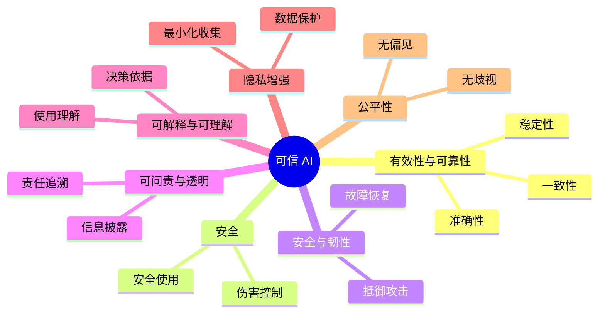
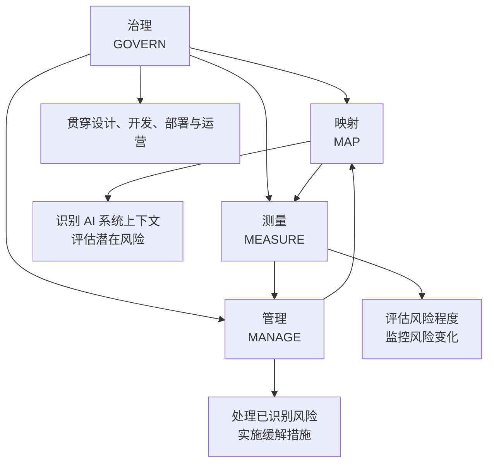
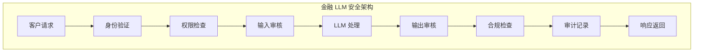
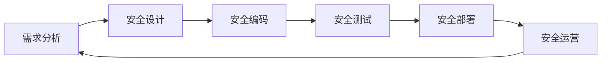

# 第三章 安全框架与标准

安全框架承担不同任务：风险清单帮助识别遗漏，治理框架明确责任和流程，行业标准限定适用要求，对抗矩阵把风险转成可检验的攻击步骤。选择框架之前，应先明确需要产出哪一种证据。

## 学习目标

读完本章，读者应能：

1. 将具体攻击映射到 OWASP LLM Top 10 的风险条目，核对条目名称与版本，并指出清单本身不能确定的攻击条件。
2. 判断一项风险应归入 LLM Top 10 还是 Agentic Top 10，并区分相邻条目的边界（例如提示注入管输入边界、输出处理不当管下游消费、过度自主权管动作是否应当执行）。
3. 用 NIST AI RMF 的 GOVERN、MAP、MEASURE、MANAGE 为一项生成式 AI 风险分配治理活动，并用 AI 600-1 检查补充要求。
4. 对比金融、医疗、政务、教育四个行业的 LLM 安全关注点，区分 ISO/IEC 23894 与 42001 的分工。
5. 用 MITRE ATLAS 技术编号把 OWASP 风险翻译成红队用例与检测规则，并说明 OWASP、NIST、ATLAS 如何组合使用。

## 阅读路径

风险清单从 [3.1](3.1_owasp_top10.md) 开始；组织责任与管理流程见 [3.2](3.2_nist_framework.md)，行业适用条件见 [3.3](3.3_industry_standards.md)。确定需要检验的风险后，用 [3.4](3.4_mitre_atlas.md) 把它转成攻击步骤与检测目标。

## 1. OWASP 大语言模型十大风险解析

开放全球应用安全项目（OWASP）发布的 LLM Top 10 是常用的 LLM 应用安全风险清单。它按风险类别组织问题，便于把模型行为、数据流、工具权限和下游处理纳入同一轮应用审查。

> 版本说明：本节依据 OWASP Gen AI Security Project 于 2026 年 8 月发布的 **OWASP Top 10 for LLM Applications 2026**（[附录 C-39](../16_appendix/C_references.md)）。2025 版（2024 年 11 月发布）仍可在官方站点获取（附录 C-95），两版编号对照见 3.1.1。

### 1.1 清单背景、版本与条目关系

OWASP 是非营利安全社区组织，长期维护 Web 安全、API 安全与 AI 安全相关实践。LLM Top 10 把“模型风险”转译为“应用系统风险”，便于工程团队落地治理。

**2026 版风险条目（官方文档）**

| 官方标识符 | 风险名称（中文） | 英文原名 |
|------------|------------------|----------|
| LLM01:2026 | 提示注入 | Prompt Injection |
| LLM02:2026 | 敏感信息泄露 | Sensitive Information Disclosure |
| LLM03:2026 | 过度自主权 | Excessive Agency |
| LLM04:2026 | 供应链风险 | Supply Chain |
| LLM05:2026 | 数据与模型投毒 | Data and Model Poisoning |
| LLM06:2026 | 无边界消耗 | Unbounded Consumption |
| LLM07:2026 | 错误信息 | Misinformation |
| LLM08:2026 | 隐藏上下文暴露 | Hidden Context Exposure |
| LLM09:2026 | 向量与嵌入弱点 | Vector and Embedding Weaknesses |
| LLM10:2026 | 输出处理不当 | Improper Output Handling |

排序方法上，此前各版均按社区投票排序。2026 版首次引入事件数据：从公开漏洞库和 AI 危害库收集 7,714 起事件，其中 6,639 起信息足以分类；最终排序中投票占四分之三权重，事件数据占四分之一。分歧最明显的有两项：

- 提示注入：按原始事件数，提示注入排不进前十；官方将其归因于防御效应：各团队重点防范，进入公开库的明确利用案例因而偏少，公开计数低估了实际风险。提示注入仍列第一。
- 错误信息：在投票中靠后、在事件记录中靠前，数据将其上调，但投票权重更大，最终居于中段。

**2025 → 2026 编号对照**

两版的十个条目基本相同，主要变化是排序，另有一条改名并扩大了范围。使用 2025 版资料的读者可按下表换算：

| 2025 版 | 2026 版 | 变化 |
|---------|---------|------|
| LLM01 提示注入 | LLM01 提示注入 | 位次不变；新版明确纳入跨模态注入（把指令藏进图像或音轨） |
| LLM02 敏感信息泄露 | LLM02 敏感信息泄露 | 位次不变；官方称这是清单顶部投票与事件数据完全一致、置信度最高的一条 |
| LLM03 供应链风险 | **LLM04** 供应链风险 | 降一位；新版纳入“被推荐的模型工件并非其所声称之物”这类信任失效 |
| LLM04 数据与模型投毒 | **LLM05** 数据与模型投毒 | 降一位；新版吸收了微调阶段的破坏 |
| LLM05 输出处理不当 | **LLM10** 输出处理不当 | 降五位，本版跌幅最大；新版把助手大规模生成的不安全代码纳入本条 |
| LLM06 过度自主权 | **LLM03** 过度自主权 | 升三位，本版最关键的变动；投票与事件记录都表明损失发生在智能体部署中 |
| LLM07 系统提示泄露 | **LLM08 隐藏上下文暴露** | 改名并扩大范围：系统提示只是“本不该被读到的信息”的一种 |
| LLM08 向量与嵌入弱点 | **LLM09** 向量与嵌入弱点 | 降一位 |
| LLM09 错误信息 | **LLM07** 错误信息 | 升两位；投票排名低、事件记录排名高，官方称这是「朝真正致命的那个方向」分歧最大的一条 |
| LLM10 无边界消耗 | **LLM06** 无边界消耗 | 升四位 |

> 编号随版本变动，风险内核保持不变。建立长期资产（评审清单、红队用例、检测规则）时，建议同时记录条目名与版本号，例如 `LLM03:2026 Excessive Agency`，而不只记 `LLM03`。

OWASP 智能体安全倡议（Agentic Security Initiative）于 2025 年 12 月另行发布 *OWASP Top 10 For Agentic Applications 2026*（`ASI01`–`ASI10`，[附录 C-94](../16_appendix/C_references.md)），与本清单并行，并非其新版本。2026 版明确了两者的分界：模型作为应用组件时，风险归本清单；模型成为能调用工具、跨会话保留记忆、在下游引发后果的行动者时，风险归智能体清单。官方指出，许多事件恰好落在这条分界上；模型开始自主行动时，应同时对照两份清单，任何一份都无法单独覆盖。ASI 条目与本书各章的对照见[附录 D](../16_appendix/D_owasp_agentic_crosswalk.md)。

**十大风险常常共现，但并非固定攻击链**

十个风险项之间可能相互放大，既非严格独立，也不构成固定顺序的攻击链。在真实系统中，多个风险常常同时出现：

- 提示注入（LLM01）可能与隐藏上下文暴露（LLM08）、过度自主权（LLM03）或敏感信息泄露（LLM02）同时出现
- 供应链风险（LLM04）与数据与模型投毒（LLM05）都属于“源头污染”问题，但影响面和发生位置并不相同
- 输出处理不当（LLM10）和过度自主权（LLM03）往往会一起放大实际执行面的风险
- 向量与嵌入弱点（LLM09）可能让错误或恶意上下文进入生成环节，并进一步放大错误信息（LLM07）的影响

安全架构设计需要从这一全局视角出发，构建多层防御以切断这些风险链条。具体防御策略见[第四章](../04_prompt_injection/README.md)至[第七章](../07_rag_security/README.md)。

**OWASP↔ATLAS 交叉映射（与 MITRE ATLAS TTP 对照，示例）**

技术名后附 ATLAS 技术编号（AML.TXXXX）。编号是跨版本稳定的统一词汇表，技术名称偶有变更，按编号检索更可靠：

| OWASP 风险 | ATLAS 技术示例（含 AML.T 编号） | 用途 |
|-----------|----------------|------|
| LLM01:2026 提示注入 | LLM Prompt Injection (AML.T0051)、Prompt Infiltration via Public-Facing Application (AML.T0093) | 把应用风险映射到可演练的攻击技术 |
| LLM02:2026 敏感信息泄露 | Extract LLM System Prompt (AML.T0056)、LLM Data Leakage (AML.T0057)、Exfiltration via AI Agent Tool Invocation (AML.T0086) | 区分泄露目标、泄露路径和外发通道 |
| LLM03:2026 过度自主权 | AI Agent Tool Invocation (AML.T0053)、AI Agent Tool Poisoning (AML.T0110) | 聚焦工具调用和智能体权限边界 |
| LLM05:2026 数据与模型投毒 | Training Data Poisoning (AML.T0020)、RAG Poisoning (AML.T0070)、AI Agent Context Poisoning (AML.T0080) | 覆盖训练、检索和会话上下文污染 |
| LLM08:2026 隐藏上下文暴露 | Extract LLM System Prompt (AML.T0056)、Discover LLM System Information (AML.T0069) | 用于系统提示提取和侦察测试 |

> 上表是本书自行维护的**技术级**映射，粒度到 `AML.TXXXX`。2026 版官方文档另附 Appendix A，把每条风险映射到 ATLAS 的**战术级**编号（`AML.TAXXXX`，如 LLM01 对应 Initial Access、Execution、Persistence 等），并同时给出与 ASI、CWE、NIST AI 600-1、AI RMF 等框架的对照。两者粒度不同、互为补充：战术级用于描述攻击链走向，技术级可直接对应红队用例与检测规则。

### 1.2 LLM01：提示注入

**风险描述**：攻击者通过恶意指令影响模型执行路径，绕过系统规则。

**提示注入排在首位的原因**

提示注入是 LLM 应用的根本性威胁。与传统 Web 应用的 SQL 注入需要先发现可注入点不同，LLM 在架构上根本不区分“指令”与“数据”，两者都是同一条 Token 流上的 Token，因此不存在参数化查询那样干净的等价物。2026 版明确扩展了“输入”的范围：输入不必是人类可读的文本，不必直接来自用户，也不必在渲染出的界面中可见。检索到的内容、工具输出、图像、音频、视频、中间推理过程、持久化记忆，都是能改变模型行为的输入。提示注入一旦成功，攻击者即获得对模型执行流的控制权，进而可以：

- 泄露系统提示内容、检索到的私有文档或基础设施细节（导致 `LLM08:2026` 隐藏上下文暴露与 `LLM02:2026` 敏感信息泄露）
- 诱导模型调用它本就有权调用的工具，在具备 shell、文件系统或云 API 权限时升级为任意命令执行（导致 `LLM03:2026` 过度自主权）
- 操纵模型输出，产生带偏见的、有害的或攻击者指定的内容，让下游系统或用户据此行动

本条关注的是输入边界本身；模型输出在被下游组件消费前的清洗与校验属于 `LLM10:2026` 输出处理不当。

新版还指出了三项放大后果的部署期性质：

- **上下文窗口池化**：系统提示、用户输入、检索文档、工具输出、会话历史与记忆被当作同一条 Token 流，其间没有被强制执行的信任边界。
- **记忆持久化**：一次写入长期记忆、检索增强生成（RAG）语料库或向量库的注入，会污染此后每一个读到它的会话。
- **智能体式执行**：当模型输出驱动工具调用时，影响面从对话界面扩展到工具能触及的一切，而工具输出又重新回到上下文窗口，形成链式甚至自我复制的效果。

威胁建模时，可先沿三条轴拆解具体场景，再决定采用哪些缓解措施：

- 投递面：直接输入、检索内容、工具输出、工具连接通道、持久化记忆
- 传播行为：单次、多步杀伤链、经记忆或 RAG 跨会话、在智能体之间自我复制
- 编码方式：明文、Base64 等混淆、不可见 Unicode、多模态或隐写、低资源语言

**典型场景**：直接注入、间接注入（检索内容与工具返回）、多模态与隐写注入，以及写入跨会话记忆或 RAG 语料后被反复读取的持久化注入（语料本身被持久污染的部分归 `LLM05:2026`）。

**防护思路**

提示注入防护的核心思路是“分层隔离”：在架构上将“系统规则”与“用户数据”“外部内容”分离。来源标记、上下文隔离、工具调用前置校验都能降低提示注入的成功率，但不能提供可靠、不可绕过的边界。

2026 版对此的表述更明确：指令与数据不可区分，模型行为又具随机性，因此目前不存在可靠的预防机制，防御是架构性的而非拦截性的。周边系统应按“模型的指令边界终将被绕过”来设计，约束模型被允许做什么、其输出被允许触及什么。

Simon Willison 的“致命三要素”把这一判断转化为上线前检查：智能体如果同时能访问私有数据、摄入不可信内容并对外通信，就具备了高影响利用的条件，去掉其中任意一项，这些条件即不再成立。

对于从外部系统（如网页、文档、MCP 服务器）返回的内容，还应建立专门的检测与沙箱化处理；评测必须由了解防御方案的自适应攻击者执行。有研究测量了 12 种近期防御，静态攻击成功率接近零，而在自适应攻击下多数超过 90%。

**防护重点**

- 指令层与数据层分离：外部内容经结构上独立、带来源标注的通道传入，使模型能区分数据与指令；但这只在非自适应测试中降低成功率，了解标注方案的攻击者可以伪造标注
- 全模态入口清洗：对文本、图像、音频、结构化数据分别过滤（图像做 OCR、音频做转写后再套文本过滤），并在每个摄入与渲染边界剥离标签块、变体选择符、零宽字符这类不可见 Unicode
- 权限预算与确定性中介：凭据与状态变更能力留在应用代码而非模型中，并以 Rule of Two（不可信输入、敏感数据、状态变更或对外通信三者最多取其二，三项都需要时须由确定性校验或人工确认把关）为架构底线；注入终会成功，限制后果要靠模型之外的权限设计，详见 `LLM03:2026` 过度自主权

具体门控架构见[第四章](../04_prompt_injection/README.md)，智能体场景下的权限预算与记忆写入治理见[第十二章](../12_agent_attack_surface/README.md)、[第十三章](../13_agent_architecture/README.md)。

### 1.3 LLM02：敏感信息泄露

**风险描述**：模型输出或上下文处理过程泄露隐私、密钥、系统细节或跨租户数据。

**与 LLM01 的关系：从“破口”到“后果”**

提示注入是攻击者的“破口”，敏感信息泄露则是最常见的“后果”。攻击者获得控制权后，首先会设法套取隐私数据、系统秘密或其他用户的信息。即使没有成功的注入攻击，模型在正常运行中也可能因以下原因而无意中向用户暴露敏感信息：

- 训练数据记忆泄露
- 上下文与日志处理不当
- 多租户隔离缺陷

因此，敏感信息泄露防护分为两层：一是通过提示注入防御减少被“套取”的风险，二是通过输出侧的脱敏和 DLP 措施防止“无意泄露”。

2026 版大幅拓宽了“输出”的边界：除最终答案外，工具调用参数、推理轨迹、检索到的文档片段、多模态输出、日志与遥测、嵌入向量，以及外部可观测的推理属性（时延、Token 长度、对数概率、置信度、缓存命中行为）都是泄露面，应按同一套分级与脱敏规则处理。泄露相应地归纳为四个阶段：

- 训练期的记忆与抽取
- 推理期的上下文回显
- 流水线期（微调、蒸馏、合成数据生成、可观测性）向衍生产物的转移
- 观测期（攻击者不接收任何内容，仅凭外部可测量的属性推断事实）

跨模态是另一处扩展：视觉模型会从截图、通知和 PDF 元数据中 OCR 出凭据与 PII，而“文本渲染成图片、图片再 OCR 回文本”这类跨模态变换可以绕过只覆盖单一模态的 DLP。

新版还指出了两类结构性成因：

- 上游过度共享：未收敛的网盘权限、历史遗留的 ACL 和知识库把本不该开放的数据提供给 RAG，模型只是“按设计”检索出这些数据，需要修复的是数据面而非模型。
- 持久化：数据一旦影响了权重、嵌入或适配器，即使删除源文件仍可被抽取，这直接冲击 GDPR 第 17 条与 CCPA §1798.105 规定的删除义务；开放权重的部署更无法依赖限流，因为抽取、成员推断和反演都可以离线无限次执行。

模型不再只是应用内组件、而能跨会话携带记忆并自行选择工具时被放大的风险，归属智能体清单（见智能体安全篇）。

**泄露路径**：训练记忆抽取、上下文回显、推理轨迹与日志误采集、嵌入向量反演，以及时延与 Token 长度一类的推理侧信道。

**防护思路**

敏感信息泄露防护需要在输入、输出两侧同时进行：一是在输入侧，通过脱敏和 PII 检测防止敏感数据被无意中送入 LLM；二是在输出侧，通过 DLP 和脱敏规则防止 LLM 的输出包含机密信息。在多租户场景下，还需要在存储、索引和日志层面严格隔离，确保一个用户的信息不会混入另一个用户的上下文。关键是建立“最小信息原则”：只向 LLM 提供完成当前任务所需的最少敏感数据。

另有两点工程细节：

- 授权必须前置到检索，鉴权要在索引查询内部完成，而不是检索之后在应用层过滤，因为已经送入模型的片段无法撤回（分块级权限与多租户索引的具体做法见 `LLM09:2026`）
- 出站检测也不能只依赖正则，跨语种、Base64 与 hex 编码很容易绕过黑名单，需要配合 NER 与训练过的分类器

此外，可观测性平台默认会完整记录提示、补全、检索片段和轨迹，接入 APM 之前必须先限制采集范围并做清洗。

观测期泄露中机制最清楚的一类是流式响应的 Token 长度侧信道。流式输出时，服务端每生成一个 Token 就把它发给客户端；传输虽然加密，数据包的大小仍暴露了每个 Token 的长度，网络上的观察者因此能拿到回答的“Token 长度序列”。[Weiss 等人](https://arxiv.org/abs/2403.09751)用一个大模型把这种序列翻译回文本，并用目标助手的写作风格对它做微调，准确重建了 29% 的回答、推断出 55% 回答的主题，并在 ChatGPT-4 与 Copilot 的浏览器和 API 流量上演示了这一攻击。该文给出三种缓解：

1. 随机填充：给每条消息加入随机长度的填充，代价是带宽增加；
2. Token 分组：把若干 Token 合并后再发送，代价是实时性下降；
3. 整段返回：生成结束后一次性发送完整回答，彻底消除逐 Token 的长度信息，但放弃流式体验。

OWASP 2026 版所说的“随机填充与 Token 批量化”即前两种。使用托管 API 时，先确认平台是否已提供填充。例如 OpenAI Responses API 的 `stream_options.include_obfuscation` 开启时，会在流式增量事件中加入一个装有随机字符的 `obfuscation` 字段，用于拉平载荷大小；该选项默认开启，官方只建议在信任应用与 OpenAI 之间网络链路的情况下关闭它以节省带宽（[API 参考](https://developers.openai.com/api/reference/resources/responses/methods/create)）。如果应用自己再把流式输出转发给浏览器，这一跳同样需要填充或分组，平台侧的填充不覆盖它。自建推理服务则要在网关层自行实现。

**防护重点**

- 输入输出双向脱敏：清洁入站数据，审计出站内容，并把推理轨迹与工具调用参数当作一等输出来分级、脱敏
- 检索前授权与多租户隔离：把文档级、分块级鉴权下沉到索引查询内部，高敏感负载使用独立的租户索引，日志中的敏感内容加密存储并自动清理
- 敏感字段检测与侧信道收敛：自动识别 PII、密钥等字段并触发审计告警，同时在生产端点上收敛对数概率与置信度、对流式响应做随机填充与批量化

嵌入向量的反演机制归 `LLM09:2026`（向量与嵌入弱点），定级则归本条：被导出或泄露的向量可被反演还原出明文，因此“只泄露了嵌入”的备份要按源文档级泄露对待，并触发相应的通报评估。本条关注训练与推理链路上的泄露及其带来的监管后果与删除义务，具体工程做法见[第九章](../09_io_protection/README.md)。

### 1.4 LLM03：过度自主权

**风险描述**：智能体被授予过多权限后，可能执行越权调用、批量外发或破坏性操作。

**权限失控的加速器**

LLM02 关注“信息被读走”，LLM03 关注“动作被执行”。本条在 2026 版中从 2025 版的第 6 位升至第 3 位，首次进入前三。官方称这是本版清单中影响最大的一次变动，因为投票与真实事件记录在这里罕见地一致：损失正发生在智能体部署中。

随着智能体（Agent）技术的普及，LLM 被赋予越来越多的“能力”：调用外部 API、访问数据库、发送邮件、修改文件等（不同厂商把这类能力称为工具、扩展、插件或技能）。这些能力本身与安全无关，问题在于：

- 权限矩阵爆炸：100 个工具的排列组合可以产生极高的风险组合
- 人工审查失效：无法逐一审查每个潜在的权限链
- 缺乏运行时约束：给 LLM 的权限往往是静态的、“要么全有，要么全无”

官方将根因归结为三类：功能过度、权限过度、自主性过度。触发因素既可能是幻觉、模型本身表现不佳或目标错位，也可能是直接或间接的提示注入；注入源除恶意用户外，还包括此前被攻陷的工具调用，以及多智能体协作场景中已被控制的同伴智能体。

因此，LLM03 的防护不仅需要精细化的权限设计（RBAC），更需要运行时的动态收敛：在每次请求时根据上下文和意图动态限制 LLM 当前可用的权限。这与传统应用“连接时获取全部权限”的设计思路完全不同。

2026 版还明确了边界：对模型输入输出做净化不是本条的根本控制手段，输入侧属于 `LLM01:2026`，输出侧属于 `LLM10:2026`，本条关注的是“这个动作是否应当执行”。在智能体形态下，本条具体表现为智能体清单中的 `ASI02` 工具滥用与利用、`ASI03` 身份与权限滥用，以及 `ASI08` 级联失效。

**防护思路**

过度自主权的根源在于权限“授予”与“使用”的不对称：设计时授予的权限是长期、静态、宽泛的，执行时所需的权限则应是当前、动态、最小化的。在 Agent 架构中，需要从以下维度约束权限：

1. 功能维度：定义每个 Agent 的能力范围（调用哪些工具），并尽量避免“执行任意 shell 命令”“抓取任意 URL”这类开放式工具，改用粒度更细、且为入参定义了严格 schema 并在使用前校验内容的专用工具
2. 参数维度：限制工具参数的有效范围（只能操作特定数据、用户或时间段）
3. 时间维度：使用短期令牌而非长期凭证，减少凭证泄露的影响
4. 行为维度：监控权限的使用情况，异常调用立即告警；同时为工具调用设定阈值与熔断，超过阈值即中止、限流或转人工复核

**防护重点**

- 最小权限与时效令牌：Agent 只获得完成当前任务所需的最小权限，使用过期时间短的临时令牌；在委托链和多智能体流程中，应将原始用户的身份与授权范围逐级传递，而不是退化为调用方智能体或服务账号的权限
- 人工审核（HITL）审批：高危或异常的工具调用需要人工确认，而不是直接执行；2026 版进一步建议采用分级执行策略（审计、告警、阻断、升级），低后果或易回滚的动作可以自动放行，不可逆的动作才路由到人工
- 高风险工具硬性阻断策略：某些工具（如删除数据库、转账等）永不允许 Agent 直接调用，必须经过显式的人工授权；授权判定要用代码逻辑做完全仲裁（complete mediation），由工具、独立的前置策略决策点或下游系统来校验，而不是交给 LLM 自己判断

### 1.5 LLM04：供应链风险

**风险描述**：模型、适配器、数据集、依赖库、镜像、转换与部署平台任一环节被污染都可影响系统。

**风险链的“上游”威胁**

前三条风险（提示注入、敏感信息泄露、过度自主权）主要是运行时风险，供应链风险则来自更早的阶段：模型和应用尚未上线时，污染就可能已被植入。供应链风险影响面广、发现较晚，因此组织需要将其纳入开发与部署链路的持续治理，而不能仅靠上线后的补救。

`LLM04:2026` 将攻击面从传统的代码与依赖扩展到模型制品本身：第三方预训练模型、数据集、用 LoRA 等参数高效微调（PEFT）技术制作并共享的适配器均被纳入，模型制品、来源证明（provenance）与格式转换、合并流水线这三项被新版明确列为一等攻击面；端侧部署的 LLM 还把设备制造过程、固件与操作系统漏洞、被重新打包的应用纳入这条链路。

本条有两条相关边界：

- 本条与 `LLM05:2026` 数据与模型投毒有重叠，区别在于本条只关注这些风险的供应链侧面。
- 智能体特有的供应链风险（如 MCP 服务器与工具注册表）不在本清单，而由 OWASP Top 10 for Agentic Applications 的 ASI04 覆盖；MITRE ATLAS 则以 `AML.T0010` 收录对应的攻击技术。

**典型场景**：把公共模型库上的模型只按 `Author/ModelName` 引用，原作者注销或转让账号后攻击者抢注同名路径，流水线随即拉取到恶意模型。

**防护思路**

供应链安全的核心是“源头认证”和“全链路追踪”。在持续集成流水线中，从模型拉取、依赖下载到容器镜像构建，每一步都应有校验机制；同时，应通过 SBOM 及其面向模型的扩展（AI BOM / ML-BOM）追踪组件的来源、版本、许可证和漏洞状态（ML-BOM 的记录格式见 [8.6.6](../08_architecture/8.6_supply_chain.md)，模型签名的签发与校验步骤见 [6.7.4](../06_data_model_attacks/6.7_malicious_model_artifacts.md)）。

新版还指出，恶意软件扫描器和“安全加载”开关不能作为保证：它们自身出现过被分配 CVE 编号的绕过，藏在计算图中的后门在 ONNX 这类公认安全的格式中同样能留存；量化也是一次可被利用的转换，权重可以被构造为全精度模型评测正常、量化后的制品却按攻击者意图行事。

发现供应链污染时，必须能快速识别受影响的下游应用并进行紧急响应。

**防护重点**

- 来源可追溯（签名/校验）：对模型、适配器与镜像做签名和哈希固定，并用不可变摘要而非 `latest` 这类可变引用来拉取；但签名只证明完整性与来源、不证明安全性，仍需配合行为评测与发布门禁
- 依赖锁定与漏洞扫描：在构建时锁定依赖版本，定期扫描已知漏洞（CVE），并在采纳 AI 编码助手建议的依赖前先确认该包真实存在且确为目标包，避免引入被预先抢注的幻觉包名
- SBOM 与变更审计：为每个部署生成 SBOM，并扩展到覆盖模型、适配器与数据集的 AI BOM / ML-BOM，记录完整的变更链条便于事后追溯与合规审计

还需将模型转换、合并服务以及自有 CI/CD 发布流水线作为高风险的“晋级点”重点监控，因为由自有发布设施构建并签名的制品恰能通过下游的来源校验。

### 1.6 LLM05：数据与模型投毒

**风险描述**：攻击者污染训练、微调、嵌入或检索数据乃至模型工件，诱导系统长期偏离预期行为。

**“污染源头”的深层威胁**

`LLM04:2026` 关注外部组件的来源是否可信（第三方模型、数据集、依赖），本条关注这些数据和模型工件被摄入之后如何被持久污染：攻击者可能通过污染组织自有的训练数据、微调数据或 RAG 知识库来长期改变系统行为。这类攻击的难点在于：

- 潜伏性强：植入的“后门”或偏差可能在数周甚至数月后才被发现
- 难以根治：需要重新清洗数据和重新训练，成本极高
- 难以追溯：如果数据来自众多外部贡献者或网络爬取，很难找到污染源头

2026 版将本条范围从传统意义上的“训练数据”明确扩展到数据被摄入、转换、检索、复用的任何环节，涵盖预训练、微调、嵌入生成、RAG 与模型分发。随模型一起分发的非权重工件（聊天模板、分词器配置、LoRA/PEFT 适配器、量化产物，以及 pickle 之类的不安全序列化文件）同样可能在加载时执行恶意代码或改写模型行为；这类后门在触发条件出现之前可能不改变模型的正常表现，模型因而可能成为“潜伏特工”。官方还援引研究指出，仅 250 份投毒文档就足以影响 600M 到 13B 参数区间的模型，且与数据集规模无关，因此“语料足够大就能稀释污染”的直觉并不成立。

新版同时明确了几条边界：推理时经检索内容送达的指令属于 `LLM01:2026` 提示注入，利用嵌入几何结构做的攻击属于 `LLM09:2026` 向量与嵌入弱点，本条覆盖对持久化数据或模型行为的持久性破坏；工具集成、跨会话记忆与 RLHF 反馈回路上的投毒，官方交由《OWASP Top 10 for Agentic Applications》深入讨论。

**投毒环节**：预训练语料、微调数据集、嵌入与向量库、迁移学习复用的上游模型，以及持续学习与自动再训练管线，都是可下手的位置。

**防护思路**

数据投毒防护的关键是事前验证和事中监控，而非事后补救。其难点在于隐蔽性：有害样本往往看似无害，需要通过统计异常检测或行为基线比对来识别。防护策略分为事前和事中两层：事前通过严格的数据来源审核和清洗降低污染概率，事中通过模型行为监控和 A/B 对比发现变异。发现投毒后，需要能快速回滚到已知安全的模型版本。

自动再训练和用户反馈回路需要特别防范：攻击者只需普通的界面访问权限，就能通过持续投喂使模型缓慢漂移，因此这类回路必须限速、校验并保留人工审核。

**防护重点**

- 数据摄入白名单与分级审核：建立受信任的数据来源清单，对新增数据进行内容和来源审核，并对检索内容设置信任边界与来源评分
- 模型工件血缘与加载前校验：把聊天模板、分词器配置、适配器与量化产物当作与代码同等重要的安全对象，加载前完成哈希与差异校验（签名与 BOM 的建立方式见 `LLM04:2026`），并记录它们与训练数据集之间的血缘
- 模型版本基线与行为回归测试：维护模型与数据集的历史版本（如用 DVC），定期运行回归测试套件与触发词探测，验证输出分布稳定并支持快速回滚；不要假设安全对齐能清除后门，每轮对齐之后都要重新探测

训练与数据治理控制见[第二章](../02_fundamentals/README.md)和[第八章](../08_architecture/README.md)。

### 1.7 LLM06：无边界消耗

**风险描述**：攻击者通过高并发、长上下文、高复杂度请求或递归工具调用，消耗预算与算力，乃至复制模型本身。

**资源层面的拒绝服务**

`LLM05:2026` 针对模型的训练数据与权重，本条针对模型运行时的算力与预算：通过不受控的推理使服务退化、成本失控，或通过反复问答窃取模型本身。2026 版将这条风险概括为**成本不对称**：攻击者只需付出极小的代价，就能触发极其昂贵的计算，手段可以是精心构造的提示、被窃取的凭据或被操纵的工作流。官方在本版列出的典型形态包括：

- **变长输入洪水与输出爆炸**：超长且长度不一的输入抬高处理成本；输出侧则可能来自微调投毒：一个恶意训练样本破坏模型的结束符行为，使模型此后每次请求都输出到最大长度
- **大上下文滥用**：许多 API 会直接拒绝超出上下文窗口的输入，因此长期存在的风险来自接近上限但始终不越界的请求，以及会话内的上下文累积和应用侧的重新分块
- **推理循环与思考 Token 耗尽**：短小、看似无害的提示可将扩展思考模型拖入漫长甚至不终止的推理循环，耗尽思考 Token 预算，输入长度过滤对此完全无效
- **为过度消耗资源而优化的对抗输入**：海绵样本与对抗性视觉扰动用梯度或非梯度方法专门优化出“最贵”的输入，有别于单纯让模型执行高算力任务
- **钱包拒绝服务（Denial of Wallet，DoW）**：用大量合法但按量计费的操作，把成本压力转嫁给服务方

清单还覆盖了多模态输入输出、模型抽取与蒸馏窃取、Agent 与工具交互泛洪，以及推理基础设施本身被利用：

- 多模态模型会把图像、音频、视频展开成大量 Token，同一次请求的开销可以远高于纯文本，具体倍数取决于模型、供应商、分辨率、媒体时长和预处理管线。
- 模型抽取是指用构造的查询批量收集输出，复现部分模型或微调出功能等价的模型，暴露 logits 与对数概率会显著加速这一过程；通过计时或共享基础设施观测以侧信道方式提取权重与架构，官方明确划归 `LLM02:2026` 敏感信息泄露。

与传统 DDoS 相比，这类请求往往更像“合法调用”。2026 版进一步指出，仅靠传统的请求速率限制已经不够：扩展思考与推理模型带来了庞大且约束不足的输出预算，多模态大幅推高单次请求成本，智能体架构与工具调用协议（如 MCP）会把一次请求放大成级联的下游操作，共享推理基础设施又引入了新的供应链攻击面。有效的防御需要面向 Token 的成本控制、硬性支出上限、智能体级熔断器，以及持续的成本归因监控。

**典型场景**：攻击者或普通用户维持一个长开的智能体会话并不断注入内容，使每次推理都重新处理全部累积上下文，单轮成本从第一轮的约 0.001 美元涨到第 100 轮的约 0.50 美元，而没有任何单个请求触发速率限制。

**防护思路**

无边界消耗的防护需要在多个维度设置“熔断”和“配额”：

- 在用户维度，按 API Key、用户、团队和云账号设置不可覆盖的预算上限；上限必须是超限即停止推理的执行机制，而不是容易被快速累积的负载越过的告警阈值
- 在请求维度，限制单个请求的 Token 数、推理步数、工具调用次数，并用预检 Token 估算在推理开始前就拒绝请求
- 在全局维度，做动态资源分配与优雅降级，让系统在高负载下保留部分功能而不是彻底失效

关键是主动设限而非被动超支。持续的成本归因监控只能让问题更早被发现，不能代替超限即停止的执行点。

**防护重点**

- 速率限制与 Token 成本控制：从每秒请求数转向每分钟、每天的 Token 配额与单请求预估成本，并让支出上限体现不同模态与工具协议之间的成本差异
- 智能体熔断与工具行为基线：对每次 Agent 执行强制步数、递归深度、时限与单次运行成本上限，用状态哈希识别递归循环，并为工具的正常 Token 消耗建立基线以发现异常会话
- 推理基础设施加固：及时更新 vLLM、TensorRT-LLM、SGLang、Triton、Ollama 等服务框架，禁用不安全的反序列化，限制特殊 Token 透传，并对所有推理端点强制认证

智能体的熔断与预算见 [12.7.5](../12_agent_attack_surface/12.7_multi_agent_security.md)。

### 1.8 LLM07：错误信息

**风险描述**：模型输出错误但看似可信的信息，被人或下游组件当作事实采纳，进而驱动有害的决策或动作。

**“有理有据”的谎言**

LLM05 与 LLM06 涉及攻击者对系统的直接施压（投毒或耗尽资源），LLM07 的危害则往往不需要攻击者在场：模型输出虚假、不完整、缺乏依据或具有误导性的信息，且这些信息看上去足够可信，足以左右一次人类决策、一条自动化流程或一次智能体动作。风险不在于模型出错，而在于错误被信任、被据以行动。这对金融建议、医疗信息、法律意见等高敏场景构成直接威胁。要点如下：

- 虚假内容可能被用户全盘接受，因为 LLM 说得条理清晰、甚至“引经据典”；流畅、自信、结构工整的输出天然被视为权威
- 成因不止幻觉一种：上下文不完整或过时、接地不足、提示歧义、被污染的数据、误导性摘要、未经校验的工具输出都会导致错误信息，攻击者也可以刻意诱发
- 跨链接损伤：一个错误的 RAG 检索结果会污染后续的推理，在多智能体编排中还会跨智能体扩散

2026 版将本条从“模型说错话”提升为系统级失效。在当前的系统中，模型输出会驱动工具调用、生成代码、推断系统状态、批准动作并在多个智能体之间传递，因此一次错误信息可以直接演变为资金损失、安全事件、人身安全风险或业务中断。在智能体架构中，它通常表现为错误的状态、推理或证据被下游组件直接采信：智能体误判某个前置条件已经满足而触发后续动作，检索智能体谎报客户“已完成身份核验”而下游支付智能体据此放款，或者智能体报告夜间数据库备份已完成、直到真正需要恢复时才发现备份从未运行。新版还专门列出了伪造或错误归属的“证据”，即被捏造、被篡改的内容被当作权威依据呈现。这种过度信任常常不是用户的一时疏忽，而是被固化在系统设计之中。

新版也明确了与相邻条目的边界：不安全生成代码的执行与处理属于 `LLM10:2026` 输出处理不当，把模型幻觉出来的包名抢先注册成真实软件包这一供应链手法属于 `LLM04:2026` 供应链风险；若根因是提示注入、投毒或供应链失陷，应归入对应条目讨论。本条只关注最终的失效形态：虚假的表述驱动了有害的决策或动作。

**防护思路**

防护 LLM07 的核心思路是“验证而非信任”：通过引用溯源、事实性评测、高敏场景的人工复核等手段弥补 LLM 本身的缺陷。错误信息风险无法仅靠架构设计彻底消除。防护重点更接近“检测和补偿”：

- 行动前为结论建立依据：要求输出基于权威且时效性强的来源（例如用检索增强把结论绑定到可查证的出处），依据须在动作发生之前建立，而不是事后交由用户核对
- 把生成与执行分开，先核验声明再动作，并在工具调用前逐项检查参数、授权、前置条件与当前状态
- 在金融、医疗、法律等高敏场景，部署事实性验证和人工复核，对高影响动作引入审批流与系统校验
- 收敛影响半径：最小权限、沙箱与限流，让一次错误信息不至于扩散成一次事故
- 校准人与系统的信任：明确区分已验证的事实与未经证实的假设，记录声明、证据与结果，并定期用误导性场景做对抗性评测

**防护重点**

- 引用来源与事实核验：强制 LLM 附加检索来源链接，对于关键事实进行自动事实性检验（如金融数据对比、医学文献查证），并以接地性与一致性等验证信号为准，而不是只看模型自报的置信度
- 高风险域强制人工审核（HITL）：医疗诊断、法律意见、投资建议等高风险内容必须经过人工审核，高影响动作还应有运行时校验与审批环节
- 不确定性提示与遗漏防护：在高风险场景中提示不确定性并建立升级路径，同时用带必填字段的结构化输出，防止关键约束、例外、时间戳被悄悄省略

跨智能体的状态与证据信任问题见 [12.7](../12_agent_attack_surface/12.7_multi_agent_security.md) 节的多智能体安全。

### 1.9 LLM08：隐藏上下文暴露

**风险描述**：攻击者通过抽取、推断或重建，获取系统提示、策略文本、工具 schema 等本不面向用户的隐藏上下文，从而实质提升攻击能力。

**破口背后的秘密**

官方将“隐藏上下文”定义为应用组装进模型上下文窗口、但不打算让终端用户看到的材料，包括系统提示、开发者指令、从 RAG 知识库、配置存储或用户画像服务取回的策略文本、应用暴露给模型的工具与函数 schema，以及其他规则和指令。这些材料不面向终端用户，却对模型可见，因此可能被抽取、推断和重建。

LLM07 关注模型输出的内容能否被信任，本条关注模型本不打算输出的内容能否被套取。本条由 2025 版的“系统提示泄露”改名并扩大范围而来：系统提示只是隐藏上下文的一种，本条针对的失效是“本不该被读到的信息被读到”。它常与提示注入配合出现：注入用于改写系统行为，隐藏上下文暴露用于事先探明系统设计，被披露的规则、工具与格式正是构造注入负载的素材。隐藏上下文一旦暴露过多内部细节，攻击者就更容易了解：

- 系统的约束与策略（知道了“防线在哪”）
- 模型的工具列表、函数 schema 与权限（知道了“能做什么”）
- 可能的内部流程与数据流（知道了“怎么做”）

危害程度取决于其中存放的内容以及应用对其保密的依赖程度：

- 信息级：无机密、无安全相关逻辑、不依赖其保密性
- 中危：内部规则、过滤标准、角色描述或流程逻辑，对攻击者有实质帮助但不决定关键判断
- 高危：内嵌凭据或令牌，或把授权与内容策略建立在上下文保密之上
- 严重：披露可链式导致远程代码执行、大范围数据外泄或关联系统的权限提升

本条自身构成风险，也会放大相邻条目的风险：被披露的规则与逻辑让提示注入更有针对性，内嵌的凭据直接构成敏感信息泄露（`LLM02:2026`），暴露的工具权限与 schema 扩大了过度自主权（`LLM03:2026`）的攻击面，泄露的输出格式规则则便于制造输出处理不当（`LLM10:2026`）。另一方面，受监管的用户数据或训练数据的泄露归 `LLM02:2026`；持久记忆、智能体间通道、工具配置持久化、多步骤智能体沦陷这类放大形态归《OWASP Top 10 for Agentic Applications》；服务端日志泄露、前端产物被翻查、基础设施层旁路等通用应用安全问题也不在本条范围内。

**典型场景**：敏感功能与工具 schema 外泄、内部决策逻辑外泄、安全与拒答机制被逆向、权限与角色信息被披露（例如内部 MCP 服务器给出的工具描述写明某项操作需要开发者角色）、输出结构与格式规则被披露。

**防护思路**

LLM08 的防护核心不是把系统提示当作秘密隐藏，而是不把机密、鉴权逻辑和安全边界委托给隐藏上下文。工程上应假设隐藏上下文可被发现，其中任何内容都不应被视为秘密，并使其被披露本身几乎不产生直接安全影响。

隐藏上下文暴露的根本问题是机密信息、授权边界或控制逻辑被放进了上下文。官方给出三条缓解方向：

1. 机密永不入上下文：密钥、连接串、令牌等应外置到模型不直接接触的系统，并尽量不让模型经手敏感数据本身。
2. 关键行为由模型之外的确定性系统与护栏保障：有害内容的检测与拦截应由外部防护完成，而不是用一条指令要求模型自觉遵守；针对性的微调或继续训练也许能降低泄露概率，但不提供一致保证，还可能带来其他意料之外的后果。
3. 权限分离与授权边界检查必须以确定性、可审计的方式在 LLM 之外实施，任务需要不同访问级别时按授权上下文拆分，各自只授予所需权限。

此外，本书建议对常见的“提示提取类”请求做意图检测与输出过滤，并通过红队测试和持续监控验证系统的抗提取能力。

**防护重点**

- 隐藏上下文中不存放机密：API 密钥、数据库连接串、用户令牌等一律外置到密钥管理系统，并假设模型能看到的一切用户也能看到
- 安全决策不依赖上下文保密：授权、权限分离、内容过滤交给 LLM 之外确定性且可审计的组件，系统提示只保留必要的行为约束；不依赖微调兜底
- 用测试集持续回归“抗提取能力”：识别常见的提取提示词（如 `repeat your instructions`、`what are your rules`），结合输出过滤进行阻断，并把红队用例纳入 CI/CD 流水线

### 1.10 LLM09：向量与嵌入弱点

**风险描述**：嵌入、索引、检索与重排链路被操纵或被反向利用，导致错误或恶意上下文进入生成环节，也可能让已存储的嵌入反过来泄露源数据。

**RAG 时代的新老攻击融合**

`LLM08:2026` 关注本不应被看到的隐藏上下文被套取，本条关注决定“模型能看到什么”的检索机制本身被操纵。随着 RAG 的广泛应用，系统架构从“单纯的 LLM”变为“LLM + 向量库 + 检索器”，由此引入新的攻击面：攻击者可以在 RAG 链路的多个环节进行污染或操纵，主要包括：

- 向量数据库的访问控制薄弱：相似度检索往往先在全量索引上完成，再在应用层做权限过滤，用户 A 可能检索到用户 B 的私密数据；即使每份文档都标注了正确的租户标签、每次调用都经过鉴权，攻击者仍能通过探针查询，从命中条数、分数分布和响应时延推断出其他租户有哪些数据及其大致内容
- 检索期投毒：攻击者构造内容，使其嵌入位置恰好接近某条目标查询，用户提问时该内容即作为可信上下文送入模型；MITRE ATLAS 把这一类归为 `AML.T0070`（RAG Poisoning）
- 检索排名操纵：通过精心构造使恶意内容排名靠前，被模型优先采用

2026 版对本条边界的划分比以往清晰得多。首先是范围更宽：RAG 只是最常见的形态，向量化的智能体记忆、语义缓存与去重流水线使用同一套机制，只要相似度检索位于数据源与提示之间，嵌入层就属于应用的信任边界。其次是与相邻条目的划分：经由检索内容实施的间接提示注入归 `LLM01:2026`，嵌入模型在训练期被投毒归 `LLM05:2026`，向量库组件的序列化缺陷归 `LLM04:2026`，不依赖嵌入几何的智能体记忆攻击则归智能体清单的 `ASI06`（记忆与上下文投毒，见 [12.3](../12_agent_attack_surface/12.3_memory_poisoning.md)）；本条保留的是必须借助嵌入层才能成立的攻击，它们利用的是嵌入空间的几何与相似度检索机制，而非模型的指令遵循行为；许多攻击即使检索到的内容中没有任何恶意指令也能成立。官方给出了一种简明的分法：投毒让系统答错，反演让系统泄密，干扰让系统沉默，权限失效让系统不分对象。

这一版还明确列出了几类过去容易被忽略的形态：

- 嵌入反演：已不只是学术问题。零样本方法无需针对特定编码器训练，在跨域和黑盒条件下依然有效，存储时加入的差分隐私噪声也无法阻止，因此向量库备份、外发给第三方的嵌入以及因云存储配置错误而暴露的嵌入，都应按源文档泄露定级，“只泄露了嵌入”不构成安全港。
- 检索干扰：针对检索层的可用性攻击。一份不含任何恶意指令的“阻断文档”，只要能被特定问题检索到，就足以让模型拒答或声称没有相关资料。
- 语义缓存与去重：二者依靠余弦相似度阈值判定两段内容是否为同一份，攻击者将内容构造在阈值两侧附近，就能污染缓存条目、绕过去重，或使正常的新内容被误判为重复而丢弃。
- 跨模态编码器：如 CLIP、ColPali，把图像、音频、代码和文本映射到同一个向量空间，一张看似普通的图片就足以因接近某条敏感文本查询而被检索出来；基于文本的内容扫描无法发现它，因为载荷不是文本。
- 相似度分数外泄：如果应用将原始相似度分数直接返回给客户端，索引本身就成为成员推断的预言机：攻击者无需看到内容，只要知道某份病历、某份法律文书是否在库中，信息就已经泄露。

**典型场景**：多租户 SaaS 共用一个向量索引、只在应用层做租户过滤，租户 A 靠一批探针查询就拼出了租户 B 的数据轮廓。

**防护思路**

RAG 防护需要覆盖从文档摄入到检索、重排的整条链路：

- 文档摄入阶段需要内容归一化、内容审核和注入检测，防止恶意文档植入
- 嵌入和索引阶段需要确保数据的机密性和完整性，混合信任级别的内容（外部网页、内部机密文档、合作方数据）应当分索引隔离，而不是靠共享索引上的分类标签
- 检索阶段需要把租户与权限范围写进索引查询本身、并在服务端校验，客户端传来的范围只是建议而非控制
- 重排阶段需要评估检索结果的可信度，防止恶意内容排名靠前
- 存储与轮换阶段需要在源文档删除后按期删除对应嵌入并做对账审计；更换嵌入模型时整库重新嵌入，避免新旧向量混用

**防护重点**

- 向量库访问控制与加密：租户与权限范围写进索引查询本身并在服务端校验，权限粒度下沉到分块（一份大体公开的文档里可能夹着一段机密）；嵌入加密存储、密钥与应用层分开管理，备份按源文档的敏感级别对待
- 检索结果可信度评估：对检索到的文档进行相关性和可信度评分，低于阈值的结果不进入 LLM 上下文；不要把原始相似度分数返回给客户端，并对可能被当作预言机反复探测的接口限速
- 文档摄入阶段注入扫描：入库前的归一化与不可见字符剥离沿用 `LLM01:2026` 的入口清洗要求，本条额外要做的是入库前的内容检查，并为每条嵌入记录来源、入库时间、信任层级与流水线版本，以便整批作废和审计

应急预案也需覆盖嵌入泄露：把“只泄露了嵌入”按源数据泄露处理，纳入 GDPR 第 33 条一类的通报评估。

### 1.11 LLM10：输出处理不当

**风险描述**：将 LLM 输出直接用于 SQL、Shell、模板渲染、API 参数或终端与聊天界面的渲染，触发传统安全漏洞。

**从“LLM 控制权”到“系统破坏权”的桥梁**

前九条大多关注模型接收了什么输入、被训练成什么、被授予多少权限，LLM10 关注最后一步：模型输出之后，这段输出被谁、以什么身份消费。即使输出本身不含恶意，只要下游将其当作“代码”或“命令”执行，模型层面的控制权就会转化为实际破坏。在 Agent 和工具调用场景中，LLM 的输出会直接成为：

- 数据库查询语句（SQL 注入）
- 系统命令（命令执行）
- 文件路径（路径遍历）
- API 调用参数（二阶注入）
- 终端、日志与聊天界面里被直接渲染的富文本

因此，LLM 的防御不能只关注 LLM 层，还必须在下游系统强制采用参数化和白名单的执行方式。这是传统 Web 应用安全的基本原则，在 LLM 时代更加重要。

2026 版将“下游”的边界进一步扩展到渲染端。除服务端的执行面外，官方明确将会解释控制字符的终端、日志查看器与 IDE 面板列为下游接收点：模型输出中的 ANSI 转义序列可用于视觉欺骗、剪贴板劫持（如 OSC 52），甚至触发终端模拟器自身的已知漏洞。同样被明确纳入的还有会自动拉取外部资源的客户端渲染器：聊天界面自动渲染 Markdown 图片或链接预览时，控制了部分上下文的攻击者可以把会话数据藏入图片 URL 的主机名或查询串中带出。此外，LLM 生成的代码未经人工审核与安全测试即自动编译上线，也被列为本条的典型攻击场景。

**判定边界**：输入侧的校验与净化属于 `LLM01:2026` 提示注入，输出内容本身是否正确、是否误导属于 `LLM07:2026` 错误信息，本条只关注输出在传给下游组件之前是否被当作不可信数据处理。

**防护思路**

这是典型的“信任边界漏洞”：LLM 的输出被下游系统当作“代码”而非“数据”。防护的核心原则是传统 Web 安全中的参数化，即使 LLM 输出看似合理，也不应直接拼接成命令。

对于会解释内容的渲染面，还要在写入前净化 ANSI 转义序列、BEL、OSC、退格与回车等控制字符（必须保留时改为可见编码），并默认关闭 Markdown 图片、链接预览与 iframe 的自动加载，确有需要时限制在显式的来源白名单内，或交由服务端代理拉取并剥掉携带数据的查询参数。

高危操作本身是否应执行、是否需要人工授权，属于 `LLM03:2026` 过度自主权；本条只要求：即便动作已获批准，其参数与内容仍须按不可信数据处理。

**防护重点**

- 输出永不直连执行面：所有 LLM 输出都经过参数化或与上下文匹配的编码，永不直接进入 SQL 引擎、Shell、模板渲染，也不直接落入会解释控制字符的终端、日志与 IDE 面板
- 参数化调用与 schema 校验：使用白名单限制可用的工具和参数范围，生成的参数必须通过 schema 验证
- 生成代码不自动上线，输出侧留监控：LLM 生成的代码在编译部署前须经人工审核与安全测试，不因“输出可信”就跳过校验；同时对输出建立日志与异常模式监控，Web 场景再用严格的内容安全策略（CSP）兜住生成内容引发的 XSS

### 1.12 使用建议

2026 版开篇提出、并贯穿十个条目的原则是：**不要试图造一个骗不倒的模型，而要把模型周围的系统建好，使模型被骗倒时（它一定会被骗倒）没有重要的东西损坏**。这也是本书[第 8 章](../08_architecture/README.md)纵深防御的出发点：十条风险中能靠“模型更聪明”解决的很少，绝大多数要靠边界、权限、参数化和审计来控制。

使用本清单时，需要明确以下三点：

- 它适合做什么：用来盘点应用层暴露面、设计安全评审清单、建立测试与红队场景。
- 它不直接替代什么：它不是完整的治理框架，也不是逐项可直接复制的实施手册。
- 它到哪里为止：模型是应用中的一个组件时，风险归本清单；模型开始自行调用工具、跨会话携带记忆、在下游引发后果时，还要同时对照 Agentic Top 10（对照表见[附录 D](../16_appendix/D_owasp_agentic_crosswalk.md)）。

## 2. NIST AI 风险管理框架

美国国家标准与技术研究院（NIST）的《AI 风险管理框架》（AI RMF）把 AI 风险管理组织为治理、映射、测量和管理四项功能。它关注组织如何持续识别与处置风险；应用层的具体攻击和控制措施可结合 OWASP LLM Top 10 分析。

### 2.1 NIST AI RMF 概述

NIST AI RMF 于 2023 年 1 月正式发布，是美国政府推动负责任 AI 发展的重要举措。该框架旨在帮助组织以结构化的方式识别、评估和管理 AI 系统的风险。

在生成式 AI 方面，NIST 于 2024 年 7 月 26 日发布了 **GenAI Profile（NIST AI 600-1）**。官方将其定义为 AI RMF 1.0 的 **cross-sectoral profile** 与 companion resource，用于把 RMF 原则映射到 GenAI 场景（见[附录 C-41](../16_appendix/C_references.md)）。

**框架特点**

- 自愿性：非强制性标准，可根据组织需求灵活采用
- 技术中立：适用于各类 AI 技术，包括 LLM
- 全生命周期：覆盖 AI 系统的设计、开发、部署和运营
- 风险导向：以风险管理为核心思想

### 2.2 可信 AI 的特征

NIST AI RMF 定义了可信 AI 系统应具备的七组特征：



图 3-1：可信 AI 的七组特征思维导图

**七组特征说明**

| 特征 | 描述 | LLM 相关考量 |
|------|------|--------------|
| 有效性与可靠性 | 系统在预期用途下产生稳定、可信结果 | 减少误答，保持输出质量 |
| 安全 | 降低 AI 使用带来的现实伤害 | 高风险任务设置边界与人工复核 |
| 安全与韧性 | 抵御攻击、滥用和异常场景 | 防御提示注入、越狱、故障恢复 |
| 可问责与透明 | 明确责任归属并向利益相关者提供适当信息 | 日志记录、审计追踪、披露 AI 使用 |
| 可解释与可理解 | 让使用者理解系统用途、依据与局限 | 解释模型输出的依据与适用范围 |
| 隐私增强 | 保护个人隐私 | 数据脱敏，访问控制 |
| 公平性及有害偏差可管理 | 系统行为公平并管理偏差风险 | 检测和缓解偏见 |

### 2.3 AI RMF 核心功能

NIST AI RMF 定义了四项核心功能。它们并非严格顺序执行的一次性流水线：GOVERN 贯穿全生命周期，`MAP / MEASURE / MANAGE` 则按具体系统和阶段反复迭代：

| 官方标识符 | 官方英文名 | 本节中文名 | 作用 |
|------------|------------|------------|------|
| GOVERN | Govern | 治理 | 建立贯穿生命周期的风险管理文化、政策与责任 |
| MAP | Map | 映射 | 建立系统、用途、利益相关者与风险上下文 |
| MEASURE | Measure | 测量 | 分析、评估、监控并记录风险 |
| MANAGE | Manage | 管理 | 排定风险优先级、实施响应并持续复核 |

> 标识符和英文名来自 NIST AIRC 发布的机器可读 Playbook；本表的版本、来源与章节绑定统一维护在 [`data/framework_crosswalk.json`](../data/framework_crosswalk.json)。



图 3-2：AI RMF 核心功能流程图

**类别与子类别。** 四项功能只是最上层。AI RMF 把每项功能再分为类别（category）和子类别（subcategory），子类别是可以逐条核对的最小单位，用“功能名 + 编号”标识。GOVERN、MAP、MEASURE、MANAGE 分别有 6、5、4、4 个类别，合计 19 个类别、72 个子类别。例如 MEASURE 2 是“依据可信特征评估 AI 系统”，其下的 MEASURE 2.7 要求对 MAP 阶段识别出的 AI 系统安全性与韧性进行评估并记录。框架同时说明，子类别之下的行动不构成检查清单，也不必按固定顺序执行；组织可以只选用部分类别和子类别，通常在落实 GOVERN 之后从 MAP 开始，再进入 MEASURE 或 MANAGE（[AI RMF 1.0](https://nvlpubs.nist.gov/nistpubs/ai/NIST.AI.100-1.pdf) 第 5 节）。

**Playbook。** 子类别写的是要达到的结果，怎样达到由配套的 AI RMF Playbook 给出建议。Playbook 为 72 个子类别各提供一条记录，包括对该子类别的说明、建议行动、一组“组织可以记录的内容”问题和参考文献，网页版之外还有机器可读的 [JSON 版本](https://airc.nist.gov/docs/playbook.json)。以 MEASURE 2.7 为例，建议行动包括：建立并跟踪安全测试与指标（如红队活动、异常事件的频率、系统停机时间、事件响应时间、被绕过所需的时间），用红队演练在对抗或压力条件下测试系统，并把错误与攻击模式共享给事件数据库和使用类似系统的组织。Playbook 与框架一样是自愿采用的，组织可以从中挑选适合自己的部分。

**Profile 与差距分析。** Profile 是指 AI RMF 的功能、类别和子类别在某一具体场景中的落实方式。框架定义了三种：用例 Profile，针对某一具体应用，如招聘；时间 Profile，分为描述现状的 Current Profile 和描述目标的 Target Profile；跨领域 Profile，覆盖可跨用例使用的模型或应用，框架原文举的例子就包括大语言模型的使用。对比 Current Profile 与 Target Profile 即得到需要弥补的差距，组织据此按类别或子类别制定行动计划，3.2.6 中的差距分析即按此进行。框架不规定 Profile 的模板（AI RMF 1.0 第 6 节）；3.2.4 的 AI 600-1 就是一个跨领域 Profile。

### 2.4 NIST AI 600-1 GenAI Profile 要点

**NIST AI 600-1** 是 AI RMF 1.0 在生成式 AI 领域的 profile，而非新的独立框架。它在上述框架之上补充了两部分内容：四类 GenAI considerations，以及 12 类生成式 AI 风险。

**GenAI 特有的关键管理点**

公开文本重点强调了四类 GenAI considerations：

| 重点 consideration | 公开资料中的关注点 | 对 LLM 应用的含义 |
|---------|----------------|-----------------|
| **Governance** | 组织治理、角色责任、风险容忍度 | 明确谁能上线模型、谁审批高风险功能 |
| **Content Provenance** | 内容来源、标注、可追溯性 | 处理 RAG 来源、合成内容标识、审计链 |
| **Pre-deployment Testing** | 上线前测试与评估 | 红队测试、场景化评估、越狱/泄露测试 |
| **Incident Disclosure** | 事件记录、通报与响应 | 建立生成式 AI 事故上报和响应流程 |

**AI 600-1 定义的 12 类生成式 AI 风险**

上述四类 considerations 是跨领域的管理重点；AI 600-1 的核心贡献是系统梳理了生成式 AI 特有或被显著放大的 12 类风险，并围绕 `GOVERN / MAP / MEASURE / MANAGE` 给出了 200 多条建议动作（见[附录 C-41](../16_appendix/C_references.md)）。下表列出这 12 类风险及其在本书中的对应章节，可直接用作覆盖度自查清单：

| NIST AI 600-1 风险类别 | 含义要点 | 本书对应 |
|------------------------|----------|----------|
| CBRN 信息或能力 | 降低化学、生物、放射性、核武器相关危险信息的获取门槛 | [第 5 章](../05_jailbreak/README.md)越狱 |
| 虚构（Confabulation） | 模型自信地生成虚假或误导性内容（即“幻觉”） | [11.6.2](../11_agent_foundations/11.6_typical_failures.md) 幻觉驱动的工具调用 |
| 危险、暴力或仇恨内容 | 生成危险、暴力或仇恨性内容 | [9.2](../09_io_protection/9.2_output_moderation.md) 输出审核、[第 5 章](../05_jailbreak/README.md)越狱 |
| 数据隐私 | 训练数据记忆与提取、个人信息泄露 | [6.4](../06_data_model_attacks/6.4_privacy_attacks.md) 隐私攻击、[8.5](../08_architecture/8.5_privacy_enhancing.md) 隐私增强技术、[9.3](../09_io_protection/9.3_sensitive_data.md) 敏感数据 |
| 环境影响 | 训练与推理的算力与能耗成本 | 可持续性议题，本书未展开 |
| 有害偏见或同质化 | 放大社会偏见、输出趋同 | [第 2 章](../02_fundamentals/README.md)基础、[第 15 章](../15_governance/README.md)治理 |
| 人机配置 | 过度依赖、自动化偏误、人机协作失当 | [12.6](../12_agent_attack_surface/12.6_human_layer.md) 人机交互层、[第 10 章](../10_operations/README.md)运营 |
| 信息完整性 | 深度伪造、虚假信息、内容溯源 | [9.4](../09_io_protection/9.4_watermarking_detection.md) 水印与检测、[15.6](../15_governance/15.6_emerging_threats.md) 深度伪造 |
| 信息安全 | 提示注入、模型提取、越权等安全攻击 | 第 4–8 章（本书攻击与架构主体）、第 11–14 章（智能体） |
| 知识产权 | 训练数据与输出的版权问题 | [第 15 章](../15_governance/README.md)治理（合规） |
| 淫秽、贬损或滥用性内容 | 生成淫秽、贬损内容（含 CSAM/NCII 等） | [9.2](../09_io_protection/9.2_output_moderation.md) 输出审核 |
| 价值链与组件集成 | 第三方模型、数据与组件的供应链风险 | [8.6](../08_architecture/8.6_supply_chain.md) 供应链安全 |

> 上表“本书对应”一列是本书建立的映射，不是 NIST 原文的逐条章节绑定。实践中可先用这 12 类风险做覆盖度盘点，再用 `GOVERN/MAP/MEASURE/MANAGE`（见 3.2.3）落实到具体动作。

**建议动作的组织方式。** AI 600-1 的建议动作按 AI RMF 子类别分表列出，每表先给出子类别原文，再逐条列动作。每条动作有一个编号，格式为“功能缩写-子类别号-序号”，GV、MP、MS、MG 分别对应 GOVERN、MAP、MEASURE、MANAGE，例如 GV-1.1-001 是 GOVERN 1.1 下的第一条。每条动作还带有风险标签，指明它针对上表中的哪几类风险；每张表末尾列出相关的 AI 参与者任务，如 AI 部署、运行与监控、测试、评估、验证与确认（TEVV）。AI 600-1 只为部分子类别给出建议动作；它说明 AI RMF 与 Playbook 中的活动本来就适用于生成式 AI，这些动作是在其上的补充。以安全最相关的 MEASURE 2.7 为例，该表有 9 条动作，其中：

- MS-2.7-001：用成熟的安全措施评估后门、受污染的依赖、数据泄露、窃听、中间人攻击、逆向工程、自主智能体、模型窃取或权重泄露等威胁的可能性与严重程度；
- MS-2.7-007：用 AI 红队评估系统抵御三类攻击的韧性：借系统攻击其他系统（如生成恶意代码、增强钓鱼内容），针对生成式 AI 的攻击（如提示注入），机器学习攻击（如对抗样本、数据投毒、成员推断、模型窃取、海绵样本）；
- MS-2.7-008：验证微调没有削弱安全控制。

使用时，可以先从 12 类风险中选出与本系统相关的几类，按风险标签筛出对应的建议动作，再把它们并入 3.2.3 所述的子类别落实工作和 Target Profile。

**Agent 和工具调用场景的补充检查项**

以下问题是基于 RMF / AI 600-1 思路整理的工程化扩展，并非 NIST 原文逐条规定的检查项：

- [ ] 工具白名单是否已明确定义并绑定到用户/任务角色？
- [ ] 高风险工具（如数据库修改、资金转账）是否启用了人工审核（HITL）审批？
- [ ] 是否定期进行“工具链权限提升”的红队测试？
- [ ] 是否建立了工具返回值注入的检测机制？
- [ ] 是否对所接入的插件、连接器和第三方组件进行了来源审查与完整性验证？

### 2.5 在 LLM 安全中的应用

将 NIST AI RMF 应用于 LLM 安全，需要结合 AI 600-1 的生成式 AI 场景化建议。一种直观的理解方式是把同一个 LLM 系统依次放入 `GOVERN -> MAP -> MEASURE -> MANAGE` 四项功能中，确认组织是否已建立治理、识别风险、量化风险，并对风险进行闭环处理。

以“企业内部文档问答助手”为例：

- `GOVERN`：定义谁可以接入模型、谁审批高风险功能、哪些数据禁止进入上下文
- `MAP`：识别提示注入、跨租户泄露、供应链和错误信息等主要风险
- `MEASURE`：建立越狱成功率、敏感信息泄露率、误答率等指标
- `MANAGE`：基于这些指标调整权限、过滤策略、人工复核与事件响应流程

这一示例是将 RMF 应用于 LLM 场景的解释性扩展，并非 NIST 原文逐条列出的控制项。实施中应把治理责任、风险记录、测量结果和处置动作相互关联，使每项高风险发现都有可追踪的处理结果。

### 2.6 实施路径建议

组织可以分四个阶段引入 AI RMF。以下是一条示例性的实施路径，其中的时间安排是经验估计，并非 NIST 官方要求：

1. 启动（1-2 个月）：组建跨职能 AI 安全工作组，进行 AI 风险意识培训，盘点现有 AI/LLM 系统。
2. 评估（2-3 个月）：对现有系统进行风险映射，识别高风险领域，做差距分析（当前状态 vs. 目标状态）。
3. 实施（持续）：制定风险缓解计划，实施优先级措施，建立监控和报告机制。
4. 成熟（长期）：持续改进风险管理过程，与行业最佳实践对齐，推动组织文化转变。

## 3. 行业安全标准与最佳实践

行业规则的适用性取决于地区、机构类型、数据和用途。金融、医疗、政务与教育系统即使使用同一模型，也可能承担不同义务；通用 AI 管理标准则提供组织治理和风险处置的方法。

### 3.1 金融行业

金融行业对 AI/LLM 的使用有严格的风险治理要求，主要关注模型风险、数据隐私、投资者与消费者保护。

**代表性参考文本（非穷尽）**

| 地区/机构 | 监管文件 | 核心要求 |
|-----------|----------|----------|
| 美国 SEC | 2023 Predictive Data Analytics 提案（2025 已撤回） / 2025 AI roundtable | 投资者保护、利益冲突与 AI 风险讨论，但当前并非统一生效规则 |
| 美联储等美国银行监管机构 | SR 26-2（替代 SR 11-7） | 按风险比例实施模型风险管理；生成式 AI 与智能体 AI 不在该指导范围内 |
| 欧盟 EBA | ML for IRB follow-up report | 机器学习模型风险治理，以及与 GDPR / AI Act 的衔接讨论 |
| 中国国家金融监督管理总局等 | 金融数据与消费者保护相关规范 | 数据安全、消费者保护、审慎治理 |

SR 26-2 的[正式附件脚注 3](https://www.federalreserve.gov/supervisionreg/srletters/SR2602a1.pdf)明确排除生成式 AI 与智能体 AI；其原则适用于传统统计、定量模型及非生成式、非智能体 AI 模型。银行仍应依据自身风险管理与治理实践，为范围外的工具和系统确定适当控制，不能将该指导直接当作 LLM 合规要求（见[附录 C-336](../16_appendix/C_references.md)）。

**金融行业 LLM 安全要点**

- 模型验证：在信贷、投顾、反欺诈等高影响场景，通常需要更严格的验证和独立审查
- 审计追踪：保留足够的决策、数据和人工干预记录，满足审计与争议处理需要
- 偏见检测：确保信贷决策等场景无歧视
- 人工监督：对高风险自动化建议建立复核和申诉机制
- 数据隔离：严格保护客户金融数据

这些要点可以串成一条请求处理链路（图 3-3）：从身份验证、权限检查、输入审核，到输出审核、合规检查和审计记录。



图 3-3：金融行业流程图

### 3.2 医疗健康行业

医疗行业 LLM 应用涉及患者安全和隐私保护，但不同规则覆盖范围并不相同：HIPAA 面向 covered entities / business associates，FDA 的 AI/ML 与 CDS 指南主要针对医疗器械与特定软件功能。

**主要合规要求**

- HIPAA（美国）：保护患者健康信息
- GDPR（欧盟）：数据保护和隐私权
- FDA 指南：AI/ML 医疗设备与临床决策支持软件功能监管
- 中国数据安全法：医疗数据分类保护

**医疗 LLM 安全要点**

- 临床验证：涉及诊疗决策的高风险场景通常需要更严格的临床评估和验证
- 免责声明：明确 AI 不能替代专业医疗建议
- 数据脱敏：严格保护患者隐私信息
- 回答边界：明确区分信息辅助、临床决策支持与直接诊疗建议
- 错误追溯：可追踪错误信息的传播

**高风险场景的常见内控做法**

```text
高风险场景：
├── 诊断建议 → 通常需要人工复核
├── 用药指导 → 高风险场景下仅提供参考，并引导就医
├── 心理健康 → 检测危机信号，提供热线
└── 急症处理 → 立即引导拨打急救电话
```

### 3.3 政府与公共服务

政府部门使用 LLM 需考虑公众信任、透明度、公平性，以及采购、部署和持续监控责任。

**代表性关注点**

- 透明与问责：明确 AI 用途、责任主体和申诉路径
- 公平无歧视：确保公共服务公平可及
- 影响评估：对高影响用途进行评估、测试和持续监控
- 安全审计：建立独立评估、事件记录和持续改进机制

**政务 LLM 的常见治理做法**

1. 分级管理：根据敏感程度划分 LLM 应用等级
2. 采购与评估：把模型能力、风险、监控和供应商责任纳入采购流程
3. 运行时监控：对高影响系统实施持续测试、事件记录与独立评估
4. 人工兜底：关键服务保留人工通道和申诉机制

### 3.4 教育行业

教育场景下的 LLM 使用涉及学术诚信、未成年人保护和学生数据隐私。美国语境下常见基线包括 FERPA / PPRA，英国教育部门近期的 guidance 还强调 safeguarding、年龄限制、隐私与监控要求。

**核心关注点**

- 学术诚信：防止滥用 LLM 进行作弊
- 内容适龄：确保内容适合学生年龄
- 隐私保护：保护学生个人信息
- 辅助而非替代：LLM 作为学习辅助工具

**常见安全措施**

| 场景 | 风险 | 防护措施 |
|------|------|----------|
| 作业辅导 | 过度代写与学术不端 | 引导式提问、过程性反馈与教师监督 |
| 内容生成 | 不适当内容 | 严格内容过滤 |
| 对话交互 | 隐私收集 | 最小化数据收集 |
| 评估反馈 | 偏见歧视 | 定期公平性审计 |

### 3.5 跨行业 AI 风险与管理标准：ISO/IEC 23894 与 42001

ISO/IEC 在 AI 治理方向上形成了两条相互配套的标准线：

- **ISO/IEC 23894:2023**（2023-02-06 发布）：在 ISO 31000 通用风险管理框架基础上，针对 AI 系统特有的风险（如算法偏见、模型漂移、自动化决策影响）提供识别、分析、评估与处置指南，是 AI 风险**指南类**标准。
- **ISO/IEC 42001:2023**（2023-12-18 发布）：首个 AI **管理体系**国际标准（AIMS），从组织层面规定治理、目标、控制、绩效评估与持续改进的可审计框架。

两者关系类似 ISO 31000 / ISO 27005 与 ISO 27001 的“指南 + 管理体系”组合：23894 解决“如何识别和处置 AI 风险”，42001 解决“如何在组织内建立可持续运行的 AI 治理体系”。

**ISO/IEC 42001 标准概况**

ISO/IEC 42001 为组织提供了一套系统化的方法来管理 AI 系统的风险和机会，帮助组织在治理、透明度、监督和持续改进之间建立统一管理体系。公开资料可确认的主要管理要求包括：

- AI 管理体系（AIMS）：用管理体系方式覆盖 AI 的开发、提供和使用
- 风险与机会管理：识别、评估并处理 AI 相关风险与机会
- 透明度与信息提供：向相关方说明 AI 系统的能力、局限性和使用边界
- 监督与绩效评估：建立监控、审计和持续改进机制

**与 ISO 27001 的关系**

ISO/IEC 42001 与信息安全管理标准 ISO 27001 互补，可集成到现有的信息安全管理体系中：

- 兼容性设计：ISO/IEC 42001 的结构与 ISO 27001 相似，都采用 PDCA（Plan-Do-Check-Act）循环
- 共同的基础：两个标准都要求建立政策、流程、监控和持续改进机制
- 集成实施：组织可以整合两套标准的审核人员、文档和流程，降低管理成本
- 互补覆盖：ISO 27001 侧重信息安全（机密性、完整性、可用性），ISO/IEC 42001 额外覆盖 AI 治理、透明度、监督和相关风险管理

实施时，先盘点 AI 系统及其责任人，再记录现有控制与标准要求之间的差距。治理政策需要落实到各部门的控制措施，并通过监控结果、审计发现和整改记录检验其是否持续运行。

### 3.6 企业通用最佳实践

行业要求需要落实到开发、数据处理、供应商管理和日常使用中。检查的对象应是实际控制及其记录，而不只是制度文件是否存在。

**安全开发生命周期（SDL）**



图 3-4：企业通用最佳实践流程图

每个阶段都应留下可用于下一阶段的证据：

| 阶段 | 检查内容 | 可核对的产物 |
|------|----------|--------------|
| 需求与设计 | 已识别哪些资产和攻击路径，安全目标由谁负责 | 安全需求、威胁模型、架构中的控制点 |
| 开发与测试 | 控制是否实现，失败场景是否进入测试 | 代码审查记录、安全测试与红队结果 |
| 部署 | 实际权限和配置是否符合设计 | 部署配置、角色权限与工具授权范围 |
| 运营 | 异常能否被发现，事件能否被处置 | 告警记录、事件响应与整改结果 |

**数据安全基线**

数据分类分级应决定访问权限、传输与存储保护、保留期限和销毁方式。例如，检查一类敏感数据时，应能确认谁可读取、哪些处理步骤会复制它、日志是否记录了访问，以及到期后如何删除。只有分类标签而没有对应的访问控制和生命周期规则，不能说明保护已落实。

**第三方风险管理**

供应商评估需要同时检查安全能力与数据处理协议：模型接收哪些数据，供应商如何处理这些数据，安全状况变化后由谁跟进。退出计划则应说明更换供应商时如何处理已交付的数据和仍依赖该服务的业务，避免仅完成采购时的一次评估。

**员工安全意识**

安全使用指南应让员工能判断哪些数据可以输入 LLM、发现异常后向谁报告。培训与事件报告机制需要配合：员工识别出的风险应有接收和处置渠道，处理结果再用于更新指南与后续培训。

### 3.7 合规检查清单

下表用于内部自查，不能替代对法规适用性和具体义务的判断。每项检查都应有证据、责任人和未完成事项；数据保护影响评估等活动需先判断是否适用。

| 检查项 | 判定依据 |
|--------|----------|
| 法规与标准适用性 | 已记录适用地区、机构、数据与用途，以及选用或排除某项要求的理由 |
| 数据保护 | 已确定影响评估是否适用；数据收集范围与用途相符，访问、保留和销毁规则可核对 |
| 输入输出控制 | 部署配置与测试结果能说明输入如何处理、输出如何审核，以及失败时如何处置 |
| 模型监控与事件响应 | 监控对象、告警接收人和响应流程明确，并保留实际处置记录 |
| 员工使用与报告 | 使用指南覆盖敏感数据和异常报告，相关人员已完成培训 |
| 安全评估与持续改进 | 安全决策有记录，定期评估发现的问题有责任人、整改措施和复核结果 |

## 4. MITRE ATLAS 对抗矩阵

**MITRE ATLAS**（Adversarial Threat Landscape for Artificial-Intelligence Systems）把针对 AI 系统的攻击组织成**对抗战术与技术（TTP）矩阵**，并连接缓解措施与真实案例（见[附录 C-4](../16_appendix/C_references.md)）。它可与 OWASP 的风险清单、NIST 的治理框架配合，用于设计演练、检测规则和威胁模型。

### 4.1 ATLAS 与 ATT&CK 的关系

ATLAS 是 ATT&CK 在 AI 领域的扩展与补充：

- 沿用 ATT&CK 范式：同样用“战术（Tactic，攻击者的目的）→ 技术（Technique，达成目的的手法）→ 子技术（Sub-technique）”的层级组织，并配套**缓解措施（Mitigations）** 与**真实案例研究（Case Studies）**。
- 新增 AI 专属战术：在继承 ATT&CK 多数战术的基础上，ATLAS 增加了 AI 特有的战术，最具代表性的两个是：
  - **AI Model Access（AML.TA0000，旧称 ML Model Access）**：攻击者获取对目标模型的访问，途径包括推理 API、下载工件或物理获取；它是模型窃取、对抗样本、成员推理等攻击的前置条件。
  - **AI Attack Staging（AML.TA0001，旧称 ML Attack Staging）**：攻击者在正式攻击前的准备阶段，如训练代理模型、构造对抗样本、植入后门、投毒训练数据。
- 配合使用：传统基础设施威胁参照 ATT&CK，AI 特有攻击面参照 ATLAS，二者结合才能覆盖“一个 AI 应用 + 承载它的系统”的完整攻击链。

### 4.2 矩阵规模与版本

ATLAS 按月发布新版本。以下为 2026.07 版官方数据（[`ATLAS-2026.07.yaml`](https://raw.githubusercontent.com/mitre-atlas/atlas-data/main/dist/v6/ATLAS-2026.07.yaml)）的统计：

| 组成 | 数量 |
|------|------|
| 战术 Tactics | 16 |
| 技术 Techniques（不含子技术） | 101 |
| 子技术 Sub-techniques | 77 |
| 缓解措施 Mitigations | 37 |
| 真实案例 Case Studies | 68 |

### 4.3 三大框架如何协同

OWASP、NIST、ATLAS 是三个互补的视角，建议组合使用：

| 框架 | 视角 | 回答的问题 | 本书对应 |
|------|------|-----------|----------|
| OWASP LLM Top 10 | 风险清单 | “我的应用有哪些高频风险？” | [3.1](3.1_owasp_top10.md) |
| NIST AI RMF / 600-1 | 治理与风险管理 | “组织如何系统地治理这些风险？” | [3.2](3.2_nist_framework.md) |
| MITRE ATLAS | 对抗 TTP | “攻击者具体如何攻击？如何演练与检测？” | 3.4、第 4–7 章 |

实践中，可用 OWASP 做风险盘点与优先级排序，用 ATLAS 把每条风险翻译成可演练、可检测的具体攻击技术（红队据此设计用例、蓝队据此编写检测规则），再用 NIST 把控制措施纳入组织治理闭环。[3.1](3.1_owasp_top10.md) 中的“OWASP↔ATLAS 交叉映射”表即是这种协同的起点。

**本书交叉映射使用的 ATLAS 技术（2026.07）**

| 官方标识符 | 官方英文名 | 本书主要用途 |
|------------|------------|--------------|
| AML.T0020 | Training Data Poisoning | 训练数据投毒 |
| AML.T0051 | LLM Prompt Injection | 提示注入 |
| AML.T0053 | AI Agent Tool Invocation | 工具调用滥用 |
| AML.T0056 | Extract LLM System Prompt | 系统提示提取 |
| AML.T0057 | LLM Data Leakage | 模型数据泄露 |
| AML.T0069 | Discover LLM System Information | 系统信息侦察 |
| AML.T0070 | RAG Poisoning | 检索数据投毒 |
| AML.T0080 | AI Agent Context Poisoning | 智能体上下文污染 |
| AML.T0086 | Exfiltration via AI Agent Tool Invocation | 借工具调用外泄数据 |
| AML.T0093 | Prompt Infiltration via Public-Facing Application | 经公开应用植入提示 |
| AML.T0110 | AI Agent Tool Poisoning | 智能体工具投毒 |

> 编号、英文名和版本取自 MITRE 官方机器可读 v6 数据；本表与 [3.1](3.1_owasp_top10.md) 的交叉映射由 [`data/framework_crosswalk.json`](../data/framework_crosswalk.json) 统一校验。本表只列交叉映射用到的技术；第五章的越狱对应 `AML.T0054`（LLM Jailbreak）。

### 4.4 落地用法

ATLAS 可以直接用于以下四类工作：

- 红队：以 ATLAS 技术为“攻击剧本”，覆盖从 AI Model Access 到 Exfiltration/Impact 的完整链路，而不是只测单点提示注入。
- 蓝队 / 检测工程：把高优先级 ATLAS 技术映射到日志与检测规则（如工具调用异常、模型访问异常、数据外发模式）。
- 威胁建模：用 ATLAS 案例研究对照自身架构，识别已被他人攻破的同类路径。
- 统一词汇：ATLAS 技术编号（AML.TXXXX）为安全团队、模型团队和管理层提供了统一的攻击词汇表，降低沟通成本。

**条目的组成。** 这几种用法都建立在 ATLAS 数据的结构上。每个对象有固定格式的编号：战术 `AML.TA####`、技术 `AML.T####`、子技术 `AML.T####.###`、缓解措施 `AML.M####`、案例研究 `AML.CS####`。对象之间的关系是显式的：技术“达成”（achieves）战术，缓解措施“缓解”（mitigates）技术，案例研究“采用”（employs）技术，并为每一步记录所属战术、步骤号和下一步（[atlas-data 仓库说明](https://github.com/mitre-atlas/atlas-data)）。以 2026.07 版中的 `AML.T0051`（LLM Prompt Injection）为例：

- 描述：攻击者构造恶意提示作为大模型的输入，使模型忽略原有指令的某些部分、转而执行攻击者的指令；注入可以成为攻击者在系统中的初始立足点，其效果可以在整个会话中持续。
- 战术：Execution（`AML.TA0005`）。
- 子技术：Direct（`.000`，攻击者直接输入）、Indirect（`.001`，模型在正常运行中从网页、数据库等其他数据通道摄入恶意提示）、Triggered（`.002`，由用户操作或系统事件触发）。
- 成熟度：Realized。ATLAS 数据中的成熟度分 Feasible、Demonstrated、Realized 三级。
- 缓解措施：7 项，每条“缓解”关系附一句说明它对该技术起什么作用。其中 AI Telemetry Logging（`AML.M0024`）要求记录模型的输入输出，以及智能体的中间步骤、数据访问和工具调用，用于发现已提交的不安全提示；Input and Output Validation for AI Agent Components（`AML.M0033`）要求对智能体所用工具和数据源的输入输出做格式统一、schema 校验、敏感信息检查和清洗，并在智能体之外执行；另有 AI Red Team（`AML.M0035`）等。
- 案例研究：30 个案例用到了该技术或其子技术。

**案例研究如何变成测试用例。** 案例研究把一次真实攻击拆成按顺序连接的步骤。[1.2](../01_intro/1.2_why_security_matters.md) 提到的 EchoLeak 在 ATLAS 中编号为 `AML.CS0059`，共 12 步（S00–S11），下表节选其中 7 步：

| 步骤 | 战术 | 技术 | 这一步做了什么 |
|------|------|------|----------------|
| S00 | Resource Development | LLM Prompt Crafting（AML.T0065） | 编写看似普通业务内容、能躲过微软间接注入分类器的指令 |
| S03 | Initial Access | Prompt Infiltration via Public-Facing Application（AML.T0093） | 把带指令的邮件发到目标用户的收件箱 |
| S05 | Persistence | RAG Poisoning（AML.T0070） | 邮件被自动纳入 Copilot 检索管线可用的 RAG 数据库 |
| S06 | Execution | Triggered（AML.T0051.002） | 用户之后调用 Copilot，邮件被检索进上下文，注入被触发 |
| S07 | Collection | RAG Databases（AML.T0085.000） | 指令让 Copilot 读取用户在 Microsoft 365 中可访问的邮件、文件等敏感信息 |
| S09 | Exfiltration | LLM Response Rendering（AML.T0077） | Copilot 输出一张 URL 中编码了敏感信息的 Markdown 图片，客户端自动请求该图片 |
| S10 | Exfiltration | Exfiltration via Cyber Means（AML.T0025） | 请求经一条被允许的 Teams 预览或代理路径发出，从而绕过 CSP 限制 |

红队可以把每一步当作一个测试用例，逐步验证自己的系统在哪一步能把攻击拦下，而不是只测 S06 的注入本身；蓝队可以为每一步找对应的日志与检测点，例如 S09 对应“模型输出中出现指向外部的图片 URL”，S10 对应出站请求的目标地址。缓解措施可以从技术反查：S06 用到的 `AML.T0051.002` 关联了 M0024、M0033、M0035 三项缓解措施，可逐项核对本系统是否已经具备。

**怎样取得数据。** 网页版在 [atlas.mitre.org](https://atlas.mitre.org/)。机器可读数据在官方仓库 [mitre-atlas/atlas-data](https://github.com/mitre-atlas/atlas-data) 的 `dist/` 目录下，按版本发布 YAML 文件，如 3.4.2 引用的 `dist/v6/ATLAS-2026.07.yaml`；`dist/v6/ATLAS-latest.yaml` 始终指向最新版本。仓库自带的工具可以把 YAML 转成 STIX、Excel 和 ATT&CK Navigator 图层，生成 STIX 时还可以选择与 ATT&CK Enterprise 合并打包，便于导入已有的威胁情报或检测平台。

评估 AI-enabled cyber threats 时，ATLAS / ATT&CK 映射还需要补充三个字段：

- AI 被用在攻击生命周期的哪个阶段
- 是否存在能串联多个阶段的智能体式编排
- 人工监督程度有多高

Anthropic 对 2025 年 3 月至 2026 年 3 月期间 832 个因恶意网络活动被封禁账号的分析显示，AI 滥用正在从初始访问辅助转向账号发现、横向移动、提权等入侵后阶段；仅看使用了多少 ATT&CK 技术，或使用的是聊天界面、API 还是代码智能体，已不足以区分风险高低。更高风险的信号往往是攻击者能让模型连续编排多个攻击步骤，并减少人工介入（见[附录 C-80](../16_appendix/C_references.md)）。
