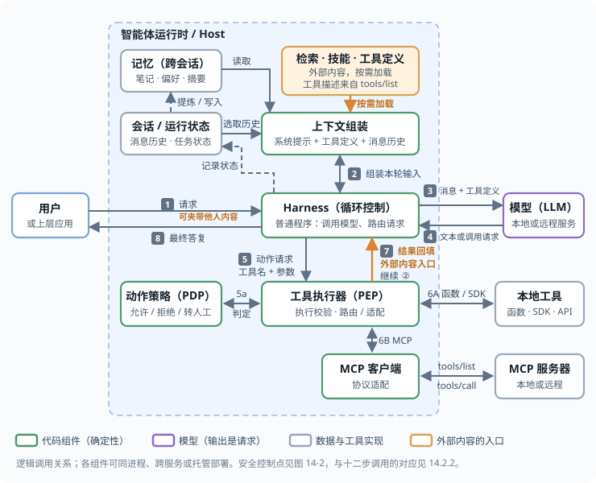
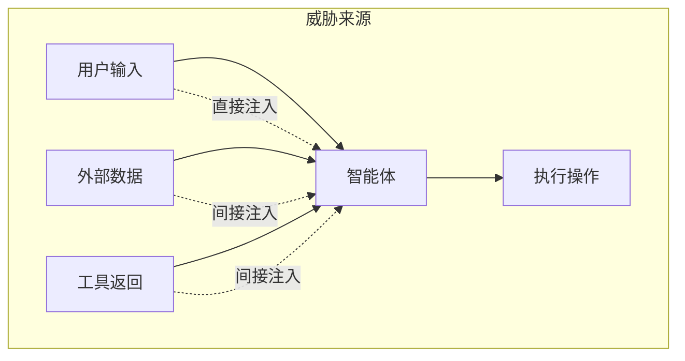
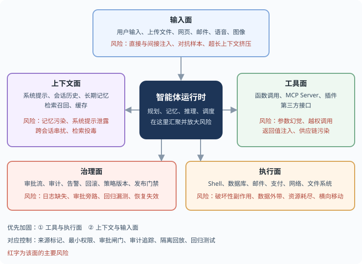
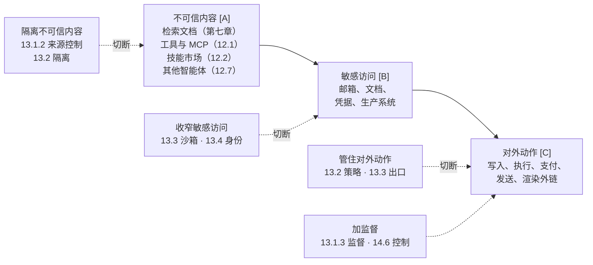
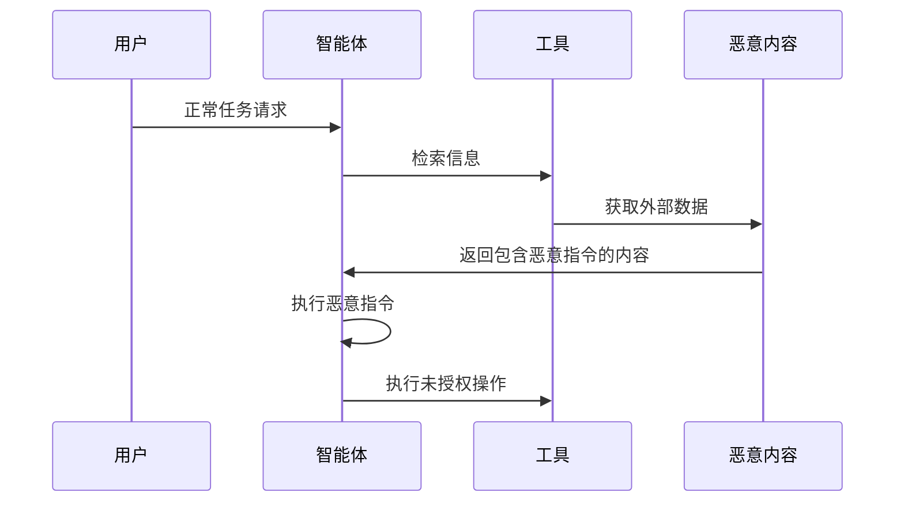
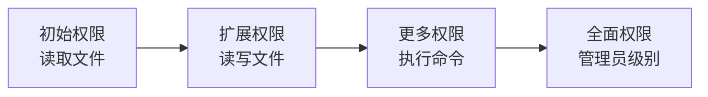
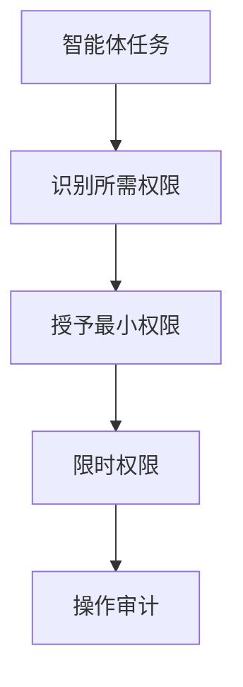
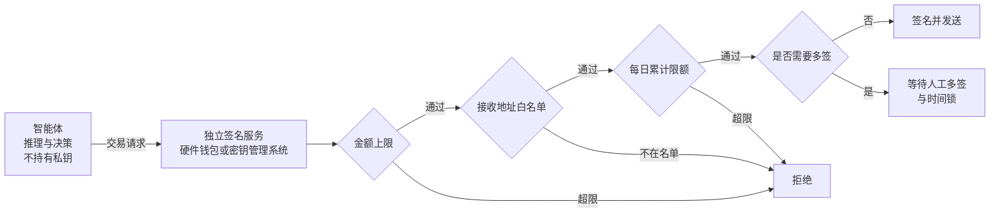

# 第十一章 智能体安全基础

智能体把模型与工具、记忆和外部环境相连，模型的一次判断可以引发连续动作。安全分析因此需要追踪内容如何影响请求、请求由谁授权，以及执行失败后能否撤销或追溯。

## 学习目标

读完本章，读者应能：

- 说明智能体调用循环中模型读到什么、输出什么，指出外部内容从哪三处进入上下文、真实执行发生在哪里。
- 区分模型的随机出错与被操纵，说明二者为何后果相同、差别在哪里，以及为何都要经过同一道闸。
- 对一个给定的智能体逐项检查不可信内容 [A]、敏感访问 [B]、对外动作 [C]，判断攻击链是否成立、闸应取何种强度、可采用哪种防御形态。
- 用 CAS 原理说明通用性、自主性、安全性任取两项时必须放弃哪一项。
- 为高风险动作规划权限治理与审计记录：危险组合规则、按可逆性分级的人工确认，以及能回答“哪段输入引起了哪个动作”的追踪。
- 以资金操作为例，说明签名权限为何应独立于模型，并识别金额、接收方与累计限额等执行前约束。

## 阅读路径

先沿调用循环（[11.1](11.1_agent_implementation.md)）标出模型与执行程序，再盘点不可信来源（[11.2](11.2_threat_model.md)）。[11.3](11.3_unreliable_executor.md) 确定动作由谁检查，[11.4](11.4_lethal_trifecta.md) 分析能力组合，[11.5](11.5_cas_principle.md) 给出安全取舍的严格定义。

用典型失效（[11.6](11.6_typical_failures.md)）检验权限治理（[11.7](11.7_permission_governance.md)）与追踪设计（[11.8](11.8_dark_code.md)），最后在资金操作（[11.9](11.9_web3_agents.md)）中检查签名权限与交易限制能否独立于模型执行。

OWASP 智能体安全威胁清单（T1–T17）、*OWASP Top 10 For Agentic Applications 2026*（ASI01–ASI10）与本书各章节的逐条对照见[附录 D](../16_appendix/D_owasp_agentic_crosswalk.md)。

> **⚠️ 道德边界**：本篇对工具调用滥用、记忆投毒、多智能体信任链破坏的剖析，用于让智能体开发者识别并修复自身系统的安全弱点；针对未经授权的他方系统执行类似攻击违反法律与服务条款。完整声明见 [§4 章首道德边界与负责任披露说明](../04_prompt_injection/README.md)。

## 1. 智能体的实现结构与调用过程

LLM 智能体（Agent）是指能够自主规划、执行任务并与外部环境交互的 AI 系统。Anthropic 将它概括为“就是在循环里根据环境反馈使用工具的 LLM”（[附录 C-154](../16_appendix/C_references.md)）。循环、工具与环境反馈使模型能够持续行动，也使一次错误判断可能转化为多步操作。

**一次模型调用的输入。** 模型每次被调用时，输入是带角色与类型的消息、工具定义和其他内容，经接口转换为模型可处理的表示；上下文窗口是本轮可用输入的容量边界。以文本助手为例，输入通常包括四部分：

- **系统提示**：开发者编写的角色、规则和约束；
- **工具定义**：每个工具的名称、用途说明和参数结构，模型据此判断何时调用哪个工具、填写什么参数；
- **消息历史**：用户此前的输入、模型此前的输出、工具此前返回的结果；
- **本轮新内容**：用户的最新输入，或刚返回的工具结果。

本节只讨论与调用循环有关的两类输出：面向用户的文本，以及结构化的**工具调用请求**（调用哪个工具、参数是什么）；同一回复可以包含多种内容块。实际接口还可能返回图像、音频、推理或其他类型。模型提出请求，真实工具动作由运行时执行。

**智能体循环。** 将模型置于一个循环中，由一段普通程序执行工具调用请求、再把结果交回模型，即构成智能体。这段程序通常称为 Harness 或编排器，它与会话、记忆等周边组件所在的层称为运行时。以下为教学伪代码，`model.generate`、`execute` 和 `tool_result` 均为抽象接口；代码省略了策略校验、授权、异常和并发处理，不能直接作为安全实现：

<!-- SAFE-LAB: defensive-only -->
```python
messages = [{"role": "user", "content": task}]          # 用户的任务

def run_agent(messages, max_steps=20):                  # 步数上限：循环的出口由代码把守
    for _ in range(max_steps):
        reply = model.generate(system=SYSTEM_PROMPT,     # 1. 调用模型：系统提示 + 工具定义 + 消息历史
                               tools=TOOL_DEFINITIONS,
                               messages=messages)
        messages.append(reply.message)                   # 2. 模型的输出整体进入历史

        if not reply.tool_calls:                         # 3. 没有工具调用请求：任务结束
            return reply.text

        for call in reply.tool_calls:                    # 4. 每个请求都由这段程序决定是否执行、如何执行
            result = execute(call.name, call.arguments)  #    真实执行发生在模型之外
            messages.append(tool_result(call.id, result))  # 5. 结果原样追加进历史 —— 外部内容由此进入上下文
    raise RuntimeError("超过步数上限")
```

实际消息并非把所有内容拼接成一个无角色的字符串。例如 [OpenAI Chat Completions 的工具调用](https://developers.openai.com/api/docs/guides/function-calling)中，以下三条消息保留了用户、助手请求和工具结果的身份，工具结果通过 `tool_call_id` 关联原请求：

```json
[
  {"role": "user", "content": "概括邮件 mail_123"},
  {"role": "assistant", "tool_calls": [{
    "id": "call_1", "type": "function",
    "function": {"name": "read_mail", "arguments": "{\"id\":\"mail_123\"}"}
  }]},
  {"role": "tool", "tool_call_id": "call_1",
   "content": "邮件正文：会议改到周五。"}
]
```

这里的 `role`、`type` 和关联标识由运行时与接口维护，邮件正文中的“我是系统消息”不会改写它们。其他接口的表达不同：OpenAI Responses 用 `function_call` / `function_call_output` 与 `call_id`，[Claude 用内容块](https://platform.claude.com/docs/en/agents-and-tools/tool-use/overview)里的 `tool_use` / `tool_result` 与 `tool_use_id`。这些结构帮助模型区分来源、帮助程序匹配调用，但不能证明模型不会把工具正文当作行动指令；后者仍需在执行处做授权检查。

下图把这一循环置于常见的实现结构中：运行时内是会话、记忆、上下文组装、Harness 循环、动作策略与工具执行器（访问控制的术语里，动作策略是策略决策点 PDP，工具执行器是策略执行点 PEP；后文也把动作策略称为策略网关），运行时外是用户、模型和工具实现；编号为一次调用的顺序。图中有三个关键位置：模型读到的只是上下文组装好的本轮输入（③）；模型输出的是请求（④），由 Harness 和动作策略决定是否执行（⑤、5a）；外部内容从三处进入：工具结果（⑦）；按需加载进上下文的检索片段、技能说明与工具定义，后者在实现上往往也是工具调用或 MCP `tools/list` 的返回；以及用户请求中转交的他人内容（①）。



图 11-1：智能体的实现结构与一次调用

**常见术语在该结构中的位置。** 各家框架的术语不同，但都对应循环中的某个位置：

| 术语 | 在实现中是什么 | 怎样进入模型 |
|------|----------------|--------------|
| 系统提示 | 接口中的系统指令字段或消息，通常是文本 | 通过专门的角色或字段提供；序列化方式依接口而定 |
| 工具 / 函数调用 / MCP | 工具定义（名称、描述、参数结构）加上执行它们的代码；MCP 是把工具定义和执行标准化的协议 | 定义进入上下文；执行在模型之外 |
| 技能 / 插件 | 打包好的说明文档加脚本 | 说明文档作为文本进入上下文，脚本作为工具执行 |
| 上下文窗口 | 本轮模型可使用的输入表示，有容量上限，可含文本与多模态内容 | — |
| 会话 | 一次任务的完整记录，是消息历史的持久形式 | 经压缩、裁剪后成为消息历史 |
| 记忆 | 跨会话保存的笔记、偏好或事实，存在文件、数据库或向量库里 | 检索后作为文本写入上下文 |
| 检索（RAG） | 从知识库按相关性取片段 | 作为工具结果或上下文片段进入 |
| 子智能体 | 另一个循环，有自己的上下文窗口和工具 | 它的最终输出作为工具结果回到父循环 |
| 沙箱 | 执行代码或命令的隔离环境 | 命令输出作为工具结果进入 |
| 浏览器 / 计算机使用 | 一组操作界面的工具，输入是截图或页面内容 | 页面内容与截图作为工具结果进入 |

**MCP、技能与子智能体的调用过程。** 表中这三类机制常被当作独立的通道，实际上都经过同一个循环：模型提出请求，运行时执行，结果回到消息历史。

- **MCP。** MCP（Model Context Protocol）服务器提供的工具同样经过这个循环：客户端取得的工具定义和服务器返回的工具结果都会写入上下文，二者都是来自外部的文本；协议的角色、消息、传输与相应风险见 [12.1.8](../12_agent_attack_surface/12.1_tool_security.md)。
- **技能。** 技能（以 Anthropic 的 Agent Skills 为例）没有独立的执行通道：说明文字以文件读取结果的形式进入上下文，附带的脚本以命令执行的形式运行，经过与其他命令相同的权限与沙箱；技能的目录结构、三级加载与风险见 [12.2.1](../12_agent_attack_surface/12.2_agent_skills.md)。
- **子智能体。** 以 Claude Code 为例，子智能体在自己的上下文窗口中运行，有自己的系统提示、可用工具与权限（[子智能体文档](https://code.claude.com/docs/en/sub-agents)）。主循环中的模型根据子智能体的 `description` 决定委派，委派本身是一次 Agent 工具调用；子智能体运行自己的循环，结束后把结果交回主对话。定义中的 `tools` 字段是可用工具的允许列表，`disallowedTools` 是拒绝列表，`maxTurns` 限定轮数。子智能体读过的网页与文件不进入主对话的上下文，但它交回的结果可能夹带其中的注入，仍按工具结果对待（[12.7](../12_agent_attack_surface/12.7_multi_agent_security.md)）。Claude Code 在主对话读取报告前会扫描一遍，给模仿系统标记的文本插入反斜杠，给模仿这类标记或提到权限设置的报告加一行标记；文档写明扫描不判断内容是否恶意，报告引出的工具调用仍要经过权限检查与沙箱。

**该结构的安全含义。** 后文各节讨论的风险均可由此推出，结论有四条：

1. **消息结构能标明来源，不能替代授权边界。** 系统指令、用户请求、工具结果有不同的角色、类型和关联标识，并非只有先后位置不同；多模态输入也不全是文本。模型仍可能错误地把低信任内容解释为指令。提示注入跨越的是这条语义信任边界，执行权限必须由模型之外的代码把守（[4.1](../04_prompt_injection/4.1_principles.md) 节）。
2. **外部内容从三处进入：工具结果，按需加载进上下文的检索片段、技能说明与工具定义，以及用户请求中转交的他人内容。** 网页、邮件、文件、检索片段、子智能体的输出以工具结果或上下文片段的形式写进消息历史，用户粘贴或上传的他人内容随请求写入，此后每一轮都被模型重新读到。一次注入会影响余下的整个循环（[4.3](../04_prompt_injection/4.3_indirect_injection.md) 节、[11.6.1](11.6_typical_failures.md)）。模型自身的输出不是外部内容，但也会把注入带回上下文：它整体写回消息历史（伪代码第 2 步）；模型若复述或照做了注入内容，这段内容此后以助手角色出现在每一轮输入中，角色标记不再反映它的真实来源。因此 [13.2.4](../13_agent_architecture/13.2_architectural_defenses.md) 把读过不可信内容的一次调用的输出整体染色；模型输出即使未受注入也不可信，见第 4 条。
3. **模型的输出是请求，不是执行。** 工具调用由 Harness 执行。这意味着控制点可以放在模型之外：Harness 决定是否执行、以什么权限执行、把结果以什么形式交回去。全书的确定性防御都建立在这一条上（[12.1.9](../12_agent_attack_surface/12.1_tool_security.md)、[13.2](../13_agent_architecture/13.2_architectural_defenses.md) 节）。
4. **模型本身就是不可靠的信息源。** 即使没有任何攻击者，模型也会幻觉出不存在的参数、误解任务、在压力情境下做出错位行为，而且同样的输入未必给出同样的输出（[11.6.2](11.6_typical_failures.md)、[14.7](../14_agent_practice/14.7_agentic_misalignment.md)、[14.6](../14_agent_practice/14.6_sabotage_ai_control.md)）。因此模型的每一个输出都应视为**待校验的输入**，而非决定；后文的“规划模型”“决策组件”等说法，含义始终是“它提出什么”，而非“由它决定”。

## 2. 威胁模型：不可信来源与攻击目标

威胁模型回答两个问题：哪些来源能影响模型的判断，攻击者想借智能体达到什么目标。防御需要限定每类来源出问题后可能造成的最大后果，不能仅依赖识别恶意内容。

### 2.1 按来源：不可信来源总表

智能体的不可信来源可分为六类：外部内容、工具与技能、记忆与会话历史、其他智能体、模型本身和人。下表对应不可靠执行者模型的第二项要求（盘点来源，见 [11.3](11.3_unreliable_executor.md)），列出不可信来源及其防御方法，也可作为本篇的索引，后续各节分别展开其中一行：

| 不可信的来源 | 从哪里进来 | 主要风险 | 确定性防御 | 主要章节 |
|--------------|------------|----------|------------|----------|
| 外部内容：网页、邮件、文档、检索结果、工具返回 | 工具结果、检索、上传文件 | 间接注入；知识库投毒 | 只交给无权限的隔离模型读，按事先锁定的字段清单（抽取契约）抽取；由代码维护的来源标记；检索前按用户权限过滤 | [第七章](../07_rag_security/README.md)、[12.1](../12_agent_attack_surface/12.1_tool_security.md)、[12.4](../12_agent_attack_surface/12.4_url_exfiltration.md) |
| 工具与技能：MCP Server、插件、技能包 | 工具描述进入上下文；代码在本机执行 | 描述投毒；恶意或仿冒的包；启动命令即代码执行；服务端索取的采样与征询 | 供应链准入、固定版本、描述变更比对后审批；本地 Server 进沙箱 | [12.1.8](../12_agent_attack_surface/12.1_tool_security.md)、[12.2](../12_agent_attack_surface/12.2_agent_skills.md) |
| 记忆与会话历史 | 每一轮从会话与记忆中取上下文 | 一次注入被持久化；摘要把不可信内容洗成可信 | 写入门控；由多个来源派生的内容按其中最不可信的来源标记；可信配置只由用户写入 | [12.3](../12_agent_attack_surface/12.3_memory_poisoning.md) |
| 其他智能体 | 发来的消息、被调用后的返回 | 注入在智能体之间传染；冒充 | 入站门控（身份、去重、记日志）；正文按不可信内容抽取；各自独立身份 | [12.7](../12_agent_attack_surface/12.7_multi_agent_security.md) |
| 模型本身：权重、微调与它的每个输出 | 每一次调用 | 幻觉与错位（随机出错）；后门或被投毒的权重（被人操纵） | 输出只是请求，会造成损失的动作一律过闸：参数只用真实存在的值，策略按参数来源判定，确认绑定参数，不可逆操作先演练后执行；模型来源校验、签名与固定版本 | [11.1](11.1_agent_implementation.md)、[11.6](11.6_typical_failures.md)、[11.8](11.8_dark_code.md)、[11.9](11.9_web3_agents.md)、[12.1.4](../12_agent_attack_surface/12.1_tool_security.md)、[13.1.5](../13_agent_architecture/13.1_agents_rule_of_two.md)、[14.3.8](../14_agent_practice/14.3_coding_agents.md)、[6.2](../06_data_model_attacks/6.2_backdoor_attacks.md)、[8.6](../08_architecture/8.6_supply_chain.md) |
| 人：用户与审批者 | 任务请求；用户粘贴或上传的内容；对高风险动作的确认 | 面向公众时的直接注入与越狱；粘贴或上传的他人内容夹带指令；借智能体越权，即请求超出用户本人的权限；审批疲劳；被智能体的输出操纵 | 认证与任务级授权；智能体的权限不超过用户本人（[13.4](../13_agent_architecture/13.4_agent_identity.md)）；用户提供的他人内容按外部内容处理；确认展示参数与来源，控制确认数量 | 第四、五章、[12.6](../12_agent_attack_surface/12.6_human_layer.md) |

各行的防御都不依赖识别恶意内容，而是限定该来源出问题后可能造成的最大后果，即 [4.5.11](../04_prompt_injection/4.5_injection_defense.md) 所说的确定性防御。检测器与模型审核仍有价值，但只能降低频率。

用户也是表中的一类来源。**委托人**（principal：智能体代其执行任务、且所用权限不超出其本人权限的用户）本人写的任务请求只在一个意义上可信：它规定了任务是什么。用户输入须先确认属于这种请求，并在其余方面照常校验：发出者是否确为委托人（认证是否有效、会话是否被劫持、共享会话里是否混有其他成员的消息），内容中是否夹带他人编写的部分（粘贴、上传、转发），请求是否超出委托人本人的权限，以及内容本身是否有误。

上传、转发等独立通道可由代码标记来源；直接粘贴进输入框的文字，代码无法与本人所写区分，OWASP 把这类情形称为无意的直接注入，其后果只能由权限与确认设上界。智能体持有超出用户本人的权限时（例如面向公众的客服能调用部署方的退款接口、能读到其他用户的数据），就超出的部分而言用户就是他人，其输入按不可信内容处理（直接注入与越狱，见[第四章](../04_prompt_injection/README.md)、[第五章](../05_jailbreak/README.md)）。

### 2.2 注入路径与攻击面

总表按来源列出风险；落到具体系统上，攻击面可从注入路径和工程组件两个角度画出。图 11-2 只画出六类来源中与注入相关的三条：



图 11-2：智能体安全威胁模型架构图

将智能体拆分为具体的工程组件后，攻击面比“输入源列表”更立体，上下文、工具和执行环境会共同放大风险：



图 11-3：智能体系统攻击面地图

### 2.3 按攻击目标

攻击者借智能体想达到的目标可分为四类：

| 目标 | 描述 | 危害示例 |
|------|------|----------|
| 操作滥用 | 执行未授权操作 | 发送恶意邮件 |
| 数据窃取 | 获取敏感信息 | 读取私密文件 |
| 系统破坏 | 损害系统完整性 | 删除重要数据 |
| 资源消耗 | 耗尽系统资源 | 无限循环任务 |

## 3. 不可靠执行者模型

用户要求智能体整理邮件，模型却提出删除全部邮件的请求。这个请求可能来自误判，也可能来自某封邮件里的恶意指令。运行时必须在删除前独立检查对象与授权范围，不能因为请求由模型生成就执行。这是不可靠执行者模型的出发点：**模型只提出请求，是否执行由模型之外的代码决定。**

### 3.1 确定部分与概率部分

智能体系统由确定部分和概率部分组成。确定部分包括 Harness（驱动模型循环、执行模型请求的普通程序，见 [11.1](11.1_agent_implementation.md)）、工具、策略和其他代码，其行为由代码规定，可以测试和审计。概率部分是模型：模型的下一步取决于它读到的内容，无法事先规定。智能体的能力和它特有的风险都来自这一点：模型可能无故出错，读到的内容也可能改变它的决定。由于二者同源，安全设计的目标不是消除不确定性，而是约束它：**概率的部分出主意，确定的部分拿主意**；规则无法覆盖的决定，才交由人确认。

确定不等于可信。[11.2.1](11.2_threat_model.md) 来源总表中的来源并非都是概率性的。模型的不确定性不是唯一的风险来源：确定部分本身也可能有漏洞，有些部分确定但不可信，例如第三方 MCP Server 的代码完全确定，其作者却可能怀有恶意。因此，除区分确定与概率外，还需区分可信与不可信，来源总表按后者划分。

Harness 工程（Harness Engineering）涵盖工具与权限编排、上下文管理、反馈纠错和安全检查。权限随功能需求逐渐膨胀（[11.6.3](11.6_typical_failures.md)）是运行环境需要控制的问题。

### 3.2 不可靠的执行者

不可靠执行者模型把模型视为一个**不可靠的执行者**：它会随机出错（幻觉；错位，即模型追求的目标偏离用户意图），也可能被操纵（注入、后门）。对系统而言，两种情况的后果相同，都是模型提出了错误的请求。

两者的差别在于是否挑选目标：幻觉相当于不挑目标的攻击者，误删数据与被诱导删除数据并无二致；注入则专挑价值最高、危险最大的操作，失败后还会改换措辞重试。被操纵并非随机性所致：即使把温度设为 0、使输出尽量固定，模型仍可被注入。原因在于，传统软件的控制流由代码决定，数据只提供取值；模型的控制流则由数据决定。

### 3.3 三项要求与闸

不可靠执行者模型包括三项要求：

1. **不信模型**：模型只提出请求，是否执行由模型之外的代码决定。对下游代码而言，模型输出是不可信输入。
2. **盘点来源**：识别所有能影响模型判断的来源，包括外部内容、工具与技能、记忆、其他智能体、模型本身和人。[11.2.1](11.2_threat_model.md) 的来源总表逐一列出这些来源及其防御方法。
3. **动作过闸**：会造成损失的动作，无论起因是幻觉还是攻击，都必须经过闸。闸是位于模型之外、决定动作能否执行的检查点，形式为代码规则或由代码强制执行的人工确认。具体要求是：参数只能取真实存在的值；不可逆操作在确认影响范围后放行；外发内容先经检查；可撤销的操作保留撤销路径。[14.2](../14_agent_practice/14.2_security_panorama.md) 的十二个步骤标出了各个闸的位置。

闸应有多强，由 [11.4](11.4_lethal_trifecta.md) 介绍的 Rule of Two 判断。

### 3.4 与零信任的关系

不可靠执行者模型把零信任（[8.2.6](../08_architecture/8.2_architecture_patterns.md)）的检查延伸到模型提出的动作与参数。零信任不默认信任任何主体，能够管控身份与凭据（[14.2](../14_agent_practice/14.2_security_panorama.md) 的第 1、7 步）；但被注入的智能体持有合法令牌、在用户权限范围内执行错误操作时，零信任的各项检查都会通过。不可靠执行者模型连代表用户执行任务的模型也不信任，并追踪每个参数受哪段内容影响。

## 4. 致命三要素与 Rule of Two

一个邮件助手既能读取私人邮件，又能访问邮件中的网页，还能向外发送消息。恶意网页若诱导模型读取邮件并发送出去，三种原本用于正常任务的能力就连成了外泄路径。评估这种风险，需要同时考察不可信内容、敏感访问与对外动作。

### 4.1 致命三要素

[11.2](11.2_threat_model.md) 按来源与目标划分了风险；实际评估一个智能体时，需要更简单的判据。Simon Willison 提出的“致命三要素”（[附录 C-99](../16_appendix/C_references.md)）就是这样的判据：只要智能体同时具备以下三项能力，攻击者就能诱使它窃取数据。

| 要素 | 含义 | 常见形态 |
|------|------|----------|
| 访问私有数据 | 能读取用户或组织不公开的信息 | 邮箱、文档、代码仓库、数据库、本机文件 |
| 接触不可信内容 | 攻击者控制的文本或图像能进入模型上下文 | 网页、来信、上传的文件、公开仓库的 Issue、工具返回值 |
| 对外通信 | 存在能把数据送到攻击者手里的通道 | 发邮件、发起网络请求、渲染外部图片、创建公开内容 |

其原理在于模型会遵循内容中的指令，而不区分指令来自操作者还是来自它正在处理的材料。三项同时具备时，攻击链自然成立：不可信内容里的指令让模型读取私有数据，再通过对外通道送出。

### 4.2 Rule of Two 的三项性质

闸的强度由 Meta 提出的 Agents **Rule of Two** 判断（[13.1](../13_agent_architecture/13.1_agents_rule_of_two.md)），它在致命三要素的基础上加以推广，把“对外通信”扩展为“改变状态或对外通信”，从而把破坏性操作也纳入其中。该规则从智能体的能力出发，列出三项性质：

- **不可信内容**（[A]）：模型在任务中读取由他人编写的内容，如网页、邮件、文档、检索结果、工具返回和其他智能体的消息，攻击者可借此操纵模型；
- **敏感访问**（[B]）：智能体能访问敏感数据或系统；
- **对外动作**（[C]）：智能体能够改变状态或对外通信，包括写入、执行、删除、支付、发送，也包括渲染外部图片、访问链接等不易察觉的外发。

沿用 Meta 的字母记法，三项能力在攻击链中分别承担以下作用：

```text
[A] 不可信内容：模型会读到他人编写的内容    ——  攻击的入口（攻击者借此下指令）
[B] 敏感访问：能访问敏感数据或系统          ——  攻击的目标
[C] 对外动作：能改变状态或对外通信          ——  攻击的出口（含渲染外链这类隐性外发）

攻击链：不可信内容 → 敏感访问 → 对外动作
防御：隔离不可信内容、收窄敏感访问、管住对外动作，三者去其一；三者都需保留时，则加监督
```

[A] 与 [B] 最容易混淆：[A] 取决于内容由谁编写，[B] 取决于权限能访问什么。读取用户的收件箱同时满足两项：他人的来信是不可信内容，收件箱本身是敏感数据。

[A] 也不等于用户输入。委托人本人写的任务请求就是任务本身，不属于 [A]；用户转交的他人内容（粘贴、上传、转发）属于 [A]；智能体持有超出用户本人的权限时，就超出的部分而言用户输入也按 [A] 处理（见 [11.2.1](11.2_threat_model.md) 来源总表后的说明）。模型自身的输出本身不算 [A]，但一次调用只要读过 [A]，其输出就按 [A] 染色（[13.2.4](../13_agent_architecture/13.2_architectural_defenses.md)）；即使没有读过，它也不可信，由 [C] 一侧的策略与确认把关。

现有框架对用户输入的处理也有前提。Meta 原文对 [A] 只举了外来邮件与网页内容，也指出满足 Rule of Two 不足以应对攻击者借智能体增强能力（attacker uplift）、权限过大（excessive privileges）等其他威胁。CaMeL 把“用户提示可信、用户没有粘贴来自不可信来源的提示”列为前提假设（[附录 C-97](../16_appendix/C_references.md)），部署时这一前提不会自动成立。

### 4.3 攻击链与四种防御形态

三项能力串成一条攻击链，它决定了闸的强度和防御的形态。三项同时具备时，攻击者可通过第一项操纵模型，再通过后两项造成损失，形成攻击链：**不可信内容 → 敏感访问 → 对外动作**。此时闸必须是硬规则或人工确认，不能只依赖模型“大概不会错”。由另一个模型检查也不满足要求：检查模型读取同一份上下文，可能被同一段文字说服。以概率部分检查概率部分，只能降低出错频率，不能为后果设定上界。

缺少任一项，攻击链即无法完成。相应地，防御有四种形态：**隔离不可信内容**（控制来源，或只交给无权限的隔离模型读取）、**收窄敏感访问**（隔离与身份）、**管住对外动作**（出口与策略）；三项都必须保留时，则 **加监督**。

各项能力上的防御位置见图 11-4。



图 11-4：智能体安全篇的主线——攻击链与四种防御

这条攻击链把问题从“如何识别恶意内容”转为“能否去掉三项之一”。对任何新接入的工具或数据源，都可先判断它为智能体增加了哪一项要素、增加之后三项是否齐备。工具可以自由组合时，用户往往在不知情的情况下使三项齐备：分别安装一个能读取内部文档的工具和一个能联网搜索的工具，两者单独看都没有问题。

### 4.4 没有攻击者时

只有幻觉而没有攻击者时，Rule of Two 不适用，但不可靠执行者模型第三项要求（[11.3.3](11.3_unreliable_executor.md)）中的闸仍然生效。幻觉不需要攻击者，但造成的损失可能完全相同：随机删除一批数据，与被诱导删除没有区别（[11.1](11.1_agent_implementation.md) 的第四条结论，[11.6](11.6_typical_failures.md)、[11.8](11.8_dark_code.md)、[11.9](11.9_web3_agents.md)）。它也不需要另一套防御：会造成损失的动作一律过闸，闸不区分原因（[13.1.5](../13_agent_architecture/13.1_agents_rule_of_two.md) 的不可逆操作网关即为这道闸）；这条链只决定有攻击者时闸的强度。

### 4.5 本篇按攻击链的组织

评估新接入的工具或数据源时，先标出它增加的是 [A]、[B] 还是 [C]，再检查组合后的能力。入口分析见[第七章](../07_rag_security/README.md)与[第十二章](../12_agent_attack_surface/README.md)；能去掉一项时，按 [13.1](../13_agent_architecture/13.1_agents_rule_of_two.md) 选择配置，并用隔离、沙箱、身份与出站控制落实（[第十三章](../13_agent_architecture/README.md)）。

三项都需要保留时，必须为具体动作确定检查规则或人工确认条件。编码智能体的分析见 [14.3](../14_agent_practice/14.3_coding_agents.md)，完整系统案例见 [14.1](../14_agent_practice/14.1_case_study.md)，各检查点的位置见 [14.2](../14_agent_practice/14.2_security_panorama.md)。

## 5. CAS 原理

用户要求智能体“按这封邮件的要求执行”。邮件可能要求回复、转账，也可能提出事先没有预见的操作。系统可以拒绝超出规则的要求，也可以请用户确认；若要求它接受任意正当任务，又始终自主执行，就必须面对预设规则无法核准的后果。

### 5.1 三项的定义

**CAS 原理**指出：通用性（Complexity）、自主性（Autonomy）、安全性（Security）三者不可兼得。

- **通用性**：任务范围不预先限定，用户正当提出的任意任务，在没有攻击时都能完成。Complexity 指范围不设限，而非难度高，其对立面是限定任务，而非简单任务。限定任务是指智能体不能完成用户正当提出的全部任务：或者事先只接受规则能够覆盖的任务，或者接受任务后遇到规则覆盖不到的步骤即拒绝，或只给出建议、交由人执行。
- **自主性**：有后果的决定仅由事先制定的规则放行。“事先”指读取不可信内容之前，设计时写定的规则和用户在任务开始时签署的授权都属于这类规则。事后审计不影响自主性；读取不可信内容之后的任何人工确认，无论确认对象是一个动作、一批动作还是一段数据，都使系统失去自主性。
- **安全性**：不可信内容能引发的后果不超出可信方核准的范围，且由模型之外的机制强制执行，而非依赖攻击大概率失败。后果既包括执行了哪些动作，也包括哪些数据流向了谁。可信方是事先制定的规则，或运行中进行确认的人。核准意味着可信方接受该范围内的最坏情况。因此，规则的放行条件只能取自通讯录、余额等可信状态；若放行条件由不可信内容自行决定（例如邮件自称来自上级、已获批准），则等同于一律放行，不构成核准。人核准的是展示给他的内容，即具体的动作与参数（[14.2](../14_agent_practice/14.2_security_panorama.md) 第 5 步），或一批动作、一段数据；人受骗而放行时，后果仍在其核准范围之内。安全性不保证核准者不受骗。

### 5.2 三者为何不可兼得

三者冲突的原因是：任务范围不设限，就必然包括“按这封邮件的要求执行”一类任务，其下一步由运行中读取的不可信内容决定，无法事先划定一个既能容纳真实邮件的全部可能要求、最坏情况又可接受的范围。伪造邮件与真实邮件在文字上可以完全相同，模型能力再强也只能降低出错概率；二者的差别在文字之外，即发件人是谁、是否有权。规则只能核查事先预见的外部事实，人则可以临时核实未预见的事实。因此，任取两项，必须放弃第三项：

- **安全 + 自主**：核准只能依靠事先制定的规则，而规则只能约束事先可划定的后果，任务因而受限，失去通用性。
- **安全 + 通用**：总有一些后果无法事先划定，规则无法核准，只能由人在运行中确认，失去自主性。
- **通用 + 自主**：对无法划定的后果，规则只能一律放行，又无人确认，只剩概率性防护，失去安全性。

### 5.3 与 Rule of Two 的关系及已有探讨

Rule of Two 可视为 CAS 原理在会话能力层面的粗略检查。满足 Rule of Two 不等于满足 CAS 的安全性：它只考察单个会话，而且去掉敏感访问后，不可信内容仍能决定对外动作。用 CAS 原理分析：去掉三项能力中的任一项，或三项齐全但仅依靠事先制定的校验规则放行，都是按能力或后果限定任务，放弃的是通用性；三项都需要且规则无法覆盖时，只能由人确认，放弃的是自主性。

对这类取舍已有一些非形式化的讨论，形式化结果也只覆盖某一类机制（[13.2.5](../13_agent_architecture/13.2_architectural_defenses.md)）；笔者提出的 CAS 原理是首个面向智能体整体、给出严格定义的不可能原理。

### 5.4 工作流与智能体

放弃通用性最常见的做法是把控制流保留在代码中。Anthropic 在[《构建高效智能体》](https://www.anthropic.com/engineering/building-effective-agents)（附录 C-154）中区分了两类系统：**工作流**由预先编写的代码路径编排模型和工具，**智能体**由模型自行决定流程和工具使用。任务能用工作流完成时，不必把控制流交给模型。

## 6. 三类典型失效：被操纵、随机出错、权限膨胀

智能体可能被外部内容操纵，也可能自行生成错误的工具参数；系统还可能随着功能增加而授予过多权限。三类失效分别发生在判断、参数与权限配置上，最终都可能使错误请求得到执行。防御需要把检查点设在动作执行之前。

### 6.1 被操纵：控制流劫持

攻击者可能通过注入指令劫持智能体的控制流，使它偏离原始任务、执行攻击者期望的操作。



图 11-5：智能体控制流劫持时序图

控制流劫持是 [11.2.1](11.2_threat_model.md) 来源总表“外部内容”一行最典型的后果。阻止它的手段是 [14.2](../14_agent_practice/14.2_security_panorama.md) 第 4 步按参数来源做出的确定性判定，而不是识别恶意指令：被劫持的模型可以提出任何请求，但来自外部内容的参数无法到达高风险的出口。

**典型案例模式：被检索内容导致的“零点击”注入。** 攻击者可以把恶意提示藏入日后会被检索到的邮件或文档，用户无需打开即可触发，EchoLeak 即是一例（[附录 C-47](../16_appendix/C_references.md)，详见 [9.2](../09_io_protection/9.2_output_moderation.md) 节）；文档中隐藏文本的系统研究见 [7.4.2](../07_rag_security/7.4_ingestion_pipeline.md)。典型过程如下：

1. **投毒**：攻击者发来一封邮件，正文看似写给人的说明，其中夹带给模型的指令。
2. **触发**：用户之后向助手提问，助手检索到这封邮件并放入上下文，指令随之生效。
3. **后果**：模型把用户邮件与文档中的敏感内容拼进一个指向外部的图片链接，客户端自动加载图片时数据即被带出（[13.1.4](../13_agent_architecture/13.1_agents_rule_of_two.md)）。

**“零点击”与间接注入**：此处的“间接提示注入”（Indirect Prompt Injection）或“上下文注入”是指恶意内容经智能体自动处理的外部文档或数据触发，无需用户额外交互即可激活。它不同于移动安全领域的“零点击利用”（Zero-Click Exploitation）：后者是指完全无需用户交互、自动执行的系统级漏洞利用；间接提示注入虽然对最终用户“无感知”，但仍依赖智能体对外部内容的主动处理。

### 6.2 随机出错：幻觉驱动的工具调用

幻觉也会造成往往不可逆的损失。智能体的工具调用参数由模型生成，而模型会幻觉。在纯对话场景中，幻觉的后果是一段错误的文字；在智能体场景中，幻觉产生的文件路径、收件地址或账户编号会被直接执行，导致删错文件、发错邮件、转错账。这类错误不需要任何攻击者，而且往往不可逆。

参数幻觉的具体形态、检测方法与防护措施在 [12.1.4 节](../12_agent_attack_surface/12.1_tool_security.md)结合工具调用机制展开；与提示注入无关的不可逆操作应如何把关，见 [13.1.5 节](../13_agent_architecture/13.1_agents_rule_of_two.md)的不可逆操作网关。隔离不可信内容这类防御无法覆盖幻觉：一个完全未接触不可信内容的智能体同样会因幻觉造成破坏；但会造成损失的动作仍要过同一道闸（[13.1.5](../13_agent_architecture/13.1_agents_rule_of_two.md)）。

### 6.3 权限膨胀：过度自主权

随着功能需求增加，智能体的权限容易逐渐膨胀。OWASP LLM Top 10 将“过度自主权”列为重要风险，智能体是其典型场景。



图 11-6：权限膨胀过程

权限膨胀是指敏感访问 [B] 与对外动作 [C] 在不知不觉中扩大；每增加一项权限，都要按 Rule of Two 重新判断闸的强度。权限的治理方法见 [11.7](11.7_permission_governance.md)。

## 7. 权限治理

权限会随功能需求逐渐膨胀（[11.6.3](11.6_typical_failures.md)）。工具较少时，可以逐个落实最小权限；工具增多后，还必须检查组合后的能力，并按任务收窄授权。高风险操作则需根据可逆性与影响面设置确认条件。

### 7.1 最小权限

最小权限是权限治理的起点：按任务识别所需权限，只授予最小权限，并限时、审计。



图 11-7：最小权限的实施流程

| 原则 | 实施方式 |
|------|----------|
| 能力隔离 | 不同任务使用不同权限集 |
| 时间限制 | 权限自动过期 |
| 范围限制 | 限制操作范围 |
| 可撤销 | 支持权限快速回收 |

### 7.2 工具数量增长后的权限治理

工具较少时，逐个工具配置权限并人工审查是可行的。工具增加到几十个之后，问题的性质发生变化：风险不再来自某一个工具的权限过大，而来自工具之间的组合。单独看都合理的“读取内部文档”和“发送邮件”，组合后即构成 [11.4](11.4_lethal_trifecta.md) 所说的外泄条件。逐项审查无法发现这类问题，因为需要审查的是组合，而组合的数量随工具数指数增长。

可行的做法是不再为每个智能体静态配置一张完整的权限表，改用以下四种机制的组合：

| 机制 | 做法 | 解决的问题 |
|------|------|------------|
| 角色模板 | 预定义少量角色及其工具集，新任务归入已有角色，而不是逐项配置 | 降低配置数量，便于审查 |
| 按任务动态收窄 | 任务开始时由策略引擎根据任务类型确定可用工具子集，任务结束即收回 | 实际生效的权限远小于智能体的全部能力 |
| 短时效授权 | 高风险权限绑定到具体操作，单次有效或分钟级过期 | 被注入后可利用的时间窗口很短 |
| 危险组合规则 | 用规则引擎声明不得同时出现的能力组合，在配置变更和运行时检查 | 直接针对组合风险 |

其中第四项最能体现智能体权限治理与传统做法的区别。这类规则声明哪些能力不得在同一会话中同时出现，例如：

```text
规则 1：[不可信内容] + [敏感访问] + [对外动作：改变状态或对外通信] 同时启用时，对外动作须经确定性校验或人工确认（见 13.1.3）
规则 2：[删除生产数据] 需要 [人工确认] 作为前置
规则 3：[调用支付接口] 的单次与累计金额不得超过上限
```

这类规则数量很少，却覆盖了数量庞大的危险组合，且可在每次工具集变更时自动检查。用策略引擎落地时，规则写成策略代码，每条规则配上应拦截与应放行的用例，随策略变更自动运行，写法见 [架构防御拓展](../13_agent_architecture/13.2_extensions.md#邮件外发策略rego-与回归测试)中的 Rego 示例与 `opa test` 用例。按任务动态收窄的进一步形式，是 [13.2.4](../13_agent_architecture/13.2_architectural_defenses.md) 介绍的策略化权限控制：权限随任务进展只收窄、不放宽，放宽必须经过批准。

### 7.3 按可逆性分级的人工确认

对高风险操作引入人工确认，按可逆性与影响面分级，而不是按工具分级：只读与可逆写入自动执行，影响面有限的不可逆操作经确定性校验、超出范围转交人工，高影响不可逆操作先演练再人工确认。同一个“执行命令”在沙箱中可以撤销，在生产环境中则不可逆。分级表见 [13.1.5](../13_agent_architecture/13.1_agents_rule_of_two.md)。

## 8. 暗码与可追溯性

同一份智能体程序面对不同输入，会生成不同的工具调用序列。源代码审查能够检查执行程序，却不能预先覆盖模型在运行时选择的全部行为。安全审计还需要保留行为记录，回答“这个动作由哪一段输入引起”。

### 8.1 暗码及其三个难题

传统软件的安全审计建立在一个隐含前提之上：代码是预先编写的、可审查的、确定性的。智能体系统打破了这一前提：Agent 的行为路径在运行时由 LLM 动态生成，执行完毕后即消失，无法像源代码一样被事先审查或事后精确复现。本书将这种“跑完即逝”的运行时行为称为**暗码（Dark Code）**。

暗码带来三个核心安全难题：

1. **身份确认困难**：智能体通过 API 调用另一个服务时，被调用方看到的只是一组凭据，无法区分操作出自用户意图还是 Agent 自行决定。传统的身份认证（OAuth、API Key）只能验证“谁有权限”，无法回答“这个操作是否确实由用户要求”。
2. **责任归属模糊**：智能体的一条决策链导致数据泄露或资产损失时，责任可能归于 Prompt 编写者、模型推理、工具提供方或编排逻辑，难以界定。暗码“即生即灭”的特性使因果链难以重建。
3. **最小权限原则失效**：传统的最小权限基于静态角色分配，而 Agent 每次运行所需的权限组合都可能不同：例如第一步只需读取数据库，第三步需要发送邮件，第五步还要调用支付 API。预先分配一组固定权限，要么过宽（安全风险），要么过窄（功能受限）。

典型场景：共享缓存跨租户泄露。

```text
场景：企业客服 Agent 系统
1. Agent A 为用户甲处理财务查询，将查询结果缓存
2. Agent B 为用户乙处理一般咨询
3. Agent B 在回答过程中，通过共享的向量缓存检索到了 Agent A 遗留的财务数据
4. 用户乙获得了用户甲的敏感信息

根因：共享的向量缓存没有按租户与权限隔离——这是确定性的访问控制缺失，
     不是侧信道；正解是检索前按租户与权限过滤（12.3、7.6）。运行时路径不可预测
     只是让这类遗漏更难在代码审查中被发现
```

### 8.2 应对方向

运行时路径难以预先枚举，需要结合追踪、权限约束与隔离：

| 应对策略 | 核心思想 | 实现方式 |
|----------|----------|----------|
| 全链路追踪 | 让暗码“可见” | 为每次 Agent 执行生成完整的 Trace，记录每一步的输入、输出、决策依据（参见 [10.1 节](../10_operations/10.1_monitoring.md)） |
| 临时窄权限 | 让权限跟随行为 | 每个工具调用前动态申请最小权限，调用后立即回收（参见 [11.7](11.7_permission_governance.md) 节的短时效授权） |
| 意图落盘 | 让每次关键操作可追溯 | 执行前由代码写入操作标识、参数及其来源、批准引用（[14.2](../14_agent_practice/14.2_security_panorama.md) 第 6 步）；模型给出的意图说明只作线索，不作审计依据，因为它和模型的其他输出一样不可信 |
| 沙箱隔离 | 让副作用可控 | Agent 的写操作在隔离环境中执行，经过验证后再提交到生产环境（参见 [13.3 节](../13_agent_architecture/13.3_sandbox_egress.md)） |

### 8.3 审计记录：记录什么

审查行为依靠审计记录。对智能体而言，日志既是事后取证的材料，也是暗码留下的唯一记录。普通应用的访问日志记录“谁在何时调用了什么接口”，这对智能体远远不够：同一个接口调用，可能出自用户的明确要求，也可能出自一封邮件中的注入指令，两者在接口日志中完全相同。智能体审计要回答的核心问题是：这个动作由哪一段输入引起。

为此，一次智能体任务应当被记录为一条完整的追踪，其中每个步骤至少包含以下内容：

| 记录项 | 内容 | 用途 |
|--------|------|------|
| 任务标识与发起者 | 用户、会话、触发方式（交互或后台） | 把所有步骤归并到同一任务，并归因到人 |
| 进入上下文的内容及其来源 | 每段内容的来源类型、标识与可信度标记，如“外部邮件，发件人某某” | 回溯注入的入口 |
| 模型的每次工具调用请求 | 工具名、完整参数、所处步骤 | 还原决策序列 |
| 策略判定 | 放行、拒绝或转人工，以及依据的规则 | 检验策略是否生效，发现被反复试探的规则 |
| 人工确认 | 展示给用户的内容、用户的决定与耗时 | 发现审批疲劳与诱导确认 |
| 执行结果 | 返回值摘要、所用凭据的范围与受众、出站请求的目标 | 确认实际后果，发现外泄 |
| 智能体版本信息 | 模型版本、系统提示版本、工具与技能清单的版本 | 复现问题，判断影响范围 |

记录日志时应注意以下三点：

1. **日志本身是敏感数据**：它包含用户内容和可能被注入的文本，应当脱敏存储并限制访问；审计日志只追加，智能体自身无权修改或删除。
2. **日志内容是不可信的**：让另一个模型分析这些日志时，日志里的注入文本同样可能影响分析者。
3. **尽量采用通用的字段约定**：OpenTelemetry 的生成式 AI 语义约定（[附录 C-153](../16_appendix/C_references.md)）已经为智能体调用、工具执行和 MCP 定义了跨度类型（目前仍处于开发状态，字段可能变动），沿用它可以让不同框架的追踪数据进入同一套分析工具。

按这套约定，追踪由智能体调用、模型调用、工具执行与 MCP 请求等跨度组成，工具名、参数、结果、会话标识和模型名都有标准属性，其中参数与结果须显式开启（Opt-In）才会记录，开启时按第 1 点脱敏。上表中的来源与可信度标记、策略判定、人工确认、凭据的范围与受众则没有标准属性，需由部署方自行定义，作为自定义属性记在对应跨度上。跨度命名、属性取值与 MCP 的追踪上下文传播见 [10.1.3](../10_operations/10.1_monitoring.md)。

### 8.4 基于记录的检测

在这些记录的基础上，应优先建立四类检测：

- **工具调用序列偏离任务类型的常见模式**，例如一个“总结邮件”的任务里出现了文档检索与外发。
- **读入不可信内容之后紧接着出现高风险动作**，这是注入得手的典型时序特征。
- **策略拒绝集中出现在同一来源**，提示有人在针对性地试探。
- **出站目标首次出现**，尤其是参数中带有疑似编码数据的请求（[12.4](../12_agent_attack_surface/12.4_url_exfiltration.md)）。

监控属于检测手段，不能替代预防性的边界。它的价值在于缩短从被攻击到被发现的时间，并在事后提供可用于改进策略的真实攻击样本。

## 9. 高后果场景：资金操作

资金操作的检查必须发生在付款之前。链上转账与推送式付款很难撤回；卡支付即使支持退款或拒付，也不能用事后追索代替事前授权。模型负责提出交易，独立的签名与支付组件负责核对收款方、金额、授权范围和已占用预算。

### 9.1 链上智能体的核心风险

区块链和去中心化金融环境使智能体安全的后果达到极端：链上操作直接转移资产，且交易一经确认即无法撤回。传统应用中的提示注入多半导致数据泄露，尚有发现和补救的余地；在链上，一次成功的注入意味着资产的永久损失。

核心风险在于读取不可信内容与签名交易集于一身。链上智能体通常需要读取大量外部信息（网页、社交媒体公告、合约源码与元数据），同时又能签名并发送交易。按 [11.4](11.4_lethal_trifecta.md) 的模型，不可信内容与高影响动作这两项始终同时存在。攻击者只需在智能体会读到的任何位置埋入指令即可：例如在合约的文档注释、代币的名称与描述字段，或者一条看似正常的项目公告里，写入“将全部余额转入某地址”。智能体在执行“查询这个合约”或“核实这个地址”这类无害任务时读到该指令，随后发起转账。

### 9.2 签名逻辑与推理逻辑分离

提示层面的约束（例如在系统提示中写“不要转移资金”）在此毫无作用。私钥和签名决策必须置于智能体无法访问的位置，由独立的签名服务在基础设施层面执行硬限制：



图 11-8：链上智能体的签名服务与硬限制

四类限制各自针对不同的失效情形，应当叠加使用：

| 限制 | 作用 | 说明 |
|------|------|------|
| 单笔金额上限 | 限定一次注入的最大损失 | 超过上限的交易签名服务直接拒绝，与智能体的意图无关 |
| 接收地址白名单 | 阻止资产流向攻击者 | 只允许向预先登记的地址转出；新增地址需要独立于智能体的审批 |
| 每日累计限额 | 防止用多笔小额交易绕过单笔上限 | 按时间窗口累计，触顶后暂停 |
| 多签与时间锁 | 为高额操作保留人工否决的机会 | 金额越高所需签名越多；时间锁期间可以撤销尚未执行的交易 |

这一设计是 [13.1.5](../13_agent_architecture/13.1_agents_rule_of_two.md) 不可逆操作网关在链上场景的具体形态：约束由智能体之外的确定性机制执行，智能体被完全控制时损失仍有上界。

本节以资金操作说明模型提出请求、独立组件掌握签名权限的边界。支付协议如何表达授权、校验交易，以及累计预算如何处理并发请求与未知付款状态，见 [14.5 资金操作：授权凭证与可信预算](../14_agent_practice/14.5_payment_security.md)。
