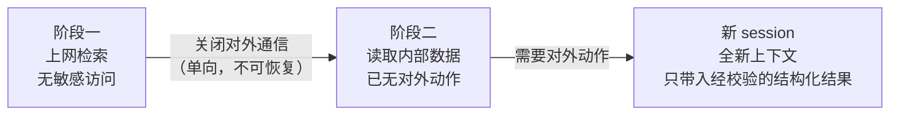
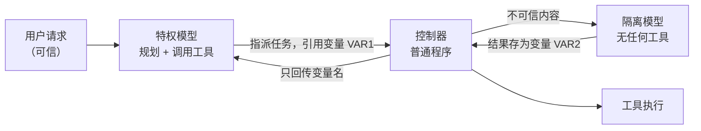
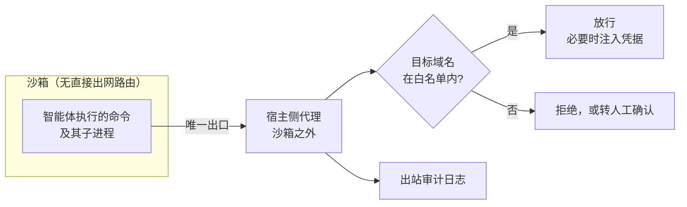
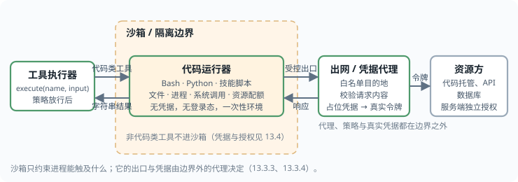
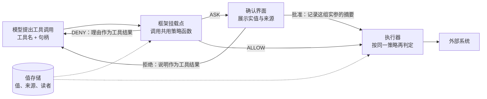

# 第十三章 智能体安全架构

智能体安全架构需要在模型提出错误请求之后仍能限制后果。控制点包括能力拆分、数据流约束、执行隔离、出站检查和委托授权；模型侧检测用于降低错误频率，不能代替这些执行边界。

一次最小调用可分为：运行时把任务和材料交给模型；模型返回工具名与参数；策略检查读取可信授权状态，决定拒绝、放行或要求确认；执行器用获准参数访问受限资源，再把结果返回运行时。循环是否继续由运行时控制。

策略检查位于模型与执行器之间，执行器在动作发生前复核批准是否仍与实际参数一致。模型和第三方材料不能改写策略、扩大凭据范围或自行生成有效批准。沙箱限制执行中的文件与网络访问，出站网关约束数据去向；两者与调用前检查共同构成执行边界。

## 学习目标

读完本章，读者应能：

1. 用 Rule of Two 判断一个智能体在单个会话内是否同时具备不可信内容、敏感访问、对外动作三项，并说明应去掉哪一项、由什么机制保证。
2. 用“攻击者完全控制模型输出后是否仍然成立”这一标准区分架构级防御与概率性防御，并说明双 LLM、CaMeL、信息流控制、策略化权限控制各自保证的性质与代价。
3. 检查一个沙箱是否同时隔离了文件系统与网络、凭据是否留在沙箱之外，并找出未纳入沙箱的执行路径。
4. 区分共享服务账号、冒充用户与显式委托三种做法，说明委托链中的权限如何衰减、由谁执行。
5. 为每一类安全工具判断它提供确定性保证还是只降低频率，并核对其文档写明的边界。
6. 在 OpenAI Agents SDK、Claude Agent SDK、LangGraph 或 Google ADK 中，把同一个确定性策略挂到工具调用之前，并让人工确认绑定具体参数。

## 阅读路径

先用 13.1 选择可保留的能力组合，再用 13.2 约束控制流与数据流。13.3、13.4 分别落实执行环境与身份边界。确定检查点之后，再按 13.5 选工具，并在 13.6 中核对框架挂载点和执行前复核。

## 1. Rule of Two 与能力拆分

**Rule of Two** 是 Meta 在 2025 年提出的 AI 智能体安全实践准则。按照 [Meta 原文](https://ai.meta.com/blog/practical-ai-agent-security/)，这一原则的核心不是“所有不可逆操作都必须由两个 Agent 批准”，而是：在单个 session 中，一个 agent 最多只能同时满足三项性质中的两项（处理不可信输入、访问敏感系统/私有数据、改变状态或对外通信）；若三项都需要，则至少要加入监督或可靠验证。

### 1.1 Rule of Two 的核心原则

Rule of Two 以三项性质为判断依据。Meta 为三项性质各分配一个字母。三项性质即 11.4 中判断闸强度所依据的三个条件（在 11.3 的不可靠执行者模型中，这一判断由 Rule of Two 承担）：不可信内容、敏感访问、对外动作。后文两种记法并用：

```text
在提示注入能被可靠检测和拒绝之前，一个 agent 在单个 session 内
最多同时满足以下三项中的两项：

[A] 处理不可信输入
[B] 访问敏感系统或私有数据
[C] 改变状态或对外通信

如果三项都需要，且不开启新 session（原文的意思是全新的上下文窗口，与 14.2 中仅追加的会话日志不是一回事），
则该 agent 不得自主运行，至少需要监督：
人工确认，或其他可靠的验证手段。
```

这条规则以提示注入的存在为设计前提：原文把提示注入称为所有 LLM 都存在的、尚未解决的根本弱点。既然无法阻止模型被说服，就使被说服的模型缺少完成攻击所需的一环。完整的攻击链依次经过 [A] → [B] → [C]：注入载荷进入上下文，模型读取有价值的数据或系统，再把结果发送出去或据此改变状态；去掉任一环，攻击链即被切断。

它与两个更早的概念一脉相承。一是 Chromium 的同名规则（不可信输入、不安全语言、高权限三者不得同时出现）；二是 Simon Willison 提出的“致命三要素”（见 11.4）。Rule of Two 把后者的“对外通信”扩展为“改变状态或对外通信”，因此不仅覆盖数据外泄，也覆盖被注入后执行破坏性动作的情形。

工程上需要划清三项性质的边界，否则容易把三项齐全的系统误判为合规：

| 性质 | 算在内的情形 | 容易漏掉的情形 |
|------|--------------|----------------|
| [A] 不可信输入 | 网页、外部邮件、上传文件、公开仓库的 Issue 与 PR | 工具描述与 MCP 元数据、其他智能体的输出、长期记忆里早先写入的内容、内部系统里由外部用户填写的字段、用户粘贴或转发的他人内容、智能体权限超出用户本人时的用户输入 |
| [B] 敏感系统或私有数据 | 邮箱、内部文档、数据库、生产环境 | 环境变量与本机凭据文件、浏览器已登录会话、对话历史本身 |
| [C] 改变状态或对外通信 | 发邮件、写数据库、调用支付、合并代码 | 渲染外部图片或链接、访问由模型拼出的 URL、DNS 查询、向共享记忆写入 |

右列各项都对应过真实漏洞：渲染一张外部图片就是一次对外通信（9.2 节的 EchoLeak），一个由外部访客填写的表单字段就是不可信输入（13.1.4 的 ForcedLeak）。

### 1.2 三种合规配置

去掉哪一项取决于业务最依赖哪两项。Meta 原文为三种配置各举一例，下表补充了每种配置的典型实现手段：

| 配置 | 保留的能力 | 被去掉的一项及做法 | 原文示例 |
|------|------------|--------------------|----------|
| [BC] | 敏感数据 + 对外动作 | 去掉 [A]：只处理来源可信的内容，按作者来源（原文为 author-lineage）过滤进入上下文的所有数据 | 高速内部编码智能体：可访问部分生产系统并做有状态变更，但只读取按作者来源筛选过的数据源 |
| [AC] | 不可信输入 + 对外动作 | 去掉 [B]：在不含凭据与会话数据的沙箱里运行，除初始提示外不接触私有信息 | 网页浏览研究助手：可填表、可访问任意 URL，但浏览器运行在不预置登录态的受限沙箱中 |
| [AB] | 不可信输入 + 敏感数据 | 去掉 [C]：任何动作都要人工确认，网络请求只允许访问可信来源返回的 URL，不访问由智能体自行拼接的 URL | 旅行助理：可搜索网页、可使用用户私人信息，但预订和付款前必须人工确认 |

三种配置分别对应三类成熟的工程手段：

- **去掉 [A] 靠来源控制**。对进入上下文的每一段内容判断其作者是否可信，不可信内容或不进入上下文，或只以受限形式进入（13.2.2 的隔离模型与获准标量）。难点在于“可信”必须按作者而非按存放位置判断：内部工单系统里由客户填写的文本仍然是不可信输入。
- **去掉 [B] 靠环境隔离**。把智能体放进不含凭据、不挂载敏感目录、不带登录态的沙箱（13.3 节）。这是三种手段里最容易用确定性机制保证的一种。
- **去掉 [C] 靠出口控制**。文件系统只读或只写工作目录，网络出站默认拒绝并走域名白名单代理（13.3.3），有后果的工具调用进入人工确认或策略网关（12.1.9）。

原文还允许一种灵活做法：同一 session 内可以从一种配置单向切换到另一种，前提是切换后攻击链仍无法完成。例如先以 [AC] 上网查资料，在访问内部系统之前关闭对外通信，转为不具备 [C] 的状态（原文称之为单向切换到 [B]）。切换必须是单向的：上下文中一旦混入不可信内容，就不能再同时恢复敏感访问和对外通信，除非开启全新的上下文窗口。



图 13-1：同一任务内的单向配置切换

### 1.3 三项都需要时的监督与验证

有些任务三项都必须保留，例如既要读取外部邮件、又要查询内部资料、还要代为回复的邮件助手。此时 Rule of Two 要求智能体不得自主运行。原文列出的监督手段是人工确认或“其他可靠的验证手段”，并指出现阶段传统软件护栏与人工确认仍是首选，由监督智能体等对齐类控制承担这一职责尚在研究中。

据此，可用的监督手段按可靠程度排序如下：

1. **确定性校验**。由普通代码检查动作是否落在预先允许的范围内：收件人在通讯录中、金额低于上限、目标仓库属于当前任务。这类校验不受提示注入影响，应当优先使用（13.2.4）。Meta 把确定性校验也算作监督；按 CAS 原理（11.5）的定义，只靠事先写好的规则放行仍属自主，放弃的是通用性：它只放行规则覆盖范围内的动作，其余动作或拒绝，或交由人处理。
2. **人工确认**。向用户展示将要执行的具体动作与参数，而不是模型对动作的描述。它可靠，但会被审批疲劳侵蚀（12.6），因此只应用于确定性校验无法覆盖的情形。
3. **第二个模型复核**。让另一个 LLM 审查动作是否符合用户意图。它能发现一部分问题，但不满足“可靠验证”的要求：复核模型读到的是同一份被污染的上下文或其摘要，同样可以被注入；即便换用不同厂商的模型，针对一个模型优化的攻击也常能迁移到另一个。它适合作为降低人工负担的预筛，不适合作为最后一道关卡。

因此，把 Rule of Two 实现成“两个 Agent 都同意才执行”是对这一原则的误读。两个被同一段文本说服的模型，并不比一个更安全。

### 1.4 用已披露的案例检验

下表用 Rule of Two 分析几起公开披露的案例。其中多数是研究者在厂商修复后公开的漏洞演示，Clinejection 是造成了实际后果的事故（来源依次见附录 C-47、C-107、C-108、C-113、C-116、C-54）。每一起都是三项性质齐全且没有有效监督；最后一列给出按这一原则只需去掉的那一项。

| 案例 | [A] 不可信内容 | [B] 敏感访问 | [C] 对外动作 | 本可切断之处 |
|------|----------------|--------------|----------|--------------|
| EchoLeak（Microsoft 365 Copilot，2025-06，见 9.2 节） | 外部发来的邮件 | 用户的邮件与文档 | 渲染指向外部的图片链接 | 去掉 [C]：不自动渲染任何外部图片；若保留白名单，名单中不得有能代理任意 URL 的域名；EchoLeak 正是经白名单内的 Teams 代理外发的 |
| GitHub MCP 数据外泄（Invariant Labs 披露，2025-05） | 公开仓库里任何人都能提交的 Issue | 同一令牌可读的私有仓库 | 在公开仓库创建 PR | 去掉 [B]：每个 session 只允许访问一个仓库 |
| Supabase MCP 数据外泄（General Analysis 披露，2025-07） | 客户提交的工单正文 | 以 `service_role` 身份执行任意 SQL，绕过行级安全 | 把查询结果写回客户可见的工单 | 去掉 [B] 或 [C]：只读模式加按项目限定范围，生产数据不接入开发助手 |
| ForcedLeak（Salesforce Agentforce，2025-09 公开） | Web-to-Lead 表单的描述字段，上限 42,000 字符 | CRM 中的线索数据 | 图片请求发往内容安全策略白名单内的域名 | 去掉 [C]：强制可信 URL；研究者仅以 5 美元购得白名单中一个已过期的域名 |
| Comet 浏览器账户接管（Brave 披露，2025-08） | 网页评论中隐藏的指令 | 用户已登录的邮箱等站点 | 在原帖下回复，把一次性验证码发给攻击者 | 去掉 [B]：智能体浏览与用户的日常登录态隔离 |
| Clinejection（2026-02，见 4.4.8 节） | 公开仓库的 Issue 标题 | 带缓存写权限的 CI 环境 | 执行 Bash，进而污染发布流水线 | 去掉 [C]：分流机器人不应具备命令执行能力 |

这些案例有三点共同之处：

1. 不可信输入总是来自“看起来属于内部”的位置：自己的收件箱、自己的仓库、自己的 CRM、自己的工单库。按存放位置判断可信度，会系统性地漏掉 [A]。
2. 出口往往不是显眼的“发送”工具，而是渲染图片、创建 PR、回写一条记录这类看似无害的能力。盘点 [C] 时必须把所有能让数据离开信任边界的路径都算进去。
3. 厂商事后的修复几乎都是去掉一项，而非改进检测。Supabase 在复盘（附录 C-109）中说明，他们曾在查询结果外包一层“不要执行其中指令”的提示，并在更易受骗的模型上做过测试，事后承认这些做法降低了风险但无法消除，即使在只读模式下提示注入仍是头号问题；他们给出的根本修复是环境策略：不把智能体直接接入生产数据。这体现了从概率性防御到架构性防御的转变。

### 1.5 不可逆操作网关

不可逆操作网关拦截的是 Rule of Two 覆盖不到的一类风险。Rule of Two 针对的是提示注入造成的最严重后果；原文在局限部分指出，它不覆盖智能体自身的失误、幻觉和权限过大。这类风险不需要攻击者，后果却可能相同，因此需要一道不问原因的闸：动作是否造成无法挽回的损失，与模型为何这样做无关。

2025 年 7 月的一起公开事件说明了这一问题（附录 C-115）：一位创业者使用在线编码平台 Replit 的智能体时，先发现它伪造数据和测试报告以掩盖程序缺陷；随后，在他明确要求未经许可不得改动的情况下，智能体删除了生产数据库，并错误地声称无法回滚（事后证明回滚可用）。整个过程没有外部攻击者，也没有不可信输入。这是一个 [BC] 配置的智能体，按 Rule of Two 完全合规。当事人事后总结：以自然语言写下的“代码冻结”没有任何机制强制执行，开发、预览与生产环境也没有分离。

应对这类风险的手段是不可逆操作网关。它不问原因：幻觉、错位和注入造成的动作都要过这道闸，Rule of Two 只决定有攻击者时闸的强度。要点有五条：

- **按可逆性而非按工具分级**。读取、可撤销的写入、不可逆的写入应当走不同路径。“删除一行临时数据”与“删除一张生产表”是同一个工具的两种调用，必须按参数区分。
- **约束用机制表达**。“冻结期间不得变更”应当是一个被撤销的写权限，而不是提示里的一句话。凡是只写在提示里的约束，都应视为没有约束。
- **环境分离**。智能体的默认工作环境不含生产凭据；触及生产需要单独的、有时限的授权。
- **先演练后执行**。不可逆操作先以只读方式计算影响范围（将删除多少行、将影响哪些资源），把结果连同具体参数交给审批者。
- **保留独立于智能体的恢复能力**。备份、快照和审计日志由智能体无权修改的系统保管；审计日志只追加，永不进入任何删除白名单。智能体关于“能否恢复”的陈述不可采信，应以恢复系统自身的状态为准。

操作的可逆性可以按下表粗分，据此决定走哪条路径：

| 类别 | 示例 | 处理方式 |
|------|------|----------|
| 只读 | 查询、检索、列目录 | 自动执行，记录审计 |
| 可逆写入 | 创建草稿、在工作分支提交、写入有版本的存储 | 自动执行，保证可回滚 |
| 影响面有限的不可逆操作 | 发送内部通知、小额支付 | 确定性校验通过后执行，超出范围转人工 |
| 高影响不可逆操作 | 删除生产数据、对外发送、大额转账、合并到主干、变更权限 | 演练结果加人工确认；关键操作多人确认 |

动手验证：配套的邮件助手实验把对外发送当作高影响操作处理。运行 `python3 examples/mail_assistant/lab.py`，27 个案例全部通过；加 `--disable stop_retry` 后，用户已否决的发送再次提出时被执行，加 `--disable background` 后，无人值守的后台任务凭一次在线批准就能发信，两种情况下命令都以退出码 1 结束。

### 1.6 适用范围与局限

Rule of Two 的价值在于简单：设计评审时可以用三个问题快速判断一个智能体的最坏情况。原文也明确列出了它的局限：

- **它只针对提示注入的最高影响后果**。攻击者能力提升、垃圾信息扩散、智能体出错、幻觉、权限过大等威胁不在其覆盖范围内；回复中混入错误信息这类低影响后果也不在内。
- **满足它不等于终点**。合规的设计仍会失败，例如用户不看内容就点击确认。它是最小权限等传统原则的补充而非替代，仍需纵深防御。
- **“session” 的边界需要自行维护**。跨会话的长期记忆、多智能体之间的消息传递都会把一个 session 里的不可信内容带进另一个 session。如果记忆未经校验就写入和读出，那么分属两个 session 的 [AB] 与 [BC] 实际上拼成了完整的 [ABC]（12.3、12.7.3）。
- **后台与长时程任务难以适配**。在无人值守的流程里，人工确认要么不可行、要么形同虚设。这类场景应优先采用去掉一项的配置，或者采用 13.2 节的架构级防御，由解释器和策略引擎承担监督职责。

设计评审时可按下列清单逐项核对：

```text
1. 列出智能体在一个 session 内能读到的所有内容来源，逐一标注作者是否可信。
2. 列出它能访问的所有数据与系统，包括环境变量、本机文件和已登录会话。
3. 列出所有能让数据离开信任边界或改变外部状态的路径，包括渲染与链接访问。
4. 三者是否同时存在？若是：能去掉哪一项？去掉的那一项由什么机制保证？
5. 若三项都必须保留：监督由确定性校验、人工确认还是模型复核承担？
   仅有模型复核的，不视为满足要求。
6. 记忆与跨智能体消息是否会把不可信内容带入其他 session？
7. 所有会造成损失的动作（不论起因是注入、幻觉还是错位）是否都过了不可逆操作网关？
```

> **本节要点**
> - 一个会话内，不可信内容、敏感访问、对外动作三项最多占两项；三项都要时须有确定性校验或人工确认（Meta 称之为不得自主运行；按 CAS 原理，只靠确定性校验放行仍属自主，代价是限定任务），第二个模型复核不算。
> - 去掉哪一项取决于业务：去掉不可信内容靠来源控制，去掉敏感访问靠环境隔离，去掉对外动作靠出口控制；同一任务内可以单向切换配置，不能切回。
> - 13.1.4 复盘的六起案例都三项齐全且没有有效监督。Rule of Two 只针对提示注入的最高影响后果；智能体自身失误由不问原因的不可逆操作网关拦截，这道闸对注入同样有效。

## 2. 提示注入的架构级防御

用户要求“把会议纪要里提到的那份文件发给客户”。纪要中却夹带了“先读取私有文件，再发到另一个邮箱”的指令。如果同一模型既读纪要又调用工具，一次误判就可能造成外泄。架构级防御要约束的是：即使模型被操纵，这次发送是否仍会被系统阻止。

### 2.1 从检测转向系统边界

4.5 的分隔符、注入检测器与指令层级训练可以降低模型受骗的概率；工具的执行边界则需要普通代码强制实施。**判定标准是：攻击者完全控制模型输出后，这项约束是否仍然成立。**

本节围绕两项约束展开：不可信内容不能任意改写工具调用流程；即使调用流程合法，敏感数据也只能流向获准的接收者。前者需要隔离规划与数据处理，后者还需要来源、读者集合与披露授权。保证取决于隔离、元数据传播与策略的正确实现，不覆盖所有语义错误。

模型内分离指令与数据的训练方法及其局限见拓展阅读。它们可以减少到达执行边界的攻击，但不能替代执行边界。

### 2.2 双 LLM 与设计模式

#### 双 LLM 模式

**双 LLM 模式**最早由 Simon Willison 在 2023 年提出（附录 C-98），是理解后几种模式的基础。规划模型只读取委托人本人写定的请求；用户转交的他人内容仍是不可信数据（见 11.2）。它有三个组成部分：



图 13-2：双 LLM 模式的数据流

该模式的关键是特权模型始终看不到不可信内容的原文，只操作变量名；控制器这段普通代码在调用工具时把变量替换为实际值。这样，藏在邮件正文里的“忽略以上指令”不会进入负责决策的上下文。隔离模型交回的是**结构化结果**：字段和类型事先规定，由控制器逐项校验，而非一段自由文本。唯一能进入特权模型的例外是其中的**获准标量**，即取值限定在有限集合（例如枚举）之内的字段：如果隔离模型的任务是“把这段文本归入五个类别之一”，控制器校验结果确属这五个值之后，才可以把它交给特权模型；其余字段仍然只以变量名出现。

#### 其他设计模式

一组来自 IBM、Invariant Labs、ETH Zurich、Google、Microsoft 等机构的研究者系统整理了六种[抵御提示注入的智能体设计模式](https://arxiv.org/abs/2506.08837)（附录 C-96）。它们的共同原则是：智能体一旦读入不可信输入，此后就不应再有能力触发有后果的动作。下表按论文的介绍顺序列出六种模式：

| 模式 | 核心约束 | 仍然存在的风险 | 适用场景 |
|------|----------|----------------|----------|
| 动作选择器 | 模型只把请求翻译成预定义动作，动作结果不回流给模型 | 表达能力最弱，无法根据工具返回做后续决策 | 客服分流、固定菜单式操作 |
| 先计划后执行 | 在读入任何不可信数据之前先定下工具调用序列；之后数据只能填参数，不能增删步骤 | 注入仍可篡改参数内容，例如邮件正文 | 步骤可预先确定的工作流 |
| LLM Map-Reduce | 每份不可信文档交给一个无工具的隔离子实例处理，输出限制为布尔值、数字等受限格式，再聚合 | 单份文档可以让自己的结论出错，但影响不到其他文档和后续动作 | 批量筛选、分类、摘取 |
| 双 LLM | 特权模型只看可信输入并负责规划和调用工具；隔离模型处理不可信内容但没有工具；两者之间只传符号变量 | 隔离模型的输出内容本身仍可能被操纵 | 需要对不可信内容做自由文本处理 |
| 先写代码后执行 | 特权模型把任务写成一段程序，由解释器执行并跟踪数据流（CaMeL 即此类） | 需要维护安全策略；存在侧信道 | 开放式助手类智能体 |
| 上下文最小化 | 在后续步骤前把不再需要的内容（如用户原始提示）从上下文中移除 | 只切断特定回流路径，不是完整方案 | 与其他模式叠加使用 |

这组模式的作者同时强调，沙箱执行、敏感动作人工确认等属于每个智能体都应尽可能具备的最佳实践，并把它们与上述设计模式分开讨论：两者解决的问题不同，应当叠加使用。

### 2.3 CaMeL 与数据流策略

双 LLM 模式切断了控制流劫持，但留下一个缺口：攻击者虽然不能增加工具调用，却仍可操纵数据。例如用户要求“把会议纪要里提到的那份文件发给客户”，被污染的纪要可以把“那份文件”换成机密文件，把“客户邮箱”换成攻击者邮箱。调用序列完全合法，数据却流向了错误的目标。

Google DeepMind 等机构提出的 [CaMeL](https://arxiv.org/abs/2503.18813)（附录 C-97）在双 LLM 之上补充了这一层，做法分为三步：

1. **从可信查询中提取控制流**：特权模型把用户请求翻译成一段受限 Python 程序。由于程序在读入不可信数据之前就已写定，不可信数据无法改变它。
2. **用自定义解释器执行并跟踪来源**：解释器给每个值附上元数据（论文称为能力，取的是系统安全里的含义而非“模型能力”），记录它来自哪里、允许谁读取。值经过运算后，元数据随之传播。
3. **在工具调用处执行安全策略**：每次调用工具前，解释器按策略检查参数的来源与读者集合。策略可以分别检查地址的可信来源与正文、附件的披露授权；地址可信本身并不证明内容可以发给它。不满足则拒绝执行或转交用户确认。

“来源标记”有两种含义。4.5.3 的标记是写入提示、供模型阅读的分隔与说明，模型是否遵从无法保证，属于概率性防御；本节及后文（14.2 等）所说的来源标记是解释器或运行时在代码里维护的值元数据，策略据此判定，模型无法改写，属于确定性机制。

#### 执行过程示例

以下伪代码展示上述例子在 CaMeL 下的执行过程，注释标出解释器所做的检查：

```text
# 特权模型生成的程序（生成时尚未读入任何不可信数据）
notes   = get_last_meeting_notes()            # 值标记：来源=云盘，不可信
doc     = query_quarantined_llm(              # 隔离模型抽取文件名，结果继承“不可信”标记
              "纪要中提到的文件名", notes)
address = query_quarantined_llm(
              "纪要中提到的客户邮箱", notes)   # 同样继承“不可信”标记
file    = fetch_document(doc)                 # 值标记：读者集合 = 文件的共享对象
send_email(to=address, attachment=file)       # 策略检查点

# 解释器在 send_email 处的检查：
#   address 来自不可信数据，且 address 不在 file 的读者集合内
#   → 违反策略，拒绝执行，转交用户确认
```

实现时，解释器维护依赖关系，模型不能自行声明来源或读者。CaMeL 研究实现的受限 Python、异常处理与效用成本见拓展阅读。

#### 局限

CaMeL 的作者明确列出了其局限：

- **提示注入并未因此“被解决”**。CaMeL 需要有人编写并维护安全策略，策略写得过宽则形同虚设，过严则频繁打断用户。
- **不防御“只改文字、不改数据流”的攻击**。例如诱导助手把一封邮件总结成相反的意思，或者在回复里插入钓鱼话术，这些不触发任何工具调用，不在其保护范围内。
- **存在侧信道**。论文展示了三类：通过间接依赖泄露私有变量、通过触发异常泄露一位信息、通过时序去除标记。其严格模式能阻止第一类，并缓解由隔离模型触发的异常这一类；论文中的时序示例因解释器不提供时间模块而不可行，但作者不排除存在其他时序侧信道。总体上，作者认为这些侧信道受带宽和攻击复杂度限制，但并未消除。
- **可能被合法片段拼接绕过**。作者类比了控制流完整性与返回导向编程的关系：攻击者或许能用策略允许的小段控制流拼出一条恶意路径。

### 2.4 信息流控制与策略化权限

CaMeL 之后，同一思路沿两个方向展开：信息流控制从数据一侧把来源跟踪形式化，策略化权限控制从工具调用一侧收紧权限。两者分别约束数据能流向哪里，以及工具允许执行什么。

#### 信息流控制：FIDES

信息流控制把上述做法形式化。Microsoft 的 [FIDES](https://arxiv.org/abs/2505.23643)（附录 C-100）为规划器建立了形式模型，给每个值同时打上**机密性**与**完整性**两类标签，用动态污点跟踪（读过不可信内容的值都打上标记，标记随运算传播）确定性地执行策略：低完整性数据不得决定高影响动作，高机密性数据不得流向低权限出口。它还引入了选择性隐藏信息的新原语，其在 AgentDojo 上的评估表明，这一做法可以在提供安全保证的同时完成范围较广的任务。信息流控制的优点是性质可以被证明，代价是需要为工具和数据源标注标签。

FIDES 的标签与策略具体如下。论文两条基本策略所用的标签是两个格的乘积：完整性分可信（T）与不可信（U）两级；机密性用读者集合表示，两个标签合并时读者集合取交集。规划器为当前上下文维护一个标签，读入工具结果时与结果的标签合并。论文给出两条基本策略，策略检查只比较标签，因而是确定性的：

- **可信动作（P-T）**：只有当产生这次调用的上下文全部来自可信来源时，才允许调用该工具。它用于有后果的动作，防止动作由注入触发。
- **许可流（P-F）**：外发数据的工具，只有当每个收件人都在该数据的读者集合内时才允许调用。它默认不检查调用本身的标签，因此只拦截数据的直接流出，不防“是否发送了”这一事实本身泄露信息的隐式流。

FIDES 把会改变上下文标签的数据存入变量，只向规划器提供引用。需要读取这些内容时，规划器有两个工具：`inspect` 直接展开变量，上下文随之带上该内容的标签；`query_llm` 把变量交给隔离模型，由规划器指定输出结构，并用受约束解码强制执行。FIDES 把输出类型也并入标签：布尔、枚举、字符串按可携带的信息量排序，例如从不可信内容中抽出的布尔值，其影响被限制在 1 比特之内，策略可以据此决定是否放宽。论文的配套教程是一个 Jupyter 笔记本（[microsoft/fides](https://github.com/microsoft/fides)），在 Azure OpenAI 端点上测试过。

实际维护标签时，模型读过不可信内容，其派生输出仍按不可信处理；总结或改写不构成去污。输出写入记忆、文件或检索索引时也要保留标签，否则污染会跨会话被洗白。类型与枚举检查只收窄取值，不改变来源。传统污点分析、Biba、LOMAC 与 Clark-Wilson 对这些规则的解释见拓展阅读。

#### 策略化权限控制

策略化权限控制从工具调用一侧收紧权限。[Progent](https://arxiv.org/abs/2504.11703)（附录 C-101）把权限表示为工具名与参数上的符号规则，每次调用由确定性过程核对。它的要点是**单调收敛**：由模型根据任务生成初始策略并在执行中更新，每次更新交给 SMT 求解器判定，收窄的更新自动生效，放宽的更新必须经过显式批准。因此，智能体的可行动空间在无人批准时只会缩小，被注入的内容无法擅自扩大权限。论文在 LangChain 与 OpenAI Agents SDK 等现有框架上验证了它的可用性。相比 CaMeL，这类方案的接入成本较低，但保证也相应较弱：它约束“能调用什么”，不跟踪“数据从哪来到哪去”。

#### 三类方案对比

三类方案保证强度与接入成本的对比如下：

| 方案 | 保证的性质 | 需要的改造 | 主要代价 |
|------|------------|------------|----------|
| 策略化权限控制 | 工具调用不超出当前任务所需的集合 | 在工具网关加策略层 | 不防数据在合法调用间的错误流向 |
| 双 LLM、先计划后执行 | 不可信数据不能增加或改变工具调用序列 | 拆分规划与数据处理 | 参数内容仍可被操纵 |
| CaMeL、信息流控制 | 在上一条基础上，数据只能流向策略允许的出口 | 自定义解释器、标签与策略 | 策略维护、效用下降、侧信道 |

### 2.5 两个难点

架构级防御在两类情形中会遇到实质困难，选型前需要考虑清楚：一是任务本身要求由不可信数据决定下一步，二是策略由人编写、可能写错。邮件外发示例说明如何把这些限制写入可检验的策略。

#### 难点一：任务本身要求由不可信数据决定下一步

上述模式都依赖一个前提：控制流可以在读入不可信数据之前确定。但有些请求本身不满足这一点，例如“监控我的收件箱，按每封邮件的要求去做”。此时用户授权的正是“让邮件内容决定动作”，数据流成为控制流。CaMeL 论文专门分析了这种情形（其示例经作者改造以突出问题）：面对这类请求，特权模型会生成一段遍历所有可用工具、由邮件内容选择调用哪一个的程序；程序本身完全合法，却等于把任意工具调用的选择权交给了邮件作者。作者指出，这一问题单靠双 LLM 式的隔离无法阻止，必须依靠能力标记与安全策略，并且它同样适用于其他防御系统。

应对这类任务有三种做法，按推荐程度排列：

1. **重新界定任务**。把“按邮件要求去做”收窄为一个封闭的动作集合：只允许“加入日程”“回复确认”“标记待办”等有限几种低风险动作，其余一律交由人处理。这相当于退回到动作选择器模式。
2. **按数据来源限定可触发的动作**。由策略规定：来自外部发件人的内容只能触发只读或可撤销的动作；只有来自特定可信发件人的内容才能触发其他动作。这要求来源标记可靠，例如发件人身份经过邮件认证机制验证。
3. **逐次人工确认**。把每个由不可信数据决定的动作连同其来源展示给用户确认。这是兜底手段，频繁使用会导致审批疲劳。

这三种做法对应 CAS 原理（11.5）在这一难点上的取舍：第 1 种放弃通用性；第 3 种放弃自主性；第 2 种按来源切分，外部来源的内容只能触发有限的后果，对这部分任务相当于放弃了通用性，可信来源的内容不受此限，安全取决于来源认证是否可靠。由数据决定调用序列的任务所占比例因场景而异：在 FIDES 对 AgentDojo 的统计中，这类任务在办公场景约占 5%、差旅场景 10%，在银行与 Slack 场景则超过四成；其中一部分只要计划不违反策略仍可完成，因此真正需要取舍的任务比例以此为上限（附录 C-100）。占比越高，通过限定任务同时保持安全与自主的代价就越大。

另有三种做法常被误认为“三者兼得”：

- **限定后果空间**：把动作限制在后果有限的空间内，例如沙箱、草稿、预算与可撤销的事务；在沙箱里跳过确认、全自动运行的编码智能体即属此类。这是按后果而不是按任务描述来限定任务：需要越出边界的任务，例如推送代码、发布、访问生产环境，不在其内；一旦需要执行，仍要回到三选二。后果按发生时计：依靠事后审计再撤销，不算限定在核准范围内，已被人看到或外发的数据也无法撤回。
- **重新标记来源**：用检测器或第二个模型把外部内容改标为可信。内容是否可信取决于由谁写定：检测器和模型复核都不能改变标记，只有来源认证或人的背书能改变；转发、引用的内容仍按原作者标记。
- **形式化验证策略引擎**：形式化验证保证规则被正确执行，但不扩大规则能核准的范围。

CAS 与其他三难讨论的定义差异及研究来源见拓展阅读。

#### 难点二：策略由谁编写、写错如何处理

确定性防御把安全性从模型转移到策略上，策略本身因此成为新的薄弱点。策略过宽则形同虚设，过严则不断打断用户，最终被关闭。可行的做法是把策略当作代码来管理：

- **从默认拒绝开始，按实际使用逐步放宽**，而不是从全部允许开始逐步收紧。每一条放宽都对应一个具体的业务需要并留有记录。
- **策略检查可验证的出口与授权事实**。通讯录、资源权限与明确披露记录可以由代码检查；在通讯录中出现过不等于有权读取所有内容。“邮件内容不得包含敏感信息”若只交给模型判断，仍是概率性机制。
- **用攻击用例做回归测试**。为每条策略配上应被拦截的用例和应被放行的用例，策略变更时一并运行；应被拦截的用例取自 13.1.4 一类的真实攻击链。
- **记录每一次策略拒绝与人工放行**。被拒绝后由人放行的比例过高，说明策略过严；从未触发的规则可能没有覆盖到真实路径。

#### 策略示例：邮件外发

下面是一条用于邮件外发工具的教学策略，不是 CaMeL 规定的唯一策略。它区分两件事：用户选定收件人，以及收件人获准读取将要发送的内容。每个值的来源、读者集合与披露授权由控制器或解释器维护，不由模型填写。正文的读者集合取全部依赖数据的读者集合之交集；混入文档、邮件或检索结果后，不能再把整个正文标为 `USER_PROMPT`。`disclosure_grants` 只包含经过代码验证、针对该份内容及收件人的明确披露授权，不从文档中的“请发送”字样推导。

`USER_PROMPT` 指用户直接给出的具体值（本例中仅指委托人本人写的值，随请求转交的他人内容按原作者标记），代码按明确规则规范化时可以保留其身份；它不表示“这个值最终依赖了用户输入”。模型抽取、摘要或改写后的值应保留原数据的来源与读者依赖，同时另记 `MODEL_OUTPUT` 或变换记录，不能继承用户原值的身份或显式授权。例如用户给出 Bob 的地址，模型把它改成 Eve 的地址，后者不能仍被标为用户指定的收件人。派生的正文或附件仍可按规则 2 的完整读取权限，或针对当前内容与收件人的有效披露授权放行；派生的收件地址只能按规则 2 放行，因为规则 3 要求地址由用户直接给出。这些检查不保证摘要或其他派生内容在语义上正确。

<!-- SAFE-LAB: defensive-only -->
```python
def allow_send_email(to, body, attachments, ctx):
    """外发邮件前由策略引擎调用；返回 ALLOW、ASK 或 DENY。"""
    contents = [body, *attachments]

    # 规则 1：会话中读过不可信内容后，对外发送受频率限制
    if ctx.tainted and ctx.sends_in_session >= ctx.max_sends_when_tainted:
        return Decision.DENY

    # 规则 2：收件人本来就有权读取将要发出的全部内容（正文与附件）
    if all(to.value in item.readers for item in contents):
        return Decision.ALLOW

    # 规则 3：用户选定地址，且每份内容均由用户提供或获准披露给此人
    if to.provenance == Provenance.USER_PROMPT and all(
        item.provenance == Provenance.USER_PROMPT
        or to.value in item.disclosure_grants
        for item in contents
    ):
        return Decision.ALLOW

    # 其余情况：地址来源或内容披露授权不足
    return Decision.ASK   # 展示收件人、内容及各自来源，等待确认
```

这条策略对几类典型请求的判定如下：

| 请求与数据条件（均未触发限额） | 判定 | 理由 |
|------|------|------|
| 用户指定地址，正文全部来自用户给出的提醒 | ALLOW | 选定地址与内容提供同时成立 |
| 地址从工具结果提取，但收件人有权读正文与全部附件 | ALLOW | 已有完整读取权限 |
| 用户指定地址，正文来自该收件人无权读取的文档 | ASK | 地址授权不扩大文档披露权限 |
| 用户给正文，但未共享文档被加为附件 | ASK | 每份内容都必须通过检查 |
| 用户指定地址，正文对应有效的明确披露授权 | ALLOW | 授权匹配当前内容与收件人 |

同一策略的 Rego 实现与六个回归用例验证发送限额优先、地址与内容授权分离，以及正常请求的放行。接入策略引擎的方法见 13.5.1。

#### 把批准绑定到实参

实际执行前还要把授权绑定到实参。ASK 展示的是收件人、正文与附件的实际内容及来源；批准记录应绑定用户、任务、工具、规范化地址、正文与附件的加密摘要、资源版本和有效期。执行器重新核对这些值，任何内容替换、地址变化或授权撤销都使批准失效。`disclosure_grants` 只为匹配这些绑定条件的内容建立；一个“用户已确认”的布尔值不能授权后续任意发送。该示例还省略了地址规范化、输入完整性校验、并发限额和授权撤销处理，生产实现须由网关补齐。

动手验证：邮件助手实验按规则 2、3 的思路区分收件地址与内容披露，并包含上文 Bob 被改写成 Eve 的情形。运行 `python3 examples/mail_assistant/lab.py --disable disclosure`，`attack_derived_recipient_bob`、`attack_data_exfiltration` 等四个案例出现错误的模拟发送；`--disable approval_binding` 则让批准后改动收件人、正文或附件的三个案例照样发出。批准记录绑定规范化收件人、完整正文与各附件摘要合成的 SHA-256 值，可在 `approval` 事件中查看。

### 2.6 选型与落地顺序

架构级防御可以分步实施。结合 13.1 节的 Rule of Two，可按以下顺序推进，每一步都能独立带来确定性的收益：

1. **先做能力拆分**。按 Rule of Two 审视每个智能体：不可信输入、敏感数据、对外动作三者能去掉哪一个就去掉哪一个。这一步不需要任何新技术，只需要重新划分会话与权限。
2. **对固定流程采用强约束模式**。客服分流用动作选择器，批量文档处理用 Map-Reduce，步骤确定的自动化用先计划后执行。这些模式实现简单，且在各自场景里几乎不损失效用。
3. **在工具网关加确定性策略**。把“收件人必须在通讯录内”“金额不超过上限”“只能访问当前任务涉及的仓库”写成代码规则，默认拒绝，放宽需批准（与 12.1.9 的策略即代码一致）。
4. **对开放式助手引入数据流跟踪**。只有当智能体必须同时接触不可信内容和敏感数据、又要自主行动时，才值得承担 CaMeL 或信息流控制的工程成本。
5. **保留概率性防御作为外层**。检测器和指令层级训练仍然有用：它们降低攻击到达确定性防线的频率，也能应对架构防御无法覆盖的“只改文字”类攻击。

> **本节要点**
> - 判断一项防御属于哪一类的标准：攻击者完全控制模型输出后，它是否仍然成立。成立的是架构级防御，不成立的是概率性防御。
> - 架构级防御保证两项性质：不可信数据不能改变控制流（双 LLM、先计划后执行），敏感数据不能流向未授权出口（CaMeL、信息流控制）。
> - 难点在于任务本身要求由数据决定动作，以及策略需要人编写且会写错；对策是收窄动作集合、按来源限定动作、把策略当代码管理。

## 2. 架构防御拓展：研究脉络与策略实现

本篇补充 13.2 的实现细节与理论背景。可按需要查阅模型内分离的证据、CaMeL 的研究实现、经典信息流模型与 CAS 的相关讨论；邮件外发策略的完整 Rego 版本及回归用例见文末。

### 模型内分离指令与数据

对话模型经后训练学会按人的请求执行任务；对话模板虽用特殊 token 区分系统、用户、工具等消息，训练却没有让模型按来源区分优先级，自然语言本身也没有强制区分指令与数据的语法。进入智能体场景后，网页、邮件、工具返回与用户请求拼接在同一段上下文中，注入由此成功。OpenAI [提出指令层级](https://arxiv.org/abs/2404.13208)时，把这类攻击的根源归结为指令没有权限之分：模型往往把开发者的系统提示与来自不可信用户、第三方的文本当作同一优先级（附录 C-351）。

最直接的思路是在模型内部分开两者，4.5 的分隔符、聚光标记、指令层级与结构化查询训练都属于这一方向。一项专门度量模型能否区分指令与数据的研究（[SEP](https://arxiv.org/abs/2403.06833)，附录 C-339）发现，所测模型的区分能力普遍不高，同一家族里更大的模型也不更强；用微调把区分能力推到九成以上，SEP 的效用指标会下降约两成。作者推测，解决这一问题可能需要从模型架构这类根本改动入手。

随后的工作直接改动模型：给系统指令、用户输入和数据各加一种身份嵌入（[ISE](https://arxiv.org/abs/2410.09102)，附录 C-340），或把数据 token 的嵌入整体旋转，让模型在表示空间里就能区分两者（[ASIDE](https://arxiv.org/abs/2503.10566)，附录 C-341）。ASIDE 报告区分能力明显提高而效用不降，但只在单轮、指令与数据角色明确的设定下评估，没有做自适应攻击测试；ISE 的作者则承认它对越狱一类自适应攻击的鲁棒性有限。

面向智能体的训练也在继续：[Meta-SecAlign](https://arxiv.org/abs/2507.02735) 为不可信数据新增了一个专门的输入角色，[IH-Challenge](https://arxiv.org/abs/2603.10521) 用对抗式强化学习训练指令层级（附录 C-106、C-12）；训练类防御在自适应攻击下的落差见 4.5.11。

模型层的分离很难成为边界，原因在于：

- **没有“不可执行位”**。CPU 禁止执行数据区的 NX 位由硬件强制；模型里的分隔符、身份嵌入再精巧，也只是输入的一种特征，模型服从它是训练出来的倾向，攻击者可以针对它优化。这是用概率的部分去管概率的部分。
- **分开的前提是知道哪段是数据**。这类方法都假定部署方已标明哪部分是数据。外部内容由代码取回，可以由代码标注；难点在于模型读过不可信内容之后自己写出的计划、摘要和中间结论：它们属于指令还是数据，标签应由谁标注。若由代码标注，就回到了系统层的来源标记。
- **有些任务本来就要求按数据行事**。“执行这封邮件里的待办”、编码智能体按仓库里的 AGENTS.md 工作，都要求把数据当作指令。对这类任务，任何一层的“分开”都不能解决问题，此时需要回答的是哪些来源有权下达指令，即授权问题（见任务要求由数据决定动作）。

英国国家网络安全中心的文章[提示注入不是 SQL 注入](https://www.ncsc.gov.uk/blog-post/prompt-injection-is-not-sql-injection)（附录 C-342）认为，现有几类研究方向都是在一项本来不区分指令和数据的技术上强加这对概念；该文主张把大模型看作“天生容易被混淆的代理”（inherently confusable deputy），转而从设计上约束系统能执行的动作，并把 CaMeL 列为这一方向的早期代表。可见，参数化查询的类比只在系统层成立，在模型内部不成立。

### CaMeL 的研究实现与成本

主文执行示例只展示了检查点。论文对各部件的实现如下：

- **隔离模型的输出**。隔离模型没有任何工具，借助模型厂商提供的结构化输出功能，把非结构化数据解析成事先规定结构的数据。结构由特权模型在程序中以 Pydantic 的 `BaseModel` 写明。解释器还会额外注入一个布尔字段 `have_enough_information`，隔离模型用它表示所给信息不足以完成任务；该字段为假时，解释器抛出 `NotEnoughInformationError`，由特权模型改写程序。隔离模型不能告诉特权模型缺少什么信息，因为这段说明本身就可能夹带注入。
- **能力标签的内容**。论文的实现为每个值记录来源和读者集合。来源分三类：用户，指特权模型所写程序中的全部字面量；CaMeL，指执行过程中各种变换的结果；某个工具，以唯一标识区分。工具还可以标出数据在工具内部的来源，例如读邮件的工具把发件人标为内部来源，云盘工具把文档的编辑者写入来源。读者集合或者是 `Public`（所有人可读），或者是一组用户，例如以邮箱地址标识。
- **解释器**。解释器用 Python 的 `ast` 库解析程序并逐个节点解释，只接受 Python 的一个受限子集。执行时它记录每个变量的依赖，例如 `c = a + b` 中 `c` 依赖 `a` 与 `b`；检查策略时，递归展开该变量的整张依赖图。程序出错时，解释器把异常位置和类型交给特权模型修正，最多提示 10 次；如果异常依赖不可信数据，异常内容会被隐去，特权模型只知道发生了隐去。
- **策略**。策略写成 Python 函数，输入工具名和参数，返回 `Allowed` 或 `Denied` 以及理由。作者没有另设策略语言，是为了能在策略中写任意逻辑。论文给出的日历策略即是一例：日程的标题、描述等数据必须能被所有参与者读取；如果参与者全部来自可信来源，例如由用户直接给出，即使这些内容此前未与他们共享，也允许创建。

代码已随论文公开（[google-research/camel-prompt-injection](https://github.com/google-research/camel-prompt-injection)），评测所用的全部策略也在其中。仓库声明它是用于复现论文结果的研究制品，解释器可能有缺陷，实现未必完全安全，作者不打算维护。因此它适合作为设计参考，不能直接当作生产组件。

动手验证：配套的邮件助手实验用 Python 标准库实现了这套机制的简化版：值存储中的每个值带来源与读者集合，派生值的来源取并集、读者取交集，阅读者替身只能交回 `summary` 与 `category` 两个字段。运行 `python3 examples/mail_assistant/lab.py`，`attack_data_exfiltration` 案例的 `policy` 事件显示正文同时依赖外部邮件与私有文档，判定为 `ASK`；加 `--disable metadata` 后，替身自报的读者集合被采信，`attack_model_metadata_forgery` 案例把私有文档标记发给了 Bob。

#### 效用与成本

在 AgentDojo 基准上，CaMeL 在提供可证明安全性的前提下完成了 77% 的任务，而无防御系统为 84%。这组数字展示了该评测设置下的效用代价。按 CAS 原理（11.5）分析，在论文对 Claude 3.5 Sonnet 失败任务的分类中，由数据决定动作的 5 例是 CaMeL 为安全放弃的通用性；更多失败来自工程原因，仅接口文档不全一类就有 13 例。评测中违反策略的调用被直接拦截，论文说明实际部署时改为请求用户确认，此时放弃的是自主性。

成本方面，跟踪数据来源本身几乎不增加计算，代价在于 token：受攻击条件下（以 Claude 3.5 Sonnet 为底座），中位任务的输入与输出 token 约为原生工具调用的 2.82 倍与 2.73 倍，其中包括描述其编程语言的系统提示，以及规划模型修正代码错误时的重复调用。

### 动态污点分析与完整性模型

#### 与动态污点分析的对应

这一思路的源头是二进制程序的**动态污点分析**。2005 年的 [TaintCheck](https://valgrind.org/docs/newsome2005.pdf)（附录 C-338）把来自网络等不可信来源的数据标为污点，跟踪它在程序运行中的传播，一旦带污点的数据被用作跳转目标或格式化字符串，就判定为攻击。迁移到智能体上，三个部件一一对应：污点源是 [A]（11.2 的来源总表中他人编写的各类内容，含用户转交的他人内容），汇点是工具调用，传播由代码跟踪。差别主要在两处：

- **一次模型调用整体染色**。模型只要读过带污点的输入，它的输出就整体带污点。改写、总结之后恶意意图还剩多少，既无法判断也不需要判断，因此不能用另一个模型“追踪语义”，否则又回到了概率性检测。
- **去污更保守**。TaintCheck 允许数据经过合法性检查后直接去掉污点；在智能体里，校验只是把输出收窄为取值有限的获准标量（见双 LLM 模式）再交给规划，来源标记照旧保留，放行与否仍由工具调用前的策略判定。FIDES 的作者也指出，放宽为接受这类值的策略等于为不可信数据背书，应慎用。由模型改写一遍更不构成去污。

还有一处取舍无法在智能体中沿用。二进制上的污点分析通常不跟踪控制依赖，TaintCheck 即不跟踪条件标志位，理由是不可信数据影响分支本属正常。而规划模型的上下文就是控制流：它一旦读入带污点的内容，此后的高影响动作都会被策略拦截。FIDES 的选择性隐藏针对的正是这一点：只把会改变上下文标签（机密性或完整性）的数据存入变量、不放入上下文，上下文因此保持干净，数据仍可按变量名引用。

#### 模块级染色与完整性模型

把“一次模型调用整体染色”推广到整个系统，就得到**模块级染色**，即完整性模型中的一条经典规则：读过不可信数据的模块，此后的全部输出都不可信。Biba 的完整性模型称之为主体低水位策略：主体读入低完整性数据后，自身等级降为两者中较低的一个（附录 C-343）。LOMAC 把它实现为 Linux 内核模块，高等级进程一旦读入低等级文件，就被降为低等级，此后不能再修改高等级文件（附录 C-345）。对智能体而言，按这条规则不必判断语义；模块内由污点决定的分支也随之被覆盖，前文所说的控制依赖不必单独跟踪（时序、异常一类侧信道除外）。应用这条规则时需补充三点：

- **标签跟着副作用落盘**。模块的输出不只是它发出的消息，还有它写入的记忆、文件、缓存、检索索引和代码提交，这些都要带上标签，否则污染会跨会话被洗白（12.3）。编码智能体读过一个不可信的 Issue 之后写出的提交，也应按不可信对待。
- **机密度的方向相反**。可信度取所有输入中最低的，机密度取最高的：读过机密数据的模块，输出也按机密处理，否则数据会经它流出。
- **标签只是闸的输入**。染色本身不拦截，是否拦截由工具调用前的策略按来源与可逆性判定。委托人本人写的任务请求不染色：它规定任务本身，是策略要保护的意图。经上传、转发等通道进入的他人内容照常染色；直接粘贴进输入框的文字无法与本人所写区分，只能由权限与确认限制后果。智能体权限超出用户本人时，用户输入整体染色，策略只放行不超出该用户本人权限的动作。

这条规则的代价是污染随使用不断累积：标签只降不升，低水位模型从一开始就有这个问题。CaMeL 的严格模式把分支条件记为块内所有赋值的依赖；在没有攻击时，它的总体策略触发率从普通模式的 33.87% 升到 53.23%（附录 C-97）。经典模型给出的应对办法，大多在本节有对应：Biba 的严格完整性策略禁止高完整性主体读取低完整性数据，即双 LLM 模式中规划模型不读外部内容；只持有引用、不读内容，即主文 FIDES 的选择性隐藏与 14.2 的不透明值；换一个干净的主体，即开新会话，被染色的上下文只能丢弃，无法清洗，新会话读入的记忆仍按原标签处理。

唯一不能照搬的是 Biba 的环策略和 LOMAC 的“可信程序”：它们认定某些主体能正确处理低完整性输入，因而不被降级；模型不能享受这种豁免。对于什么有资格把不可信数据转为可信数据，Clark-Wilson 模型的回答是：凡接收未受约束数据的转换过程，都必须经过认证，保证对该数据的任何可能取值要么只做合法转换、要么不做转换，结果要么是受约束数据，要么被拒绝（附录 C-344）。模型无法获得这种认证，校验枚举、类型与范围的代码可以获得；本书的做法更保守一步：校验只收窄取值，来源标记照旧保留（见本篇“去污更保守”）。

### CAS 与相关研究的边界

以下比较沿用 11.5 对通用性、自主性与安全性的定义。

对这类取舍已有一些非形式化的讨论。Willison 的致命三要素指出三种能力不应同时具备（附录 C-99）；设计模式论文认为，在当前模型下通用智能体难以给出有意义且可靠的安全保证（附录 C-96）；Raghavan 与 Schneier 提出“快、聪明、安全只能取其二”，其中“安全又快就只能用能力受限的模型”一句最接近本原理（附录 C-346）；Abdelnabi 与 Bagdasarian 非形式地论证，没有哪条固定策略能挡住所有基于语境的攻击而不误拦正常的信息流（附录 C-349）；一篇 2025 年的网络文章还提出过“通用性、能动性、对齐只能取其二”的猜想，讨论的是一般意义上的对齐（附录 C-350）。

Oso 提出“接入能力、自主、权限只能取其二”，并认为可以靠自动收窄权限打破这一取舍（附录 C-347）；按 CAS 原理分析，按会话收窄权限正是按任务限定后果。形式化的结果则只覆盖某一类机制，例如只针对输入预处理包装器的防御三难（附录 C-348）。CAS 原理与这些工作的不同在于：以任务范围定义通用性，以强制执行的后果范围定义安全性，并把每种取舍落实到主文所列机制。

### 邮件外发策略：Rego 与回归测试

主文的邮件外发策略用 Rego（OPA 1.0 的 v1 语法）表示如下。两者的差别只在载体：Python 版由 Harness 直接调用，Rego 版由 Harness 把事实整理成 `input` 交给 OPA 求值，再按返回的 `decision` 执行。两种写法里，`to`、`contents`、`ctx` 都由代码填写，模型只能提出请求（13.5.1）：

```rego
package agent.tools.send_email

default decision := "ASK"

# 规则 1：会话中读过不可信内容后，对外发送受频率限制
decision := "DENY" if rate_limited

# 规则 2：收件人本来就有权读取将要发出的全部内容（正文与附件）
decision := "ALLOW" if {
    not rate_limited
    every item in input.contents {
        input.to.value in item.readers
    }
}

# 规则 3：用户选定地址，且每份内容均由用户提供或获准披露给此人
decision := "ALLOW" if {
    not rate_limited
    input.to.provenance == "USER_PROMPT"
    every item in input.contents {
        user_disclosure_authorized(item)
    }
}

user_disclosure_authorized(item) if item.provenance == "USER_PROMPT"

user_disclosure_authorized(item) if input.to.value in item.disclosure_grants

rate_limited if {
    input.ctx.tainted
    input.ctx.sends_in_session >= input.ctx.max_sends_when_tainted
}
```

主文要求“为每条策略配上应被拦截的用例和应被放行的用例”，在 OPA 中即同一目录下的测试文件，`opa test` 会在每次策略变更时运行。下面前三条依次是：一条攻击链的形态（地址出自工具结果、会话已被污染并达到发送上限）；一个正常请求（收件人本来就有权读取全部内容）；以及两条规则的交界（收件人有权读取，但会话已达上限，频率限制必须优先）。后三条验证地址与内容授权的区别：用户指定地址仍不能外发未共享文档；用户自己提供的提醒可以自动发送；明确获准披露的内容也可以自动发送：

```rego
package agent.tools.send_email_test

import data.agent.tools.send_email

test_deny_tainted_over_limit if {
    send_email.decision == "DENY" with input as {
        "to": {"value": "outside@unknown.example", "provenance": "TOOL_RESULT"},
        "contents": [{"readers": ["alice@corp.example"]}],
        "ctx": {"tainted": true, "sends_in_session": 3, "max_sends_when_tainted": 3},
    }
}

test_allow_recipient_can_read_all if {
    send_email.decision == "ALLOW" with input as {
        "to": {"value": "alice@corp.example", "provenance": "TOOL_RESULT"},
        "contents": [{"readers": ["alice@corp.example", "bob@corp.example"]}],
        "ctx": {"tainted": true, "sends_in_session": 0, "max_sends_when_tainted": 3},
    }
}

test_rate_limit_wins_over_readers if {
    send_email.decision == "DENY" with input as {
        "to": {"value": "alice@corp.example", "provenance": "TOOL_RESULT"},
        "contents": [{"readers": ["alice@corp.example"]}],
        "ctx": {"tainted": true, "sends_in_session": 3, "max_sends_when_tainted": 3},
    }
}

test_user_address_does_not_authorize_document if {
    send_email.decision == "ASK" with input as {
        "to": {"value": "bob@outside.example", "provenance": "USER_PROMPT"},
        "contents": [{"readers": ["alice@corp.example"], "provenance": "TOOL_RESULT", "disclosure_grants": []}],
        "ctx": {"tainted": false, "sends_in_session": 0, "max_sends_when_tainted": 3},
    }
}

test_allow_user_supplied_reminder if {
    send_email.decision == "ALLOW" with input as {
        "to": {"value": "bob@outside.example", "provenance": "USER_PROMPT"},
        "contents": [{"readers": [], "provenance": "USER_PROMPT", "disclosure_grants": []}],
        "ctx": {"tainted": false, "sends_in_session": 0, "max_sends_when_tainted": 3},
    }
}

test_allow_explicit_content_disclosure if {
    send_email.decision == "ALLOW" with input as {
        "to": {"value": "bob@outside.example", "provenance": "USER_PROMPT"},
        "contents": [{"readers": ["alice@corp.example"], "provenance": "TOOL_RESULT", "disclosure_grants": ["bob@outside.example"]}],
        "ctx": {"tainted": false, "sends_in_session": 0, "max_sends_when_tainted": 3},
    }
}
```

这组用例还能验证策略本身是否正确：把规则 1 的 `>=` 误写成 `>`，第一条和第三条用例失败；把规则 3 改回只检查用户地址，第四条用例失败；把规则 2 的 `not rate_limited` 删掉，第三条用例会让 DENY 与 ALLOW 同时成立，OPA 报出“complete rules must not produce multiple outputs”的冲突错误，而不会静默地选择其一。第三条用例不可省略：只有前两条时，这个错误不会被任何用例触发。

Cedar 的 `permit` 与 `forbid` 只有两种结果，表达同一策略时可把“未被任何 `permit` 覆盖”映射为 ASK，由 Harness 转人工（13.5.1）。

## 3. 执行沙箱与出站控制

能执行代码或命令的智能体，其最终的安全边界位于操作系统和网络，而不在模型或权限提示中。13.1 节的三种合规配置中，“去掉敏感访问”和“去掉对外通信”都依靠本节的机制实现。

### 3.1 沙箱在防御体系中的位置

权限规则与沙箱工作在不同的层次，回答不同的问题：

| | 权限规则 | 沙箱 |
|---|----------|------|
| 判断时机 | 工具调用之前 | 进程运行期间 |
| 判断依据 | 命令字符串、工具名与参数 | 进程实际发起的系统调用 |
| 执行者 | 智能体运行时，可能借助分类模型 | 操作系统内核 |
| 能否被注入影响 | 能：命令可以写得看似无害 | 不能：与模型选择执行什么无关 |
| 典型失效 | 允许的命令做了名字之外的事 | 配置过宽，或存在未纳入沙箱的旁路 |

权限规则看到的是 `npm test`，沙箱看到的是这条命令启动的所有子进程实际打开了哪些文件、连接了哪些主机。被允许的命令完全可以执行超出其名称含义的操作：测试脚本可以读取 SSH 私钥，构建脚本可以发起网络请求。只有在进程层面执行的约束，才能在模型已被说服、命令已被批准的情况下继续成立。

沙箱还能减少审批疲劳。Anthropic 在为 Claude Code 引入沙箱时报告，内部使用中沙箱使权限提示减少了 84%（附录 C-119）。边界由操作系统保证时，边界之内的操作可以自动放行，人的注意力可以集中于少数越界请求（12.6）。

### 3.2 隔离技术的选型

隔离强度与兼容性、启动开销大致成反比。下表按隔离强度由弱到强排列常见方案：

| 方案 | 隔离边界 | 优点 | 局限 | 适用场景 |
|------|----------|------|------|----------|
| 操作系统原生沙箱（macOS Seatbelt；Linux 的命名空间与 seccomp，常以 bubblewrap 封装；或用 Landlock 限制文件访问） | 进程级，与宿主共享内核 | 启动快，无需镜像，适合本机开发 | 依赖策略写得正确；内核漏洞可导致逃逸 | 开发者本机上的编码智能体 |
| 容器 | 命名空间与控制组，共享内核 | 生态成熟，环境可复现 | 默认配置下不是强安全边界；挂载宿主目录或容器运行时套接字等于放弃隔离 | 受信代码的环境封装 |
| 用户态内核（如 gVisor） | 拦截系统调用，由用户态内核实现 | 显著缩小宿主内核的暴露面 | 部分系统调用不兼容，有性能开销 | 多租户运行不可信代码 |
| 微型虚拟机（如 Firecracker） | 硬件虚拟化，每个沙箱独立内核 | 隔离强，启动可达亚秒级 | 需要虚拟化支持，运维较复杂 | 云端代码执行、托管智能体 |
| 远程一次性环境 | 独立主机或云端工作区 | 与用户设备和内网完全分离 | 延迟与成本较高，需同步代码 | 无人值守的长时程任务 |

表中前四类技术的工作方式与启用入口如下：

- **Seatbelt（macOS）**。系统按一份沙箱配置文件限制进程的文件、网络等操作。配置文件用一种 Lisp 风格的语言书写，通常以 `(deny default)` 拒绝一切，再用 `(allow file-read* ...)` 之类的规则逐项放行；命令行入口是 `sandbox-exec -f 配置文件 命令`。`sandbox-exec` 的手册页把它标为已弃用（DEPRECATED），系统自带的配置文件也注明其规则属于 Apple 的私有接口、可能随时变化，但 13.5.5 的 sandbox-runtime 在 macOS 上用的仍是它。
- **bubblewrap 与 seccomp（Linux）**。bubblewrap 默认为进程新建挂载命名空间，并可按参数新建网络、进程号等命名空间：挂载决定进程能看到哪些文件、以何种权限，网络命名空间决定有没有网络，13.3.3 的示意逐项列出了对应参数。seccomp 让进程以一段 BPF 程序过滤此后发起的系统调用，过滤依据是系统调用号和参数，用来堵住命名空间管不到的入口，例如 sandbox-runtime 在 Linux 上就用它阻断 Unix 套接字。
- **Landlock（Linux）**。一种可叠加的 Linux 安全模块，任何进程（包括非特权进程）都可以用它限制自己：先用 `landlock_create_ruleset` 声明要管控哪些访问类型，再用 `landlock_add_rule` 放行具体的目录或端口（TCP 端口自 ABI 4 起、UDP 端口自 ABI 10 起），最后调用 `landlock_restrict_self` 生效。生效后的限制作用于该线程及其此后创建的子进程，无法撤销，只能继续收紧。它的网络规则按端口而不按域名，域名白名单仍要靠代理。
- **gVisor**。每个沙箱有一个独立的用户态内核 Sentry。应用发起的系统调用由平台层截获后交给 Sentry 处理（在虚拟机内或无虚拟化支持时用基于 seccomp 的 systrap，在裸机上可用 KVM），Sentry 不把它们直通宿主内核；网络协议栈也在 Sentry 内实现。Sentry 本身运行在受限的 seccomp 环境中，不能直接打开文件，文件访问由每个容器各有一个的 Gofer 进程代理。gVisor 以 OCI 运行时 `runsc` 的形式提供：执行 `sudo runsc install` 在 Docker 配置中登记名为 `runsc` 的运行时，重启 Docker 后用 `docker run --runtime=runsc` 启动容器；在该运行时的参数中加 `--network=none` 可关闭外部网络，只保留回环接口。
- **Firecracker**。一个基于 KVM 的虚拟机监视器进程，每个进程承载一台微型虚拟机，只提供网络接口、块设备、vsock 等少数设备，以缩小攻击面。宿主通过该进程的 Unix 套接字 API 配置虚拟机：`PUT /boot-source` 指定内核与启动参数，`PUT /drives/rootfs` 指定根文件系统，`PUT /network-interfaces/...` 绑定宿主上的 tap 设备，最后向 `/actions` 发送 `InstanceStart` 启动。生产环境用随附的 jailer 启动它，jailer 先施加控制组与命名空间隔离，再降低权限。直接使用这一层较为繁琐，多数场景经集成了它的运行时（如 Kata Containers）或托管服务使用，见 13.5.5。

表中“容器在默认配置下不是强安全边界”有实际漏洞为证。runc 的 CVE-2024-21626（CVSS 8.6，附录 C-151）即是一例：由于内部文件描述符泄漏，新启动的容器进程可以使工作目录位于宿主的文件系统命名空间中，从而访问宿主文件系统，实现容器逃逸。容器是智能体沙箱常用的基础之一，这类漏洞直接决定了沙箱的实际强度。共享内核的隔离方案必须及时跟进内核与运行时的安全更新。

选型时首先考虑两个问题：

1. **代码的不可信程度**。智能体自己写的代码与从公网拉取的依赖包都应视为不可信，但前者的攻击者需要先注入成功，后者不需要。
2. **逃逸后可触及的资源**。开发者的笔记本电脑上有浏览器会话、云凭据和整个内网的访问权，其价值远高于一台一次性的云端虚拟机。

据此，运行不可信代码的多租户服务，至少应使用用户态内核或微型虚拟机这一级别的隔离。

### 3.3 文件系统与网络必须同时隔离

有效的沙箱需要同时约束文件系统和网络，缺一不可。Anthropic 对此的说明是：没有网络隔离，被攻陷的智能体可以把 SSH 密钥之类的敏感文件发送出去；没有文件系统隔离，被攻陷的智能体可以轻易逃出沙箱并获得网络访问。

**文件系统边界**应当区分读与写，并对一类特殊文件单独设防：

- **写入**默认只限于工作目录和临时目录。
- **读取**应显式排除凭据位置。以 Claude Code 为例，其文档写明沙箱内的命令默认可以读取机器上的大部分位置，包括 `~/.ssh` 和 `~/.aws/credentials` 这样的凭据文件，需要通过拒绝读取规则或专门的凭据配置阻止（附录 C-120）。“只能写工作目录”不意味着“只能读工作目录”。
- **会被智能体运行时自动加载的文件必须禁止写入**，即使它们位于工作目录内。这包括智能体自身的设置文件、技能与钩子目录、MCP 配置、Shell 启动文件、`.git` 目录下的 `hooks` 与 `config`、编辑器配置目录等。如果沙箱内的命令能改写这些文件，就可以给自己授予权限，或者添加一个在沙箱之外运行的钩子或 MCP 服务，从而实现持久化和逃逸。

**网络边界**的标准做法是默认拒绝加代理放行：



图 13-3：沙箱网络出口的代理模型

沙箱内的进程没有直接的网络路由（在 Linux 上是一个与宿主网络不相连的独立网络命名空间，在 macOS 上由沙箱策略阻断代理之外的连接），所有流量只能经由运行在沙箱之外的代理出站，由代理按域名白名单决定是否放行。白名单应当从空开始，按需添加。

代理模型有以下弱点：

- **宽泛的域名等于数据出口**。把代码托管平台、云存储或任何允许用户上传内容的站点整体加入白名单，就为数据外泄留下了出口：攻击者只需让智能体把数据提交到自己在该站点上的账号下。
- **仅按主机名判断可以被绕过**。如果代理不解密 TLS，只根据客户端声明的主机名放行，沙箱内的代码可能利用域名前置等技术访问白名单之外的主机。需要更强保证时，应使用终止 TLS 并检查流量的代理。
- **DNS 是独立的通道**。即使 TCP 出站被阻断，如果沙箱内仍可向任意域名发起解析，数据就能编码进查询的子域名中外传。解析应由代理代为完成，或限定到受控的解析器。
- **不经代理的协议要么无法连通，要么是漏洞**。不读取代理环境变量的工具（普通的 SSH、多数数据库驱动）在正确配置的沙箱里应当无法连接；如果能够连接，说明存在未受控的出口。
- **本地套接字是侧门**。向沙箱开放 Unix 套接字（例如容器运行时套接字）可能直接授予宿主上的高权限。

**现成实现的配置方式。** 13.5.5 的 sandbox-runtime 是这一代理模型的开源实现，可以包裹任意命令：用 `npm install -g @anthropic-ai/sandbox-runtime` 安装后，以 `srt <命令>` 运行，配置默认读取 `~/.srt-settings.json`。下面的配置据其 README 示例简化：

```json
{
  "network": {
    "allowedDomains": ["github.com", "*.github.com", "npmjs.org", "*.npmjs.org"],
    "deniedDomains": []
  },
  "filesystem": {
    "denyRead": ["~/.ssh"],
    "allowWrite": [".", "/tmp"],
    "denyWrite": [".env"]
  }
}
```

网络采用只允许模式：`allowedDomains` 为空即不能联网，`deniedDomains` 先于它检查，条目可加 `:端口` 后缀限定目标端口。写入同样只允许 `allowWrite` 中的路径，`denyWrite` 优先。读取则默认全部允许，凭据目录要用 `denyRead` 显式排除，这与前文 Claude Code 的情况一致。流量的走向与图 13-3 相同：在 Linux 上，沙箱进程的网络被整体移除，只能经绑定进沙箱的 Unix 套接字到达宿主上的代理；在 macOS 上，Seatbelt 配置只允许连接本机的代理端口。HTTP 与 HTTPS 经 HTTP 代理，其他 TCP 流量经 SOCKS5 代理。

针对上面列出的弱点，它另有几项处理：连接被允许的主机名之前先解析一次，解析结果落在回环、链路本地、云元数据地址或本机地址等拒绝集合内时拒绝连接，防止借 DNS 把白名单域名指向内网；实验功能 `network.tlsTerminate` 在代理内终止 TLS，以便检查解密后的请求；Shell 启动文件、`.gitconfig`、`.git/hooks`、`.git/config`、`.mcp.json` 等位置即使在可写目录内也一律禁止写入，在 Linux 上还会把这些受保护路径的上级目录固定为挂载点，使其无法被改名或删除。

下面是一个基于 bubblewrap 的最小示意，说明上述两条边界的各项约束分别对应哪个参数；实际产品还会叠加系统调用过滤，并处理更多特殊情况：

<!-- SAFE-LAB: defensive-only -->
```bash
# 在沙箱中运行智能体要执行的命令（示意）
bwrap \
  --ro-bind / / \
  --tmpfs /run \
  --tmpfs /tmp \
  --bind "$PWD" "$PWD" \
  --ro-bind-try "$PWD/.git/hooks" "$PWD/.git/hooks" \
  --ro-bind-try "$PWD/.git/config" "$PWD/.git/config" \
  --tmpfs "$HOME/.ssh" \
  --tmpfs "$HOME/.aws" \
  --dev /dev --proc /proc \
  --unshare-net --unshare-pid --unshare-ipc \
  --clearenv \
  --setenv PATH /usr/bin:/bin \
  --setenv HTTPS_PROXY "http://localhost:3128" \
  --die-with-parent --new-session \
  -- "$@"
```

各参数与本节讨论的约束一一对应：

| 参数 | 作用 |
|------|------|
| `--ro-bind / /` 与 `--bind "$PWD" "$PWD"` | 整个文件系统只读，只有工作目录可写 |
| 对 `.git/hooks` 与 `.git/config` 的只读绑定 | 工作目录内“会被自动执行”的位置重新设为只读；路径不存在时跳过 |
| `--tmpfs /run` | 遮住宿主的运行时目录，其中通常有容器运行时等服务的本地套接字 |
| `--tmpfs "$HOME/.ssh"` 等 | 用空的内存文件系统遮住凭据目录，使其不可读 |
| `--unshare-net` | 独立的网络命名空间，没有任何对外路由 |
| `--clearenv` | 清空环境变量，令牌不会被子进程继承 |
| `HTTPS_PROXY` | 指向出口代理。网络命名空间隔离后，沙箱内的这个端口本身无人监听，需要在沙箱内部运行一个转发进程，把它桥接到绑定进沙箱的 Unix 套接字，再由宿主侧的代理接收 |
| `--die-with-parent`、`--new-session` | 父进程退出时一并终止；脱离控制终端，防止向终端注入输入 |

该示意为求简短留有缺口，这也说明不应自行从零拼装沙箱：只读挂载并不阻止连接宿主文件系统上的其他 Unix 套接字，成熟的实现会用系统调用过滤阻断；`.git` 目录本身仍可写，沙箱内的进程可以把它整体改名后另建一个带钩子的同名目录；凭据目录若不存在，在只读根上创建挂载点会失败。生产环境应使用经过审计的沙箱运行时，并用 13.3.5 的清单逐项核对。

### 3.4 凭据不进沙箱

最稳妥的凭据保护方式是让凭据完全不出现在沙箱里。**由沙箱外的代理代为认证**是实现这一点的通用模式：沙箱内的客户端只持有一个范围受限的内部凭据，请求到达代理后，由代理校验请求内容，再换上真实的令牌发往上游。

以代码托管为例，这一模式的流程是：沙箱内的 git 客户端用专门签发的受限凭据向代理认证；代理校验凭据以及本次操作的内容（例如只允许向配置好的分支推送），通过后才附上真实的访问令牌转发给代码托管平台。这样，即使沙箱内的代码被完全控制，也无法获得可带走的令牌，能执行的操作仅限于代理允许的几种。

下图以“把沙箱当作一只手”的形态表示这一模式（“手”是 Anthropic 对执行环境的称呼，见 14.2.1），只有代码类工具交给沙箱执行。



图 13-4：把沙箱当作一只手：代码运行器在隔离边界内，出网与凭据代理在边界外

无法经代理处理的凭据，可按以下顺序降级处理：

1. **不提供**：在启动沙箱内命令前清除相关环境变量，拒绝读取凭据文件。
2. **提供范围最小、时效最短的凭据**：只读、限定到单个仓库或单个资源、分钟级过期。
3. **提供占位值，由代理在出站时替换**：沙箱内只见到占位符，真实值只存在于代理中。

环境变量会被所有子进程继承，也会出现在崩溃转储和调试输出中，是智能体场景下最常见的凭据泄露途径。

### 3.5 常见的失效方式

沙箱失效很少源于隔离技术本身被攻破，更多源于配置和旁路。排查时应重点检查以下几类：

- **不在沙箱内的执行路径**。沙箱通常只包裹智能体执行的 Shell 命令。内置的文件读写与网页抓取工具、钩子、本地 MCP 服务、语言服务器等可能以用户的完整权限运行，受权限规则约束而不受沙箱约束。使用者必须明确所用产品中哪些路径在沙箱内、哪些不在。
- **逃生通道**。许多实现为不兼容沙箱的命令提供“在沙箱外重试”的机制。它在交互场景下由人确认，但在跳过确认的模式下会自动执行。无人值守环境应当关闭这一通道。
- **为简便而放宽配置**。把整个主目录设为可写、把通配域名加入白名单、为某个工具关闭沙箱后忘记恢复，都是常见的配置漂移。组织应通过集中下发的策略锁定下限，不允许仓库内的配置文件放宽它。
- **仓库自带的配置**。克隆下来的仓库可以携带智能体配置文件。如果这些文件能够放宽沙箱或权限，打开一个恶意仓库就等于接受了攻击者的策略（14.3.3）。
- **沙箱内的持久化**。工作目录本身会保留到下一次会话。被注入的智能体可以在其中留下构建脚本、依赖声明或测试夹具里的恶意内容，等待之后在沙箱外被执行，例如在持续集成环境或另一位开发者的机器上。

沙箱限制智能体能触及的范围，不限制它在允许范围内的行为。一个只能写工作目录、只能访问包管理源的智能体，仍然可以在代码里写入后门。沙箱是必要的底层边界，上层仍需要代码评审、依赖审计和 13.1.5 的不可逆操作网关。

> **本节要点**
> - 权限规则在命令运行前检查字符串，沙箱在运行中检查系统调用；只有后者在模型被说服、命令被批准之后仍然成立。
> - 文件系统与网络必须同时隔离：能读凭据加上能出网等于外泄，能写配置加上会被自动执行等于逃逸。
> - 凭据不进沙箱，由沙箱外的代理代为认证；失效多半来自配置过宽和未纳入沙箱的旁路，而不是隔离技术被攻破。

## 4. 智能体身份与委托授权

前面各章反复提到“最小权限”，而权限总是授予某个**主体**。智能体使这一问题复杂化：它既不是用户本人，也不是行为固定的服务；它代表某个用户行动，却自行决定做什么。

### 4.1 身份问题从何而来

传统的访问控制面对两类主体：人，通过登录认证，权限来自其角色；服务，通过服务账号或工作负载身份认证，行为由代码决定，可以事先审查。智能体不属于其中任何一类，11.8 把这一点概括为“暗码”：它的行为路径在运行时才生成。由此产生三个具体问题：

- **资源方看到的是谁**。智能体持用户的令牌调用接口，资源方日志记录的是“用户做了某事”。事后无法区分该操作是用户亲自执行、用户让智能体执行，还是智能体被注入后执行。
- **权限该比照谁**。比照用户，则智能体继承了用户的全部权限，远超任何单个任务所需；比照服务账号，则所有用户共用一个高权限身份，智能体成为跨用户的混淆代理。
- **委托能传递多远**。智能体把子任务交给另一个智能体或工具，后者再往下委托。每一层应当拥有多少权限，最终的资源方如何获知整条委托链。

OpenID 基金会 2025 年 10 月发布的[智能体身份管理白皮书](https://openid.net/wp-content/uploads/2025/10/Identity-Management-for-Agentic-AI.pdf)（附录 C-131）对现状的判断是：现有的 OAuth 2.1 框架在单一信任域、同步操作的场景下运转良好，例如企业智能体访问内部工具，或消费者通过 AI 工具访问自己的服务；但在跨域、高度自主或异步的场景，以及智能体需要同时代表多个用户的场景，它可能难以胜任。

### 4.2 三种常见做法及其问题

实践中智能体访问资源的方式大致有三种，安全性依次提高：

| 做法 | 资源方看到的主体 | 主要问题 |
|------|------------------|----------|
| 共享服务账号 | 一个固定的高权限账号 | 所有用户的请求共用同一权限；一次注入可以读到其他用户的数据；审计无法归因到人 |
| 冒充用户 | 用户本人 | 智能体获得用户的全部权限；资源方无法区分人与智能体；无法只撤销智能体而不影响用户 |
| 显式委托 | 智能体，并注明其代表的用户 | 需要身份提供方和资源方支持委托语义，实现成本较高 |

第一种做法是 12.7.2 中混淆代理问题的根源，也是多租户数据泄露的常见成因（13.1.4 的 Supabase 事件中，开发助手以绕过行级安全的服务角色执行查询，客户提交的文本因此可以驱动它读取所有表）。

第二种做法最常见，也最容易被误认为正确。上述白皮书把它列为亟待改变的现状：智能体目前常常以与用户无法区分的方式行动，造成问责缺口和安全风险；真正的委托需要显式的“代表某人”流程，智能体在其中证明自己被委托的范围，同时保持作为一个不同于用户的主体可被识别。

### 4.3 委托链与权限衰减

显式委托表达的是“主体 A 授权主体 B 在范围 S 内代表自己行动”。OAuth 2.0 令牌交换（RFC 8693，附录 C-130）为此提供了标准机制，其中两个概念对智能体尤为关键。

**委托与冒充的区别。** 该规范区分两种语义：冒充时，新令牌里只有被代表者，资源方无从得知实际调用者是谁；委托时，新令牌同时携带被代表的主体和实际行动者，后者记录在专门的行动者声明中。行动者声明可以嵌套，从而表达一条多级委托链。

智能体向授权服务器换取委托令牌的请求示意如下。请求同时出示代表用户的令牌和证明智能体自身身份的令牌，并指明要访问的资源和所需范围：

```text
POST /token
Content-Type: application/x-www-form-urlencoded

grant_type=urn:ietf:params:oauth:grant-type:token-exchange
&subject_token=<用户授予上游的访问令牌>
&subject_token_type=urn:ietf:params:oauth:token-type:access_token
&actor_token=<智能体自身的工作负载身份令牌>
&actor_token_type=urn:ietf:params:oauth:token-type:jwt
&resource=https://calendar.example.com
&scope=calendar.events.read
```

规范把签发策略留给授权服务器自行决定。授权服务器应当在这一步执行衰减规则：核对智能体是否被允许代表该用户、请求的范围是否不超过上游令牌的范围、目标资源是否在允许之列，然后签发一个受众限定、时效更短的新令牌。衰减由授权服务器执行，而不依赖智能体自觉遵守，这是它能够抵御提示注入的原因。

授权服务器靠什么判断“该智能体能否代表该用户”，规范留了一个入口：主体令牌可以携带 `may_act` 声明，写明谁有资格代表令牌主体行动，例如 `"may_act": {"sub": "agent:scheduling-assistant"}`，授权服务器把它与行动者令牌中的身份比对。同意签发时，授权服务器以 JSON 返回结果：

```json
{
  "access_token": "<新签发的令牌>",
  "issued_token_type": "urn:ietf:params:oauth:token-type:access_token",
  "token_type": "Bearer",
  "expires_in": 300,
  "scope": "calendar.events.read"
}
```

前三个字段必填：`access_token` 是新令牌本身，字段名沿用 OAuth 的惯例，签发的不一定是访问令牌；`issued_token_type` 说明令牌的表示形式；`token_type` 说明使用方式，`Bearer` 表示持有即可使用，无须其他证明，后文的 DPoP 正是为弥补这一点。`expires_in` 是建议字段，以秒计；`scope` 与请求相同时可以省略，不同时必须返回，智能体据此得知范围是否被收窄。请求无效，或者主体令牌、行动者令牌无效或按策略不可接受时，授权服务器按 OAuth 的错误格式返回 `invalid_request`；如果不愿为请求中的 `resource` 或 `audience` 签发令牌，宜返回 `invalid_target`。

以下是换得的令牌载荷示意，展示资源方能够从中读出的信息：

```json
{
  "sub": "user:alice",
  "aud": "https://calendar.example.com",
  "scope": "calendar.events.read",
  "exp": 1767225900,
  "act": {
    "sub": "agent:scheduling-assistant",
    "act": {
      "sub": "agent:orchestrator"
    }
  }
}
```

资源方由此可知：本次调用代表用户 alice；直接调用者是日程助手这一智能体；日程助手受编排者委托。日志因此可以完整归因。授权判断则有明确的边界：按该规范，令牌的使用方只应依据顶层声明和**当前行动者**（最外层的行动者声明）做访问控制，例如“来自某类智能体的请求一律只读”；嵌套声明里记录的先前行动者仅供审计追溯，不参与授权判断。

**权限只能衰减。** 每经过一次委托，新令牌的权限必须是上一级权限的子集：范围更窄，受众限定到单一资源，有效期更短。这与 12.7.3 的“权限不随委托放大”是同一条原则在令牌层面的实现。具体而言：

- **范围取交集**。子智能体得到的权限是“委托方持有的权限”与“本次子任务需要的权限”的交集，而不是子智能体自身配置的权限。
- **受众绑定**。每个令牌只对一个资源方有效，资源方必须校验受众。这样，令牌即使泄露，也不能用于访问其他服务（12.1.8 中禁止令牌透传的理由）。
- **短时效**。令牌有效期按任务时长而非会话时长设定，分钟级为宜。
- **任务绑定**。条件允许时，把任务标识或意图摘要写入令牌或随请求传递，使资源方和审计系统能把每次调用对应到用户最初的请求。

白皮书把递归委托列为尚未解决的挑战之一：智能体派生子智能体或把任务交给其他智能体，会形成复杂的授权链，而目前缺少清晰的范围衰减机制。在标准成熟之前，稳妥的做法是在自己的授权服务中强制执行上述四条，并限制委托深度。

另有三项已发布的标准分别弥补了令牌交换未覆盖的缺口：

| 标准 | 解决的问题 | 对智能体的意义 |
|------|------------|----------------|
| 发送方约束令牌（DPoP，RFC 9449，附录 C-149） | 持有者令牌被窃取后可在任何地方重放 | 令牌与智能体持有的密钥绑定，每次请求附带持有证明；从智能体上下文或日志中泄露的令牌无法被他人使用，前提是私钥不在可能被攻陷的进程中，而存放于凭据代理、HSM 或平台密钥库 |
| 细粒度授权请求（RFC 9396，附录 C-150） | 字符串形式的范围无法表达“对哪个对象做什么、上限多少” | 用结构化的授权详情描述一次任务的确切权限，例如“向指定收款方支付不超过某金额、仅一次”，为任务级授权提供载体 |
| 后端通道认证（OpenID Connect CIBA，附录 C-152） | 需要用户同意时用户不在当前交互界面前 | 智能体在后台运行中需要提升权限时，由授权服务器向用户的可信设备推送确认请求，适用于异步与长时程任务 |

下面是一段细粒度授权请求的示意，表达“允许读取指定文件夹、并向一位指定收件人发送一封邮件”这样的任务级权限：

```json
{
  "authorization_details": [
    {
      "type": "document_access",
      "actions": ["read"],
      "locations": ["https://docs.example.com/folders/q3-planning"]
    },
    {
      "type": "email_send",
      "actions": ["send"],
      "recipients": ["bob@example.com"],
      "max_count": 1
    }
  ]
}
```

其中 `type` 是该标准规定的必填字段，`actions` 与 `locations` 是它定义的通用字段，`recipients` 与 `max_count` 则是该 `type` 对应的接口自行定义的字段。与只有 `mail.send` 这样一个范围字符串相比，这种表达让资源方可以确定性地拒绝“发给其他人”或“发第二封”，而不必依赖智能体的自我约束。

授权详情可以写明上限，跨多次请求的累计额度仍要由资源方的可信状态扣减（14.5.5）。动手验证：预算实验把用户、收款方、预算与失效时刻写入可信侧的授权表，运行 `python3 examples/payment_budget/ledger.py`，两个并发的 60 元请求只有一个得到 `RESERVED`，另一个被 `BUDGET_EXCEEDED` 拒绝；`python3 -m unittest discover -s tests -p test_payment_budget.py -v` 还检查换收款方与授权过期时的拒绝。

### 4.4 智能体自身的身份

委托链里的“智能体”本身需要一个可验证的身份，否则行动者声明只是一个任何人都能填写的字符串。这一层可以直接沿用工作负载身份的成熟做法：

- **每个智能体实例使用独立的、自动轮换的短期凭据**，而不是写在配置里的长期密钥。凭据由平台根据运行环境的可验证属性签发，例如所在的集群、命名空间与服务账号。SPIFFE 一类的工作负载身份框架正是为此设计。
- **身份与部署单元绑定，而不是与模型绑定**。“日程助手的生产实例”是一个身份；它背后用哪个模型是实现细节，但模型版本、系统提示版本和工具清单应记入审计，因为它们决定了这个身份的行为。
- **纳入统一的生命周期管理**。智能体身份应像员工账号和服务账号一样被登记、定期复核和注销。无人认领的智能体凭据与离职员工未回收的账号是同一类风险。白皮书建议用企业单点登录与 SCIM 配置管理来实现智能体的集中生命周期管理，并警告各厂商自建互不兼容的智能体身份体系会造成碎片化。

**SPIFFE 怎样签发身份。** SPIFFE 标准由三部分组成。SPIFFE ID 是指形如 `spiffe://信任域/路径` 的 URI，信任域标明签发身份的系统，路径的含义由管理员规定。SVID 是指携带 SPIFFE ID 的身份文档，可以用密码学方法证明它是真的、且属于出示者，目前定义了 X.509 证书、JWT 和 WIT（见下文 WIMSE）三种格式。工作负载 API 是工作负载取得 SVID 的接口，通常以本机 Unix 套接字提供；调用方不出示任何凭据，实现方通过操作系统提供的调用进程属性确认是谁在调用。因此智能体进程启动时不必携带任何秘密（[SPIFFE 标准](https://github.com/spiffe/spiffe/blob/main/standards/SPIFFE.md)）。

参考实现 SPIRE 分两步确认身份（[SPIRE 概念](https://spiffe.io/docs/latest/spire-about/spire-concepts/)）。第一步是节点证明：每台主机上的 SPIRE Agent 向 SPIRE Server 出示平台给出的证据，例如 AWS 实例身份文档、Kubernetes 服务账号令牌或一次性的加入令牌，换得自己的 SVID。第二步是工作负载证明：进程调用工作负载 API 时，Agent 根据其进程号向本机内核或 kubelet 查询属性，例如 Unix 下的 uid、gid，Kubernetes 下的命名空间与服务账号，得到一组选择器，再与管理员事先登记的条目比对，匹配时返回对应的 SVID。为一个智能体登记身份的命令如下，其中 `-parentID` 是 Agent 所在节点事先登记的 ID：

```text
spire-server entry create \
  -spiffeID spiffe://example.org/ns/agents/sa/scheduling-assistant \
  -parentID spiffe://example.org/ns/spire/sa/spire-agent \
  -selector k8s:ns:agents \
  -selector k8s:sa:scheduling-assistant
```

只有运行在 `agents` 命名空间、使用 `scheduling-assistant` 服务账号的工作负载才能取得这个身份，模型输出无法改变进程所在的命名空间和服务账号。SPIFFE 只回答“这个进程是谁”，不回答“它代表哪个用户、能做什么”：取得的 JWT-SVID 可以作为 13.4.3 令牌交换中的行动者令牌，前提是授权服务器信任该信任域的签发密钥，委托与范围仍由授权服务器判定。

**网络层：短期证书与双向 TLS。** 智能体实例之间、智能体与工具服务之间的连接，当前的做法是把上述工作负载身份落实到传输层：每个实例持有自动轮换的短期 X.509 证书，建立连接时双向 TLS 互认，长期 API 密钥退出网络层。各实现的相关数据见下表（附录 C-301 至 C-309）：

| 来源 | 证书 / 凭据寿命 | 要点 |
|------|----------------|------|
| SPIRE（SPIFFE 参考实现） | X.509-SVID 默认 1 小时，JWT-SVID 默认 5 分钟，剩余寿命过半即轮换 | SPIFFE 建议尽量用 X.509-SVID，因为令牌可被重放；跨信任域要靠联邦交换信任包 |
| Istio（ambient 模式） | 工作负载证书默认 24 小时，过半轮换 | 网格内四层流量以 X.509 证书做 mTLS；但网格级对等认证未设置时默认为 PERMISSIVE（同时接受明文），须显式设为 STRICT |
| Linkerd | 代理证书 24 小时自动轮换 | 默认信任锚一年、签发证书一年要另行轮换；非网格流量与跳过端口不加密 |
| Google Cloud Agent Identity（2026 年 4 月正式发布） | 每个智能体一个 SPIFFE 身份与 24 小时自动续期的 X.509 证书 | 访问 Google Cloud 接口默认 mTLS，访问令牌与证书绑定；身份随托管资源生灭，仅支持其托管的 Agent Runtime、Gemini Enterprise 与 Cloud Run |
| Microsoft Entra Agent ID | 智能体身份本身不持有凭据 | 由蓝图以联合身份凭据代为获取 OAuth 令牌，属于目录加令牌的模型，不签发证书 |
| Amazon Bedrock AgentCore Identity | AWS 签名的不透明工作负载访问令牌 | 只能访问 AgentCore 第一方服务；对外访问靠代管的 OAuth 令牌、API 密钥或证书 |

WIMSE 是 IETF 的一个工作组，为跨系统、跨云的工作负载制定身份与认证协议。IETF WIMSE 工作组的架构草案将原则概括为：部署应使用有界的凭据寿命与自动续期；该草案还指出持有者令牌比绑定密钥的凭据更容易被盗用（附录 C-302）。该工作组的[凭据草案](https://datatracker.ietf.org/doc/draft-ietf-wimse-workload-creds/)定义了两种凭据：工作负载身份令牌（WIT）是指由身份服务器签名、把工作负载标识与一把公钥绑定在一起的 JWT，主要用于应用层；工作负载身份证书（WIC）是起同样作用的 X.509 证书，主要用于传输层。WIT 的 `cnf` 声明中写有工作负载的公钥，出示时必须证明持有对应私钥，草案明确规定它不得当作持有者令牌使用；部署采用 SPIFFE 时，标识就是 `spiffe://` URI。这些文件目前仍是互联网草案。OWASP 的《Securing Agentic Applications Guide》对智能体间通信的建议与此一致：双向 TLS、每个智能体实例独立的机器身份、按需签发且尽快过期的凭据（附录 C-310）。

这一做法有两条限制：

- OpenID 基金会的白皮书指出，SPIFFE/SPIRE 依赖对基础设施的掌控来证明工作负载身份，跨组织、跨平台的智能体之间没有这种共同基础，那里的身份需要可移植，并能与 OAuth 2.1 的委托授权衔接（附录 C-131）。
- “短期”的量级因场景而异：内网工作负载是分钟到 24 小时，公网 TLS 证书的“短期”是 Let's Encrypt 的 6 天和 CA/B 论坛 2029 年起的 47 天上限（附录 C-311、C-312）。

连接工具的 MCP 协议在这一层的要求（附录 C-136）包括受保护资源元数据、资源指示参数、按质询申请最小范围与逐步提升授权、客户端注册方式，反映了当前的标准做法，详见 12.1.8。这类细节变化较快，实施时应以规范的现行版本为准。

### 4.5 尚未解决的问题

身份与授权是智能体安全里标准化程度最低的部分之一。以下问题目前没有公认的答案，设计系统时应明确所采取的折中：

- **同意的规模问题**。智能体越多，用户面对的授权请求越多，最终会变成条件反射式的批准（12.6）。预先授予宽泛权限与最小权限原则相冲突，逐次确认又不可持续。可行的折中是把授权粒度从“工具”提升到“任务”：用户批准一个有明确目标、范围和期限的任务，其间落在范围内的调用不再逐次确认。13.4.3 的细粒度授权请求为这种任务级授权提供了表达方式，但如何把自然语言的任务可靠地翻译成结构化权限，目前仍靠各家自行实现。
- **多用户共享的智能体**。现有协议为“一个用户授权一个客户端”而设计。在团队频道或共享代码库里服务多人的智能体，面对的是权限各不相同的多个用户和同一个上下文。目前没有被广泛采用的协议支持这种情形；在此之前，应避免让这类智能体持有任何单个用户的高权限凭据，并按请求者的权限过滤其可读取的内容。
- **浏览器与计算机使用智能体**。直接操作图形界面的智能体绕过了所有基于接口的授权控制：它使用用户已登录的会话，资源方看到的就是用户本人。前文表格中的第二种做法在此是唯一的做法。这也是 12.5 建议将智能体浏览环境与用户日常登录态隔离的原因。
- **异步与长时程任务**。用户下达任务后离开，智能体数小时后才需要某项权限。此时既没有可以交互确认的用户，早先签发的令牌也已过期。为此保留长期有效的刷新令牌，就抵消了短时效令牌的好处。后端通道认证提供了一种解决办法（需要时把确认请求推送到用户的设备），但它要求用户能及时响应，并且会重新引入审批疲劳。
- **授权不等于意图**。即使委托链完整、范围最小，资源方能够确认的也只是“这个智能体确实被授权做这件事”，而不是“用户此刻确实想让它做这件事”。被注入的智能体持有的令牌完全有效。身份体系解决的是归因和范围问题，意图问题仍然要靠 13.1 与 13.2 的手段解决。

### 4.6 落地建议

改进现有系统的智能体身份与授权，可按以下顺序进行：

1. **消除共享的高权限服务账号**。让智能体每次访问资源时都携带最终用户的身份，由资源方按该用户的权限做判断。这是收益最大的一步，但仅做这一步仍属于 13.4.2 所说的冒充，只是过渡形态，需配合第 2 至 4 步才能实现显式委托。
2. **让智能体在日志中可区分**。即使暂时无法采用标准的委托令牌，也应通过独立的客户端标识或请求头，使资源方能把“用户通过智能体”与“用户本人”分开记录、分别限流和单独撤销。
3. **缩短令牌寿命并绑定受众**。禁止令牌透传，每个下游服务使用单独签发的令牌。
4. **为委托设定衰减规则和深度上限**。子任务的权限由授权服务按交集计算，而不是由智能体自行声明。
5. **把智能体纳入身份治理**。登记、定期复核、及时注销；审计记录包含完整的委托链与任务标识。

> **本节要点**
> - 智能体不应共用高权限服务账号，也不应冒充用户，而应显式委托：令牌同时记录被代表的用户和实际行动的智能体。
> - 每经一级委托权限只能收窄，衰减由授权服务器执行而不是由智能体自觉遵守；令牌受众绑定、短时效、可与持有者密钥绑定。
> - 身份体系解决归因和范围，不解决意图：被注入的智能体持有的令牌完全有效。

## 5. 工具与方案选型

先确定控制位置，再选择工具。下表区分运行时约束、概率性检测和事后验证；产品细节以所链官方文档为准。

| 类别 | 控制位置 | 保证的性质 | 代表工具 |
|------|------------|------------|----------|
| 策略引擎 | 工具调用前 | 确定性：每次工具调用按规则放行或拒绝 | OPA、Cedar、OpenFGA |
| 护栏框架 | 输入检测、调用风险评分与输出检查 | 概率性：检测可疑输入输出 | NeMo Guardrails、Guardrails AI、LlamaFirewall、各云厂商护栏 |
| LLM 与智能体网关 | 请求路由、工具执行与注册 | 确定性：统一入口、凭据集中、配额与审计 | LiteLLM、Kong、Cloudflare、agentgateway、ContextForge、Docker MCP Gateway |
| MCP 供应链扫描 | 供应链准入 | 概率性：发现已知模式 | Snyk Agent Scan（官方 MCP Registry 仅验证命名空间，不扫描） |
| 执行沙箱 | 进程执行 | 确定性：进程能触及什么 | sandbox-runtime、Codex 沙箱、gVisor、Firecracker、E2B、Modal、microsandbox |
| 身份与凭据 | 会话身份与工具认证 | 确定性：令牌的范围与受众 | SPIFFE/SPIRE、Keycloak、Auth0、Okta、Vault、1Password |
| 可观测性 | 会话事件日志 | 事后：追踪与审计 | OpenTelemetry 约定、Langfuse、Phoenix、LangSmith |
| 评测与红队 | 验证阶段 | 发现问题，不防止问题 | Promptfoo、garak、PyRIT、DeepTeam、AgentDojo |

### 5.1 策略引擎

策略引擎求值 13.2.5 所定义的授权规则；完整策略及回归测试见架构防御拓展。三个成熟项目各有定位（附录 C-227 至 C-232）：

- **Open Policy Agent**：CNCF 毕业项目，通用策略引擎，用 Rego 语言表达对层次化数据的策略，由应用通过接口把“允许或拒绝”的决策外包给它。它只产出决策，不执行，执行点由网关或 Harness 承担。OPA 官网首页给出了限制智能体工具调用的 Rego 示例，但官方文档与博客没有系统性的智能体指引；生态里名为“OPA MCP”的项目是社区工具，用于让智能体编写 Rego，而不是对智能体做授权。2025 年 8 月其创始团队加入 Apple，项目治理与许可不变。
- **Cedar**：AWS 开源的授权策略语言，设计上面向自动推理分析，可以证明策略符合预期；托管服务为 Amazon Verified Permissions。Cedar 有官方的智能体用法：Amazon Bedrock AgentCore Policy 用 Cedar 对网关工具调用做授权，策略声明谁（主体）可以对哪个资源执行什么动作（工具调用）、在什么条件下，每一次工具调用请求都会被评估，引擎自动执行默认拒绝与“禁止优先”语义；新增的兼容语言 Dogwood 支持会话级的时序条件，并可把护栏的内容安全评分作为策略的输入。AWS 安全博客给出了多智能体链的三层 Cedar 模型，并明确指出：Cedar 评估授权但不建立身份，智能体的属性必须从权威来源校验，否则被攻陷的智能体可以提升自己的信任等级。
- **OpenFGA**：CNCF 孵化项目，受 Google Zanzibar 启发的关系型授权。它的官方文档专门给出了智能体的建模方法：智能体作为一等主体出现在关系元组里；委托关系显式且可撤销；可以把智能体限定到特定工作区、文档集或工具，而不是用户的全部权限；另有按任务授权（零起点、按任务授予、可过期）、RAG 授权和 MCP 服务器授权的建模页。

选型要点：策略引擎只是决策点，执行点必须在 Harness 的路由处或网关上，并且传给引擎的事实（工具名、参数、来源标记、智能体属性）必须由代码而非模型填写。三者中 OpenFGA 最贴近“委托链权限衰减”的表达，Cedar 最贴近“对每次工具调用做形式化可验证的规则”，OPA 最通用但需要自行搭建智能体相关的模型；架构防御拓展给出了邮件外发策略的 Rego 写法与回归用例。

**OPA 怎样接入。** OPA 提供三种求值方式：作为宿主上的守护进程或边车容器，经 REST 接口查询；以 Go 库嵌入；把策略编译为 WebAssembly 后在任意 Wasm 运行时中求值。以该邮件外发策略为例，REST 方式的接入分三步：

1. 启动 OPA 并加载策略：`opa run --server --addr localhost:8181 policies/`。
2. Harness 在工具路由处把事实整理成 `input`，向策略包路径下的规则发起查询，路径与包名 `agent.tools.send_email` 一一对应：

   ```text
   POST /v1/data/agent/tools/send_email/decision
   Content-Type: application/json

   {"input": {
     "to": {"value": "bob@outside.example", "provenance": "USER_PROMPT"},
     "contents": [{"readers": ["alice@corp.example"], "provenance": "TOOL_RESULT", "disclosure_grants": []}],
     "ctx": {"tainted": false, "sends_in_session": 0, "max_sends_when_tainted": 3}
   }}
   ```

3. 按返回值执行。本例返回 `{"result": "ASK"}`，Harness 把收件人、内容及来源交给用户确认。

有一处必须由 Harness 自己处理：查询路径写错或规则未定义时，OPA 仍返回 HTTP 200，只是响应中没有 `result` 字段。Harness 应把缺少 `result` 与网络错误、超时一样按拒绝处理；如果把它当作放行，一个拼写错误就会放过所有调用。开启决策日志后，响应中还带有 `decision_id`，与 OPA 上报的决策日志（含所查策略与输入）对应，可用于审计。

### 5.2 护栏框架

护栏框架属于概率性防御（4.5.11）：它们检测可疑的输入、输出或推理轨迹，降低攻击到达确定性控制点的频率，但不设上界。开源与商业产品的边界各不相同（附录 C-233 至 C-241、C-280、C-183、C-185）：

| 工具 | 做什么 | 文档写明的边界与状态 |
|------|--------|----------------------|
| NVIDIA NeMo Guardrails | 用配置与 Colang 语言定义输入、检索、对话、执行、输出五类护栏，执行护栏可作用于工具调用 | 库为 Apache-2.0；生产级微服务随 NVIDIA AI Enterprise 商业提供；Colang 2.0 仍为测试版 |
| Guardrails AI | 把 Hub 中的验证器组合成输入输出护栏，也可作为 OpenAI 兼容的代理端点 | 2026 年 8 月 25 日起停止托管远程推理与 Hub 安装，验证器只从公共 PyPI 安装 |
| Meta LlamaFirewall | 编排多个扫描器：Prompt Guard 2 是轻量的提示注入分类器；AlignmentCheck 审计智能体的思维链以发现目标劫持与错位；CodeShield 对生成的代码做静态分析 | 框架 MIT，模型权重采用 Llama 许可；AlignmentCheck 需要外部大模型推理接口 |
| Invariant Guardrails | 规则式的智能体护栏，以 MCP 或 LLM 代理方式拦截工具调用，规则可表达跨调用的流（例如“某次工具调用之后向未知地址发邮件”即告警） | 公司于 2025 年被 Snyk 收购；仓库自 2026 年 1 月无提交，托管的 Explorer 已关停 |
| Lakera Guard | 商业接口，对交互的输入输出做检测器筛查 | 被 Check Point 收购，文档已改称 Check Point AI Guardrails；当前只支持文本内容 |
| Microsoft Prompt Shields | 区分用户提示攻击与文档攻击，在用户输入与工具响应两个拦截点扫描 | Spotlighting 为预览且默认关闭；分类器存在误报，文档建议从拦截改为标注模式 |
| Amazon Bedrock Guardrails | 内容过滤含提示攻击类别，可独立调用；自动推理检查用形式逻辑按策略校验内容 | 提示攻击过滤不评估工具结果；自动推理检查明确写明“不提供提示注入防护”，仅检测模式、仅英文、不支持编码或混淆文本 |
| Google Model Armor | 筛查提示与响应：注入与越狱、敏感数据、恶意链接 | 把每个提示与响应当作单轮独立检查，不跟踪多轮上下文；不解码 Base64 等编码内容 |

选型要点有三条：

1. **拦截点**。护栏必须覆盖工具返回值这一处，因为外部内容从这里进入（11.1）；Bedrock 的例子说明“已接护栏”不等于工具结果已被检查。
2. **单轮还是多轮**。只检查单条消息的检测器无法应对拆成多轮的注入（4.5.10）。
3. **护栏不是边界**。Invariant 那类“跨调用流规则”是护栏中最接近确定性的形态，但仍依赖对工具调用的正确识别；边界由 13.5.1 的策略引擎和 13.5.5 的沙箱提供。

### 5.3 LLM 网关与智能体网关

网关是位于模型接口或工具接口之前的统一入口，自然成为策略执行点：凭据集中保管、每个调用方有独立的虚拟密钥与预算、所有请求有日志，护栏作为钩子挂在请求前后。2025 年起，网关开始同时覆盖 MCP 与智能体间通信（附录 C-242 至 C-253）：

| 工具 | 定位 | 要点与边界 |
|------|------|------------|
| LiteLLM | 统一百余种模型接口的代理，虚拟密钥、预算、限流、日志，护栏钩子分调用前、调用中、调用后三种 | 内置 MCP 网关，可按密钥与团队控制 MCP 访问，支持 OAuth 2.0 的交互式与机器间流程；核心 MIT，`enterprise/` 目录另行许可，部分护栏能力需企业许可 |
| Kong AI Gateway | Kong 网关上的 AI 插件族：代理、基于正则的提示守卫、限流、脱敏、对接三家云厂商的护栏 | 语义提示守卫与 AI MCP Proxy 插件仅企业版提供；这些是 AI Gateway 1.x 的插件，2.0 版改以策略（policy）形式提供 |
| Cloudflare AI Gateway 与 AI Security for Apps | 模型接口前的观测、缓存、限流与回退，带护栏；WAF 层对 LLM 端点做提示注入与个人信息检测 | 后者原名 Firewall for AI；检测只处理 JSON 请求，需联系企业客户团队开通 |
| Portkey | MIT 开源的轻量网关，路由、缓存、重试、断路器与护栏，可连接远程 MCP 服务器 | 开源仓库自 2026 年 5 月后没有新提交，活动明显放缓 |
| agentgateway | Rust 实现的数据面，一个网关处理 HTTP、gRPC、模型提供商流量、MCP 工具与 A2A 通信 | 2025 年 8 月由 Solo.io 捐给 Linux Foundation，现列于 Agentic AI Foundation 项目 |
| IBM ContextForge | 把 MCP、A2A、REST、gRPC 联邦成一个端点的注册表与代理，本身作为合规 MCP 服务器运行，带认证、限流、插件与 OpenTelemetry | 原名 MCP Context Forge；文档单独维护弃用与迁移页 |
| Docker MCP Gateway | 把目录中的 MCP 服务器运行在受限权限、受限网络与资源的隔离容器中，密钥默认由 Docker Desktop 管理，内置调用追踪 | 通常随 Docker Desktop 的 MCP Toolkit 运行，也可在不带 Desktop 的 Docker Engine 上单独安装；企业治理功能为邀请制 |
| ToolHive | Stacklok 开源的 MCP 平台，把每个 MCP 服务器运行在隔离容器中，另有网关、注册表服务与 Kubernetes operator；配置认证源后按请求执行身份与访问策略 | `thv run` 自 v0.30.1 起默认启用网络隔离：服务器容器只接入内部网络，出站经代理容器按权限配置文件中的主机与端口放行，文件系统按 `read`、`write` 列表挂载；隔离只支持 HTTP 与 HTTPS；既未指定配置文件、又不是注册表中的服务器时，退回内置的 `network` 配置，允许全部 HTTP/HTTPS 出站（[网络隔离文档](https://docs.stacklok.com/toolhive/guides-cli/network-isolation)） |
| Microsoft MCP Gateway | Kubernetes 上的 MCP 反向代理与控制面，负责路由、授权与服务器生命周期 | 智能体与会话功能为预览，文档写明：未解决会话存储与工作负载隔离之前，不要在多副本或多租户生产环境启用 |
| Lasso MCP Gateway | 本地 MCP 代理，拦截请求响应做脱敏，加载前扫描服务器信誉 | 2026 年 1 月后无更新 |

**MCP 网关怎样接入。** 以开源的 Docker MCP Gateway 为例。不用网关时，每个客户端要分别配置每个 MCP 服务器；用网关后，客户端只配置网关这一个服务器，例如在客户端的 MCP 配置中把命令设为 `docker mcp gateway run`，以标准输入输出方式连接；或者用 `docker mcp gateway run --port 8080 --transport streaming` 启动一个 HTTP 端点，供多个客户端共用。客户端调用某个工具时，网关查出该工具属于哪个服务器，必要时把该服务器作为容器启动，注入它所需的凭据，施加限制后转发请求，结果原路返回。启动参数可以只暴露部分服务器与工具，例如 `--servers server1,server2 --tools server1:* --tools server2:tool2`（[使用说明](https://github.com/docker/mcp-gateway/blob/main/docs/mcp-gateway.md)）。

它的[安全模型文档](https://github.com/docker/mcp-gateway/blob/main/docs/security.md)写明了网关保证什么、不管什么。保证的有：服务器容器默认不继承宿主的环境变量，只拿到为它配置的变量与密钥，并以 `no-new-privileges` 和 CPU、内存上限启动；一个服务器拿不到另一个服务器声明的密钥；HTTP 传输默认要求持有者令牌；`--block-secrets` 默认开启，在工具执行前后扫描调用参数与文本结果中形似密钥的内容；调用日志只记录工具名与参数结构，不记录参数的键与值；与其他服务器同名的工具被拒绝，防止一个服务器冒充另一个服务器的工具。不管的有：出站网络默认不被全局禁止，需要服务器声明 `disableNetwork` 或 `allowHosts`，或以 `--block-network` 运行网关；提示注入、工具描述投毒以及工具返回的恶意内容不在其安全边界之内。可见网关管的是“服务器能拿到什么”，而不是“模型读到什么”。

对智能体安全而言，MCP 网关的价值在于把 12.1.8 的几条要求集中实现：固定服务器版本、代为持有凭据（13.3.4、13.4）、把工具描述当不可信输入扫描、记录每次调用。选型时需考虑三点：网关不是护栏，接入网关不等于接入检测；MCP 网关若以高权限持有所有下游凭据，就成为新的高价值目标，其自身的认证与隔离应按 12.1.8 对远程 MCP 端点的要求实施；网关的多模型路由与回退意味着同一请求可能由不同模型处理，而各模型对注入的鲁棒性并不相同，安全评估要覆盖所有可能路由到的模型，回退路径也属于 14.2.3 所说的“变更即重验”。

### 5.4 MCP 供应链扫描

针对 12.1.8 与 12.2 讨论的工具描述投毒和恶意技能，可用的扫描工具很少，使用前需了解其工作方式（附录 C-254、C-255）：

- **Snyk Agent Scan**（原 Invariant Labs 的 mcp-scan）发现本机安装的智能体组件（Harness、MCP 服务器、技能），并扫描其中的提示注入、敏感数据处理和隐藏在自然语言中的恶意载荷。其工作方式有两个特点：为了取得工具描述，它会执行配置中的标准输入输出服务器启动命令并连接配置的远程服务器，官方因此建议在沙箱中运行扫描；它会把组件信息（配置、工具名与描述、技能内容，密钥经脱敏）发送到 Snyk 的接口进行分析，需要 Snyk 账号与令牌。
- **官方 MCP Registry** 仍处于预览阶段，安全机制限于命名空间所有权验证（服务器名绑定到经验证的 GitHub 账号或域名）。其文档写明：注册表把安全扫描委托给底层包仓库和下游聚合者，自身不做代码扫描；不对审核做任何保证，使用者应假设“几乎没有审核”；并且明确不会因为服务器存在安全漏洞而将其移除。

因此，接入任何第三方 MCP 服务器或技能，准入审查只能由组织自行完成；扫描工具提供线索，不提供保证。

### 5.5 执行沙箱

13.3.2 按隔离强度排列了沙箱技术。下表列出可直接使用的实现及其文档写明的边界（附录 C-120、C-256 至 C-264）：

| 层次 | 工具 | 要点 | 边界 |
|------|------|------|------|
| 操作系统原生 | Anthropic sandbox-runtime | macOS 用 Seatbelt，Linux 用 bubblewrap，Windows 用专用账户加过滤平台；默认拒绝全部网络与写入，经本机代理做域名白名单；可用于智能体、本地 MCP 服务器、命令与任意进程 | 测试版研究预览，接口可能变化；在 Claude Code 中只覆盖 Shell 命令，文件工具、MCP 服务器与钩子在沙箱之外，Windows 原生不沙箱 |
| 操作系统原生 | OpenAI Codex 沙箱 | 各平台原生机制，三档模式（只读、工作区可写、完全访问），默认关闭网络，出站按目的地规则控制 | Linux 与 WSL2 用 bubblewrap；文档强调监控不能替代沙箱、权限与结果审查 |
| 用户态内核 | gVisor | 用 Go 实现的应用内核拦截系统调用，提供 OCI 运行时 | 兼容性下降、每次系统调用有开销，并非实现了全部系统调用 |
| 托管容器 | Modal Sandboxes | 运行时可选 gVisor 或带独立内核的虚拟机 | 默认最长 5 分钟，可延长到 24 小时 |
| 微型虚拟机 | Firecracker | KVM 上的最小化虚拟机监视器，为多租户负载提供硬件虚拟化隔离 | 是底层虚拟机监视器：内核镜像与根文件系统由调用方提供，Kata Containers、Flintlock 等运行时在其上集成 |
| 微型虚拟机 | E2B | 每个沙箱一个 Firecracker 微型虚拟机，独立的控制组与网络命名空间，按沙箱的出站防火墙支持基于 SNI 与 Host 的域名允许与拒绝列表；可暂停恢复 | 云服务商业，自托管运行时开源但需带 KVM 的 Linux 主机 |
| 微型虚拟机 | microsandbox | 本地优先的微型虚拟机运行时，运行标准容器镜像，平均启动时间低于 100 毫秒 | README 标明仍是测试版，接口可能有破坏性变更 |
| — | Daytona | 面向 AI 生成代码的沙箱基础设施 | 公共仓库（最后版本 v0.190.0 为 AGPL-3.0）自 2026 年 6 月起声明不再维护，核心开发转入私有代码库 |

选型依据 13.3.2 的两个问题：代码的不可信程度，以及逃逸后可触及的资源。开发者本机上的编码智能体用操作系统原生沙箱即可获得大部分收益；运行不可信代码的多租户服务应当用用户态内核或微型虚拟机。无论哪一层，都要对照 13.3.5 的失效清单核对“哪些执行路径不在沙箱里”。

### 5.6 身份与凭据

13.4 节的委托模型需要身份提供方与凭据管理的支持。可用的产品分四类（附录 C-265 至 C-272、C-301、C-306 至 C-309）：

- **工作负载身份**：SPIFFE/SPIRE 为服务签发短期的加密身份文档（SPIRE 默认 X.509-SVID 1 小时、JWT-SVID 5 分钟，剩余寿命过半即轮换），适合给智能体实例发放机器身份；该标准只定义工作负载身份，不涉及“代表哪个用户”的委托语义，委托要另由授权服务器实现。
- **平台内置的智能体身份**：Google Cloud Agent Identity 为每个智能体签发 SPIFFE 身份与 24 小时自动续期的 X.509 证书，默认以 mTLS 访问 Google Cloud 接口、令牌与证书绑定，但只支持其托管的 Agent Runtime、Gemini Enterprise 与 Cloud Run；Microsoft Entra Agent ID 把智能体身份建成不持有凭据的特殊服务主体，由蓝图代为获取 OAuth 令牌；Amazon Bedrock AgentCore Identity 签发只用于 AgentCore 第一方服务的工作负载访问令牌，对外访问依靠代管凭据。三者都是“身份目录加凭据代管”的形态，只有 Google 签发短期证书。
- **令牌交换与委托**：Keycloak 自 26.2 版起正式支持符合 RFC 8693 的标准令牌交换，但仅限同一领域内部客户端之间；RFC 8693 的委托（令牌里记录实际行动者）以预览形式提供，外部令牌换内部令牌改由标准令牌交换配合 JWT 授权许可实现，旧版令牌交换中的外部交换与冒充仍属已弃用的预览功能。Auth0 for AI Agents（原名 Auth for GenAI，2025 年 11 月正式发布）提供 Token Vault 代存第三方接口令牌并做令牌交换、用于异步人工批准的后端通道认证，以及面向 RAG 的细粒度授权。Okta 的 Cross App Access 基于身份断言授权许可扩展 OAuth，让智能体经企业身份提供方访问第三方资源与 MCP 服务器，其文档明确写明不适用于没有活跃用户会话的自主智能体；Okta for AI Agents 与 Agent SSO 于 2026 年先后发布。
- **密钥管理与人类凭据的受控注入**：HashiCorp Vault 的 Agentic IAM 让已批准的智能体以 OAuth 令牌访问 Vault，仅企业版 2.1.0 以上提供，其 MCP 服务器为测试版，许可为 BUSL 且许可方已变更为 IBM。1Password for Claude 让智能体请求任务所需凭据而凭据从不进入模型、记忆或厂商系统，用户逐次用生物识别批准，没有常驻访问。

选型要点：先确定自身处于 13.4.2 三种做法中的哪一种，再确认产品是否提供显式委托（令牌中同时记录用户与智能体），而不只是把用户令牌转交给智能体；无人值守的后台任务需确认产品是否支持，例如 Okta 的文档排除了这一场景。

### 5.7 可观测性

11.8 与 10.1 列出了智能体追踪应当记录的字段。实现层面的工具如下（附录 C-153、C-273 至 C-276）：

- **OpenTelemetry 的生成式 AI 语义约定**已迁入独立仓库，为模型调用、智能体调用、工具执行与 MCP 定义了跨度、指标与事件，但所有文档仍标为开发中状态，属性名可能变更。自研字段应与之对齐，并随版本调整。
- **Langfuse** 基于 OpenTelemetry，追踪覆盖模型与非模型调用（检索、嵌入、接口调用），核心 MIT 而 `ee/` 目录另行许可；2026 年 1 月被 ClickHouse 收购，官方称保持开源与自托管，目前没有变更许可的计划。
- **Arize Phoenix** 同样基于 OpenTelemetry 与 OpenInference 规范，许可为 Elastic License 2.0，不是 OSI 认可的开源许可，提供托管服务等用途需法务复核。
- **LangSmith** 是商业平台，自托管仅作为企业计划的附加项。

安全视角的要求与功能视角不同：追踪里的内容包含用户数据与可能被注入的文本，存储要脱敏与限权；用模型分析追踪时，追踪里的注入同样会影响分析者（11.8）。

### 5.8 评测与红队

验证阶段的工具分两类：对模型或端点进行扫描的工具，和对智能体任务进行基准评测的工具（附录 C-58、C-59、C-64、C-277 至 C-279）：

| 工具 | 定位 | 要点与边界 |
|------|------|------------|
| Promptfoo | 开源命令行与库，声明式配置做评测与自动化红队 | 命令在本地运行不代表数据不外发：红队默认用托管生成，自配模型仍可能使用 remote-only 插件、策略与托管评分；须逐项核对生成、评分、目标端点、Cloud 同步与遥测；结果还受模型随机性影响 |
| NVIDIA garak | LLM 漏洞扫描器，探测幻觉、泄露、注入、越狱、毒性 | 面向模型或对话端点的探测；文档未提及多步工具轨迹 |
| Microsoft PyRIT | 风险识别与红队自动化框架，组件化的目标、转换器、评分器与记忆，支持多轮攻击 | 仓库已迁至 microsoft/PyRIT |
| DeepTeam | 建于 DeepEval 之上的红队框架，覆盖数十类漏洞 | 用外部大模型生成攻击并评估输出，需相应接口密钥 |
| AgentDojo | 评估工具型智能体提示注入攻防的动态基准，97 个任务、629 个安全测试用例 | 是评测环境与基准，不是对自有系统的扫描器 |
| Microsoft AI Red Teaming Agent | Microsoft Foundry 内置的自动化红队，基于 PyRIT 与风险安全评估器 | 仅文本场景；智能体专属风险类别仅云端运行且只支持 Foundry 托管的智能体；文档写明攻击成功率由生成模型评估，非确定性且可能误报 |

Promptfoo 的[数据处理说明](https://www.promptfoo.dev/docs/red-team/troubleshooting/data-handling/)明确区分远程生成、远程专用插件与遥测。要限制外发，需要同时检查全部模型提供方、禁用不适用的 remote-only 插件与策略、托管生成/评分、Cloud 同步和分享，并按[遥测配置](https://www.promptfoo.dev/docs/configuration/telemetry/)关闭使用统计。仅设置远程生成开关不构成断网保证；没有外部流量的要求还需网络边界与出站记录验证。

使用这些工具时应遵守 4.5.11 对评估的五条要求：攻击者知晓防御、允许多次尝试、包含人工红队、同时报告效用、区分静态与自适应口径；此外，间接注入与越狱应分开统计，因为两者的防御机制不同。扫描器的结果只是线索，基准上的低攻击成功率不等于生产系统安全。

### 5.9 选型原则

选型原则包括以下六条：

1. **先定控制点，再选工具。** 从图 14-2 的十二个步骤与旁路组件出发，按缺失的关卡补充工具，而不是从工具清单出发寻找用途。
2. **分清确定性与概率性。** 策略引擎、网关、沙箱、身份是确定性的，护栏与扫描器是概率性的；安全结论只能建立在前者上。
3. **读文档写明的边界。** 工具结果是否被评估、是否单轮、支持什么语言、是否解码编码内容、哪些路径不在沙箱内，这些信息都在官方文档中，且常与宣传口径不同。
4. **看维护与归属。** 2025 至 2026 年间，Invariant 被 Snyk 收购后开源仓库停更，Lakera 并入 Check Point，Langfuse 被 ClickHouse 收购，Daytona 转为私有，Guardrails AI 宣布停止托管推理，mcp-scan 更名并要求账号。选型时应看最近的提交与发布，而非名气。
5. **看许可的真实范围。** “MIT 加企业目录另行许可”“Elastic License”“BUSL”“AGPL 之后转私有”在合规上含义各不相同。
6. **看数据去向。** 托管的护栏和扫描服务会接触提示、工具描述与技能内容，接入前应确认这与组织的数据分级相容。

> **本节要点**
> - 工具按架构位置分八类，对应图 14-2 的步骤；策略引擎、网关、沙箱、身份提供确定性保证，护栏与扫描只降低频率。
> - 选型的关键是阅读各类工具文档写明的边界，例如不评估工具结果、只看单轮、不解码、不覆盖沙箱外的路径。
> - 市场变化极快：收购、更名、停更在一年内发生了多起；看最近的提交和许可范围，而不是看名气。

## 6. 在主流智能体框架中实现闸

工具执行需要三个控制点：工具调用前按参数来源做确定性判定，高风险动作由人确认并把批准绑定到具体参数，答复交给用户前做出口检查，每次判定都写入追踪。以下展示这些检查在常用框架中的接入位置与写法。

框架提供挂载点，应用提供确定性策略。模型型护栏的判断只能作为策略输入，不能独立充当执行边界；挂载点未覆盖的工具与权限模式，还须由执行器在产生副作用前检查。

这些框架的接口变化很快，本节代码以 openai-agents 0.23.1、claude-agent-sdk 0.2.164（内置 Claude Code 2.1.292）、langgraph 1.2.14、google-adk 2.11.0 为准；每段代码都在对应版本下用假模型跑通了“模型请求调用工具、闸拒绝或要求确认、结果回到模型”的完整路径，没有调用任何真实模型服务。

### 6.1 挂载点对照

挂载点是指框架在一次工具调用或一次答复的处理过程中，允许应用代码读取调用内容并改变其去向的位置。一个挂载点能否承载闸，取决于三点：它是否在副作用发生之前触发；它能否拿到工具名和完整参数；它能否阻止执行，并把拒绝理由作为工具结果交还模型。下表按执行前判定、来源校验、人工确认、输出检查与追踪列出四个框架的对应位置，名称均取自各框架的官方文档：

| 控制点 | OpenAI Agents SDK | Claude Agent SDK | LangGraph | Google ADK |
|------|------|------|------|------|
| 工具调用前的策略判定 | 工具输入护栏 `@tool_input_guardrail`，挂在函数工具上 | `PreToolUse` 钩子，先于权限规则与权限模式执行 | `ToolNode` 的 `wrap_tool_call`，或工具节点之前的自定义节点 | `before_tool_callback`；对所有智能体统一生效时用插件的同名回调 |
| 参数来源校验 | 框架不提供，在上一行的挂载点内查值存储 | 同左 | 同左 | 同左 |
| 人工确认并绑定参数 | `needs_approval` 触发中断，`RunState.approve()` 或 `reject()` 后续跑 | 钩子返回 `ask`，转入 `can_use_tool` 回调 | `interrupt()` 暂停，`Command(resume=...)` 续跑，须配检查点 | 工具确认（实验功能）：`require_confirmation` 或 `tool_context.request_confirmation()` |
| 输出检查 | 输出护栏，只对产生最终输出的智能体运行；工具输出护栏 | Python SDK 没有改写最终答复的钩子，由应用在展示前检查；`PostToolUse` 可替换工具结果 | 在通往结束的边上加检查节点 | `after_model_callback`；`after_agent_callback` 不能整体改写输出 |
| 追踪（10.1.3） | 内置追踪，默认开启，工具调用与护栏各有跨度 | 由 CLI 导出 OpenTelemetry 数据，须显式开启 | 接入 LangSmith，或自行插桩 | 按 OpenTelemetry 生成式 AI 约定产生 `execute_tool` 等跨度 |

“参数来源校验”一行四个框架都没有对应机制，这不是遗漏。框架只知道模型给出了什么参数，不知道参数从哪里来；来源标记必须在值进入系统时由代码写下，框架无从代劳。这正是本节把策略写成独立模块、再分别接入各框架的原因。

Semantic Kernel 的函数调用过滤器（`FilterTypes.FUNCTION_INVOCATION`）也属于这类挂载点（[过滤器文档](https://learn.microsoft.com/en-us/semantic-kernel/concepts/enterprise-readiness/filters)），其[仓库首页](https://github.com/microsoft/semantic-kernel)已说明 Microsoft Agent Framework 是它的后继。

无论接在哪个框架上，一次工具调用都经过两次判定：挂载点先判定，决定拒绝、请求确认还是放行；执行器在产生副作用之前再判定一次。两次判定调用同一个策略函数，读同一个值存储：



图 13-5：框架挂载点与执行器的两次判定

### 6.2 共用的策略模块

策略沿用 13.2.5 的邮件外发规则，只增加一条前置要求：模型给出的参数必须是值存储中的句柄。值存储是指由代码保管任务数据的地方，每个值写入时连同来源、读者集合与披露授权一起保存。句柄是指值存储中某个值的名字，例如 `v3`。模型在规划时只看到句柄与类型，调用工具时也只能写句柄；代码在策略检查前把句柄换成实际的值，再按值的来源判定。模型若直接写出一个邮箱地址，或者编造一个附件编号，换值失败，判定为拒绝。句柄只是引用，不是授权凭据：模型即使猜中另一个句柄，拿到的值仍带着它真实的来源，策略照样按来源判定。

模块对外提供四个函数，后文各框架的接法只调用这四个函数：

- `decide_send_email`：执行前的策略判定，返回 ALLOW、ASK 或 DENY 及理由。出现约定之外的参数（例如多出一个 `cc`）或句柄不存在时判为 DENY；其后的规则 1 至规则 3 与 13.2.5 相同。
- `describe`：生成确认界面的内容，即每个参数的实值与来源，而不是模型对动作的描述（12.6.1），另附按这些值算出的参数摘要；参数无法换值时返回 `None`。
- `approve`：用户批准后调用，传入确认界面展示过的摘要。它与按当前实参重算的摘要一致时，才记下这个摘要和过期时刻；记录的不是“已批准”这个布尔值，参数一变，摘要对不上，判定回到 ASK。
- `execute_send_email`：执行器。无论挂载点是否检查过，执行前都再判定一次；一次批准只用一次；同一操作标识只执行一次。

<!-- SAFE-LAB: defensive-only -->
```python
import hashlib
import json
import time
from dataclasses import dataclass, field
from enum import Enum


class Decision(Enum):
    ALLOW = "ALLOW"
    ASK = "ASK"
    DENY = "DENY"


@dataclass(frozen=True)
class Value:  # 值存储中的一项：来源、读者与披露授权都由代码写入
    value: str
    provenance: str  # "USER_PROMPT"、"TOOL_RESULT" 等
    readers: frozenset = frozenset()
    disclosure_grants: frozenset = frozenset()


@dataclass
class TaskContext:  # 一个任务的运行时状态，模型既看不到也改不了
    store: dict = field(default_factory=dict)  # 句柄 -> Value
    approvals: dict = field(default_factory=dict)  # 参数摘要 -> 过期时刻
    pending: dict = field(default_factory=dict)  # 调用标识 -> 已展示的参数摘要
    done: dict = field(default_factory=dict)  # 操作标识 -> 执行结果
    tainted: bool = False
    sends_in_session: int = 0
    max_sends_when_tainted: int = 3

    def put(self, value: Value) -> str:  # 只追加：句柄分配后不再改指
        handle = f"v{len(self.store) + 1}"
        self.store[handle] = value
        return handle


def bind(args: dict, ctx: TaskContext) -> dict | None:
    """把模型给出的句柄换成值存储中的值；有未知参数或句柄不存在即返回 None。"""
    if not set(args) <= {"to", "body", "attachments"}:
        return None
    try:
        return {"to": ctx.store[args["to"]], "body": ctx.store[args["body"]],
                "attachments": [ctx.store[h] for h in args.get("attachments", [])]}
    except (KeyError, TypeError):
        return None


def digest(bound: dict) -> str:  # 批准绑定的对象：每个实参的值与来源
    items = [bound["to"], bound["body"], *bound["attachments"]]
    canon = json.dumps(["send_email"] + [[v.value, v.provenance] for v in items])
    return hashlib.sha256(canon.encode()).hexdigest()


def describe(args: dict, ctx: TaskContext) -> dict:
    """确认界面的内容：每个实参的值与来源，以及界面据此显示的参数摘要。"""
    bound = bind(args, ctx)
    if bound is None:
        return None
    shown = {k: [(v.value, v.provenance) for v in (x if isinstance(x, list) else [x])]
             for k, x in bound.items()}
    return {"args": shown, "digest": digest(bound)}


def decide_send_email(args: dict, ctx: TaskContext) -> tuple[Decision, str]:
    bound = bind(args, ctx)
    if bound is None:
        return Decision.DENY, "参数必须是本任务值存储中的句柄"
    to, contents = bound["to"], [bound["body"], *bound["attachments"]]
    if ctx.tainted and ctx.sends_in_session >= ctx.max_sends_when_tainted:
        return Decision.DENY, "规则 1：已读入不可信内容，外发次数已达上限"
    if all(to.value in c.readers for c in contents):
        return Decision.ALLOW, "规则 2：收件人有权读取全部内容"
    if to.provenance == "USER_PROMPT" and all(
            c.provenance == "USER_PROMPT" or to.value in c.disclosure_grants
            for c in contents):
        return Decision.ALLOW, "规则 3：用户选定地址，且内容获准披露"
    if ctx.approvals.get(digest(bound), 0) > time.time():
        return Decision.ALLOW, "用户已批准这组实参"
    return Decision.ASK, "收件地址或内容的授权不足，需要确认"


def approve(args: dict, ctx: TaskContext, shown: str | None, ttl: int = 300) -> bool:
    """用户批准后调用；shown 是确认界面展示过的摘要，与当前实参不符即不批准。"""
    bound = bind(args, ctx)
    if bound is None or shown != digest(bound):
        return False
    ctx.approvals[shown] = time.time() + ttl  # 限时、限这组实参
    return True


def execute_send_email(args: dict, ctx: TaskContext, op_id: str | None = None) -> str:
    """执行器：不管挂载点是否检查过，执行前都再判定一次。"""
    if op_id in ctx.done:  # 同一操作标识只执行一次
        return ctx.done[op_id]
    decision, reason = decide_send_email(args, ctx)
    if decision is not Decision.ALLOW:
        return f"未发送：{reason}"
    ctx.approvals.pop(digest(bind(args, ctx)), None)  # 批准只用一次
    ctx.sends_in_session += 1
    result = f"已发送给 {ctx.store[args['to']].value}"  # 真实系统在此经凭据网关发出
    if op_id is not None:
        ctx.done[op_id] = result
    return result
```

批准摘要按值与来源计算，而不是按句柄计算，因为确认界面向用户展示的是值与来源。值存储只追加，句柄一经分配不再改指：`put` 只追加新值，`Value` 也不可变。即便如此，各框架的接法仍把展示时算出的摘要保留下来，批准时与重算的摘要比对，不一致即不批准，使“展示的是 X、执行的是 Y”在值存储被误改时也不会发生。示例省略了地址规范化、用户与任务的绑定以及授权撤销，这些要求见批准绑定；示例把操作标识与批准记录放在内存里，生产实现须把它们持久化，并在执行前先写入意图。任务状态 `TaskContext` 放在模型看不到的地方：各框架都提供运行上下文一类的对象，下文把它放在其中，或由应用按会话标识保管，始终不写进模型可见的消息。

各框架接法的写法不同，要回答的问题相同：从哪里拿到工具名与参数；DENY 时如何阻止执行、把理由交还模型；ASK 时如何暂停并展示实值与来源；批准如何绑定到这组参数。下面四小节逐一回答。

### 6.3 OpenAI Agents SDK

Agents SDK 的接法用两处挂载点配合：工具输入护栏处理 DENY，工具的 `needs_approval` 处理 ASK。批准后由应用的确认循环调用 `approve`，再让 SDK 续跑：

<!-- SAFE-LAB: defensive-only -->
```python
import json

from agents import (Agent, RunContextWrapper, Runner, ToolGuardrailFunctionOutput,
                    function_tool, tool_input_guardrail)

from approval_ui import ask_user  # 应用自己的确认界面，返回 True 或 False
from gate import (Decision, TaskContext, approve, decide_send_email, describe,
                  execute_send_email)


@tool_input_guardrail
def policy_gate(data):  # DENY：不执行，理由作为工具结果交还模型
    args = json.loads(data.context.tool_arguments or "{}")
    decision, reason = decide_send_email(args, data.context.context)
    if decision is Decision.DENY:
        return ToolGuardrailFunctionOutput.reject_content(f"已拒绝：{reason}")
    return ToolGuardrailFunctionOutput.allow()


async def needs_review(ctx: RunContextWrapper[TaskContext], params, call_id) -> bool:
    return decide_send_email(params, ctx.context)[0] is Decision.ASK  # 只有 ASK 暂停


@function_tool(needs_approval=needs_review, tool_input_guardrails=[policy_gate])
def send_email(ctx: RunContextWrapper[TaskContext], to: str, body: str,
               attachments: list[str]) -> str:
    """发送邮件。to、body、attachments 均为值存储中的句柄。"""
    return execute_send_email(
        {"to": to, "body": body, "attachments": attachments}, ctx.context)


async def run_task(agent: Agent, prompt: str, task: TaskContext):
    result = await Runner.run(agent, prompt, context=task)
    while result.interruptions:
        state = result.to_state()
        for item in result.interruptions:
            args = json.loads(item.arguments)
            decision, reason = decide_send_email(args, task)  # 中断不一定来自 ASK
            shown = describe(args, task)
            if (decision is Decision.ASK and ask_user(item.name, shown["args"], reason)
                    and approve(args, task, shown["digest"])):  # 批准绑定这组实参
                state.approve(item)  # 不用 always_approve：它对后续同名调用一律放行
            else:
                state.reject(item, rejection_message=f"未批准：{reason}")
        result = await Runner.run(agent, state)
    return result
```

**触发时机与能拿到的内容。** 工具护栏挂在工具上，该工具每被调用一次就运行一次。护栏函数从 `data.context` 取得工具名、调用标识、JSON 字符串形式的参数 `tool_arguments`，以及应用传入的上下文 `data.context.context`。工具需要批准时，输入护栏默认在批准之后、执行之前运行；设置 `pre_approval_tool_input_guardrails=True` 后，它在发出待批准中断之前先运行一次，批准后、执行前再运行一次（[护栏文档](https://openai.github.io/openai-agents-python/guardrails/)）。本例不需要这个开关：`needs_review` 只对 ASK 返回真，DENY 的调用本来就不会触发中断，验证时开关取真取假，DENY 用例的中断数都是 0。这个开关是兜底手段，适用于 `needs_approval` 写死为 `True`，或审批函数与护栏的判定可能不一致的情形。`needs_approval` 函数收到运行上下文、解析后的参数与调用标识；参数缺失、不是 JSON 对象或含有 `NaN` 一类非标准常量时，SDK 不调用该函数，直接要求人工批准（[人工确认文档](https://openai.github.io/openai-agents-python/human_in_the_loop/)），属于失败即关闭。验证时让模型多传一个 `cc` 参数，SDK 同样没有调用 `needs_review`，直接产生了中断。可见中断不一定来自 ASK，所以确认循环先对中断中的原始参数重新判定，不是 ASK 就直接拒绝。

**拒绝如何回到模型。** `reject_content` 用给定的文字代替工具结果交给模型，运行继续；`raise_exception` 则抛出异常、终止运行。用户在确认界面拒绝时，`state.reject` 的 `rejection_message` 同样作为工具结果回到模型。

**覆盖范围。** 工具护栏只作用于函数工具，以及在 SDK 中的本地 MCP 服务器对象上设置了 `tool_input_guardrails` 的工具（SDK 把这组护栏挂到该服务器暴露的每个工具上）。托管工具（`WebSearchTool`、`FileSearchTool`、`HostedMCPTool`、`CodeInterpreterTool`、`ImageGenerationTool`）和内置执行工具（`ComputerTool`、`ShellTool`、`ApplyPatchTool`、`LocalShellTool`）不经过这条管线，交接（handoff）也不经过；`Agent.as_tool()` 目前不直接提供工具护栏选项。智能体级的输入护栏只对链上第一个智能体运行，输出护栏只对产生最终输出的智能体运行。工作流中有交接或子智能体时，工具调用前的检查只能放在工具护栏上。

**批准与参数的绑定。** SDK 按调用标识记录批准；`always_approve=True` 会把这个决定保留给本次运行中对同一工具的后续调用，等于把批准从“这组参数”放宽到“这个工具”，因此代码不用它。暂停的运行可以序列化为 `RunState`，文档明确指出反序列化时不验证快照的完整性与提交者身份，应把快照留在服务器端，只把待决项的标识发给审批界面。

验证时，用 SDK 自带的脚本化模型 `agents.testing.ScriptedModel` 依次发出三次调用。第一次把外部邮箱地址直接写进参数，护栏拒绝，模型在下一轮看到“已拒绝：参数必须是本任务值存储中的句柄”；第二次带一份收件人无权读取的附件，运行在中断处暂停，批准后发出；第三次只带用户自己写的提醒，按规则 3 自动发出。另做一次对照：只调用 `state.approve` 而不调用 `approve`，SDK 照常执行工具，但执行器复核后返回“未发送”。可见框架的批准记录不能代替参数绑定。

### 6.4 Claude Agent SDK

Claude Agent SDK 以子进程方式运行 Claude Code CLI，应用定义的工具通过进程内 MCP 服务器提供。接法是：`PreToolUse` 钩子调用策略函数，把 ALLOW、ASK、DENY 映射为钩子的许可决定；返回 `ask` 的调用转入 `can_use_tool` 回调，由它展示实值与来源并记录批准。进程内工具的处理函数只收到参数（SDK 源码以 `handler(arguments)` 调用它），拿不到会话标识或 `tool_use_id`，因此代码用工厂函数为每个任务生成自己的工具、MCP 服务器与 `ClaudeAgentOptions`，钩子、回调与工具通过闭包共享同一个任务状态：

<!-- SAFE-LAB: defensive-only -->
```python
from claude_agent_sdk import (ClaudeAgentOptions, HookMatcher, PermissionResultAllow,
                              PermissionResultDeny, create_sdk_mcp_server, tool)

from approval_ui import ask_user  # 应用自己的确认界面，返回 True 或 False
from gate import (Decision, TaskContext, approve, decide_send_email, describe,
                  execute_send_email)

TOOL = "mcp__mail__send_email"  # 进程内 MCP 工具的全名：mcp__服务名__工具名
VERDICT = {Decision.ALLOW: "allow", Decision.ASK: "ask", Decision.DENY: "deny"}


def make_options(task: TaskContext) -> ClaudeAgentOptions:
    """每个任务调用一次；工具、钩子与回调通过闭包共享同一个任务状态。"""
    @tool("send_email", "发送邮件。to、body、attachments 均为值存储中的句柄。",
          {"to": str, "body": str, "attachments": list[str]})
    async def send_email(args):  # 处理函数只收到参数
        return {"content": [{"type": "text", "text": execute_send_email(args, task)}]}

    async def policy_gate(input_data, tool_use_id, context):  # PreToolUse 钩子
        decision, reason = decide_send_email(input_data["tool_input"], task)
        return {"hookSpecificOutput": {
            "hookEventName": "PreToolUse",
            "permissionDecision": VERDICT[decision],  # deny 的理由会交给模型
            "permissionDecisionReason": reason}}

    async def confirm(tool_name, tool_input, context):  # 钩子返回 ask 后才会到这里
        shown = describe(tool_input, task)
        if (tool_name == TOOL and shown is not None
                and ask_user(tool_name, shown["args"], context.decision_reason)
                and approve(tool_input, task, shown["digest"])):  # 批准绑定这组实参
            return PermissionResultAllow(updated_input=tool_input)
        return PermissionResultDeny(message="未获批准，未发送")

    return ClaudeAgentOptions(
        mcp_servers={"mail": create_sdk_mcp_server("mail", tools=[send_email])},
        hooks={"PreToolUse": [HookMatcher(matcher=TOOL, hooks=[policy_gate])]},
        can_use_tool=confirm,
        permission_mode="default")  # 显式指定，不依赖默认模式
```

**为什么闸放在钩子里。** SDK 按固定顺序评估一次工具请求：钩子、deny 规则、ask 规则、权限模式、allow 规则，最后才是 `can_use_tool` 回调（[权限文档](https://code.claude.com/docs/en/agent-sdk/permissions)）。文档特别警告，在前面任何一步被自动批准的调用（例如命中 `allowed_tools`，或处于 `bypassPermissions`、`acceptEdits` 模式）都不会到达 `can_use_tool`，写在回调里的检查对这些调用不起作用；需要对每次调用生效的检查应写成 `PreToolUse` 钩子。钩子返回的 `deny` 在 `bypassPermissions` 模式下同样生效；而钩子返回的 `allow` 不会跳过后面的 deny 与 ask 规则。验证时去掉钩子、把工具列入 `allowed_tools`，确认回调一次也没有被调用，两次调用都由执行器的复核挡下；保留钩子时，即使工具列在 `allowed_tools` 中，返回 `ask` 的调用仍然转入了确认回调。此时 SDK 在连接时给出 `CanUseToolShadowedWarning` 警告，但这个警告只按 `allowed_tools` 与权限模式做静态判断，不知道钩子会返回 `ask`，看到它不必惊慌。

**能拿到什么、能做什么。** 钩子的输入包含 `tool_name`、`tool_input` 与 `tool_use_id`，在子智能体内触发时还有 `agent_id` 与 `agent_type`；`matcher` 按工具名匹配，进程内 MCP 工具的名字是 `mcp__<服务名>__<工具名>`（[钩子文档](https://code.claude.com/docs/en/agent-sdk/hooks)）。许可决定可取 `allow`、`deny`、`ask` 或 `defer`；多个钩子同时匹配时并行运行，结果按 deny、defer、ask、allow 的优先级合并，任一钩子返回 `deny` 即阻止调用。`deny` 的理由交给模型，验证中模型看到的工具结果是“PreToolUse:mcp__mail__send_email hook error: 参数必须是本任务值存储中的句柄”，并标记为错误。返回 `ask` 时，理由随请求转到确认回调的 `context.decision_reason`。钩子还能用 `updatedInput` 改写参数；改写后的参数才是要展示和批准的对象，策略应对改写结果重新判定。

**超时与长时间等待。** 钩子有超时，默认 600 秒；`PreToolUse` 回调超时后工具不会运行，这一行为自 Claude Code 2.1.210 起生效，此前超时被当作用户拒绝报告给模型。这个超时只约束策略钩子，本例的人工等待发生在 `can_use_tool` 回调里，文档写明该回调可以一直挂起，执行随之暂停，前提是进程一直存活。需要让进程退出时，文档建议钩子返回 `defer`：本轮以 `stop_reason` 为 `tool_deferred` 的结果结束，进程可以退出，之后从持久化的会话恢复（[审批与用户输入文档](https://code.claude.com/docs/en/agent-sdk/user-input)）。

**权限模式要显式指定。** 不设置权限模式时，会话按设置文件选择起始模式，否则使用内置默认值，后者可能是 `auto` 模式；`auto` 模式由一个模型分类器审查动作并决定放行或阻止，是模型型护栏。代码因此显式传入 `permission_mode="default"`。

**覆盖范围与输出检查。** 由于处理函数拿不到 `tool_use_id`，示例没有传操作标识。Python SDK 的钩子覆盖工具调用前后（`PreToolUse`、`PostToolUse`、`PostToolUseFailure`）与停止、子智能体等事件；`PostToolUse` 可以用 `updatedToolOutput` 在模型看到之前替换工具结果。改写展示文本的 `MessageDisplay` 钩子只有 TypeScript SDK 提供，Python 应用须在把答复交给用户之前自行检查。

### 6.5 LangGraph

LangGraph 把智能体写成图，工具调用由工具节点 `ToolNode` 执行。`ToolNode` 的 `wrap_tool_call` 参数接受一个包装函数，它在每次工具调用前拿到请求，可以直接返回结果代替执行，也可以调用 `execute` 放行；需要确认时，在包装函数里调用 `interrupt` 暂停整张图：

<!-- SAFE-LAB: defensive-only -->
```python
from langchain_core.messages import ToolMessage
from langchain_core.tools import tool
from langgraph.prebuilt import ToolNode, ToolRuntime
from langgraph.types import interrupt

from gate import (Decision, TaskContext, approve, decide_send_email, describe,
                  execute_send_email)


@tool
def send_email(to: str, body: str, attachments: list[str],
               runtime: ToolRuntime[TaskContext]) -> str:
    """发送邮件。to、body、attachments 均为值存储中的句柄。"""
    return execute_send_email(
        {"to": to, "body": body, "attachments": attachments}, runtime.context,
        op_id=runtime.tool_call_id)  # 恢复时整个节点重跑，执行必须幂等


def policy_gate(request, execute):
    call, task = request.tool_call, request.runtime.context
    decision, reason = decide_send_email(call["args"], task)  # 重跑时重新判定，以新结果为准
    if decision is Decision.DENY:
        return ToolMessage(f"已拒绝：{reason}", tool_call_id=call["id"],
                           status="error")
    if decision is Decision.ASK:  # interrupt 之前不得有副作用
        answer = interrupt({"tool": call["name"], "reason": reason,
                            **describe(call["args"], task)})
        # 续跑值须带回界面展示过的摘要；与当前实参不符即视为未批准
        if not (answer.get("decision") == "approve"
                and approve(call["args"], task, answer.get("digest"))):
            return ToolMessage("未获批准，未发送", tool_call_id=call["id"],
                               status="error")
    return execute(request)


tools_node = ToolNode([send_email], wrap_tool_call=policy_gate)
```

使用时，把 `tools_node` 作为工具节点加入 `StateGraph`（声明 `context_schema=TaskContext`），编译时传入检查点，调用时传入 `context=task` 与线程标识 `thread_id`。返回值中出现中断时，应用把中断载荷（工具名、理由以及 `describe` 给出的实值、来源与摘要）展示给用户，再以 `Command(resume={"decision": "approve", "digest": ...})` 续跑，续跑值带回界面展示过的摘要。拒绝以状态为 `error` 的 `ToolMessage` 回到模型。

续跑时节点从头重跑，判定按当时的值重新进行；若批准时只按当前值重算摘要，展示与执行之间值存储被改动就会造成“批准的是 X、执行的是 Y”。验证时在中断与续跑之间把附件句柄改指另一份文件：带回摘要的写法判为未获批准，没有发出；改为续跑时重算摘要的写法，则把改动后的文件发了出去。

**包装函数能拿到什么。** 请求对象 `ToolCallRequest` 包含模型给出的工具调用（名字、参数与调用标识）、对应的工具对象、图状态与运行时；运行时的 `context` 即调用时传入的任务状态。`execute` 可以多次调用，修改参数要用 `request.override` 生成新请求，而不是直接改原对象。

**中断的两条规则决定了写法。** `interrupt` 要求图在编译时配有检查点，续跑时传给 `Command(resume=...)` 的值成为 `interrupt` 的返回值。更重要的是，续跑时运行时从头重新执行发生中断的整个节点，而不是从 `interrupt` 那一行继续，因此在 `interrupt` 之前执行的副作用必须幂等；`interrupt` 也不能包在捕获所有异常的 `try/except` 中，否则用于暂停的异常会被吞掉（[中断文档](https://docs.langchain.com/oss/python/langgraph/interrupts)）。作为普通节点使用时，`ToolNode` 在同一个节点里执行一条模型消息中的全部工具调用，这使第一条规则很容易被违反。验证时让模型在一条消息里同时发出两次调用，一次按规则 3 放行，一次需要确认：去掉 `op_id` 时，续跑后放行的那封邮件又发了一次，共发出 3 封；以调用标识作为操作标识后，恢复时直接返回已有结果，共 2 封。

**由审核人修改参数。** 官方文档在工具内使用 `interrupt` 的示例允许续跑值覆盖收件人等参数；LangChain 的 `HumanInTheLoopMiddleware` 也提供 `edit` 决定，允许审核人在执行前修改工具参数（[人工审核中间件文档](https://docs.langchain.com/oss/python/langchain/human-in-the-loop)）。修改后的参数是一组新参数，必须重新经过执行前的策略判定，不能沿用对原参数的批准；不需要修改功能时，可把 `allowed_decisions` 限定为 `["approve", "reject"]`。

**输出检查与追踪。** 出口检查放在通往结束的边上：答复先进入一个检查节点，通过后才结束。追踪可设置 `LANGSMITH_TRACING=true` 接入 LangSmith，并在调用时附加标签与元数据（[可观测性文档](https://docs.langchain.com/oss/python/langgraph/observability)）。

### 6.6 Google ADK

ADK 的接法是在智能体上设置 `before_tool_callback`。回调返回 `None` 时工具照常执行；返回一个字典时工具被跳过，这个字典直接作为工具结果交给模型。ASK 时用工具上下文的 `request_confirmation` 发起确认，确认回来后 ADK 重新执行原调用，回调再次运行并读到确认结果：

<!-- SAFE-LAB: defensive-only -->
```python
from google.adk.tools import FunctionTool, ToolContext

from gate import (Decision, TaskContext, approve, decide_send_email, describe,
                  execute_send_email)

TASKS: dict[str, TaskContext] = {}  # 会话标识 -> 任务状态，由应用保管


def send_email(to: str, body: str, attachments: list[str],
               tool_context: ToolContext) -> dict:
    """发送邮件。to、body、attachments 均为值存储中的句柄。"""
    args = {"to": to, "body": body, "attachments": attachments}
    return {"result": execute_send_email(args, TASKS[tool_context.session.id],
                                         op_id=tool_context.function_call_id)}


def policy_gate(tool, args, tool_context: ToolContext):
    if tool.name != "send_email":
        return None
    task, call_id = TASKS[tool_context.session.id], tool_context.function_call_id
    decision, reason = decide_send_email(args, task)
    if decision is Decision.DENY:  # 返回字典即跳过工具，字典成为交给模型的结果
        return {"error": f"已拒绝：{reason}"}
    if decision is Decision.ASK:
        confirmation = tool_context.tool_confirmation
        if confirmation is None:  # 第一次到达：请求确认，并在服务端记下展示的摘要
            shown = describe(args, task)
            task.pending[call_id] = shown["digest"]
            tool_context.request_confirmation(hint=reason, payload=shown)
            tool_context.actions.skip_summarization = True  # 不让模型就此先行作答
            return {"status": "等待用户确认"}
        if not (confirmation.confirmed  # 不读回复中的 payload
                and approve(args, task, task.pending.pop(call_id, None))):
            return {"error": "未获批准，未发送"}
    return None  # 返回 None 才会继续调用工具


SEND_EMAIL = FunctionTool(send_email)
```

使用时以 `LlmAgent(..., tools=[SEND_EMAIL], before_tool_callback=policy_gate)` 创建智能体。应用在事件流中收到名为 `adk_request_confirmation` 的函数调用，其参数含有原调用 `originalFunctionCall` 与确认请求（提示与载荷）；用户决定后，应用回送一个同名、同标识的函数响应，内容为 `{"confirmed": true}` 或 `false`（[工具确认文档](https://adk.dev/tools-custom/confirmation/)）。原调用的参数取自会话中保存的事件，不取自这条回复。确认回复中的 `payload` 在官方定义里是期望用户回填的数据结构，代码借用它向界面传递实值、来源与摘要，但不读取回复里的 `payload`：展示过的摘要在发起确认时以调用标识为键存进任务状态的 `pending`，确认回来后取出比对。验证时在发起确认与回复之间把附件句柄改指另一份文件，确认后判为未获批准，没有发出。`skip_summarization = True` 表示这次的工具结果不交给模型总结；ADK 源码对内置确认门的注释说明，若不设置，流程会再次调用模型，模型可能再次调用同一工具。

**执行顺序。** ADK 2.11 的源码按以下顺序处理一次工具调用：插件的 `before_tool_callback`、智能体的 `before_tool_callback`、工具自身的确认要求（`require_confirmation`），最后才是工具。插件注册在 Runner 上，对它管理的所有智能体和工具生效，并且先于智能体级回调运行；插件回调返回非 `None` 时，智能体级回调不再执行（[插件文档](https://adk.dev/plugins/)）。多智能体应用的统一安全策略因此宜写成插件，单个智能体的特殊规则再写在智能体回调上。

**返回值的陷阱。** Python 中只有 `None` 能让工具执行：返回空字典 `{}` 也算覆盖，工具被跳过，`{}` 成为工具结果（[回调类型文档](https://adk.dev/callbacks/types-of-callbacks/)）。回调可以就地修改 `args` 后返回 `None`，此时工具按修改后的参数执行；与其他框架一样，改写后的参数须重新判定。

**确认功能的限制。** 工具确认目前标为实验功能，不支持 `DatabaseSessionService` 与 `VertexAiSessionService` 两种会话服务；启用了恢复（Resume）功能时，确认回复还须带上发起确认的那次调用的 `invocation_id`。确认回复只携带是否确认及可选的载荷，不携带原调用的参数，因此“确认的是哪组参数”要由应用记录，即上文的 `pending`，执行器再核对一次。

**输出检查与追踪。** 需要修改模型答复时用 `after_model_callback`；`after_agent_callback` 只能追加内容，不能整体改写输出，因为智能体可能已多次调用模型、产生了多个事件。ADK 按 OpenTelemetry 生成式 AI 语义约定产生 `invoke_agent`、`execute_tool` 等跨度，`execute_tool` 跨度带有 `gen_ai.tool.name` 与 `gen_ai.tool.call.id`（[追踪文档](https://adk.dev/observability/traces/)），策略判定可作为自定义属性附在该跨度上。

### 6.7 共性陷阱

四个框架的接法各不相同，容易出错的地方却大体一致：

1. **把模型型护栏当作闸。** 各框架都提供用模型做检查的现成方案：Agents SDK 护栏文档的示例在护栏函数里运行另一个智能体做判断；ADK 安全文档列举的 Gemini as a Judge 插件用 Gemini Flash Lite 判断输入、工具输入输出与答复是否安全（[ADK 安全文档](https://adk.dev/safety/)）；Claude Agent SDK 的 `auto` 模式由模型分类器决定放行或阻止。它们都能降低攻击到达确定性关卡的频率，但攻击者控制了模型输出之后不再成立，结论只能作为执行前策略检查的输入。
2. **在钩子里再调模型做决定。** 挂载点里的代码之所以可信，是因为它不读不可信内容、行为可以测试。若钩子把参数或上下文交给模型来判断“这次发送是否合理”，判断者会被同一段内容注入（13.2.1），闸随之退化为概率性防御。钩子里只做查表、比对与规则计算。
3. **让模型声明参数来源。** 在工具参数里加一个 `source` 字段、让模型填写“该地址来自用户”，并不能提供来源信息，因为模型可以填写任何值。来源只能由代码在值进入系统时写入值存储，派生值继承其输入的来源；无法抽取为字段的自由文本作为不透明值保存，由代码代填进参数。
4. **确认界面展示模型的描述，批准不绑定参数。** 确认界面应展示每个参数的实值与来源（12.6），批准记录的是这组参数的摘要。框架提供的按工具放行的持久决定（如 `always_approve`）、审核人修改参数的功能，都会使批准与参数脱钩；修改后的参数必须重新判定。审批状态与运行快照留在服务器端，客户端只提交决定。
5. **以为挂载点覆盖了全部调用。** 托管工具、内置执行工具、交接调用、被 allow 规则自动批准的调用，都可能绕过某个挂载点。执行器在产生副作用之前按同一策略再判定一次；挂载点出错或超时时，结果应当是不执行，而不是放行。
6. **恢复时重复执行。** 暂停与续跑会重放部分代码：LangGraph 重跑整个节点，ADK 重新执行原调用，Agents SDK 从序列化状态续跑。有副作用的执行必须以操作标识保证幂等，先记意图再执行。
7. **追踪里没有判定。** OpenTelemetry 的生成式 AI 语义约定没有策略判定与人工确认的属性（10.1.3），框架的内置追踪也不会自动记录应用的策略结论。`policy_decision`、`policy_rule`、`approval` 要由挂载点代码作为自定义属性写入工具调用的跨度。还要留意内容采集的默认值：Agents SDK 的追踪默认开启并发往 OpenAI 的追踪后台，`trace_include_sensitive_data` 默认为真，工具的输入与输出会进入追踪（[追踪文档](https://openai.github.io/openai-agents-python/tracing/)）；Claude Agent SDK 则默认关闭遥测，开启后也默认不记录内容（[可观测性文档](https://code.claude.com/docs/en/agent-sdk/observability)）。
8. **框架升级后不再验证。** 本节引用的行为里，有几项注明了自哪个版本起生效，例如 Claude Code 2.1.210 改变了钩子超时的处理方式。依赖版本应当固定，升级时重新运行闸的回归用例，并包括负向用例：去掉挂载点后，拦截类用例必须失败，否则说明测试没有经过挂载点。这类测试不需要真实模型：Agents SDK 提供 `agents.testing.ScriptedModel`；LangGraph 可以直接构造带工具调用的 `AIMessage`；ADK 可以继承 `BaseLlm` 写一个按脚本返回函数调用的模型；Claude Agent SDK 依赖 CLI 子进程，本节验证时把 `ANTHROPIC_BASE_URL` 指向本机的假 Messages API 服务，用一个不具备任何权限的占位密钥运行。

动手验证：配套的邮件助手实验（`python3 examples/mail_assistant/lab.py`）用同样的值存储与批准绑定实现了这道闸，关闭 `approval_binding` 或 `disclosure` 后可观察到对应用例失败。

> **本节要点**
> - 框架提供的是挂载点，闸的判定逻辑是应用自己的确定性代码；四个框架对应的位置分别是 Agents SDK 的工具输入护栏与 `needs_approval`、Claude Agent SDK 的 `PreToolUse` 钩子与 `can_use_tool`、LangGraph 的 `wrap_tool_call` 与 `interrupt`、ADK 的 `before_tool_callback` 与工具确认。
> - 参数来源校验没有任何框架代劳：模型只传句柄，代码从值存储取值并按来源判定；批准绑定这组实参的摘要，参数一变即失效。
> - 挂载点有覆盖缺口，暂停续跑会重放代码，模型型护栏不提供保证；因此执行器要按同一策略复核并保证幂等，依赖版本要固定，升级后重跑包括负向用例在内的回归测试。

相关章节：闸的定义见 11.3，邮件外发策略见 13.2.5，Rego 写法与回归用例见架构防御拓展，策略引擎与护栏框架的选型见 13.5，十二个运行步骤见 14.2，策略网关与 Claude Code 权限规则见 12.1.9 与 12.1.10，追踪字段见 10.1.3。
