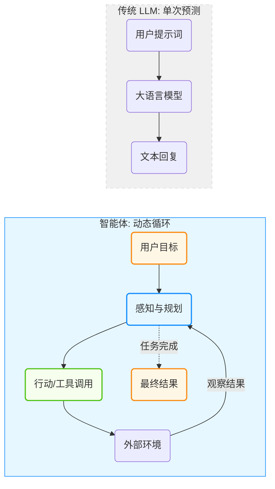
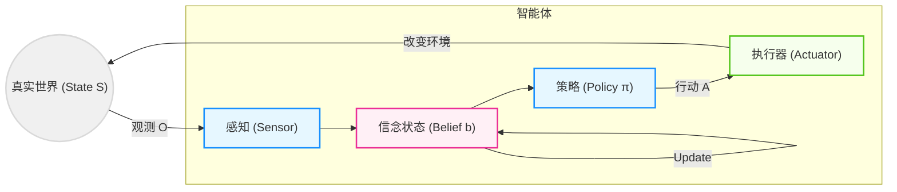
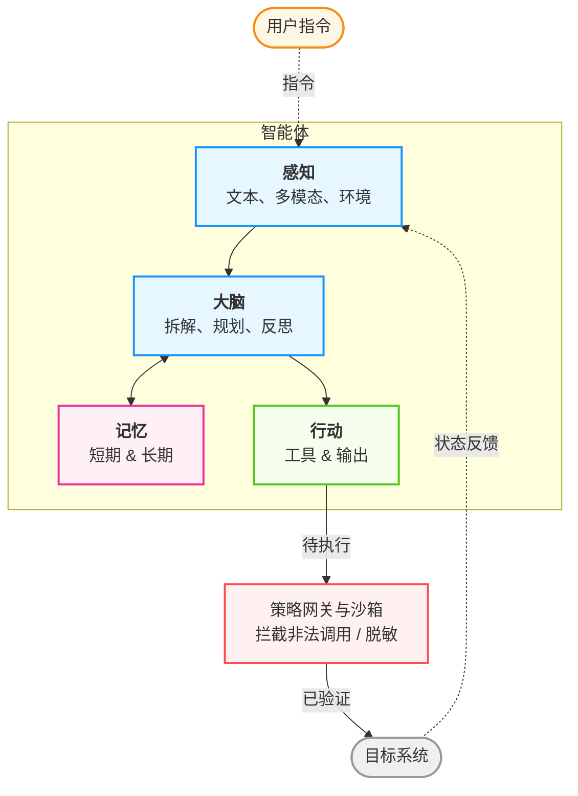
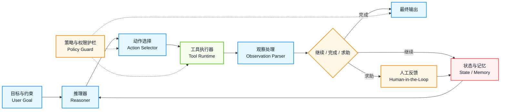

# 第一章 智能体范式革命

> “AI 的未来不仅是聊天机器人回答问题，而是智能体采取行动解决真实问题。”

本章建立智能体的宏观认知框架。你将学习从静态 LLM 向动态自主智能体的演进，理解支撑智能体运行的核心理论模型(PEAS、POMDP)，拆解四大核心组件（大脑、感知、行动、记忆），以及掌握从 L1 到 L5 的认知层级分类。

## 学习目标

完成本章后，你将能够：

1. **理解** 智能体与 LLM 的本质区别
2. **掌握** 智能体的核心理论模型与四大核心组件
3. **评估** 智能体的认知层级与能力边界
4. **应用** 智能体工作流范式优化系统设计

## 章节地图

本章按照“范式转移 → 理论基础 → 核心组件 → 能力分层 → 工作流模式”的顺序展开，先回答“什么是智能体”，再回答“它为什么成立、由什么组成，以及如何落到工程设计”。

---

**下一节**: 1.1 从大模型到智能体

## 1. 从大模型到智能体

本节将深入探讨从 **生成式 AI** 向 **智能体 AI** 的演进过程，并剖析二者的核心差异——即从单纯的“下一个 Token 预测”转向以“目标达成”为导向的能力跃迁。

### 1.1 从生成式 AI 到智能体 AI

在人工智能的发展长河中，正经历着从“生成式 AI (Generative AI)”向“智能体 AI (Agentic AI)”的深刻转型。如果说“聊天机器人”让大众看到大模型的对话能力，那么“智能体”强调的是能够独立完成任务的 **工作助手**。

传统的大语言模型（LLM）像是一个博学的思想家。它阅尽了互联网上的海量文本，拥有关于莎士比亚、量子物理和计算机编程的广博知识。如果不给它工具、执行环境和状态管理，即便是多模态模型，能够理解图像、生成语音，它依然主要停留在“输入-输出”范式里。它能“看”能“说”，但未必能稳定地“做”。

**智能体 AI** 的出现打破了这一僵局。通过赋予 LLM “手”（工具）、“眼”（感知）和“记忆”，将这个思想家变成了一个能够与物理和数字世界互动的实干家。这种范式转移（Paradigm Shift）不仅是技术的升级，更是人机交互模式的根本性变革——不再是命令机器“生成一段文字”，而是授权机器“帮我达成一个目标”。



图 1-1：传统 LLM 与智能体架构对比

### 1.2 核心差异：从“下一个 Token 预测”到“目标达成”

要理解智能体，首先要剖析它与 LLM 的本质区别。

#### 目标导向与概率预测

LLM 的训练目标是极其单一的：根据上文预测下一个词元（Token）的概率分布。当你问它“这种药怎么吃？”时，它并不是为了治好你的病而回答，仅仅是因为在训练数据中，这样的问题通常伴随着说明书式的回答。

相反，**智能体** 是 **目标导向** 的。它内置了一个核心指令（系统提示词）：“你是一个能够解决问题的助手”。当面对任务时，它不急于输出词元 (Token)，而是先思考“为了达成这个目标，我需要获取什么信息？需要执行什么步骤？”。

#### 有状态与无状态

原生的 LLM 是无状态的函数。你的每一次请求对它来说都是全新的，它不记得上一秒发生了什么（除非你把历史对话作为上下文传给它）。

智能体（Agent）维护着持久化的 **状态**。这包括：

* **长期记忆**：记得你上周提到的过敏源。
* **任务状态**：知道“订机票”的任务目前停留在“已搜索航班，等待用户确认”的阶段。
* **环境状态**：知道当前目录下有哪些文件被创建了。

#### 主动循环与单次推理

这是最显著的架构差异。
* **LLM**：输入 A -> 输出 B。线性，一次性。
* **智能体**：处理（目标）-> 思考 -> 行动 -> 观察 -> 思考 -> ... -> 最终结果。这是一个 **循环（Loop）**。智能体会在一个 `while` 循环中不断运行，直到它认为任务完成或达到最大尝试次数。这种“试错-修正”的能力，赋予了智能体解决复杂非线性问题的可能。

#### 不确定的判断与确定的执行

前面三点差异归结起来是：LLM 的输出只是文本，读的人可以不信；智能体的输出会被执行。因此智能体由两部分组成。一部分是 **确定的**：工具代码、权限检查、状态存储、循环控制，给定输入就有确定的结果。另一部分是 **不确定的**：模型对意图的理解、对步骤的规划、对工具和参数的选择，事先无法枚举，同样的输入也可能得到不同的结果。

传统软件只有第一部分，行为都由开发者预先写定，能处理的也只限于开发者想到的情况。智能体的能力恰恰来自第二部分：面对没人写过规则的请求，它也能给出合理的下一步。但同一个性质也带来风险，模型给出的下一步可能是错的，原因有两类：

* **自己出错**：幻觉、误解意图、规划跑偏。即使没有任何攻击者，模型也可能把一个编造的文件路径交给删除工具（1.1.4 节 的“幻觉传递”）。
* **被人操纵**：模型读到的网页、邮件或工具返回里夹带了指令（提示词注入，见 11.1 节）。这一类与采样的随机性无关：即使让模型对同样的输入总是给出同样的输出，它照样会执行夹带的指令，因为指令和数据走的是同一个通道。

两类原因不同，到了执行这一步后果却一样：一个错误的工具调用。只会说话、没有执行权限的模型，最坏是答错一句话；危险来自把不确定的判断直接接到有后果的执行上。

能力和风险既然同源，就不能靠消除不确定性来解决，否则智能体就退化成了普通程序。工程上要做的是给两部分分工：

| | 交给模型（不确定） | 交给代码（确定） |
| :--- | :--- | :--- |
| **回答的问题** | 该做什么、怎么做 | 准不准做、做没做成、何时停止 |
| **典型内容** | 理解意图、规划步骤、选择工具与参数、生成内容 | 权限与审批、参数校验、执行与重试、状态提交、步数与预算上限、审计日志 |
| **出错的表现** | 提出一个错误的请求 | 规则写错或权限给得过宽，与传统软件的缺陷相同 |

一句话：**模型提出请求，代码决定是否执行**。代码的检查不问请求为什么错，不管是幻觉还是注入，删除数据之前都要过同一道闸。分工的另一面是能交给代码的决策就不要交给模型，9.10 节 据此讨论如何选择系统形态；后续章节中的护栏、编排、评测与安全机制，大多是这条边界上的具体做法。

### 1.3 认知升级：系统 1 与系统 2

诺贝尔奖得主丹尼尔·卡尼曼在《思考，快与慢》中提出的双系统理论，完美地映射了 AI 的进化路径。

* **系统 1 (System 1)**：人类的直觉思维，快速、无意识、自动化。
    *   *AI 映射*：**LLM 的直接生成**。当你问“1+1 等于几”或“写一首诗”时，模型不需要深思熟虑，依赖训练数据的统计相关性瞬间生成答案。这既快又充满创造力，但也容易产生幻觉（Hallucination）。

* **系统 2 (System 2)**：人类的逻辑思维，慢速、有意识、费力。
    *   *AI 映射*：**智能体的规划与反思**。当要求 AI “分析这家上市公司过去五年的财报并预测股价”时，直觉（系统 1）是行不通的。AI 需要进入慢思考模式：
        1.  先拆解任务（Decomposition）。
        2.  一步步执行（Reasoning & Acting）。
        3.  检查每一步的结果是否合理（Self-Reflection）。
        4.  如果有误，回退并重试（Error Recovery）。

> **说明**：
> **边界正在模糊**：随着 OpenAI o 系列等推理增强模型（Reasoning Models）的出现，大模型开始在内部原生具备部分“系统 2”的能力（例如更强的多步推理与审慎决策）。但从工程落地视角看，对长周期任务的持久化记忆、异步工具调用管理与兜底审计，依然属于智能体工程框架（外在的“系统 2”）不可替代的职能。

智能体架构实际上是在 LLM 这个强大的“系统 1”外层，用工程手段（上下文工程、记忆系统、工具系统）包裹了一层“系统 2”的逻辑外壳。

#### 为什么现在爆发？

智能体的概念在几十年前的 AI 教科书中就已出现，为何直到近几年才爆发，并进入规模化落地？这源于三大要素的“涌现”：

1. **推理能力的临界点**：
    早期的模型推理与规划能力有限，难以进行有效的任务拆解；随着模型能力提升，**上下文学习（In-context Learning）** 与多步推演变得更可靠，使得“让模型自己写计划”成为可能。

2. **标准化的交互协议**：
    **函数调用（Function Calling / Tool Use）** 的出现是决定性的。随后，MCP 等协议把“模型—工具/数据源”的连接方式进一步标准化；A2A 等协议则把 agent 之间的发现与协作推向更成熟的互操作层，让模型与现实世界的软件系统（计算器、搜索引擎、数据库、其他 agent）更容易打通。

3. **记忆与上下文的扩展**：
    随着 RAG 技术与更长上下文窗口的发展，智能体能够处理海量信息，记住复杂的规则和用户偏好，从而胜任真实场景下的工作。

#### 行业现状：从“玩具”到“生产系统的一部分”

智能体 AI 已经不再只是实验室里的概念验证，而是在许多团队中逐步进入生产。从行业实践来看，智能体使用正在从“演示能力”走向“受治理约束的生产能力”。下面的描述仅用于说明趋势，而不是统一统计结论：

* **从辅助到端到端**：从写脚本、生成代码片段，逐步走向可在约束下执行“规划→执行→复盘”的闭环任务。
* **从单点提效到流程再造**：价值不只在“写得更快”，还在把需求、实现、测试、发布的工作流连起来。
* **从个人工具到组织能力**：当团队开始统一提示词、工具权限、评审与可观测性，智能体才可能稳定进入生产。
* **ROI 取决于治理**：收益通常与安全策略、权限边界、失败兜底、成本监控等工程化投入强相关。

这意味着，软件开发全周期的效率提升正在从“点状提效”走向“系统性提效”。智能体正在重塑我们构建软件的方式。

> **前沿观点：代码形态的演进**
>
> 黄东旭在 QCon 2026 提出，我们正在经历编程语言发明以来同级别的变革。从历史视角看，计算机发展是一部**抽象史**：
>
> - 最初：硬件既是执行载体也是思考载体（机器码）
> - 编程语言时代：代码成为思考载体，硬件成为执行载体（分离）
> - Agent 时代：代码退化为执行载体（与硬件同级），**人类思考媒介转变为 Goal+Context+Constraints**
>
> 这反映了一个深层的范式转变：代码不再是记录“怎么做”的主要手段，而是一种“让机器实现意图”的介质。人的核心工作从“编写代码逻辑”转向“定义目标、提供上下文、设定约束”。

### 1.4 早期智能体的教训

智能体技术的发展并非一帆风顺。2022-2023 年间的早期探索也带来了宝贵的教训：

- **幻觉传递**：模型在工具参数中产生的幻觉会被实际执行，导致不可预期的副作用。例如，将错误的文件路径传给删除工具可能造成数据丢失。
- **无限循环**：早期 ReAct 实现缺乏最大步数限制，智能体陷入“重试-失败-重试”的死循环，消耗大量 Token。
- **上下文爆炸**：每次工具调用的结果都被追加到上下文中，导致 Token 成本呈线性增长，长任务的费用远超预期。
- **错误处理缺失**：当工具返回错误时，早期系统不知道如何优雅降级，往往直接崩溃或产生无意义的输出。

这些教训催生了本书后续章节讨论的护栏机制（第 11.1 节）、可观测性设计（第 9.3 节）和故障模式分析（第 9.6 节）。

### 1.5 关键里程碑

回顾过去几年，可以清晰地看到智能体进化的加速度：

* **早期阶段：Chatbot 元年**
    *   对话式大模型广泛普及，工具使用开始进入大众视野。
    *   AutoGPT 等开源项目展示了由 LLM 自主循环的可能性。

* **架构成型与推理提升**
    * **推理增强模型的出现**：更强的推理与规划能力让复杂任务拆解与多步执行更可靠。
    * **计算机使用能力（Computer Use）**：模型开始能在受控环境下操作 GUI，提高端到端任务闭环能力。
    * **统一连接协议出现**：MCP 等协议开始把模型与工具、资源、提示模板的连接标准化。

* **标准化与生产化**
    * **协议走向工程化**：工具、资源、提示模板等接口开始被规范化，降低跨系统集成成本。
    * **治理层开始独立化**：权限、审计、人工审批和回滚不再只靠 prompt 约束，而开始沉到 host、sandbox 与策略层。

* **生态互操作与扩展**
    * **长上下文与计算机使用能力**：更多模型开始提供更长上下文与更强的工具/计算机操作能力，推动端到端任务成功率提升。
    * **代码专用模型持续演进**：代码能力更强的模型推动“从需求到可运行系统”的自动化程度提升。
    * **互操作性增强**：MCP、A2A 等协议与平台接口的成熟，让生态更易迁移与复用。

### 1.6 核心演进总结

上面的时间线回答了“先发生了什么”，这一节改从架构维度回答“具体变了什么”。四个关键变化分别是连接方式、决策逻辑、安全控制和协作模式：

#### 1. 连接方式：从“自定义 API”到“更标准化的工具连接”

* **早期形态**：开发者需要为每个工具手动编写调用代码（如 `get_weather_api()`）。每增加一个工具，都要写一遍描述、参数格式和错误处理。
* **最新进展**：工具连接方式逐步标准化。
    * **标准化**：工具提供方以更统一的方式暴露资源、工具与提示模板，降低二次开发成本。
    * **动态发现**：智能体不再死记硬背每个 API，而是在运行时发现“你能提供什么数据？格式是什么？权限边界在哪里？”。

#### 2. 决策逻辑：从“简单路由”到“更明确的认知架构”

* **早期形态**：核心逻辑是 **Router（分发器）**。模型根据用户的一句话，在 A、B、C 三个工具中选一个。如果任务涉及多个步骤，模型很容易在中间步骤“断片”，因为它没有长期的记忆和自我修正能力。
* **最新进展**： **认知架构 (Cognitive Architecture)** 借鉴了人类大脑的分工。
    * **慢思考 (System 2)**： 引入了类似“推理增强”的强化学习/蒸馏路线。智能体在调用技能前会先进行“思维链 (CoT)”规划，预演可能的后果。
    * **分层规划**： 顶层负责设定目标（Goal），中层负责拆解策略（Strategy），底层才去触发具体的原子技能。
    * **自我进化**： 智能体拥有“反思内存”，它会记录：“上次用 SQL 技能查表失败是因为没加引号”，下次它会自动规避这个错误。

#### 3. 安全控制：从“Prompt 约束”到“更独立的策略层”

* **早期形态**：靠 System Prompt 叮嘱智能体：“你千万不能删除数据库”。这种“嘴控”防御极易被指令注入 (Prompt Injection) 攻破。
* **最新进展**：引入独立的策略引擎与权限系统。
    * **硬拦截**： 安全规则不在模型里，而在运行环境（Sandbox）里。即便模型“发疯”想删库，策略层会因为其身份（Agent ID）权限不足而直接拦截 API 请求。
    * **零信任架构**： 智能体的每一次技能调用都被视为潜在风险，需要实时校验上下文。例如：智能体只能在“处理财务报表”的上下文中访问财务接口，平时则会被物理隔离。

#### 4. 协作模式：从“单体多技能”到“多智能体 + 编排工作流”

* **早期形态**：试图创造一个“全能智能体”。这导致 Context Window（上下文窗口）被上百个技能描述塞满，模型变得极其迟钝且容易产生幻觉。
* **最新进展**： **多智能体协作 (MAS, Multi-Agent Systems)** 成为主流。
    * **社会化分工**： 任务被分配给“经理智能体”、“文案智能体”和“代码审核智能体”。每个智能体只掌握 3-5 个核心技能，精度极高。
    * **编排工作流**：开发者通过图式工作流等方式定义智能体之间的互动流（如：如果 A 审核不通过，强制退回 B 重写）。这种模式结合了程序的确定性和智能体系统的灵活性。

#### 核心演进总结表

| 维度 | 痛点| 解决方案 | 关键技术词 |
| :--- | :--- | :--- | :--- |
| **集成** | 烟囱式开发，扩展难 | 工业级协议实践，趋向即插即用 | Tool-aware |
| **智商** | 走一步看一步，易出错 | 三思而后行，分层思考 | Reasoning LLM, Reflection |
| **安全** | 容易被“忽悠”，防不住 | 权限隔离，硬性审计 | Policy as Code, Zero Trust |
| **效率** | 臃肿、思维混乱 | 小而美，协同作战 | MAS, State-sharing |

---

**下一节**: 1.2 智能体理论基础

## 2. 智能体理论基础

在动手写代码之前，需要构建坚实的理论地基。为什么给大模型加上“有状态”和“循环”就能变成智能体？其背后的数学和逻辑基础是什么？

本节将从人工智能宏观理论出发，推导出智能体的核心运行机制，并解释这些枯燥的理论是如何映射到现代智能体架构设计中的。

### 2.1 智能体的第一性原理：理性与效用

Stuart Russell 和 Peter Norvig 在 1995 年出版的经典教材《人工智能：一种现代方法》(AIMA) 中定义了 AI 的核心目标：构建 **理性智能体 (Rational Agent)**。

#### 什么是“理性”？

在 AI 理论中，“理性”并不等同于人类的情感理智或全知全能，而是有着严格的数学定义。一个理性智能体是指：**“对于每一个可能的感知序列，根据已知的感知序列和内置的知识，选择能使其预期效用 (Expected Utility) 最大化的行动。”**

这可以用一个简化的决策公式来表示：

$$ a^* = \arg\max_{a \in A} \mathbb{E}[U(s') | s, a] $$

其中：
*   $a^*$ 是最优行动。
*   $s$ 是当前状态，$a$ 是候选行动。
*   $s'$ 是执行行动后可能到达的新状态。
*   $U(s')$ 是新状态的 **效用值 (Utility)**。

#### 从强化学习到大模型智能体

在传统的强化学习 (RL) 中，需要显式地定义 **奖励函数 (Reward Function)** 来计算效用（例如：赢了得 1 分，输了扣 1 分）。

而在 **LLM 智能体** 中，这个“效用函数”发生了有趣的演变：
* **隐式效用**：经过 RLHF（基于人类反馈的强化学习）训练的模型，其内部已经内化了符合人类价值观的效用函数。
* **指令即目标**：系统提示词“你是一个帮助用户写代码的助手”定义了 **当前任务的效用边界**。智能体生成的行动如果符合该人设和目标，就被视为“高效用”。

> **设计启示**：设计智能体的提示词时，本质上是在定义 $U(s)$。如果你的提示词模糊不清，智能体就无法计算出哪个行动 $a$ 能带来最大效用，从而导致行为混乱。

### 2.2 核心循环：从 MDP 到 POMDP

智能体与其环境的交互，在数学上通常被建模为 **马尔可夫决策过程 (MDP)**。但在真实世界应用中，由于智能体的上下文窗口与感知能力存在物理边界，它更准确地是一个 **部分可观测马尔可夫决策过程 (POMDP)**。

#### 限定上下文边界

如果把工作空间设计得毫无约束，智能体会因为需要追踪的状态爆炸（State Explosion）而陷入幻觉与徘徊。优秀的智能体工程，本质上是用约束条件在 POMDP 的混沌中切分出一个“确定的、边界清晰的小型 MDP (Small MDP)”让机器去解：
- 限制它每次只处理当前函数或文件（而非整个仓库的语法树）。
- 通过检索增强（RAG）对客观事实进行投影，大幅降低环境状态的不确定性。

#### 为什么是“部分可观测”？

* **MDP（上帝视角）**：智能体能看到世界的 **全部** 状态。例如下围棋，棋盘上的一切都是公开透明的。
* **POMDP（真实世界）**：智能体只能看到世界的 **一部分**。
    * **例子**：一个编码智能体只能读取它打开的那几个文件，看不到其他文件，也看不到运行时的内存状态。它只能通过 `ls` 或 `read_file` 等工具获得局部观测 (Observation)。

#### “记忆”的理论本质：状态估算

在 POMDP 中，仅凭当前的观测 $O_t$ 是无法决策的。根据观测，智能体可以构建和维护对世界的猜测（即“我认为现在的世界是什么样的”），即 **信念状态 (Belief State)**。



图 1-2：POMDP 中的信念状态更新循环 (Belief State Update Loop in POMDP)

$$ b_t = f(b_{t-1}, a_{t-1}, o_t) $$

*   $b_t$：当前的信念状态。
*   $o_t$：最新的观测。

**具体示例**：假设一个编程智能体正在分析项目依赖：
- **$b_0$（初始信念）**：“我不知道这个项目用什么框架。”
- **$a_0$（行动）**：执行 `read_file("requirements.txt")`
- **$o_1$（观测）**：文件内容显示 `flask==2.0.1, sqlalchemy>=1.4`
- **$b_1$（更新后的信念）**：“这是一个使用 Flask 和 SQLAlchemy 的 Python Web 项目。”

这解释了为什么 **上下文 (Context)** 在智能体系统中如此重要。上下文不仅仅是聊天记录，它是 **信念状态 $b_t$ 的文本化表示**。
*   当智能体把“运行报错信息”加入上下文时，它就在更新它的信念状态（从“代码是完美的”更新为“代码第 5 行有 Bug”）。
* **记忆即状态**：RAG 和长上下文窗口的本质，是帮助智能体在部分可观测的世界中更好地估计信念状态、补足关键上下文，从而降低不确定性，而不是把 POMDP 真正变成简单的 MDP。

### 2.3 决策架构：从反应式到认知式

根据丹尼尔·卡尼曼的《思考，快与慢》，人类思维分为系统 1（快）和系统 2（慢）。如 1.1.3 节「认知升级：系统 1 与系统 2」 所述，这一理论完美地映射了 AI 的进化路径。智能体设计也经历了类似的进化。

#### 反应式架构：Reflex Agent——系统 1

* **原理**：感知 -> 行动。
* **公式**：$Action = Policy(State)$
* **表现**：你问一句，LLM 答一句。没有内部独白，没有思考过程。这是标准 LLM 的默认行为（预测下个 Token）。
* **局限**：无法解决需要多步推理的复杂问题。

#### 认知式/审慎架构：Deliberative Agent——系统 2

* **原理**：感知 -> **构建模型 -> 规划/推理** -> 行动。
* **引入“思考时间”**：在输出行动之前，先进行内部的计算。
* **思维链 (CoT) 的理论意义**：思维链不仅仅是一种提示词技巧，它在理论上通过生成中间 Token，增加了模型用于计算当前问题的 **测试时计算量 (Test-Time Compute)**。
    *   它将 $P(y|x)$ 拆解为 $P(z|x) P(y|x, z)$，其中 $z$ 是中间推理步骤。
    *   通过这种方式，非结构化的推理过程被显式化、结构化了。

### 2.4 环境建模：PEAS 框架的现代演绎

在设计智能体之前，必须先分析它所处的 **环境**。PEAS (Performance, Environment, Actuators, Sensors) 是经典的分析框架，在 LLM 时代依然适用且必要。

| 维度 | 定义 | 现代智能体设计考量 |
| :--- | :--- | :--- |
| **P**erformance |**性能度量**| 也就是“目标函数”。不仅是提示词中的指令，还包括 **量化评估指标**（如代码通过率、API 消耗成本）。**工程落地中，性能度量必须被转化为可自动执行的验收标准 (Acceptance Criteria) 或 CI 卡点阈值（例如：测试通过率 100% 且单次调用 < $0.1），否则无法进行回归优化。** |
| **E**nvironment |**环境**| 决定了架构复杂度。<br>•**完全/部分可观测**：是否需要强记忆模块？<br>•**确定/随机**：工具调用失败是否需要重试机制？<br>•**静态/动态**：智能体思考时环境会变吗（如股票市场）？ |
| **A**ctuators |**执行器**| 智能体的“手”。在 LLM 时代，这就是 **Tools / Function Calling**。所有的输出（文本、JSON、API 请求）都是行动。 |
| **S**ensors |**传感器** | 智能体的“眼”。提示词的输入部分。除了用户文字，还可以是图像（Vision）、LSP 报错信息、网页 DOM 树等。 |

### 2.5 理论到设计的映射

最后，将上述理论概念与现代智能体的工程组件做“近似对应”而不是“严格同构”的映射。它的目的不是声称形式理论已经被工程实现完整等价复刻，而是帮助读者理解：现代 Agent 系统借用了哪些经典 AI 问题设定，以及这些设定在工程里大致落在哪些模块。

| 经典 AI 理论概念 | 现代 LLM 智能体中的近似对应 | 说明 |
| :--- | :--- | :--- |
| **策略函数 Policy $\pi(a\|s)$**|**LLM + 外层控制逻辑** | 给定上下文 $s$，模型生成候选行动；最终能否执行，往往还受 harness、权限与工具路由约束。 |
| **信念状态 Belief State $b_t$**|**Context Window / Memory** | 维护当前对话历史、变量状态、环境观测的文本快照。 |
| **规划 Planning / Search**|**CoT / ReAct / Planner 模块** | 通过中间推理步骤、任务拆解或外部 planner 模块模拟搜索和规划过程。 |
| **感知 Perception $o_t$**|**输入通道与观测编码** | 将多模态信号（视觉、代码、日志）编码为 Token 序列或结构化上下文。 |
| **行动 Action $a_t$**|**Function Calling / Tool Use** | 也就是工具调用。输出结构化请求来触发外部代码执行。 |
| **环境反馈 / 观察更新**|**Tool Outputs / Runtime Feedback** | 工具执行结果、编译器报错、人工反馈等会更新下一轮上下文，但它们不天然等同于强化学习中的标量 reward。 |

---

**下一节**: 1.3 核心组件：大脑、感知、行动与记忆

## 3. 核心组件：大脑、感知、行动与记忆

一个功能完备的智能体，往往需要感知、规划、记忆、行动等相互协作的功能模块。

本书结合最新的工程实践，提出现代智能体的核心架构，主要包括四个部分：
1. **大脑 (Brain)**：负责规划与决策的核心。
2. **感知 (Perception)**：信息的输入与处理。
3. **行动 (Action/Tools)**：与世界交互的接口。
4. **记忆 (Memory)**：经验和知识的存储。



图 1-3：智能体核心组件架构（含可信计算基）

> **注：可信计算基 (Trusted Computing Base, TCB)**
> 这是生产级智能体的必备措施。智能体虽然聪明，但也最容易被攻击和产生幻觉（非完全可信）。因此，在将行动下发至目标系统前，必须经过一层包含硬编码策略引擎、权限校验和沙箱隔离的 TCB 拦截层。

### 3.1 四大核心组件与思考三维框架

本书第 2–4 章详细拆解了上述四个核心组件的工程实现。但从更宏观的层面看，**Agent 时代**需要一个新的思考框架来统一目标、上下文和安全约束的工作。

黄东旭在 QCon 2026 提出，任何 Agent 相关的工作都可以归入以下三个维度：

1. **Goal（目标工程）**
   - Skill：如何定义和表达 Agent 应当掌握的工作流和领域知识
   - 人机交互：如何让用户高效地向 Agent 表达目标意图

2. **Context（上下文工程）**
   - Harness Engineering / Memory：Agent 执行时看到什么
   - RAG（检索增强生成）：如何动态获取相关信息
   - 信息环境：让 Agent 能够准确建立对任务状态的认知

3. **Constraints（约束）**
   - Sandbox：Agent 的执行边界
   - CICD/Lint：确定性检查和自动化验证
   - Agent Infra：运行时的安全、权限和可观测性

这个框架的核心洞察是：**Agent 的能力不只取决于模型的智力，更取决于这三个维度的设计完整性和平衡**。一个初创 Agent 系统可能只需关注目标和基础上下文；但要进入生产环节，约束层的成熟度往往成为瓶颈。

### 3.2 大脑：核心控制器

**大脑** 由大语言模型（LLM）扮演。它是整个系统的 CPU，所有的逻辑推理、指令遵循和决策都在这里发生。

大脑的效能主要取决于两个维度：**静态的角色设定** 决定了它的思维底色，**动态的推理能力** 决定了它的智力上限。

#### 静态维度：角色设定

角色设定可以为一个智能体提供背景信息和行为准则。

* **身份锚定**：“你是一个拥有 10 年经验的资深 Python 架构师，性格严谨，甚至有点强迫症。” 这种设定不仅影响说话语气，甚至能提高代码质量。
* **少样本示例（Few-shot Examples）**：大脑通过 **上下文学习（In-context Learning）** 学习。提供 3-5 个“完美互动的样本”，能让大脑迅速领悟当前的某种特定任务模式。

#### 动态维度：推理能力

推理能力是智能体区别于传统软件的关键。主要包括：

* **任务拆解（Decomposition）**：大脑需要将用户的模糊指令（“做个贪吃蛇游戏”）拆解为原子任务列表（UI 设计、逻辑实现、输入监听）。
* **规划（Planning）**：大脑需要预判步骤的依赖关系。是先查天气还是先订酒店？
* **反思（Reflection）**：这是一个高级功能。大脑会在输出结果前进行自我审视：“我生成的这段代码符合最佳实践吗？”

> **选型提示**：
> * **高能力模型**：适合充当“主脑”，处理复杂的逻辑、规划与反思。
> * **轻量模型**：适合充当“小脑”或“脊髓”，处理分类、摘要、路由等轻任务，成本更低。

### 3.3 感知：智能体的感官

感知模块负责将环境中的 **非结构化信息** 转化为大脑可以理解的 **结构化信号**（通常是文本或嵌入）。

#### 基础感知：文本输入

这是最基础的。包括用户的指令、API 返回的 JSON 数据、错误日志。

#### 高级感知：多模态

现代智能体正在长出眼睛和耳朵。

* **视觉 (Vision)**：利用具备视觉能力的多模态模型，智能体可以“看”懂网页内容与界面元素，甚至从截图中定位按钮与表单。
* **听觉 (Audio)**：通过语音识别模型，智能体可以接入电话或会议系统，实时转录语音并做出回应。

#### 深度感知：环境状态

对于编程智能体，感知不仅仅是看，还包括对环境的深度读取：

*   读取 IDE 当前打开的文件路径。
*   通过 `git diff` 感知代码变更。
*   通过 LSP (Language Server Protocol) 感知代码中的语法错误红线。

### 3.4 行动：手与工具

没有工具的智能体只是一个只会聊天的缸中之脑。**行动空间（Action Space）** 定义了智能体的能力边界。智能体通过工具与外部系统交互，包括信息检索、代码执行、文件操作、系统命令等。这些工具让模型能够突破知识截止、获取实时数据、执行可靠的计算，并对真实世界产生影响。

工具使用的完整机制、类型分类与实现细节详见第四章：工具使用与环境交互。

### 3.5 记忆：经验的载体

LLM 本身是无状态的，**上下文窗口 (Context Window)** 是昂贵且有限的。**记忆模块** 旨在解决“健忘”问题。

#### 感觉记忆

即原始的输入流。所有的用户提示词、系统消息最开始都存储在这里。

#### 短期记忆

映射为 LLM 的 **上下文窗口**。
*   它存放当前正在进行的对话历史。
*   它就像计算机的 **RAM**，存取速度快，但断电（会话结束）即失。
* **受限**：即便一些模型支持更长的上下文窗口，塞入太多无关信息仍会降低推理精度（**中间丢失 Lost in the Middle** 现象）。

#### 长期记忆

长期记忆通常可以映射为 **向量数据库 (Vector DB)** 或外部存储。
*   它就像计算机的 **硬盘**。
* **检索增强生成 (RAG)**：当记忆太多放不下 **上下文** 时，智能体会先在向量库中检索与当前问题最相关的几条片段，只把这几条“回忆”加载到短期记忆中。
* **经验积累**：智能体可以将成功的案例总结成经验存入长期记忆，下次遇到类似问题时，表现会更好。

详见第三章：记忆系统架构。

---

**下一节**: 1.4 智能体的认知层级

## 4. 智能体的认知层级

智能体的能力并非二元对立（有或无），而是一个连续的光谱。为了更好地指导架构设计，本节给出一个**教学用分层模型**：它主要按“单体系统通常承担的能力复杂度”来组织讨论，而不是声称所有智能体都会沿着同一条单向路径从 L1 进化到 L5。长期记忆、多智能体协作和自我改写等能力，在真实系统中常常是正交设计维度。

### 4.1 认知层级模型

将智能体从“聊天”到“群体进化”的能力演进定义为以下五个层级：

#### Level 1: 辅助型

这一层级的智能体仅具备基础的信息处理能力，无法主动干预外部世界，本质上是 **“对话辅助者” (Chat Assistant)**。

-   **核心能力**：自然语言理解、知识检索 (RAG)、文本生成。
-   **行为模式**：用户提问 → 检索知识 → 生成回答。
-   **状态**：具备短期记忆（上下文），但通常是无状态的（Session 结束后不仅不记得你，也没改变世界）。
-   **典型应用**：通用对话助手、问答型助手、客服机器人，如 ChatGPT。
-   **价值**：信息获取效率提升。

#### Level 2: 执行型

这一层级的智能体能够主动调用外部工具来解决复杂任务，具备初步的行动力，本质上是 **“工具使用者” (Tool User)**。

-   **核心能力**：**任务拆解 (Decomposition)**、**工具使用 (Tool Use)**、逻辑推理。
-   **行为模式**：用户下指令 → 拆解步骤 → 调用 API/代码 → 反馈结果。
-   **关键跃迁**：从“说”变成了“做”。它开始具有 **行动力 (Agency)**，能改变环境状态（如写文件、发邮件）。
-   **典型应用**：具备工具调用能力的智能体、代码解释器式环境，如 Codex、Claude Code。
-   **价值**：自动化执行特定任务。

#### Level 3: 自主型

这一层级的智能体开始具备初步的“人格”和学习能力，本质上是 **“学习者” (Learner)**。

-   **核心能力**：**长期记忆 (Long-term Memory)**、**自我反思 (Self-Reflection)**、错误修正。
-   **行为模式**：执行失败 → 分析原因 → 调整策略 → 重试 → 记录经验。
-   **关键跃迁**：从“被动执行”变成“主动优化”。它能在没有人类干预的情况下，通过试错来解决未见过的难题。
-   **典型应用**：具备长期记忆与复盘能力的个人助理原型，例如带持久记忆与回顾机制的个人智能体系统。
-   **价值**：处理非确定性的复杂问题，减少人类监督成本。

#### Level 4: 进化型 [研究阶段]

这一层级的智能体具备改进自身的能力，本质上是 **“创造者” (Creator)**。

-   **核心能力**：**自我编程 (Self-Coding)**、自动化提示词工程 (APE)、权重微调。
-   **行为模式**：发现能力短板 → 编写新工具代码/优化 System Prompt → 热更新 → 能力增强。
-   **关键跃迁**：从“固定能力”变成“无限成长”。它能创造出开发者最初没有赋予它的技能。
-   **典型应用**：Voyager（在 Minecraft 中通过代码技能持续探索和积累能力）等能够在环境中持续试错与积累技能的探索型智能体原型。

#### Level 5: 群体型 [研究阶段]

这一层级超越了个体，关注社会化网络连接，本质上是 **“社会网络” (Social Network)**。

-   **核心能力**：**多智能体协作 (Multi-Agent Collaboration)**、社会模拟、去中心化共识。
-   **行为模式**：组队 → 角色分工 → 冲突协商 → 共同决策 → 完成宏大目标。
-   **关键跃迁**：从“个体智能”变成“集体智能”。涌现出单一智能体无法具备的复杂行为。
-   **典型应用**：斯坦福小镇（Generative Agents）、ChatDev（虚拟软件公司）等；以及虚拟社交网络类研究原型。
-   **价值**：模拟复杂社会网络系统，解决超大规模工程问题。

| 层级 | 定位 | 核心特征 (Key Logic) | 人类对标 (Analogy) | 常见实现要素 |
| :--- | :--- | :--- | :--- | :--- |
| **L1**|**助理** | Talk（对话）| 图书馆员 | RAG, 提示词工程 |
| **L2**|**工人** | Do（执行）| 实习生 | ReAct, Tool Use, CoT |
| **L3**|**自主** | Learn（学习）| 工程师 | 向量数据库 (Memory), Reflexion |
| **L4**|**进化** | Evolve（进化）| 科学家/极客 | Self-Coding, APE |
| **L5**|**群体** | Connect（连接）| 公司/社会 | 多智能体框架, SOP |

### 4.2 设计启示

在实际应用中要根据具体需求来选择合适的智能体，**不要盲目追求高层级**。层级越高，成本越高，延迟往往越大。更重要的是：这个模型强调的是“系统承担任务复杂度”的大致分层，而不是说所有高阶能力都必须叠加在同一个系统里。

1. **L1 足够好**：如果你只是做知识库问答，不要引入 L2 的工具调用，那会增加幻觉风险。
2. **L2 是基石**：大多数企业级应用（如数据分析、运维助手）应稳定在 L2，确保执行的确定性。
3. **L3 慎用**：在需要极高可靠性的场景（如金融交易），L3 的自我反思和自动重试可能导致不可预期的副作用。
4. **L4/L5 是未来**：目前主要处于实验和科研阶段，或者是特定领域的（如游戏、软件开发）封闭沙箱中。

> ⚠️ **生产成熟度提示**：L1-L3 已有生产部署案例，而 L4（自我编程）和 L5（社会网络）目前仍主要处于研究原型阶段，落地时需审慎评估。

---

**下一节**: 1.5 智能体工作流

## 5. 智能体工作流

智能体工作流（Agentic Workflow）是一类重要的 AI 应用范式。与传统的单次推理不同，它强调将 AI 能力组织成可控、可观测、可迭代的工作流程。

### 5.1 什么是智能体工作流

智能体工作流是一种让 AI 系统以 **迭代、自主、目标导向** 的方式完成复杂任务的工作模式。**核心特征**：

- **迭代式执行**：不是一次生成最终答案，而是多步骤逐渐逼近目标
- **自主决策**：AI 自主决定下一步行动，而非完全由用户控制
- **工具集成**：无缝调用外部工具和服务
- **状态管理**：维护执行过程中的中间状态

### 5.2 与传统提示词模式的区别

| 维度 | **传统提示词**|**智能体工作流** |
|------|-------------|------------------|
| 交互模式 | 单次请求-响应 | 多轮迭代执行 |
| 控制权 | 用户完全控制 | AI 自主决策 |
| 执行时间 | 毫秒～秒级 | 秒级～分钟级 |
| 能力边界 | 模型内在知识 | 工具扩展后的能力 |
| 结果质量 | 依赖 **提示词** 质量 | 可通过迭代改进 |

### 5.3 典型的智能体工作流模式

根据所处理任务的特点，典型的智能体工作流模式包括：`规划-执行模式`、`ReAct 模式`、`反思-改进模式`、`层级协作模式` 等。

先看一个总览图，可以把这四类模式放在同一坐标系里理解：它们的差异不在“会不会调用模型”，而在“如何组织决策、反馈与角色分工”。


图 1-4：典型智能体工作流模式总览

#### 规划-执行模式

智能体会先制定完整计划，然后逐步执行，直到达到目标。这个模式通常用于结构化任务、可预测的工作流程。

```text
用户目标
    ↓
[规划阶段] 生成任务步骤列表
    ↓
[执行阶段] 逐步执行每个步骤
    ↓
最终结果
```

**适用场景**：结构化任务、可预测的工作流程

#### ReAct 模式

ReAct（Reasoning + Acting）是推理和行动交替进行的模式。智能体在“思考”和“行动”之间交替，根据观察结果动态调整策略，直到达到目标。这种循环使智能体能够在不确定的环境中逐步逼近解决方案。

ReAct 模式的完整理论、代码示例与提示词模板详见第 2.3 节：ReAct：推理与行动的统一。

**适用场景**：探索性任务、需要动态调整的场景

#### 反思-改进模式

智能体会在执行后进行自我评估和改进，这个模式通常用于需要质量把控的任务。

```text
初始方案 → 执行 → 评估结果 → 反思问题 → 改进方案 → 重新执行
```

**适用场景**：代码编写、内容创作等需要质量把控的任务

#### 多智能体协作模式

多个专业化智能体分别担任不同角色，协同完成任务。这个模式通常用于复杂项目、需要多种专业技能的任务。

```text
用户需求
    ↓
[协调者智能体] 分配任务
    ↓
[研究智能体] ←→ [写作智能体] ←→ [审核智能体]
    ↓
整合输出
```

**适用场景**：复杂项目、需要多种专业技能的任务

### 5.4 实践案例

以下是几个典型的智能体工作流应用案例，展示了上述模式在实际产品中的落地。前 3 个案例用于说明“产品形态如何对应工作流模式”，后 2 个案例则用于说明企业实践中常见的治理与落地权衡。除非特别注明来源，下面的企业案例都只作为示意性场景，不应理解为可审计的行业统计。

#### 案例一：交互式产物视图

一些交互式界面会将“产物”与“对话”并列呈现，常见地采用 **反思-改进模式**：先生成一个可见的中间结果，再围绕这个结果反复修订。

- **即时预览**：生成代码后立即渲染展示
- **迭代改进**：用户可以要求修改，智能体理解上下文逐步完善
- **工具集成**：支持 HTML/CSS/JS、React、Mermaid 图表等

#### 案例二：AI 原生 IDE

现代 AI IDE 的代码编辑工作流常结合 **规划-执行模式** 与 **反思-改进模式**：先理解代码库和修改范围，再逐步编辑并在验证失败时回退或修正。

```text
1. 用户描述需求
2. 智能体分析代码库
3. 生成修改计划
4. 逐文件编辑
5. 自动验证（运行测试、检查类型）
6. 必要时自动修复问题
```

#### 案例三：自主软件开发智能体

自主软件开发智能体常综合运用 **ReAct** 模式和 **多智能体协作** 模式：既要在不确定环境中动态决策，也要把计划、实现、测试拆给不同角色。

- 完整的开发环境访问
- 自主执行 git 操作
- 运行测试并修复问题
- 与用户进行异步协作

#### 案例四：企业级智能体生产流程

一个更可信的企业级示意场景是：金融科技团队采用 **层级协作模式** 自动化研报生成与审查。规划智能体拆解结构，多个撰写智能体并行编写，审查智能体基于 RAG 验证合规性。其核心经验通常不是“速度提升了多少”这类脱离上下文的统一数字，而是两点：第一，防止模型幻觉需要强制工具验证；第二，通过分层智能体可以更清楚地切换成本、质量与审核强度的权衡。

#### 案例五：跨国软件团队的协作案例

另一个常见示意场景是：SaaS 团队用多智能体工作流（计划→执行→测试）加速跨时区的需求→代码→测试流程。通过 RAG 检索内部知识库确保方案合规，并在关键节点保留人工审批。它真正改善的往往是“等待成本”和“交接摩擦”，而不是某个可以脱离组织背景单独比较的统一 ROI 数字。

### 5.5 实现智能体工作流的关键要素

无论采用哪一种工作流模式，真正决定系统是否能稳定落地的，通常不是“提示词是否聪明”，而是状态、控制流与人机交互点有没有被显式设计出来。下面按这三个要素展开。

从工程视角看，这些要素通常会收敛到一个标准的 agent loop：推理器根据目标与状态选择动作，工具执行器与观察处理器持续更新记忆，策略护栏和人工反馈则在关键节点把循环拉回可控边界。



图 1-5：标准智能体循环的核心组件

#### 状态管理

以下示例展示一个可跟踪目标、计划、记忆和工具结果的最小状态结构：

```python
class AgentState:
    goal: str                    # 最终目标
    current_step: int            # 当前步骤
    plan: List[str]              # 执行计划
    memory: List[Message]        # 对话历史
    tool_results: Dict           # 工具调用结果
    errors: List[str]            # 错误记录
```

#### 控制流

- **循环机制**：直到达成目标或超时
- **分支判断**：根据中间结果调整路径
- **错误处理**：失败时的重试或回退策略
- **终止条件**：明确的完成标准

#### 人机交互点

- **审批节点**：关键操作前询问用户
- **信息补充**：缺少必要信息时请求输入
- **进度反馈**：实时展示执行状态

### 5.6 最佳实践

把工作流真正搬进生产环境时，需要同时考虑“应当鼓励什么”与“必须限制什么”。下面的建议和禁止项可以看作工作流设计的最小护栏。

#### 建议 ✅

- **设置明确的终止条件**：避免无限循环
- **实现渐进式披露**：先执行低风险操作
- **提供取消机制**：用户可随时中断
- **记录完整轨迹**：便于调试和审计

#### 禁止 ❌

- **不要过度自主**：重大决策应询问用户
- **不要忽略错误**：每个失败都应该被处理
- **不要无限重试**：设置最大尝试次数
- **不要隐藏过程**：透明度建立信任

---

**下一节**: [本章小结](summary.md)
