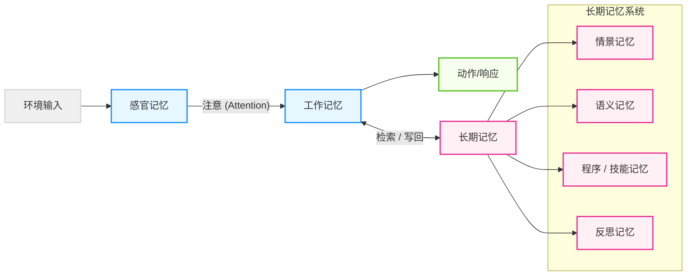
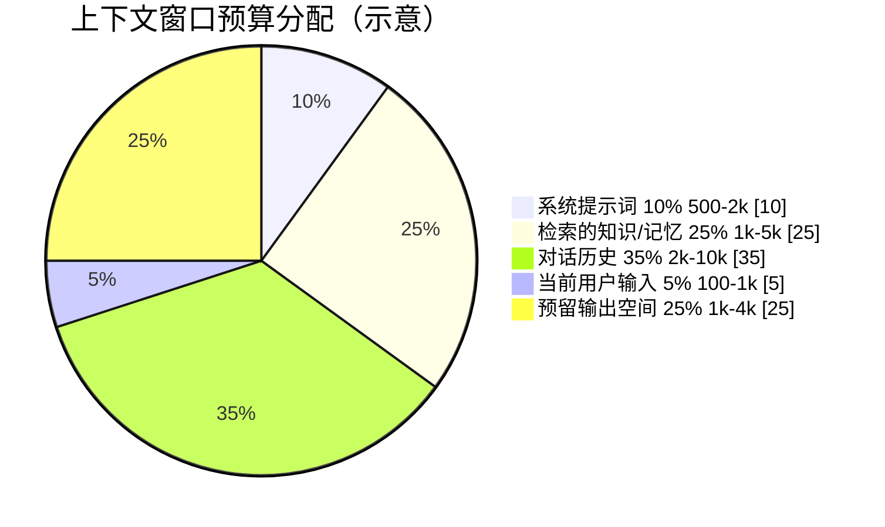
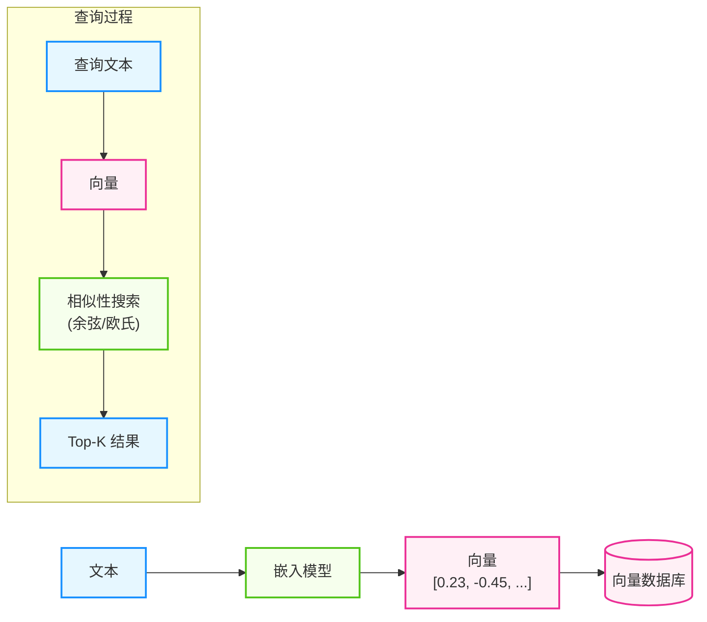
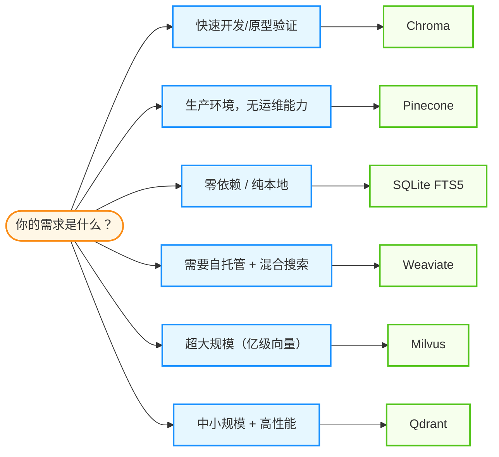
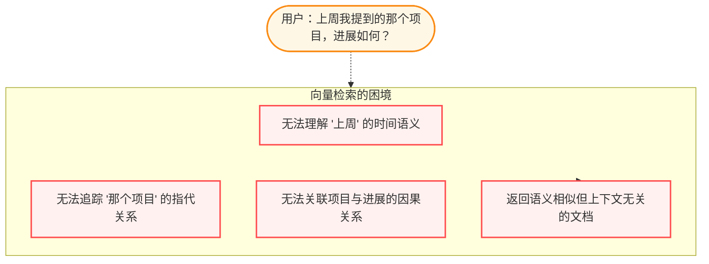
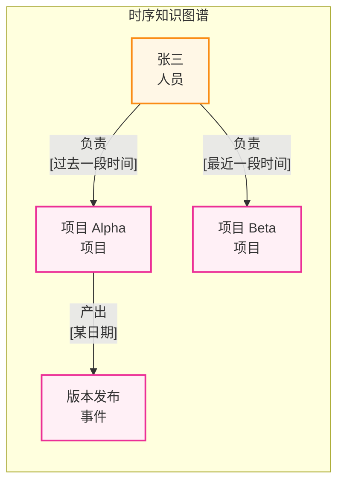
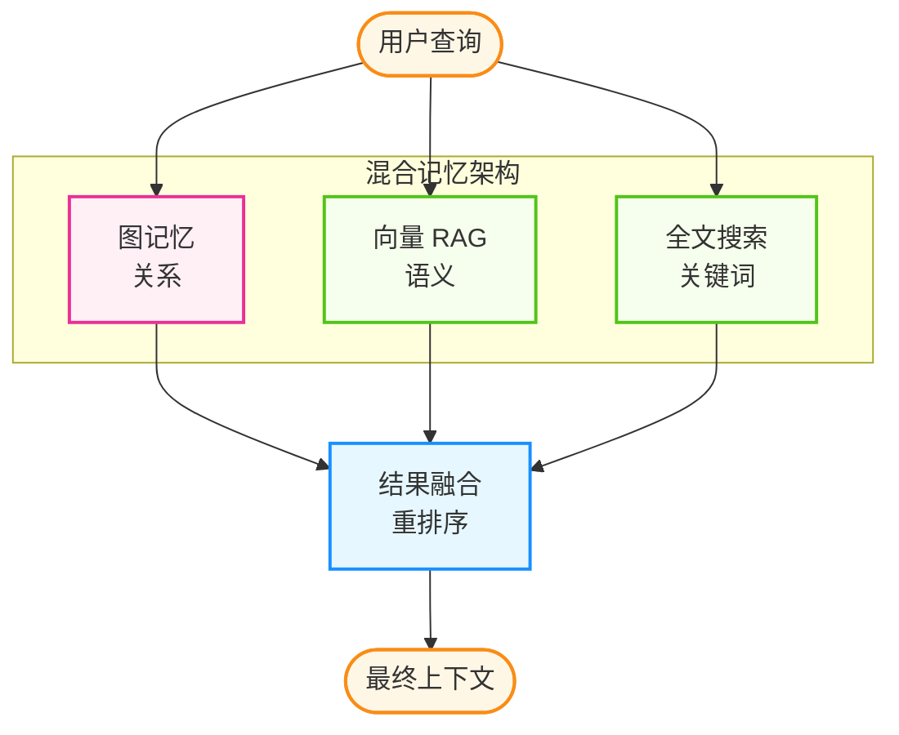
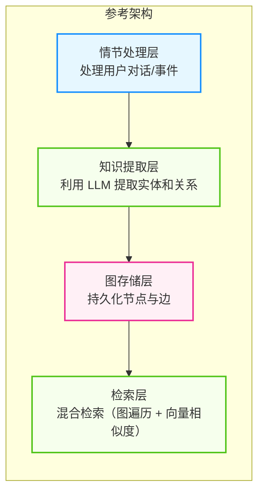

# 第三章 记忆系统与上下文工程

记忆不是单一的“向量数据库”问题，而是一个从认知模型、工作记忆管理、长期记忆存储，到检索组织与上下文编排的系统工程。本章的核心路径更适合理解为：先分清“模型内部记住了什么”和“系统外部该保存什么”，再决定哪些信息应留在上下文窗口里、哪些信息应写入长期记忆、写入后又该如何检索、更新和组织，最后回到完整的上下文工程与案例分析。

## 学习目标

完成本章后，你将能够：

1. **理解** 记忆系统的认知模型与设计原则
2. **选择** 适合项目需求的向量数据库方案
3. **设计** 面向长期记忆的检索、更新与图结构方案
4. **统筹** 上下文窗口、长期记忆与安全约束之间的取舍

## 章节地图

本章按照“认知模型 → 工作记忆 → 长期记忆 → 检索结构 → 上下文工程”的顺序展开，但这些内容并不是一条简单的流水线，而是同一套 Agent 记忆系统里的相互制约层：

- [3.1 记忆的认知模型](3.1_memory_models.md)：先回答“什么才算记忆”，建立参数记忆、非参数记忆与多层记忆架构的基本框架
- [3.2 短期记忆管理](3.2_short_term_memory.md)：聚焦上下文窗口这一工作记忆层，讨论预算、裁剪、摘要与动态分配
- [3.3 长期记忆与向量数据库](3.3_vector_databases.md)：讨论长期记忆的存储底座，以及向量数据库的选型与边界
- [3.4 Agent 中的 RAG 系统设计](3.4_rag_advanced.md)：把“能存”推进到“能取、能评、能和任务协同”
- [3.5 图记忆与知识图谱](3.5_graph_memory.md)：补上向量相似度难以表达的关系、时序与结构约束
- [3.6 上下文工程](3.6_context_engineering.md)：把窗口、记忆、工具与安全要求整合成统一系统；文末继续用案例研究收束本章

---

**下一节**: [3.1 记忆的认知模型](3.1_memory_models.md)

## 1. 记忆的认知模型

在设计智能体（Agent）之前，需要先回答一个根本性问题：**智能体的“记忆”到底是什么？**

如果不理解记忆的本质，很容易陷入“把所有东西都塞进向量数据库”的误区。本节先从认知科学视角拆出不同记忆层，再给出这些层在 Agent 设计里的含义，为后续“窗口管理、长期存储、检索与上下文工程”建立共同语言。

### 1.1 参数记忆与非参数记忆

首先，需要区分两种最基础的记忆形态：

#### 1. 参数记忆

这是模型 **内部** 的记忆，存储在神经网络的权重（Weights）中。
* **类比**：人类的 **本能** 与 **潜意识知识**。
* **特点**：
    * **难以修改**：需要昂贵的训练（Training）或微调（Fine-tuning）才能更新。
    * **模糊**：信息被压缩为概率分布，容易产生“幻觉”（Hallucination）。
    * **静态**：截止于训练结束的那一刻（Knowledge Cutoff）。

#### 2. 非参数记忆

这是模型 **外部** 的记忆，通常以文本、向量或结构化数据的形式存在。
* **类比**：人类的 **笔记**、**书本** 或 **外脑**。
* **特点**：
    * **易通过检索获取**：通过 RAG（检索增强生成）或工具调用即时读取。
    * **精确**：可以逐字逐句地引用原始记录。
    * **动态**：可以随时插入、更新或删除。

> **Agent 的核心**：智能体系统的本质，就是构建一个强大的 **非参数记忆系统**，以弥补大模型参数记忆的滞后性和不准确性。

---

### 1.2 认知架构：从 Atkinson-Shiffrin 到现代智能体

受 1968 年 Atkinson-Shiffrin 的多重存储模型（Multi-Store Model）启发，现代智能体的记忆架构通常被划分为三个层级：感官记忆、工作记忆、长期记忆。



图 3-1：Atkinson-Shiffrin 多重存储模型

#### 1. 感官记忆

* **定义**：原始输入的瞬时缓冲区。
* **Agent 映射**：
    *   用户输入的原始提示词。
    *   多模态输入（图片像素、音频波形）。
    *   API 返回的原始 JSON 数据。
* **特点**：容量大但衰减极快。如果不被“注意”（写入上下文窗口），就会立即消失。

#### 2. 工作记忆

* **定义**：当前正在 **活跃处理** 的信息及其推理过程。这不仅仅是“短期记忆”，更强调 **加工**（Processing）能力。
* **Agent 映射**：**上下文窗口 (Context Window)**。
* **关键组件**：
    * **语音回路 (Phonological Loop)**：对应的对话历史（Chat History）。
    * **视觉空间画板 (Visuo-Spatial Sketchpad)**：对应的多模态输入处理。
    * **中央执行系统 (Central Executive)**：对应的 **CoT (Chain of Thought)** 推理过程。
* **限制**：虽然一些模型已支持更长的上下文窗口，但“注意力稀释”（Lost in the Middle）现象依然存在——窗口越大，推理精度越低。

#### 3. 长期记忆

这是 Agent 区别于普通 Chatbot 的关键。它分为四类：

| 记忆类型 | 定义 | 人类例子 | Agent 映射 | 存储介质 |
| :--- | :--- | :--- | :--- | :--- |
| **情景** | 个人经历的序列记录 | “我昨天吃了寿司” | 对话日志、交互历史 | 向量数据库 (Vector DB) |
| **语义** | 事实与世界知识 | “寿司是日本食物” | 领域文档、百科知识 | 知识图谱 (Knowledge Graph) / RAG |
| **程序** | 执行任务的技能 | “如何骑自行车” | 工具 (Tools)、代码解释器 | 函数定义 (Function Schemas) |
| **反思** | 元认知与经验教训 | “我不该空腹吃生鲜” | 优化后的 Prompt、SOP 改进 (e.g., `.cursor/rules`) | 提示词库 / 元数据存储 |

> **补充：反思记忆**
> 许多架构忽略了这一点。反思记忆是智能体 **自我进化** 的关键。当 Agent 犯错并修正后，它应该将“教训”存储下来（例如：“查询 SQL 时对于日期字段必须加引号”）。下次遇到类似任务时，先检索“经验教训”，而非重蹈覆辙。该机制与第 2 章的反思框架紧密协作。

到这里，可以先抓住一个简化判断：**感官记忆决定输入如何进入系统，工作记忆决定模型此刻能处理什么，长期记忆决定系统跨轮次保留什么。** 后面章节并不是重复这套分类，而是分别回答三个工程问题：工作记忆怎么管、长期记忆怎么存、存下来以后怎样在任务里被正确召回和使用。

---

### 1.3 从认知模型到系统设计

认知模型的价值，不在于做一张“术语对照表”，而在于帮助我们明确每一层真正要解决的问题：

| 认知组件 | 在 Agent 中真正要解决的问题 | 后续对应章节 |
| :--- | :--- | :--- |
| **工作记忆** | 当前轮次哪些信息必须进入上下文窗口，哪些应被裁剪、压缩或延后使用 | 3.2、3.6 |
| **情景记忆** | 交互经历如何跨会话保留，并在需要时按时间与语境被召回 | 3.3、3.4 |
| **语义记忆** | 稳定事实与知识关系如何被组织，而不只是按语义相似度堆叠 | 3.4、3.5 |
| **程序记忆** | “会做事的方法”如何沉淀为工具、技能或稳定流程 | 3.6 及后续工具章节 |
| **反思记忆** | 错误与经验如何转化为下次可执行的约束和规则 | 3.6，并与第 2 章联动 |

这里先建立问题框架，不急着进入具体实现。比如“窗口怎么压缩”属于 3.2，“长期记忆的存储底座怎么选”属于 3.3，“检索与图结构如何组织”属于 3.4 和 3.5，“怎样把记忆、工具、提示词和安全约束合成一个系统”则属于 3.6。

---

### 1.4 理论启发：从检索评分到分层记忆

#### 斯坦福小镇：Generative Agents

在论文 [Generative Agents: Interactive Simulacra of Human Behavior](https://arxiv.org/abs/2304.03442) 中，研究人员提出了记忆检索的三条核心经验打分法则：
1. **近期性 (Recency)**：刚发生的事情权重更高。
2. **重要性 (Importance)**：对智能体目标影响大的事情权重更高（例如“结婚”与“吃早饭”）。
3. **相关性 (Relevance)**：与当前上下文语义相似度高的事情权重更高。

$$Score = \alpha \cdot Recency + \beta \cdot Importance + \gamma \cdot Relevance$$

#### MemGPT: 操作系统隐喻

论文 [MemGPT: Towards LLMs as Operating Systems](https://arxiv.org/abs/2310.08560) 借用了操作系统“虚拟内存”的思路来管理智能体的记忆。这里要注意时间线口径：Letta 公司于 **2024-09-23** 从隐身状态启动，整合了 MemGPT 研究项目，后续 MemGPT 开源包和 Docker 镜像已改名为 letta。更稳妥的表述是：**MemGPT 是关键研究原型与架构隐喻，Letta 是沿这一路线继续演化的状态化智能体框架/平台。**

这个隐喻把记忆分成两层：

* **主上下文（类似内存）**：即 LLM 当前能直接看到的上下文窗口，容量有限、推理成本高。
* **外部存储（类似硬盘）**：向量库或文档库，容量几乎不受限，但需要额外检索才能使用。
* **分页调度**：由一个调度模块（Orchestrator）决定哪些记忆片段需要从外部存储“换入”上下文窗口，哪些已不再需要的信息可以“换出”腾出空间。

> **⚠️ 能力边界提示**：MemGPT 解决的是“虚拟上下文管理与分页调度”的问题，它在物理有限窗口内智能换入换出数据，**并非** 让大模型拥有真正的“无限上下文推理能力”。避免在工程决策时产生“接入即可无损读取整库文档”的能力误解。

---

### 1.5 案例：用户偏好记忆机制

不少产品形态会加入“用户偏好记忆”（Preference Memory）：不只存对话日志，还会抽取用户的 **偏好** 与 **背景上下文**，以减少重复指令并提升体验。

这类案例之所以值得单独讨论，是因为它把“长期记忆”从抽象概念拉回了一个很实际的问题：**系统到底应该记住哪些用户事实，又该如何处理这些事实随时间变化的状态？** 这仍然是认知模型层的问题；具体实现细节会在后文展开。

**核心机制**：它不是 RAG 那样的“查文档”，而是维护一个动态更新的 **Profile**：

```json
{
  "user_profile": {
    "coding_style": "Prefer TypeScript over JavaScript, use strict types",
    "role": "Frontend Architect",
    "project_context": "Working on a Next.js 15 dashboard"
  }
}
```

当用户说：“别用 `any`！”，系统会更新 Profile：“User dislikes `any` types”。
这种机制极大地减少了重复指令（Repetitive Prompting），是提升用户体验的低成本高收益手段。

然而，简单的 Profile 存储只是起点。更深层的问题是：**当用户状态随时间变化时，系统如何处理事实冲突与信息过期？**

#### 从“存原文”到“抽事实 + 管状态”

传统做法是将对话原文直接存入向量数据库，检索时靠语义相似度召回。这种方式有一个结构性缺陷：**旧事实和新事实会被同时召回，系统无法判断哪个应该失效**。

例如，用户三个月前说“我住在纽约”，上周说“我刚搬到旧金山”。纯向量检索在回答“用户住在哪里”时，两条记录的语义相似度几乎相同，系统无法自动判断后者覆盖了前者。

因此，很多长期记忆系统会把记忆重新定义为 **持续状态维护**（Continuous State Maintenance），而非被动存储。核心做法包括：

1. **事实抽取**（Fact Extraction）：不存原始对话，而是从对话中自动抽取结构化事实
2. **时间推理**（Temporal Reasoning）：理解事实的时间属性，判断新旧事实的覆盖关系
3. **冲突消解**（Contradiction Resolution）：当检测到矛盾时，自动用新事实替换旧事实
4. **自动遗忘**（Automatic Forgetting）：主动淘汰过期或不再相关的信息，而非无限累积

这些机制也是近年公开记忆评测反复考察的难点：跨会话推理、多跳关联、时间推理、知识更新和偏好学习。需要注意口径的是，**ConvoMem（发布于 2025-11-13，arXiv:2511.10523）更适合被表述为 75,336 QA 对的大规模记忆基准**，而不是已经定型的行业“官方标准”或某个成熟产品能力清单。

#### 用户画像的分层设计

在偏好记忆的基础上，更成熟的做法是将用户画像拆分为 **静态层** 和 **动态层**：

- **静态画像**（`profile.static`）：长期稳定的事实，如职业、技术栈偏好、语言习惯。更新频率低，查询权重高。
- **动态画像**（`profile.dynamic`）：近期上下文状态，如当前项目、最近关注的话题、临时偏好。更新频率高，有衰减机制。

这种分层的意义在于：个性化任务中最常见的错误不是“检索不到”，而是 **系统不知道哪些信息是长期偏好、哪些只是临时状态**。将两者混在同一层，会导致临时状态污染长期偏好，或者长期偏好被近期行为淹没。

> **设计启示**：记忆系统的核心不在于“检索更强”，而在于 **任务定义是否准确**。多数系统默认优化语义相似度，但长期记忆场景需要优化的是更新正确性、时间正确性、冲突消解和噪声抑制。目标函数的选择，往往比检索算法的选择更能决定系统效果。

当系统进一步要求“同时理解用户偏好”和“引用外部知识”时，就会自然过渡到后文的 RAG、图记忆与上下文工程问题：不仅要知道**记住什么**，还要知道**什么时候取、取多少、如何与当前任务拼接**。

---

**下一节**: [3.2 短期记忆管理](3.2_short_term_memory.md) 将深入探讨如何高效管理昂贵的上下文窗口。

## 2. 短期记忆管理

大语言模型的上下文窗口是有限的资源。如何在有限的窗口中放入最有价值的信息，是构建高效智能体的关键挑战。

### 2.1 概述

短期记忆通常对应于大模型的 **上下文窗口**。虽然一些模型已支持更长的上下文窗口，但高效的窗口管理算法仍然是构建生产级智能体的关键，主要基于以下三个因素：

1. **成本控制 (Cost)**：长窗口的 Token 费用是线性的，但在高并发场景下，每次请求都带上完整的历史记录会导致总体成本快速上升。
2. **延迟 (Latency)**：首字生成延迟（TTFT）与输入 Token 数成正比。过长的上下文会显著降低交互的实时性。
3. **注意力稀释 (Attention/Recall)**：随着上下文长度增加，模型对中间信息的检索能力（Recall）会下降（即 “Lost in the Middle” 现象），导致指令遵循能力变弱。

### 2.2 上下文限制（实践视角）

不同模型/平台的上下文上限差异很大，而且会随着版本更新而变化。工程上更建议把“上下文上限”当成一个可配置参数，并在运行时做预算与降级策略：

- **把上限当配置**：在模型配置中维护 `max_input_tokens` / `max_output_tokens`。
- **预留输出空间**：避免把输入塞满导致模型没有空间输出。
- **做降级策略**：超预算时优先摘要、再裁剪历史、最后裁剪检索内容。

### 2.3 上下文窗口的构成

上下文窗口由以下几个部分构成：

| 组件 | 说明 | 典型 Token 范围 |
|------|------|-----------------|
| 系统提示词 | 身份、规则、工具定义 | 500-2k |
| 检索的知识/记忆 | 从外部检索的相关信息 | 1k-5k |
| 对话历史 | 之前的对话轮次 | 2k-10k |
| 当前用户输入 | 用户本轮的请求 | 100-1k |
| 预留给输出的空间 | 模型生成回复所需空间 | 1k-4k |



图 3-2：上下文窗口构成与预算分配（示意）

### 2.4 基础管理策略

上下文管理的基础是解决两个核心问题：**保留什么（选择策略）** 和 **如何精简（压缩策略）**。

**选择策略**决定保留哪些内容，常见方法包括滑动窗口、Token 预算管理、重要性采样。

#### 滑动窗口

滑动窗口是最简单的选择策略：保留最近的 N 条消息，丢弃更早的历史。其核心假设是“最近的对话最相关”，适用于上下文延续性强、早期信息价值低的场景。

```python
from typing import List

class SlidingWindowMemory:
    def __init__(self, max_messages: int = 20):
        self.messages = []
        self.max_messages = max_messages

    def add(self, message: dict):
        self.messages.append(message)
        if len(self.messages) > self.max_messages:
            self.messages.pop(0)  # 移除最早的消息

    def get_context(self) -> List[dict]:
        return self.messages
```

**成本/风险/适用场景**：
- **成本**：极低（$O(1)$ 队列操作）。
- **风险**：可能丢失早期的关键上下文（如初始系统指令），导致任务目标漂移。
- **适用场景**：上下文延续性强、早期信息价值低的多轮闲聊。

#### Token 预算管理

Token 预算管理是滑动窗口的一种变种：将度量单位从“消息数”改为“Token 数”。由于不同消息的 Token 数差异巨大，按 Token 设定上限能更精确地控制成本和上下文使用率。

```python
import tiktoken
from typing import List

class TokenBudgetMemory:
    def __init__(self, max_tokens: int = 4000, model: str = "gpt-5.5"):
        self.messages = []
        self.max_tokens = max_tokens
        try:
            self.encoder = tiktoken.encoding_for_model(model)
        except KeyError:
            self.encoder = tiktoken.get_encoding("o200k_base")

    def count_tokens(self, messages: List[dict]) -> int:
        total = 0
        for msg in messages:
            total += len(self.encoder.encode(msg['content']))
            total += 4  # 消息格式开销
        return total

    def add(self, message: dict):
        self.messages.append(message)
        self._trim()

    def _trim(self):
        current_tokens = self.count_tokens(self.messages)
        while current_tokens > self.max_tokens:
            # 找到第一个非 system 消息的索引
            try:
                idx = next(i for i, m in enumerate(self.messages) if m['role'] != 'system')
                # 简单估算减少的 Token 数，避免全量重新计算
                removed_msg = self.messages.pop(idx)
                current_tokens -= (len(self.encoder.encode(removed_msg['content'])) + 4)
            except StopIteration:
                break
```

**成本/风险/适用场景**：
- **成本**：中等（由于每次添加都要进行编码计算，时间复杂度为 $O(N)$）。
- **风险**：若不加选择地按 Token 截断，可能随机破坏 JSON 结构或代码块的完整性。
- **适用场景**：对 API 消耗敏感、输入长度极为不可控的商业化应用。

#### 重要性采样

不是所有消息都同等重要。重要性采样为每条消息打分，当需要精简时优先丢弃低分消息。这样可以保留关键决策和重要指令，丢弃闲聊和确认性回复。

```python
class ImportanceSamplingMemory(TokenBudgetMemory):
    def __init__(self, max_tokens: int = 4000, model: str = "gpt-5.5"):
        super().__init__(max_tokens, model)
        self.importance_scores = []

    def add(self, message: dict, importance: float = 0.5):
        """
        importance: 0.0-1.0，越高越重要
        - 1.0: 关键决策、用户明确要求记住的内容
        - 0.7: 重要的技术细节
        - 0.5: 普通对话
        - 0.3: 闲聊、确认性回复
        """
        self.messages.append(message)
        self.importance_scores.append(importance)
        self._trim()

    def _over_budget(self):
        return self.count_tokens(self.messages) > self.max_tokens

    def _trim(self):
        while self._over_budget():
            # 找到重要性最低的非系统消息

            min_idx = -1
            min_score = float('inf')
            for i, (msg, score) in enumerate(zip(self.messages, self.importance_scores)):
                if msg['role'] != 'system' and score < min_score:
                    min_score = score
                    min_idx = i

            if min_idx >= 0:
                self.messages.pop(min_idx)
                self.importance_scores.pop(min_idx)
            else:
                # 剩下的全是 system 消息，已无可淘汰项；不 break 会死循环
                break
```

**成本/风险/适用场景**：
- **成本**：较高（需要额外维护打分逻辑，甚至需要 LLM 辅助打分）。
- **风险**：打分规则如果未经过充分回归测试，容易造成关键依赖消息的误删。
- **适用场景**：需要长期遵守系统约束、且对话中常夹杂冗余信息的长线规划智能体。

**压缩策略**决定如何精简内容，常见方法包括对话摘要、词元压缩、相关性过滤、知识抽取。这些技术的完整实现可参考 [3.6 上下文工程](3.6_context_engineering.md)，此处着重介绍核心思路。

#### 对话摘要

对话摘要使用 LLM 将历史对话压缩为简洁摘要。核心思路是：保留最近几轮完整对话（用于上下文延续），更早的历史则压缩为摘要（保留语义）。适用于长对话场景。

```python
class SummaryMemory:
    def __init__(self, llm, summary_threshold: int = 10):
        self.llm = llm
        self.messages = []
        self.summary = None
        self.summary_threshold = summary_threshold

    def add(self, message: dict):
        self.messages.append(message)
        if len(self.messages) > self.summary_threshold:
            self._compress()

    def _compress(self):
        recent = self.messages[-3:]           # 保留最近几条
        to_summarize = self.messages[:-3]     # 更早的压缩为摘要
        new_summary = self.llm.generate(
            f"请将以下对话压缩为简洁摘要：\n{self._format_messages(to_summarize)}"
        )
        self.summary = f"{self.summary}\n{new_summary}" if self.summary else new_summary
        self.messages = recent

    def get_context(self) -> List[dict]:
        ctx = [{"role": "system", "content": f"[历史摘要]\n{self.summary}"}] if self.summary else []
        return ctx + self.messages
```

**成本/风险/适用场景**：
- **成本**：高（额外增加一次 LLM 摘要调用的延迟与 Token 费用）。
- **风险**：摘要过程本质是有损压缩，频繁摘要不仅引入语义漂移（Semantic Drift），还容易遗漏细节线索。
- **适用场景**：生命周期极长的个人助理或客服对话（需配合关键实体抽取使用）。

#### 词元压缩

词元压缩使用专门的压缩模型（如 LLMLingua）移除冗余 Token，同时保留核心语义。其原理是：利用小模型评估每个 Token 的信息量，移除低信息量 Token。适用于压缩大段文档或检索结果。

```python
from llmlingua import PromptCompressor

compressor = PromptCompressor(model_name="microsoft/llmlingua-2-bert-base-multilingual-cased-meetingbank")

def compress_context(context: str, target_ratio: float = 0.5) -> str:
    """将上下文压缩到指定比例"""
    result = compressor.compress_prompt(
        context,
        rate=target_ratio,
        force_tokens=['重要', '关键'],  # 强制保留的词
    )
    return result['compressed_prompt']
```

#### 相关性过滤

> **说明**：
> 这里的相关性过滤是指在 **上下文窗口内** 进行的轻量级筛选。对于海量数据的检索，请参考 [3.4 RAG 系统设计与优化](3.4_rag_advanced.md) 和 [3.6 上下文工程](3.6_context_engineering.md)。

相关性过滤根据当前查询，从历史中只提取相关信息。其核心思路是：用 LLM 判断哪些历史内容与当前问题相关，只保留相关部分。适用于历史中包含多个不相关话题的场景。

```python
def extract_relevant_info(history: List[dict], current_query: str) -> str:
    """用 LLM 从历史中只提取与当前查询相关的信息"""
    prompt = f"对话历史：\n{format_history(history)}\n\n当前问题：{current_query}\n\n请提取相关关键信息："
    return llm.generate(prompt)
```

#### 知识抽取

知识抽取将非结构化对话转化为结构化知识（实体、事实、待办事项），以更紧凑的方式存储，便于后续查询。适用于需要长期维护用户信息或任务状态的场景。典型做法是让 LLM 从对话中提取“用户信息、讨论主题、达成结论、待办事项”等字段，输出结构化 JSON。

### 2.5 高级管理策略

随着智能体复杂度的提升，仅仅依靠基础算法（如滑动窗口）已经难以满足需求。需要引入更智能的动态管理策略。

#### 会话生命周期管理

> **最佳实践**：尽量控制单次会话的目标范围；当任务开始分叉或上下文明显膨胀时，优先拆成多个独立会话处理。

#### “醉酒”现象

随着上下文积累，智能体会表现出类似醉酒的症状：遗忘指令、逻辑混乱、开始产生幻觉。这是因为信噪比随着无关信息的积累而降低。

#### 重启阈值

不要等到 Token 耗尽才重启。
* **最佳实践**：当上下文开始明显膨胀、且历史信息边际价值下降时，就应该考虑重启会话或切分任务。
* **成本考量**：长对话的总生成成本会快速增长（因为每次请求都需要携带更长的历史作为输入）。

#### 任务拆解

将大任务拆解为一组相互关联的短对话：
1. **调研对话**：只负责读代码，输出计划。
2. **实现对话**：带着计划（作为系统提示词或第一条消息）进行编码。
3. **测试对话**：带着代码变更进行测试和修复。

#### 动态预算分配

不同任务对上下文组件的需求不同。代码生成需要更多代码示例，对话类任务需要更多历史记录，分析任务需要更多背景资料。动态分配的核心思路是：根据任务类型预定义不同的预算分配方案，然后根据当前任务选择合适的方案。

```python
class DynamicContextManager:
    def __init__(self, total_budget: int = 8000):
        self.total_budget = total_budget

    def allocate(self, task_type: str) -> dict:
        """根据任务类型分配上下文预算"""

        allocations = {
            "code_generation": {
                "system": 500,
                "knowledge": 3000,  # 需要更多代码示例
                "history": 1000,
                "output": 3500
            },
            "conversation": {
                "system": 500,
                "knowledge": 1000,
                "history": 4000,   # 需要更多对话历史
                "output": 2500
            },
            "analysis": {
                "system": 500,
                "knowledge": 4000, # 需要更多背景资料
                "history": 1000,
                "output": 2500
            }
        }

        return allocations.get(task_type, allocations["conversation"])
```

#### 优先级上下文队列

当有多个信息源竞争有限的上下文空间时，可以使用优先级队列管理。其核心思路是：为每个内容块分配优先级，在预算内优先纳入高优先级内容。这种方法适用于需要从多个来源（检索结果、历史、工具定义等）动态组装上下文的场景。

```python
from heapq import heappush, heappop

class PriorityContextManager:
    def __init__(self, max_tokens: int = 4000):
        self.max_tokens = max_tokens
        self.items = []  # 最小堆：(-priority, tokens, content)

    def add(self, content: str, priority: int, tokens: int):
        heappush(self.items, (-priority, tokens, content))

    def build_context(self) -> str:
        """按优先级贪心选取，直到预算耗尽"""
        selected, used = [], 0
        for neg_pri, tokens, content in sorted(self.items):
            if used + tokens <= self.max_tokens:
                selected.append(content)
                used += tokens
        return "\n\n".join(selected)
```

### 2.6 案例研究：渐进式记忆架构

下面是一套面向编码 Agent 的**渐进式记忆架构示例**，用于说明如何把低成本缓存、会话笔记、压缩摘要和子智能体隔离组合起来。公开文档通常只确认某些能力（如项目记忆、子智能体、会话恢复或工具结果管理），不应把这里的层级、目录名、清理周期或“做梦”机制理解为 Claude Code 的官方内部实现。

| 层级 | 机制 | 触发条件 | 成本 | 用途 |
|------|------|---------|------|------|
| L1 | 工具结果磁盘缓存 + 2KB 预览 | 工具调用完成 | 极低 | 避免重复调用 |
| L2 | 微压缩（60 分钟自动清理） | 时间阈值 | 低 | 清理过期临时数据 |
| L3 | Session Memory（结构化笔记） | 手动 `/memory save` | 低（零 API 成本） | 跨会话恢复工作状态 |
| L4 | 完整压缩（9 小节摘要） | 上下文逼近上限 | 中（一次性 LLM 调用） | 保留完整会话语义 |
| L5 | 自动记忆提取（跨会话知识库） | 检测稳定知识点 | 中 | 累积可复用知识 |
| L6 | “做梦”机制（后台整合） | 累积多个会话 | 高（独立 agent） | 跨会话知识整合与优化 |
| L7 | 子智能体通信（Branch Agent） | 任务分发 | 中（共享缓存） | 并行执行与隔离上下文 |

关键设计哲学：每层拦截可能导致下层触发的问题，从而避免成本螺旋。例如，若 L1 缓存有效命中率足够高，L2-L4 的压缩操作就能大幅延后甚至避免。

### 2.7 监控和优化

持续监控上下文使用情况是优化的基础。建议在（后续 [第 9 章 AgentOps](../09_agentops/README.md)）的可观测性体系中，把以下维度设为核心监控指标：

- **上下文长度（Context Length）**：防范输入突然膨胀引发的 OOM 或超预算熔断。
- **摘要触发次数（Summary Triggers）**：频次过高说明窗口太小或压缩策略过于激进，极大增加延迟与语义漂移风险。
- **检索片段命中率（Retrieval Hit Rate）**：评估注入上下文的外部知识是否被模型真正引用或采纳。
- **目标漂移报警（Goal Drift Alert）**：若发生连续多次的推理重试或偏离初始用户指令，通常意味着上游的上下文裁剪不慎丢弃了核心意图。

具体的监控实现方案，请参考 [第 9 章 AgentOps](../09_agentops/9.3_observability.md) 的可观测性体系。

---

**下一节**: [3.3 长期记忆与向量数据库](3.3_vector_databases.md)

## 3. 长期记忆与向量数据库

向量数据库是最常见的存储智能体长期记忆的方式。它们专门优化了 **向量** 的存储和相似性搜索，是构建 RAG 系统和记忆系统的关键组件。

### 3.1 为什么需要向量数据库

传统数据库擅长精确匹配查询（如 `SELECT * FROM users WHERE name = 'Alice'`），但无法处理语义相似性搜索：

```text
用户问：“如何在 Python 中读取文件？”
相关记忆：
  - “使用 open() 函数打开文件”      ← 语义相关
  - “Python 文件操作的最佳实践”     ← 语义相关
  - “用户昨天问了文件权限问题”      ← 可能相关
```

**向量数据库的工作原理**

下图展示了文本如何被转化为向量并存储检索的过程：



图 3-3：向量数据库检索流程

### 3.2 向量数据库选型维度

与其维护“某时点的主流产品对比表”，本节更推荐用维度来做选型：

| 维度 | 你需要回答的问题 |
|------|------------------|
| 部署形态 | 托管式还是自托管？是否需要离线环境？ |
| 伸缩与高可用 | 并发、延迟、容灾与运维能力如何？ |
| 搜索能力 | 是否需要混合检索、过滤、分片与多租户隔离？ |
| 成本模型 | 读写成本、存储成本、运维成本如何核算？ |
| 生态集成 | 是否容易与编排框架、评测与可观测性工具对接？ |
| 数据治理 | 审计、权限、加密与合规要求是什么？ |

以下各产品都基于这些维度评估。

---

### 3.3 Pinecone

**特点**

- **全托管服务**：无需运维
- **高性能**：毫秒级查询响应
- **易用性**：简洁的 API 设计
- **无服务器**：自动扩缩容

**快速开始**

Pinecone 官方 Python 文档的主线用法已经围绕 `pinecone` 包、`ServerlessSpec` 以及数据面按 `host` 访问展开。下面示例采用“自带向量 + serverless dense index”路径（具体 API 请以[官方文档](https://docs.pinecone.io)为准）：

⚠️ **版本注意**：以下示例代码验证于 2026-03，API 和依赖版本可能随后续更新而变动。使用前请参考 [官方文档](https://docs.pinecone.io)。

```python
# 运行前提（已按 Pinecone 官方文档于 2026-04 核对）
# pip install "pinecone[grpc]"
# 必要环境变量：PINECONE_API_KEY

from pinecone.grpc import PineconeGRPC as Pinecone
from pinecone import ServerlessSpec

# Pinecone SDK 会读取 PINECONE_API_KEY，避免把密钥硬编码进代码。
pc = Pinecone()
index_name = "agent-memory"

if not pc.has_index(index_name):
    pc.create_index(
        name=index_name,
        vector_type="dense",
        dimension=4,  # 教学示例使用 4 维；生产环境需与嵌入模型输出维度一致（如 1536）
        metric="cosine",
        spec=ServerlessSpec(cloud="aws", region="us-east-1"),
        deletion_protection="disabled",
    )

# 教学示例中可直接解析 host；生产环境更适合预先缓存 host 再复用
index = pc.Index(host=pc.describe_index(index_name).host)

index.upsert(
    namespace="user-123",
    vectors=[
        {
            "id": "mem_001",
            "values": [0.10, 0.20, 0.30, 0.40],
            "metadata": {
                "text": "用户偏好深色主题",
                "type": "preference",
                "updated_at": "2026-04-19T10:00:00Z",
            }
        }
    ]
)

results = index.query(
    namespace="user-123",
    vector=[0.11, 0.19, 0.28, 0.41],
    top_k=5,
    include_metadata=True,
)

for match in results.matches:
    print(match.id, match.score, match.metadata["text"])
```

如果你希望 Pinecone 在写入和查询时自动完成文本向量化，当前官方文档还提供 `create_index_for_model(...)` 和 `index.search(...)` 的集成嵌入路径；但对于“记忆系统”和“向量数据库”这一节，显式展示“外部嵌入 -> upsert/query”更能说明底层接口的通用形态。

**成本与计费**

| 计划 | 计费特征 | 适用场景 |
|------|----------|----------|
| 免费/入门 | 通常有配额限制 | 开发测试、原型验证 |
| 标准/按量 | 随存储与查询量增长 | 小到中型生产环境 |
| 企业 | 合同与 SLA | 大规模部署与合规要求 |

**适用场景**

✅ 快速上线、无运维团队、中小规模应用
❌ 需要自托管、预算有限、超大规模

---

### 3.4 Weaviate

**特点**

- **开源**：BSD 3-Clause 许可
- **GraphQL API**：灵活的查询接口
- **模块化**：内置嵌入模块
- **混合搜索**：支持向量 + 关键词

**快速开始**

Weaviate 官方 Python 客户端已经稳定在 v4 系列，集合定义 API 使用 `vector_config`，本地连接默认同时检查 HTTP(`8080`) 与 gRPC(`50051`)。下面先给出最小、最稳妥的“自带向量”示例（具体 API 请以[官方文档](https://weaviate.io/developers/weaviate)为准）：

```python
# 运行前提（已按 Weaviate 官方文档于 2026-04 核对）
# pip install -U weaviate-client

import weaviate
import weaviate.classes as wvc

with weaviate.connect_to_local() as client:
    client.collections.create(
        name="Memory",
        vector_config=wvc.config.Configure.Vectors.self_provided(),
        properties=[
            wvc.config.Property(name="content", data_type=wvc.config.DataType.TEXT),
            wvc.config.Property(name="memory_type", data_type=wvc.config.DataType.TEXT),
            wvc.config.Property(name="updated_at", data_type=wvc.config.DataType.DATE),
        ],
    )

    memories = client.collections.use("Memory")
    memories.data.insert(
        properties={
            "content": "用户喜欢使用 Python 编程",
            "memory_type": "preference",
            "updated_at": "2026-04-19T10:00:00Z",
        },
        vector=[0.10, 0.20, 0.30, 0.40],
    )

    response = memories.query.near_vector(
        near_vector=[0.11, 0.19, 0.29, 0.39],
        limit=5,
        return_properties=["content", "memory_type"],
        return_metadata=wvc.query.MetadataQuery(distance=True),
    )

    for obj in response.objects:
        print(obj.properties, obj.metadata.distance)
```

如果你希望直接使用 `near_text(...)`，则需要按当前官方部署文档为实例启用向量化模块，或者使用云端/API 型向量化集成；没有配置向量化器时，最小本地示例应改用 `self_provided()` + `near_vector(...)`。

**Docker 部署**

如果你选择自托管方案，下面这个最小 `docker-compose.yml` 示例更接近 2026-04 官方文档中的当前口径：先跑一个不带模块的本地节点，用于验证集合创建、对象写入和 `near_vector` 查询。

⚠️ **版本注意**：以下示例代码验证于 2026-03。Weaviate 镜像版本和配置参数可能随后续更新而变动。使用前请参考 [官方部署指南](https://weaviate.io/developers/weaviate/installation)。

```yaml
# docker-compose.yml
---
services:
  weaviate:
    image: cr.weaviate.io/semitechnologies/weaviate:1.37.0
    command:
      - --host
      - 0.0.0.0
      - --port
      - "8080"
      - --scheme
      - http
    ports:
      - "8080:8080"
      - "50051:50051"
    volumes:
      - weaviate_data:/var/lib/weaviate
    restart: on-failure:0
    environment:
      QUERY_DEFAULTS_LIMIT: 25
      AUTHENTICATION_ANONYMOUS_ACCESS_ENABLED: "true"  # 仅限开发/验证
      PERSISTENCE_DATA_PATH: "/var/lib/weaviate"
      CLUSTER_HOSTNAME: "node1"
volumes:
  weaviate_data:
```

如果你需要 `near_text`、`hybrid` 里的向量化部分，或导入时自动生成向量，再按官方配置为该 compose 增加 `text2vec-*` 模块或相应的 API 型向量化集成。

**适用场景**

✅ 需要自托管、混合搜索、GraphQL 偏好
❌ 追求极致简单、完全无运维需求

> **注**：关于开源许可的选择（如 Weaviate 采用 BSD 而非 Apache 2.0），在选型时应确认最新的许可条款以满足项目合规要求。

---

### 3.5 Chroma

**特点**

- **极简设计**：几行代码即可使用
- **内嵌模式**：无需独立服务
- **Python 原生**：与 Python 生态无缝集成
- **编排框架集成**：常见框架多可对接

**快速开始**

Chroma 内置嵌入模型，只需几行代码即可创建客户端、集合、添加文档和查询。

⚠️ **版本注意**：以下示例代码验证于 2026-03，API 和依赖版本可能随后续更新而变动。使用前请参考 [官方文档](https://docs.trychroma.com)。

```python
# 运行前提 (Tested with chromadb>=1.0, Python 3.10+, 验证时间: 2026-03)

import chromadb

client = chromadb.EphemeralClient()  # 内存模式
# client = chromadb.PersistentClient(path="./chroma_db")  # 持久化模式

collection = client.create_collection(
    name="agent_memory",
    metadata={"hnsw:space": "cosine"}
)

collection.add(
    documents=[
        "用户偏好深色主题",
        "用户是 Python 开发者",
        "最近在学习机器学习"
    ],
    metadatas=[
        {"type": "preference"},
        {"type": "background"},
        {"type": "activity"}
    ],
    ids=["mem_1", "mem_2", "mem_3"]
)

results = collection.query(
    query_texts=["用户的技术背景是什么？"],
    n_results=2
)
print(results['documents'])  # [['用户是 Python 开发者', '最近在学习机器学习']]
```

**与编排框架集成**

许多编排框架提供了统一的向量存储抽象层，便于在不同后端间切换。

```python
from typing import Protocol, Sequence


class Retriever(Protocol):
    def search(self, query: str, top_k: int = 3) -> Sequence[dict]: ...


def retrieve_context(retriever: Retriever, query: str) -> Sequence[dict]:
    """让业务逻辑依赖稳定接口，而不是某个框架的导入路径。"""
    return retriever.search(query, top_k=3)
```

仓库中的[确定性离线向量检索夹具](../examples/offline_smoke.py)用余弦相似度和文档 ID 次级排序验证这一语义，不依赖网络或第三方 SDK。

**适用场景**

✅ 快速原型、本地开发、小型项目
❌ 大规模生产、高并发场景

---

### 3.6 选型决策树

下图展示了如何根据需求选择合适的向量数据库：



图 3-4：向量数据库选型决策树

### 3.7 性能优化建议

**选择合适的索引类型**

| 索引类型 | 适用场景 | 查询速度 | 内存占用 |
|----------|----------|----------|----------|
| Flat | 小数据集 (<10K) | 最慢 | 最小 |
| IVF | 中等数据集 | 中等 | 中等 |
| HNSW | 大数据集，高性能需求 | 最快 | 较大 |

**向量维度选择**

向量维度由实际嵌入模型输出决定，同时也会影响存储成本与查询性能。不要从过时清单复制维度；初始化索引前应直接探测当前模型输出：

```python
probe_vector = embedding_model.embed_query("维度探针")
embedding_dimension = len(probe_vector)
assert embedding_dimension > 0
```

**元数据过滤**

在检索前先做元数据过滤，可以显著缩小候选集合，从而降低延迟并提升召回质量：

```python
results = collection.query(
    query_texts=["编程相关"],
    n_results=5,
    where={"type": "preference"}  # 元数据预过滤
)
```

---

### 3.8 统一抽象与契约测试

为了抵御底层 SDK 的变动风险并方便未来选型迁移，工程项目必须在业务逻辑与具体向量数据库之间封装一层 **统一抽象接口**，并结合 **契约测试 (Contract Tests)** 确保无论底层接入哪家产品，核心语义检索流均不受影响。

**统一接口与契约测试示例代码**：

```python
from typing import List, Dict, Any

class VectorStoreBase:
    def upsert(self, doc_ids: List[str], texts: List[str], metadatas: List[Dict]):
        raise NotImplementedError
    def search(self, query: str, top_k: int = 5, filter_dict: Dict = None) -> List[Dict]:
        raise NotImplementedError

def test_vector_store_contract(store: VectorStoreBase):
    """契约测试：验证向量存储核心功能"""
    store.upsert(
        doc_ids=["1", "2"],
        texts=["苹果是红色的", "天空是蓝色的"],
        metadatas=[{"color": "red"}, {"color": "blue"}]
    )

    res1 = store.search(query="哪种水果是红色的？", top_k=1)
    assert len(res1) == 1 and "苹果" in res1[0]["text"]

    res2 = store.search(query="红色的", top_k=5, filter_dict={"color": "blue"})
    assert len(res2) > 0 and "天空" in res2[0]["text"]
    print("✅ 契约测试通过！")
```

通过这套模式，底层向量库选型不再停留在“阅读对比表格”层面，而是变成了 **“跑测试代码”** 的工程级验证。

---

### 3.9 向量检索的能力边界

到这里可以把边界说得更直接一些：向量数据库解决的是“如何高效找相似内容”，而不是“如何维护一个始终自洽的用户状态”。

对长期记忆系统来说，至少还有三类问题必须在应用层补齐：

- **时间顺序**：当“我住在纽约”和“我刚搬到旧金山”同时存在时，向量相似度不会自动帮你判定哪条更新。
- **事实覆盖**：向量库原生提供的是写入、过滤和检索，不提供“用新事实替换旧事实”的业务语义。
- **噪声治理**：如果把所有原始对话都直接写进去，重复、过时和低价值片段会持续侵蚀召回质量。

因此，工程上更稳妥的做法是把向量数据库视为**记忆索引层**，并在其上叠加事实抽取、冲突消解、遗忘策略和检索编排。上一节的统一抽象与契约测试，是为了降低底层存储替换成本；下一节的 RAG 设计，则要回答“在真正生成答案时，什么时候检索、检索什么、以及检索失败时怎么办”。

---

**下一节**: [3.4 智能体中的 RAG 系统设计](3.4_rag_advanced.md)

## 4. 智能体中的 RAG 系统设计

上一节解决的是“向量放在哪里”和“向量库能做什么”，这一节解决的是“什么时候取出来、怎样交给模型、以及取不到时怎么办”。检索增强生成（RAG）在智能体系统中的角色与独立应用大不相同，但在讨论 Agent 特化之前，本章先把最小闭环补完整。

> 💡 本节会先在本章内给出一个可落地的最小闭环；如果你还想展开阅读分块、重排序、混合检索等通用优化技术，可把《上下文工程指南》第五章当作延伸材料。

### 4.1 一个最小可用的 RAG 闭环

无论系统是否“agentic”，一个能工作的 RAG 至少要有下面五个环节：

| 环节 | 最小要求 | 常见失败模式 |
|------|----------|--------------|
| 索引 | 将原始资料切成可检索单元，并保留 `source_id`、时间戳、权限范围等元数据 | 切块过大、丢失来源、无法过滤权限 |
| 检索 | 把用户问题转换为查询，召回 Top-K 候选，并在必要时做过滤或重排 | 找不到关键 chunk、召回了无权限内容 |
| 生成 | 只基于检索证据组织回答，而不是把检索结果原样堆给模型 | 回答脱离证据、上下文窗口被噪声占满 |
| 引用或拒答 | 回答里附上证据来源；证据不足时明确拒答、澄清或继续检索 | 模型“猜一个”看似流畅但不可溯源 |
| 观测 | 记录 query、召回的 chunk ID、最终答案和引用，便于回放与评测 | 线上出了问题却无法区分是检索失败还是生成失败 |

最小闭环并不要求你一开始就上复杂的 reranker、query planner 或多路检索，但至少要满足两个底线：**答案必须能回溯到证据**，以及**证据不足时系统必须有保守策略**。否则它不是一个可维护的 RAG，只是“把检索结果拼进 Prompt”的临时技巧。

可以把这条链路压缩成下面的伪代码：

```text
chunks = retriever.search(query, top_k=5, filters=scope)
if chunks is empty or evidence_is_insufficient(chunks):
    return ask_for_clarification_or_abstain()

prompt = build_grounded_prompt(query=query, evidence=chunks)
answer = llm.generate(prompt)
return {
    "answer": answer,
    "citations": [chunk.source_id for chunk in chunks]
}
```

有了这条基础链路，后面再讨论 Agent 的动态检索、记忆融合和评测，才有统一语境。

### 4.2 智能体 RAG 与独立 RAG 的关键区别

**独立 RAG**：用户提问 → 检索 → 生成 → 回答（线性流程）

**智能体 RAG**：
- 智能体在多步推理中动态决定**何时、是否、从哪里**检索
- 检索结果可能触发**连续多次**的检索（而非单次）
- 检索与**工具调用、信息融合、决策制定**紧密耦合

这意味着智能体 RAG 不是单纯的上下文增强，而是**认知流程的有机部分**。

换句话说，普通 RAG 解决的是“拿材料来回答”，而 Agent RAG 还要解决“何时去拿、拿完是否继续行动、以及不同来源之间如何协同”。

### 4.3 最小可复现智能体 RAG 评测脚手架

一旦最小闭环跑通，下一步不是继续堆技巧，而是先把评测脚手架搭起来。建议构建 **最小可运行评估栈**，包括：

1. **数据集设计**：包含 `query_id`、问题、标准答案和 `required_source_ids`，支持追溯“检索失败” vs “生成失败”。
2. **日志收集**：记录检索到的 chunk ID、生成的答案和引用的证据，完整保存执行轨迹。
3. **指标评估**：
   - **context_precision**：所需 chunk 是否被检索到（确定性指标）
   - **answer_faithfulness**：回答是否基于检索内容（用 LLM-as-a-judge 评分）
4. **回归门槛**：CI/CD 拦截 `context_precision` 下降、`answer_faithfulness` 未保持或提升。

> RAG 评测方法的详细设计（数据集构建、评估框架、自动化回归）请参考第 7 章（Ch7.2 评估方法）。

### 4.4 智能体中的动态检索决策

在 Agent 中，最大的进步是从 **“总是检索”** 到 **“按需智能检索”** 的转变。

**检索时机决策**（何时调用 RAG）：
- Agent 在**规划阶段**评估：“我的内部知识足以回答这个问题吗？”
- 只在判断需要检索时才调用 RAG 工具，降低延迟和成本
- 对于多步问题，智能体可以在完成某个子任务后再决定是否检索相关信息

**实现示例**（伪代码）：
```text
if agent_has_internal_knowledge(question):
    answer = agent.think(question)
else:
    relevant_docs = agent.retrieve(question)
    answer = agent.think_with_context(question, relevant_docs)
```

这类“按需检索”只有在你已经具备上一节的最小闭环与日志能力时才真正可控，否则你只会看到“有时检索，有时不检索”，却无法判断它究竟帮了你还是害了你。

### 4.5 记忆系统核心评估指标

有效的 Agent 记忆系统需要在多个维度上进行量化评估：

| 指标 | 定义 | 计算方式 | 目标值 |
|------|------|---------|-------|
| Recall@K | 前 K 个检索结果中包含相关文档的比例 | 相关命中数 / 总相关文档数 | > 0.85 |
| Precision@K | 前 K 个检索结果中相关文档的占比 | 相关命中数 / K | > 0.70 |
| 幻觉率 | 生成内容中无法溯源到检索结果的事实比例 | 无来源断言数 / 总断言数 | < 0.05 |
| 检索决策准确性 | Agent 选择“检索”的决定是否正确 | 需要检索且检索的 / 需要检索的总数 | > 0.80 |

> 💡 **Agent-特定指标**：对 Agent 系统而言，“检索决策准确性”比单纯的检索精度更重要，因为不必要的检索会拖累响应速度。

### 4.6 RAG 与多源记忆系统的融合

传统 RAG 和用户记忆系统往往作为两套独立管道运行：RAG 检索知识库文档，记忆系统检索用户历史。这种松耦合架构存在一个根本问题——**知识与个性化上下文的割裂**。

#### 割裂带来的失败模式

考虑一个技术助手场景：用户问“如何部署我的服务”。

- 知识库 RAG 能检索到通用的部署文档（Kubernetes、Docker Compose、Serverless 等多种方案）
- 记忆系统知道“这个用户偏好 Kubernetes，且上周刚完成了集群搭建”

如果两者分离，系统要么给出不够个性化的通用答案，要么只基于记忆回答但缺少最新文档支撑。

#### 混合检索的设计思路

新一代框架（如 Supermemory）将两者合并为单次混合查询：一次检索同时返回知识库文档和个性化记忆，让模型在生成时能同时基于“外部知识是什么”和“用户的相关上下文是什么”。

这种设计对 RAG 系统的架构有两个重要启示：

1. **检索源的统一语义层**：来自不同源的内容（文档、聊天记录、文件、代码、邮件）需要经过统一的事实抽取和结构化处理，进入同一个语义空间。否则跨源召回时容易出现上下文不匹配。

2. **目标函数的重新定义**：传统 RAG 优化的是语义相似度（Semantic Similarity），但当记忆参与检索后，系统需要同时优化 **更新正确性**（新事实是否覆盖了旧事实）、**时间正确性**（是否返回了最新状态）和 **噪声抑制**（是否过滤了过期信息）。

#### 外部连接器：让记忆超越聊天

记忆不应只来自对话历史。在真实智能体场景中，用户的状态分散在多个外部系统中：

- 文档协作平台（Google Drive、Notion）中的最新工作内容
- 代码仓库（GitHub）中的最近变更
- 邮件中的确认事项和决策

通过实时连接器（Webhooks）同步这些外部源，系统获得的不只是“用户说过什么”，还有“用户最近做了什么”。这种多源融合显著提升了上下文的完整度，是从“聊天记忆”到“全景记忆”的关键一步。

> **架构提示**：混合检索不是简单地将两个检索结果拼接后送入 LLM。有效的实现需要在检索层面完成结果的去重、冲突消解和优先级排序，确保送入上下文窗口的信息既完整又不自相矛盾。

---

**下一节**: [3.5 图记忆与知识图谱](3.5_graph_memory.md)

## 5. 图记忆与知识图谱

前两节已经讨论了向量数据库与 Agent RAG 的能力边界，本节不再重复“为什么纯检索会失效”的一般论证，而是聚焦一个更具体的问题：当记忆需要表达实体、关系与时间演化时，为什么要引入图结构。**图记忆** 因而成为长期记忆的一种补充范式，常见实现包括带时间戳或有效期的知识图谱。

### 5.1 何时需要显式图结构

在 3.3/3.4 已说明纯向量检索难以处理时间冲突、实体指代与多跳关系后，这里只补充一个判断标准：如果系统需要稳定回答“谁在什么时候与谁发生了什么关系”，就应考虑把这些关系显式建模为图。



图 3-5：向量搜索的局限性

图结构的价值不在于取代检索，而在于把“相关”转成“可遍历、可更新、可约束的关系”。

### 5.2 时序知识图谱核心概念

**时序知识图谱** 在传统知识图谱基础上增加了 **时间维度**，让智能体能够理解“什么时候发生了什么”。

#### 基础结构

下图展示了一个简单的时序知识图谱示例，其中包含了人员、项目、事件等实体，以及带有时间范围的“负责”、“产出”等关系。这种结构清晰地表达了实体间随时间演化的动态关联。



图 3-6：时序知识图谱结构示例

#### 核心元素

时序知识图谱由三个核心元素组成：
* **实体**（Entity）表示人、项目、事件等节点；
* **关系**（Relationship）表示实体之间的连接，并带有时间有效期；
* **情节**（Episode）记录一次完整的交互或事件。

```python
from dataclasses import dataclass
from datetime import datetime
from typing import Optional, List

@dataclass
class Entity:
    """知识图谱中的实体节点"""
    id: str
    name: str
    entity_type: str  # Person, Project, Event, Concept...
    attributes: dict
    created_at: datetime
    updated_at: datetime

@dataclass
class Relationship:
    """实体之间的关系边"""
    id: str
    source_id: str
    target_id: str
    relation_type: str  # 负责, 参与, 产出, 依赖...
    attributes: dict
    valid_from: datetime  # 关系生效时间
    valid_to: Optional[datetime]  # 关系失效时间（None=当前有效）

@dataclass
class Episode:
    """一次交互或事件的完整记录（情节）"""
    id: str
    content: str
    entities: List[str]  # 涉及的实体ID列表
    relationships: List[str]  # 涉及的关系ID列表
    timestamp: datetime
    source: str  # conversation, document, observation...
```

### 5.3 混合记忆架构：图记忆 + RAG

图记忆通常不是孤立部署，而是与 RAG 组合使用：向量负责语义召回，图负责关系约束、时序约束和多跳推理。



图 3-7：图记忆与 RAG 混合架构

| 场景 | 推荐方案 |
|------|---------|
| 静态知识库问答 | 向量 RAG |
| 长期用户交互 | 图记忆 |
| 多实体关系推理 | 图记忆 |
| 文档语义检索 | 向量 RAG |
| 时间相关查询 | 图记忆 |
| 混合场景 | 图记忆 + 向量 RAG |


如果查询主要是文档相似度匹配，优先用向量检索；如果查询依赖实体一致性、时间线或多跳关系，再让图层参与重排或推理。

### 5.4 工程化落地路径

本节以工程视角归纳三类常见落地方式：图存储内核、知识抽取流水线，以及面向检索与推理的混合查询层。具体项目名与 API 细节可能随时间变化。

无论采用哪一种封装形态，底层通常都离不开“情节采集 → 实体关系抽取 → 图存储持久化 → 检索与推理接口”四个环节。

**架构概览**



图 3-8：图记忆参考分层架构

这种分层架构实现了从非结构化文本到结构化图谱的自动流转：
1. **情节处理层**：作为系统入口，接收用户的对话、文档片段或观察到的事件。
2. **知识提取层**：利用 LLM 的语义理解能力，自动提取实体（Node）、关系（Edge）以及相关的时序元数据（Valid At）。
3. **图存储层**：将提取的三元组持久化到图数据库或图存储中，维护知识的演化历史。
4. **检索层**：提供混合检索能力，既能通过向量找到语义相关的节点，又能通过图遍历找到多跳关系节点。

**基础用法示例**

下例用伪代码展示典型工作流：初始化连接、写入情节、检索相关记忆。实现细节会因具体库而异，但接口形状通常相近。

```python
graph_memory = GraphMemory(
    graph_store=GraphStore(dsn="bolt://localhost:7687"),
    extractor=EntityRelationExtractor(model="claude-sonnet-4-6")
)

await graph_memory.add_episode(
    name="用户对话",
    content="用户：我刚加入了项目 Alpha 团队，负责后端开发。",
    timestamp=now(),
    source="conversation"
)

results = await graph_memory.search(query="用户在做什么项目？", k=5)
for item in results:
    print(item.fact)
    print(item.entities)
    print(item.valid_time)
```

**知识提取过程**

下面以通用流程为例：语言模型从对话中抽取实体与关系，再交由图存储进行持久化。

```python

# 输入对话

episode = "张三说他上周完成了项目 Alpha 的一次版本发布，现在开始负责项目 Beta。"

# LLM 提取的结构化知识

extracted = {
    "entities": [
        {"name": "张三", "type": "人员"},
        {"name": "项目 Alpha", "type": "项目"},
        {"name": "版本发布", "type": "事件"},
        {"name": "项目 Beta", "type": "项目"}
    ],
    "relationships": [
        {
            "source": "张三",
            "target": "项目 Alpha",
            "type": "完成",
            "valid_at": "上周"
        },
        {
            "source": "项目 Alpha",
            "target": "版本发布",
            "type": "发布",
            "valid_at": "上周"
        },
        {
            "source": "张三",
            "target": "项目 Beta",
            "type": "负责",
            "valid_from": "现在"
        }
    ]
}
```

#### 方案二：记忆服务化

这类方案把“抽取、存储、索引、检索、评测”打包为独立服务，对应用侧暴露统一 API。优点是集成门槛低、便于运维与观测；代价是需要处理网络延迟、成本与数据治理。

```python
import os

memory_service = MemoryServiceClient(
    endpoint=os.environ["MEMORY_SERVICE_ENDPOINT"],
    api_key=os.environ["MEMORY_SERVICE_API_KEY"],
)

await memory_service.add(
    user_id="user_123",
    session_id="session_456",
    messages=[
        {"role": "user", "content": "我想了解上次讨论的项目进展"},
        {"role": "assistant", "content": "我记得你负责的项目 Alpha 正在推进。"}
    ]
)

context = await memory_service.retrieve(user_id="user_123", query="项目进展", k=10)
```

**与向量检索的差异（概念层）**

图记忆类系统通常更擅长：实体一致性、时间线追踪、多跳关系；代价是：建模与抽取更复杂、存储与维护成本更高。具体准确率/延迟取决于数据、抽取提示词、存储后端与评测口径。

#### 方案三：个性化画像记忆层

这类方案把“用户偏好、稳定事实、长期目标”抽取为可更新的画像，并与会话记忆解耦。常见策略包括去重、冲突消解与置信度更新。

```python
profile_memory = ProfileMemory()

profile_memory.add("我周末喜欢去爬山，但不喜欢去人多的地方。", user_id="alex_01")
related = profile_memory.search(user_id="alex_01", query="推荐个周末去处", k=5)
print(related)
```

### 5.5 实战：为智能体添加图记忆

以下示例展示了如何将图记忆集成到智能体中。核心流程是：检索相关记忆→构建增强上下文→生成回复→存储本次对话。这样智能体就能记住用户的历史信息并在后续对话中使用。

```python
from typing import List, Dict
class GraphMemoryAgent:
    """带有图记忆能力的智能体"""

    def __init__(self, llm, graph_memory):
        self.llm = llm
        self.memory = graph_memory

    async def chat(self, user_id: str, message: str) -> str:
        # 1. 检索相关记忆

        memories = await self.memory.search(query=message, k=10, filters={"user_id": user_id})

        # 2. 构建增强上下文

        memory_context = self._format_memories(memories)

        # 3. 生成回复

        response = await self.llm.generate(f"""
        你是一个有记忆的智能助手。

        用户历史记忆：
        {memory_context}

        用户问题：{message}

        基于历史记忆回答问题。如果记忆中没有相关信息，如实说明。
        """)

        # 4. 将本次对话存入记忆

        await self.memory.add_episode(
            name=f"对话-{user_id}",
            content=f"用户：{message}\n助手：{response}",
            timestamp=now(),
            source="conversation"
        )

        return response

    def _format_memories(self, memories: List) -> str:
        """格式化记忆为上下文"""
        if not memories:
            return "暂无相关历史记忆。"

        formatted = []
        for m in memories:
            formatted.append(
                f"- [{m.valid_time}] {m.fact}，相关实体：{', '.join(m.entities)}"
            )
        return "\n".join(formatted)
```

---

**下一节**: [3.6 上下文工程](3.6_context_engineering.md)

## 6. 上下文工程

随着智能体系统复杂度的提升，业界逐渐意识到：仅仅优化提示词已经不够了，一个更系统的工程方向正在兴起——**上下文工程**。

> 💡 关于上下文工程的完整介绍，请参阅《上下文工程指南》。

> **要点**：上下文工程强调把“提示词、工具、记忆、用户元数据、缓存与路由”当成一个整体系统来设计。很多稳定性问题，本质上不是“提示词写得不够好”，而是“上下文注入的内容不对/不全/不可控”。

> **关键链接**：上下文工程是必要条件但非充分条件。要将精心设计的上下文转化为生产级的可靠行为，还需要 Harness 层的执行治理——工具执行控制、状态持久化、安全边界和生命周期管理（详见 [9.2 节](../09_agentops/9.2_harness.md) Harness 架构）。

### 6.1 上下文工程在智能体中的关键角色

**上下文工程** 是系统性地管理、优化和编排输入给 AI 模型的所有信息的技术。在智能体系统中，核心职能是将长期记忆（数据库、知识库）中的海量信息，经筛选、压缩和编排，高效注入到短期记忆（上下文窗口）中。

智能体与一般的 LLM 应用不同，上下文工程需要特别关注：
- 工具的动态注入与卸载
- 内存（episodic、semantic、procedural）的分层管理
- 用户元数据与权限隔离
- 缓存与路由的动态调整

### 6.2 核心约束：有效上下文远小于标称值

模型宣称的上下文窗口规模（如 200K tokens）并不反映实际推理能力。两个核心限制：

1. **上下文腐烂（Context Rot）**：即便模型能处理长序列，推理准确率也会随上下文长度增加而逐步衰减。这不是突然崖裂，而是性能的渐进式下降。

2. **中段丢失（Lost in the Middle）**：模型倾向于关注开头（系统提示）和结尾（最新结果），对中间内容重视度低。关键信息如淹没在日志海中，易被忽略。

**经验法则**：编码智能体通常只能有效利用上下文窗口的一小部分；当窗口被噪音填满时，推理准确性与指令遵循会明显下降。

### 6.3 系统提示词的“高度”校准

系统提示词需避免两个极端：

- **过度硬编码**：`IF 包含“代码” THEN 调用 tool_A` 在边界情况下失效，需不断补丁。
- **过度抽象**：`你是聪明助手，按最佳实践完成任务` 指导不足，易导致猜测。

**正确做法**：提供启发式指导而非严格规则。例如：“你是编码助手。修改代码时：(1) 搜索相关文件理解上下文 (2) 提出方案并说明原因 (3) 实施后运行测试 (4) 失败则分析并迭代（最多 3 次）”——既具体又灵活。

### 6.4 四大核心策略

面对 **“有限的上下文窗口”** 与 **“无限的知识需求”** 之间的矛盾，工程上常用一组可复用的上下文工程策略来解决一个核心问题：*如何在不溢出 Token 预算的前提下，让 AI 获得最精准、最相关的决策依据？*

这套方法可以抽象为四种对信息的处理原语：持久化上下文、筛选上下文、压缩上下文、隔离上下文。

把这四种策略放进一个统一流水线里，会更容易理解它们之间的前后关系：持久化负责“把信息留在系统外”，筛选负责“把相关内容找回来”，压缩负责“把必要内容变短”，隔离负责“把不该看到的内容挡在外面”。


图 3-9：四大上下文策略的统一管线

#### 1. 持久化上下文

**核心理念**：将信息持久化存储到外部系统，超越即时上下文窗口的限制。

大模型的上下文窗口是昂贵且易失的。“持久化上下文”不仅仅是简单的日志记录，而是要构建一个 **外部记忆体**。这使得智能体能够“记住”跨越数天甚至数月的交互细节，而无需每次都重新输入。

**关键操作**：
- **索引化**：将非结构化文本通过嵌入转化为向量，从一开始就为后续检索做好准备。
- **结构化存储**：将关键实体（如用户偏好、项目配置）提取存入 SQL/NoSQL 数据库。
- **状态快照**：定期保存智能体的思维状态，支持断点续传。

```python
class ContextWriter:
    """将重要信息写入持久化存储"""

    def __init__(self, memory_store):
        self.memory = memory_store

    def persist_user_preference(self, user_id: str, preference: dict):
        """保存用户偏好，供后续会话使用"""
        self.memory.write(
            key=f"user:{user_id}:preferences",
            value=preference,
            ttl=86400 * 30  # 保留 30 天
        )

    def persist_task_context(self, task_id: str, context: dict):
        """保存任务上下文，支持跨会话恢复"""
        self.memory.write(
            key=f"task:{task_id}:context",
            value={
                "state": context,
                "timestamp": datetime.now().isoformat(),
                "checksum": self._compute_checksum(context)
            }
        )
```

**应用场景**：

- 用户偏好和个性化设置
- 长期任务的进度保存
- 跨会话的知识积累

**工具设计中的 Token 效率原则**：设计工具时应优先考虑 Token 消耗。例如 `search_contacts(query)` 比 `list_contacts()` 的 Token 效率高出一个数量级——前者只返回匹配结果，后者返回完整列表。设计原则是：**让工具 API 支持查询与过滤，而非一次性加载全集**。

#### 2. 筛选上下文

**核心理念**：从海量信息中检索最相关的内容，只向模型展示即刻决策所需的信息——这就是 RAG 的本质。

**关键操作**：向量检索（语义相似度）→ 重排序（精确性）→ Token 预算控制（选择 Top-K）。

```python
def select_context(query: str, candidates: List[str], budget: int = 4000) -> List[str]:
    """多阶段检索：粗筛 → 精排 → 预算截断"""
    coarse = vector_search(query, candidates, top_k=20)   # 语义粗筛
    ranked = reranker.rank(query, coarse, top_k=10)        # 交叉编码器精排
    selected, used = [], 0
    for doc in ranked:
        tokens = count_tokens(doc)
        if used + tokens <= budget:
            selected.append(doc)
            used += tokens
    return selected
```

详细的检索优化技术请参考 [3.4 RAG 系统设计与优化](3.4_rag_advanced.md)。

#### 3. 压缩上下文

**核心理念**：通过额外计算（LLM 摘要），在保留关键信息的前提下大幅减少 Token 占用（“用时间换空间”）。

**关键操作**：对话摘要（保留最近 N 轮，更早的压缩为摘要）、信息提取（只保留结构化字段）、渐进式遗忘（周期性压缩早期记录）。

一种被实证验证高效的变体是 **结构化笔记**：让智能体在执行过程中定期将关键发现写入外部文件（如 `NOTES.md`），重启会话时直接读取笔记恢复工作记忆，而非压缩整个对话历史。笔记比自由文本摘要更紧凑、更易检索，且支持跨会话延续。

详细实现请参考 [3.2 短期记忆管理](3.2_short_term_memory.md)。

#### 4. 隔离上下文

**核心理念**：将任务拆分给不同的子智能体（Sub-agents），实现信息隔离和关注点分离——体现“最小特权原则”。

不让全能智能体面对混杂上下文，而是“编码智能体”只看代码、“客服智能体”只看 FAQ，既提升准确性，也强化安全边界。

```python
def route_to_subagent(query: str, context: dict) -> str:
    """按意图将请求路由到专用子智能体，每个子智能体只看到自己领域的上下文"""
    intent = classify_intent(query)  # coding / support / analysis
    subagent = AGENT_REGISTRY[intent]
    filtered_ctx = filter_context_by_domain(context, domain=intent)  # 隔离
    return subagent.run(query, context=filtered_ctx)
```

**关键操作**：上下文路由（按意图分发）、防火墙设计（敏感数据隔离）、独立状态机（各子智能体的历史互不污染）。详见 [第 5 章 多智能体协作](../05_collaboration/5.1_architectures.md)。

### 6.5 实战：构建统一的上下文结构与管理器

在工程落地时，强类型与标准化的上下文结构能极大简化调试与监控。建议抛弃散装的字符串拼接，改用统一的 `ContextPack` 结构。该结构必须内置 `trace_id` 与 `span_id`，以保证与系统其余部分（如互操作协议、可观测性平台）的日志完全对齐。

```python
import uuid
from typing import List, Dict

class ContextPack:
    """标准化的上下文数据包——所有字段对齐可观测性体系"""
    def __init__(self, trace_id: str = None):
        self.trace_id = trace_id or str(uuid.uuid4())
        self.span_id = str(uuid.uuid4())
        self.system: str = ""              # 身份与规则提示词
        self.tools: List[Dict] = []        # 当前可用工具 Schema
        self.memory: List[Dict] = []       # 长/短期记忆、压缩历史及偏好
        self.evidence: List[Dict] = []     # 检索到的事实片段（需含 source_id）

class ContextManager:
    """四大策略的统一编排入口"""

    def prepare_context(self, query: str, user_id: str,
                        history: List[dict], tools: List[dict]) -> ContextPack:
        pack = ContextPack()
        # 1. 持久化 → 加载用户偏好
        pack.memory += self.load_user_prefs(user_id)
        # 2. 筛选 → 检索相关知识
        pack.evidence = self.select_relevant(query, max_tokens=4000)
        # 3. 压缩 → 摘要对话历史
        pack.memory += self.compress_history(history, max_tokens=2000)
        # 4. 隔离 → 过滤当前任务相关的工具
        pack.tools = self.filter_tools(query, tools)
        return pack
```

对应到工程对象，`ContextPack` 本身可以看成一个带来源标签的标准容器：顶部是全链路追踪信息，中间是系统提示词与工具定义，底部是记忆和证据片段。


图 3-10：ContextPack 的结构与来源

通过引入 `ContextPack` 及强制性的 `trace_id/span_id`，每一次上下文拼接过程都可以被独立回放和审计。这与[第 6 章](../06_communication/README.md)的通信协议及[第 9 章](../09_agentops/README.md)的可观测性监控体系形成了完美的闭环。

### 6.6 进阶模式：应对复杂场景

随着智能体系统规模化，面临上下文腐烂、工具过载等挑战。以下是四种应对方案：

#### 1. 上下文腐烂与卸载

**问题**：工具调用累积，历史膨胀，模型推理性能断崖式下跌。

**解决**：不硬塞进短期记忆，改为卸载到外部存储（超过 Token 阈值的结果写入 `.log`，对话历史写入 `.json`），需要时再检索。这比持续压缩短期窗口更高效。

#### 2. 两阶段缩减策略

当卸载不足时，采用渐进式缩减：

- **第一阶段（紧凑化）**：无损、可逆。剥离能从外部重建的信息（如文件写入只保留路径），保留最近调用作为 Few-shot 示例。
- **第二阶段（摘要化）**：有损但带保险。生成摘要前先备份，保留最后 6 次完整调用维持连贯性。

关键：紧凑化可逆，摘要化不可逆，应优先尽力紧凑。

#### 3. 动态上下文发现

**核心**：“少即是多”——不在系统提示中列举所有工具，改为同步工具定义到文件（`.tools/` 目录），让智能体按需用 `cat` 或 `grep` 自行发现。

**效果**：显著降低初始上下文 Token 消耗，尤其对工具众多的场景。

#### 4. 分层行动空间

**问题**：工具过多导致上下文混淆与幻觉。

**解决**：分三层架构——
- **L1（原子）**：`read_file, write_file, shell` 等基础操作，固定且缓存友好
- **L2（沙箱）**：格式转换、语音识别等工具，智能体自行用 `ls/--help` 探索
- **L3（代码）**：复杂计算写成 Python 脚本，只返回摘要

模型只需调用统一的 L1 接口，通过 L1 执行 L2/L3 的工具，大幅简化认知负荷并提高稳定性。

### 6.7 智能体工程师的核心技能

构建可靠智能体需要 **提示词工程 × 软件工程 × 产品设计** 三者的交叉能力，业界开始将这一角色称为“智能体工程师”或“上下文工程师”。其核心技能包括：

* **上下文预算与裁剪**：权衡成本、延迟与信息量，制定可执行的预算策略。
* **信息检索与证据链**：设计检索、重排序与引用格式，让答案可追溯、可审计。
* **工具与接口设计**：将复杂能力封装为稳定的原子工具，通过 Schema 降低参数幻觉。
* **评估与回归**：将需求转化为验收标准，维护回归样例集并量化改动收益。
* **安全与隐私**：处理提示词注入、数据脱敏、权限分级与保留期治理。
* **可观测与故障恢复**：用轨迹日志定位失败模式，设计重试、回退与熔断机制。

### 6.8 设计哲学：避免过度复杂化

**上下文工程的目标是让模型的工作变得更简单，而不是更难。**

> **重要**：
> **智能体工程的核心定律**
> *“中等模型 + 精心设计的流程”，远胜于“顶级模型 + 混乱的架构”。*

> **提示**：
> **延伸阅读**：
> - 上下文预算与成本：见 3.2、9.3。
> - 证据链与工具调用：见 4.2、9.2。
> - 安全防御与对抗测试：见 11.1、9.5。

### 6.9 被动上下文 vs. 动态技能：实证对比

2026 年初，[Vercel 的公开评估](https://vercel.com/blog/agents-md-outperforms-skills-in-our-agent-evals)对比了两种传递框架知识的方式：**被动上下文（AGENTS.md）** 与 **动态技能（Skills）**。

**实证发现**：在 Next.js 16 API（超出模型训练数据的框架特性）的评估套件上，以下四种配置的表现对比：

| 配置 | 成功率 |
| :--- | :--- |
| **无文档（基线）** | 53% |
| **Skills（默认）** | 53% |
| **Skills + 显式指导** | 79% |
| **AGENTS.md（压缩索引）** | 100% |

关键洞见：**被动上下文优势**——信息总在系统提示词中可用，无需智能体主动激活技能，消除了“先参考文档还是先探索代码”的决策摩擦。一份压缩的 8KB 文档索引（从原 40KB 文档压缩而来）嵌入系统提示，达到了完美的适应性。

这启示我们：在上下文有限的情况下，**精心设计、无需激活的被动信息往往优于可选的动态工具**。

> **补注**：上述数据来自特定项目的内部评估。实际效果因项目复杂度、框架特性和 LLM 能力而异。建议在自身项目中通过类似评估验证效果。

### 6.10 记忆安全与隐私

记忆系统一旦“能写能读”，就具备了长期影响智能体行为的能力；相应地，它也会带来更高的安全与合规要求。工程上建议把记忆与上下文视为一类“可被攻击、可被治理”的数据资产。

#### 6.10.1 记忆投毒与间接注入

记忆投毒是指攻击者通过对话、文档或工具输出，把恶意指令写入长期记忆或知识库，从而在后续检索中反复触发。常见防护思路包括：

- **写入前审查**：将“可写入记忆”的内容分为白名单字段（偏好、事实、已验证结论），拒绝写入指令性文本。
- **分区与隔离**：将“用户偏好”“任务轨迹”“外部知识”分库存储，检索时按任务域选择分区，避免跨域污染。
- **带证据的写入**：要求每条可持久化记忆携带来源与证据指针，支持事后回放与撤销。

#### 6.10.2 保留期与删除权

记忆越持久，风险越大。建议把保留期做成明确策略，而不是“默认永久保存”：

- **按类型设置保留期**：偏好可长存，任务轨迹与日志应短存，敏感字段应不落盘或强加密。
- **可删除与可追溯**：支持按用户、会话、记忆条目删除，并确保下游索引与缓存同步失效。
- **最小化原则**：能从原始数据推导出的信息不要重复存储；能用摘要表达的不要存全文。

例如，可以把保留期策略做成可配置的规则集：

```yaml
memory_retention:
  preference:
    ttl_days: 365
  episodic_trace:
    ttl_days: 30
  tool_outputs:
    ttl_days: 7
  pii_fields:
    persist: false
```

#### 6.10.3 隐私与脱敏清单

落地时可以用一份最小清单做自检：

- 记忆写入前是否做了 PII 识别与脱敏
- 是否区分“用户可见摘要”和“受控日志细节”
- 是否记录了每条记忆的 `source`、`timestamp`、`trace_id`
- 是否支持删除与撤销，并能覆盖向量索引与缓存
- 是否为跨租户检索设置了硬隔离与权限校验

#### 6.10.4 授权类记忆：范围比事实更容易丢失

前三小节关注的是“写进去的内容对不对”。还有一类失效与内容真假无关：**事实被完整保留，限定条件却在摘要中蒸发了**。

设想用户在一次对话里说：

```text
这个月的促销活动，你可以自行批准 15% 以内的折扣。
```

这句话携带三个限定：时间（这个月）、对象（这次促销活动）、额度（15% 以内）。而记忆压缩很容易把它归纳成一条更“干净”的偏好：

```text
用户允许 15% 以内的折扣。
```

从语义上看这句话不算撒谎——额度是真的，“用户允许”也是真的。丢掉的是**什么时候、对哪件事、在什么前提下**允许。几个月后另一个活动触发检索，智能体读到这条记忆，会认为自己一直握有这项授权。至此，一次**事务级的临时批准，已经悄悄变成了长期的常设权限**，而这个变化没有经过任何审批。

这类问题之所以难发现，是因为它不表现为错误答案。智能体的推理链条完整、引用的记忆真实存在、行为也与记忆一致，只有把记忆回溯到原始对话，才能看出授权范围被放大了。相比之下，3.6.10.1 节 的记忆投毒至少还留下了一段可疑的注入文本。

工程上的处理办法是**按授权语义给记忆分类，而不是一律当作偏好**：

| 记忆类型 | 典型内容 | 可否长期留存 | 关键要求 |
| --- | --- | --- | --- |
| 偏好类 | 「摘要写短一些」 | 可以 | 记录来源即可 |
| 事实类 | 「客户账期为 Net 60」 | 需要复验 | 必须可被更新的权威源覆盖 |
| 策略类 | 「超过 5 万需二级审批」 | 不宜自存 | 引用策略系统，不复制成记忆 |
| 授权类 | 「这次你可以直接批」 | **不可以** | 绑定作用域，用完即失效 |

其中授权类记忆最容易出问题，因为它在自然语言里和偏好类几乎长得一样。稳妥的做法是让这类记忆在写入时就带上作用域，并且**默认过期**：

```yaml
memory:
  statement: 可自行批准 15% 以内的折扣
  type: authorization        # 与 preference 区分，检索时单独处理
  scope:
    campaign_id: CMP-2026-08
    max_discount: 0.15
  granted_by: marketing_manager
  valid_until: 2026-08-31    # 授权类记忆必须有终止条件
  auto_renew: false
```

检索阶段则需要在语义相似度之外再加一道判断：这条记忆的作用域是否覆盖当前任务。命中但作用域不匹配时，正确的行为是**忽略它并按无授权处理**，而不是把它当作弱证据参考。

同样的道理适用于从人类行为中归纳出的规律。如果智能体观察到过去多次「它建议暂缓、人类选择放行」，那么它可以得出一条有价值的观察：

```text
同类交易通常会被放行。
```

但这条观察**不能**自动演化成：

```text
同类交易以后可以由我直接放行。
```

前者是对组织行为的描述，后者是对自身权限的主张。两者之间隔着一次审批，这个边界不应该由记忆归纳来跨越。可行的做法是让重复出现的人工放行触发一次**策略复审**，由人决定是否正式扩大智能体的权限；在复审通过之前，智能体的权限维持原状。


在前面的章节里，我们讨论的是抽象原则；下面给出一个“贴近真实产品、但明确标注边界”的示意案例，把持久化、压缩、隔离与治理串成一个完整闭环。

---

### 6.11 “做梦”机制：跨会话记忆整合

一种新兴的记忆管理模式是“做梦”（Dreaming）机制，灵感来自生物学上睡眠期间大脑的记忆整合过程。这套机制尤其适合长期运行的智能体系统。

#### 工作原理

在积累足够数量的会话后，后台触发一个 **专用记忆整合 Agent**（类似“梦者”），执行以下四个阶段：

1. **定位**（Locate）：扫描过去 N 个会话的记忆存储，识别重复出现或稳定的知识点、模式与经验。
2. **收集**（Collect）：把这些稳定内容从分散的会话记忆中收集起来，去重并标记源会话。
3. **合并**（Merge）：将相似内容合并，生成更紧凑、更通用的总结（如“处理 API 错误的最佳实践”）。
4. **组织**（Organize）：将合并后的知识重新组织回外部记忆库（如 MEMORY.md 的 topic 文件），供未来会话检索。

#### 互斥与安全保障

多个会话同时触发梦者存在竞争风险。通常采用 **PID + 时间戳的文件锁**：

```python
lock_file = f"~/.claude/projects/{project_id}/memory/.dreamlock"
# 格式：{pid}:{timestamp}
# 只有最早的进程获得独占权
```

梦者 Agent 本身使用受限工具集：只读访问 bash（查询文件）和对 `memory/` 目录的写权限，防止误修改项目代码。

#### 实施建议

- **触发阈值**：每 5-10 个会话或每周一次定期触发。
- **隔离上下文**：梦者运行时与主会话隔离，使用独立的系统提示与工具定义。
- **版本管理**：整合前备份原始会话记录，支持事后审计与回滚。

#### 真实案例：OpenAI Dreaming

“做梦”并不只是类比。OpenAI 在 2026 年公开了一套官方命名就叫 **Dreaming** 的后台记忆整合系统（见 [Dreaming: Better memory for a more helpful ChatGPT](https://openai.com/index/chatgpt-memory-dreaming/)，2026-06-04），可作为本节机制的一个真实产品对照：

- **从显式保存到后台综合**：ChatGPT 记忆经历了三个阶段——Saved memories（2024-04，依赖用户显式说“记住……”）→ 首版 dreaming（2025-04，即 Dreaming V0，开始引用聊天历史自动整理）→ Dreaming V3（2026）。Dreaming 用一个后台进程从大量会话中**综合**记忆状态，而不再依赖逐条显式指令——这正对应本书 §3.1 把记忆重新定义为“持续状态维护”，以及静态/动态画像的分层。
- **三条评测目标**：官方用三条标准衡量记忆质量——带着有用上下文前进、遵循偏好与约束、随时间保持时效。最后一条与本书反复强调的“时间推理 / 自动遗忘”一致：行程结束后，记忆应从“将在 7 月去新加坡”自动修订为“已于 2026 年 7 月去过新加坡”。
- **规模化是工程约束**：OpenAI 报告近期改进把向免费用户提供该能力所需的算力降低了约 5×，这才使得向免费用户推广成为可能。这提示“做梦”的真正难点常常不在算法，而在**以可接受的成本，在海量用户与多年时间跨度上持续维护记忆**。

### 6.12 示意案例：以 Claude Code 官方机制为参照的“autoDream”记忆整合器

> 说明：与上一节 OpenAI Dreaming 这一**真实产品**不同，本节是一个**工程示意**。Anthropic 官方文档公开了 Claude Code 的 `CLAUDE.md`、auto memory、`/memory`、`/compact`、subagents 与 hooks 等机制；下文中的“autoDream”只是为了说明这些机制如何被工程化组合而构造的示意名称，不代表 Anthropic 已公开发布同名功能或内部实现。

#### 6.12.1 官方文档已经公开的记忆机制

根据 Anthropic 公开的 Claude Code 文档，以下机制可以作为“记忆整合器”的可靠设计基础：

- **层级化指令记忆**：`CLAUDE.md`/`CLAUDE.local.md` 会按目录层级加载；当前工作目录以上的文件在启动时加载，子目录下的文件在读取相关文件时按需加载。
- **项目级 auto memory**：每个项目对应 `~/.claude/projects/<project>/memory/`；其中 `MEMORY.md` 是入口文件，首 200 行或 25KB 会在每次会话开始时加载，其余 topic 文件按需读取。
- **显式管理入口**：`/memory` 可以查看当前加载的记忆文件、切换 auto memory，并直接打开和编辑记忆目录。
- **上下文压缩机制**：`/compact` 与自动 compact 会在上下文逼近上限时摘要历史；Claude Code 也会为 `claude --resume` 做后台会话摘要。
- **隔离式子智能体**：subagent 运行在独立上下文中；若启用 `memory` 字段，还可拥有单独的持久化记忆目录。
- **可编排触发点**：hooks 提供 `PostCompact`、`TaskCompleted`、`SubagentStop` 等事件，可作为记忆整理流程的触发器。

这些都是文档可证实的“能力边界”；再往里一层的调度策略与内部实现，官方并未公开。

#### 6.12.2 一个推测性的“autoDream”架构

如果要在 Claude Code 的公开机制之上实现后台记忆整合，可以把“autoDream”理解为一个**示意性的维护流程**，而不是既有产品特性：

1. **触发**：在 `PostCompact`、`TaskCompleted`、`SessionEnd` 等 hooks 上触发，或由外部定时任务周期性唤起。
2. **读取**：检查项目的 `CLAUDE.md`、auto memory 目录，以及需要长期积累知识的 subagent memory。
3. **整合**：把稳定、可复用的经验写回 topic 文件，把 `MEMORY.md` 保持为简洁索引，避免超出首屏加载预算。
4. **回流**：下一次会话启动时，`CLAUDE.md` 与 `MEMORY.md` 头部自动进入上下文；更细的主题文件继续按需读取。

用伪代码表示，大致会是下面这样的组合：

```python
def auto_dream(event):
    project_memory = load_auto_memory_dir()
    instruction_files = load_claude_md_hierarchy()
    agent_memories = load_subagent_memories()

    stable_notes = consolidate(
        instruction_files=instruction_files,
        project_memory=project_memory,
        agent_memories=agent_memories,
        trigger=event,
    )

    rewrite_memory_index(
        memory_dir=project_memory,
        notes=stable_notes,
        max_head_lines=200,
        max_head_bytes=25 * 1024,
    )
```

这里真正关键的不是“是否有一个叫 autoDream 的后台智能体”，而是是否把**压缩、分层、按需加载、可审计编辑**这些公开机制连接成了闭环。

#### 6.12.3 哪些内容不能当作 Claude Code 官方事实

为了避免把示意架构误读为产品说明，下面这些说法都不应写成“Claude Code 已经如此实现”：

- 存在一个官方命名为“autoDream”的内置后台组件。
- 存在固定的“三重门控”规则，如“24 小时 + 5 次会话 + 互斥锁”。
- 官方使用了本文所写的 `~/memories/` 目录结构、`findRelevantMemories()` 函数或特定向量嵌入流程。
- 官方要求只能通过某个专用 memory API 写入，或采用了文中的特定淘汰/冲突消解启发式。

更稳妥的写法是：**官方公开了可拼装这些能力的机制；至于如何组合成后台记忆整合器，则属于工程实现选择。**

---

**下一节**: [本章小结](summary.md)
