# 第四章 工具使用与环境交互

工具是智能体的“手”“眼”与“计算引擎”。本章从工具设计原则出发，讲解函数调用 → 标准化协议(MCP) → 代码执行 → 计算机操作 → 多模态融合的完整路径。通过标准化设计与协议，让智能体真正具备改变世界的能力。

## 学习目标

完成本章后，你将能够：

1. **理解** 工具使用的核心机制与设计原则
2. **实现** 基于 Tool Use 的工具集成与标准化协议
3. **搭建** 安全的代码执行与计算机操作环境
4. **集成** 多模态感知能力

## 章节地图

本章按“工具是什么 → 怎么调 → 怎么标准化 → 怎么扩展能力 → 怎么触达真实环境”的顺序展开：

- `4.1` 给出工具的分类方式与“该不该做成工具”的判据
- `4.2` 讲函数调用的运行机制、参数校验与错误回传
- `4.3` 以 MCP 为代表，讲工具连接协议如何把静态集成变成动态发现
- `4.4` 讲 Skill 规范如何把领域知识打包成可复用、可渐进加载的能力
- `4.5` 讲浏览器自动化与 Computer Use 这类直接操作环境的方案
- `4.6` 讲多模态输入输出如何扩展智能体的感知与表达
- `4.7` 讲工具执行结果如何回到人面前，即智能体的交互体验设计

---

**下一节**: 4.1 工具使用概述与分类

## 1. 工具使用概述与分类

工具是智能体扩展能力边界的核心手段。理解工具的分类和设计原则，是构建强大智能体系统的基础。

### 1.1 什么是工具

在智能体系统中，**工具（Tool）** 是一个可被模型调用的函数或服务，它接收结构化输入，执行特定操作，并返回结果。以下是工具的基本结构定义：

```python
# 一个简单的工具定义

class Tool:
    name: str                    # 工具名称
    description: str             # 工具描述
    parameters: dict             # 参数定义

    def run(self, **kwargs):     # 执行函数
        pass
```

### 1.2 为什么工具使用如此重要

大语言模型虽然强大，但存在固有局限：

| 局限 | 示例 | 工具解决方案 |
|------|------|--------------|
| 知识截止日期 | 不知道最新新闻 | 网页搜索工具 |
| 无法计算 | 复杂数学容易出错 | 计算器/代码执行 |
| 无法访问私有数据 | 不知道用户文件 | 文件系统工具 |
| 无法执行操作 | 不能发送邮件 | API 调用工具 |
| 无法感知环境 | 不知道当前时间 | 系统信息工具 |

### 1.3 工具使用的核心流程

智能体使用工具通常遵循一个基本的 “感知-思考-行动” 循环：

#### 基本循环

智能体使用工具的核心是一个循环过程：分析需求、选择工具、生成参数、执行工具、处理结果。以下代码展示了这一基本流程：

```python
while not task_completed:
    # 1. 理解当前状态和目标

    analysis = llm.analyze(context, goal)

    # 2. 决定是否需要使用工具

    if needs_tool(analysis):
        # 3. 选择合适的工具

        tool = select_tool(analysis, available_tools)

        # 4. 生成工具参数

        params = generate_params(analysis, tool)

        # 5. 执行工具

        result = execute_tool(tool, params)

        # 6. 将结果反馈给模型

        context.add(f"工具返回：{result}")
    else:
        # 直接生成回答

        response = llm.generate(context)
        return response
```

#### 工具选择的决策过程

从收到请求到决定调用哪个工具，智能体要依次判断“能否靠自身知识回答”“该用哪个工具”“参数从哪里来”。

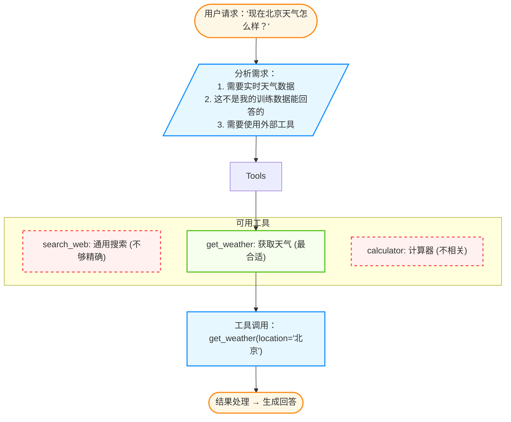

图 4-1：工具选择决策流程

### 1.4 工具与提示词的区别

| 维度 | **提示词**|**工具** |
|------|--------|------|
| 执行者 | 模型自身 | 外部系统 |
| 能力边界 | 模型内在知识 | 可无限扩展 |
| 结果确定性 | 可能产生幻觉 | 确定性结果 |
| 实时性 | 训练数据截止 | 可获取实时信息 |

### 1.5 工具的分类体系

根据功能和用途，智能体工具主要可以分为五大类别：

#### 信息获取类

从外部源获取信息的工具。包括 Web 搜索、数据库查询、API 调用、文档检索等。

```python
def search_web(query: str, num_results: int = 5) -> List[SearchResult]:
    """搜索网页获取信息"""
    pass

def query_database(sql: str) -> QueryResult:
    """执行 SQL 查询"""
    pass
```

其他工具：`call_api`（调用外部 API）、`retrieve_documents`（从知识库检索文档）。

#### 计算执行类

执行计算和数据处理的工具。包括数学计算、代码执行、数据分析。工具集合：`calculate`、`run_python`、`analyze_data`。

#### 内容生成类

生成特定格式内容的工具。包括图像生成、图表生成、文档生成。工具集合：`generate_image`、`create_chart`、`generate_pdf`。

#### 环境交互类

与运行环境交互的工具，包括文件操作、命令行操作、浏览器控制等。

```python
def read_file(path: str) -> str:
    """读取文件内容"""
    pass

def run_shell(command: str) -> ShellResult:
    """执行 shell 命令"""
    pass
```

其他工具：`write_file`（写入文件）、`browser_navigate`（打开网页）。

#### 通信类

与外部实体通信的工具。包括发送消息、调用其他智能体、人机交互。工具集合：`send_email`、`send_slack`、`call_agent`、`ask_human`。

### 1.6 按接口类型分类

工具可根据执行环境和调用方式进行区分，主要分为客户端工具和服务端工具：

| 维度 | 客户端工具 | 服务端工具 |
|------|---------|---------|
| **执行位置** | 用户设备 | 远程服务器 |
| **访问资源** | 本地文件、系统命令、本地数据库 | 代码解释器、Web 搜索、第三方 API |
| **优点** | 低延迟、完全访问本地资源 | 安全可控、统一管理 |
| **缺点** | 安全风险、依赖环境配置 | 无法访问本地资源、网络依赖 |
| **示例** | `read_file`、`run_shell`、`browser_navigate` | `call_api`、`search_web`、`run_python` |

### 1.7 工具设计原则

为了确保智能体能够准确、高效地使用工具，在设计工具时应遵循以下核心原则。这些原则旨在降低模型的认知负担，提高工具调用的成功率和系统的整体稳定性。


每个工具只做一件事：

```python
# ✅ 好的设计

tools = [
    Tool(name="search_web", description="搜索网页"),
    Tool(name="read_file", description="读取文件"),
    Tool(name="write_file", description="写入文件"),
]

# ❌ 不好的设计

tools = [
    Tool(name="file_operation", description="文件操作，包括读取、写入、删除等"),
]
```

#### 清晰的描述

让模型准确理解何时使用：

```python
# ✅ 好的描述

Tool(
    name="calculate",
    description="""执行数学计算。

    适用场景：
    - 简单四则运算
    - 复杂数学表达式
    - 统计计算（均值、标准差等）

    不适用场景：
    - 需要推理的逻辑题
    - 需要外部数据的计算

    参数格式：标准数学表达式，如 "2 + 3 * 4" 或 "sqrt(16)"
    """
)

# ❌ 模糊的描述

Tool(
    name="calculate",
    description="计算"
)
```

#### 明确的参数定义

使用 JSON Schema 规范参数：

```python
Tool(
    name="send_email",
    parameters={
        "type": "object",
        "properties": {
            "to": {
                "type": "string",
                "description": "收件人邮箱地址",
                "pattern": r"^[\w\.-]+@[\w\.-]+\.\w+$"
            },
            "subject": {
                "type": "string",
                "description": "邮件主题",
                "maxLength": 200
            },
            "body": {
                "type": "string",
                "description": "邮件正文，支持 Markdown 格式"
            },
            "cc": {
                "type": "array",
                "items": {"type": "string"},
                "description": "抄送列表（可选）"
            }
        },
        "required": ["to", "subject", "body"]
    }
)
```

#### 友好的错误信息

返回可操作的错误提示：

```python
class ToolResult:
    success: bool
    data: Any = None
    error: str = None
    error_code: str = None
    suggestion: str = None

# 示例返回

ToolResult(
    success=False,
    error="API 调用失败：认证错误",
    error_code="AUTH_ERROR",
    suggestion="请检查 API Key 是否正确配置"
)
```

#### 幂等性

相同输入产生相同结果：

```python
# ✅ 幂等操作

def get_weather(city: str) -> WeatherInfo:
    """获取天气（幂等）"""
    return weather_api.get(city)

# ⚠️ 非幂等操作（需要特殊处理）

def send_message(to: str, content: str) -> bool:
    """发送消息（非幂等）"""
    # 添加幂等性 ID

    idempotency_key = hash(f"{to}:{content}:{timestamp}")
    return message_api.send(to, content, idempotency_key)
```

### 1.8 工具组合模式

在面对复杂的现实任务时，往往无法仅靠单一工具解决问题。通过将多个工具按照特定的逻辑进行组合，可以构建出更强大的工作流，以应对更高级的挑战。常见的组合模式包括链式模式、分支模式和并行模式。

#### 链式模式

多个工具按顺序调用：


图 4-2：链式组合模式

#### 分支模式

根据条件选择不同工具：

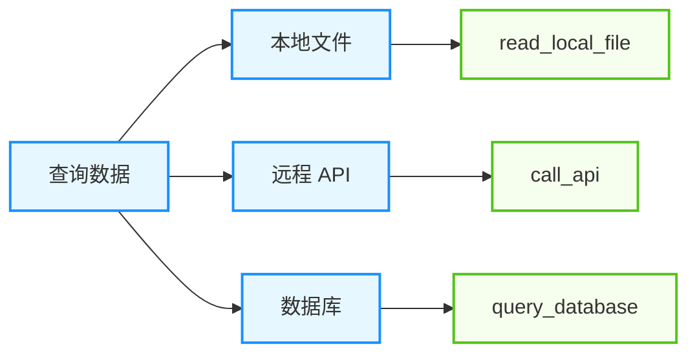

图 4-3：分支组合模式

#### 并行模式

同时调用多个独立工具：

```python
async def parallel_search(query: str):
    results = await asyncio.gather(
        search_web(query),
        search_docs(query),
        search_code(query)
    )
    return merge_results(results)
```

### 1.9 为 AI 设计的信息架构

现有的 CLI 工具是为人设计的（人类可读的输出、隐式的上下文），而 AI 需要更明确的信息架构。将来支持 AI 调用的工具，需要支持结构化的输出、显式的上下文和进度感知。

#### 结构化输出

* **Human**: `ls -l`（表格视图）
* **AI**: `ls --json`（JSON 格式，易于解析，无歧义）

#### 显式上下文

当工具报错时，必须提供足够的上下文让智能体自行修复：

*   ❌ `Error: file not found`
*   ✅ `Error: file 'main.py' not found in current directory '/src/utils'. Did you mean '/src/app/main.py'?`

#### 进度感知

对于长输出（如日志），不要让智能体盲目猜测。

*   提供 `head/tail` 的同时，告知总行数。
*   允许智能体缓存输出到文件，而不是塞满上下文。

---

**下一节**: 4.2 工具使用机制

## 2. 工具使用机制

工具使用（Tool Use）机制是连接大语言模型与外部代码逻辑的桥梁。本节将深入剖析其工作原理、实现机制以及如何通过它来构建强大的智能体应用。

### 2.1 核心原理

在早期对话式大模型刚被广泛使用时，常见批评之一是“它无法获知最新信息”和“它不能完成实际任务”。这是因为模型本身无法联网，也无法直接操作文件系统。

**工具使用（Tool Use）**（也常被称为函数调用/工具调用机制），彻底打破了这堵墙。它赋予了智能体“手”和“脚”，使其能够执行 API 调用、运行代码、控制浏览器，从而真正地干涉物理和数字世界。

---

#### 运行机制

工具调用并不是魔法，它本质上是一种 **结构化输出协议**。模型并没有真的去运行 Python 函数，它只是生成了一段 **请求运行工具** 的文本。

#### 工具定义

为了让智能体使用工具，必须先用精确的语言定义工具。通常使用 JSON Schema 或 Pydantic 模型。

**好的工具定义示例**：

```python
tools = [
    {
        "name": "search_web",
        "description": "搜索互联网获取信息。适用于查询新闻、事实、最新数据等。不适用于需要推理或创作的任务。",
        "parameters": {
            "type": "object",
            "properties": {
                "query": {
                    "type": "string",
                    "description": "搜索查询词，应该简洁明确"
                },
                "num_results": {
                    "type": "integer",
                    "description": "返回结果数量，默认 5",
                    "default": 5
                }
            },
            "required": ["query"]
        },
        "examples": [
            {"query": "某年度诺贝尔物理学奖获得者"},
            {"query": "Python 3.12 新特性", "num_results": 3}
        ]
    }
]
```

**工具定义要素**：

| 要素 | 说明 | 重要性 |
|------|------|--------|
| name | 简洁、有意义的名称 | 必须 |
| description | 详细说明用途和限制。LLM 依靠这段描述来判断何时调用该工具。 | **关键** |
| parameters | 清晰的参数定义 (JSON Schema) | 必须 |
| examples | 示例调用 (Few-shot) | 推荐 |
| use_when | 何时应该使用 | 推荐 |
| avoid_when | 何时不应使用 | 推荐 |

#### 执行流程

当用户说“查询北京明天的天气”时：
1. **思考 (Thinking)**: LLM 分析语义，发现需要外部数据。
2. **选择 (Selection)**: LLM 扫描工具列表，发现 `get_weather` 最相关。
3. **生成 (Generation)**: LLM 输出一个特殊的 JSON 结构：
    ```json
    {
      "tool_calls": [
        {
          "id": "call_123",
          "function": {
            "name": "get_weather",
            "arguments": "{\"location\": \"Beijing\", \"date\": \"tomorrow\"}"
          }
        }
      ]
    }
    ```
4. **执行 (Execution)**: Python 脚本（**运行时 Runtime**）解析这个 JSON，在本地真正调用 `get_weather("Beijing", "tomorrow")` 函数，获取 `Sunny, 25C` 这样的天气结果。
5. **反馈 (Feedback)**: Runtime 构建一条 `ToolMessage`，包含返回值，追加到对话历史中，再次喂给 LLM。
6. **响应 (Response)**: LLM 看到最新的 ToolMessage，终于可以说：“北京明天晴朗，气温 25 度。”

该执行模式在第 2.3 节 ReAct 框架中有形式化定义。

---

### 2.2 常用工具类型

一个全能的智能体通常通过 **Toolkit** 的形式加载一组工具，常见的工具类型包括信息获取、计算与逻辑、生产力与协作等。

#### 信息获取类

* **Web Search**：解决 LLM 知识截止和时效性问题。
* **Wikipedia**: 获取背景知识。
* **Arxiv**: 搜索学术论文。
* **RAG Retriever**: 搜索私有的企业知识库。

#### 计算与逻辑类

LLM 是文科生，算数（Arithmetic）很差，经常一本正经地算错。

* **Calculator**: 简单的四则运算。
* **Python Interpreter**: 终极武器。当需要解方程、数据分析、画图时，让智能体写一段 Python 代码并在沙箱中运行，是准确率最高的方法（代码解释器模式）。

**计算器**

计算器工具适合处理明确的四则运算与可控表达式求值，优点是确定性强、实现简单。工程上建议使用安全解析器而不是直接 `eval`，并明确支持的运算符与函数集合。

**代码解释器详解**

代码解释器的核心是让 LLM 从“说话者”变成“行动者”。它通常作为一个 **工具（Tool）** 暴露给 LLM，当用户提出需要计算或数据处理的请求时，LLM 生成代码并通过工具调用将代码发送给解释器执行。

**核心价值**：

| 价值 | 问题 | 解决方案 |
|------|------|---------|
| **弥补数学短板** | LLM 是概率模型，不擅长精确计算 | 运行 `print(248 * 1923)` 得到确定性正确结果 |
| **精确数据分析** | 百万行数据无法放入上下文 | 编写 Pandas 代码进行清洗、聚合和分析 |
| **多模态输出** | 需要生成图表、文档 | 调用 Matplotlib、MoviePy 等库 |
| **算法验证** | 复杂逻辑难以口述验证 | 实际运行代码验证正确性 |

**沙箱技术方案**：

代码解释器必须运行在严格隔离的沙箱中，防止 `rm -rf /` 等危险操作：

| 技术 | 描述 | 优点 | 缺点 |
|------|------|------|------|
| **Docker 容器** | 行业标准，每个 Session 独立容器 | 隔离性强，库支持全 | 启动较慢 |
| **WebAssembly (WASM)** | 浏览器端通过 Pyodide 运行 | 绝对安全，轻量 | 性能有限，库受限 |
| **E2B 微虚拟机** | 云原生沙箱，毫秒级启动 | 快速、安全、可扩展 | 依赖云服务 |
| **gVisor/Firecracker** | 轻量级容器运行时 | 安全性极高 | 配置复杂 |

以下示例展示了如何使用 E2B 沙箱运行代码并获取生成的图表：

```python
from e2b_code_interpreter import CodeInterpreter

async def run_analysis(code: str, data_path: str):
    with CodeInterpreter() as sandbox:
        sandbox.upload_file(data_path)
        result = sandbox.run_code(code)
        for artifact in result.artifacts:
            if artifact.type == "image":
                return artifact.download()
        return result.text
```

**从计算到编排：用代码调用工具**

代码解释器的用途正在从“算数”扩展到“编排工具”。常规的工具调用每一步都要回到模型：模型发出 JSON 调用，拿到结果，再决定下一步。如果把工具也暴露为代码里可调用的函数，模型就可以写一段程序，用循环、条件和变量把多次调用一次串起来。学术界较早系统研究这一做法的是 CodeAct（[Executable Code Actions Elicit Better LLM Agents](https://arxiv.org/abs/2402.01030)，2024），之后它进入了主流平台：Anthropic 的 [程序化工具调用](https://platform.claude.com/docs/en/agents-and-tools/tool-use/programmatic-tool-calling) 在沙箱容器中运行模型写的代码，代码运行期间不再重新采样模型，中间结果也不进入上下文；Anthropic 在 [Code execution with MCP](https://www.anthropic.com/engineering/code-execution-with-mcp) 一文中把同样的思路用于 MCP 工具，文中示例的 token 用量从约 15 万降到约 2000。

这并不意味着把关也交给了模型写的代码。代码只是请求的另一种形式，每一次工具调用仍应回到宿主程序，接受与直接调用相同的权限和参数检查（见 1.1.2 节）。另外，工具结果以字符串形式交给运行中的代码，可能夹带会被当作代码执行的内容，对外部来源结果的校验也要放在宿主程序一侧。

#### 生产力与协作类

* **Gmail/Outlook**:读写邮件。
* **Calendar**: 安排日程。
* **Jira/Trello**: 管理项目任务。
* **File System**: 读写本地文件（需严格限制路径）。

### 2.3 工具设计哲学与评估驱动优化

在实践中，工具的有效性并不由数量决定，而由设计质量与目标导向决定。Anthropic 团队基于大量工具评估与优化实践，总结出以下核心设计理念。

#### 确定性与非确定性的权衡

传统软件开发中，工具是确定性的：给定相同输入，输出永远相同。但智能体工具处于不同语境——它们是 **非确定性系统（智能体）与确定性系统之间的接口**。

例如，`getWeather("NYC")` 作为确定性函数总是返回相同结构；但当用户问“应该带伞吗？”时，智能体可能：
- 调用天气工具
- 从知识库回答
- 反过来问用户位置

这意味着工具设计必须考虑智能体的 **多元解决策略**，而非单一的“正确路径”。

#### 选择正确的工具而非包装所有 API

关键原则：**更多工具不一定更好**。常见误区是把每个 API 端点都包装成工具。实际上应该问：

1. **上下文成本 vs 实用性**：每个额外的工具都消耗智能体的有限上下文。加载 100 个工具，其中 50 个不相关，会严重降低智能体的专注度。

2. **工具合并优于枚举**：比起提供 `list_users`, `list_events`, `create_event` 三个工具，不如实现单一的 `schedule_event` 工具，它内部负责查询可用性并一步完成预订。

   对比：
   - **不推荐**：`read_logs` 工具返回所有日志（可能数千行），智能体逐行阅读
   - **推荐**：`search_logs` 工具支持筛选，只返回相关日志和上下文

3. **Token 效率优先**：工具返回应当精简。支持 `response_format` 参数让智能体在 “concise”（仅关键数据）和 “detailed”（包含技术标识符）之间选择，从而在精确性和 Token 消耗间动态平衡。

#### 评估驱动的工具改进流程

最有效的工具优化遵循以下迭代循环：

1. **生成评估任务**：基于真实工作流，创建 20-50 个综合性任务
   - 弱示例：“搜索日志中的错误”
   - 强示例：“找出客户 9182 报告的三次重复收费问题的所有相关日志，判断是否有其他客户被影响”

2. **运行评估**：让智能体在这些任务上执行，记录完整轨迹

3. **分析失败模式**：
   - **重复调用增多** → 调整分页参数或返回数据量
   - **参数无效错误** → 改进工具描述和示例
   - **工具选择错误** → 重新设计工具命名空间（按服务/资源分组）

4. **与 Claude 协作优化**：将评估轨迹导入 Claude Code，让其自动分析并建议：
   - 工具描述是否清晰
   - 参数定义是否有歧义
   - 是否存在可合并的工具

#### 工具命名空间化策略

当工具数量增加时，合理的命名约定能显著提升智能体的准确度：

```text
推荐：按服务 + 资源分层命名
  asana_projects_search
  asana_users_search
  asana_tasks_create

  slack_messages_search
  slack_channels_list
```

前缀-后缀式的命名能帮助智能体快速定位工具，避免在语义相近的工具间混淆。研究表明，这个看似简单的改进能提升工具调用准确度 5-15%。

---

### 2.4 鲁棒性与安全

赋予智能体操作外部世界的能力，必须设置严格的安全护栏。

> **说明**
> **关于安全主题的分工**
> *   本节 (4.2) 侧重于 **单次工具调用的沙箱机制**（如何防止 `rm -rf /`）。
> * **9.5 企业级安全** 侧重于 **生产环境的整体防护**（网络隔离、PII 保护）。
> * **11.1 安全边界** 侧重于 **对抗性攻击与防御**（提示词注入、越狱）。

#### 工具响应的 Token 效率优化

工具返回的数据量直接影响智能体的上下文消耗。以下策略能显著降低 Token 成本：

1. **精简返回数据**：
   - 移除低信息密度的字段（UUID、mime_type、256px_image_url）
   - 保留语义相关字段（name、image_url、file_type）

2. **分页与截断**：实现可配置的分页、范围选择与截断，默认参数应保守（如限制 25,000 tokens）。

3. **智能错误响应**：
   - **不推荐**：`Error: ValidationError: field 'sql' type mismatch`
   - **推荐**：`SQL 参数错误：检测到 DELETE 操作，仅允许 SELECT。请改为：SELECT * FROM users WHERE...`

   通过给出具体修正建议，减少智能体的盲目重试。

#### 容错设计

* **参数幻觉（Hallucinated Args）**：LLM 可能会编造不存在的参数名。代码层必须做 Schema 校验（Pydantic），如果校验失败，将 **校验错误（Validation Error）** 直接返给 LLM，让它 **自我修正**。
* **工具报错**：如果 API 超时或报错，智能体不应崩溃，而应捕获异常，并尝试重试或换一个工具。

可先运行确定性离线工具循环夹具，验证工具观察记录、未知工具处理和“必须显式结束”的循环边界，再接入真实外部服务。

**示例：健壮的执行器实现**

```python
class ToolExecutor:
    def execute(self, tool: Tool, params: dict) -> ToolResult:
        try:
            result = tool.run(**params)
            return ToolResult(success=True, data=result)

        except InvalidParameterError as e:
            return ToolResult(
                success=False,
                error=f"参数错误：{e}",
                suggestion="请检查参数格式"
            )

        except ToolNotAvailableError as e:
            return ToolResult(
                success=False,
                error=f"工具暂时不可用：{e}",
                suggestion="稍后重试或使用替代方案"
            )

        except Exception as e:
            return ToolResult(
                success=False,
                error=f"未知错误：{e}",
                suggestion="请联系管理员"
            )
```

#### 安全沙箱

代码执行必须在隔离的沙箱中进行（Docker、E2B、WebAssembly），防止恶意代码影响主系统。对于敏感操作（转账、删除、发送消息），必须实施人工确认机制：智能体生成操作请求，用户批准后系统才执行。通过权限校验、输入验证、高风险操作确认和审计日志记录形成完整防御体系。

详见《AI 安全指南》第 7 章关于代码沙箱、权限控制与人工介入的完整配置方案。

### 2.5 工具描述与 Prompt 工程

工具描述是智能体是否能正确使用工具的 **关键**。描述会被直接加载到智能体的上下文中，是模型做出工具选择决策的主要依据。

#### 描述的关键要素

将工具描述看作“给新员工讲解怎么用这个工具”：

- **明确用途与限制**：例如，不要只说“搜索”，而要说“搜索互联网获取最新信息。不适用于推理或创意任务。”
- **清晰的参数名**：用 `user_id` 而非 `user`；用 `start_date` 而非 `date`
- **具体示例**：提供 few-shot 示例，展示正确的调用方式

```json
{
  "name": "web_search",
  "description": "搜索互联网获取最新信息、事实和时事。返回相关网页摘要。不适用于需要推理、创意或个人经验的任务。",
  "parameters": {
    "type": "object",
    "properties": {
      "query": {
        "type": "string",
        "description": "搜索查询词，应简洁明确"
      }
    }
  },
  "examples": [
    {"query": "2025年诺贝尔物理学奖获得者"},
    {"query": "Python 3.13 新特性"}
  ]
}
```

#### Prompt 工程对工具使用的影响

即使工具定义完美，系统 Prompt 中的上下文引导也很关键：

在工具评估中，调整工具描述、添加使用场景往往能显著提升准确度。这表明系统 Prompt 中的上下文引导至关重要。

在 SWE-bench Verified 等基准中，仅通过精化工具描述就能显著改进结果。

### 2.6 结构化输出

**结构化输出（Structured Outputs）** 是工具使用能力的增强版本，能够保证 API 响应严格匹配预定义的 JSON Schema。


传统的工具使用方式存在格式不稳定问题：

```python
# 传统方式：模型可能返回不符合 Schema 的数据

response = agent.run("提取用户信息")

# 可能返回：{"name": "张三"} 而非预期的 {"full_name": "张三", "age": null}
```

结构化输出通过 **约束解码** 尽可能保证输出符合 Schema：

```python
# 结构化输出：保证格式正确

response = agent.run(
    "提取用户信息",
    response_format={
        "type": "json_schema",
        "json_schema": {
            "name": "user_info",
            "schema": {
                "type": "object",
                "properties": {
                    "full_name": {"type": "string"},
                    "age": {"type": ["integer", "null"]}
                },
                "required": ["full_name", "age"]
            }
        }
    }
)

# 保证返回：{"full_name": "张三", "age": null}
```

### 2.7 关键应用场景

| 场景 | 说明 |
|------|------|
| **数据提取** | 下游系统依赖无错误、一致的格式 |
| **多智能体架构** | 智能体间通信格式一致性是性能和稳定性的关键 |
| **复杂搜索工具** | 多字段必须精确填充并符合特定模式 |

#### 收益

1. **消除解析错误**：无需 try-catch 和重试逻辑
2. **简化代码**：移除复杂的失败回退处理
3. **提升可靠性**：生产环境中工具调用成功率显著提升

#### 保证范围声明

> **警告**
> **Schema-valid ≠ Semantically-valid**
> 约束解码 / 结构化输出主要保证“输出符合 Schema（字段、类型、格式）”，从而显著降低解析错误与重试成本。但它 **不保证** 以下语义层面的正确性：
> - **工具选择正确**：模型仍可能选错工具。
> - **参数值正确**：字段类型正确不意味着填入的值符合业务逻辑。
> - **结果解读正确**：模型对工具返回值的推理仍可能出错。

生产系统仍需在格式保证之上叠加 **二次校验**：

- **范围校验**：参数值是否在合理区间（如日期格式、金额上下限）。
- **权限校验**：该用户/会话是否有权调用此工具、访问此资源。
- **幂等性校验**：重复调用是否会产生副作用（如重复下单）。
- **业务规则校验**：参数组合是否满足业务约束。

当校验失败时，推荐将错误信息回填给模型进行 **自修复**（Self-Repair）：把校验失败原因作为新一轮的 Observation 送回 LLM，让其纠正参数后重新调用。

> **提示**
> **何时使用这些机制**：
> - 工具多、来源多：优先做“工具目录/按需加载”。
> - 批处理、多步编排：优先做“编程式编排 + 沙箱”。
> - 用法复杂：给出正反示例与失败回退。

---

**下一节**: 4.3 工具连接协议：模型上下文与工具服务

## 3. 工具连接协议：模型上下文与工具服务

当智能体需要访问外部世界（数据库、文件、知识库、SaaS）时，最大的工程痛点往往不是“能不能调 API”，而是 **如何在不同工具之间用一致方式描述能力、传递上下文、处理错误与权限**。

本节介绍一类“工具连接协议”的通用思路：把工具与数据源以标准化结构暴露给智能体宿主，让不同模型与不同工具更容易互联互通。

### 3.1 什么是工具连接协议：以 MCP 为例

随着智能体生态的发展，业界急需一种连接标准。**Model Context Protocol (MCP)** 是这一方向上的开放协议代表。本节探讨的理念适用于各类工具互操作协议，但我们将以 MCP 的核心设计为代表蓝本来阐述。

在缺乏统一协议时，常见痛点包括：

- **重复造轮子**：每个应用为每个数据源单独开发连接器。
- **语义不一致**：同一类工具在不同系统里参数、错误码与返回结构不同。
- **权限难治理**：鉴权方式分散，审计事件不统一。
- **难以复用**：一个工具的集成难以迁移到另一个宿主或框架。

### 3.2 从静态集成到动态发现

工具连接协议的一个关键收益是从“静态硬编码”走向“动态发现”：

- **静态硬编码**：开发者手写每个工具的描述、参数格式、错误处理与权限边界。
- **动态发现**：宿主在运行时向工具服务询问：你能提供什么资源？你有哪些操作？输入输出结构是什么？声明了哪些 capability？

这使得智能体可以在复杂的企业数据库、本地文件系统和第三方服务之间更容易切换，降低集成成本。


在接入协议前，应该先构建本地原型并进行评估：

1. **快速原型**：使用 Claude Code 或本地环境快速搭建工具的初版
   - 如果依赖第三方库或 API，应提供完整的文档（如 `llms.txt` 格式）
   - 在 MCP 服务或 Desktop Extension 中注册，以便本地测试

2. **人工测试**：在将工具暴露给智能体前，开发者应亲自测试各种边界情况

3. **自动化评估**：构建一套综合评估任务，涵盖真实使用场景
   - 弱任务：单一操作（“创建日历事件”）
   - 强任务：多步工作流（“为 Jane 安排下周会议，讨论 Acme 项目，附加上次会议记录，预订会议室”）

4. **迭代优化**：
   - 分析工具调用日志，找出高错误率的操作
   - 改进工具描述或合并相关功能
   - 通过 Claude 自动分析轨迹，获得优化建议

### 3.3 协议能力结构

以 MCP 为例，**Server 侧**暴露的核心原语是三类：资源（resources）、工具（tools）、提示模板（prompts）。与此同时，**Client 侧**声明的是另一组能力，例如 roots、sampling、elicitation。两边都要在初始化时显式声明 capability（2025-11-25 版），不能把它们混写成“协议只有一张能力表”。2026-07-28 版取消了 `initialize` 握手，客户端能力改为随每一次请求在 `_meta` 中携带（`io.modelcontextprotocol/clientCapabilities`），但“两侧能力分开声明”这一结构没有变。

#### 1. 资源

资源代表只读或受限读写的数据项，例如文件、表、文档、记录集合。

```json
{
  "resources": [
    {"uri": "file:///project/README.md", "name": "项目说明", "mimeType": "text/markdown"},
    {"uri": "db://users", "name": "用户表"}
  ]
}
```

#### 2. 工具

工具代表可执行的操作，例如查询、写入、创建工单、发送消息。

```json
{
  "tools": [
    {
      "name": "query_database",
      "description": "执行查询",
      "inputSchema": {
        "type": "object",
        "properties": {"sql": {"type": "string"}},
        "required": ["sql"]
      }
    }
  ]
}
```

#### 3. 提示模板

提示模板用于把“可复用的交互模式”沉淀为结构化模板，避免每次从零写提示词。

```json
{
  "prompts": [
    {
      "name": "summarize_ticket",
      "description": "总结工单并输出结构化要点",
      "arguments": [{"name": "ticket_id", "type": "string"}]
    }
  ]
}
```

### 3.4 宿主、客户端与工具服务

以 MCP 为例，规范上的核心分工更适合写成三类参与者，而不是把“协议层”单独当作业务层：

1. **宿主（Host）**：承载智能体运行的环境（IDE、CLI、桌面应用、服务端），负责权限、授权和会话编排。
2. **客户端（Client）**：由 Host 创建，与单个 Server 建立 1:1 会话，负责 capability 协商、消息路由、订阅与通知。
3. **工具服务（Server）**：暴露 resources、tools、prompts 等具体能力，并在需要时经由 Client 请求 sampling / elicitation 等客户端能力。

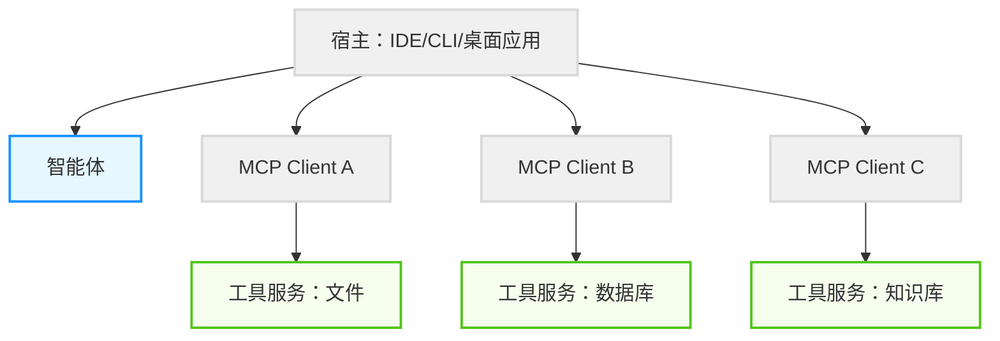

图 4-4：工具连接协议分层示意

按 MCP 官方规范（2025-11-25 版），边界可概括为：**Server 负责暴露 resources / tools / prompts；Client 负责 roots / sampling / elicitation 等客户端能力声明；Host 负责安全边界、用户同意和多 Client 编排。** 例如，sampling 不是“Server 自己去调任意模型”，而是 Server 向 Client 发起请求，由 Client 保持对模型访问、选择和权限的控制。需要注意的是，2026-07-28 版已把 Roots 与 Sampling 标记为废弃（deprecated，至少保留 12 个月过渡期，现有实现仍可正常工作），官方规范索引中客户端对服务端提供的能力只列出 Elicitation；Server 向 Client 发起请求的模式也改由 MRTR（Multi Round-Trip Requests：Server 返回 `input_required` 结果，Client 带着 `inputResponses` 重试原请求）承载。新实现不宜再采用 Roots 与 Sampling。

### 3.5 安全基线与漏洞防范

在工具连接协议中，安全性必须在协议与服务实现层建立硬护栏，而非仅依赖提示词。核心基线包括：

1. **强白名单机制**：所有文件、进程、URL 访问必须约束在沙箱目录或白名单域列表中。防止路径遍历（`../`）和参数注入。

2. **最小权限原则**：按需配置权限。数据库查询工具仅使用 SELECT 权限账号，写入工具限制到特定沙箱目录。

3. **速率控制与熔断防御**：配置 API 级速率限制，防止智能体陷入重试风暴导致系统崩溃。

在工具服务侧可以结合**应用自定义的权限声明**和返回错误处理提供防御基础，例如把 `permissions.scope: "database:read"` 作为示意性元数据，表达“这个工具只允许读取数据库”，但不要把它当作 MCP 协议原生字段。宿主侧实施路径验证和参数清洗。企业级场景可部署 IAM 策略引擎管理会话级约束（Token 预算、操作上限、审计日志）。

详见《AI 安全指南》第 8 章完整的权限配置、沙箱实现与速率控制方案。

### 3.6 实战建议

对于中小团队，建议从以下步骤起步：

1. **路径沙箱守卫**：在工具调用前验证路径，拦截 `../` 等目录遍历。
2. **SQL 白名单**：禁止 DROP、DELETE、UPDATE 等危险操作。
3. **结构化错误**：返回机器可读的错误类型，减少智能体盲目重试。

随着业务规模扩大，逐步引入会话级 Token 预算、网络域白名单和完整审计日志。

### 3.7 新兴方向：支付协议与智能体经济

当工具或服务需付费时，支付协议（如 Stripe 的 Machine Payments Protocol）可以与 MCP 工作流配套使用，让智能体在获准条件下完成付费调用。但这不属于 MCP 核心协议能力，仍属探索方向，不是本节的核心建议。

### 3.8 最佳实践

- **单一职责**：一个工具服务聚焦一个领域，避免“巨无霸工具服务”。
- **结构化错误**：返回机器可读的错误类型与建议，减少智能体盲目重试。
- **权限前置**：在工具服务侧做硬权限校验，不把安全寄托在提示词。
- **可观测性统一**：为每次调用打上 `trace_id`，支持跨系统回放与排障。
- **与技能协同**：协议解决“连接与调用”，技能解决“流程与最佳实践”。

---

**下一节**: 4.4 智能体技能：能力扩展规范

## 4. 智能体技能：能力扩展规范

**智能体技能（Agent Skills）** 是一种用于扩展 AI 智能体能力与专业知识的开放格式实践。它提供了一种轻量级、可移植的方式来封装领域知识和工作流程。

> **说明**
> **定位说明**：本节讨论的是 **Agent Skills 开放标准** 这一层，即以 `SKILL.md` 为核心的可移植技能格式。不同厂商产品还可能提供 rules、subagents、project instructions、`AGENTS.md` 等其他“指令表面”，它们不等同于 Agent Skills，也不应混写成同一套加载机制。建议先写清标准层，再分别说明各产品是否兼容、如何映射。

### 4.1 什么是智能体技能

Skills 是一种简单的开放格式，用于赋予智能体新的能力和专业知识。与工具连接协议提供系统连接能力不同，Skills 专注于 **过程性知识** 的封装。

> 工具连接协议是 **通道**，技能是 **智慧**。
>
> 工具连接协议解决“通过什么做”，技能解决“如何做”。

Skills 为智能体系统带来了以下核心价值：

- **领域专业知识**：将法律审查流程、数据分析管道等专业知识封装为可复用指令
- **新能力扩展**：赋予智能体创建演示文稿、构建工具服务、分析数据集等能力
- **可重复工作流**：将多步骤任务转化为一致、可审计的工作流程
- **跨平台互操作**：在不同 Skills 兼容的智能体产品间复用相同技能


2026 年的论文 [SkillsBench: Benchmarking How Well Agent Skills Work Across Diverse Tasks](https://arxiv.org/abs/2602.12670) 给出了一个重要的经验事实：**Skill 不是“可有可无的提示词附件”，而是一个可以被单独测量、并且经常显著提升智能体表现的工程变量。**

该论文的核心贡献是通过严格的实验设计量化了 Skills 的效果。论文把任务分为 **无 Skills**、**人工策展 Skills**、**模型自生成 Skills** 三种条件进行比较，覆盖 8 个领域、87 个任务。其主要发现包括：

- **人工策展的 Skills 平均能显著提升完成率**，说明高质量过程性知识在推理时注入是有效的。
- **模型现写的 Skills 平均没有稳定收益**，说明“会使用程序性知识”和“会编写高质量程序性知识”是两种不同能力。
- **领域差异极大**：收益从软件工程的 +4.5pp 到医疗的 +51.9pp 不等，但**所有领域的总体增益都是正的**；负收益出现在**单个任务**这一层（84 个任务里有 16 个），而不是整个领域。这说明 Skill 要面向任务类别精确设计，而不是抽象地“加说明书”——同一领域内也会有被 Skill 拖累的具体任务。
- **聚焦型 Skill 往往优于大而全的文档**：2 到 3 个模块、围绕一个清晰工作流组织的 Skill，通常比塞满背景材料的综合手册更有效。
- **小模型 + 好 Skill 可以逼近大模型裸跑**：这说明 Skill 不只是“锦上添花”，也是一种现实的成本优化手段。

这几个结论对工程实践有直接影响：如果一个团队已经在做工具调用、RAG 和记忆系统，却还没有把“任务类程序知识”当成独立资产管理，那么通常还有一整块性能提升空间没有被系统开发。

进一步的 Skill 优化研究则把这件事推进到“可训练资产”层面。以 SkillOpt 为代表的方法不直接更新模型权重，而是把单个 Skill 文档视为冻结智能体的外部状态：目标智能体先在任务集上执行当前 Skill 并产生 scored rollout，优化器再根据成功和失败轨迹提出受控的新增、删除或替换编辑，候选 Skill 只有在 held-out 验证集上严格提升时才被接受。这个过程说明，高质量 Skill 的维护不应停留在“写一份说明书”，而应具备版本、评估、回归和拒绝编辑记录。

### 4.2 Skills 工作机制

Skills 采用三阶段加载机制：

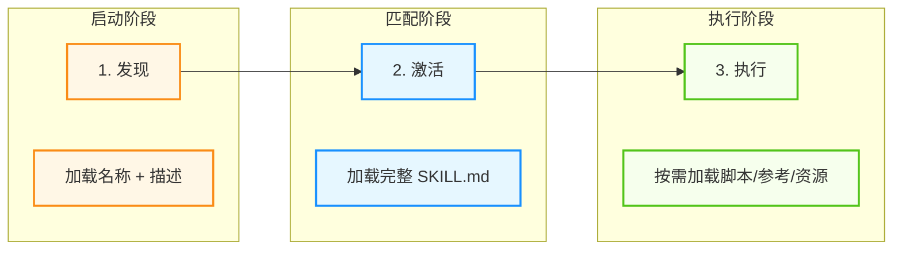

图 4-5：Skills 三阶段加载机制

1. **发现（Discovery）**：启动时仅加载每个技能的 name 和 description，足以判断其相关性
2. **激活（Activation）**：当任务匹配某个技能的描述时，将完整 SKILL.md 指令加载到上下文
3. **执行（Execution）**：智能体按照指令执行，按需加载引用的文件或执行捆绑的脚本

### 4.3 Skill 目录结构

一个 Skill 的标准目录结构如下：

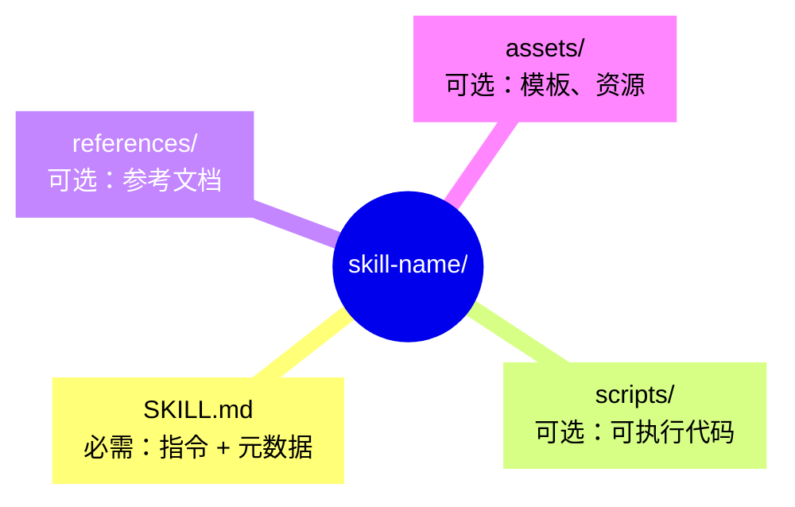

图 4-6：Skill 的标准目录结构

| 目录/文件 | 说明 |
|-----------|------|
| `SKILL.md` | **必需**。包含元数据和详细指令 |
| `scripts/` | 可执行脚本，应自包含或清晰声明依赖 |
| `references/` | 技术参考文档，如 REFERENCE.md、领域专用文档 |
| `assets/` | 模板、图片、数据文件等资源 |

### 4.4 SKILL.md 格式规范

SKILL.md 由 YAML Frontmatter 和 Markdown 正文两部分组成。

#### 前置元数据（必需）

以下是一个完整的 YAML Frontmatter 示例：

```yaml
---
name: pdf-processing
description: Extract text and tables from PDF files, fill forms, merge documents.
license: Apache-2.0
compatibility: Designed for agentic coding hosts
allowed-tools: Bash(git:*) Bash(jq:*) Read
metadata:
  author: example-org
  version: "1.0"
---
```

| 字段 | 要求 | 说明 |
|------|------|------|
| `name` | 必需 | 1-64 字符，仅小写字母、数字和连字符 |
| `description` | 必需 | 1-1024 字符，描述功能和使用场景 |
| `license` | 可选 | 许可证信息 |
| `compatibility` | 可选 | 环境要求，如“需要 git、docker” |
| `allowed-tools` | 可选 | 预授权工具列表 |
| `metadata` | 可选 | 自定义键值对 |

#### 正文内容

正文采用 Markdown 格式，应包含：

- 分步骤指令
- 输入输出示例
- 常见边界情况处理

以下是一个 SKILL.md 正文的典型结构示例（示意采用英文小节名，实际项目可使用中文）：

```markdown
# PDF 处理

### 何时使用

当用户需要处理 PDF 文件时使用本技能。

### 如何抽取文本

1. 使用合适的 PDF 解析工具抽取文本。

### 如何填写表单

...
```

### 4.5 渐进式披露

Skills 采用三层加载机制优化上下文使用：

| 层级 | 内容 | Token 预算 | 加载时机 |
|------|------|-----------|---------|
| 元数据 (Metadata) | name + description | ~100 tokens | 启动时加载所有 Skills |
| 指令 (Instructions) | 完整 SKILL.md 正文 | <5000 tokens（建议） | 任务匹配时激活 |
| 资源 (Resources) | scripts/、references/、assets/ | 按需 | 执行时按需加载 |

这种设计确保：

- 启动时上下文开销极小
- 仅在需要时加载详细指令
- 大型资源文件按需获取


结合工业实践与 SkillsBench 的结论，可以把高质量 Skill 的设计原则概括为三条：

1. **写过程，不写答案**：Skill 应该告诉智能体“如何排查、如何验证、如何收尾”，而不是把某一道题的最终输出直接塞进去。
2. **聚焦任务类，不追求百科全书**：一个 Skill 最好只覆盖同一类问题的稳定工作流。功能边界越清晰，触发越稳定，负迁移越少。
3. **把确定性逻辑下沉到脚本和资源**：长文档、模板、校验脚本、示例数据尽量放在按需层，而不是把所有内容堆进 `SKILL.md`。

如果一个 Skill 变成了“十几页背景知识 + 各种顺手都想塞进去的技巧合集”，它大概率已经从“高密度程序性知识包”退化成了“低命中率说明书”。

### 4.6 Skill 的局限与进化方向

当前的 Skill 框架已成为 Agent 软件的“及格线”，但并非最终形态。黄东旭在 QCon 2026 指出，未来 Agent 系统需要更复杂的抽象形式，具备以下特性：

1. **可调试性（Debuggability）**：Skill 应该能像软件模块一样被诊断、定位和修复错误
2. **可分发性（Distributability）**：不仅可复用，还能跨智能体系统、跨组织分发和版本管理
3. **知识蒸馏（Knowledge Distillation）**：能够将复杂的人类专家知识编码为可学习、可优化的形式，而非单纯的指令文本

当前 Skill 主要以自然语言指令存在，缺乏结构化的执行语义和自适应能力。下一代 Agent 基础设施可能需要结合 GStack、Superpower 等更有结构的知识表达方式，实现“人机协同生成”——即通过自然语言与 Agent 协同迭代定义 Skill，而非单向的人工编写。这样的演进将使 Skill 从“静态知识包”升级为“动态学习资产”。

如果把这个方向工程化，Skill 的生命周期至少应包含四个动作：先用真实或合成任务建立基线，再把失败轨迹压缩为候选规则，然后通过小步编辑更新 Skill，最后用未参与编辑的评估集决定是否发布。这里的关键不是“让智能体随便改自己的说明”，而是把自我改进限制在可审计、可回滚、可验证的配置层。

### 4.7 Skills 与工具连接协议的协同

技能和工具连接协议是互补的：技能定义“做什么”和“怎么做”，协议提供“用什么工具做”。

#### 协同架构

把技能与工具连接协议放进同一张图，可以看清二者的分工：技能提供业务规则与流程，协议提供实际可调用的工具。

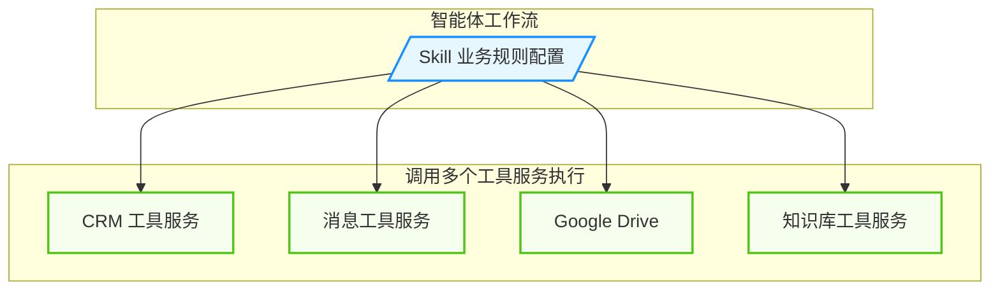

图 4-7：Skills 与工具连接协议协同架构

*注：Skill 定义了工作流程、业务规则和质量标准等过程性知识。例如“查询客户数据时，先检查 CRM，再交叉验证 Slack”。*

#### 边界划分

| 维度 | 协议负责 | 技能负责 |
|------|---------|------------|
| 核心 | 连接能力 | 领域知识 |
| 内容 | API 格式、查询语法 | 工作流程、业务规则 |
| 指令 | 工具使用提示 | 多工具编排逻辑 |
| 粒度 | 单个服务 | 跨服务流程 |

**经验法则**：

- 协议指令覆盖 **如何正确使用服务及其工具**；Skill 指令覆盖 **如何在特定流程或多服务工作流中使用它们**。

#### 实际案例

下面用两个示例展示 Skill 如何把“方法论与流程”固化为可复用能力。

**案例 1：财务分析 Skill**

```markdown
# Comparable Company Analysis Skill

### 工作流程

1. 从财务数据工具服务拉取指标
2. 从补充数据工具服务获取额外字段
3. 应用估值方法论（Skill 定义）
4. 格式化输出符合合规要求（Skill 定义）
```

**案例 2：会议准备 Skill**

```markdown
# Meeting Intelligence Skill

### 工作流程

1. 通过知识库工具服务搜索相关项目页面
2. 通过知识库工具服务获取历史会议记录
3. 整理为两份文档：内部预读 + 外部议程
4. 通过知识库工具服务保存到指定位置
```

### 4.8 Skills 生态与企业部署

#### 组织级管理

在团队/组织场景下，Skills 往往需要被当成“可审计的组织资产”来管理：版本控制、审批、权限与分发。

**集中配置能力**：

- 组织管理员可从管理设置集中配置 Skills
- 管理员配置的 Skills 默认为所有用户启用
- 用户仍可选择关闭个别 Skills 以自定义体验
- 确保团队使用一致、经批准的工作流

**部署优势**：

- 统一标准：整个组织遵循相同的工作流程
- 质量控制：IT 团队审核和批准 Skills
- 快速推广：一次配置，全员可用
- 灵活性：用户保留个性化选择权

#### 版本化与回归

当 Skill 被用于关键业务流程时，建议把它当作“可发布的软件资产”治理：

- **版本管理**：为 Skill 建立语义化版本号与变更日志，支持回滚。
- **审批与灰度**：在推广到全员前先做小范围试点，避免一次性引入大范围回归。
- **回归样例集**：为核心 Skill 维护最小回归用例（输入、期望输出结构、失败诊断），每次更新前后对比。

#### Skills 目录与生态

生态与具体合作伙伴会随时间变化；工程上更重要的是：能否把 Skill 当成可版本化的资产（仓库管理）、能否做审批与分发、能否与权限/审计体系集成。

#### 创建与编辑体验优化

**简化创建流程**：

- **描述即创建**：描述需求，由系统/助手协助构建 Skill
- **直接编写**：直接编写指令文件
- **文件夹上传**：上传完整的 Skill 文件夹结构
- **Skill creator / scaffolding 工具**：部分宿主会提供内置创建器，帮助生成初始 Skill 结构

**完整预览功能**：

- 启用前查看 Skill 完整内容
- 理解 Skill 具体做什么
- 审核指令的安全性和合理性

**助手辅助编辑**：

- 助手可帮助编辑现有 Skills
- 根据反馈优化指令
- 迭代改进工作流

#### 跨平台可用性

Agent Skills 作为开放标准，目标是让同一个 `SKILL.md` 目录结构在多个兼容宿主之间复用；但**具体产品表面必须分开描述**：

- **标准层**：Skill 是目录 + `SKILL.md` + 可选的 `scripts/`、`references/`、`assets/`，宿主按“发现 → 激活 → 按需加载”使用它。
- **兼容宿主层**：像 Codex 这类已公开支持 Agent Skills 的宿主，会扫描技能目录并显式或隐式激活 `SKILL.md`。在 Codex 的产品化插件中，plugin 不是单个 Skill，而是可以把 apps、skills、instructions 和 workflows 一起打包的分发层；这有助于把某个角色或团队的重复工作沉淀成可安装能力包。
- **非等价表面**：另一些产品可能提供 rules、subagents、组织级工作流模板或浏览器扩展中的技能入口；它们是否直接兼容 Agent Skills，要以各自官方文档为准，不能把 UI 入口、配置路径或 API 端点写成通用规范。

> **说明**
> **工程建议**：写文档时先描述开放标准，再单列“OpenAI/Codex”“Anthropic/Claude”“其他 IDE/客户端”等厂商章节，分别说明触发方式、权限前置条件和分发机制。

### 4.9 最佳实践

在开发和使用 Agent Skills 时，遵循经过验证的最佳实践可以显著提高技能的质量和可用性，避免常见的陷阱。

#### Skill 设计原则

- **功能聚焦**：每个 Skill 专注于一个明确的领域或工作流
- **自文档化**：任何人阅读 SKILL.md 都能理解其功能
- **可移植性**：Skills 就是文件，易于编辑、版本控制和分享

#### 避免常见问题

- **避免指令冲突**：如果工具服务指定返回 JSON，而 Skill 要求 Markdown 表格，智能体需要猜测。让工具服务处理连接，Skill 处理呈现。
- **保持复用性**：一个工具服务可支持多个 Skills；一个 Skill 可编排多个工具服务。
- **利用渐进式加载**：将详细参考资料放在 references/ 目录，仅在需要时加载

#### 验证工具

可以使用项目提供的校验脚本或自定义 linter 来验证 Skill 格式：

```bash
<skill-linter> check ./my-skill
```

> **提示**
> **相关资源**：建议在项目内维护一份“Skill 规范/示例/校验工具”的链接清单，并定期核验有效性。

---

**下一节**: 4.5 浏览器自动化与计算机操作

## 5. 浏览器自动化与计算机操作

智能体不仅需要调用 API，还需要与图形界面交互。**浏览器自动化（Browser Automation）** 和 **计算机操作（Computer Use）** 都在扩展智能体的执行边界，但两者的成熟度不应一概而论：基于 DOM/CDP 的浏览器自动化已经是成熟工程手段；模型驱动的 browsing / computer use 则要按具体产品、环境范围和安全承诺分别评估。

### 5.1 为什么需要浏览器自动化

并非所有系统都开放 API。遗留系统（ERP/CRM）和现代 SaaS 往往只有 Web 界面，要实现自动化操作，必须让智能体具备操控浏览器的能力。

**典型应用场景**：
- **Web 抓数据**：从没有 API 的网站提取信息
- **遗留系统集成**：自动操作老旧的企业内部系统
- **端到端测试**：模拟用户行为进行 UI 测试
- **RPA 任务**：订票、购物、表单填写等重复性工作

### 5.2 自动化技术的三代演进

自动化技术经历了三代演进，从硬编码坐标到 DOM 选择器，再到基于视觉感知的智能操作：

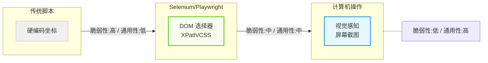

图 4-8：自动化技术三代演进

当前主流的两种范式有着根本不同的工作方式：

- **DOM-based（基于文档对象模型）**：通过解析网页的 HTML 结构，使用 CSS 选择器或 XPath 定位元素。这是 Selenium/Playwright 的工作方式，精确高效，但 **依赖页面结构**——一旦开发者修改了 HTML 布局、类名或 ID，脚本就会失效。

- **视觉感知（Vision-based）**：通过截取屏幕图像，让多模态模型“看”界面并理解其含义。模型像人类一样识别“登录按钮在哪里”，然后输出坐标和操作指令。这种方式 **不依赖代码结构**，能够适应界面变化，但速度较慢且消耗更多计算资源。

| 维度 | DOM-based | 视觉感知 |
|------|-----------|----------|
| **工作方式** | 解析 HTML 结构 | 分析屏幕截图 |
| **选择器** | CSS/XPath | 视觉坐标 (x, y) |
| **精确性** | 高 | 中 |
| **速度** | 快 | 较慢 |
| **通用性** | 仅 Web | 任意 GUI |
| **维护成本** | 页面变化需更新 | 自适应 |
| **成本** | 低 | 高（消耗 Token） |

### 5.3 DOM-based 自动化

DOM-based 自动化通过程序化方式操控浏览器，适合结构稳定的网页场景。以下是使用 Playwright 操作公开搜索表单的示例：

```python
from playwright.sync_api import sync_playwright

def search_traditional():
    with sync_playwright() as p:
        browser = p.chromium.launch()
        page = browser.new_page()
        page.goto("https://example.com/search")

        # 依赖 CSS 选择器 - 页面结构变化即失效

        page.fill("input[name='q']", "agent browser automation")
        page.click("button[type='submit']")
```

真实账号登录、密码输入和会改变用户数据的提交应按本节后文的高风险操作策略处理，不能把口令硬编码到脚本中。

**适用场景**：
- 内部系统自动化（页面结构可控）
- 需要高速批量操作
- 测试自动化

### 5.4 视觉感知与计算机操作

视觉感知方式让智能体通过“看”屏幕来操作界面，不依赖底层代码结构。

#### 工作机制

以下流程图展示了计算机操作的完整循环：截屏→分析→生成操作→执行→重复直到任务完成：

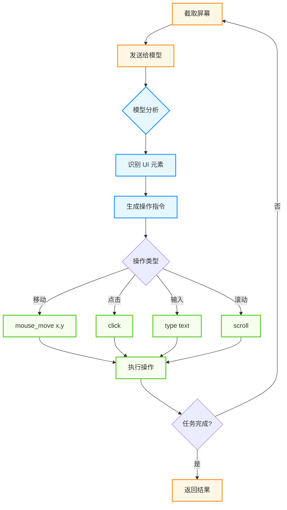

图 4-9：计算机操作循环

#### 代码示例

下面用一个最小循环说明这类方案的骨架：截屏、交给模型决策、执行动作，再回到截屏。

```python
import os

client = Client(model=os.environ["BROWSER_AGENT_MODEL"])
username = os.environ["DEMO_USERNAME"]

while not done:
    screenshot = capture_screen()
    action = client.decide_action(
        image=screenshot,
        goal=f"请登录这个网站，用户名是 {username}"
    )
    done = execute_ui_action(action)
```

#### 浏览器智能体

一些平台提供了面向网页任务的浏览器智能体形态：结合规划 + 浏览器操作，可执行订票、购物、表单填写等多步骤任务。工程上最好把它和“任意桌面 / 任意 GUI 的 computer use”分开看待：前者通常局限在浏览器沙箱，后者风险面更大、成熟度判断也要更保守。

常见能力包括：端到端任务执行、多步骤规划、错误恢复、人机接管（敏感操作暂停等待用户）。

### 5.5 混合模式：视觉与代码结合

将“视觉”与“代码”结合是 DOM-based 和视觉感知的融合方向。一些 IDE/开发工具的可视化编辑能力展示了这种新型交互形态。

#### 工作模式

以下图示展示了可视化预览、源代码和智能体之间的交互关系：

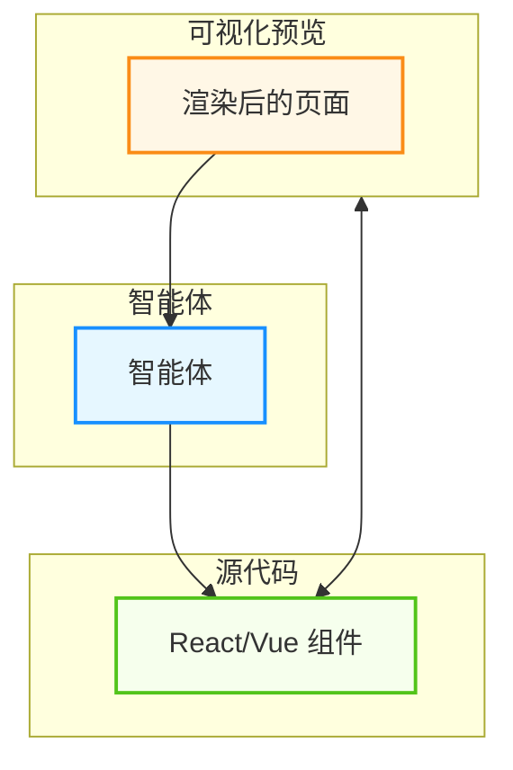

图 4-10：可视化编辑器交互模型

#### 应用场景

这类可视化编辑最典型的用法，是让用户直接指着渲染结果提要求，由智能体完成从视觉定位到代码修改的映射。

```markdown
用户：（指向渲染页面上的按钮）
"把这个按钮的圆角改大一点，颜色改成蓝色渐变"

智能体：
1. [视觉识别] 定位到页面中的按钮元素
2. [代码映射] 找到对应的 React 组件 Button.tsx
3. [修改代码] 更新 className 和 style
4. [实时预览] 页面立即更新显示效果

用户：（满意）"好的，再把文字改成白色"

智能体：
1. 继续修改同一组件
2. 更新文字颜色
3. 保存更改
```

### 5.6 主流浏览器自动化框架对比

在选择浏览器自动化框架时，需要考虑延迟、可靠性、成本和易用性等多个维度。

#### 框架对比表

| 框架 | 工作原理 | 性能 | 学习曲线 | 生产就绪 | 特色 |
|------|---------|------|--------|--------|------|
| **Playwright** | CDP 协议 + 无头浏览器 | 快速（200-500ms） | 中 | ✅ | 跨浏览器、稳定 |
| **Selenium** | WebDriver 标准 | 中等（500-2000ms） | 低 | ✅ | 生态成熟、广泛支持 |
| **Puppeteer** | Chrome DevTools Protocol | 快速（200-500ms） | 中 | ✅ | Chrome 专用、轻量 |
| **视觉感知(Vision)** | 图像识别 + LLM | 慢速（2-5s） | 高 | ⚠️ | 通用性强、自适应 |

#### Playwright vs Selenium 深度对比

| 特性 | Playwright | Selenium |
|------|-----------|----------|
| **跨浏览器** | ✅ 原生支持 Chromium、Firefox、WebKit | ✅ 支持，需配置 |
| **性能** | 更快（CDP 协议） | 较慢（WebDriver） |
| **API** | 现代异步 | 传统同步 |
| **生态** | 新兴 | 成熟完善 |
| **跨语言** | 有限 | 广泛（Java、Ruby、JS） |

**代码对比**：

```python
# Playwright：灵活的元素定位
from playwright.async_api import async_playwright

async def test_with_playwright():
    async with async_playwright() as p:
        browser = await p.chromium.launch()
        page = await browser.new_page()
        await page.goto("https://example.com")
        await page.locator("button:has-text('Submit')").click()

# Selenium：显式等待
from selenium import webdriver
from selenium.webdriver.common.by import By
from selenium.webdriver.support.ui import WebDriverWait
from selenium.webdriver.support import expected_conditions as EC

def test_with_selenium():
    driver = webdriver.Chrome()
    driver.get("https://example.com")
    WebDriverWait(driver, 10).until(
        EC.presence_of_element_located((By.XPATH, "//button[contains(text(), 'Submit')]"))
    ).click()
```

#### Puppeteer 的适用场景

Puppeteer 最适合：
- **Chrome/Chromium 专属场景**（不需要跨浏览器）
- **高性能需求**（需要毫秒级延迟）
- **复杂交互自动化**（JavaScript 操作）

```javascript
// Puppeteer 例子：执行 JavaScript 交互
const puppeteer = require('puppeteer');

(async () => {
  const browser = await puppeteer.launch();
  const page = await browser.newPage();
  await page.goto('https://example.com');

  // 在页面上下文中执行JavaScript
  const result = await page.evaluate(() => {
    // 这段代码在浏览器中执行
    return document.querySelector('.result').textContent;
  });

  await browser.close();
})();
```

### 5.7 视觉定位 vs DOM 定位的权衡

#### DOM 定位的最佳实践

DOM 定位快速可靠，但需应对页面结构变化。采用多策略查找降低脆弱性：

```python
class RobustDOMLocator:
    def __init__(self, page):
        self.page = page

    def find_by_multiple_strategies(self, target_name: str):
        """多策略回退：ID → aria-label → data-testid → text → class"""
        strategies = [
            f"#{target_name}", f"[aria-label='{target_name}']",
            f"[data-testid='{target_name}']", f"button:has-text('{target_name}')",
            f"[class*='{target_name.lower()}']",
        ]
        for selector in strategies:
            try:
                element = self.page.query_selector(selector)
                if element: return element
            except:
                continue
        raise RuntimeError(f"Could not locate {target_name}")

    def click_with_retry(self, selector, max_attempts=3):
        """失败重试，最终降级到视觉操作"""
        for attempt in range(max_attempts):
            try:
                self.find_by_multiple_strategies(selector).click()
                return True
            except Exception:
                if attempt == max_attempts - 1:
                    return self._click_by_vision(selector)
                time.sleep(0.5)
```

#### 视觉感知的实际应用

当 DOM 定位不可用时，可以退回纯视觉路径：把截图交给多模态模型，让它直接给出坐标级的操作指令。

```python
class VisionBasedInteraction:
    def __init__(self, model):
        self.model = model

    def interact_with_screenshot(self, task: str, screenshot: bytes) -> dict:
        """分析截图，返回操作指令：{"action": "click", "x": 342, "y": 215}"""
        import base64
        encoded = base64.b64encode(screenshot).decode()
        response = self.model.generate(
            prompt=f"Task: {task}\nRespond: {{'action': 'click'|'type'|'scroll', 'x': int, 'y': int}}",
            image_data=encoded, image_type="image/png"
        )
        return json.loads(response.content)

    def loop_until_task_complete(self, task: str, page, max_iterations: int = 10) -> dict:
        """循环：截屏→分析→操作→检查→重复"""
        for i in range(max_iterations):
            screenshot = page.screenshot()
            check = self.model.generate(
                prompt=f"Task: {task}\nCompleted? {{'completed': bool, 'reason': str}}",
                image_data=base64.b64encode(screenshot).decode(), image_type="image/png"
            )
            if json.loads(check.content)["completed"]:
                return {"success": True, "iterations": i}
            action = self.interact_with_screenshot(task, screenshot)
            self._execute_action(page, action)
        return {"success": False, "reason": "max_iterations_reached"}
```

### 5.8 生产中的稳定性挑战与解决方案

浏览器自动化在生产环境中需应对四类问题：

**问题一：页面加载不完整** - 动态内容未渲染。解决：`page.wait_for_selector(".content", state="visible", timeout=5000)` 等待目标元素出现，或 `page.goto(url, wait_until="networkidle")` 等待网络空闲。

**问题二：网络不稳定导致随机失败** - 使用指数退避重试（3 次尝试，延迟为 1s → 2s → 4s），超时设为 30 秒，失败时 reload() 重新导航。

**问题三：JavaScript 动态渲染** - 等待网络空闲（networkidle），或等待特定元素出现（wait_for_selector），或注入 JavaScript 等待自定义事件（page.evaluate）。

**问题四：授权与反滥用限制** - 只自动化自己拥有权限或已获授权的网站；设置 User-Agent、等待 networkidle、添加退避和速率限制，都是为了让授权流程更稳定，而不是规避风控。遇到 Cloudflare 等反滥用保护时，不要把绕过保护当作生产方案，应改用官方 API、白名单测试环境、合作方数据接口或人工授权流程。

### 5.9 Computer Use 类方案的最新进展

随着多模态模型（视觉+文本）的进展，出现了“Computer Use”类方案，让模型可以在截图反馈回路中提出点击、输入、滚动等动作建议。根据各厂商最新官方资料，**不同厂商与产品的 computer use / browsing 成熟度分化明显**。有的已经提供更稳定的浏览器或受限环境集成，有的仍明确标注为 beta / preview，旧 preview 接口也常只为兼容历史集成而保留。

#### Computer Use 架构

Computer Use 的运行形态是一个以截图为反馈的闭环，模型每一步只根据当前画面决定下一个动作。

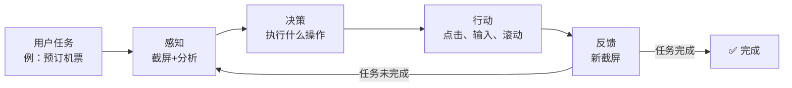

图 4-11：Computer Use 的感知-决策-行动闭环

#### 实现原理

把上面的闭环落成代码，核心是一个带步数上限的循环，以及每一步都必须重新截屏这一约束。

```python
class ComputerUseAgent:
    def __init__(self, model, browser):
        self.model = model
        self.browser = browser

    def act(self, goal: str, max_steps: int = 10):
        for step in range(max_steps):
            screenshot = self.browser.screenshot()
            response = self.model.generate(messages=[{
                "role": "user",
                "content": [
                    {"type": "image", "source": {"type": "base64", "media_type": "image/png", "data": screenshot}},
                    {"type": "text", "text": f"Goal: {goal}\nStep {step}: Respond in JSON: {{\"type\": \"click\"|\"type\"|\"scroll\"|\"finish\", \"x\": int, \"y\": int}}"}
                ]
            }])
            action = json.loads(response.content)
            if action["type"] == "finish":
                return {"success": True, "result": action.get("result"), "steps": step}

            # 执行对应操作
            if action["type"] == "click":
                self.browser.click(action["x"], action["y"])
            elif action["type"] == "type":
                self.browser.type(action["text"])
            elif action["type"] == "scroll":
                self.browser.scroll(action.get("direction", "down"))
            time.sleep(1)
        return {"success": False, "reason": "max_steps_exceeded"}
```

#### Computer Use 的优势与局限

| 维度 | 优势 | 局限 |
|------|------|------|
| **通用性** | 可操作任意 GUI，无需集成 API | 速度慢（每次 2-5 秒） |
| **鲁棒性** | 页面结构变化不影响操作 | 成本高（每次视觉分析）|
| **易用性** | 开发简单，快速原型 | 容易被反爬虫阻止 |

实践上，**browser-scoped browsing** 往往先于“跨桌面任意 GUI computer use”进入更可控的可用阶段；无论厂商是否提供 GA 路径，高权限环境、破坏性操作和认证态会话都仍应默认要求沙箱、域白名单与人类确认。

### 5.10 实战建议：选择合适的方案

前面几种方案没有绝对优劣，选择取决于目标系统有没有 API、页面是否稳定，以及你能接受多大的不确定性。

```text
任务类型与方案选择决策树：

├─ 内部系统/已有API
│  └─ 使用 API 或数据库连接（最佳）
│
├─ 稳定的商业网站（如 AWS、GitHub）
│  └─ 使用 DOM-based（Playwright/Selenium）+ XPath
│
├─ 动态渲染+频繁变化的网站
│  └─ 使用视觉感知（Vision + Computer Use）
│
├─ 反爬虫保护很强的网站
│  └─ 考虑：(1) 是否有 API，(2) 是否值得成本，(3) 人工操作
│
└─ 一次性/原型任务
   └─ 使用 Computer Use（快速开发）
```

赋予智能体“手”的同时也引入了巨大风险。如果智能体不小心删除了数据库或发送了钓鱼邮件，后果严重。

#### 三层防御体系

浏览器与计算机操作直接触达真实环境，因此防御要分层设置，从环境隔离一直做到动作审计。

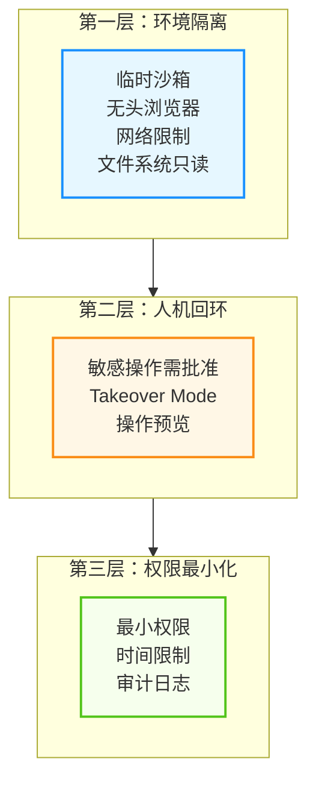

图 4-12：安全防御三层体系

#### 敏感操作分级

| 级别 | 操作类型 | 处理方式 |
|------|---------|---------|
| 低 | 读取公开页面、搜索 | 自动执行 |
| 中 | 填写表单、点击按钮 | 日志记录 |
| 高 | 提交订单、发送消息 | 预览确认 |
| 极高 | 支付、删除数据、密码输入 | 人工接管 |

#### 安全配置示例

以下示例展示了如何实现操作黑名单、高风险确认和审计日志：

```python
class SecureComputerUse:
    """安全的计算机操作封装"""

    BLOCKED_ACTIONS = [
        ("navigate", r".*bank.*"),
        ("type", r"password=.*"),
        ("click", r".*delete.*all.*"),
    ]
    HIGH_RISK_PATTERNS = [r".*payment.*", r".*checkout.*", r".*confirm.*order.*"]

    def execute(self, action: dict) -> dict:
        # 检查黑名单
        for action_type, pattern in self.BLOCKED_ACTIONS:
            if action["type"] == action_type and re.match(pattern, str(action.get("target", ""))):
                return {"blocked": True, "reason": "Forbidden action"}

        # 高风险操作需确认
        if any(re.match(p, str(action)) for p in self.HIGH_RISK_PATTERNS):
            if not self.get_user_confirmation(action):
                return {"blocked": True, "reason": "User declined"}

        # 记录审计日志并执行
        self.audit_log(action)
        return self.do_execute(action)
```

---

**下一节**: 4.6 多模态能力

## 6. 多模态能力

世界不仅仅由文字组成。人类通过眼睛（视觉）、耳朵（听觉）感知世界，通过绘画、语音表达观点。**多模态智能体（Multimodal Agent）** 突破了纯文本的限制，能够理解图像、处理音频、观看视频，并生成丰富多彩的内容。

本节探讨 LMM（Large Multimodal Model）如何让智能体获得“五官”，以及如何构建能够看、听、说、画的全能智能体。

### 6.1 视觉智能

视觉是人类获取信息最主要的渠道。赋予智能体视觉感知能力，使其能够像人类一样“看”懂屏幕和物理世界，是迈向通用人工智能的重要一步。

#### 视觉感知

不少多模态模型都具备较强的视觉理解能力。它们不再是将图片转成文字描述，而是直接 **理解** 像素。**图像提示（Prompting with Images）**：

通过将图像以 Base64 编码形式与文本一起发送给模型，智能体可以“看”并理解图像内容：

```python
import base64
import os

client = Client(model=os.environ["MULTIMODAL_MODEL"])
with open("report.png", "rb") as f:
    image_b64 = base64.b64encode(f.read()).decode()

response = client.generate(input=[
    {"type": "image", "data": image_b64},
    {"type": "text", "text": "分析这张财报，指出三个关键趋势"}
])
```

**多图对比分析**：

在同一请求中发送多张图像，让模型进行对比分析：

```python
messages = [{
    "role": "user",
    "content": [
        {"type": "text", "text": "比较这两张财报图表，哪家公司的增长更健康？"},
        {"type": "image", "source": {"type": "base64", "media_type": "image/png", "data": report_a_b64}},
        {"type": "image", "source": {"type": "base64", "media_type": "image/png", "data": report_b_b64}}
    ]
}]
```

**技术原理：LMM 如何“看见”？** LMM 将图像转化为“视觉 Tokens”：视觉编码器（CLIP/ViT）将图像分块提取特征，投影层映射到 LLM 空间，LLM 将其与文本 Token 并联处理。

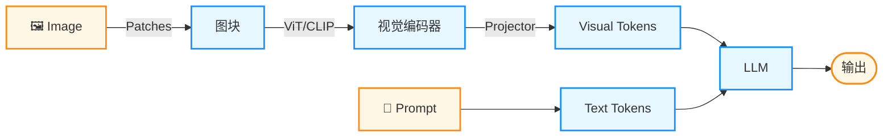

图 4-13：LMM 视觉处理架构

#### 视觉行动

除了“看”，智能体还可以通过视觉与设备交互。通过截屏→识别元素→计算坐标→执行触摸的循环实现自动化操作。详见 第 4.5 节。

以下是 GUI 智能体的“观察-思考-行动”循环实现：

```python
class VisualGUIAgent:
    """通用的视觉 GUI 智能体：观察→思考→行动"""

    def run_task(self, goal: str):
        history = []
        while not self.is_done():
            # 1. 观察：屏幕截图 + 布局信息
            screenshot, xml_dump = self.env.observe()

            # 2. 思考：LMM 决策下一步动作
            action = self.lmm.predict(
                image=screenshot, layout=xml_dump,
                instruction=goal, history=history
            )

            # 3. 行动：执行操作
            self.env.step(action)
            history.append((screenshot, action))
            time.sleep(1.0)
```

**技术原理：视觉定位 (Visual Grounding)** 核心难点是输出精确的 `(x, y)` 像素坐标。主流方案是**标号集（Set-of-Marks, SoM）**：先用检测模型（SAM/IconDet）识别所有可交互元素并编号（1,2,3...），LMM 只需输出“点击标号 5”，脚本再映射回实际坐标。这将复杂的坐标回归简化为多项选择，大幅提高准确率。

**这一能力的典型应用场景**：

| 场景 | 描述 | 技术实现 |
|------|------|---------|
| **UI 自动化** | 像人一样操纵软件 | 截图 → 识别元素 → 点击坐标 |
| **文档智能** | 理解文档的布局和结构 | 图像输入 → 提取表格/流程图 |
| **视频理解** | 回答关于视频内容的问题 | 抽帧 → 图像序列分析 |
| **代码审查** | 分析架构图和流程图 | 图像理解 → 代码建议 |

#### GUI 智能体的失败模式与安全护栏

尽管 GUI 智能体展现出了强大的潜力，但在实际工程落地中，让 AI 直接接管鼠标和键盘伴随着极大的不确定性与风险。

**常见失败模式 (Failure Modes)**：
1. **定位偏移 (Grounding Offset)**：模型正确理解了意图，但输出的点击坐标偏离了目标元素几像素，导致点击了旁边的广告或关闭按钮。
2. **状态误判 (State Misjudgment)**：界面加载缓慢或出现弹窗遮挡时，智能体依然按照预期状态点击，导致操作完全错位（例如在加载动画上反复点击）。
3. **严重破坏性后果 (Irreversible Actions)**：如误删文件、发送乱码邮件等。由于模型缺乏现实常识，它很难感知点击 “Delete” 或 “Send” 按钮的严重后果。

**必备安全护栏 (Safety Guardrails)**：
- **硬编码黑/白名单**：在环境控制层拦截对系统关键区域或危险应用的访问（例如禁止焦点切入终端、系统设置、网银页面）。
- **敏感操作人工确认 (HITL)**：涉及支付、删除、发送等破坏性操作时，环境必须挂起执行并通知人类二次授权（Human-in-the-loop）。
- **动作频控与熔断**：限制智能体每分钟的最大动作数量、连续异常重试次数，防止失控后的无底线重试或循环点击。
- **DOM / API 优先**：如果仅需获取信息或执行确定性修改，在有后门 API 或 DOM 树可用的情况下，尽量不要使用纯视觉机械点击的黑盒方案。

### 6.2 听觉与语音交互

未来的智能体交互将是 **语音优先（Voice-First）** 的。让智能体能听、能说，并理解语气及情绪。


语音处理有两种主要架构：传统的 ASR→LLM→TTS 流水线，和新型的端到端语音模型。

**技术原理：音频也是 Token** 端到端模型将音频离散化为 Audio Tokens（VQ-VAE/SoundStream），1 秒语音约 25-50 个 Token ID。LLM 像处理文本 Token 一样直接预测音频 Token，实现端到端语音生成。

| 方案 | ASR→LLM→TTS | 端到端模型 |
|------|-------------|----------|
| 延迟 | 高（三次转换） | 低 |
| 情绪感知 | 仅文字 | 语音表现力 |
| 自然度 | 机械 | 接近真人 |

**自动语音识别 (Automatic Speech Recognition, ASR)**

业界常见做法是使用语音识别（ASR）模型进行转写，并尽可能保留时间戳与分段信息：

```python
import os

asr = ASRModel(name=os.environ["ASR_MODEL"])
result = asr.transcribe(
    "meeting_recording.mp3",
    language="zh"
)
for segment in result.segments:
    print(f"[{segment.start:.1f}s - {segment.end:.1f}s] {segment.text}")
```

**语音合成 (Text-to-Speech, TTS)**

现代 TTS 系统支持多种音色、情绪控制和语调调整：

```python
import os

tts = TTSModel(name=os.environ["TTS_MODEL"])
audio = tts.synthesize(
    text="非常抱歉给您带来不便...",
    voice=os.environ["TTS_VOICE"],
    style={"stability": 0.3, "similarity_boost": 0.5}
)
tts.save(audio, "apology.mp3")
```


### 6.3 图像生成与编辑

除了看和听，智能体还能像艺术家一样创作。常见实现既包括扩散模型，也包括原生多模态图像模型，或两者结合的系统。对智能体工程而言，更重要的是把“生成 / 编辑 / 局部重绘”封装为稳定工具，而不是预设后端一定是 diffusion-only。

#### 图像生成工作流

智能体不直接逐像素作画，而是充当 **创意导演 / 编辑器**，通过工具调用控制生成或编辑模型：

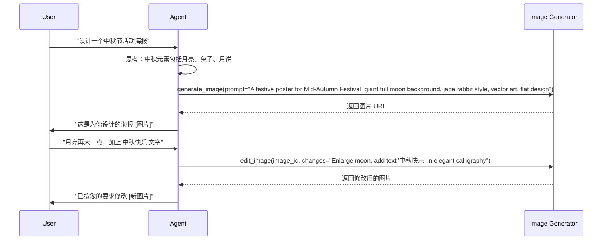

图 4-14：图像生成与编辑工作流

#### 工具定义

| 工具 | 参数 | 示例 |
|------|------|------|
| **generate_image** | prompt(str), style(enum) | “生成中秋节海报” |
| **edit_image** | image_url, mask_description, edit_prompt | “把这只狗换成猫” |
| **inpaint** | image, mask, description | 替换图像特定区域 |
| **outpaint** | image, direction | “向左右延伸图像” |
| **style_transfer** | image, target_style | “转换为油画风格” |

### 6.4 多模态架构与实战

在设计多模态智能体时，核心挑战是 **模态对齐（Modality Alignment）**。

#### 架构设计

多模态智能体包括输入编码、融合层、推理核心和多模态输出：

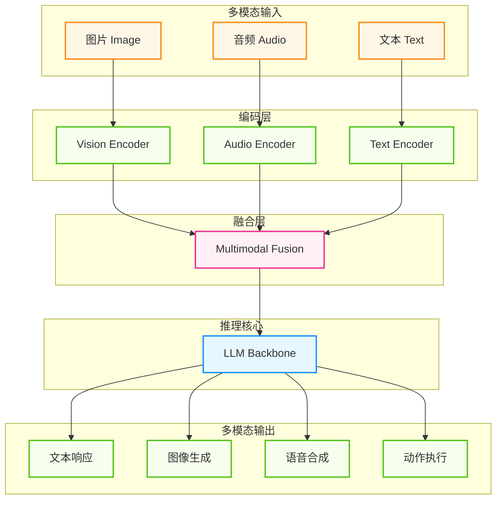

图 4-15：多模态智能体架构

| 策略 | 描述 | 适用场景 |
|------|------|---------|
| **早期融合** | 在编码层合并所有模态 | 紧密相关的多模态任务 |
| **晚期融合** | 各模态独立处理后合并 | 松散关联的任务 |
| **统一词表** | 所有模态映射到同一空间 | 端到端生成任务 |

#### 实战：构建多模态客服智能体

以下示例展示了一个完整的多模态客服智能体实现，它能够处理语音、图像和文本输入，并根据用户情绪调整回复语气：

```python
class MultimodalCustomerService:
    """多模态客服智能体"""

    async def handle_request(self, request: MultimodalRequest):
        context = []

        # 处理语音：转录 + 情绪识别
        if request.audio:
            text = await self.asr.transcribe(request.audio)
            emotion = await self.asr.detect_emotion(request.audio)
            context.append({"type": "text", "content": text})
            context.append({"type": "emotion", "content": emotion})

        # 处理图像
        if request.images:
            for img in request.images:
                analysis = await self.vision_model.analyze(img)
                context.append({"type": "image_analysis", "content": analysis})

        # LLM 推理
        response = await self.llm.generate(
            system="你是友好的客服助手", context=context
        )

        # 多模态响应
        result = MultimodalResponse(text=response.text)
        if response.should_show_image:
            result.image = await self.generate_illustration(response.image_prompt)
        if request.prefers_audio:
            voice_style = {"angry": {"stability": 0.5, "speed": 0.9},
                          "happy": {"stability": 0.3, "speed": 1.1}}.get(emotion)
            result.audio = await self.tts.speak(response.text, style=voice_style)
        return result
```

### 6.5 长上下文能力

多模态智能体的另一个关键维度是 **上下文窗口（Context Window）** 的扩展。2026 年，主流模型已支持 200K 乃至 1M+ tokens 的上下文窗口，这意味着智能体可以一次性接收大量材料（书稿、长文档集、代码库等），而不再受限于片段化处理。

#### 长上下文 vs 传统上下文

| 维度 | 传统模型（4K-128K） | 1M+ tokens 模型 |
|------|---------------------|-----------------|
| 单次对话 | 10-20 轮 | 数百轮 |
| 文档分析 | 最多 10-50 页 | 更长文档或多文档联合分析 |
| 代码库分析 | 单个文件 | 大型项目中的关键文件集或较完整仓库切片 |
| 信息保持 | 前面信息逐渐“遗忘” | 具备更强的长程引用能力，但仍需检索与验证 |

#### 典型应用场景

长上下文在以下场景中展现价值：

- **代码库分析**：全代码库安全审计、架构分析或重构建议
- **知识库问答**：跨多个文档的综合分析和交叉引用
- **文档处理**：整个项目文档的关联分析
- **长文本理解**：完整书籍或长篇论文的分析

#### 成本优化策略

长上下文虽然强大，但使用整个上下文可能成本高昂。推荐采用 **渐进式策略**：先用向量搜索缩小范围，不够再逐步扩展。详细的长上下文管理策略请参考 第 3 章 记忆与上下文。

```python
from anthropic import Anthropic

# 渐进式上下文管理示例
client = Anthropic()
model = "claude-sonnet-4-6"

def ask(docs):
    return client.messages.create(
        model=model,
        max_tokens=4096,
        messages=[{"role": "user", "content": prepare_context(docs, query)}]
    )

# 逐级升档：每一档都要先真的问一次模型，再用它的回答决定要不要加料
# 第 1 步：用向量搜索找最相关文档（低成本）
response = ask(vector_search(query, top_k=5))

# 第 2 步：如果不足，扩展到更多文档
if insufficient_info(response):
    response = ask(vector_search(query, top_k=15))

# 第 3 步：仍不够时，加载完整上下文
if insufficient_info(response):
    response = ask(load_full_context())
```

这种策略在大多数情况下可将成本降低 80% 以上——只有少数复杂问题才需要加载完整上下文。

---

**下一节**: 4.7 智能体交互体验：人机交互接口

## 7. 智能体交互体验：人机交互接口

传统对话式界面（Chatbot UI）面向简单任务，随着智能体能力的提升，用户和智能体的交互需求日益复杂。当智能体具备了工具使用、长期记忆和多步规划能力后，需要一种全新的交互范式——**智能体交互体验**。本节将探讨如何设计适应智能体的人机交互接口，从生成式界面到伴随式交互，重新定义人与 AI 的协作方式。

### 7.1 从 Chatbot 到 Agentic UI

用户界面的演进总是伴随着交互方式的变革。从简单的对话框发展到能够感知状态、支持协作的智能体界面，是 AI 能力提升的必然要求。

#### “Prompt as UI” 的局限性

在 LLM 早期，所有的交互都压缩在单一的聊天窗口中。这种模式对于简单的问答（QA）是有效的，但对于复杂的智能体任务存在显著缺陷：

1. **信息密度低**：纯文本难以展示结构化数据（如数据报表、架构图）。
2. **交互性差**：用户无法直接修改智能体的中间产物，只能通过新的提示词（Prompt）进行修正。
3. **状态不可见**：用户不知道智能体在规划什么，导致“等待焦虑”。

#### 智能体交互体验的核心特征

智能体交互体验是一种 **多模态、动态、状态感知** 的界面范式：
* **富交互（Rich Interaction）**：不仅是文本，还包括动态生成的 GUI 组件（按钮、表单、图表）。
* **协作式（Collaborative）**：用户可以随时介入智能体的工作流，进行修改或确认。
* **透明化（Transparent）**：通过 UI 可视化计划摘要、当前步骤、证据引用和工具调用状态；是否展示更细粒度推理取决于产品策略，不应把暴露 raw Chain of Thought 写成通用核心要求。

### 7.2 生成式界面

生成式界面指的是智能体根据当前的意图和数据，**动态生成** 最适合的 UI 组件呈现给用户。

#### 动态组件生成

智能体不仅生成文本，还能生成 React/Vue 组件。例如：
* **天气查询**：智能体不只是说“今天是晴天”，而是渲染一个带有温度曲线和天气图标的卡片。
* **数据分析**：当用户问“分析上季度销售额”时，智能体直接渲染一个可交互的 ECharts 柱状图。

**实现原理** 其核心思想是将 **工具调用** 与 **React Server Components (RSC)** 结合。
1. **定义工具与 UI**：在服务端定义工具（如 `showWeather`），并在其 `generate` 方法中直接返回一个 React 组件（如 `<WeatherCard />`），而不仅是 JSON 数据。
2. **智能路由**：`streamUI` 函数将用户的 Prompt 发送给大模型。
3. **流式渲染**：如果模型决定调用 `showWeather`，SDK 会在服务端执行该工具，获取数据，渲染组件，并将渲染结果流式传输（Stream）给前端。前端就像接收文本流一样接收这个 UI 组件流。

下面是一个例子。

```typescript
// 智能体决定渲染什么 UI（伪代码示例）
import { z } from 'zod';

async function renderUI(input: string) {
  const result = await streamUI({
    model: '<MODEL>',
    system: 'You are a helpful assistant.',
    prompt: input,
    tools: {
      showWeather: {
        description: 'Show weather forecast',
        parameters: z.object({ location: z.string() }),
        generate: async ({ location }) => {
          const data = await getWeather(location);
          // 返回一个 React 组件作为结果
          return <WeatherCard data={data} />;
        },
      },
    },
  });
  return result;
}
```

#### 上下文自适应渲染

UI 应该根据上下文自动调整形态：
* **移动端**：生成简洁的卡片视图。
* **桌面端**：生成带有详细数据表格的仪表盘。
* **新手模式**：通过 GUI 引导用户操作。
* **专家模式**：提供更密集的命令行或代码编辑器界面。

### 7.3 延迟掩盖与流式反馈

智能体的思考和工具调用往往需要较长时间（数秒甚至数分钟）。为了保持良好的用户体验，必须妥善处理延迟。

#### 思考状态可视化

不要让 UI 假死。通过流式输出来展示智能体的“心跳”：
1. **规划阶段**：显示 “Planning tasks...”，并列出待办事项清单。
2. **执行阶段**：显示 “Searching web for...”, “Analyzing data...”。
3. **结果阶段**：逐步渲染最终内容。

这里的“可见性”通常应优先落在**计划摘要、阶段状态、可检查证据、工具进度与可取消性**上，而不是默认暴露未经筛选的内部推理文本。

**最佳实践：**
* **Skeleton Screens（骨架屏）**：预测即将生成的内容结构，先展示骨架。
* **Optimistic UI（乐观更新）**：假设操作成功，立即在 UI 上反映变化，后台异步确认。如果失败则回滚并提示。

#### 流式组件

利用 React Server Components (RSC) 等技术，实现组件级的流式传输。
*   文本内容逐字显示。
*   图表数据点逐个加载。
*   图片先显示模糊占位图，再逐步清晰。

### 7.4 伴随式交互

智能体不应总是占据屏幕中心，更多时候它应该作为一个 **助手（Side-kick）** 伴随用户工作。

#### 隐式触发

智能体通过观察用户的行为主动提供帮助，而不需要用户显式输入 Prompt。
* **代码补全**：当你输入 `def calculate_` 时，幽灵文本（Ghost text）自动建议函数体。
* **上下文感知建议**：当你在写文档提到“下周会议”时，侧边栏自动浮现日历组件建议安排日程。

#### 画布交互

以“画布 + 对话”的交互模式为代表。
* **Content-First**：左侧是聊天，右侧是文档/代码编辑器。
* **指向性编辑**：用户在右侧选中一段代码，在左侧说“优化这段逻辑”，智能体直接修改右侧内容。
* **Diff 视图**：清晰展示智能体的修改建议，用户一键 Accept/Reject。

#### 人工干预设计

在关键节点允许人类介入是至关重要的。**Human-in-the-Loop (HITL)** 机制让用户对敏感决策进行确认。设计清晰的批准/拒绝按钮，并用颜色编码风险等级；允许用户在批准前对参数进行微调；给予用户“后悔药”，在执行初期允许取消（Cancel）。关于 HITL 的协作模式与架构详见 5.4 人机协作。

### 7.5 从 UX 到 AX：智能体体验设计（前瞻视角）

前几节聚焦于“人看到的界面”，但从趋势上看，部分软件产品的“第一使用者”正在逐步从人类扩展到其他智能体或自动化流程。这催生了一个更偏前瞻性的设计话题——**智能体体验（Agent Experience, AX）**。

#### 角色转变：从操作者到委托者

当智能体承担更多端到端工作流后，人类在部分软件系统中的角色会从直接操作 GUI 的“操作者”（Operator），逐步转向设定高层目标与监督结果的“委托者”（Delegator）。这并不意味着传统 UX 失效，而是意味着很多系统需要同时面向“人类用户 + 外部智能体”双重受众。

#### API 是新的“用户界面”

在 AX 视角下，API、结构化数据格式和模型上下文协议会越来越像“机器的界面”。更稳妥的说法不是“API 取代 UI”，而是：未来的软件平台需要同时优化 **人类可用性** 与 **机器可读性**。AX 设计的核心目标，是提升平台的“机器可读性”与“意图可执行性”——将复杂业务能力映射为智能体可稳定调用的工具与协议（参见 4.3 MCP）。

#### 商业指标的迁移：从 DAU 到 DAA

传统互联网企业依赖 DAU 等人类行为指标来评估产品健康度。若智能体代劳的比例持续上升，一些团队可能会引入类似 DAA（Daily Active Agents）这类补充指标，衡量“程序化调用产生的业务价值”。不过这仍属于新兴实践，更适合作为补充指标，而不是已经定型的行业金标准。

---

**下一节**: [本章小结](summary.md)
