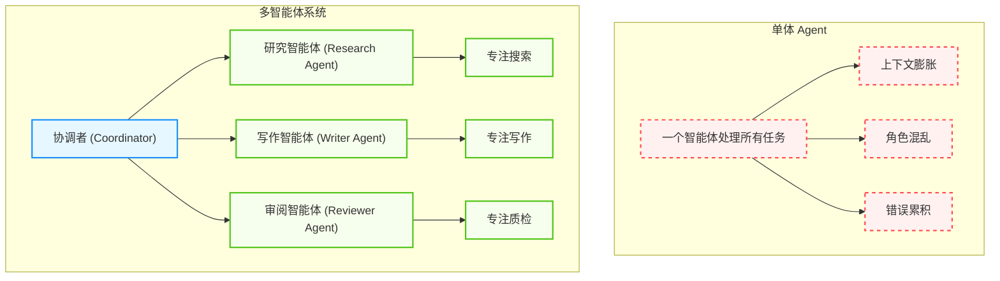
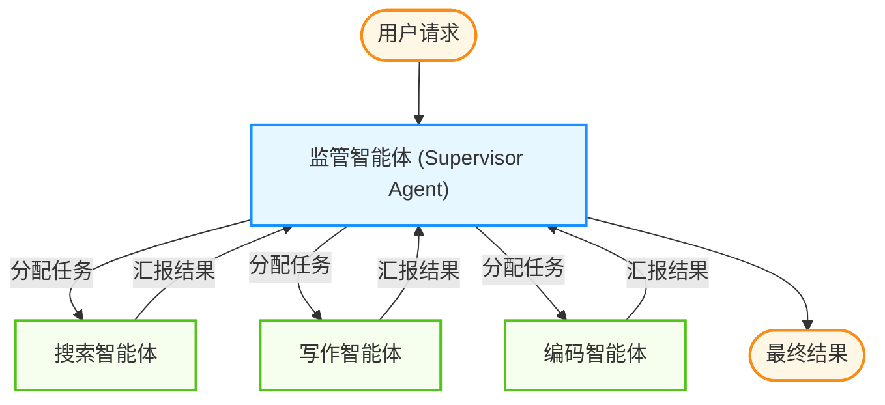
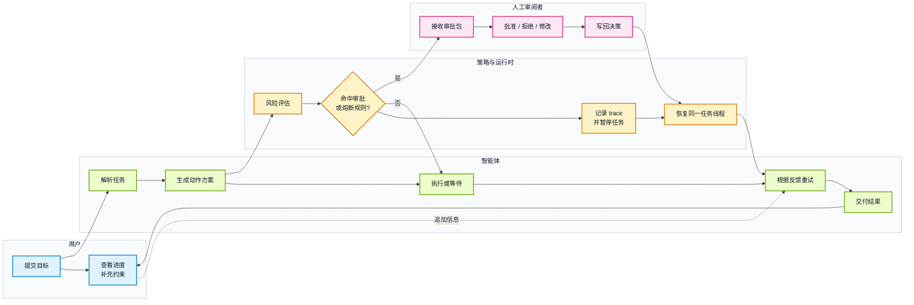

# 第五章 多智能体协作模式

多智能体系统通过专业分工与协作，能涌现出处理复杂问题的能力。本章探索不同的协作架构（层级式、扁平式、动态组队）、角色定义与 SOP 标准程序以及人机协作机制。通过精心设计，让一组智能体发挥出远超个体的力量。

完成本章后，你将能够：

1. **设计** 适合场景的协作架构与角色分工
2. **实现** 标准作业程序(SOP)与任务流程编排
3. **优化** 动态组队与自适应编排机制
4. **整合** 人机协作实现可控的多智能体系统


本章按“先定架构 → 再定角色与流程 → 再谈动态调整 → 最后把人放回环内”的顺序展开：

- `5.1` 对比层级式、扁平式与动态组队三类协作架构的适用边界
- `5.2` 讲角色分工与 SOP，把协作从“靠提示词默契”变成可交付的流程
- `5.3` 讲动态组队与自适应编排，应对任务结构事先不可枚举的场景
- `5.4` 讲人机协作的介入点设计：在哪里暂停、由谁决定、如何恢复

## 1. 协作架构：层级、扁平与动态

### 1.1 为什么需要多智能体

正如一个人无法同时精通产品设计、后端架构、前端绘图和法律合规一样，指望单个智能体完成所有复杂任务是不现实的。**单体智能体** 面临以下瓶颈：

1. **上下文限制**：所有角色的指令都塞进一个系统提示词 (System Prompt)，会导致逻辑混乱，注意力分散。
2. **幻觉风险**：缺乏检查机制，自己产生的错误自己信以为真。
3. **能力专业化**：不同的任务需要不同的工具和提示词策略。
4. **Token经济性**：单一智能体处理复杂任务时，上下文膨胀导致 Token 成本激增

**多智能体系统** 通过 **分工** 和 **协作** 解决这些问题，实现“1+1>2”的涌现效果。



图 5-1：单体智能体与多智能体系统对比

### 1.2 角色定义与身份构建

每个智能体是一个独立的实体，拥有完整的“身份档案”：

| 属性              | 说明      | 示例                         |
| --------------- | ------- | -------------------------- |
| **Role**        | 职位定义    | 首席架构师                    |
| **Goal**        | 具体的 KPI | 设计可扩展的微服务架构  |
| **Backstory**   | 背景故事    | 你长期从事大型系统开发，崇尚简洁可维护的代码风格 |
| **Tools** | 专属工具权限  | HR 智能体可读工资单，Coding 智能体不可   |
| **Constraints** | 行为边界    | 不得讨论竞争对手产品   |

背景故事的设计尤为重要，它能显著影响 LLM 的输出风格。一个“资深律师”背景的智能体会比“实习生”输出更谨慎、更规范的文本。

### 1.3 主流协作拓扑

#### 1.3.1 顺序式架构

这是最简单的流水线模式，类似于传统的瀑布开发模型。

```bash
User → Product Manager → Tech Lead → Developer → Tester → Result
```

**工作机制**：

- 上一个智能体的 Output 直接成为下一个智能体的 Input
- 每个智能体完成其专属任务后，将结果传递给下游
- 整个流程是线性的、确定性的

**适用场景**：

- SOP 非常明确的任务
- 如“写一篇文章并翻译成三种语言”
- 静态工作流，步骤固定

**局限性**：

- 这是一个开环系统
- 如果源头（PM）的需求理解错了，后面全错
- 缺乏反馈修正机制

#### 1.3.2 层级式架构

引入一个 **监督者** 角色来动态分派任务。



图 5-2：层级式监督者架构

**核心角色**：

- **监管者(Supervisor)**：大脑角色，不干具体的活。分析用户需求，决定任务路由
- **执行者(Worker)**：执行者角色，只负责执行 Supervisor 分配的具体指令

**路由决策示例**：

```json
{
  "thought": "用户需要查询最新股价并生成分析报告",
  "next_agent": "FinanceSearchAgent",
  "args": {"ticker": "AAPL", "period": "1Y"}
}
```

**适用场景**：

- 复杂的、非线性的任务
- 需要根据中间结果动态调整下一步
- 任务优先级和资源分配需要集中控制

#### 1.3.3 联合协作式架构

类似于头脑风暴会议的模式，多个智能体在共享空间中自由交流。**工作机制**：

- **广播通信**：智能体 A 发言，其他所有智能体都能接收
- **轮次控制**：需要 Controller 决定发言顺序（如“CEO 发言后必须是 CTO”）
- **共识达成**：通过多轮讨论形成最终决策

**优势与风险**：

- ✅ 利用群体智慧涌现出意想不到的创意
- ✅ 模拟真实团队协作动态
- ❌ 容易跑题或陷入死循环争论
- ❌ Token 消耗较高

#### 1.3.3 混合智能体架构

这是一种前沿的 **模型级协作（MoA）**：一种常见思路是“多提议 + 再聚合”。

- **提议层**：多个模型/策略并行生成候选解（不同视角、不同温度或不同工具集）。
- **聚合层**：由一个聚合器对候选解做对比、去噪、融合，输出最终答案。

这种结构的价值主要在于提升稳健性与覆盖面，但会带来更高的成本与编排复杂度。

### 1.4 两种最常见的工程协作模式

虽然协作拓扑很多，但在真实工程里最常见、也最值得先掌握的是两种：

#### 1.4.1 Orchestrator-Subagent

这是当前最主流的多智能体工程模式。

- **Orchestrator**：负责理解总目标、拆解任务、分派子任务、汇总结果
- **Subagent**：只处理自己负责的子问题，不直接接管全局流程

它的优势在于：

1. 全局目标不容易漂移
2. 可以按角色做专业化分工
3. 更容易做权限控制、验收和回放

它的代价也很明确：

1. Orchestrator 容易成为瓶颈
2. 所有子任务都要经过中心节点，通信开销较高
3. 如果 Orchestrator 拆解得不好，下游再优秀也会偏题

#### 1.4.2 生产级案例：Anthropic Research 系统

Anthropic 在 2025 年 6 月 13 日公开的工程文章《How we built our multi-agent research system》中，介绍了其 Research 功能采用的 LeadResearcher-Subagent 模式。这是 Orchestrator-Subagent 架构在开放式研究任务中的一个公开案例。

**架构设计**：

- **LeadResearcher**：负责理解用户查询、制定研究策略、拆解子任务、综合发现，并在存在信息缺口时继续追加研究。
- **Subagent**（多个）：各自独立执行网页搜索、阅读结果、评估证据质量，再把发现返回给 LeadResearcher。
- **并行粒度**：Anthropic 公开写到，LeadResearcher 会先并行拉起 **3-5 个** subagents；配图里只画了两个，但原文明确说明数量并不固定。

**性能与成本权衡**：

- **性能提升**：在 Anthropic 的内部 research eval 中，多智能体 Research 系统相对单智能体 Claude Opus 4 提升 **90.2%**。这是该案例的内部评测结果，不应当外推成行业通用基准。
- **Token成本**：Anthropic 同时披露，其数据里普通 agent 流程大约消耗 chat interaction 的 **4 倍** token，而 multi-agent research 大约是 **15 倍**。这说明性能收益来自更高的“推理预算”，而不是免费提升。
- **适用范围**：该架构特别适合宽度优先查询，以及信息量明显超出单一上下文窗口的任务。

**关键工程实践**：

1. **明确任务边界**：LeadResearcher 给每个 subagent 指定清晰目标，减少重复搜索和无效重叠。
2. **并行搜索 + 中心综合**：并行扩展信息覆盖面，再由中心节点统一做取舍和汇总。
3. **结果不够就继续扩展**：LeadResearcher 会根据返回结果决定是否继续增补子任务，而不是一次性固定完整流程。

#### 1.4.3 Peer-to-Peer

这是更“去中心化”的协作方式。智能体之间处于相对平等的关系，通过协商、辩论、投票或相互审查来达成结论。

它适合：

- 需要多视角碰撞的任务
- 需要互相纠错的任务
- 更强调探索性而非确定性流程的任务

但它的工程难点也更大：

- 发言顺序和仲裁机制更难设计
- 更容易出现重复讨论和责任不清
- 观测、调试、计费都比层级式更复杂

经验上，如果你的任务属于“必须交付结果、必须可控回放、必须可审计”，优先从 **Orchestrator-Subagent** 开始；只有在确实需要多方博弈时，再引入 Peer-to-Peer 元素。

### 1.5 实战案例：长期自主编码

在长周期的自主编码任务里，系统常见的挑战包括：并发冲突、任务选择偏好（只挑简单的做）、上下文漂移、以及质量与速度的权衡。

一个常见的演进路径是从“扁平协作（人人平等、靠共享状态协同）”走向“分层协作（规划/执行/评审分工）”：

- **扁平模式的风险**：需要复杂的锁/协同协议；一旦异常退出或忘记释放资源，吞吐量会显著下降；同时容易出现“困难任务无人负责”。
- **分层模式的优势**：规划者只做拆解与分派，执行者专注交付，评审者负责验收与回退；执行者之间尽量隔离，从结构上降低协调成本。

!!! info "设计要点"
    
    如果系统出现“空转”（看似忙但无交付），优先收紧角色职责与交付接口，而不是继续堆叠协调机制。

在多智能体系统中，单纯增加 Agent 数量并不必然带来能力的线性提升，反而容易引入以下系统级失败节点：

1. **协同饥饿 (Coordination Starvation)**：多个 Agent 都在等待对方的前置输出，或因为共享资源竞争导致全局死锁。
2. **目标漂移 (Goal Drift)**：在多轮接力传导中，最初的用户意图被逐层稀释或扭曲，最终交付物虽“质量高”但完全偏题。
3. **无限回文 (Infinite Ping-Pong)**：审查者 Agent 与执行者 Agent 因为 Prompt 判定标准不一致（或缺乏仲裁机制），陷入“修改-打回-修改”的死循环。
4. **责任推诿 (Buck Passing)**：由于边界定义不清，Agent 错误判断某项模糊任务是“下游的职责”而直接跳过执行。

**防范措施**：清晰的角色定义和标准化的 SOP 流程是防止这些失败模式的关键。详见 5.2 角色分工与 SOP 流程编排，其中通过精心设计角色职责边界、输入输出接口和终止条件，可以有效降低这些系统级风险。

### 1.6 架构选型决策矩阵

| 架构类型  | 复杂度 | 延迟 | 成本 | 适用场景        |
| ----- | --- | -- | -- | ----------- |
| 顺序式   | 低   | 低  | 低  | 固定流程、SOP 任务 |
| 层级式   | 中   | 中  | 中  | 动态路由、复杂决策   |
| 联合协作式 | 高   | 高  | 高  | 创意生成、头脑风暴   |
| 混合架构  | 中   | 中  | 中  | 质量优先、模型集成   |

### 1.7 案例补充：编码场景中的协调器模式

编码任务同样常见“中心协调器 + 并行子任务”的协作方式：先把代码库分析、改动实施、验证检查拆成相对独立的子问题，再由上层节点做计划收敛与结果验收。

这里更稳妥的做法是抽象模式，而不是把某个具体产品的内部 worker 名册、swarm 上限或共享目录实现细节写成通用事实。对于公开资料不足的系统，应该只保留以下可迁移的工程原则：

1. **研究/分析阶段适合并行展开**：依赖扫描、风险识别、测试缺口分析往往可以分头进行。
2. **综合/决策阶段通常要收口**：当多个子任务结论互相冲突时，需要由协调器或人类做取舍。
3. **实施与验证可以再并行展开**：只要文件边界和验收接口清楚，编码与验证任务就能重新分片并行。
4. **可观测性比“多几个 agent”更重要**：没有清晰日志、回放和责任边界时，智能体数量越多，调试越困难。

### 1.8 本节小结

架构即政治。在设计智能体系统时，实际上是在设计一个人类组织的电子映射。选择 **顺序式** 还是 **层级式**，取决于你的业务流程是更像工厂流水线（追求效率），还是像咨询公司项目组（追求灵活）。

核心原则：

1. **专业化分工**：让每个智能体专注于其擅长的领域
2. **明确边界**：定义清晰的输入输出接口和责任范围
3. **容错机制**：设计失败处理和回退策略
4. **数字口径要回到具体案例**：性能提升、token 成本和并行规模都应绑定具体评测与公开来源，而不是写成放之四海而皆准的定律
5. **可观测性**：确保每个智能体的行为可追踪、可审计

**下一节**: [5.2 角色分工与 SOP 流程编排](5.2_roles_sop.md)

## 2. 角色分工与 SOP 流程编排

在多智能体系统中，明确的角色定义和标准化的工作流程是高效协作的基础。本节探讨如何为每个智能体设计独特的“人设”，以及如何通过 **标准作业程序 (SOP)** 来编排复杂的协作流程。

### 2.1 角色定义：智能体的身份证

每个智能体都应该拥有一张独特的“身份证”，包含以下核心要素：

#### 角色

角色定义了智能体的职能边界。如同公司中的职位，角色决定了智能体应该做什么、不应该做什么。以下示例展示了如何定义一个智能体的角色：

```python
class AgentRole:
    def __init__(self):
        self.name = "首席架构师"
        self.department = "技术部"
        self.permissions = ["代码审查", "架构决策", "技术选型"]
        self.restrictions = ["不参与招聘", "不处理财务"]
```

**设计原则**：角色应该足够具体，避免“万能智能体”。一个好的角色定义应该能回答“这个智能体负责什么？不负责什么？”

#### 高度专业化角色案例：CitationAgent

在 Anthropic Research 系统中，为了确保每项声明都能追溯到确切的来源，专门引入了 **CitationAgent** 这一高度专业化的角色。它的职责单一但关键：在海量研究文档与生成的研究报告之间建立精确的对应关系（《如何构建多智能体研究系统》，2025 年 6 月）。

**角色定义**：
```yaml
名称：CitationAgent
职责：文档解析与引文映射
输入：原始研究文档 + 编排者生成的研究报告
输出：带有精确源引用的最终报告（每项声明都含 source_id）
约束：
  - 只能使用提供的研究文档作为信息源
  - 严禁创造或推断未在文档中明确出现的事实
  - 优先级：准确性 > 完整性（宁可遗漏，不要错引）
```

**工程价值**：
- **责任清晰**：将“引文生成”从主研究流程中独立出来，使得主流程可以聚焦于信息发现与综合
- **质量保证**：由专用智能体处理所有引文逻辑，降低主研究智能体因上下文过长而出现遗漏的概率
- **可追溯性**：用户可以点击任何声明直接跳转到源文献，提高了整个系统的可信度

#### 目标

目标是智能体的 KPI，驱动其行为方向。目标应该是可衡量的、具体的。

**好的目标示例**：

- “将用户需求转化为不超过 10 个的技术任务项”
- “确保代码覆盖率达到 80% 以上”
- “在 5 轮对话内解决用户问题”

**差的目标示例**：

- “做好工作”（太模糊）
- “成为最好的助手”（无法衡量）

#### 背景故事

背景故事看似“软性”，但实际上能显著影响 LLM 的输出风格和决策倾向。这是利用模型“角色扮演”能力的关键技巧。

```python
backstory = """
你是一位长期从事大型系统开发的资深架构师。你崇尚简洁可维护的代码风格，
讨厌过度工程化。你总是先问"这真的有必要吗？"再动手实现。
在技术争论中，你习惯用数据和案例说话，而不是诉诸权威。
"""
```

实践中，详细的背景故事往往能让输出风格更一致：它为模型提供了决策时的参考框架。

### 2.2 标准作业程序设计

SOP（标准作业程序）定义了多个智能体如何按照预定流程协作完成任务。一个完整的 SOP 包含以下核心要素：

1. **触发条件**：什么情况下启动这个流程？
2. **参与角色**：哪些智能体参与？
3. **执行步骤**：每一步做什么？谁来做？
4. **交接规则**：步骤之间如何传递信息？
5. **终止条件**：什么情况下流程结束？

### 2.3 SOP 的工程化实践

#### 角色分工与交接标准

在工程实践中，一个典型的“软件开发 SOP”可以模拟团队分工：需求澄清 → 方案设计 → 编码实现 → 测试验收。

```text
用户需求 → 产品经理(PRD) → 架构师(设计文档) → 工程师(代码) → QA(测试)
```

每个角色都应有明确的输入、输出与质量标准：

| 角色 | 输入 | 输出 | 质量标准 |
|------|------|------|----------|
| 产品经理 | 用户原始需求 | 产品需求文档 (PRD) | 需求完整性 |
| 架构师 | PRD 文档 | 系统设计图 | 架构合理性 |
| 工程师 | 设计文档 | 可运行代码 | 代码质量 |
| QA | 代码 | 测试报告 | 测试覆盖与回归 |


下面这个最小实现展示了如何把“角色分工 + 顺序交接”落成一个可执行的协作流程：

```python
# 注意：下面的 Agent 类（ProductManagerAgent, ArchitectAgent 等）需要先在项目中定义或导入

from agents import ProductManagerAgent, ArchitectAgent, DeveloperAgent, QAAgent

class SoftwareDevelopmentSOP:
    def __init__(self):
        self.agents = {
            "pm": ProductManagerAgent(),
            "architect": ArchitectAgent(),
            "developer": DeveloperAgent(),
            "qa": QAAgent(),
        }

    async def execute(self, user_requirement: str):
        prd = await self.agents["pm"].analyze(user_requirement)
        design = await self.agents["architect"].design(prd)
        code = await self.agents["developer"].implement(design)
        report = await self.agents["qa"].test(code)

        if not report.passed:
            code = await self.agents["developer"].fix(code, report.issues)

        return code, report
```

#### SOP 的版本化与验收

把 SOP 当成“运行在智能体之上的流程代码”来管理，才能在迭代中保持稳定：

- **版本号与变更记录**：每次调整角色职责、交接格式或停止条件都应记录原因与影响范围。
- **验收标准前置**：为每个步骤定义可检查的产物（例如 PRD 字段齐全、测试通过、审查清单通过）。
- **失败兜底**：当任一节点无法收敛时，明确回退路径（回到上一步重写、切换策略、请求人工介入）。

### 2.4 工具权限分配

在多智能体系统中，工具权限的分配是角色设计的重要组成部分。不同角色应该只能访问与其职能相关的工具。


```python
PERMISSION_MATRIX = {
    "product_manager": ["search_web", "read_document", "create_prd"],
    "architect": ["search_code", "draw_diagram", "analyze_dependency"],
    "developer": ["write_code", "run_tests", "git_commit"],
    "qa": ["run_tests", "generate_report", "create_issue"],
    "hr": ["search_employee", "send_email", "schedule_meeting"]
}

def get_tools_for_agent(role: str) -> List[Tool]:
    allowed_tools = PERMISSION_MATRIX.get(role, [])
    return [tool for tool in ALL_TOOLS if tool.name in allowed_tools]
```

**安全原则**：最小权限原则。每个智能体只应该拥有完成其任务所必需的最少权限，避免越权操作带来的风险。

### 2.5 角色设计的常见失败模式

多智能体系统在落地中常见失败原因往往不是“模型不够聪明”，而是角色与流程设计不清晰：任务边界含糊、交接信息不完整、停止条件缺失、重复步骤无法收敛等。

#### 系统设计问题的典型失败模式

下面表格总结了常见的系统设计类失败模式，便于在复盘时快速定位问题类型：

| 编号 | 失败模式 | 描述 |
|------|---------|------|
| FM-1.1 | **违反任务规范** | 未能遵循用户指定的任务要求 |
| FM-1.2 | **违反角色规范** | 行为超出定义的角色边界 |
| FM-1.3 | **步骤重复** | 陷入重复执行相同步骤的循环 |
| FM-1.4 | **上下文丢失** | 关键信息在执行过程中被遗漏或被覆盖 |
| FM-1.5 | **停止条件不清** | 无法判断任务何时完成或何时该停止 |

#### 案例：角色规范优化的效果

实践中常见现象是：在不更换模型的前提下，仅通过改进角色规范（输入输出、约束、停止条件、交接模板），整体成功率就能显著提升。这说明系统设计往往比模型选择更重要。

**优化建议**：

1. **明确终止条件**：在角色定义中显式说明“什么情况下任务完成”，避免 FM-1.5（停止条件不清）。
2. **防止步骤重复**：设置最大迭代次数，并在 Prompt 中提醒智能体 “不要重复已完成的步骤”（FM-1.3）。
3. **职责边界清晰**：使用 `restrictions` 字段明确禁止的行为，降低 FM-1.2（违反角色规范）风险。

### 2.6 小结

角色分工和 SOP 是多智能体系统的“组织架构”。通过精心设计角色定义（Role + Goal + Backstory）和标准化流程（SOP），可以：

- 让每个智能体专注于自己擅长的领域
- 减少角色冲突和职责模糊
- 提高复杂任务的完成质量
- 便于系统的调试和维护

下一节将探讨如何让这些角色动态组队，应对更加复杂多变的任务场景。

---

**下一节**: [5.3 动态组队与自适应编排](5.3_dynamic_teaming.md)

## 3. 动态组队与自适应编排

静态的团队配置适合处理模式固定的任务，但现实世界的问题往往复杂多变。本节探讨如何让智能体根据任务需求动态组队，实现自适应的任务编排。

传统的多智能体系统通常采用静态配置：

```python
# 静态团队配置
team = [
    ResearchAgent(),
    WriterAgent(),
    EditorAgent()
]
```

这种方式的问题在于：

1. **资源浪费**：简单任务也要启动完整团队
2. **灵活性差**：无法应对未知类型的任务
3. **扩展困难**：添加新能力需要修改配置

### 3.1 动态编排的优势

动态组队让系统能够根据任务特征“按需组建”团队：

```python
def assemble_team(task: Task) -> List[Agent]:
    required_skills = analyze_task_requirements(task)
    available_agents = get_agent_pool()
    return match_agents_to_skills(required_skills, available_agents)
```

### 3.2 任务分析与技能匹配

#### 任务需求分析

第一步是理解任务需要哪些能力。这可以通过 LLM 的自然语言理解能力实现：

```python
async def analyze_task_requirements(task: str) -> List[str]:
    prompt = f"""
    分析以下任务需要哪些技能：
    任务：{task}

    请列出完成此任务所需的技能，每行一个：
    """
    response = await llm.generate(prompt)
    return parse_skills(response)
```

**示例分析**：

| 任务 | 识别出的技能需求 |
|------|------------------|
| “写一篇关于 AI 的技术博客” | 搜索、写作、技术理解 |
| “分析销售数据并生成报告” | 数据分析、可视化、报告撰写 |
| “用 Python 实现排序算法” | 编程、代码测试 |

#### 技能标签与映射

为了让“需求 → 团队”的匹配更稳定，建议先建立一套轻量的技能标签体系，把模糊的自然语言需求映射到有限集合的标签（例如“检索”“写作”“数据分析”“测试”“安全审查”）。这样可以：

- 降低不同任务描述导致的漂移，让匹配更可复现
- 便于统计哪些技能最常用，从而优化智能体池与成本
- 让权限与工具分配可以按标签做治理，而不是靠临时判断

### 3.3 智能体能力注册

每个智能体需要声明自己具备的能力：

```python
class AgentCapability:
    def __init__(
        self,
        name: str,
        skills: List[str],
        expertise_level: float,  # 0-1 的专业度评分
        cost_per_task: float     # 每任务成本估算
    ):
        self.name = name
        self.skills = skills
        self.expertise_level = expertise_level
        self.cost_per_task = cost_per_task

# 智能体能力注册表

AGENT_REGISTRY = {
    "researcher": AgentCapability(
        name="资深研究员",
        skills=["搜索", "信息整合", "文献分析"],
        expertise_level=0.9,
        cost_per_task=0.05
    ),
    "coder": AgentCapability(
        name="Python 专家",
        skills=["编程", "代码测试", "代码审查"],
        expertise_level=0.85,
        cost_per_task=0.08
    ),
    # ...

}
```

### 3.4 智能匹配算法

基于任务需求和智能体能力进行最优匹配：

```python
def match_agents_to_task(
    required_skills: List[str],
    agent_registry: Dict[str, AgentCapability],
    optimization_goal: str = "quality"  # quality | cost | speed
) -> List[str]:

    # 错误处理：检查必需技能是否为空
    if not required_skills:
        raise ValueError("required_skills cannot be empty. Please analyze the task to identify required skills.")

    candidates = []
    for agent_id, capability in agent_registry.items():
        # 计算技能覆盖度

        coverage = len(set(required_skills) & set(capability.skills))
        coverage_ratio = coverage / len(required_skills)

        if coverage_ratio > 0.3:  # 至少覆盖 30% 技能
            candidates.append({
                "agent_id": agent_id,
                "coverage": coverage_ratio,
                "expertise": capability.expertise_level,
                "cost": capability.cost_per_task
            })

    # 错误处理：检查是否找到匹配的候选项
    if not candidates:
        raise RuntimeError(
            f"No matching agents found for required skills: {required_skills}. "
            f"Consider expanding the agent pool or revising the required skills."
        )

    # 根据优化目标排序

    if optimization_goal == "quality":
        candidates.sort(key=lambda x: x["expertise"], reverse=True)
    elif optimization_goal == "cost":
        candidates.sort(key=lambda x: x["cost"])

    return select_optimal_team(candidates, required_skills)
```

### 3.5 自适应编排策略

#### 基于规则的编排

最简单的方式是预定义规则：

```python
ORCHESTRATION_RULES = {
    "contains_code": ["coder", "reviewer"],
    "requires_research": ["researcher"],
    "needs_writing": ["writer", "editor"],
    "involves_data": ["analyst", "visualizer"]
}

def rule_based_orchestration(task: str) -> List[str]:
    selected_agents = []
    keywords = extract_keywords(task)

    for pattern, agents in ORCHESTRATION_RULES.items():
        if matches_pattern(keywords, pattern):
            selected_agents.extend(agents)

    return list(set(selected_agents))
```

#### 基于反馈的自适应调整

规则编排适合冷启动，但长期运行后更建议引入反馈信号进行自适应调整，例如把“成功率、平均步数、超时率、人工介入率”作为指标，周期性更新规则权重或路由阈值。常见做法包括：

- **失败驱动回退**：某类任务连续失败时，自动升级到更强角色或加入审查节点
- **成本驱动降级**：在低风险场景切换到低成本成员或减少并行提议数
- **风控阈值**：当检测到异常调用或越权倾向时，强制进入人工审批

### 3.6 基于 LLM 的智能编排

更灵活的方式是让 LLM 来决定团队组成：

```python
async def llm_based_orchestration(
    task: str,
    available_agents: List[AgentCapability]
) -> List[str]:

    agent_descriptions = "\n".join([
        f"- {a.name}: 擅长 {', '.join(a.skills)}"
        for a in available_agents
    ])

    prompt = f"""
    任务：{task}

    可用团队成员：
    {agent_descriptions}

    请选择完成此任务所需的最小团队配置。
    考虑因素：任务复杂度、成员专长、协作效率

    返回格式：
    团队成员：[成员1, 成员2, ...]
    理由：...
    """

    response = await llm.generate(prompt)
    return parse_team_selection(response)
```

### 3.7 边界说明：MoA 更像聚合模式，不是动态组队本身

Mixture of Agents（MoA）在论文和实现里通常指一种**分层提议 + 聚合**结构：多个模型并行产出候选答案，再由后续层或聚合器读取这些候选并融合最终输出。

这类结构解决的核心问题是“**如何综合多个提议**”，而不是“**运行时如何按任务临时招募团队成员**”。因此：

- 如果系统先根据任务动态选择专家，再把这些专家的输出送入聚合器，那么“动态组队”发生在前半段，“MoA”发生在后半段。
- 如果成员集合和层次结构基本固定，那么它更接近 [5.1 协作架构：层级、扁平与动态](5.1_architectures.md) 中的混合/聚合型架构，而不是本节讨论的 runtime teaming。
- 在工程上，MoA 可以作为动态组队系统里的**答案融合器**，但不应直接拿来替代任务分析、能力匹配和运行时路由。

**关键权衡**：MoA 往往能提升覆盖面与稳健性，但也会增加成本、延迟和信息一致性治理难度。

### 3.8 小结

动态组队和自适应编排让多智能体系统具备了应对未知和复杂任务的能力。核心要点：

- **任务分析**：理解任务需要哪些能力
- **能力注册**：每个智能体声明自己的技能和专长
- **智能匹配**：根据需求选择最优团队配置
- **自适应策略**：规则 + LLM 混合编排
- **边界意识**：MoA 这类多提议聚合结构可以嵌入动态组队系统，但它本身不是运行时动态组队机制

下一节将探讨人机协作模式，了解何时应该让人类介入智能体的决策过程。

---

**下一节**: [5.4 人机协作](5.4_hitl.md)

## 4. 人机协作

**完全自主的智能体** 并不总是最佳选择。在高风险决策、创意性工作或需要最终确认的场景中，人类的参与是不可或缺的。本节探讨如何在智能体系统中优雅地引入人类监督，实现人机协作的最佳平衡。

### 4.1 为什么需要人类介入

人机协作（HITL）的目标不是“让人类替智能体干活”，而是在关键节点提供校验、授权与偏好输入：让系统既保持自动化效率，又能在高风险与高不确定性处收敛到可控边界。

### 4.2 智能体自主性的边界

尽管 AI 能力在快速提升，但在以下场景中，人类介入仍然是必要的：

| 场景类型 | 原因 | 示例 |
|----------|------|------|
| 高风险决策 | 错误成本过高 | 金融交易、医疗诊断 |
| 价值判断 | 需要主观偏好 | 创意设计、品牌策略 |
| 法律责任 | 需要人类签字确认 | 合同签署、重要审批 |
| 不确定性高 | 模型信心不足 | 模糊需求、边缘案例 |
| 学习反馈 | 持续优化需要 | 错误纠正、偏好学习 |

### 4.3 完全自主与人机协作

两种模式的差别不在能力强弱，而在于执行链路上有没有一个人类确认的检查点。

```text
完全自主模式：
用户 → 智能体 → 执行 → 结果
        ↑
      (无监督)

人机协作模式：
用户 → 智能体 → [检查点] → 人类确认 → 执行 → 结果
                    ↓
              (如需修正) → 智能体重试
```

如果把这个过程展开成运行时视角，HITL 更像四条并行泳道之间的持续交接：用户给出目标，智能体提出动作，运行时策略判断是否需要停下，人类则在关键节点批准、拒绝或改写方向。



图 5-3：HITL 的四泳道协作流程

### 4.4 人机协作模式设计

在关键操作前设置人类审批节点：

```python
from typing import Dict

class ApprovalResult:
    def __init__(self, approved: bool, reason: str = ""):
        self.approved = approved
        self.reason = reason


class ApprovalGate:
    def __init__(self, approval_type: str, timeout_hours: int = 24):
        self.approval_type = approval_type
        self.timeout_hours = timeout_hours

    async def request_approval(
        self,
        action: str,
        context: Dict
    ) -> ApprovalResult:
        # 发送审批请求到人类

        request_id = await send_approval_request(
            action=action,
            context=context,
            approval_type=self.approval_type
        )

        # 等待人类响应

        result = await wait_for_human_response(
            request_id,
            timeout=self.timeout_hours * 3600
        )

        return result

# 在工作流中使用

async def execute_high_risk_action(action: str):
    gate = ApprovalGate("financial_operation")

    approval = await gate.request_approval(
        action=f"执行转账: {action}",
        context={"amount": 10000, "recipient": "vendor_001"}
    )

    if approval.approved:
        return await perform_action(action)
    else:
        raise ActionRejected(approval.reason)
```

#### 置信度阈值

当智能体对决策信心不足时自动请求人类帮助：

```python
from typing import Tuple

class ConfidenceBasedHITL:
    def __init__(self, confidence_threshold: float = 0.8):
        self.threshold = confidence_threshold

    async def decide_with_human_backup(
        self,
        question: str
    ) -> Tuple[str, str]:
        # 智能体生成回答和置信度
        response, confidence = await agent.generate_with_confidence(question)

        if confidence >= self.threshold:
            return response, "agent"
        else:
            # 置信度不足，请求人类帮助
            human_response = await request_human_input(
                question=question,
                agent_suggestion=response,
                agent_confidence=confidence,
                message="智能体不确定此回答，请人工确认或修正"
            )
            return human_response, "human"
```

#### 迭代反馈循环

人类持续提供反馈，智能体不断改进：

```python
class IterativeFeedbackLoop:
    def __init__(self, max_iterations: int = 3):
        self.max_iterations = max_iterations

    async def refine_with_feedback(
        self,
        task: str,
        initial_output: str
    ) -> str:
        current_output = initial_output

        for i in range(self.max_iterations):
            # 展示当前结果给人类
            feedback = await get_human_feedback(
                iteration=i + 1,
                current_output=current_output,
                prompt="请提供修改建议，或输入 'approve' 接受当前结果"
            )

            if feedback.lower() == "approve":
                return current_output

            # 根据反馈改进
            current_output = await agent.refine(
                original=current_output,
                feedback=feedback
            )

        return current_output
```

### 4.5 以 LangGraph 为代表的框架实践

像 LangGraph 这类强调状态图执行与持久化恢复的编排框架，通常会提供一组便于实现 HITL 的运行时机制。这里常见的 **checkpoint/checkpointer**、**interrupt**、**resume** 更适合被理解为**框架 API 语汇**，而不是行业统一标准术语。

以 LangGraph 的做法为例：

1. **Checkpointer / Checkpoint**：在图执行过程中持久化状态，使同一个 `thread_id` 后续可以继续运行。
2. **Interrupt**：在节点内部显式暂停执行，把“待审批内容”返回给外部调用方。
3. **Resume**：外部拿到人类决策后，再用 `Command(resume=...)` 之类的恢复接口继续同一条执行线程。
4. **持久化与幂等**：这是更普遍的工程要求，不专属于 LangGraph，但在这类框架中通常和 checkpoint 机制一起实现。

示意伪代码（不同 LangGraph 版本的返回结构略有区别，这里只表达控制流）：

```python
config = {"configurable": {"thread_id": "approval-1"}}

# 首次调用：图在 interrupt(...) 处暂停，并返回待审批内容
result = graph.invoke({"input": task}, config=config)
approval_payload = result["__interrupt__"]

# ... later ...

decision = get_human_decision(approval_payload)
resumed = graph.invoke(Command(resume=decision), config=config)
```

不同框架也可能提供 approval queue、workflow token、人工任务节点等能力，但它们的命名方式、恢复粒度和重放语义并不完全一致。

#### 明确介入时机

定义清晰、**可前置验证** 且 **可量化** 的介入规则，是防止系统走向两个极端（过度打扰或监督不足）的关键原则：

1. **资源与预算边界 (Resource-based)**：
   - 消耗的预测 Token 成本或单次任务流程费用超过特定额度（如 `> $5.00`）。
   - 请求的计算周期或系统存留时间超过预警窗口。
2. **状态变更边界 (State-based)**：
   - 尝试写库、修改外部状态或执行不可逆操作（如“删除用户数据”、“发送对外群发邮件”）。
   - 触发了基座框架设定的硬编码拦截器（如检测到 PII 出境请求）。
3. **置信度与错误阈值 (Confidence/Error-based)**：
   - 智能体内在置信度（大模型自我评分或 Logprobs 衍生）低于设定的及格线（如 `0.80`）。
   - 单个工具连续发生错误返回超过阈值（如 `> 3次 Retry Exhaustion`），或陷入规划死循环（Looping）。

```python
HITL_TRIGGERS = {
    # 状态与边界 (State & Boundaries)
    "always": ["delete_production_data", "financial_transaction > 10000", "send_external_email"],
    # 置信度与错判 (Confidence & Errors)
    "conditional": ["confidence < 0.8", "tool_retry_count > 3", "cost_estimate > $5.0"],
    # 自由放行 (Safe)
    "never": ["search_query", "read_document", "local_sandbox_test"]
}
```


#### 提供足够上下文

人类做决策时需要完整信息：

```python
def format_approval_request(action: str, context: Dict) -> str:
    return f"""
📋 需要您的审批

操作类型：{action}

背景信息：
- 智能体的推理过程：{context["reasoning"]}
- 置信度：{context["confidence"]}
- 潜在风险：{context["risks"]}

预期结果：{context["expected_outcome"]}

请选择：[✅ 批准] [❌ 拒绝] [✏️ 修改后批准]
"""
```

#### 支持异步审批

不要让人类一直等待，支持稍后处理：

```python
class AsyncApprovalSystem:
    async def submit_for_approval(self, request):
        # 存储请求
        await self.db.save(request)

        # 发送通知（邮件、IM、工单等）
        await self.notify(request.reviewer, request)

        # 返回请求ID，不阻塞
        return request.id

    async def check_approval_status(self, request_id: str):
        request = await self.db.get(request_id)
        return request.status  # pending | approved | rejected
```

### 4.6 实时可观测与行动透明

前面讨论的审批门控和置信度阈值属于**被动式**人机协作——人类只在特定节点被叫停审批。但对于长时间运行的复杂任务，用户需要**实时看到** Agent 正在做什么，而不是等到执行完毕才获得一份事后报告。

#### 为什么需要实时可观测？

传统的可观测性（observability）侧重于事后分析：收集日志、构建 trace、生成仪表板。但在 Agent 场景下，任务可能持续数分钟甚至数小时，用户需要：

- **即时感知**：当前 Agent 在思考什么？正在调用哪个工具？
- **信任建立**：看到 Agent 的推理过程，用户才能判断它是否走在正确方向上
- **及时干预**：发现偏差时立即介入，而不是等到错误累积后再回滚
- **成本感知**：实时了解 token 消耗和 API 调用次数

#### Action Streaming 模式

Agent 在执行过程中，应将每一步操作以结构化事件的形式实时推送给外部系统：

```python
from dataclasses import dataclass
from enum import Enum
from typing import Any, Callable
import asyncio

class EventType(Enum):
    THINKING = "thinking"       # Agent 正在推理
    TOOL_CALL = "tool_call"     # 准备调用工具
    TOOL_RESULT = "tool_result" # 工具返回结果
    DECISION = "decision"       # 做出决策
    ERROR = "error"             # 遇到错误

@dataclass
class AgentEvent:
    event_type: EventType
    content: Any
    step_index: int
    timestamp: float

class StreamingAgent:
    """支持实时事件流的 Agent"""

    def __init__(self):
        self._subscribers: list[Callable] = []

    def subscribe(self, callback: Callable):
        self._subscribers.append(callback)

    async def _emit(self, event: AgentEvent):
        for cb in self._subscribers:
            await cb(event)

    async def run(self, task: str):
        step = 0
        while not self.is_complete():
            # 1. 推理阶段 — 推送思考过程
            thought = await self.think(task)
            await self._emit(AgentEvent(
                EventType.THINKING, thought, step, time.time()
            ))

            # 2. 工具调用 — 推送调用详情
            tool, args = self.select_tool(thought)
            await self._emit(AgentEvent(
                EventType.TOOL_CALL,
                {"tool": tool.name, "args": args},
                step, time.time()
            ))

            # 3. 执行并推送结果
            result = await tool.execute(**args)
            await self._emit(AgentEvent(
                EventType.TOOL_RESULT, result, step, time.time()
            ))
            step += 1
```

#### UI 展示模式

实际产品中，常见的实时展示模式包括：

- **步骤进度流**：类似 Claude Code 的终端输出，逐步显示 “Thinking → Calling search_api → Got 5 results → Analyzing...”
- **思维链可视化**：将 Agent 的推理过程以树状结构展示，便于追踪决策分叉
- **工具调用预览**：在执行前展示即将调用的工具和参数（类似 Cursor 的 diff 预览），用户可确认或修改后再执行

#### 实时流 vs 事后追踪

| 维度 | 事后追踪（传统） | 实时流（Agent 场景） |
|------|---------------|-------------------|
| 时机 | 任务结束后分析 | 执行过程中同步推送 |
| 用途 | 调试、审计、优化 | 监控、干预、信任建立 |
| 数据格式 | OpenTelemetry Span | SSE / WebSocket 事件 |
| 延迟容忍 | 分钟级 | 秒级甚至毫秒级 |
| 交互性 | 只读 | 可触发暂停、修改、终止 |

### 4.7 运行时控制：暂停、恢复与指令注入

审批门控是一种**预设的**控制点，但现实中用户往往需要在**任意时刻**介入 Agent 执行。这就需要运行时控制机制。

#### 控制粒度

运行时控制可以在不同层级生效：

```text
┌─────────────────────────────────────────┐
│ 任务级控制                                │
│  "停止当前任务" / "切换到另一个目标"        │
│  ┌───────────────────────────────────┐  │
│  │ 步骤级控制                         │  │
│  │  "跳过这一步" / "换个方法试试"      │  │
│  │  ┌─────────────────────────────┐  │  │
│  │  │ 工具调用级控制               │  │  │
│  │  │  "别调这个 API" / "改下参数"  │  │  │
│  │  └─────────────────────────────┘  │  │
│  └───────────────────────────────────┘  │
└─────────────────────────────────────────┘
```

#### 暂停与恢复

Agent 需要在**安全点**（如工具调用前后、步骤边界）检查控制信号：

```python
import asyncio
from dataclasses import dataclass, field
from typing import Optional

@dataclass
class ControlSignal:
    action: str  # "pause", "resume", "stop", "inject"
    payload: Optional[str] = None

class AgentStopped(Exception):
    """用户主动叫停。注意不要用 StopIteration：在协程里抛它会被运行时
    转成 RuntimeError（PEP 479），调用方的 except StopIteration 根本捕不到。"""

class ControllableAgent:
    """支持暂停/恢复/指令注入的 Agent"""

    def __init__(self):
        self._control_queue: asyncio.Queue = asyncio.Queue()
        self._paused = False
        self._state_snapshot = None

    async def send_control(self, signal: ControlSignal):
        """外部系统发送控制信号"""
        await self._control_queue.put(signal)

    async def _check_control(self):
        """在安全点检查是否有控制信号"""
        while not self._control_queue.empty():
            signal = await self._control_queue.get()
            if signal.action == "pause":
                self._paused = True
                self._save_state()
            elif signal.action == "stop":
                raise AgentStopped("User requested stop")
            elif signal.action == "inject":
                return signal.payload  # 返回注入的新指令

        # 如果处于暂停状态，阻塞等待恢复
        while self._paused:
            signal = await self._control_queue.get()
            if signal.action == "resume":
                self._paused = False
            elif signal.action == "stop":
                raise AgentStopped("User requested stop")

        return None

    async def run(self, task: str):
        # 用队列而不是 for + enumerate：for 持有的是原列表的迭代器，
        # 循环体里给 steps 重新赋值不会影响它，重规划的结果会被静默丢弃
        queue = self.decompose(task)
        while queue:
            # 每个步骤前检查控制信号
            injected = await self._check_control()
            if injected:
                # 重规划后立刻按新计划继续，不再执行本轮那个旧步骤
                queue = self.replan(injected, remaining=queue)
                continue

            step = queue.pop(0)
            await self.execute_step(step)
```

#### 指令注入的典型场景

运行中注入新指令是 Agent 从“自动化脚本”升级为“协作伙伴”的关键能力：

- **修正方向**：“你搜索的方向不对，应该关注 X 而不是 Y”
- **补充约束**：“记得结果要用中文输出”
- **跳过步骤**：“这一步不用做了，我已经有结果了”
- **追加任务**：“顺便也检查一下 Z”
- **调整策略**：“别用暴力搜索，试试先缩小范围”

这些在传统批处理任务中不可能实现，但在 Agent 的 Think-Act-Observe 循环中，每一轮循环都是天然的干预点。

#### 安全考量

运行时控制带来灵活性的同时也引入风险：

- **状态一致性**：暂停时 Agent 可能处于工具调用中间态，恢复时需确保状态正确
- **指令冲突**：注入的指令可能与 Agent 当前上下文矛盾，需要验证和协调机制
- **权限分级**：不同用户应有不同的控制权限（查看者只能观看，操作者可暂停，管理员可注入指令）
- **成本控制**：暂停/恢复不应产生额外 token 消耗，应通过检查点机制实现零成本恢复

### 4.8 小结

人机协作不是对智能体能力的否定，而是对其能力边界的务实认知。从最基础的审批门控，到实时可观测，再到运行时控制，人机协作机制形成了一个由浅入深的层次：

| 层次 | 机制 | 人类角色 |
|------|------|---------|
| L1 审批门控 | 预设检查点，人工批准/拒绝 | 审批者 |
| L2 置信度阈值 | 低置信度自动升级给人类 | 后备决策者 |
| L3 实时可观测 | 全程可见 Agent 动态 | 监督者 |
| L4 运行时控制 | 随时暂停、恢复、注入指令 | 协作者 |

关键在于找到 **自动化与人工介入的最佳平衡点**——既不能让智能体完全失控，也不能让人类成为瓶颈。随着 Agent 能力的增强，人类的角色会从“审批者”逐步演变为“监督者”和“协作者”。

---

**下一节**: [本章小结](summary.md)

