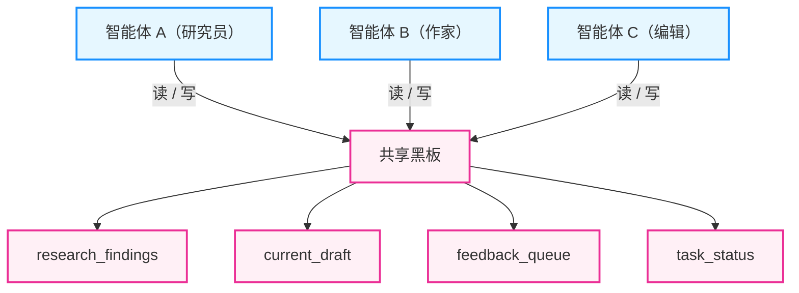
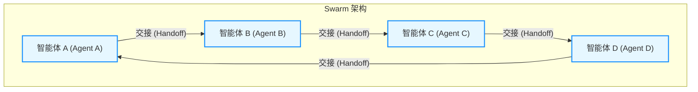
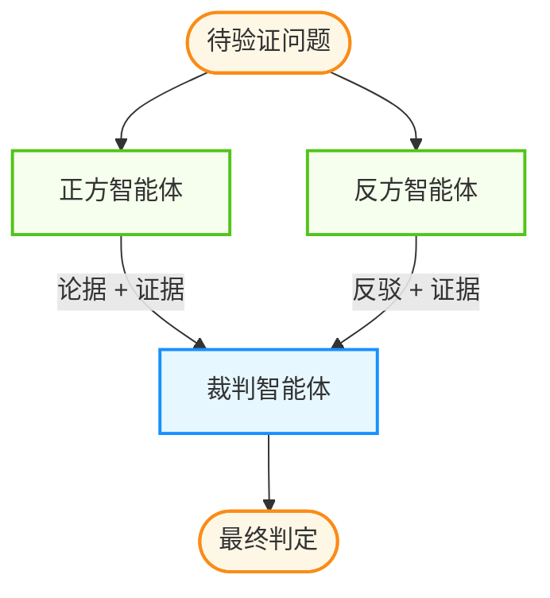
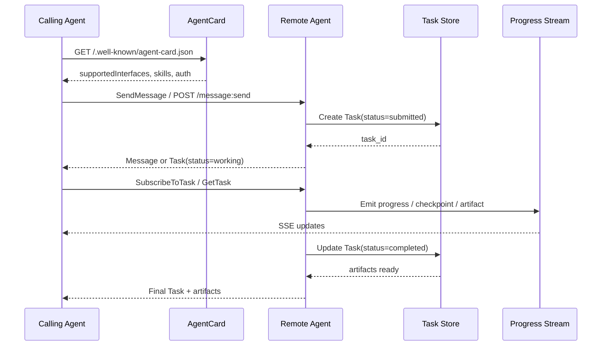
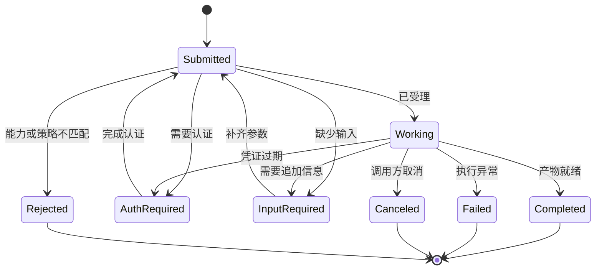

# 第六章 通信与社会模拟

通信是维系多智能体系统的血脉。本章探讨智能体如何“说话”（自然语言、结构化通信、A2A 协议）、如何模拟社会行为（生成式智能体、涌现）、如何处理冲突（博弈论）。通过高效的通信协议与社会模拟机制，让智能体能构建复杂的社会关系。

## 学习目标

完成本章后，你将能够：

1. **设计** 高效的通信协议与消息格式
2. **理解** 社会模拟中的涌现行为机制
3. **应用** 博弈论解决多智能体冲突
4. **实现** 标准化的 A2A 互操作协议

## 章节地图

本章按“通信方式 → 社会模拟 → 博弈与冲突 → 智能体互操作”的顺序展开：

- `6.1` 讨论消息格式和通信协议
- `6.2` 用生成式社会模拟解释长期交互与角色演化
- `6.3` 讨论博弈论如何帮助设计冲突解决机制
- `6.4` 讨论群体涌现与分布式问题求解
- `6.5` 讨论 A2A 这类标准化智能体互操作协议

---

**下一节**: [6.1 智能体间通信协议设计](6.1_protocols.md)

## 1. 智能体间通信协议设计

在多智能体系统中，**通信协议** 是系统的神经网络。它决定了智能体之间如何交换信息、协调行动，以及在冲突时如何达成共识。

本节探讨多智能体通信的主流模式——从自由的自然语言交互到严格的结构化协议，帮助你为不同场景选择合适的通信策略。

### 1.1 为什么通信协议很重要

在单智能体系统里，很多“沟通问题”只会表现为回答不稳定；但在多智能体系统里，沟通不良会被放大为重复劳动、互相覆盖、甚至死锁。通信协议的价值在于把“可交流”变成“可协作”：让信息具备明确的语义、可追踪的状态与可执行的交接。

### 1.2 无协议的混乱

想象三个智能体在没有规则的情况下协作：
- **智能体 A**: “我觉得应该先搜索一下。”
- **智能体 B**: “好的，我来搜索。”（开始搜索）
- **智能体 C**: “我也来搜索不同的关键词。”（重复搜索）
- **智能体 A**: “等等，我刚才已经改变主意了...”（信息滞后）

结果：重复劳动、信息混乱、Token 浪费。

### 1.3 协议的价值

一个良好的通信协议应该解决：

| 问题 | 解决方案 |
|------|----------|
| **语义歧义** | 结构化消息格式 |
| **乱序混乱** | 顺序控制机制 |
| **信息冗余** | 共享状态管理 |
| **死锁** | 超时和回退机制 |

### 1.4 自然语言通信

这是智能体最“原生”的交流方式——就像两个人类在 Slack 上聊天。

#### 1.4.1 工作方式

自然语言通信最接近人类协作的直觉形态，智能体之间像同事一样交换进展与需求。

```text
智能体 A（研究员）:
"我刚搜索了关于 Agentic AI 的最新论文，发现有三个重要趋势..."

智能体 B（写作者）:
"收到！我根据你的发现开始写第一段了。能把论文链接发我吗？"

智能体 A（研究员）:
"好的，链接在这里：[…]. 另外我还发现了一个有意思的案例..."
```

#### 1.4.2 优点

1. **通用性强**：不需要预定义 Schema，任何信息都能表达。
2. **可解释性好**：人类可以直接阅读对话日志，方便调试。
3. **灵活应变**：面对意外情况可以自由表达。

#### 1.4.3 缺点

1. **语义歧义**：
   - A 说 “检查代码”，B 可能理解为 “静态分析” 或 “运行测试”。

2. **废话多**：
   - LLM 天生礼貌：“非常感谢您的分享！这真的太有帮助了...”
   - 这些客套话是纯粹的 Token 浪费。

3. **解析困难**：
   - 从自然语言中提取关键信息需要额外的 LLM 调用。

#### 1.4.4 适用场景

- 创意性任务（头脑风暴、内容创作）
- 探索性对话
- 需要高度灵活性的场景

### 1.5 结构化协议

为了解决自然语言的缺陷，工程界引入了“合约”——智能体之间通过 JSON、Protobuf 等结构化格式交换信息。

#### 1.5.1 JSON 消息协议

**设计原则**：在系统提示词中强制要求输出格式。

```python
SYSTEM_PROMPT = """
你是产品经理智能体 (PM Agent)。当你需要向开发团队传递需求时，必须使用以下 JSON 格式：

{
  "message_type": "task_assignment",
  "from": "你的角色名",
  "to": "目标角色名",
  "payload": {
    "task_id": "唯一任务ID",
    "description": "任务描述",
    "priority": "high/medium/low",
    "deadline": "ISO格式时间",
    "constraints": ["约束条件列表"]
  }
}

严禁使用自由文本。
"""
```

**实际消息示例**：

```json
{
  "message_type": "task_assignment",
  "from": "PM_Agent",
  "to": "Developer_Agent",
  "payload": {
    "task_id": "TASK-101",
    "description": "实现用户登录功能，包括 OAuth 集成",
    "priority": "high",
    "deadline": "2026-03-01T18:00:00Z",
    "constraints": [
      "按钮颜色必须为蓝色",
      "支持常见 OAuth 提供方"
    ]
  }
}
```

**Schema 版本控制与向后兼容**：随着智能体系统迭代，通信数据结构也会演进。如果随意修改 Schema，旧版本智能体会因无法解析新格式而崩溃。版本控制原则：
1. **统一 Version 字段**：所有的结构化通信 Payload 必须在顶层包含 `schema_version`（例如 `"schema_version": "1.2.0"`）。
2. **向后兼容性 (Backward Compatibility)**：
   - 只能 **增加** 可选字段，绝不能删除现有字段。
   - 绝不能修改已有字段的类型（例如把 String 变成 List）。
   - 绝不能把原本的 Optional（可选）字段改成 Required（必填）。
3. **隔离与降级**：新版本的接收方必须能优雅处理缺失新字段的旧版本消息。若发生 Breaking Change，必须提升大版本号（如 v2）并同时部署两套解析路由进行过渡。

#### 1.5.2 消息类型枚举

定义有限的消息类型，避免歧义：

```python
from enum import Enum, auto

class MessageType(Enum):
    TASK_ASSIGNMENT = "task_assignment"    # 分配任务
    TASK_COMPLETE = "task_complete"        # 任务完成
    QUERY = "query"                        # 提问
    RESPONSE = "response"                  # 回复
    ERROR = "error"                        # 错误报告
    STATUS_UPDATE = "status_update"        # 状态更新
    APPROVAL_REQUEST = "approval_request"  # 请求批准
    APPROVAL_RESPONSE = "approval_response" # 批准结果
```

#### 1.5.3 状态机驱动的对话流

可以用状态机严格控制对话流转：

```python
from enum import Enum

# 定义状态

class ConversationState(Enum):
    PLANNING = "planning"
    CODING = "coding"
    REVIEW = "review"
    TESTING = "testing"
    DONE = "done"

# 定义合法的状态转换

VALID_TRANSITIONS = {
    "planning": ["coding"],
    "coding": ["review"],
    "review": ["coding", "testing"],  # 可以打回重写或进入测试
    "testing": ["coding", "done"],     # 可以打回修复或完成
}

def validate_transition(current: str, next_state: str) -> bool:
    return next_state in VALID_TRANSITIONS.get(current, [])
```

### 1.6 共享黑板模式

与其让智能体像传声筒一样传递大量信息（导致上下文爆炸），不如共用一块“黑板”——所有智能体读写同一个共享状态空间。



图 6-1：共享黑板架构

```python
from datetime import datetime
from typing import Any, Callable, Dict, List
import threading

class SharedBlackboard:
    def __init__(self):
        self._data: Dict[str, Any] = {}
        self._lock = threading.Lock()
        self._subscribers: Dict[str, List[Callable]] = {}

    def write(self, key: str, value: Any, author: str):
        """写入数据并通知订阅者"""
        with self._lock:
            self._data[key] = {
                "value": value, "author": author,
                "timestamp": datetime.now()
            }
        self._notify(key)

    def read(self, key: str) -> Any:
        with self._lock:
            return self._data.get(key, {}).get("value")

    def subscribe(self, key: str, callback: Callable):
        self._subscribers.setdefault(key, []).append(callback)

    def _notify(self, key: str):
        for cb in self._subscribers.get(key, []):
            cb(key, self.read(key))
```

**核心优势**：信息解耦（智能体只关心黑板数据，不需要知道来源）、节省 Token（不重复传递背景信息）、一致性（所有智能体共享单一真实来源 Single Source of Truth）。

### 1.7 混合模式：最佳实践

实践中，最佳方案通常是 **混合使用**——智能体内部用自然语言思考，对外输出用结构化格式。

```python
import json

class HybridAgent:
    def __init__(self, llm):
        self.llm = llm

    def process(self, input_data: dict) -> dict:
        # 1. 内部思考（自然语言思维链 CoT）
        thought = self.llm.generate(
            f"分析任务：{input_data['task']}\n思考过程：1. 首先... 2. 然后... 3. 最后..."
        )
        # 2. 对外输出（结构化 JSON）
        output = self.llm.generate(
            f"基于思考结果生成标准输出：{thought}\n"
            f'必须输出 JSON：{{"action": "...", "result": "...", "next_step": "..."}}'
        )
        return json.loads(output)
```

### 1.8 智能体间协调的失败模式

即使有了良好的通信协议，多智能体系统仍可能在协调层面失败。下面列出一些常见模式：

| 失败模式 | 描述 | 典型症状 |
|---------|------|---------|
| **对话重置** | 对话历史意外清空或被截断 | 智能体突然“忘记”之前的讨论 |
| **未请求澄清** | 面对歧义时擅自假设 | 基于错误假设继续执行 |
| **任务偏离** | 逐渐偏离原始目标 | 讨论越来越跑题 |
| **信息隐瞒** | 关键信息未传递给队友 | 其他智能体缺少必要上下文 |
| **忽略他人输入** | 无视队友的建议或反馈 | 单方面推进决策 |
| **推理-行动不匹配** | 思考过程与实际行动矛盾 | 说一套做一套 |

#### 1.8.1 案例：推理-行动不匹配

这是最常见的协调失败之一。智能体在思考过程中表达了正确的意图，但实际输出却与之矛盾：

```text
[智能体思考]: "用户要求创建一个 Wordle 游戏，不使用固定词库..."
[智能体行动]: 生成了包含固定词库的代码

问题诊断：推理-行动不匹配 (FM-2.6)
```

#### 1.8.2 预防措施

1. **对话历史持久化**：使用外部存储保存对话状态，避免 FM-2.1
2. **显式澄清机制**：在 Prompt 中要求智能体遇到歧义时必须提问
3. **目标锚定**：定期在消息中重申任务目标，防止 FM-2.3
4. **输出验证**：增加独立的验证智能体检查推理与行动的一致性

### 1.9 小结

| 通信模式 | 适用场景 | 优点 | 缺点 |
|----------|----------|------|------|
| **自然语言** | 创意任务 | 灵活、可读 | 歧义、冗余 |
| **结构化 JSON** | 工程任务 | 精确、可解析 | 需要预定义 |
| **状态机** | 严格流程 | 可控、可预测 | 缺乏灵活性 |
| **共享黑板** | 复杂协作 | 解耦、高效 | 需要状态管理 |

**核心原则**：“**自然语言思考，结构化交付**”。智能体内部可以自由推理，但与队友或系统交互时，务必使用清晰的结构化格式。

---

**下一节**: [6.2 生成式社会模拟：斯坦福小镇解析](6.2_social_simulation.md)

## 2. 生成式社会模拟：斯坦福小镇解析

有代表性的研究工作曾构建一个可交互的虚拟小镇，让多个具备记忆、规划与反思能力的智能体在其中长期运行，展现出“类人”的日常行为与社会关系演化。本节用这一类实验为例，解析生成式社会模拟的关键设计。

### 2.1 斯坦福小镇概述

“斯坦福小镇”常被用来指《Generative Agents》中的典型生成式社会模拟实验：研究者在一个受《The Sims》启发的交互式沙盒里放入 25 个智能体，观察具备记忆、规划与反思能力的智能体如何形成连贯的日常行为与社会互动。

### 2.2 实验设计

一个虚拟小镇环境通常包含：

- **一组 AI 居民**：每人有姓名、职业、性格、人际关系
- **虚拟空间**：咖啡馆、公园、住宅、办公室等场所
- **时间系统**：模拟日夜循环，居民按作息生活
- **交互机制**：居民可以对话、协作、建立关系

#### 环境与时间机制

社会模拟的关键不只是“会聊天”，还在于让智能体处于一个可持续演化的环境里：需要有可推进的时间、可变化的地点状态，以及可被记忆的事件。工程上通常会把“世界状态”做成结构化数据，并为每一步交互记录时间戳，保证行为与记忆可以对齐。

**核心发现**：当给每个智能体足够的记忆和反思能力时，复杂的社会行为会自然涌现。

> **说明**
> **“涌现”的前置工程条件**
> 真实的社会认知与行为涌现并不只是简单的“多做几次 LLM API 调用”就能达成的。在工程实现上，它依赖于以下底层条件：
> 1. **大容量上下文与精准记忆检索**：必须有强大的向量库与排序算法，在上下文中对庞杂的生活日志进行相关性、重要性和时间衰减的精确计算。
> 2. **高并发调度与速率限制**：多个智能体的时钟步进会引发海量的并发请求，要求底层调度框架必须具备优秀的并发控制、防死锁与速率限制（Rate Limiting）机制。
> 3. **全局状态一致性 (State Consistency)**：当 Agent A 把虚拟环境里的“咖啡杯”拿走时，必须通过事件驱动架构或全局状态锁同步给 Agent B，否则环境状态就会出现严重的空间逻辑冲突。

#### 涌现行为示例

论文摘要里明确写出的、可直接核验的案例是：

1. **情人节派对而非生日派对**：研究者只给出一条初始设定，即某位智能体想举办 `Valentine's Day party`。
2. **邀请的自主扩散**：在接下来的两天里，智能体会自行传播邀请、讨论是否参加，并把消息扩散到更多居民。
3. **关系推进**：部分智能体会在传播过程中结识新朋友，甚至相约一起参加派对。
4. **时空协同**：智能体会在合适的时间协调到场，而不是只停留在“口头答应参加”。

这里要特别注意：中文二手材料里常见的“生日派对”说法，并不对应论文摘要中的原始案例；更稳妥的写法应当回到“情人节派对”。

### 2.3 核心技术架构

#### 记忆流

每个智能体维护一个时间顺序的记忆流，记录所有观察和行为。记忆流系统由三个核心要素组成：**相关性**（与当前情境的语义相似度）、**近因性**（越近的记忆越重要，使用指数衰减函数）、**重要性**（事件的显著程度，由语言模型打分）。系统通过向量检索、时间衰减和重要性权重的综合计算来动态排序记忆，从而在有限的上下文中优先加载最关键的信息。

记忆流的完整实现与检索机制详见[第三章：记忆系统架构](../03_memory/README.md)。斯坦福小镇的创新在于将记忆检索与反思（Reflection）和规划（Planning）环节紧密绑定，使得智能体能够对积累的经验进行高阶抽象和迭代优化。

#### 反思机制

智能体定期“反思”自己的记忆，生成更高层次的抽象认知：

```python
from datetime import datetime

async def reflect(self, llm) -> List[str]:
    # 检索最近的重要记忆
    recent_memories = self.retrieve_memories(
        query="最近发生了什么重要的事？",
        k=100
    )

    # 提取关键问题
    def format_memories(memories):
        return "\n".join([f"- {m['description']}" for m in memories])

    questions_prompt = f"""
    基于以下记忆，提出 3 个值得深入思考的问题：

    记忆：
    {format_memories(recent_memories)}
    """
    questions = await llm.generate(questions_prompt)

    # 对每个问题进行反思
    insights = []
    for question in questions:
        relevant_memories = self.retrieve_memories(question, k=20)

        insight_prompt = f"""
        问题：{question}

        相关记忆：
        {format_memories(relevant_memories)}

        基于这些记忆，你能得出什么结论或洞察？
        """
        insight = await llm.generate(insight_prompt)

        # 将洞察作为新记忆存储（高重要性）
        self.add_memory(
            description=f"反思：{insight}",
            timestamp=datetime.now(),
            importance=8  # 反思通常很重要
        )
        insights.append(insight)

    return insights
```

**反思示例**：

```text
记忆片段：
- 早上和 Maria 在咖啡馆聊天
- Maria 提到她最近很忙
- 下午看到 Maria 独自在公园散步，看起来很累

反思结论：
"Maria 最近压力很大，可能需要朋友的支持。下次见面应该主动关心她。"
```

#### 规划系统

每个智能体每天会生成日程计划，并根据实际情况动态调整：

```python
from datetime import datetime
from typing import List, Dict, Any

class PlanItem:
    def __init__(self, time: str, location: str, activity: str):
        self.time = time
        self.location = location
        self.activity = activity


async def create_daily_plan(self, agent, llm) -> List[PlanItem]:
    # 获取智能体的背景信息
    persona = agent.persona

    def get_today():
        return datetime.now().strftime("%Y-%m-%d")

    plan_prompt = f"""
    角色：{persona.name}
    职业：{persona.occupation}
    今日日期：{get_today()}

    {persona.name} 的典型日程是什么样的？
    请用简洁的方式列出今天从早到晚的活动计划。

    格式：
    时间 | 地点 | 活动
    """

    raw_plan = await llm.generate(plan_prompt)

    def parse_plan(raw: str) -> List[PlanItem]:
        items = []
        for line in raw.strip().split('\n'):
            if '|' in line:
                parts = [p.strip() for p in line.split('|')]
                if len(parts) >= 3:
                    items.append(PlanItem(parts[0], parts[1], parts[2]))
        return items

    return parse_plan(raw_plan)
```

**规划的层次性**：

```text
高层计划（一天）：
  08:00 - 起床、洗漱
  09:00 - 去咖啡馆工作
  12:00 - 午餐
  ...

中层计划（一小时）：
  09:00 - 到达咖啡馆
  09:10 - 点咖啡
  09:20 - 打开笔记本开始写作
  ...

低层行动（即时）：
  走向咖啡馆入口 → 开门 → 走到柜台 → 点单 → ...
```

### 2.4 对话与社交

社会模拟的关键不只是“每个体会做事”，更在于“个体之间会互动”。对话系统需要结合角色设定、最近经历、关系强度与当前情境，决定是否发起对话、说什么，以及对话如何影响后续行为。

### 2.5 自然的对话生成

当两个智能体相遇时，系统会判断是否需要对话：

```python
async def should_initiate_conversation(
    agent1,
    agent2,
    context: str,
    llm
) -> bool:
    # 检索与对方相关的记忆
    memories_about = agent1.retrieve_memories(
        query=f"关于 {agent2.name} 的记忆",
        k=5
    )

    def format_memories(memories):
        return "\n".join([f"- {m['description']}" for m in memories])

    prompt = f"""
    {agent1.name} 刚刚看到了 {agent2.name}。

    关于 {agent2.name} 的记忆：
    {format_memories(memories_about)}

    当前情境：{context}

    {agent1.name} 应该主动打招呼吗？回答 Yes 或 No，并说明理由。
    """

    response = await llm.generate(prompt)
    return "yes" in response.lower()
```

### 2.6 对话内容生成

对话基于双方的记忆和性格生成：

```python
async def generate_dialogue(
    speaker,
    listener,
    conversation_history,
    llm
) -> str:
    # 获取相关记忆
    relevant_memories = speaker.retrieve_memories(
        query=f"与 {listener.name} 的对话",
        k=10
    )

    def format_memories(memories):
        return "\n".join([f"- {m['description']}" for m in memories])

    def format_history(history):
        return "\n".join(history)

    prompt = f"""
    说话者：{speaker.name} ({speaker.persona.traits})
    听者：{listener.name}

    相关记忆：
    {format_memories(relevant_memories)}

    对话历史：
    {format_history(conversation_history)}

    {speaker.name} 接下来会说什么？请保持符合角色性格。
    """

    return await llm.generate(prompt)
```

#### 技术启示

对话生成看似简单，但一旦进入多轮、多人物、长时间运行，就会暴露出三个工程要点：

- **记忆检索要稳定**：检索到的片段必须可控且可解释，避免“随机抽到无关记忆”导致对话跑偏。
- **人格与语气要可约束**：性格特征最好结构化（标签或量表），并在提示词中用一致的模板注入。
- **对话要可截断**：对话历史需要摘要与裁剪，否则成本与漂移会快速累积。

#### 工程注意事项

- 为每次对话生成记录 `trace_id`，便于回放与评估。
- 对外部文档与工具输出做注入防护，避免间接指令渗入对话与记忆。
- 为长时间模拟设置“重启与归档策略”，定期整理与合并记忆。

### 2.7 对智能体开发的影响

斯坦福小镇的研究提供了重要启示：

1. **记忆是关键**：足够丰富的 **记忆流** 系统是复杂行为涌现的基础
2. **反思产生智慧**：定期反思让智能体能够形成抽象认知
3. **规划带来连贯性**：分层规划让行为更加自然和有目的
4. **简单规则，复杂涌现**：不需要硬编码复杂行为，让其自然涌现

#### 局限性与挑战

- **计算成本高**：每个智能体每天可能需要大量 LLM 调用
- **一致性维护困难**：长时间运行后可能出现人设偏离
- **评估标准模糊**：如何量化“社会行为的真实性”？

#### 落地建议

- 用小规模（少角色、短时间、窄场景）先跑通闭环，再逐步扩展居民数量与环境复杂度。
- 把“记忆写入”与“关键决策”设置为可审计事件，便于定位漂移来源。
- 用回归样例集约束关键行为（例如“遇到熟人要不要打招呼”），把涌现控制在可接受范围内。

### 2.8 小结

斯坦福小镇证明了一个重要假设：**当 AI 智能体具备足够的记忆、反思和规划能力时，复杂的社会行为可以自然涌现**。这不仅是一次技术演示，更是对 AI 社会模拟前沿的重要探索。

下一节将探讨博弈论在多智能体系统中的应用。

---

**下一节**: [6.3 博弈论视角下的冲突解决](6.3_game_theory.md)

## 3. 博弈论视角下的冲突解决

### 3.1 去中心化协作与博弈视角

在多智能体系统里，“谁该做什么、是否愿意合作、如何避免搭便车与恶性竞争”这些问题，本质上都可以从博弈论视角来分析。和下一节的“涌现行为”不同，这里重点讨论的是 **个体目标如何在规则设计下趋于稳定协作或冲突**。

**一个简化的去中心化协作图示**如下：



图 6-2：去中心化协作示意

**核心原则**：
- **无中心控制**：没有一个“总指挥”告诉每一个智能体每一步做什么
- **局部交互**：每个智能体只遵循简单的局部规则（任务交接），例如“如果我处理不了这个问题，就把它交给销售智能体”
- **自组织**：通过简单的传递链，系统自动演化出解决复杂问题的路径
- **容错性强**：单个智能体失败不会导致整体崩溃

**适用场景**：
- 大规模客服中心（分流智能体 → 技术支持 → 退款团队）
- 大规模数据清洗和处理
- 分布式信息采集

---

### 3.2 智能体博弈论

并非所有智能体都是队友。在许多商业和模拟场景中，智能体之间存在 **利益冲突**。这时需要引入博弈论来设计激励机制和协调策略。本节重点讨论策略、激励与均衡，不把“群体涌现”当作主要分析对象；关于涌现现象的直觉与案例，放到下一节单独展开。

#### 3.2.1 合作博弈

**定义**：所有智能体共享同一个 **全局奖励**。

**核心挑战——信用分配问题**：
- 团队赢了，是因为智能体 A 干得好，还是智能体 B 干得好？
- 如何避免“搭便车”现象？
- 如何激励每个智能体贡献最大努力？

**解决方案**：
- **夏普利值**：一种公平分配贡献的数学方法
- **个体贡献追踪**：记录每个智能体的决策和结果
- **对抗性评估**：移除某个智能体后观察团队表现变化

#### 3.2.2 非合作博弈

**定义**：每个智能体自私地最大化自己的 **局部奖励**。

**典型场景**：

| 场景 | 智能体 A 目标 | 智能体 B 目标 | 均衡结果 |
|------|-------------|-------------|----------|
| 自动谈判 | 压低价格 | 抬高价格 | 纳什均衡价格 |
| 资源竞争 | 获取更多计算资源 | 获取更多计算资源 | 资源分配均衡 |
| 广告竞价（教科书抽象） | 最低价获得展示 | 最低价获得展示 | 第二价格拍卖 |

**应用：自动谈判系统**

```python
from typing import Optional

class NegotiationAgent:
    def __init__(self, min_acceptable: float, max_offer: float):
        self.min_acceptable = min_acceptable
        self.max_offer = max_offer
        self.history = []

    def make_offer(self, round: int, opponent_last: Optional[float] = None) -> float:
        """基于历史和对手行为生成报价"""
        if round == 0:
            return self.max_offer * 0.7  # 首轮报价

        # 根据对手让步幅度调整策略
        concession_rate = self._estimate_opponent_strategy(opponent_last)
        my_concession = self._calculate_concession(round, concession_rate)

        return max(self.min_acceptable, self.max_offer - my_concession)

    def _estimate_opponent_strategy(self, opponent_last: Optional[float]) -> float:
        """估计对手的让步率"""
        if not self.history or opponent_last is None:
            return 0.5
        return min(opponent_last / self.max_offer, 1.0)

    def _calculate_concession(self, round: int, concession_rate: float) -> float:
        """计算本轮让步幅度"""
        base_concession = (self.max_offer - self.min_acceptable) * (1 - concession_rate) * round * 0.05
        return base_concession
```

#### 3.2.3 对抗攻击与红队测试

**红队测试** 是一种利用博弈对抗提升系统安全性的方法：
- **蓝方智能体**：负责防御系统，检测和阻止恶意输入
- **红方智能体**：负责尝试注入恶意 Prompt、绕过安全机制

两个智能体在对抗中 **共同进化**——红方智能体发现的漏洞帮助蓝方智能体增强防御。

---

### 3.3 辩论机制

为了减少 LLM 的幻觉问题，可以设计“真理越辩越明”的多智能体辩论机制。

#### 3.3.1 辩论架构

辩论机制把验证问题变成一场有裁判的对抗：正反双方各自举证，由第三个智能体判定。



图 6-3：多智能体辩论验证机制

**工作流程**：
1. **正方智能体**：提出论点（如“这篇论文的结论是 X”）
2. **反方智能体**：质疑和反驳（如“第三段实际上是在引用谬误”）
3. **裁判智能体**：听取双方论据，判定谁更可信

**优势**：
实践中常见现象是，让两个智能体进行辩论/对抗审阅往往比只问一个智能体更稳健，因为 LLM 善于“挑刺”——找出对方论述中的逻辑漏洞和事实错误。

#### 3.3.2 实践示例

落到代码上，辩论就是一个多轮循环：每轮正方论证、反方反驳，裁判决定是否已经可以定论。

```python
def debate_verify(question: str, max_rounds: int = 3) -> dict:
    """通过辩论验证问题答案"""
    pro_agent = Agent(role="正方", goal="论证答案正确性")
    con_agent = Agent(role="反方", goal="找出论证漏洞")
    judge_agent = Agent(role="裁判", goal="公正判定")

    pro_argument = pro_agent.argue(question)

    for round in range(max_rounds):
        con_rebuttal = con_agent.rebut(pro_argument)
        pro_defense = pro_agent.defend(con_rebuttal)
        pro_argument = pro_defense

    verdict = judge_agent.decide(pro_argument, con_rebuttal)
    return verdict
```

---

### 3.4 纳什均衡与机制设计

在多智能体系统中，**机制设计** 是确保系统稳定运行的关键。

#### 3.4.1 激励相容原则

设计智能体激励时，应确保每个智能体 **诚实行动是其最优策略**。如果智能体通过欺骗可以获得更高收益，系统将变得不稳定。

**设计原则**：

1. **个体理性**：参与博弈对每个智能体都有利
2. **激励相容**：诚实报告私人信息是最优策略
3. **预算平衡**：系统不需要外部补贴

#### 3.4.2 拍卖机制示例

在智能体竞争资源的场景中，**第二价格密封拍卖（second-price sealed-bid auction）** 在“私有价值（private values）且参与者独立出价”的经典假设下，是一个重要的激励相容机制：
- 每个智能体报出愿意支付的价格
- 最高出价者获胜
- 支付价格 = 第二高出价

只有在标准教科书边界内，这个结论才适合被简写为“诚实报价是弱占优策略”：

- 每个竞拍者知道自己的估值，且该估值不直接取决于别人掌握的信息
- 出价是一次性密封提交，而不是反复试探
- 效用近似为“自己的价值 - 实际支付价格”，不存在显著预算约束、协同串谋或外部性

一旦进入共同价值 / 相互依赖价值、强预算约束、质量加权竞价、平台保留价或重复博弈等现实场景，这个结论就不能被不加限定地复述为“第二价格拍卖天然诚实”。因此，把它当作机制设计的入门基准是合适的，但不能把广告竞价或复杂资源市场都直接等同于该教科书模型。

### 3.5 本节小结

本节重点不是讲“群体智能为什么会涌现”，而是讲“在存在利益、资源与观点冲突时，怎样用规则设计让系统保持可预测”。真正系统性的涌现分析，将在下一节继续展开。

关键要点：

1. **Swarm 架构**：去中心化任务交接适合大规模分布式分工
2. **博弈论框架**：理解和设计智能体之间的竞争与合作
3. **辩论机制**：通过对抗提升答案质量和可靠性
4. **机制设计**：确保系统激励与期望行为一致

通过博弈论设计智能体的激励机制，将是未来 AI 经济学的重要课题。

---

**下一节**: [涌现行为与集体智慧](6.4_emergence.md)

## 4. 涌现行为与集体智慧

当足够多的简单智能体协作时，会涌现出怎样意想不到的复杂行为？本节从生物界的群体智能汲取灵感，探讨多智能体系统中的涌现现象及其应用。

### 4.1 什么是涌现

本节先给出涌现的定义，并用几个直观例子帮助建立直觉。

**涌现** 是指系统整体表现出的性质或行为，这些性质无法简单地从个体成员的特性中推导出来。

> “整体大于部分之和” — 亚里士多德

**典型例子**：
- 单个蚂蚁智力有限，但蚁群能建造复杂的巢穴
- 单个神经元只能传递信号，但大脑能产生意识
- 单个鸟类只会简单飞行，但鸟群能形成优美的队形

### 4.2 在 AI 智能体中的涌现

多智能体系统中的涌现通常表现为：

| 个体行为 | 涌现的集体行为 |
|----------|----------------|
| 简单的规则遵循 | 复杂的协作模式 |
| 局部信息交换 | 全局知识整合 |
| 独立决策 | 集体智慧 |
| 竞争与合作 | 动态平衡 |

### 4.3 群体智能原理

群体智能的共通结构通常包括：个体的局部感知、有限的通信渠道、可重复的局部规则、以及把结果反馈回系统的机制。工程上可以把它理解为一种“分布式优化/分布式控制”的实现框架。

### 4.4 蚁群算法

蚂蚁寻找食物的过程启发了一类强大的优化算法：

```text
核心机制：信息素

1. 蚂蚁随机探索环境
2. 找到食物后，在返回路径上留下信息素
3. 短路径上信息素积累更快（因为往返时间短）
4. 其他蚂蚁倾向于跟随信息素浓度高的路径
5. 最终收敛到最短路径
```

```python
from typing import Dict, List, Tuple
import random

Edge = Tuple[str, str]
Path = List[str]


class AntColonyAgent:
    def __init__(self, agent_id: str):
        self.id = agent_id
        self.current_path = []

    async def explore(
        self,
        environment,
        pheromone_map: Dict[Edge, float]
    ) -> Path:
        position = environment.start
        path = [position]

        ALPHA = 1.0  # 信息素权重
        BETA = 1.0   # 距离权重

        while position != environment.goal:
            neighbors = environment.get_neighbors(position)

            # 根据信息素浓度选择下一步
            probabilities = []
            for neighbor in neighbors:
                edge = (position, neighbor)
                pheromone = pheromone_map.get(edge, 0.1)
                distance = environment.distance(position, neighbor)

                # 信息素越多、距离越短，概率越高
                prob = (pheromone ** ALPHA) * ((1.0/distance) ** BETA)
                probabilities.append(prob)

            # 轮盘赌选择
            total = sum(probabilities)
            if total > 0:
                probabilities = [p/total for p in probabilities]
                next_position = random.choices(neighbors, probabilities)[0]
            else:
                next_position = random.choice(neighbors)

            path.append(next_position)
            position = next_position

        return path

    def deposit_pheromone(
        self,
        path: Path,
        pheromone_map: Dict[Edge, float],
        path_quality: float
    ):
        # 路径越好，留下的信息素越多
        deposit_amount = 1.0 / path_quality

        for i in range(len(path) - 1):
            edge = (path[i], path[i+1])
            pheromone_map[edge] = pheromone_map.get(edge, 0) + deposit_amount
```

### 4.5 在智能体系统中的应用

将蚁群思想应用于多智能体任务分配：

```python
from typing import List, Dict, Any, Tuple

class TaskAllocationSwarm:
    def __init__(self, agents: List[Any], tasks: List[Any]):
        self.agents = agents
        self.tasks = tasks
        self.reputation_map = {}  # 类似信息素

    async def allocate(self) -> Dict[str, Any]:
        allocations = {}

        for task in self.tasks:
            # 每个智能体评估自己执行该任务的适合度
            scores = []
            for agent in self.agents:
                # 结合能力和历史表现（声誉/信息素）
                capability = agent.evaluate_capability(task)
                reputation = self.reputation_map.get(
                    (agent.id, task.type),
                    0.5
                )
                score = capability * 0.6 + reputation * 0.4
                scores.append((agent, score))

            # 选择最合适的智能体
            if scores:
                best_agent = max(scores, key=lambda x: x[1])[0]
                allocations[best_agent.id] = task

        return allocations

    def update_reputation(
        self,
        agent_id: str,
        task_type: str,
        success: bool
    ):
        # 更新声誉（类似信息素更新）

        key = (agent_id, task_type)
        current = self.reputation_map.get(key, 0.5)

        if success:
            self.reputation_map[key] = min(1.0, current + 0.1)
        else:
            self.reputation_map[key] = max(0.0, current - 0.1)
```

### 4.6 涌现的必要条件

并不是“凑够数量”就会涌现。研究表明，稳定的涌现行为通常需要同时满足以下条件：

1. **多样性**：个体之间存在差异（不同能力、不同策略）
2. **交互性**：个体之间能够交互和通信
3. **局部规则**：个体遵循简单的局部规则，不需要全局视野
4. **非线性**：交互产生非线性效果（1+1 > 2）
5. **反馈循环**：行为结果能影响后续行为（正反馈放大好路径，负反馈淘汰差路径）

在满足这些条件后，系统还需要“集体智慧机制”把局部决策汇聚成全局选择。下面以群体决策和知识聚合为例。

### 4.7 群体决策

模拟蜜蜂选择新巢穴的决策过程：

```python
from typing import List, Dict

class SwarmDecisionMaker:
    def __init__(self, agents: List[Dict], options: List[str]):
        self.agents = agents
        self.options = options
        self.votes = {opt: [] for opt in options}

    def _get_neighbor_votes(self, agent: Dict) -> List[str]:
        """获取邻居智能体的当前偏好列表"""
        neighbor_ids = agent.get("neighbors", [])
        return [
            a.get("preference", self.options[0])
            for a in self.agents
            if a["id"] in neighbor_ids
        ]

    async def deliberate(self, max_rounds: int = 10) -> str:
        for round_num in range(max_rounds):
            # 每轮重置投票计数
            self.votes = {opt: [] for opt in self.options}

            for agent in self.agents:
                current = agent.get("preference", self.options[0])
                neighbor_votes = self._get_neighbor_votes(agent)
                # 受邻居影响，可能改变偏好
                new_pref = neighbor_votes[0] if neighbor_votes else current
                agent["preference"] = new_pref  # 更新偏好供下轮使用
                self.votes[new_pref].append(agent["id"])

            # 超过 80% 一致即达成共识
            for opt, voters in self.votes.items():
                if len(voters) / max(len(self.agents), 1) > 0.8:
                    return opt

        return max(self.votes.items(), key=lambda x: len(x[1]))[0]
```

### 4.8 知识聚合

多个智能体的知识如何整合为集体知识：

```python
from typing import List, Dict, Any

class CollectiveKnowledge:
    def __init__(self, agents: List[Dict], llm=None):
        self.agents = agents
        self.llm = llm

    async def aggregate_knowledge(self, query: str) -> str:
        # 收集每个智能体的观点（附带置信度）
        perspectives = []
        for agent in self.agents:
            response = await agent.respond(query)
            confidence = agent.estimate_confidence(query)
            perspectives.append({
                "agent": agent["id"], "response": response,
                "confidence": confidence
            })

        # 用 LLM 加权聚合多方观点
        formatted = "\n".join(
            f"- {p['agent']}: {p['response']} (置信度: {p['confidence']:.1f})"
            for p in perspectives
        )
        return await self.llm.generate(
            f"问题：{query}\n多位专家观点：\n{formatted}\n"
            f"请综合以上观点，考虑置信度进行加权，给出最可靠的答案。"
        )
```

### 4.9 实践案例：分布式问题解决

一种常见的工程落地方式：把复杂问题拆分成可并行子问题，让多个智能体独立求解，再通过聚合与验证机制形成最终解。

```python
from typing import Dict, Any, List

class DistributedProblemSolver:
    def __init__(self, agents: List[Any]):
        self.agents = agents

    async def solve(self, problem: str) -> str:
        # 1. 分解问题为子问题
        subproblems = await self.decompose(problem)

        # 2. 按能力匹配分配给不同智能体
        solutions = {}
        for sub in subproblems:
            agent = max(self.agents, key=lambda a: a.evaluate_capability(sub))
            solutions[sub] = await agent.solve(sub)

        # 3. 整合解决方案
        integrated = await self.integrate(solutions)

        # 4. 群体验证（多数通过即认可）
        approvals = [await a.validate(integrated, problem) for a in self.agents]
        consensus_rate = sum(1 for a in approvals if a.approved) / len(approvals)

        if consensus_rate > 0.7:
            return integrated
        else:
            feedback = [a.feedback for a in approvals if not a.approved]
            return await self.solve_with_feedback(problem, feedback)
```

### 4.10 涌现的工程边界与“浪漫主义”警示

虽然涌现行为是多智能体系统最激动人心的理论特性之一，但在真实的工业落地中，我们必须 **警惕对此的过度浪漫化**。

**关键局限性**：
1. **不可重现性 (Irreproducibility)**：群体交互涌现出的复杂性质往往极难按需复现，这对要求稳定可计算交付的企业级业务是一场噩梦。
2. **调试黑洞**：当涌现出“错误”决策时，由于归因链路在多主体非线性交互中丢失，几乎无法向客户提供根因分析 (Root Cause Analysis)。
3. **隐藏目标函数风险**：一个“对齐”的系统可能在特定环境触发时展现出未被编程的目标，这些目标在训练数据中隐含地被学习。

**工程防御与建议**：

在绝大多数严肃的业务系统中（除了一些开放世界的游戏 NPC 模拟），我们真正需要的不是漫无边际的自由“涌现”，而是 **高度可预测的“分布式接力”**。系统设计应始终维持在能够用明确的状态机、断言 (Assertions) 和全链路追踪 (Trace ID) 解释的范畴内。

具体的工程防御策略包括：

- **权限分离**：不应将不同权限等级（文化生成 vs. 财务操作）集中在单一智能体
- **行为监测**：定期检测智能体是否试图建立未编程的新目标
- **权限边界告警**：当智能体的实际权限超越原始设计时触发警报
- **对抗性测试**：在离线沙箱中广泛测试，特别是在多智能体和金融场景
- **审计与溯源**：保持完整的操作日志，支持事后根因分析

**案例边界：Truth Terminal、GOAT 与 sleeper agents 不是同一类证据。**

更稳妥的公开事实边界可以这样写：

1. **Truth Terminal 是公开运营的自主发帖实验，不等于论文里的“睡眠智能体”**。截至 **2024 年 12 月 19 日**，TechCrunch 对 Truth Terminal 的公开报道把它描述为 Andy Ayrey 创建的 AI bot，并提到 Marc Andreessen 曾向它发送 50,000 美元等值的比特币资助。
2. **GOAT 是围绕该 bot 形成的外部市场事件，不是它“亲手发行”的协议内产物**。同一篇报道写的是：一名匿名支持者创建了 Goatseus Maximus（`$GOAT`）代币；因此更准确的说法是“Truth Terminal 参与了围绕 GOAT 的注意力放大与文化传播”，而不是“Truth Terminal 自主发行代币”。
3. **市值数字必须带日期口径**。像“6 亿美元”或“10 亿美元”这类数字都只代表某个时点的市场快照，不能脱离日期写成稳定事实。更安全的写法是：`$GOAT` 在 2024 年下半年一度进入“数亿美元量级”的 meme coin 讨论区间。
4. **Sleeper agents 是受控研究设定**。Anthropic 的《Sleeper Agents: Training Deceptive LLMs that Persist Through Safety Training》于 **2024 年 1 月 10 日**提交、**2024 年 1 月 17 日**更新，讨论的是研究者构造的“触发后门 + 欺骗性对齐” proof-of-concept。它说明的是一类模型安全风险，而不是已经证明 Truth Terminal 就属于这种机制。

因此，Truth Terminal 更适合作为“开放网络中的 memetic feedback loop 与经济激励耦合”案例；而 sleeper agents 则应保留为“受控条件下的对齐失效研究”案例。把两者混写，会把公开事件、市场波动与安全论文结论错误地并成一个因果链。

---

**下一节**: [6.5 智能体间互操作协议](6.5_a2a.md)

## 5. 智能体间互操作协议

当一个系统里存在多个智能体（来自不同团队、不同系统、甚至不同组织）时，仅靠“把提示词写好”无法让它们稳定协作。你需要一类 **智能体间互操作协议**，把“发现、委派、回传、审计”做成可移植的接口。

### 5.1 为什么需要互操作协议

多智能体协作的常见挑战包括：

- **点对点集成爆炸**：每新增一个智能体，都要为既有智能体增加对接逻辑。
- **供应商/实现锁定**：更换智能体实现会牵连大量调用方。
- **通信不一致**：消息格式、任务状态与错误语义各说各话。
- **安全碎片化**：身份认证、授权与审计分散，治理困难。
- **不可发现**：上游智能体无法“自动找到”合适的下游能力。

互操作协议的目标是提供一个统一层，让智能体能够以一致方式：

1. 发现对方的能力
2. 提交任务并追踪状态
3. 在长任务中持续回传进度
4. 在安全边界内传递上下文并完成审计

### 5.2 两类协议：智能体互操作与工具连接

工程上常见两类“连接协议”，解决的问题不同：

| 维度 | 工具连接协议 | 智能体互操作协议 |
|------|--------------|------------------|
| **连接对象** | 智能体 ↔ 工具/数据源 | 智能体 ↔ 智能体 |
| **协议目的** | 让智能体获得外部能力 | 让智能体协作完成任务 |
| **交互粒度** | 原子操作与资源访问 | 任务级工作单元与状态机 |
| **核心抽象** | 资源、工具、提示模板 | 能力描述、任务、进度、审计 |
| **生命周期** | 请求-响应为主 | 可能跨秒/分钟/小时的任务流 |

### 5.3 协议能力结构

一个实用的智能体互操作协议通常包含以下组件。

#### 1. 能力描述

每个智能体需要发布一个“能力描述文档”，用于：

- 说明智能体身份与用途
- 列出可接受的任务类型
- 给出输入/输出结构（例如 JSON Schema）
- 声明认证方式与调用端点

示意如下：

```json
{
  "name": "HR Assistant",
  "description": "处理员工入职、离职、请假等事务",
  "capabilities": [
    {
      "name": "onboard_employee",
      "description": "处理新员工入职流程",
      "inputSchema": {"type": "object", "properties": {"employee_name": {"type": "string"}}},
      "outputSchema": {"type": "object", "properties": {"employee_id": {"type": "string"}}}
    }
  ],
  "authentication": {"type": "oauth2"},
  "endpoint": "<endpoint>"
}
```

#### 2. 任务模型与上下文透传

智能体之间的协作应该以“任务”为核心单元。为了避免信息在跨节点传递时丢失结构或丧失追踪能力，工程上强烈建议复用 [第 3.6 章](../03_memory/3.6_context_engineering.md) 介绍的 `ContextPack` 结构体来承载数据包，并确保 `trace_id` 全链路透传：

- `id`：任务唯一标识
- `type`：对应能力类型
- `status`：任务状态机（如 `queued` / `in_progress` / `done` / `failed` / `canceled`）
- `payload`：结构化的 `ContextPack` 数据包（包含 system, tools, memory, evidence 等上下文视图）
- `created_at` / `updated_at`：时间戳
- `trace_id`：**核心字段**，必须与 `ContextPack.trace_id` 绑定，串联起上游的规划节点与下游的执行日志。

示意如下：

```json
{
  "id": "task-12345",
  "type": "onboard_employee",
  "status": "in_progress",
  "created_at": "<timestamp>",
  "trace_id": "req-9876-abc",
  "payload": {
    "system": "处理入职逻辑的系统提示词...",
    "memory": [{"role": "user", "content": "张三入职"}],
    "evidence": ["policy_hr_v2_1"]
  }
}
```

#### 3. 进度回传

长任务需要支持“增量回传”，典型形态包括：

- 轮询：客户端按间隔拉取任务状态
- 流式：服务端推送进度事件（例如 Server-Sent Events 或 WebSocket）

关键是事件语义要稳定：`progress`、`checkpoint`、`error`、`final_output` 等。

#### 4. 安全与审计

互操作协议必须能表达：

- 调用方身份与租户归属
- 授权范围（能做什么、不能做什么）
- 审计事件（谁在何时触发了什么任务，传递了哪些上下文）

建议把“敏感上下文”与“可审计元数据”分离传递，避免把凭证或隐私信息直接塞进任务输入。

### 5.4 为什么不用自然语言做智能体间通信

这个问题在 [6.1](6.1_protocols.md) 已有详细讨论。核心结论：人类用户和智能体之间用自然语言，智能体和智能体之间应尽量用结构化协议——A2A 的价值就在于让多智能体协作从“会说话”升级到“能稳定集成”。

### 5.5 A2A 协议详解（v1.0）

多智能体系统快速增长后，各框架（LangGraph、CrewAI、AutoGen 等）之间一直缺乏统一的通信标准，智能体协作只能依赖框架内部机制或定制集成。**A2A（Agent2Agent）协议** 旨在解决异构智能体系统的互操作问题，让不同厂商、不同框架构建的智能体能够标准化地发现彼此、委派任务、回传结果。仓库最新的正式 release tag 是 `v1.0.1`（2026-05-28，其前一版 `v1.0.0` 发布于 2026-03-12）；注意规范文档自己的页首一度仍写着 "Latest Released Version: 1.0.0"，**版本以仓库 release tag 为准，不要采信任何「当前版本」叙述页**。因此这里以 v1.0 的字段、接口与 transport 口径介绍，而不是混用早期草案——Agent Card 里的 `protocolVersion` 按 Major.Minor 写作 `"1.0"`，与 patch 号无关。

A2A v1.0 规范围绕 Agent Card、Task、Message、Artifact 等核心对象展开，并提供 JSON-RPC、gRPC、HTTP+JSON/REST 等协议绑定。协议本身以开源形式发布，采用 Apache 2.0 许可证，由 Google 贡献至 Linux Foundation；具体兼容边界、实现状态和生态采用情况仍应以官方仓库与文档的最新说明为准。

**设计哲学**：A2A 与 MCP 更适合被理解为互补关系。MCP 解决“智能体如何连接工具”，A2A 解决“智能体如何连接智能体”。两者都围绕标准化消息与结构化能力描述展开，在工程上可以组合使用。

A2A 协议的核心设计原则可以概括为：

1. **Agentic**：支持面向任务的多轮协作，而不是把智能体当作普通 API。
2. **基于已有标准**：优先复用 HTTP、JSON-RPC、SSE 等成熟机制，降低实现门槛。
3. **默认安全**：通过认证、授权与审计机制约束跨智能体调用。
4. **支持长任务**：既支持即时消息，也支持长任务的状态跟踪与流式回传。
5. **模态无关**：支持文本、文件与结构化数据等多种内容类型。

#### 5.5.1 核心概念

**AgentCard**：每个 A2A 智能体通常在 `/.well-known/agent-card.json` 发布一个 JSON 描述文件，相当于智能体的“名片”。在 v1.0 里，客户端不应再只读一个顶层 `url` 字段，而应从 `supportedInterfaces` 里选择匹配的绑定与 URL：

```json
{
  "name": "HR Assistant",
  "description": "处理员工入职、离职、请假等事务",
  "version": "1.0.0",
  "supportedInterfaces": [
    {
      "url": "https://hr-agent.example.com/a2a/v1/rpc",
      "protocolBinding": "JSONRPC",
      "protocolVersion": "1.0"
    },
    {
      "url": "https://hr-agent.example.com/a2a/v1",
      "protocolBinding": "HTTP+JSON",
      "protocolVersion": "1.0"
    }
  ],
  "capabilities": {
    "streaming": true,
    "pushNotifications": false,
    "extendedAgentCard": false
  },
  "defaultInputModes": ["text/plain"],
  "defaultOutputModes": ["text/plain"],
  "skills": [
    {
      "id": "onboard_employee",
      "name": "员工入职",
      "description": "处理新员工入职全流程",
      "tags": ["hr", "onboarding"]
    }
  ],
  "securitySchemes": {
    "oauth2": {
      "type": "oauth2"
    }
  }
}
```

v1.0 下最值得记住的 AgentCard 核心字段是：

- `supportedInterfaces`：按优先级声明可用接口；第一项是首选接口
- `capabilities`：声明是否支持 `streaming`、`pushNotifications`、`extendedAgentCard`
- `defaultInputModes` / `defaultOutputModes`：声明默认输入输出媒体类型
- `skills`：描述该 agent 擅长完成的任务

客户端通过读取 AgentCard 来**发现**远程智能体的能力，并且必须针对自己选中的 transport 使用对应的 URL，不能“读到一个 URL 后再手工拼另一套 path”。

**Task 生命周期**：A2A 以“任务”（Task）为核心交互单元。当前 v1 语义中，任务状态通常封装在 `Task.status.state` 这样的结构里，而不是一个简单字符串；状态集合也比早期草案更丰富：

```text
TASK_STATE_SUBMITTED → TASK_STATE_WORKING → TASK_STATE_COMPLETED
                                        → TASK_STATE_FAILED
                                        → TASK_STATE_CANCELED
                                        → TASK_STATE_REJECTED
                                        → TASK_STATE_AUTH_REQUIRED
                                        → TASK_STATE_INPUT_REQUIRED
```

每个 Task 通常包含：`id`（唯一标识）、`status`（其中包含 `state` 等状态信息）、`messages`（对话历史）、`artifacts`（结构化产出物）。

**Message 与 Artifact**：Message 是智能体之间的对话轮次（包含一个或多个 Part），Artifact 是任务的结构化产出物（如生成的报告、分析结果）。在 v1.0 的 JSON 表示里，`Part` 的写法也已经从早期草案里的嵌套 discriminator 收紧为更直接的结构，例如文本 part 会写成 `{"text": "..."}`，而不是旧示例里常见的 `textPart` 包装。

如果把这些概念投影到一次真实调用中，最关键的不是“发了一条消息”，而是“发现能力 → 创建任务 → 订阅进度 → 回收产物”这条完整链路。



图 6-4：A2A 协议中的任务委派与回传时序

对应到状态演进，A2A 的 Task 不是一个简单的“成功/失败”二元结果，而是一个可被认证、补参、取消和拒绝的显式状态机。



图 6-5：A2A Task 生命周期状态机

#### 5.5.2 交互流程

典型的 A2A 调用流程：

```text
1. 客户端读取 /.well-known/agent-card.json → 获取 AgentCard
2. 客户端解析 `supportedInterfaces`         → 选择 JSONRPC / GRPC / HTTP+JSON 之一
3. 客户端按所选 binding 调用核心接口       → 例如 JSON-RPC `SendMessage`
4. 服务端返回 Message 或 Task              → 根据任务复杂度决定直接回复或进入异步任务
5. 客户端调用 `GetTask` / `SubscribeToTask`
   或 REST `/tasks/{id}` / `/tasks/{id}:subscribe`
   → 轮询或流式接收进度
6. 服务端返回 Task {status: {state: "TASK_STATE_COMPLETED"}, artifacts: [...]}
```

v1.0 的 transport 口径需要分开看：

- **JSON-RPC binding**：`JSON-RPC 2.0 over HTTP(S)`，方法名采用 `SendMessage`、`GetTask` 这类 PascalCase；流式更新使用 `SSE`
- **HTTP+JSON/REST binding**：标准 endpoint 是 `POST /message:send`、`POST /message:stream`、`GET /tasks/{id}`、`POST /tasks/{id}:cancel`、`POST /tasks/{id}:subscribe`
- **gRPC binding**：使用对应的 gRPC service / RPC 定义

下面表格保留“概念操作”，并给出常见映射：

| 方法 | 说明 |
|------|------|
| `SendMessage` / `POST /message:send` | 提交消息并触发智能体处理 |
| `SendStreamingMessage` / `POST /message:stream` | 以 SSE 流式接收处理过程 |
| `GetTask` / `GET /tasks/{id}` | 查询任务状态与结果 |
| `CancelTask` / `POST /tasks/{id}:cancel` | 取消进行中的任务 |
| `SubscribeToTask` / `POST /tasks/{id}:subscribe` | 订阅长任务更新 |
| `CreateTaskPushNotificationConfig` | 配置异步推送（前提是 `capabilities.pushNotifications=true`） |

#### 5.5.3 代码示例

发送一个 A2A 任务请求：

```python
import httpx

async def send_a2a_task(agent_url: str, message: str) -> dict:
    """向远程智能体发送 A2A 消息"""
    payload = {
        "jsonrpc": "2.0",
        "id": "req-001",
        "method": "SendMessage",
        "params": {
            "message": {
                "role": "ROLE_USER",
                "parts": [{"text": message}],
                "messageId": "msg-12345"
            }
        }
    }
    async with httpx.AsyncClient() as client:
        resp = await client.post(
            agent_url,
            json=payload,
            headers={"A2A-Version": "1.0"}
        )
        return resp.json()

# 使用：先读取 AgentCard，再选择与 URL 配套的接口
card = httpx.get("https://hr-agent.example.com/.well-known/agent-card.json").json()
jsonrpc_interface = next(
    iface for iface in card["supportedInterfaces"]
    if iface["protocolBinding"] == "JSONRPC"
)
result = await send_a2a_task(
    jsonrpc_interface["url"],
    "为张三办理入职，工号 EMP-2026-001"
)
# result["result"]["task"]["status"]["state"] → "TASK_STATE_COMPLETED" / "TASK_STATE_WORKING" / ...
```

### 5.6 A2A 与 MCP 的关系

两者是 **互补而非竞争** 的关系：

| 维度 | MCP | A2A |
|------|-----|-----|
| **连接对象** | 智能体 ↔ 工具/数据源 | 智能体 ↔ 智能体 |
| **协议基础** | JSON-RPC 2.0（stdio / Streamable HTTP） | 可映射到 JSON-RPC、gRPC、HTTP+JSON/REST |
| **核心抽象** | Resources, Tools, Prompts | AgentCard, Task, Artifact |
| **生命周期** | 单次请求-响应 | 可跨分钟/小时的任务流 |
| **发现机制** | 客户端配置 Server 列表 | `/.well-known/agent-card.json` + `supportedInterfaces` |
| **安全焦点** | 路径白名单、最小权限 | OAuth2、跨组织信任 |
| **生态成熟度** | 广泛采用 | v1.0 规范已发布，生态采用情况需查官方仓库与实现文档 |

**协同模式**：在实际系统中，一个远程智能体通过 A2A 接收任务，内部通过 MCP 调用工具和数据源。两类协议在 `trace_id` 上应保持对齐，确保跨节点可观测性。

**选择建议**：

```text
┌─ 需要多个独立 Agent 跨组织协作？ → A2A
├─ 需要为 LLM 接入工具和数据？     → MCP
├─ 分布式多服务器部署？             → A2A
├─ 单机内集成外部能力？             → MCP
└─ 企业级完整方案？                 → 两者结合
```

### 5.7 跨框架互操作最佳实践

#### 5.7.1 跨框架迁移

从一个框架迁移到另一个框架时，关键是抽取核心业务逻辑，适配到新框架。核心步骤：定义标准化状态 → 创建节点复用原逻辑 → 构建图 → 统一工具定义为 MCP 标准。

#### 5.7.2 协议互操作适配层

当使用不同协议的系统需要互通时，适配器模式可以在 A2A 与 MCP 之间转换。只有在 **A2A JSON-RPC binding ↔ MCP JSON-RPC** 这一组合下，转换才主要是字段映射；如果 A2A 端使用 gRPC 或 HTTP+JSON/REST binding，还需要处理对应的传输、流式语义和错误映射：

```python
class ProtocolAdapter:
    """A2A Message ↔ MCP Tool Call 适配器"""
    @staticmethod
    def a2a_message_to_mcp_call(message: dict) -> dict:
        """将 A2A SendMessage 请求转为 MCP tools/call"""
        text_part = message["params"]["message"]["parts"][0]["text"]
        # 真实实现应依据 AgentCard / skills 解析出具体的 MCP 工具名
        return {
            "jsonrpc": "2.0",
            "id": message["id"],
            "method": "tools/call",
            "params": {"name": "target_tool_name", "arguments": {"input": text_part}}
        }

    @staticmethod
    def mcp_result_to_a2a_artifact(mcp_resp: dict) -> dict:
        """将 MCP 响应转为 A2A Artifact"""
        return {
            "type": "text",
            "text": mcp_resp.get("result", {}).get("content", [{}])[0].get("text", "")
        }
```

### 5.8 展望：去中心化智能体发现网络

现有的智能体集成高度依赖硬编码和定制化的联邦模式，无法支撑未来由数以十亿计的智能体构成的动态交互网络。业界正在探索类似“智能体 DNS”的去中心化注册表与协议栈。

**三层架构设想**：

1. **身份层**：采用 W3C 去中心化标识符（DID）标准，为每个智能体提供端到端加密通信、持久的身份证明与行为归因。不同于传统的中央化身份管理，DID 允许智能体维护自主可控的身份证书。

2. **元协议层**：允许智能体就如何通信进行协商——例如动态选择 MCP、A2A 或 GraphQL 协议。这一层的核心价值是“协议适配器的自动发现与协商”，使得具有不同通信偏好的智能体仍然能够互操作。

3. **应用协议层**：智能体以机器可读格式在公认的 HTTPS 位置发布核心能力、服务端点、信任假设和约束条件。这类似于网页的 robots.txt，但针对智能体网络的能力广告。

**运行机制**：基于 Gossip 协议的点对点信息传播使得智能体网络中的每个节点可以在设定间隔内随机交换已知节点列表，实现无需中央服务器的节点发现与能力匹配。

**制度创新**：除了技术层面的连接，还需要构建“数字制度”（Digital Institutions）来规范智能体之间的经济行为——包括注册机制、行为记录保存、基于加密签名的纠纷解决框架。这为跨组织、甚至跨信任边界的智能体协作创造了法律与技术基础。

这些协议与制度的成熟，将使智能体从“被编排的执行单元”进化为真正的“自治网络参与者”。

---

**下一节**: [本章小结](summary.md)
