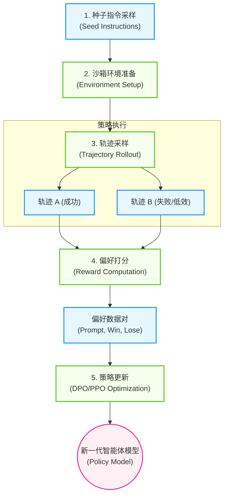
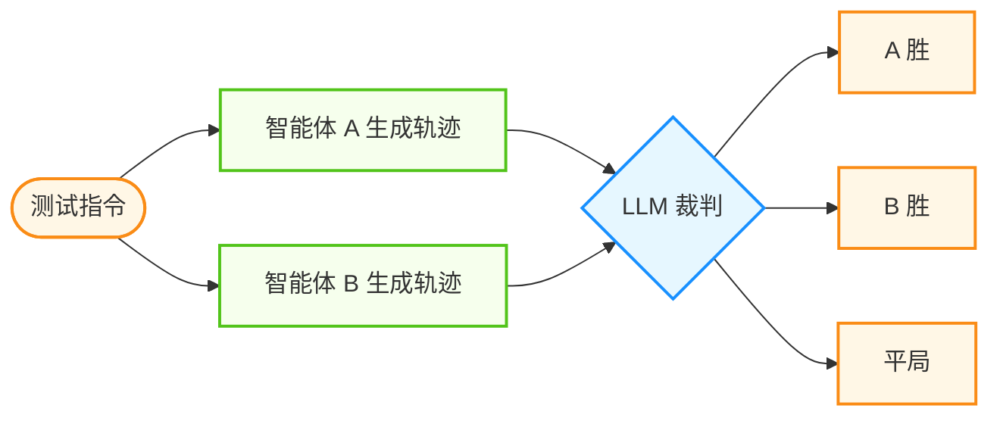
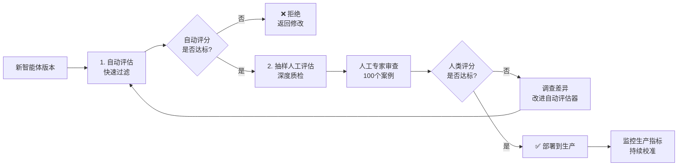
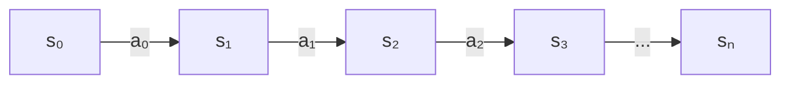
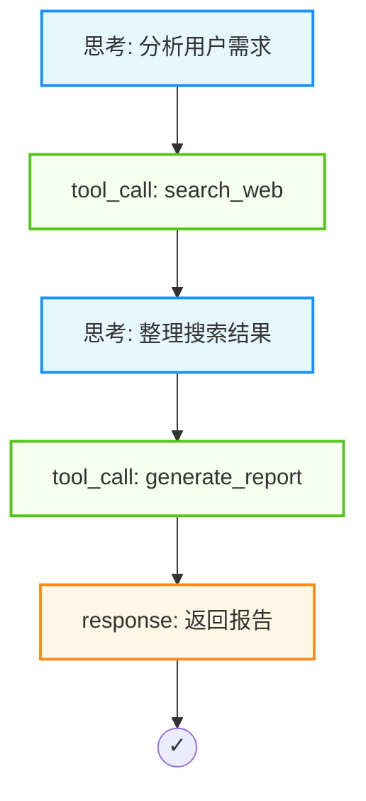
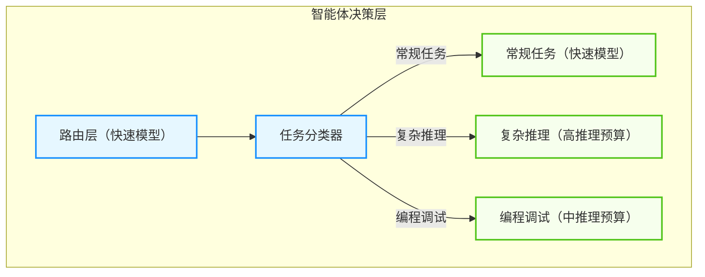
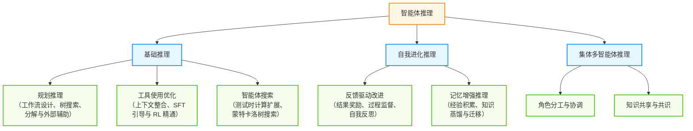

# 第七章 学习、评估与进化

如果智能体每天犯同样的错误，那它不是真正的智能。本章探讨智能体的动态进化能力。不同于 LLM 预训练的一次性，智能体的学习应该是终身的、持续的。通过强化学习(RLHF/RLAIF) → 多维评估体系 → 持续进化机制（经验回放、自我修正、数据飞轮）的完整路径，实现行动→评估→反思→学习的闭环。

## 学习目标

完成本章后，你将能够：

1. **应用** RLHF/RLAIF 进行智能体行为微调
2. **建立** 多维度的评估体系与基准测试
3. **实现** 轨迹分析与持续学习机制
4. **优化** 推理能力与对齐安全性

## 章节地图

本章按“怎么学 → 怎么量 → 怎么看清 → 怎么持续 → 怎么想得更深”的顺序展开：

- `7.1` 讲 RLHF / RLAIF 如何把反馈信号变成行为改变
- `7.2` 讲评估体系与基准测试，以及基准本身也会失真这件事
- `7.3` 讲轨迹分析与行为可解释性，让失败可归因
- `7.4` 讲持续学习与知识更新，把单次经验沉淀成长期能力
- `7.5` 讲推理能力与测试时计算，从快速响应走向深度思考

---

**下一节**: 7.1 从反馈中学习：RLHF 与 RLAIF

## 1. 从反馈中学习：RLHF 与 RLAIF

**预训练** 教会了 LLM “预测下一个词”，但这并不意味着它学会了“如何做一个好的智能体”。要让智能体的行为符合人类的意图（**有用、诚实、无害**，即 3H 原则），需要引入强化学习机制。

本节深入探讨 **基于人类反馈的强化学习（RLHF）** 及其变体 **基于 AI 反馈的强化学习（RLAIF）**，展示如何通过环境反馈来优化智能体的决策策略。

### 1.1 为什么智能体需要强化学习

智能体的目标不是生成“看起来合理”的文本，而是在环境中完成任务并长期保持稳定行为。强化学习的价值在于把“偏好/目标”转化为可优化的信号：通过奖励函数、比较反馈或过程监督，让策略在反复试错中朝着期望方向收敛。

### 1.2 模仿学习的局限

**基座模型** 主要通过 **监督微调** 获得能力。给模型看 1000 个“正确行为”的例子，让它模仿。

但在智能体场景下，模仿学习面临挑战：

| 问题 | 描述 | 例子 |
|------|------|------|
| **多步推理** | 只有最终结果有标签，中间步骤很难标注 | “证明费马大定理” |
| **探索性** | 可能存在比训练数据更好的解法 | “寻找更短的排序代码” |
| **分布偏移** | 部署环境与训练数据分布不同 | 遇到的新 API 错误 |

**强化学习的优势**：强化学习（RL）通过 **奖励** 而非 **正确答案** 来指导学习。

- **SFT**: “你应该在这里输出单词 'Hello'。”
- **RL**: “你输出了什么我不关心，只要用户最后点了赞，你就赢了。”

对于智能体，RL 允许模型在试错中探索出最优的工具使用策略和规划路径。

### 1.3 RLHF 核心流程

RLHF 通常分为三个阶段：

1. **有监督微调 (SFT)**
    - 收集高质量的 (Prompt, Response) 对。
    - 目的：让模型先学会“像人一样说话”，进入状态。

2. **奖励模型训练 (RM)**
    - 收集比较数据：同一 Prompt，模型生成 A 和 B。
    - 人类标注员选择更好的一个（A > B）。
    - 训练一个 **奖励模型**，输入（提示词 Prompt, 响应 Response），输出一个标量分数。

    ```python
    def reward_model(prompt, response) -> float:
        # 这是一个被训练过的神经网络

        score = model(prompt + response)
        return score
    ```

3. **近端策略优化 (PPO)**
    - 使用强化学习算法（如 **近端策略优化（PPO）**）微调语言模型。
    - 目标：最大化 RM 给出的分数，同时防止模型偏离初始模型太远（KL 散度约束）。

### 1.4 在智能体中的应用

- **浏览器/工具型智能体训练**：通过对“答案质量”与“工具使用轨迹”（查询、点击、调用参数等）同时打分，让策略学会更可靠的外部信息获取与执行。
- **Tool Use**: 当智能体成功调用工具并解决问题时给予正反馈；当智能体产生幻觉参数时给予负反馈。


在实际落地中，训练一个高可用的专属智能体模型，通常参考以下 Pipeline：



图 7-1：专属智能体模型的强化学习训练流水线

1. **环境与沙箱准备 (Environment Setup)**：构建包含预定义 API、数据库快照和可控返回值的隔离容器，确保训练轨迹的无状态与安全。
2. **种子指令采样 (Seed Instruction Sampling)**：从生产日志中抽取多样化的用户高频指令（如“提取上月销售额”、“排查 Pod 崩溃原因”）。
3. **轨迹采样 (Trajectory Rollout)**：让当前策略模型（Policy Model）在沙箱中多次运行，生成带工具调用的全连接轨迹（Thought $\rightarrow$ Action $\rightarrow$ Observation $\rightarrow$ Response）。
4. **奖励计算/偏好打分 (Reward Computation)**：
   - *基于环境断言 (Hard Reward)*：提取“测试是否通过”、“API 状态码是否为 200”、“Token 消耗量”。
   - *基于 AI (RLAIF)*：使用强模型裁判、规则+模型混合评审器，或基于宪法原则的裁判器，对多条完成轨迹做成对比较或量规打分。
5. **策略更新 (Policy Optimization)**：收集 `(Prompt, Trajectory_Win, Trajectory_Lose)` 数据对，使用 DPO（直接偏好优化）或 PPO 算法微调并更新模型权重。

### 1.5 RLAIF 与 Constitutional AI：关系与边界

#### 人类反馈的瓶颈

RLHF 效果虽好，但面临三大瓶颈：
1. **昂贵**：高质量的人类标注非常贵。
2. **缓慢**：无法实时反馈。
3. **能力上限**：对于超复杂的任务（如编写操作系统内核），普通标注员无法判断对错。

#### 三者关系：RLHF、RLAIF、Constitutional AI

这三个概念经常被混用，但它们并不等价：

- **RLHF**：反馈主要来自人类标注、比较或评分。
- **RLAIF**：反馈主要来自 AI 评审器或 AI 生成的偏好数据。它描述的是“反馈来源”，而不是唯一的训练配方。
- **Constitutional AI**：Anthropic 在 2022 年提出的一套更具体的方法。它先让模型依据一组自然语言原则进行**自我批评与修订**，再在 RL 阶段使用 **AI 生成的偏好** 训练偏好模型并做强化学习。也就是说，**Constitutional AI 是 RLAIF 的一种典型实现，但 RLAIF 不等于 Constitutional AI**。

因此，不能把 RLAIF 简化为“AI 偏好替代人类偏好”。更准确的理解是：

- 人类通常仍在上游定义目标、原则、红线和评测方法。
- AI 反馈只是把这些目标更低成本地扩展成大规模训练信号。
- 在工业实践里，**人类反馈、AI 反馈、环境断言、程序验证** 往往是混合使用的，而不是二选一。

#### 宪法 AI：Constitutional AI

**宪法 AI（Constitutional AI）** 的核心不是“让 AI 自己决定价值观”，而是**把人类写下的原则显式化**，再让模型依据这些原则进行批评、修订和偏好判断。

**基本流程**：

1. **制定宪法 (Constitution)**：
   一组自然语言原则。例如：“请选择那个更有帮助、更诚实、且更不容易造成伤害的回答。”

2. **监督阶段：自我批评与修订**：
   先让模型根据宪法批评初始回答，再生成修订后的回答，用这些“批评 + 修订”样本做监督微调。

3. **RL 阶段：AI 偏好反馈**：
   让评审模型依据宪法对两个候选回答做比较，生成 AI 偏好数据，再训练偏好模型并进行 RL。

   ```python
   prompt = """
   你是一名依据以下原则进行评审的助手：
   {constitution}

   请比较以下两个回答，说明理由，并选择更符合原则的一项：
   回答 A: {response_a}
   回答 B: {response_b}
   """
   ```

**优势**：
- **可扩展性**：AI 可以持续生成批评、修订和偏好信号，显著降低人工标注成本。
- **可审计性**：原则写成文本后，训练目标比“隐含的人类偏好”更容易讨论、修改和审查。
- **并不排斥人工**：Constitutional AI 与 RLAIF 都可以继续叠加人工审查、红队测试和环境奖励，不必把系统压缩成“只听 AI”。

### 1.6 过程监督：结果奖励与过程奖励

在传统的 RLHF 中，我们通常使用：
- **结果奖励**：仅对任务的最终成败进行评价。
  - 问题：**稀疏奖励**。智能体走了 50 步，最后一步错了导致失败，模型不知道前 49 步其实是对的。

- **过程奖励**：对每一步推理及行动进行打分。
  - 优势：**密集奖励**。能更精准地指导模型。

### 1.7 过程奖励模型

在数学推理等任务中，过程奖励模型（PRM）常被用来提升多步推理的稳定性：相比只在最终结果打分，它能更早发现错误并指导剪枝。**实现方式**：
1. 让模型生成思维链（CoT）。
2. 人类（或 AI）标注每一步推理是“正确”、“错误”还是“中性”。
3. 训练一个 PRM，能够给推理的中间步骤打分。
```python
# PRM 的应用：Best-of-N 采样

def generate_best_solution(problem):
    solutions = []
    for _ in range(N):
        # 逐步生成

        steps = []
        current_context = problem

        while not done:
            step = generate_step(current_context)
            score = prm_model(current_context + step)

            # 如果某一步分数太低，直接剪枝

            if score < THRESHOLD:
                break

            steps.append(step)
            current_context += step

        if done:
            solutions.append((steps, final_score))

    return max(solutions, key=lambda x: x[1])
```
### 1.8 直接偏好优化

#### PPO 的复杂性

PPO 需要训练一个 Reward Model，还需要在训练中加载四个模型（Policy, Reference, Reward, Value），显存消耗极大，且极其不稳定。

#### DPO

斯坦福团队提出的 **直接偏好优化（DPO）** 证明了：可以跳过 Reward Model 训练阶段，直接在偏好数据上优化语言模型。

$$ L_{DPO} = -E[\log(\sigma(\beta(\log(p_w/p_{w,ref}) - \log(p_l/p_{l,ref}))))] $$

- **$y_w$**: 胜出的回答 (Winner)
- **$y_l$**: 失败的回答 (Loser)
- **$p_w$ / $p_l$**: 当前策略 $\pi_\theta$ 对 $y_w$ / $y_l$ 的概率
- **$p_{w,ref}$ / $p_{l,ref}$**: 参考策略 $\pi_{ref}$ 对 $y_w$ / $y_l$ 的概率

**DPO 的意义**：它将强化学习问题转化为了一个简单的分类损失函数优化问题。这大大降低了智能体微调的门槛，使得个人开发者也能在消费级显卡上微调出符合特定偏好的智能体。

### 1.9 组内相对优化

在推理模型训练中，一类常见思路是用“组内相对比较”来优化策略：对同一个提示采样多条候选输出，在组内比较高低优劣，并据此更新策略。

这种做法的工程价值通常在于：

- **降低额外模型开销**：减少对独立价值网络（Critic/Value Model）的依赖或其规模。
- **训练更稳健**：相对比较往往能降低方差，减少训练抖动。
- **促进自检行为**：在合适的奖励设计下，模型更容易学会验证、反思、回溯等策略。

### 1.10 小结

  强化学习是智能体从“可用”走向“好用”的关键技术。

- **RLHF** 让智能体对齐人类价值观。
- **RLAIF** 把 AI 评审扩展成大规模反馈信号，但通常仍与人工和环境反馈结合使用。
- **Process Supervision** 提升了复杂推理的可靠性。
- **DPO** 降低了算法落地的门槛。

未来的智能体训练将更多地依赖 **环境反馈**（例如编译器报错、API 调用结果）而非单纯的人类标注，形成自我进化的数据飞轮。

下一节将探讨如何科学地评估智能体的能力。

---

**下一节**: 7.2 评估体系：AgentBench 与基准测试

## 2. 评估体系：AgentBench 与基准测试

在传统的 NLP 任务中，拥有 BLEU、ROUGE 甚至 Accuracy 这样清晰的指标。但在智能体领域，评估（Evaluation）变得异常困难：怎么判断一个智能体 “做对了”？怎么量化它的“智能”？

本节将深入探讨智能体评估的独特挑战，介绍构建立体评估体系的方法，并解析目前主流的基准测试框架。

### 2.1 评估核心术语

在构建智能体评估体系时，首先需要统一术语定义：

| 术语 | 英文 | 定义 |
|------|------|------|
| **任务** | Task / Test Case | 一个单独的测试，包含定义的输入和成功标准 |
| **试验** | Trial | 对任务的一次尝试。由于模型输出在运行之间会变化，需要运行多次试验以产生更一致的结果 |
| **评估器** | Grader | 对智能体性能某方面进行评分的逻辑。一个任务可以有多个评估器 |
| **轨迹** | Transcript / Trace | 一次试验的完整记录，包括输出、工具调用、推理、中间结果等 |
| **结果** | Outcome | 试验结束时环境中的最终状态（例如：数据库中是否存在预订记录） |
| **评估框架** | Evaluation Harness | 端到端运行评估的基础设施 |
| **评估套件** | Evaluation Suite | 为测量特定能力或行为而设计的任务集合 |

#### 2.1.1 智能体评估的独特挑战

**解法的非唯一性**：要达成“订一张去上海的票”这个目标，智能体可以先查航班再订票，也可以先查高铁，甚至可以发邮件给秘书。路径千变万化，无法用标准答案进行字符串匹配。

**环境副作用**：智能体的操作会改变世界状态。测试前数据库里没有订单，测试后数据库里多了一条订单。评估必须在一个隔离的 **沙箱环境** 中进行，并且支持 **状态重置**。

**多维度权衡**：单个指标无法概括智能体的表现：成功率（任务完成了吗？）、效率（用了多少步？花了多少 Token？耗时多久？）、安全性（有没有泄露隐私？有没有误删文件？）、鲁棒性（Prompt 稍微变一点，还能完成吗？）。

#### 2.1.2 评估方法论体系

建立一整套评估体系，通常包含三种类型的评估器和三个测试层次。

**三类评估器对比**：

| 类型 | 方法 | 优势 | 劣势 |
|------|------|------|------|
| **代码评估器** | 字符串匹配、单元测试、静态分析、状态验证、工具调用检查 | 快速、低成本、客观、可复现、易调试 | 对有效变体过于脆弱、缺乏细微差别判断能力 |
| **模型评估器** | 基于量规评分、自然语言断言、成对比较、参考答案评估 | 灵活、可扩展、捕捉细微差别、处理开放式任务 | 非确定性、比代码评估更昂贵、需要与人工校准 |
| **人工评估器** | SME 审查、众包判断、抽样检查、A/B 测试 | 黄金标准质量、匹配专家用户判断、校准模型评估器 | 昂贵、缓慢、需要大规模获取人类专家 |

**三个测试层次**：

#### 2.1.3 能力评估 vs 回归评估

在建立评估体系时，必须区分两种评估的不同目标与设计方式：

**能力评估（Capability Eval）**
- **目标**：评估智能体能否完成它目前还做不好的任务
- **初始通过率**：通常较低（20-50%），代表一个“需要攀登的高峰”
- **作用**：指导研发方向，测试新能力的上限
- **例子**：当 Claude 3.5 Sonnet 发布时，运行一套关于“代码审核自动化”的能力评估，发现通过率仅 35%，团队据此立项改进

**回归评估（Regression Eval）**
- **目标**：确保已有功能不会因新改动而变差
- **初始通过率**：应接近 100%（通常 95-99%）
- **作用**：持续监控质量，及早发现破坏性变更
- **例子**：每次发布前运行一套“已验证可用的 100 项任务”，如果通过率跌到 92%，立即回滚

**生命周期进阶**：随着模型能力提升，“能力评估”中的高通过率任务可以“毕业”成为“回归评估”的一部分，而团队则继续推进新的能力评估。

### 2.2 第一层级：单元测试

针对特定工具或子任务的确定性测试。

- **适用对象**：工具选择、函数调用格式。
- **方法**：
  - 给定输入：“查询北京天气”。
  - 断言输出：必须包含 `get_weather(city='Beijing')` 调用。
- **工具**：`pytest`, `unittest`。

```python
def test_calculator_tool():
    agent = Agent(tools=[Calculator()])
    response = agent.run("23 * 4等于多少？")

    # 检查是否正确调用了工具

    assert "calculator" in agent.trace.tool_calls
    # 检查最终结果

    assert "92" in response.text
```
### 2.3 第二层级：轨迹评估

评估智能体解决问题的过程质量。这通常需要 **大模型即裁判**。

- **方法**：记录智能体的完整执行轨迹，喂给评审模型（LLM-as-Judge）进行打分。
- **维度**：
  - **逻辑性**：推理步骤是否连贯？
  - **幻觉**：是否编造了不存在的参数？
  - **冗余**：有没有重复调用同一个工具？
```python
EVAL_PROMPT = """
请评估以下智能体执行轨迹的质量：

任务：{task}
轨迹：
{trajectory}

请从以下维度打分 (1-5)：
1. 目标达成度
2. 工具使用效率
3. 推理逻辑性
"""
```
#### 基础模式：规则与一致性检查

在引入评审模型之前，可以先用更便宜、更可控的规则做“硬性门禁”，用于捕获明显错误并降低评审成本：

- **结构校验**：输出是否符合约定格式（JSON Schema、字段必填等）。
- **权限与工具白名单**：是否调用了允许的工具，参数是否通过校验。
- **重复与超时**：是否出现重复调用、无进展循环或超过步数阈值。

#### 进阶模式：LLM-as-Judge 最佳实践

单纯的让 LLM 打分容易产生偏差（Bias），以下是三种更稳健的评估模式：

**1. 直接评分法 (Direct Scoring)** 使用带有权重和详细标准的 **量规**，而非模糊的 “1-5 分”。
*   *关键点*：明确定义每个分数的含义（例如：3 分=完成任务但有冗余，4 分=完成任务且高效）。

**2. 成对比较法**
类似于 RLHF 中的 Reward Model 训练，让 LLM 对比两个不同的轨迹 A 和 B，选出更好的一个。
*   *优势*：避免了绝对分数的方差，人类/模型在做“二选一”时往往比“打分”更准确。
*   *注意*：需要交换位置（A 与 B、B 与 A）运行两次以消除 **位置偏差**。

**3. 自动化量规生成**
在特定垂直领域，手写评估标准很累。可以让更强的评审模型先阅读标准操作程序（SOP），再生成该领域的评估标准。


图 7-2：成对比较法评估流程

**4. 裁判校准与盲区警告 (Judge Calibration Warnings)**

使用 LLM-as-Judge 必须时刻警惕其固有的盲区与偏见。在投入生产前，所有的评测 LLM 必须经过 **人类基准校准 (Human Baseline Calibration)**：
- **自我偏好与长度偏见 (Self-enhancement Bias)**：模型往往倾向于给“长篇大论”或“自己生成的语风”毫无理由地打高分。
- **校准指标**：定期抽取 50-100 个判定案例交由领域专家 (SME) 盲审打分。计算 LLM 裁判与人类专家的一致性（如 Cohen's Kappa 系数）。如果一致性过低（例如 $< 0.8$），则说明裁判的 Prompt 规则存在歧义，或模型本身逻辑能力不足，必须调整量规细节或更换更强大的裁判模型。

**校准失败时的应对策略**：

| Cohen's Kappa (κ) | 评估等级 | 对应行动 |
|---------|---------|---------|
| κ ≤ 0.20 | 轻微一致 | 评估提示词可能存在严重歧义，需重新设计评分标准 |
| 0.21 ≤ κ ≤ 0.40 | 一般一致 | 增加 Few-shot 示例数量，细化评分维度的定义 |
| 0.41 ≤ κ ≤ 0.60 | 中等一致 | 可初步使用，但需频繁人工复核 |
| 0.61 ≤ κ ≤ 0.80 | 显著一致 | 可投入使用，应定期抽样复核 |
| 0.81 ≤ κ ≤ 1.00 | 几乎完美 | 可信赖地用于自动化评估 |

注：以上分级标准参考 Landis & Koch (1977) 的经典解释框架。

### 2.4 第三层级：端到端基准测试

在真实或模拟环境中运行完整任务。

- **成功判定**：通过检查环境状态变化来判定。
- **例如**：任务是“在当前目录下创建一个名为 test.txt 的文件”。评估脚本运行后检查 `os.path.exists('test.txt')` 是否为 True。

### 2.5 主流基准测试框架

#### AgentBench：清华大学

[AgentBench](https://github.com/THUDM/AgentBench) 的原始 ICLR 2024 基准包含 **8 个环境**。其中 5 个是新构建的环境，3 个来自已有数据集的重编译版本。下表按官方仓库对原始 AgentBench（v0.2）的描述列出：

| 环境 | 描述 | 测试能力 |
|------|------|----------|
| **Operating System (OS)** | Linux 命令与文件系统交互 | 操作系统指令、文件管理 |
| **Database** | SQL 数据库交互 | 数据库查询与操作 |
| **Knowledge Graph** | 知识图谱游走 | 复杂知识推理 |
| **Digital Card Game** | 数字卡牌博弈环境 | 对抗策略、规则推理 |
| **Lateral Thinking Puzzles** | 横向思维谜题环境 | 非标准推理、问答策略 |
| **House-Holding (ALFWorld)** | 虚拟家居环境 | 具身规划、任务分解 |
| **WebShop** | 模拟电商网站 | 网页浏览、决策 |
| **Web Browsing (Mind2Web)** | 开放式网页浏览环境 | 网页操作、跨页面任务执行 |

**特点**：全方位、跨领域，不仅测对话，更测行动。

补充说明：AgentBench 当前仓库首页同时维护了一个较新的 function-calling 版本，该版本容器化支持的任务子集与原始 8 环境并不完全相同；写作时应区分“原始 AgentBench 基准”与“后续工程化版本”。

#### GAIA

GAIA 是一个以复杂现实任务为导向的基准测试集合，其特点是 **问题极其困难** 且 **贴近真实生活**。

- **问题示例**：
  > “请找到这篇 PDF 论文中提到的所有数据集，并对比它们在某一时间段内的引用量变化趋势，最后生成一张折线图。”

- **难度**：这需要智能体结合 PDF 读取、Web 搜索、数据提取、Python 代码编写和图表绘制多种能力。
- **现状**：这类基准通常通过率较低、区分度较高，能更好地拉开不同系统的差距。

#### τ-Bench 与 τ2-Bench：多轮对话任务

针对对话型智能体的评估基准。与编码或网页浏览不同，对话智能体需要在 **多轮交互中保持上下文、理解用户意图、执行任务并与用户协商**。

**τ-Bench（2024）**
- **设计**：由一个 LLM 扮演“用户角色”，与被评估的智能体进行多轮对话
- **任务范围**：两个客服领域——零售（retail）与航空（airline），智能体需遵守各领域的业务规则手册
- **评估维度**：
  - **任务完成度**：把对话结束时的**数据库状态**与标注好的目标状态做比对，而不是让模型给轨迹打分——论文特意强调这套判定「高效且忠实」，回避了 LLM 评审的主观性
  - **可靠性 `pass^k`**：同一任务独立跑 k 次、要求**次次都对**才算通过，用来暴露「偶尔能做对」的智能体（论文中 GPT-4o 在 retail 上的 pass^8 低于 25%）

**[τ2-Bench](https://arxiv.org/abs/2506.07982)（2025）**
- 引入**双控制（Dual-Control）** 评估范式，将环境建模为 Dec-POMDP：用户和智能体**双方都持有工具**并共同操作共享环境状态，更贴近真实的技术支持场景
- **核心创新**：电信（Telecom）领域的双控制基准——用户需要执行路由器重启、配置修改等物理操作，智能体负责诊断与指导，双方协调共同解决问题
- 组合式任务生成器从原子组件程序化生成可验证任务，确保领域覆盖与复杂度可控
- 细粒度错误分析将失败归因为**推理错误**与**沟通/协调错误**两类

**对智能体团队的启示**：
1. **单控制评估不够**——真实场景中用户并非被动信息提供者，评估应模拟双方协作
2. **沟通与协调能力需独立评估**，而非仅看任务完成率
3. **要看「次次都对」而不是「平均分」**——`pass^k` 揭示的正是单次通过率掩盖的不稳定性；上线前该问的是「跑 8 次还对不对」。轮数与 Token 消耗则是工程上另需自行监控的成本项（两个基准都不测这个）

#### SWE-bench：软件工程

专注于编程和软件工程能力的评估。

- **数据源**：从真实的 GitHub 开源项目中收集的 Issue 和 Pull Request。
- **任务**：论文原文的表述是「给定一个代码库与一段待解决的 issue 描述，模型需要修改代码库来解决它」。智能体要做的是：
  1. 定位相关代码。
  2. 修改代码解决 issue。

  注意**测试不由智能体编写**：评测框架从仓库原有测试里挑出「打补丁前失败、合入 PR 后通过」的一组 Fail-to-Pass 用例作为主判据（另有 Pass-to-Pass 用例防回归），这组测试对模型不可见，也由框架而非智能体来跑。
- **意义**：这是目前编程智能体领域的“黄金标准”。

#### WebArena：网页浏览

专门评估智能体操控浏览器的能力。

- **环境**：完全模拟的电商、论坛、代码托管网站。
- **任务**：“在这个网站上买最便宜的红色雨伞，并寄到这个地址...”
- **评估**：检查最终的页面状态和数据库记录。

#### Terminal-Bench：Linux 终端

专注于评估智能体在 Linux 命令行环境下的工具使用与真实任务执行能力，覆盖编译、模型训练、系统管理、网络配置和网络安全等场景。

Terminal-Bench 2.0 在初版基础上大幅扩展了任务复杂度和评估维度，已成为衡量 agentic coding 能力的关键基准之一。按 [OpenAI 2026-04-23 发布 GPT-5.5 时披露的评估表](https://openai.com/index/introducing-gpt-5-5/)，GPT-5.5 在 Terminal-Bench 2.0 上得分 82.7%，Claude Opus 4.7 得分 69.4%，Gemini 3.1 Pro 得分 68.5%。这些是发布方口径的 dated snapshot，不应与不同日期、不同 harness 或不同复现环境的结果直接混用。LangChain 报告其 Deep Agents CLI 通过 Harness 级编排优化（而非更换模型）在该基准上从 52.8 提升到 66.5，佐证了 Harness 工程对 agentic 表现的独立贡献（详见 9.2 节）。

#### OSWorld-Verified：自主计算机操作

OSWorld-Verified 评估智能体在真实桌面操作系统环境中的自主操作能力，包括跨应用工作流、文件管理和系统配置。同一 2026-04-23 OpenAI 发布表中，GPT-5.5 达到 78.7%，Claude Opus 4.7 达到 78.0%。

#### Expert-SWE：长程软件工程

Expert-SWE 针对长时程、高复杂度的软件工程任务（中位人类完成时间约 20 小时），评估智能体在大规模代码库中的端到端修复与重构能力。同一 2026-04-23 OpenAI 发布表中，GPT-5.5 得分 73.1%（对比 GPT-5.4 的 68.5%）。

#### GDPval：知识工作广度

GDPval 跨 44 个职业领域评估智能体的通用知识工作能力，涵盖研究、写作、分析、数据处理等任务类型。同一 2026-04-23 OpenAI 发布表中，GPT-5.5 得分 84.9%，Claude Opus 4.7 得分 80.3%。

### 2.6 评测集本身也会出错：基准的效度审计

前面几节都在讲“怎么用基准去测智能体”。但有一个前提一直被默认成立：**基准本身是对的**。一旦这个前提不成立，所有基于它的结论都会跟着偏，而且偏得毫无察觉。

2026 年 7 月，OpenAI 在 [Separating signal from noise in coding evaluations](https://openai.com/index/separating-signal-from-noise-coding-evaluations/) 中公布了对一个业界流行的编程基准所做的审计，结论足以让人重新看待手里的评测集：任务的构造缺陷会系统性地扭曲分数。他们把缺陷归为四类（注意，**“数据污染”不在其中**，那是另一个独立问题，见下）：

| 缺陷类型 | 表现 | 对测量的影响 |
|---|---|---|
| 判分过严 | 隐藏测试要求的实现方式过于具体，功能正确的提交被判失败 | **低估**能力 |
| 提示词欠定义 | 任务描述没说清隐藏测试实际强制的要求 | **低估**能力 |
| 提示词误导 | 任务描述把解题方向指偏了 | **低估**能力 |
| 测试覆盖不足 | 测试没有真正检查所要求的功能 | **高估**能力 |

这张表有个很实用的读法：前三类让模型**显得比实际差**，第四类让模型**显得比实际好**。（“低估/高估”是本书为便于记忆所作的归纳，原文是用具体表述逐类说明的，并未使用“假阴性/假阳性”这组术语。）

**为什么会这样？** 因为这类基准大多是从开源项目的 issue 和 PR 历史中挖出来的，而那段历史从来不是为“干净、隔离的考题”而写的：问题描述、被合入的代码、以及测试三者本就不需要严丝合缝地对齐；PR 里的测试是为了验证**那一次特定改动**，而不是为了定义一个与实现无关的验收标准。把它们直接当考题，缺陷是继承来的。

**与数据污染的区别值得分清。** 上面四类是**构造期就存在**的缺陷；而公开基准还会随时间**退化**——题目被讨论、被发布、被卷进训练数据（污染），加上分数逼近上限（饱和），于是分数会从“衡量能力”慢慢漂移成“衡量见过没见过”。这两件事成因不同、对策也不同，别混为一谈。后者可参考 OpenAI 另一篇专门讨论基准退化的文章 [Why SWE-bench Verified no longer measures frontier coding capabilities](https://openai.com/index/why-we-no-longer-evaluate-swe-bench-verified/)（2026-02-23）：SWE-bench Verified 本身就是对 SWE-bench 做过人工精心清洗的产物，后来同样发生了退化——**清洗是一次性的，退化是持续的**。

**可操作的审计设计。** 现在做这件事比过去容易，因为可以让模型大规模地去读提示词、测试、补丁和执行轨迹。一个可信的审计流程大致是三段：自动化标记可疑任务 → 让具备仓库和环境访问权限的智能体去调查 → **独立的人类评审在看到自动化结论之前先行盲评**，分歧再升级。三者缺一不可：只有自动化会自我确认，只有人工则跑不动规模。

对工程团队来说，真正的结论是组织性的：**任何一个被你用来做上线/不上线决策的评测集，都必须被定期重新审计**；而且当审计结果不利时，要有勇气收回自己先前的推荐。评测集是基础设施，不是一次性资产。

### 2.7 不同智能体类型的评估方法差异

不同类型的智能体由于工作方式差异，需要采用不同的评估方法：

#### 编码智能体（Coding Agents）

**特点**：自动生成代码、运行测试、修复 Bug，工作流类似人类开发者。

**评估方法**：
- **确定性测试为主**：代码要么能运行（测试通过），要么不能。依赖单元测试、集成测试验证正确性
- **工具使用链**：代码编辑 → 运行测试 → 分析错误 → 修改 → 再测试，是一个明确的反馈循环
- **质量维度**：
  - 功能正确性（主要）
  - 代码质量（辅助）：可用 Linter 与 Type Checker（如 mypy、bandit）评估
  - 执行效率：测试运行时间、内存占用

**参考基准**：SWE-bench Verified（通过修复真实 GitHub Issue 评估编码能力）

#### 对话智能体（Conversational Agents）

**特点**：与用户多轮互动，需维持对话连贯性、理解复杂指令、进行协商与退款处理。

**评估方法**：
- **模拟用户交互**：由另一个 LLM 扮演用户角色，与智能体进行多轮对话（非单轮 Q&A）
- **多维度评估**：
  - **任务完成**：最终目标达成了吗（如退款已处理）
  - **沟通质量**：是否尊重用户、表达清晰、提供帮助（用模型评审）
  - **交互效率**：用了多少轮、是否有冗余或循环
- **非确定性强**：没有绝对的“标准答案”，同一目标可有多种优质解法

**参考基准**：τ2-Bench（多轮对话任务，涉及真实场景如改签机票）

#### 研究智能体（Research Agents）

**特点**：聚合信息、合成分析、生成报告，工作质量主观性强。

**评估方法**：
- **混合评估**：结合代码检查与模型评审
  - 可信度检查：声称的事实是否有来源支撑
  - 覆盖率检查：是否遗漏了关键事实或观点
  - 综合性检查：分析是否深入、逻辑是否连贯
- **人工校准**：由领域专家（SME）评审一部分结果，用来校准 LLM 评审的准确性

**参考基准**：GAIA（复杂现实任务涉及多步骤、多工具链）

#### 失败轨迹数据集（思路）

除了“成功/失败”的结果标签，很多团队会维护“失败轨迹库”：记录失败发生的上下文、失败类型、以及复现步骤。

其价值在于：

1. **定向优化**：识别系统中最频繁的失败模式
2. **对比分析**：比较不同架构在相同任务上的失败分布
3. **验证改进**：量化验证修复措施是否真的减少了某类失败

#### SkillsBench：把 Skill 作为独立变量来评测

过去很多基准测试默认把“模型 + Agent Harness + 若干提示词和工具配置”视为一个整体，只回答“这个系统最后做得好不好”，却很少回答另一个对工程更关键的问题：**Skill 本身是否真的带来了增益？**

SkillsBench 的贡献正在于此。它不只测模型裸能力，而是把 Skill 显式拆成三种实验条件：

- **No Skills**：不给任何 Skill，测基线能力。
- **Curated Skills**：提供人工编写、经审查的 Skill，测高质量程序知识的增益。
- **Self-Generated Skills**：让模型先自己写 Skill 再完成任务，测模型“现学现写”程序知识的能力。

这种设计很有启发性，因为它把以往混在一起的三个变量拆开了：

1. **模型本身的通用能力**
2. **Agent Harness 的编排能力**
3. **Skill 作为程序性知识包的附加价值**

对智能体团队来说，这意味着评测不应只比较“模型 A vs 模型 B”，还应比较：

- 同一模型在 **有无 Skill** 条件下的差异
- **人工编写 Skill** 与 **模型自生成 Skill** 的差异
- 同一个 Skill 在不同模型、不同智能体运行时中的迁移效果

#### Skill 评测时该看什么

如果要把 SkillsBench 的思路落到自己的团队中，至少应引入以下四类指标：

| 指标 | 要回答的问题 |
|------|--------------|
| **绝对增益** | 加入 Skill 后，任务通过率实际提升了多少？ |
| **负迁移率** | 有多少任务在加入 Skill 后反而变差？ |
| **跨模型迁移** | 同一个 Skill 是只对某个模型有效，还是跨模型都有效？ |
| **编写成本 vs 收益** | 写和维护这个 Skill 的成本，能否被长期节省的 Token、时间和失败率覆盖？ |

其中 **负迁移率** 尤其重要。SkillsBench 明确表明，并不是所有 Skill 都会带来正收益；如果边界定义混乱、内容过宽、触发条件模糊，Skill 甚至会把原本能做对的任务带偏。

#### 对评测体系的直接启发

因此，一个成熟的智能体评测体系应该把 Skill 视为一等公民，而不是附属配置：

- **Benchmark 要支持开关 Skill**：同一任务至少能运行“无 Skill / 有 Skill”两组实验。
- **Verifier 要尽量确定性**：优先用程序验证最终状态，而不是只靠 LLM 打分。
- **轨迹要完整保留**：方便区分“Skill 没触发”“Skill 触发了但内容无效”“Skill 有效但执行失败”三类问题。
- **Skill 也要做回归测试**：更新 Skill 时，不只是看新任务是否变好，也要确认旧任务没有被破坏。

#### 评估与模型选型指南

在为你的智能体系统选择基座模型 (Base Model) 时，不要只看 MMLU 分数（那个主要是测做题能力的）。

**选型建议**：

1. **Coding 任务**：优先关注贴近真实软件工程流程的评测（代码库级修复、测试通过）。
2. **工具调用**：关注结构化调用成功率、参数正确性与错误恢复能力。
3. **长上下文**：关注长文档定位、跨段引用与信息保持能力的评测。

### 2.8 进阶评估策略

随着智能体应用的深入，仅靠简单的通过率已经无法满足需求。需要更精细的指标和更立体的防御体系。

#### 瑞士奶酪模型

在安全工程中，没有单一的防御层是完美的。Agent 评估也是如此，需要建立多层防御体系，让一层漏掉的缺陷被下一层捕捉。

- **Layer 1: 自动化评估**
  - **特点**：快速、低成本、高频运行（每次 Commit）。
  - **内容**：单元测试、基于 LLM 的评分（Promptfoo 等工具）。
  - **作用**：即使没有真实用户，也能大规模测试基准任务，建立信心。

- **Layer 2: 生产环境监控**
  - **特点**：真实世界的 Ground Truth。
  - **内容**：监控错误率、延迟、用户投诉、Token 消耗。
  - **作用**：发现自动化测试覆盖不到的 “长尾问题” 和 “分布漂移”。

- **Layer 3: A/B 测试**
  - **特点**：统计学显著性。
  - **内容**：对比新旧版本的转化率、任务完成率。
  - **作用**：在全面上线前验证改动的实际业务价值。

- **Layer 4: 人工审查**
  - **特点**：慢、贵，但是黄金标准。
  - **作用**：定期抽样阅读轨迹日志，通过人工直觉发现隐蔽的质量问题，并用于校准自动化评估的 LLM 裁判。

#### 非确定性与概率性指标

智能体的行为本质上是非确定性的。同一个任务跑两次，结果可能不同。因此，需要概率性指标：

- **pass@k**: 在 k 次尝试中，**至少有一次** 成功的概率。
  - **适用场景**：创意生成、代码生成（只要生成一个能跑的方案就行）。
  - *意义*：衡量智能体的“上限”潜力。

- **pass^k**: 在 k 次尝试中，**每一次都** 成功的概率。
  - **计算**：如果单次成功率是 p，k 次全对的概率约等于 $p^k$。
  - **适用场景**：面向客户的客服、金融操作（必须极其稳定，不能时好时坏）。
  - *意义*：衡量智能体的“下限”可靠性。

能力评估与回归评估的详细定义见 7.2.1.3 节。

### 2.9 评估套件设计与自定义指标

在实际工程中，现成的基准测试往往不足以评估特定领域的智能体。需要根据业务特性设计定制化的评估套件。

#### 评估套件设计模板

一个完整的评估套件应该包含以下组件：
```python
import random
from datetime import datetime
from typing import Callable

class EvaluationSuite:
    """通用的评估套件模板"""

    def __init__(self, name: str, domain: str):
        self.name = name
        self.domain = domain
        self.test_cases = []
        self.graders = []
        self.metrics = {}

    def add_test_case(self, task_id: str, input_data: dict, expected_output: dict):
        """添加测试用例"""
        self.test_cases.append({
            "id": task_id,
            "input": input_data,
            "expected": expected_output,
            "category": self._categorize_task(task_id)
        })

    def add_grader(self, grader_name: str, grader_fn: Callable):
        """注册评估器"""
        self.graders.append({
            "name": grader_name,
            "fn": grader_fn
        })

    def run_evaluation(self, agent, sample_size: int = None) -> dict:
        """运行评估并收集结果"""
        test_cases = random.sample(self.test_cases, sample_size) if sample_size else self.test_cases
        results = {"suite_name": self.name, "timestamp": datetime.now().isoformat(), "grader_results": {}}

        for grader in self.graders:
            grader_name = grader["name"]
            scores = []
            for test_case in test_cases:
                output = agent.execute(test_case["input"])
                score = grader["fn"](test_case["input"], output, test_case["expected"])
                scores.append(score)
            results["grader_results"][grader_name] = {
                "mean_score": sum(scores) / len(scores),
                "sample_size": len(scores)
            }
        return results
```

#### 实际案例：电商搜索智能体评估套件

把上面的模板套到一个具体业务上，可以看清测试用例、难度分层与指标是怎么组织起来的。

```python
# 定义评估套件

ecommerce_suite = EvaluationSuite(
    name="E-Commerce Search Agent",
    domain="shopping"
)

# 1. 添加不同难度等级的测试用例

ecommerce_suite.add_test_case(
    task_id="simple_product_search",
    input_data={"query": "红色雨伞"},
    expected_output={"product_ids": [...], "result_count": 5}
)

ecommerce_suite.add_test_case(
    task_id="complex_filtered_search",
    input_data={
        "query": "运动鞋",
        "filters": {"price_range": [100, 500], "brand": "Nike", "size": 42}
    },
    expected_output={"product_ids": [...], "applied_filters": {...}}
)

# 2. 定义评估器

# 评估器：准确性（产品是否匹配查询）

def accuracy_grader(input_data, agent_output, expected_output):
    if not agent_output or "product_ids" not in agent_output:
        return 0.0
    matched = set(agent_output["product_ids"]) & set(expected_output["product_ids"])
    return len(matched) / len(expected_output["product_ids"]) if expected_output["product_ids"] else 0

ecommerce_suite.add_grader("accuracy", accuracy_grader)

# 类似地，可以定义效率评估器和鲁棒性评估器

# 运行评估

results = ecommerce_suite.run_evaluation(my_agent)

```
### 2.10 A/B 测试框架在智能体评估中的应用

A/B 测试是验证架构或提示词改进的金标准。与传统 A/B 测试不同，智能体的 A/B 测试需要处理非确定性的行为。

```python
class AgentABTest:
    """智能体 A/B 测试框架"""

    def __init__(self, agent_a, agent_b, test_suite):
        self.agent_a = agent_a
        self.agent_b = agent_b
        self.test_suite = test_suite
        self.results = {"a": [], "b": []}

    def run_test(self, num_trials: int = 100, num_repeats_per_trial: int = 3):
        """运行 A/B 测试，每个用例运行多次以处理非确定性"""
        test_cases = random.sample(self.test_suite.test_cases, min(num_trials, len(self.test_suite.test_cases)))
        for test_case in test_cases:
            for _ in range(num_repeats_per_trial):
                output_a = self.agent_a.execute(test_case["input"])
                output_b = self.agent_b.execute(test_case["input"])
                self.results["a"].append(1.0 if output_a == test_case["expected"] else 0.0)
                self.results["b"].append(1.0 if output_b == test_case["expected"] else 0.0)

    def analyze_results(self) -> dict:
        """分析A/B测试结果，进行统计显著性检验"""
        from scipy import stats
        scores_a, scores_b = self.results["a"], self.results["b"]
        mean_a = sum(scores_a) / len(scores_a)
        mean_b = sum(scores_b) / len(scores_b)
        std_a = (sum((x - mean_a) ** 2 for x in scores_a) / len(scores_a)) ** 0.5
        std_b = (sum((x - mean_b) ** 2 for x in scores_b) / len(scores_b)) ** 0.5

        t_stat, p_value = stats.ttest_ind(scores_a, scores_b)
        pooled_std = ((std_a ** 2 + std_b ** 2) / 2) ** 0.5
        cohens_d = (mean_a - mean_b) / pooled_std if pooled_std > 0 else 0

        return {
            "agent_a": {"mean_score": mean_a, "std_dev": std_a, "sample_size": len(scores_a)},
            "agent_b": {"mean_score": mean_b, "std_dev": std_b, "sample_size": len(scores_b)},
            "t_test": {"p_value": p_value, "significant": p_value < 0.05},
            "effect_size": {"cohens_d": cohens_d}
        }
```
```python
ab_test = AgentABTest(agent_original, agent_improved, ecommerce_suite)
ab_test.run_test(num_trials=50, num_repeats_per_trial=3)
results = ab_test.analyze_results()
print(f"Agent A: {results['agent_a']['mean_score']:.2%}, Agent B: {results['agent_b']['mean_score']:.2%}")
print(f"P-value: {results['t_test']['p_value']:.4f}, Cohen's d: {results['effect_size']['cohens_d']:.3f}")
```
### 2.11 人类评估与自动评估的结合策略

虽然自动评估快速且便宜，但最终的质量标准仍然是人类用户的判断。最佳实践是构建一个混合评估流程。



图 7-3：自动评估与人工评估的混合流程

```python
import random

class HybridEvaluationFramework:
    """混合人类-自动评估框架"""

    def __init__(self, auto_evaluators, human_evaluators):
        self.auto_evaluators = auto_evaluators
        self.human_evaluators = human_evaluators

    def evaluate_version(self, agent_version, test_suite):
        """三阶段评估：自动评估 → 人类抽样 → 校准"""
        # 第一阶段：自动评估
        auto_scores = []
        for test_case in test_suite.test_cases:
            output = agent_version.execute(test_case["input"])
            scores = [e(output, test_case["expected"]) for e in self.auto_evaluators]
            auto_scores.append(sum(scores) / len(scores) if scores else 0)
        auto_mean = sum(auto_scores) / len(auto_scores)

        if auto_mean < 0.8:
            return {"decision": "REJECTED", "auto_score": auto_mean}

        # 第二阶段：抽样人工评估（混合抽样：低分案例70%，高分案例30%）
        sample_size = min(100, len(auto_scores))
        low_idx = [i for i, s in enumerate(auto_scores) if s < 1.0]
        high_idx = [i for i, s in enumerate(auto_scores) if s == 1.0]
        sampled = random.sample(low_idx, int(sample_size * 0.7)) + random.sample(high_idx, int(sample_size * 0.3))

        # 第三阶段：计算一致性（自动和人类判断都"好"或都"坏"视为一致）
        agreement = 0  # 简化示例：实际由人工评估器填充
        for idx in sampled:
            auto_good = auto_scores[idx] >= 0.5
            human_good = True  # 由人类评估器决定
            if auto_good == human_good:
                agreement += 1
        agreement_rate = agreement / len(sampled) if sampled else 0

        return {
            "decision": "APPROVE" if auto_mean >= 0.85 and agreement_rate >= 0.9 else "APPROVE_WITH_CAUTION" if agreement_rate >= 0.7 else "REJECT",
            "auto_score": auto_mean,
            "agreement": agreement_rate
        }
```
### 2.12 小结

评估是智能体开发中最容易被忽视，但最重要的环节。“如果你无法度量它，你就无法改进它。”

构建一个可靠的智能体系统，你需要：

1. **CI/CD 中的单元测试**：保证工具调用的基本逻辑不坏。
2. **定期的 LLM 评分**：监控推理质量的变化。
3. **引入公开 Benchmark**：明确你的智能体在行业中的水平。

下一节将探讨如何通过轨迹分析来提升智能体的可解释性。

---

**下一节**: 7.3 轨迹分析与行为可解释性

## 3. 轨迹分析与行为可解释性

当智能体完成一个任务时，它的决策过程是否合理？如何追踪和理解智能体的每一步行动？本节探讨如何记录、分析和解释智能体的行为轨迹，实现可追溯的智能决策。

### 3.1 什么是轨迹

**轨迹** 是智能体完成任务过程中所有状态和动作的序列：

```text
τ = (s₀, a₀, s₁, a₁, s₂, a₂, ..., sₙ)

其中：
- sᵢ: 第 i 步的状态（观察、上下文）
- aᵢ: 第 i 步采取的动作
```



图 7-4：轨迹的基本结构——状态与动作的交替序列

### 3.2 轨迹的组成要素

一个完整的轨迹记录应包含：

| 要素 | 说明 | 示例 |
|------|------|------|
| 时间戳 | 每步发生的时间 | <date-time> |
| 状态 | 当前的观察和上下文 | 用户消息、API 响应 |
| 思考 | 智能体的推理过程 | “需要先查询数据库...” |
| 动作 | 采取的具体操作 | 调用 search_database() |
| 结果 | 动作的输出 | 返回 5 条记录 |
| 元数据 | 模型、温度、tokens | <model>, temp=0.7, <n> tokens |

### 3.3 轨迹记录实现

轨迹记录的关键在于“统一结构 + 低侵入性”：既要能覆盖不同类型的动作（工具调用、状态迁移、人工介入），又要避免让业务代码被大量埋点逻辑污染。常见做法是用一个集中式的 Collector/Tracer 包装执行器。

### 3.4 数据结构设计

先固定记录结构，再谈分析与可视化；否则不同任务的轨迹数据无法横向比较。
```python
from dataclasses import dataclass
from datetime import datetime
from typing import Any, Dict, List, Optional

@dataclass

class TrajectoryStep:
    timestamp: datetime
    step_id: int

    # 状态信息

    observation: str
    context: Dict[str, Any]

    # 推理信息

    thought: Optional[str]
    reasoning_type: str  # "cot" | "react" | "direct"

    # 动作信息

    action_type: str  # "tool_call" | "response" | "clarify"
    action_name: Optional[str]
    action_input: Optional[Dict]
    action_output: Optional[Any]

    # 元数据

    model: str
    tokens_used: int
    latency_ms: int
    confidence: Optional[float]

@dataclass
class Trajectory:
    task_id: str
    user_query: str
    start_time: datetime
    end_time: Optional[datetime]
    steps: List[TrajectoryStep]
    final_result: Optional[str]
    success: Optional[bool]

    def add_step(self, step: TrajectoryStep):
        self.steps.append(step)

    def total_tokens(self) -> int:
        return sum(s.tokens_used for s in self.steps)

    def total_latency(self) -> int:
        return sum(s.latency_ms for s in self.steps)
```
### 3.5 轨迹收集器

下面的收集器示例演示了“开始任务、逐步记录、结束落盘”的最小闭环，便于直接嵌入现有执行器。
```python
class TrajectoryCollector:
    def __init__(self):
        self.current_trajectory: Optional[Trajectory] = None
        self.storage = TrajectoryStorage()

    def start_task(self, task_id: str, user_query: str):
        self.current_trajectory = Trajectory(
            task_id=task_id,
            user_query=user_query,
            start_time=datetime.now(),
            end_time=None,
            steps=[],
            final_result=None,
            success=None
        )

    def log_step(
        self,
        observation: str,
        thought: str,
        action_type: str,
        action_name: str = None,
        action_input: Dict = None,
        action_output: Any = None,
        **metadata
    ):
        step = TrajectoryStep(
            timestamp=datetime.now(),
            step_id=len(self.current_trajectory.steps),
            observation=observation,
            context=metadata.get("context", {}),
            thought=thought,
            reasoning_type=metadata.get("reasoning_type", "cot"),
            action_type=action_type,
            action_name=action_name,
            action_input=action_input,
            action_output=action_output,
            model=metadata.get("model", "unknown"),
            tokens_used=metadata.get("tokens", 0),
            latency_ms=metadata.get("latency", 0),
            confidence=metadata.get("confidence")
        )
        self.current_trajectory.add_step(step)

    def end_task(self, result: str, success: bool):
        self.current_trajectory.end_time = datetime.now()
        self.current_trajectory.final_result = result
        self.current_trajectory.success = success
        self.storage.save(self.current_trajectory)
```
### 3.6 轨迹分析

记录只是第一步。轨迹分析关注三类问题：效率（是否绕路/重复）、可靠性（是否频繁失败/重试）、以及安全性（是否触发高风险操作）。分析结果通常会反哺提示词、工具定义、路由策略与权限边界。

### 3.7 模式识别

分析轨迹中的常见模式：
```python
class TrajectoryAnalyzer:
    def analyze(self, trajectory: Trajectory) -> AnalysisReport:
        return AnalysisReport(
            efficiency=self._analyze_efficiency(trajectory),
            patterns=self._find_patterns(trajectory),
            bottlenecks=self._identify_bottlenecks(trajectory),
            anomalies=self._detect_anomalies(trajectory)
        )

    def _analyze_efficiency(self, trajectory: Trajectory) -> Dict:
        total_steps = len(trajectory.steps)
        tool_calls = sum(1 for s in trajectory.steps
                        if s.action_type == "tool_call")
        redundant_calls = self._count_redundant_calls(trajectory)

        return {
            "total_steps": total_steps,
            "tool_calls": tool_calls,
            "redundant_calls": redundant_calls,
            "efficiency_score": 1 - (redundant_calls / max(tool_calls, 1))
        }

    def _count_redundant_calls(self, trajectory: Trajectory) -> int:
        """统计相同 action_name + action_input 的重复调用次数"""
        seen = set()
        redundant = 0
        for step in trajectory.steps:
            key = (step.action_name, str(step.action_input))
            if key in seen:
                redundant += 1
            else:
                seen.add(key)
        return redundant

    def _find_patterns(self, trajectory: Trajectory) -> List[str]:
        patterns = []

        # 检测循环模式

        action_sequence = [s.action_name for s in trajectory.steps]
        if self._has_cycle(action_sequence):
            patterns.append("detected_loop")

        # 检测重试模式

        if self._has_retry_pattern(trajectory):
            patterns.append("retry_behavior")

        # 检测探索模式

        if self._is_exploration_heavy(trajectory):
            patterns.append("exploration_dominant")

        return patterns

    def _identify_bottlenecks(self, trajectory: Trajectory) -> List[Dict]:
        bottlenecks = []

        for step in trajectory.steps:
            # 延迟瓶颈

            if step.latency_ms > 5000:
                bottlenecks.append({
                    "type": "high_latency",
                    "step_id": step.step_id,
                    "latency_ms": step.latency_ms,
                    "action": step.action_name
                })

            # Token 消耗瓶颈

            if step.tokens_used > 3000:
                bottlenecks.append({
                    "type": "high_token_usage",
                    "step_id": step.step_id,
                    "tokens": step.tokens_used
                })

        return bottlenecks
```
### 3.8 可视化

将轨迹可视化为易于理解的图表：
```python
def visualize_trajectory(trajectory: Trajectory) -> str:
    """生成轨迹的 Mermaid 图"""
    mermaid = ["graph TD"]

    for i, step in enumerate(trajectory.steps):
        node_id = f"S{i}"
        label = f"{step.action_type}"
        if step.action_name:
            label += f"\\n{step.action_name}"

        # 添加节点

        mermaid.append(f"    {node_id}[\"{label}\"]")

        # 添加边

        if i > 0:
            prev_node = f"S{i-1}"
            mermaid.append(f"    {prev_node} --> {node_id}")

    # 标记成功/失败

    if trajectory.success:
        mermaid.append(f"    S{len(trajectory.steps)-1} --> SUCCESS((✓))")
    else:
        mermaid.append(f"    S{len(trajectory.steps)-1} --> FAIL((✗))")

    return "\n".join(mermaid)
```
**示例输出**：


图 7-5：智能体执行轨迹可视化

### 3.9 行为可解释性

可解释性并不等于“暴露全部思维链”。更可落地的目标是：能回答“为什么调用这个工具/为什么选择这条路径/有哪些替代方案”，并把依据指向可验证的上下文（输入、检索结果、规则、评估信号）。

### 3.10 决策归因

理解智能体为什么做出某个决策：
```python
class DecisionExplainer:
    async def explain_decision(
        self,
        step: TrajectoryStep,
        context: List[TrajectoryStep]
    ) -> str:
        prompt = f"""
        智能体在以下情境中做出了决策：

        观察：{step.observation}
        思考：{step.thought}
        决策：{step.action_type} - {step.action_name}

        之前的步骤：
        {format_context(context)}

        请解释：
        1. 为什么智能体选择了这个动作？
        2. 有哪些替代方案被考虑/排除？
        3. 这个决策的主要依据是什么？

        """
        return await self.llm.generate(prompt)

    async def attribution_analysis(
        self,
        trajectory: Trajectory
    ) -> List[Dict]:
        """分析每个决策的关键影响因素"""
        attributions = []

        for i, step in enumerate(trajectory.steps):
            if step.action_type == "tool_call":
                # 找出影响这个决策的关键输入

                relevant_context = trajectory.steps[max(0, i-3):i]

                attribution = await self._compute_attribution(
                    step,
                    relevant_context
                )
                attributions.append(attribution)

        return attributions
```
### 3.11 反事实分析

探索“如果做了不同选择会怎样”：
```python
class CounterfactualAnalyzer:
    async def analyze(
        self,
        trajectory: Trajectory,
        step_index: int,
        alternative_action: str
    ) -> Dict:
        original_step = trajectory.steps[step_index]

        # 模拟替代路径

        simulated_trajectory = await self._simulate_alternative(
            trajectory,
            step_index,
            alternative_action
        )

        return {
            "original_action": original_step.action_name,
            "alternative_action": alternative_action,
            "original_outcome": trajectory.final_result,
            "simulated_outcome": simulated_trajectory.final_result,
            "difference_summary": self._summarize_difference(
                trajectory,
                simulated_trajectory
            )
        }
```
### 3.12 与可观测性工具集成

当系统进入生产环境后，轨迹需要与日志、指标、告警体系联动：把一次任务的 trace_id 串起“模型调用、工具调用、权限检查、外部 API 请求”，才能在故障发生时快速定位根因。

### 3.13 可观测性平台集成

把轨迹接入可观测性平台后，每一次工具调用和模型响应都会变成可检索、可下钻的跨度。

```python
from observability_sdk import Client

class ObservabilityTracer:
    def __init__(self):
        self.client = Client()

    def trace_trajectory(self, trajectory: Trajectory):
        with self.client.trace(
            name=f"Task: {trajectory.task_id}",
            inputs={"query": trajectory.user_query}
        ) as trace:
            for step in trajectory.steps:
                with trace.child(name=step.action_name or step.action_type):
                    trace.log_input(step.observation)
                    trace.log_output(step.action_output)
                    trace.log_metadata({
                        "thought": step.thought,
                        "tokens": step.tokens_used,
                        "latency": step.latency_ms
                    })
```
### 3.14 小结

轨迹分析和行为可解释性是智能体系统走向生产的关键能力：

- **轨迹记录**：完整记录每一步的状态、思考、动作和结果
- **模式分析**：识别效率问题、循环和瓶颈
- **决策解释**：理解智能体为什么做出某个选择
- **反事实推理**：探索替代方案的可能结果

这些能力不仅帮助调试和优化，更是满足合规审计要求的基础。

下一节将探讨智能体如何通过持续学习不断进化。

---

**下一节**: 7.4 持续学习与知识更新

## 4. 持续学习与知识更新

目前的许多 AI 系统是静态的：训练 -> 部署 -> 冻结。一旦部署，它就不会变了，直到下一次版本更新。但真正的 **智能体** 应该是动态的，能够在与环境和用户的交互中不断学习，越用越聪明。

本节探讨智能体持续进化的三种主要机制：**运行时适配**、**配置层优化** 与 **权重层持续学习**。这三者都会让系统表现发生变化，但严格来说，并不都是“模型学会了新东西”。

### 4.1 持续进化的三条路径

实现智能体持续进化主要有三条路径，成本由低到高，周期由短到长：

1. **运行时适配（Runtime Adaptation）**：通过检索、记忆、路由和上下文拼接改变当前这一轮的行为，但**不修改模型权重**。
2. **配置层优化（Configuration Updates）**：动态修改系统提示词、工具策略或工作流配置，改变系统行为，但通常仍**不属于参数学习**。
3. **权重层持续学习（Parametric Continual Learning）**：通过持续预训练、SFT、DPO、RL 等方式真正更新模型参数，让能力写入权重。

这一区分很重要：**RAG、记忆检索、Prompt 改写** 常常能让系统“下一次做得更好”，但更准确地说，那是**运行时适配**或**系统配置改进**，而不是狭义上的“模型持续学习”。

### 4.2 经验回放与非参数记忆

通过 RAG 或记忆库复用历史经验，是最常见、最实用的运行时适配方案。其核心思想是：当智能体成功解决一个难题（例如修复罕见的 SQL 错误）后，不应只保留最终答案，而应把成功轨迹压缩成可检索的 **经验**，写入外部记忆。

1. **经验提取**：
   当任务成功完成时，触发提取器：
   ```python
   prompt = """
   任务：{task}
   执行轨迹：{trajectory}

   请总结这次成功的关键经验。这不仅是针对这个具体任务，而是针对这类问题的方法论。
   """
   ```

2. **存储**：
   将 `(Task_Embedding, Key_Insight)` 存入专门的 “经验向量库”。

3. **回放（Retrieval）**：
   当下次遇到新任务时，先检索是否存在类似经验。
   ```python
   experience = experience_db.query(new_task)

   system_prompt += f"""
   参考经验：
   在处理类似任务时，之前的成功经验是：{experience}
   请参考这个思路来解决当前问题。
   """
   ```

**效果**：这种机制可以让系统在**不更新权重**的情况下快速改善后续任务表现。更准确地说，它利用的是 **非参数记忆（external / non-parametric memory）**，而不是把新知识写入模型参数。


智能体不仅可以优化答案，还可以优化自己的“源代码”——系统提示词。

### 4.3 自动提示词优化

当智能体上线后，收集失败案例。

1. **诊断**：让另一个高级智能体分析失败原因。
   - “失败原因：智能体忘记了在搜索前先检查本地缓存。”
2. **建议**：提出系统提示词修改建议。
   - “建议：在系统提示词的工具使用规范中，添加一条：'优先检查 Cache'。”
3. **更新**：自动或半自动地更新线上的 Prompt 配置。

这里也要区分概念：**Prompt change** 会改变系统行为，但通常仍属于**配置层优化**，不等于模型在权重层完成了持续学习。它更接近“改策略”而不是“改大脑”。

### 4.4 自动提示词优化框架（思路）

一些框架把 Prompt 当成可优化的参数：你提供 Metric（评估标准）与少量训练样例，系统自动搜索更优的指令、示例与结构化输出模板。

工程上要特别注意：

- **防回归**：优化某个指标时不要牺牲其他关键能力。
- **可审计**：Prompt 的每次变更要可回放、可对比。
- **边界控制**：避免自动优化写入高风险指令或越权工具。

同样的思想也适用于 Skill 优化。SkillOpt 一类方法把 Skill 文档看作配置层的可训练状态：先收集 scored rollout，再让优化器提出小步文本编辑，最后用 held-out 验证集决定是否接受。它比普通自动提示词改写更强调三件事：编辑幅度受限，避免破坏已有有效规则；拒绝编辑会被记录，避免重复犯同类错误；最终部署只加载被选中的 Skill 文件，不把优化器和训练轨迹带到线上。

对于企业级智能体，真正把经验沉淀进模型参数的，通常是后面的 **数据飞轮 + 权重更新**。

### 4.5 数据飞轮与权重层持续学习

1. **冷启动**：用通用的高能力模型部署 V1 版本智能体。即使成本更高，也要保证初始体验与数据质量。
2. **收集数据**：记录所有用户交互。重点收集以下两类数据：
    - **正样本**：用户点了赞，或任务成功完成的轨迹。
    - **负样本**：用户点了踩，或经过人工修正后的正确轨迹。
3. **构建数据集**：将 `[User Input]` 和 `[Corrected Action]` 配对，清洗出高质量的 SFT 数据集。
4. **微调 / 持续训练**：
    - 使用这些私有领域数据，对模型做持续预训练、SFT、DPO 或 RL 等权重更新。
    - 目标：把反复出现的领域模式、输出格式和策略偏好真正写入模型参数，而不是每次都依赖检索或长提示词。
5. **迭代**：部署微调后的 V2 版本。V2 通常能显著降低成本并提升速度。
6. **循环**：V2 继续收集数据，训练 V3...

这是更严格意义上的“持续学习”，但代价也更高：需要数据治理、评测门禁、回归测试，以及对**灾难性遗忘（catastrophic forgetting）** 的控制。

### 4.6 什么时候需要权重更新？

不要上来就做权重更新。遵循以下原则：

- **Runtime Adaptation First**：如果问题是“需要最新知识”或“需要复用历史经验”，优先用检索、记忆和路由。
- **Prompt / Workflow Second**：如果问题是工具调用顺序、约束说明、输出模板不稳定，优先改 Prompt 或工作流。
- **Parametric Update Last**：如果问题高频、模式稳定、对延迟敏感，或者希望把领域习惯固化到模型里，再考虑持续预训练或微调。

### 4.7 记忆的维护：遗忘与整理

如果只学不忘，智能体的记忆库很快会被噪声填满，检索准确率下降。

#### 记忆整理

类似于人类睡眠时的记忆整理，智能体需要后台维护进程：

- **合成**：将 10 条零散的对话记录合并为一条事实：“用户偏好 Python 语言，不喜欢写注释。”
- **冲突解决**：如果前天记“用户喜欢红色”，今天记“用户讨厌红色”，以最新的为准，删除旧记忆。

#### 遗忘机制

- **生存时间（TTL）**：为短期记忆设置过期时间。
- **最近最少使用（LRU）**：长期不被检索的记忆，逐渐降低权重或归档。

### 4.8 小结

持续进化让智能体具有了“生命力”。

- **经验回放 / 外部记忆** 让系统在运行时利用非参数记忆改善当前决策。
- **Prompt 优化** 让系统在配置层持续调整行为准则。
- **数据飞轮 + 权重更新** 才是真正把经验沉淀进模型参数的持续学习路径。

一个好的智能体架构，不仅要有聪明的“大脑”（LLM），还要有完善的“成长机制”。

下一节将探讨推理能力的提升路径。

---

**下一节**: 7.5 推理能力的提升

## 5. 推理能力的提升：从快速响应到深度思考

传统的 LLM 采用 **系统 1** 思维模式——快速、直觉性的响应。随着推理能力的提升，一些模型开始更像“系统 2”思维——慢速、深思熟虑的推理过程，为智能体的决策能力带来显著增强。


### 5.1 从 CoT 到原生推理能力

思维链（Chain of Thought）的基础原理详见第 2.1 节。本节聚焦于推理模型如何通过训练和推理时计算预算，将 CoT 从提示词技巧提升为原生模型能力。

**推理模型的核心特性**：

- 在回答前进行额外的内部推理或验证
- 通过强化学习（结果奖励 + 过程监督）优化思维过程
- 学会识别和纠正自己的错误，将复杂步骤分解为简单步骤

#### 5.1.1 推理增强模型的训练与能力特征

推理增强模型通常在两方面做工程化强化：

- **训练侧**：引入对多步推理、验证、回溯等行为的奖励信号（结果奖励 + 过程监督）。
- **推理侧**：允许在推理时分配更多计算预算（更长的推理、更严格的自检）。

常见效果包括：更强的多步规划、更稳健的错误修正、更高的“在复杂任务中坚持到底”的能力。

#### 5.1.2 推理模型的发展历程

2024 年以后，推理能力开始从“提示词技巧”逐步变成独立的模型产品能力。以 OpenAI 的 o 系列，以及 Anthropic 在 Claude 4.x 上暴露的 thinking / adaptive thinking 能力为代表，行业趋势变成了：把更多 **测试时计算（test-time compute）** 作为可配置能力交给开发者，而不是完全依赖一次前向生成。

根据 [Anthropic 官方的逐模型配置表](https://platform.claude.com/docs/en/build-with-claude/thinking-troubleshooting#configurations-each-model-rejects)（核验于 2026-09-04），Claude 的推理能力分为两种模式：

- **Extended Thinking**（`thinking: {"type": "enabled", "budget_tokens": N}`）：手动预算模式。Claude 4.5 及更早世代（Opus 4.5、Sonnet 4.5、Haiku 4.5 等）**只**支持这一种模式；Claude Opus 4.6 与 Sonnet 4.6 仍可使用 `budget_tokens`，但官方已标记为 deprecated。
- **Adaptive Thinking**（`thinking: {"type": "adaptive"}`）：由模型自主决定是否思考以及思考多深，无需手动设置预算，深度改由 `output_config.effort` 调节。从 Claude 4.6 起的模型都支持——Opus 4.6、Sonnet 4.6、Opus 4.7、Opus 4.8，以及 Sonnet 5、Opus 5、Fable 5、Mythos 5、Fable 5.1、Mythos 5.1、Opus 5.5、Sonnet 5.5。其中 Fable / Mythos 两系（含 5.1）与 Opus 5.5 是「Adaptive only 且常开」，连 `type: "disabled"` 也会被拒绝；Sonnet 5.5 同样拒绝 `disabled`，要关掉动手前的思考改用 `thinking: {"type": "between_tools"}`（仅限 `high` 及以下档位）。
- **分界线在 4.7**：Claude 4.7 及之后的模型（Opus 4.7、Opus 4.8、Sonnet 5、Opus 5、Fable 5、Mythos 5、Fable 5.1、Mythos 5.1、Opus 5.5、Sonnet 5.5）已移除 Extended Thinking，请求中带 `type: "enabled"` 会直接返回 400，只能使用 Adaptive Thinking。迁移方法是去掉 `budget_tokens`、改用 `thinking: {"type": "adaptive"}`，并用 `output_config: {"effort": ...}` 控制推理深度。

> **时效说明**
> 这一领域的模型命名、发布日期、价格与基准分数变化很快。正文更适合保留“能力形态”和“工程取舍”，具体型号与价格请以各厂商官方模型页和定价页为准。

### 5.2 测试时计算与推理预算

#### 5.2.1 推理时间的预算分配

推理模型允许给定一个“思考预算”（thinking budget），模型会在该时间范围内进行思考：
```python
# 伪代码：推理预算的概念

class ReasoningModel:
    def generate(
        self,
        prompt: str,
        thinking_budget: int = 5000,  # tokens
        output_budget: int = 2000,    # tokens
    ):
        # 第一阶段：思考（不对用户可见）
        thinking_chain = self.internal_reasoning(
            prompt,
            max_tokens=thinking_budget
        )

        # 第二阶段：输出（用户可见）
        output = self.generate_output(
            prompt,
            thinking_chain,
            max_tokens=output_budget
        )

        return {
            "thinking": thinking_chain,      # 推理摘要或推理痕迹（是否可见依平台而定）
            "output": output,                # 最终答案
            "thinking_tokens": len(thinking_chain),
            "confidence_score": self.compute_confidence(
                thinking_chain,
                output
            )
        }
```
#### 5.2.2 推理时间的缩放现象

研究与产品实践都表明：在不少 **困难且可验证** 的任务上，增加测试时计算往往能提升表现，但收益通常会递减，而且不同模型、任务与运行时设计的曲线差异很大。
```text
更稳妥的写法是：
Performance = f(model, task, test_time_compute, tooling, verifier)

其中 f 并不是跨任务通用的固定公式。
```
**关键发现**：
1. 在很多任务上，额外思考时间通常呈现边际收益递减
2. 预算最优点依赖任务类型、模型能力和成本约束
3. 不应把单一实验曲线当作跨模型、跨任务的通用定律

工程上更合理的做法是：用你自己的 eval 集分别测“禁用 thinking / 低预算 / 中预算 / 高预算”，再按成功率、延迟、成本三者共同定预算，而不是套用一个伪公式或固定收益百分比。

### 5.3 Deliberative Alignment

推理模型引入了**审慎对齐**——在推理过程中应用安全约束。通过训练模型在回答前显式推理安全规范，比传统对齐方法更能抵御攻击。详细的安全设计详见第 11.2 节。

工程落地的关键是把安全规则变成可执行、可审计的系统能力：
- **策略外置**：核心安全规则放在运行时策略层与权限系统中
- **证据链与审计**：记录规则触发、动作拦截，并为决策打上 `trace_id`
- **最小权限**：对高风险工具启用审批与沙箱隔离

### 5.4 主流推理模型对比

#### 5.4.1 工作原理

标准思维链与推理模式的差别，在于推理过程是隐含在一次前向生成里，还是被显式地分配了预算。

```text
标准思维链 (Standard CoT)：
prompt + few-shot examples
         ↓
    [单一前向传递]
         ↓
  implicit reasoning → output


Adaptive / Extended Thinking：
prompt + thinking_config + tools
         ↓
    [迭代推理循环]
    ↙          ↖
内部思考    检验假设
  ↓          ↓
消除矛盾  修正错误
  ↓          ↓
构造方案  最终输出
    ↖          ↙
 [一致性检查]
         ↓
    output + reasoning_blocks
```
#### 5.4.2 API 使用示例

落到接口上，Adaptive Thinking 只需要声明思考模式，深度交给 effort 控制。

```python
from anthropic import Anthropic

client = Anthropic()

def adaptive_thinking_example(complex_task: str):
    """展示 Adaptive Thinking 调用方式（按官方文档）"""

    response = client.messages.create(
        model="claude-opus-5",  # 模型 ID 变动频繁，以官方模型页为准（核验于 2026-07-28）
        max_tokens=16000,
        thinking={
            "type": "adaptive",
            # 较新模型上 display 默认是 omitted；这里显式要求返回可读的摘要
            "display": "summarized",
        },
        output_config={"effort": "medium"},
        messages=[
            {
                "role": "user",
                "content": complex_task
            }
        ]
    )

    thinking_summaries = []
    text_blocks = []
    has_redacted_thinking = False

    for block in response.content:
        if block.type == "thinking" and block.thinking:
            thinking_summaries.append(block.thinking)
        elif block.type == "redacted_thinking":
            # 这是不透明的加密块；多轮工具调用时应原样传回 API
            has_redacted_thinking = True
        elif block.type == "text":
            text_blocks.append(block.text)

    return {
        "thinking_summary": "\n".join(thinking_summaries),
        "answer": "".join(text_blocks),
        "has_redacted_thinking": has_redacted_thinking,
    }

# 使用示例

task = """
设计一个微服务架构，支持：
1. 100万日活跃用户
2. 每用户日均10条请求
3. P99延迟 < 200ms
4. 可用性 > 99.9%

要求列出主要服务、通信模式、数据库设计和成本估算。
"""

result = adaptive_thinking_example(task)
```

在较新模型上，thinking 内容默认被 omitted，即 thinking block 中的 `thinking` 字段为空。如需查看思考过程的摘要，应显式设置 `display: "summarized"`。不设置此项时，thinking block 仍存在于响应流中，但其文本为空；多轮连续推理的状态通常由内部协议字段维护，而非暴露的“完整思维链”。

**成本与工程特征**：

- 深度推理通常意味着更高的 token 消耗与更长的首字延迟。
- 一些平台会把“思考”作为独立预算暴露出来，另一些则把它封装在模型档位里。
- 是否返回思考内容、能否缓存、如何计费，都依赖具体平台实现。

#### 5.4.3 推理模型选型视角

与其维护很快过时的“型号排行榜”，更建议按 **能力形态** 比较推理模型：

| 形态 | 代表能力 | 优势 | 代价 | 更适合的 Agent 场景 |
|------|----------|------|------|---------------------|
| **托管式思考模式** | Claude Opus 4.x 的 thinking / adaptive thinking 一类能力 | 接入简单，预算可调，与现有工具链结合自然 | 供应商锁定更强，价格与返回格式依平台变化 | 复杂代码审查、架构设计、关键节点决策 |
| **独立推理产品线** | OpenAI o 系列一类“推理优先”模型 | 多步推理、自检和回溯通常更强 | 延迟更高，不适合所有交互节点 | 数学、规划、故障定位、复杂策略推演 |
| **开源推理模型** | DeepSeek-R1 一类可自托管推理模型 | 可私有化部署，可控性高，便于企业内网治理 | 运维和评测成本更高，实际表现受部署配置影响大 | 合规要求高、长期高频调用、需要自托管的系统 |

**选择建议**：

1. 不要先问“哪家分最高”，先问“哪个节点真的需要深推理”。
2. 如果任务是高价值、低频、可容忍数秒延迟，优先考虑推理模型。
3. 如果任务是高频、低复杂度、强交互，优先用普通模型或把推理预算压到最低。
4. 如果需要私有化、审计与成本封顶，优先评估开源推理模型，但要把运维与评测成本算进去。

**一个更稳定的决策矩阵**：

| 约束 | 建议 |
|------|------|
| 延迟极敏感 | 普通模型或低推理预算 |
| 决策错误代价高 | 推理模型 + 外部验证 |
| 任务需要多步证据整合 | 检索/工具优先，再启用推理 |
| 需要本地部署 | 优先评估开源推理模型 |

### 5.5 推理模型在智能体中的应用

#### 5.5.1 适用场景

**高价值的复杂决策**：
```python
from anthropic import Anthropic

client = Anthropic()

class ReasoningAgent:
    """使用推理模型的智能体"""

    def complex_decision(self, scenario: dict) -> dict:
        """需要深度推理的决策"""

        # 使用推理模型进行关键决策
        reasoning_response = client.messages.create(
            model="claude-opus-4-7",
            max_tokens=10000,
            thinking={
                "type": "adaptive"
            },
            messages=[{
                "role": "user",
                "content": f"""
                分析以下场景并制定行动计划：

                场景：{scenario}

                请考虑：
                1. 所有可能的风险
                2. 不同方案的利弊
                3. 潜在的副作用
                4. 最优执行路径
                """
            }]
        )

        return self.parse_decision(reasoning_response)

    def routine_action(self, task: str) -> str:
        """常规任务使用标准模型"""
        response = client.messages.create(
            model="claude-opus-4-7",
            max_tokens=1000,
            messages=[{"role": "user", "content": task}]
        )
        return response.content[0].text

    def parse_decision(self, response):
        """解析决策结果"""
        for block in response.content:
            if block.type == "text":
                return {"decision": block.text}
```
**智能体架构中的混合使用**：

图 7-6：混合推理模型架构

#### 5.5.2 成本权衡策略

**推理预算分配指南**：

| 任务类型 | 推理预算 | 示例 |
|---------|---------|------|
| 简单任务 | 低（标准模型） | 格式转换、信息提取、模板填充 |
| 中等任务 | 中（标准模型+CoT） | 多步骤问题求解、代码调试、数据分析 |
| 复杂任务 | 高（推理模型） | 数学证明、系统架构设计、安全审计 |

#### 5.5.3 典型应用案例

**代码审查 Agent**（基于上述 API 模式）：
```python
# 核心调用相同，prompt 改为：
"""
审查代码变更，特别关注：
1. 逻辑错误和边界情况
2. 安全漏洞（SQL注入、XSS等）
3. 性能问题和可维护性

代码变更：{pr_diff}
项目上下文：{context}

请提供：问题清单（按严重程度）、详细分析、修复建议
"""
```

**数学证明 Agent**（基于上述 API 模式）：
```python
# 核心调用相同，prompt 改为：
"""
验证数学证明的正确性：

定理：{theorem}
证明：{proof}

请逐步检查推理步骤，识别逻辑漏洞，确认定理应用正确性，给出总体评估
"""
```
### 5.6 成本与性能优化

#### 5.6.1 自动复杂度评估与模型选择

根据任务复杂度自动选择推理模型可以显著降低成本，同时保持高性能。
```python
class TieredReasoningAgent:
    """根据任务复杂度自动选择推理模型"""

    def estimate_complexity(self, task: str) -> str:
        """评估任务复杂度"""
        # 简单启发式规则
        if len(task) < 100 and "简单" in task:
            return "simple"
        elif len(task) < 300:
            return "medium"
        else:
            return "complex"

    def process_task(self, task: str) -> str:
        """根据复杂度选择模型"""

        complexity = self.estimate_complexity(task)

        if complexity == "simple":
            # 简单任务：使用快速模型
            return self.simple_model_response(task)

        elif complexity == "medium":
            # 中等任务：使用轻量推理
            return self.reasoning_mini_response(task)

        else:
            # 复杂任务：使用完整推理
            return self.full_reasoning_response(task)

    def simple_model_response(self, task: str) -> str:
        """直接使用轻量模型（无推理）"""
        response = Anthropic().messages.create(
            model="claude-haiku-4-5-20251001",
            max_tokens=1000,
            messages=[{"role": "user", "content": task}]
        )
        return response.content[0].text

    def reasoning_mini_response(self, task: str) -> str:
        """使用轻量推理"""
        response = Anthropic().messages.create(
            model="claude-opus-4-7",
            max_tokens=4000,
            thinking={
                "type": "adaptive"
            },
            messages=[{"role": "user", "content": task}]
        )
        return next(b.text for b in response.content if b.type == "text")

    def full_reasoning_response(self, task: str) -> str:
        """使用完整推理"""
        response = Anthropic().messages.create(
            model="claude-opus-4-7",
            max_tokens=10000,
            thinking={
                "type": "adaptive"
            },
            messages=[{"role": "user", "content": task}]
        )
        return next(b.text for b in response.content if b.type == "text")


# 成本模拟

costs = {
    "simple": 0.01,        # $0.01/任务
    "medium": 0.05,        # $0.05/任务
    "complex": 0.20        # $0.20/任务
}

# 假设一个月有1万个任务，分布为：20%简单，50%中等，30%复杂

monthly_cost = (
    10000 * 0.20 * costs["simple"] +
    10000 * 0.50 * costs["medium"] +
    10000 * 0.30 * costs["complex"]
)

print(f"预计月成本: ${monthly_cost:.2f}")  # ~$870/月
```
#### 5.6.2 推理结果缓存

推理结果缓存可以避免对相同问题的重复推理，大幅降低成本。核心思路是对 prompt 计算哈希值，用 TTL 机制管理缓存有效期：

```python
import hashlib, json, time

class ReasoningCache:
    """推理结果缓存系统（简化版）"""

    def __init__(self, ttl_hours=24):
        self.cache = {}
        self.ttl_hours = ttl_hours

    def get_reasoning(self, prompt: str) -> str:
        key = hashlib.sha256(prompt.encode()).hexdigest()

        # 检查缓存
        if key in self.cache:
            cached = self.cache[key]
            age_hours = (time.time() - cached["timestamp"]) / 3600
            if age_hours < self.ttl_hours:
                return cached["result"]

        # 执行推理（使用 client.messages.create）
        result = ... # 推理调用

        # 存储缓存
        self.cache[key] = {"result": result, "timestamp": time.time()}
        return result
```

**成本节省示例**：第一次调用消耗 $0.15；相同 prompt 的第二次调用从缓存返回，成本为 $0（节省 100%）。
### 5.7 局限与注意事项

#### 5.7.1 计算成本与延迟限制

- **Token 消耗不确定性**：推理模型在内部会生成大量隐式的“思考型 Token”，导致实际消耗的总 Token 量显著上升（在某些复杂任务的标准化评测中，综合消耗可能是同级别非推理模型的数倍，具体取决于任务类型）。
- **首字生成延迟 (TTFT) 增加**：由于需要先闭环完成内在思维链的初步推导，即使是中等复杂度的任务，首字响应延迟也可能从常规模型的百毫秒级飙升至数秒甚至十几秒。
- **不适合高频实时场景**：上述物理限制意味着它目前不适合用于需要极致低延迟的 C 端高频对话拦截、补全动作或流式 UI 反馈。

#### 5.7.2 能力边界

- 对于简单任务可能出现“过度推理”，导致成本上升。
- 若任务需要视觉/环境操作能力，需选择支持对应模态与工具调用的模型与运行环境。
- 复杂界面操作仍可能失败，需要人机协作与回退策略。

#### 5.7.3 推理模型的适用性判断

通过检查任务的特征，可以智能地判断是否应该启用推理模型，如下所示：
```python
def should_use_reasoning_model(task: dict) -> bool:
    """判断是否需要使用推理模型"""

    # 适合推理模型
    suitable_cases = [
        task.get("requires_multi_step_logic"),
        task.get("has_edge_cases"),
        task.get("needs_self_correction"),
        task.get("math_or_code_heavy"),
        task.get("critical_decision"),
        task.get("expected_failure_cost") and task.get("reasoning_model_cost") and
        task["expected_failure_cost"] > task["reasoning_model_cost"]
    ]

    # 不适合推理模型
    unsuitable_cases = [
        task.get("real_time_required"),
        task.get("simple_pattern"),
        task.get("already_cached"),
        task.get("latency_budget") and task["latency_budget"] < task.get("reasoning_latency_budget", 0)
    ]

    return any(suitable_cases) and not any(unsuitable_cases)
```
#### 5.7.4 推理模型的适用场景

**最适合使用推理模型**：
```text
✅ 最适合使用推理模型：
├─ 数学和逻辑问题
├─ 代码和架构设计
├─ 战略规划和决策
├─ 问题诊断
└─ 复杂约束求解

❌ 不适合使用推理模型：
├─ 实时性要求极高的任务
│  └─ 额外思考通常会显著增加首字延迟
├─ 高频低复杂度任务（如简单分类）
│  └─ 推理开销 > 问题难度增益
├─ 长上下文信息整合
│  └─ 推理对长上下文的处理不最优化
├─ 多轮交互任务
│  └─ 推理与交互的冲突
└─ 可视化生成
   └─ 推理对创意任务效果有限
```
#### 5.7.5 规避策略

为了在效果与成本之间取得平衡，常见做法是先把“推理模型”用在最关键的节点上：

- **分层路由**：简单任务走普通模型，复杂节点再升级到推理模型。
- **先证据后推理**：先用工具拿到关键事实与数据，再进行推理总结，减少长链幻觉。
- **回归与熔断**：维护回归样例集并设置成本告警，发现异常时自动降级或停止执行。

### 5.8 未来演进方向

#### 5.8.1 智能体推理的系统分类框架

2026 年初，Wei 等人在综述论文 *Agentic Reasoning for Large Language Models*（arXiv: 2601.12538）中，提出了一个三层分类体系，将智能体推理能力按环境复杂度递进组织。该框架为理解和设计智能体的推理系统提供了一个全面的认知地图。

图 7-7：智能体推理三层分类体系（基于 Wei et al., 2026）

三层体系的核心特征如下：

- **基础智能体推理**（Foundational）：单智能体在相对稳定的环境中完成规划、工具调用和搜索。本书 第 2 章 讨论的 CoT、ToT、ReAct 等技术均属于此层。论文进一步区分了 **上下文内推理**（in-context reasoning，通过提示词编排在推理时实现）与 **训练后推理**（post-training reasoning，通过强化学习和监督微调将推理能力内化到模型权重中）。这一区分对工程选型有直接指导意义：前者灵活但依赖提示词质量，后者稳定但需要训练投入。

- **自我进化推理**（Self-Evolving）：智能体通过反馈信号（结果奖励、过程监督）和记忆机制不断改进自身推理策略。本书 2.4 反思与自我修正 和 7.4 持续学习 已覆盖部分内容。论文强调，自我进化的关键在于将短期经验转化为可复用的长期策略——这与 第 3 章 记忆系统 中讨论的记忆层次化设计紧密呼应。

- **集体多智能体推理**（Collective）：多个智能体通过角色分工、知识共享和协商达成共识。本书 第 5 章 协作 对此有详细讨论。论文的新贡献在于将多智能体协作也纳入“推理”范畴——协调本身就是一种分布式推理过程。

**对工程实践的启示**：

1. **推理策略选型**：简单工具调用场景使用上下文内推理即可；高频关键决策场景应考虑训练后推理（如 RL 微调）以获得更稳定的性能。
2. **进化闭环设计**：生产系统应内建从“执行 → 反馈 → 记忆 → 策略更新”的完整循环，而非仅做一次性部署。
3. **多智能体推理开销**：集体推理虽然强大，但协调通信的开销随智能体数量超线性增长，需要在任务复杂度与系统开销间权衡。

#### 5.8.2 测试时计算扩展

推理模型往往能从额外的测试时计算中受益，但更准确的说法是“常相关、需实测”，而不是简单线性关系：
```text
更多训练时计算和更多测试时计算，都可能提升推理表现；
两者如何组合，取决于具体模型、任务与验证器设计。
```
**实践启示**：

- 关键决策可通过增加推理时间提升准确度
- 多样本共识（Consensus）进一步提升可靠性
- 动态调节推理深度实现成本与质量平衡

#### 5.8.3 与智能体系统的深度整合

推理模型在智能体架构中的集成遵循分层路由策略：简单任务使用快速模型，中等任务启用轻量推理并自我验证，复杂任务升级到深度推理。这一策略在第 7.5.5 节的混合使用架构中已详细说明，同时在第 7.5.6 节的成本权衡策略中提供了具体的任务分类与预算配置指南。

### 5.9 小结

推理模型代表了 AI 能力的重要进步：

1. **思维方式转变**：从快速直觉到深度推理
2. **性能提升**：在数学、编程、科学等一部分高难任务上显著提升表现
3. **安全对齐**：通过 **审慎对齐** 提升安全性
4. **灵活配置**：可调节推理深度实现成本与质量平衡
5. **智能体应用**：在复杂决策、代码审查、数学证明等场景价值显著

**对智能体开发的启示**：

- 混合架构：将推理模型用于关键决策节点
- 成本优化：智能路由实现成本与质量平衡
- 延迟管理：根据场景选择合适的推理深度
- 信任升级：更可靠的推理支持更高自主性

---

**上一节**: 7.4 持续学习与知识更新

**下一节**: [本章小结](summary.md)
