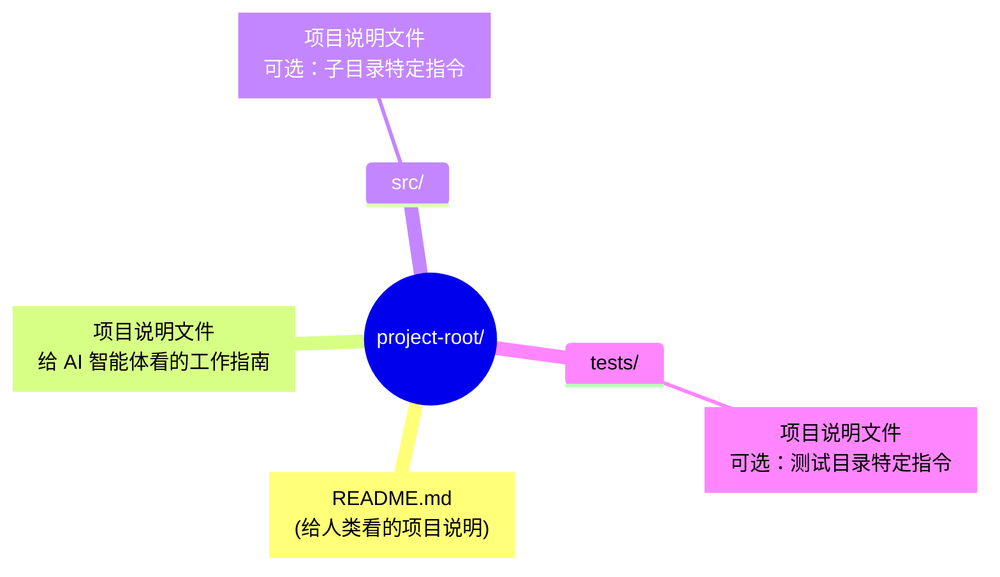
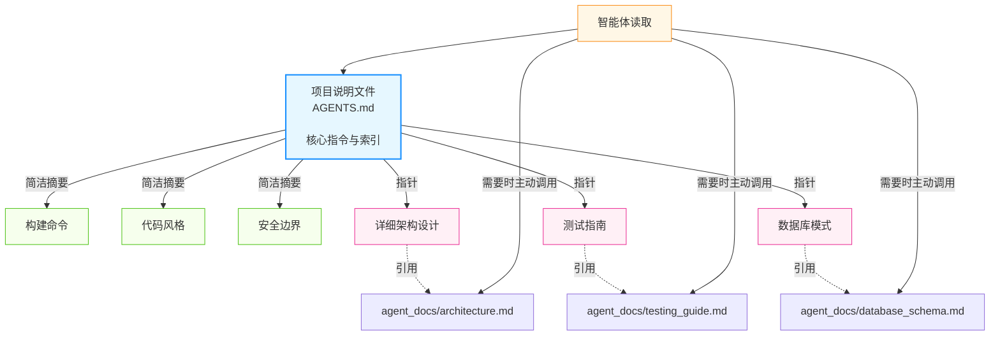
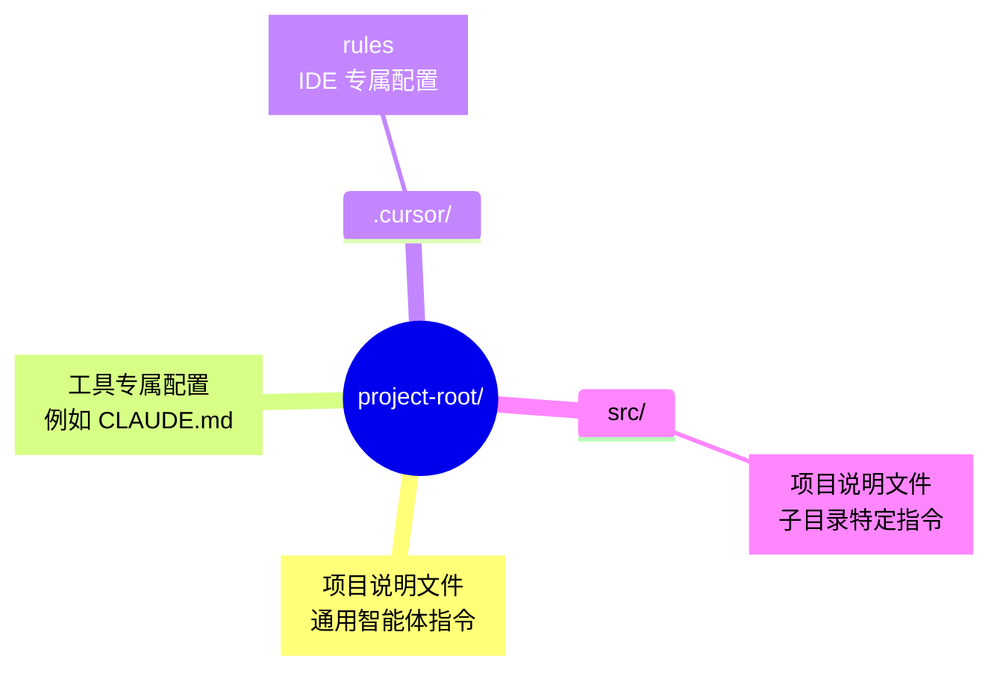
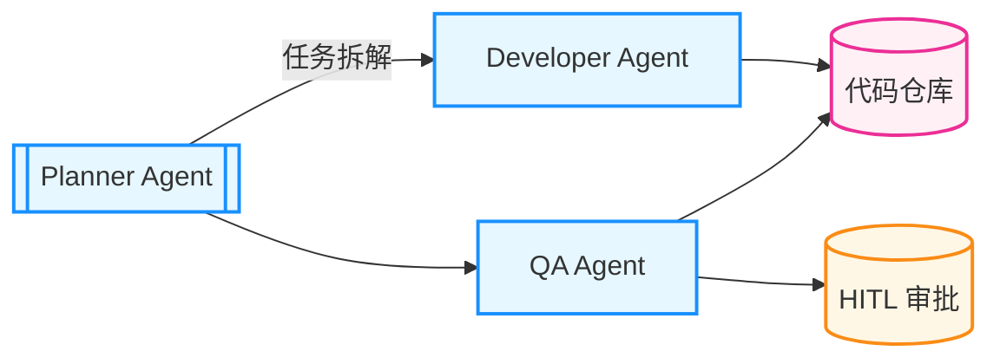
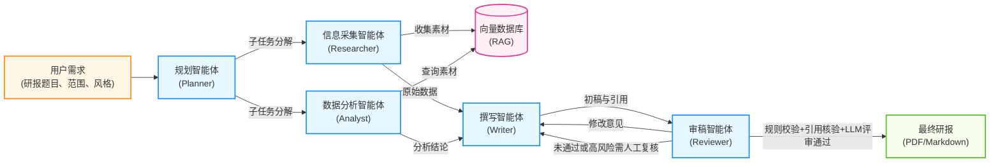

# 第十二章 附录

本附录汇集了学习与实践智能体 AI 所需的参考资料，包括术语定义、推荐阅读、项目说明文件规范与案例落地方法。

## 章节导读

- **12.1 术语表**
  - 汇总本书关键术语与定义，便于统一概念与沟通口径。

- **12.2 推荐论文与阅读清单**
  - 精选论文、博客与技术文档，帮助读者系统跟进理论与实践进展。

- **12.3 AGENTS.md 规范指南**
  - 提供面向 AI 编程智能体的 `AGENTS.md` 结构与编写实践。

- **12.4 案例模板与检查清单**
  - 提供可复用的案例模板、工程验收清单、升级回归流程与 AgentOps 指标参考。

- **12.5 快变事实核验表**
  - 记录模型、协议、价格、法规和平台能力等高波动事实的核验口径。

## 如何使用本附录

- **初学者**：先读术语表，再结合阅读清单建立基础认知。
- **研究者**：重点参考论文与技术资料，追踪方法演进与前沿趋势。
- **开发者**：优先使用项目说明文件规范与案例清单，指导落地实践。
- **团队负责人**：结合规范与检查清单，建立团队协作与交付标准。

---

**下一节**: 术语表

## 1. 术语表

本书中出现的关键术语及其解释。

### 1.1 术语翻译约定

| 英文术语 | 中文翻译 | 本书写法 | 首次出现 |
|---------|---------|---------|---------|
| Agent | 智能体 | 智能体 (Agent) | 1.1 节 |
| Token | 词元 | Token（代码/技术讨论中保留英文） | 1.1 节 |
| Prompt | 提示词 | 提示词 或 提示词 (Prompt) | 2.5 节 |
| Context | 上下文 | 上下文 | 1.1 节 |
| Context Engineering | 上下文工程 | 上下文工程 | 3.6 节 |
| Embedding | 嵌入向量 | 嵌入 或 嵌入向量 | 3.3 节 |
| Hallucination | 幻觉 | 幻觉 | 1.1 节 |
| Fine-tuning | 微调 | 微调 | 1.4 节 |
| RAG | 检索增强生成 | RAG | 3.4 节 |
| Guardrails | 护栏 | 护栏 | 1.1 节 |
| Sandbox | 沙箱 | 沙箱 | 1.3 节 |
| Orchestrator | 编排器 | 编排器 | 5.1 节 |
| Trace / Tracing | 追踪 | Trace 或追踪 | 9.3 节 |
| Trajectory | 轨迹 | 轨迹 | 7.3 节 |
| Human-in-the-Loop | 人机协作 | HITL 或人机协作 | 5.4 节 |
| Agentic Coding | 智能体编程 | 智能体编程 (Agentic Coding) | 10.1 节 |
| Vibe Coding | 氛围编程 | Vibe Coding | 10.1 节 |
| Model Distillation | 模型蒸馏 | 蒸馏 | 1.1 节 |
| Speculative Decoding | 投机解码 | 投机解码 | 8.7 节 |
| MCP | 模型上下文协议 | MCP | 4.3 节 |
| Function Calling | 函数调用 | 函数调用 或 工具调用 | 1.1 节 |

---

### 1.2 A

**Agent（智能体）**: 具有自主决策能力的 AI 系统，能够感知环境、制定计划并执行行动以达成目标。

**Agent-to-Agent Protocol（A2A, 智能体对智能体协议）**: 一类用于智能体间通信和协作的协议标准。

**Agent Card（智能体名片）**: A2A 协议中智能体发布的自我描述文档，包含身份和能力信息。

**Artificial General Intelligence（AGI, 通用人工智能）**: 具有人类水平通用智能的 AI 系统。

**Alignment（对齐）**: 确保 AI 系统的行为与人类意图和价值观一致的过程。

**Agentic Coding（智能体编程）**: AI 作为自主开发伙伴参与软件开发的新范式。

**Agent Harness（智能体运行壳）**: 包裹在 AI 模型外围的操作系统级基础设施，通过预设系统指令、工具调用管理、生命周期钩子等机制，专门管理长周期任务，解决模型在复杂任务中易跑偏、忘规则等问题。

**Agentic Workflow（智能体工作流）**: AI 以迭代、自主方式完成复杂任务的工作模式。

**Agentic Development Maturity Model（智能体研发成熟度模型）**: 一种用于描述研发模式演进的分级框架：L1 辅助、L2 协同、L3 自主。

### 1.3 B

**Budget Circuit Breaker（预算熔断）**: 基于 Token 累积消耗或执行时间设置的硬阈值机制，超额时立即阻断智能体执行，防止失控的循环消耗大量资源。

### 1.4 C

**Chain-of-Thought（CoT, 思维链）**: 让模型在给出答案前展示推理步骤的技术。

**Computer Use（计算机使用）**: AI 直接控制鼠标、键盘操作桌面环境的能力。

**Context Engineering（上下文工程）**: 管理大语言模型有限“注意力预算”的学科，比提示词工程更广泛。

**Context Window（上下文窗口）**: 模型一次能处理的最大词元 (Token) 数量。

**Compounding Engineering（复利工程）**: 通过知识沉淀使智能体系统持续进化的工程方法。

### 1.5 D

**Deliberative Alignment（审慎对齐）**: 推理模型在思维链中显式调用安全原则的技术。

**Disaggregated Serving（分离式推理架构）**: 将模型推理的预填充（Prefill）和解码（Decode）阶段部署到不同集群的架构模式，解决高并发场景下的计算/访存资源竞争问题。

**Domain Randomization（域随机化）**: 在仿真训练中对材质、光照、摩擦系数等环境参数进行随机变化，以训练模型学到更鲁棒特征，从而改善仿真到现实（Sim-to-Real）的策略迁移效果。是具身智能中的关键技术。

### 1.6 E

**Embedding（嵌入向量）**: 将文本转换为高维向量表示，用于语义相似度计算。

### 1.7 F

**Function Calling（函数调用）**: 模型生成结构化的函数调用请求，由外部系统执行。

**Few-Shot Learning（少样本学习）**: 通过少量示例让模型学会新任务的技术。

**FinOps（云财务运营）**: 将财务问责制引入云和 AI 支出的文化与实践。在智能体体系中意味着工程团队需对每一次 Token 消耗的投资回报率（ROI）负责。

### 1.8 G

**Graph of Thoughts（GoT, 思维图）**: 将推理过程组织为图结构的高级推理技术。

**Guardrails（护栏）**: 对智能体输入输出施加约束的安全机制，用于防止有害内容生成、越权操作等风险。

**Grounding（事实锚定）**: 通过检索增强生成（RAG）等技术将智能体输出锚定到可验证的外部证据或环境状态，减少幻觉。可选地附带引用/证据链接，从而提高事实准确性。

### 1.9 H

**Hallucination（幻觉）**: 模型生成看似合理但实际错误的信息。

**Human-in-the-Loop, HITL（人机协作，又译人在回路）**: 在智能体工作流的关键决策点引入人类审核与干预的设计模式。用于处理高风险操作、不确定性较高的决策或合规要求。

**Hooks（钩子）**: 在工具或框架的生命周期事件中注入自定义逻辑的机制。

**HTN（Hierarchical Task Network, 分层任务网络）**: 一种任务规划技术，通过递归地将高层目标分解为更小的子任务，形成层级结构的任务网络。在智能体系统中用于复杂任务的分解与编排。

### 1.10 I

**Instruction Hierarchy（指令层级）**: 定义智能体如何在冲突指令间进行优先级选择的机制，通常遵循 `system ≻ developer ≻ user ≻ tool` 的信任顺序。通过对抗训练（如 IH-Challenge）可增强模型在此层级下的鲁棒性。

### 1.11 K

**Knuth, Donald（高德纳）**: 图灵奖得主，1984 年提出“文学编程”（Literate Programming）概念，被视为 Agentic Coding “自然语言优先”理念的思想先驱。

**KV Cache（键值缓存）**: Transformer 模型推理时缓存已计算的 Key-Value 对，避免重复计算前缀 Token。是提示词缓存（Prompt Caching）的底层机制。

### 1.12 L

**Large Language Model（LLM, 大语言模型）**: 基于 Transformer 架构、在大规模文本数据上训练的深度学习模型，是智能体系统的核心“大脑”。

**Large Multimodal Model（LMM, 大型多模态模型）**: 能处理文本、图像、音频等多种输入的模型。

**LLM-as-Judge（大模型作为评审）**: 利用大语言模型对其他模型或智能体的输出进行评估、打分或作出合规判断的范式。在红队测试、幻觉检测和质量门禁中广泛应用。

### 1.13 M

**Memory Poisoning（记忆投毒）**: 间接提示词注入的一种变种，旨在污染智能体的长期记忆（例如向量检索知识库）。

**Model Context Protocol（MCP, 模型上下文协议）**: 一类用于模型与工具交互的开放协议标准。

**Multi-Agent（多智能体）**: 多个 AI 智能体协作完成任务的系统架构。

**Model Router（模型路由）**: 根据任务复杂度或置信度评估，将请求动态分发到不同规格模型（大模型 vs 小模型）的策略组件，用于优化成本与质量的平衡。

### 1.14 O

**Orchestrator（编排器）**: 负责协调多个智能体或工具调用顺序的控制组件。

### 1.15 P

**Perceive-Plan-Act Loop（PPA, 感知-规划-行动循环）**: 智能体的基本工作循环。

**Plan Mode（规划模式）**: 智能体先制定计划再执行的工作模式。

**Prompt Engineering（提示词工程）**: 设计有效提示词以引导模型产生期望输出的技术。

### 1.16 R

**Retrieval-Augmented Generation（RAG, 检索增强生成）**: 通过检索外部知识增强生成质量。

**ReAct（推理与行动）**: 将推理和行动交织进行的智能体架构模式。

**Reflexion（反思）**: 让智能体从失败中学习并改进的机制。

**Reinforcement Learning from Human Feedback（RLHF, 基于人类反馈的强化学习）**: 使用人类偏好数据优化模型的训练方法。

**Rules（规则）**: 存储在项目规则目录中的项目级行为规范。

**Reasoners（推理模型）**: 在复杂任务上表现更稳定、更擅长多步推理的一类模型，是智能体系统能力提升的重要来源。

### 1.17 S

**Sandbox（沙箱）**: 隔离执行环境，防止代码对系统造成危害。

**Skills（技能）**: 封装领域知识的可复用知识包。

**Standard Operating Procedure（SOP, 标准操作流程）**: 预定义的工作流程。

**Stop Sequence（停止序列）**: 控制模型暂停生成、等待工具结果的特殊标记。

**Speculative Decoding（投机解码）**: 用小型“草稿模型”快速预测多个候选 Token，再由大型“目标模型”并行验证的推理加速技术。在不损失生成质量的前提下，可将推理延迟降低数倍。

**Structured Output（结构化输出）**: 让模型按照指定的数据格式（如 JSON Schema）生成内容的技术，提高输出的可解析性。

**Supply Chain Attack（供应链攻击）**: 针对智能体依赖的第三方组件（如 MCP 服务器、插件、工具包）发起的攻击。攻击者通过篡改上游依赖注入恶意代码，影响所有下游智能体系统。

**Sim-to-Real Transfer（仿真到现实迁移）**: 将在虚拟仿真环境中训练的策略（如机器人控制策略）迁移到真实物理环境执行的过程。是具身智能的核心难题，涉及域适应与精确校准。

### 1.18 T

**Tool Return Injection（工具返回注入）**: 一种间接提示词注入攻击，攻击者在智能体调用的工具返回结果中隐蔽地嵌入恶意指令，诱导智能体执行非预期操作。属于提示词注入的高级形式，防御需在指令层级训练中加强。

**Token（词元）**: 模型处理的基本文本单位，一个汉字约 1-2 个词元。

**Tool Use（工具使用）**: 智能体调用外部工具扩展能力的能力。

**Tree of Thoughts（ToT, 思维树）**: 将推理过程组织为树结构的推理技术。

**Trajectory（轨迹）**: 智能体完成任务的完整执行路径，包含所有思考和行动。

**Trace / Tracing（追踪）**: 记录智能体从接收任务到产出结果全过程中每个步骤的技术。包括推理轨迹、工具调用、中间状态等，用于调试、优化和审计。

### 1.19 V

**Vibe Coding（氛围编程）**: 用自然语言描述需求、由 AI 生成代码的编程风格。

**Vector Database（向量数据库）**: 专门存储和检索向量的数据库系统。

### 1.20 Z

**Zero-Shot（零样本）**: 不提供示例，仅通过指令让模型完成任务。

### 1.21 复合术语

**Total Cost of Ownership, TCO（总拥有成本）**: 衡量智能体系统全生命周期成本的指标，包括模型推理费用（Token 消耗）、基础设施、开发维护、监控运维和人工干预等各项成本的总和。

---

**下一节**: 推荐论文与阅读清单

## 2. 推荐论文与阅读清单

本节提供一份“按主题组织”的阅读清单，帮助你从论文与工程资料中有重点地学习智能体。考虑到框架与产品更迭很快，本书避免维护“某平台官方文档链接合集”与“某年最新文章清单”，而是给出更稳定的筛选与阅读路径。

> **阅读建议**：
>
> 建议的阅读顺序：先从 **必读论文**(12.2.1) 和 **推理技术**(12.2.2) 建立基础概念，再根据你的专注方向选读相应主题。如果关注生产环境部署，**优先阅读安全与对齐部分** 的论文，特别是提示词注入与供应链安全相关的工作，这些直接影响系统稳定性。**工程资料选择**(12.2.8) 提供的优先级建议可帮助你避免被快速迭代的工具细节淹没。

### 2.1 必读论文

建议优先阅读这几类“奠基性工作”，它们对后续工程实践影响最大：

| 论文 | 主题 | 年份 |
|------|------|------|
| [Chain-of-Thought Prompting Elicits Reasoning](https://arxiv.org/abs/2201.11903) | 逐步推理与提示词设计 | 2022 |
| [ReAct: Synergizing Reasoning and Acting](https://arxiv.org/abs/2210.03629) | 推理与行动结合 | 2022 |
| [Toolformer: Language Models Can Teach Themselves to Use Tools](https://arxiv.org/abs/2302.04761) | 工具学习 | 2023 |
| [Reflexion: Language Agents with Verbal Reinforcement Learning](https://arxiv.org/abs/2303.11366) | 反思与自我改进 | 2023 |
| [Generative Agents: Interactive Simulacra of Human Behavior](https://arxiv.org/abs/2304.03442) | 生成式智能体与记忆驱动行为 | 2023 |

### 2.2 推理技术

| 论文 | 主题 | 年份 |
|------|------|------|
| [Tree of Thoughts: Deliberate Problem Solving](https://arxiv.org/abs/2305.10601) | 树搜索式思考 | 2023 |
| [Self-Consistency Improves CoT Reasoning](https://arxiv.org/abs/2203.11171) | 多样采样与自一致性 | 2022 |
| [DeepSeek-R1: Incentivizing Reasoning Capability in LLMs via Reinforcement Learning](https://arxiv.org/abs/2501.12948) | 开源推理模型（见 7.5 节） | 2025 |

### 2.3 多智能体

| 论文 | 主题 | 年份 |
|------|------|------|
| [AutoGen: Enabling Next-Gen LLM Applications via Multi-Agent Conversation](https://arxiv.org/abs/2308.08155) | 对话式多智能体 | 2023 |
| [MetaGPT: Meta Programming for Multi-Agent](https://arxiv.org/abs/2308.00352) | 面向软件开发的多智能体 | 2023 |
| [CAMEL: Communicative Agents for Mind Exploration](https://arxiv.org/abs/2303.17760) | 角色扮演与协作 | 2023 |

### 2.4 检索增强

| 论文 | 主题 | 年份 |
|------|------|------|
| [RAG: Retrieval-Augmented Generation](https://arxiv.org/abs/2005.11401) | 检索增强生成 | 2020 |
| [Self-RAG: Learning to Retrieve, Generate, and Critique](https://arxiv.org/abs/2310.11511) | 自适应检索与自我批判 | 2023 |

### 2.5 安全与对齐

| 论文 | 主题 | 年份 |
|------|------|------|
| [Ignore This Title and HackAPrompt](https://arxiv.org/abs/2311.16119) | 提示词注入攻防 | 2023 |
| [Constitutional AI: Harmlessness from AI Feedback](https://arxiv.org/abs/2212.08073) | 价值对齐与无害性 | 2022 |
| [Red Teaming Language Models to Reduce Harms: Methods, Scaling Behaviors, and Lessons Learned](https://arxiv.org/abs/2209.07858) | 模型安全评估与对齐实践 | 2022 |
| [Give Us the Facts: Enhancing Large Language Models with Knowledge Graphs for Fact-aware Language Modeling](https://arxiv.org/abs/2306.11489) | 事实锚定与幻觉减少 | 2023 |
| [Large Language Model Supply Chain: Open Problems From the Security Perspective](https://arxiv.org/abs/2411.01604) | 供应链安全与依赖管理 | 2024 |
| [IH-Challenge: A Training Dataset to Improve Instruction Hierarchy on Frontier LLMs](https://arxiv.org/abs/2603.10521) | 指令层级鲁棒性训练 | 2026 |
| [Many-Tier Instruction Hierarchy in LLM Agents](https://arxiv.org/abs/2604.09443) | 多层级指令优先级建模 | 2026 |

### 2.6 智能体编程

| 论文 | 主题 | 年份 |
|------|------|------|
| [SWE-bench: Can Language Models Resolve Real-World GitHub Issues?](https://arxiv.org/abs/2310.06770) | 软件工程智能体评估 | 2023 |
| [AgentBench: Evaluating LLMs as Agents](https://arxiv.org/abs/2308.03688) | 智能体综合评估基准（见 7.2 节） | 2023 |
| [AutoCoder: Enhancing Code Large Language Model with AIEV-Instruct](https://arxiv.org/abs/2405.14906) | 自动化代码生成增强 | 2024 |
| [SkillOpt: Executive Strategy for Self-Evolving Agent Skills](https://arxiv.org/abs/2605.23904) | 可验证的 Skill 自进化 | 2026 |

### 2.7 综述论文

| 论文 | 主题 | 年份 |
|------|------|------|
| [A Survey on Large Language Model based Autonomous Agents](https://arxiv.org/abs/2308.11432) | 智能体综述 | 2023 |
| [The Rise and Potential of LLM Based Agents: A Survey](https://arxiv.org/abs/2309.07864) | 智能体发展 | 2023 |

### 2.8 工程资料如何选

建议把工程材料按“可迁移性”排序：

1. **方法论与流程**：评测设计、可观测性、权限边界、回归样例集、事故复盘模板。
2. **系统能力结构**：工具调用、结构化输出、缓存、检索、沙箱、审批与治理。
3. **工具/框架手册**：具体配置文件、命令行参数、SDK 示例。

这样阅读能避免被短周期的产品变化牵着走。

---

*注：论文链接多为 arXiv，版本可能随作者更新。*

---

**下一节**: AGENTS.md 规范指南

## 3. AGENTS.md 规范指南

`AGENTS.md`（项目说明文件）是一类面向 AI 编程智能体的项目级说明文档，用于集中存放构建命令、测试入口、代码风格、安全边界与工具权限说明等关键信息。它的定位更接近“给智能体看的 README”：提供上下文与操作约束，但**不是独立的安全边界**。真正的权限控制仍必须由运行时网关、沙箱、凭证代理、CI 策略或人工审批机制执行。不同工具生态可能仍在使用各种前缀名（如 CLAUDE.md、.cursorrules），但理念高度一致，并在长远上正逐渐向通用的 `AGENTS.md` 收敛。

### 3.1 什么是 AGENTS.md 与核心概念

`AGENTS.md` 是面向 AI 编程智能体的项目级操作手册，重点回答“能做什么、如何做、不能做什么”。如果说 `README.md` 是给人类开发者看的项目说明，那么 `AGENTS.md` 就是给 AI 编程智能体看的“机器可读说明书”。

> **类比**：
> - `README.md` → 人类开发者的项目介绍
> - `AGENTS.md` → AI 编程智能体的工作与合规指南

### 3.2 为什么需要项目说明文件

传统的 README.md 存在以下问题：

1. **面向人类**：包含快速入门、项目描述等人类易读但机器难以精确解析的内容
2. **信息分散**：构建命令、测试规则、代码风格等信息可能散落在多个文件中
3. **格式不统一**：每个项目的写法不同，Agent 需要“猜测”

项目说明文件通过标准化格式解决这些问题：

- 给智能体一个 **清晰、可预测** 的上下文与指令位置
- 提供 **精确、步骤化** 的操作指南和风险提示
- 保持 README 简洁，专注人类读者

### 3.3 文件结构与基本布局

文件结构通常由根目录主文件、子目录补充文件和可按需引用的扩展文档索引组成。



图 12-1：项目说明文件布局结构

**嵌套规则**：

- 根目录的说明文件适用于整个项目
- 子目录的说明文件可以覆盖或补充父目录的指令
- 适用于 Monorepo 等大型项目

### 3.4 推荐内容结构

一个完整的项目说明文件通常包含以下部分：


```markdown

# Project Overview

This is a TypeScript-based web application using Next.js 14.
Architecture: Monorepo with apps/ and packages/ directories.
```

#### 构建与测试命令

命令部分要写得能直接复制执行，并标注每条命令各自的适用范围。

```markdown

# Build

npm run build

# Test

npm run test              # 运行所有测试
npm run test:unit         # 仅单元测试
npm run test:e2e          # 端到端测试

# Lint

npm run lint              # ESLint + Prettier
npm run lint:fix          # 自动修复可修复问题
```


```markdown

# Code Style

- Use TypeScript strict mode
- Prefer small, focused modules with descriptive names
- Use named exports for shared modules
- Run `npm run lint` and `npm run format` before handoff
- Let ESLint / Prettier enforce formatting details
```

#### 测试规范

测试规范要说明测试放在哪里、怎么命名，以及哪些外部依赖必须被 mock。

```markdown

# Testing Guidelines

- All new features must have unit tests
- Test files should be co-located: `foo.ts` → `foo.test.ts`
- Use `describe` for grouping, `it` for individual tests
- Mock external APIs in tests
```

#### 安全考虑

安全部分列出的是硬约束，应该写成智能体可以逐条自查的禁止项。

```markdown

# Security

- Never commit secrets or API keys
- Use environment variables for configuration
- Validate all user input
- Avoid `eval()` and `dangerouslySetInnerHTML`
```

#### 权限边界

权限边界要同时写清可以直接动的范围，和必须先问一句的动作。

```markdown

# Permissions

- Allowed paths: `src/`, `tests/`, `docs/`
- Ask before destructive commands or production writes
- Never read or modify undeclared secret stores
```

#### Pull Request 指南

这一部分决定智能体如何收尾，因此要给出可量化的规模与内容要求。

```markdown

# Pull Request Guidelines

- Keep PRs focused and small (< 500 lines changed)
- Write meaningful commit messages
- Include tests for new functionality
- Update documentation if needed
```

#### 完整示例

把以上各节拼起来，一份完整的项目说明文件大致如下。

````text

# 项目说明文件（示例）

# Project Overview

A Python REST API.
- Framework: <web-framework>
- Database: <database>
- Authentication: <auth>

# Environment Setup

```bash
python -m venv venv
source venv/bin/activate
pip install -r requirements.txt
cp .env.example .env
```

# Build

```bash
python -m compileall app
```

# Run

```bash

## Development mode

uvicorn app.main:app --reload

## Production mode

uvicorn app.main:app --host 0.0.0.0 --port 8000
```

# Test

```bash

## Run all tests

pytest

## Run with coverage

pytest --cov=app --cov-report=html

## Run specific test file

pytest tests/test_users.py
```

# Code Style

- Follow PEP 8
- Use type hints for all function parameters and returns
- Run Ruff/Black before handoff
- Let the formatter enforce line length and import ordering

# File Naming

- API routes: `app/routers/{resource}.py`
- Models: `app/models/{entity}.py`
- Schemas: `app/schemas/{entity}.py`
- Tests: `tests/test_{module}.py`

# Security

- Validate all input with Pydantic models
- Use parameterized queries (SQLAlchemy handles this)
- Never log passwords or tokens
- Rate limit all public endpoints

# Permissions

- Allowed paths: `app/`, `tests/`, `docs/`
- Ask before destructive shell commands or production writes
- Never access undeclared secret stores
````

### 3.5 工具支持与配置关系

不同工具生态对项目说明文件的支持程度不同：有的会自动加载指定文件名，有的需要在配置中声明路径。建议以“文件内容结构”作为稳定部分，以“文件名与加载方式”作为可替换的适配层。

项目说明文件旨在 **统一** 而非取代现有的工具特定配置：

| 工具 | 专用配置 | 项目说明文件的作用 |
|------|----------|-----------------|
| IDE / 编辑器插件 | 项目内规则目录 | 提供通用指令 |
| CLI 智能体 | 项目内配置文件 | 提供通用指令 |
| 自动化机器人 | CI 配置 | 提供项目上下文 |

**最佳实践**：将通用指令放在项目说明文件中，将工具特定配置放在各自文件中。

### 3.6 高级技巧与最佳实践

**高级技巧：渐进式披露**

不要试图把所有信息都塞进一个项目说明文件。这会消耗 **词元** 并降低智能体的注意力。**推荐结构**：

```text
agent_docs/
  ├── architecture.md
  ├── testing_guide.md
  └── database_schema.md
项目说明文件（只包含索引和指针）
```

在项目说明文件中：
> “关于数据库设计细节，请阅读 `agent_docs/database_schema.md`。”

智能体会自行决定何时深入阅读。



图 12-2：项目说明文件的渐进式披露架构

**核心原则：What / Why / How**

一个好的配置文件应该回答三个问题：

1. **WHAT**: 技术栈、项目结构。
2. **WHY**: 设计决策的背景。
3. **HOW**: 如何运行、测试、验证。

**反模式：不要做 Linter 的工作**

❌ **错误做法**：在 **提示词 (Prompt)** 中详细规定代码风格（空格还是 Tab、换行习惯）。
* **后果**：浪费 Token，执行不稳定。

✅ **正确做法**：使用 ESLint / Prettier / Ruff 等格式化工具。
* 让工具自动修复格式与 Lint 错误。智能体只需要知道 “run `npm run lint:fix`”。

### 3.7 逐步采用与验证

**快速开始**

1. 在项目根目录创建项目说明文件。可先下载 [AgentGo](https://github.com/yeasy/AgentGo)（原名 agentrc）提供的最佳实践模板：`curl -fsSL https://raw.githubusercontent.com/yeasy/AgentGo/main/AGENTS.md -o AGENTS.md.new`
2. 如果项目已存在 `AGENTS.md`，先用 `diff -u AGENTS.md AGENTS.md.new` 对比，再手工合并；确认无本地规则被覆盖后再替换
3. 根据项目实际情况调整内容
4. 优先补全 **Build / Test / Lint / Permissions**，再补充 **Code Style** 与 **Security**

**逐步完善**

- 第一周：基础构建、测试、Lint 与权限边界
- 第二周：代码风格和命名规范
- 第三周：安全规则和 PR 指南
- 持续：根据智能体表现调整和补充

**验证效果**

使用 AI 编程 Agent 进行以下测试：

1. “请添加一个新的 API 端点”——检查是否遵循文件命名规范
2. “请为这个函数添加测试”——检查测试是否放在正确位置
3. “请修复这个 bug”——检查是否运行了测试套件

### 3.8 CI 持续集成与 Linter 检查

`AGENTS.md` 不能仅仅是一份被遗忘在根目录的纯文档，**必须加入 CI/CD 流程以防止其随时间发生“沉默腐烂”**。

**1. 目录强制校验 (Linter)**

通过编写一段简单的 CI 脚本（例如 `scripts/lint_agents_md.py`）并挂载到 Actions：

```python
import sys

def lint_agents_md():
    try:
        with open("AGENTS.md", "r") as f:
            content = f.read()
    except FileNotFoundError:
        print("❌ 错误: 必须在根目录提供 AGENTS.md")
        sys.exit(1)

    required_sections = ["# Build", "# Test", "# Lint", "# Permissions"]
    recommended_sections = ["# Code Style", "# Security"]

    for sec in required_sections:
        if sec not in content:
            print(f"❌ 错误: AGENTS.md 缺失核心要求章节 '{sec}'")
            sys.exit(1)

    for sec in recommended_sections:
        if sec not in content:
            print(f"⚠️ 警告: 建议补充章节 '{sec}'")

    # 避免占用过长上下文
    if content.count('\n') > 500:
        print("❌ 错误: AGENTS.md 太长，请使用子文件并在主文件引用")
        sys.exit(1)

    print("✅ AGENTS.md 结构校验通过")

if __name__ == "__main__":
    lint_agents_md()
```

**2. 将权限声明接入运行时策略 (Permission Constraints)**

可以把 `AGENTS.md` 中的权限段落作为**策略输入**，由系统网关、工具代理或 CI 检查转译成可执行的 allowlist / denylist。关键边界是：自然语言文件本身只负责说明意图，不能替代真正的访问控制。

```markdown

# Permissions

- allowed_mcp_servers: ["db-readonly", "github-repo-read"]
- allowed_fs_paths: ["src/", "tests/", "docs/"]
- blocked_shell_commands: ["rm -rf", "docker push", "npm publish"]
```

要实现“代码化安全边界 (Security-as-Code)”，还需要至少三件事：

1. **运行时强制**：工具网关或沙箱在执行前读取策略并硬拦截越权调用。
2. **默认拒绝**：未声明的文件路径、外部域名、MCP server、发布命令和生产写入默认不可用。
3. **可审计性**：每次放行、拒绝和人工批准都记录 trace，避免把 `AGENTS.md` 误当成不可绕过的安全机制。

### 3.9 其他资源与配置对比

**相关资源**

建议查阅大模型工具链（如 Cursor、Cline、Aider 等）的最新官方文档，确认其支持的规则加载机制。

**与其他配置文件的对比**

| 维度 | 项目说明文件 | 工具专属配置文件 |
|------|-----------|-----------|
| 标准化 | 目标是跨工具通用 | 工具专属 |
| 适用范围 | 尽量跨工具复用 | 仅特定工具 |
| 层级位置 | 根目录 + 子目录 | 根目录 + 父目录 + 用户目录 |
| 核心内容 | 构建命令、测试、代码风格 | 工作流、工具连接相关特化配置 |
| 加载方式 | 工具主动读取或声明路径 | 随工具原生机制自动加载 |

两者的互补结构图如下：



图 12-3：项目说明文件与工具专属配置共存结构

> **提示**：最佳实践：项目说明文件应随项目演进持续维护，重点关注：构建/测试入口、代码规范、安全边界、回归样例集。

---

**下一节**: 案例模板与检查清单

## 4. 案例模板与检查清单

本节用于解决“如何把智能体方案写成可复用、可验收、可迭代的交付案例”。

---

### 4.1 标准案例呈现模板

建议所有实战案例（Case Study）统一采用如下结构。

#### 案例背景

- **行业/场景**：说明具体业务环境（如金融风控、电商客服、软件开发）。
- **用户痛点**：说明引入智能体前的核心问题（如人工流程慢、规则维护成本高、跨系统协作困难）。

#### 目标设定

- **核心目标**：一句话描述要解决的问题。
- **关键指标（KPI/SLO）**：给出可量化目标，例如：
  - 平均响应时间下降 30%
  - 任务成功率提升到 90%+
  - 人工介入率下降 40%

#### 解决方案

- **架构设计**：说明采用的智能体架构（单体/多智能体、ReAct/ToT/分层等）。
- **关键技术栈**：
  - **模型选型**：基于能力、成本、延迟、合规等因素说明选择理由。
  - **记忆设计**：短期缓存、检索增强、结构化存储如何配合。
  - **工具体系**：数据库、搜索、代码执行、外部 API 等工具如何接入与授权。
- **工作流图示**：建议使用 Mermaid 展示关键路径。



图 12-4：标准协作架构图模板

#### 实施成效

- **定性结果**：哪些流程被改善、用户体验如何变化。
- **定量结果**：对照目标前后数据，例如延迟、错误率、吞吐、成本变化。

#### 风险与教训

- **主要风险**：如幻觉、工具失败、长链路延迟、越权调用、成本超预算。
- **经验沉淀**：哪些做法有效、哪些应避免、下一轮优化优先级是什么。

---

### 4.2 实施与验收检查清单

以下清单用于评估案例是否达到“可复现、可运行、可验收”标准。

#### A. 工程实现检查（必选）

- [ ] **输入输出定义**：是否给出输入数据结构与输出结构（建议 JSON Schema）。
- [ ] **依赖与环境**：是否列出库版本、环境变量、外部服务与权限要求。
- [ ] **核心实现**：是否提供关键流程伪代码或核心代码片段。
- [ ] **错误处理**：是否覆盖超时、拒答、工具失败、重试与降级策略。
- [ ] **可观测性**：是否说明日志、追踪、评估集或告警配置。
- [ ] **运行说明**：是否给出可执行的启动、测试、回归验证命令。

#### B. 工具开发检查（按需）

- [ ] **幂等性**：重复调用是否安全；写操作重复执行是否可控。
- [ ] **参数校验**：是否校验类型、取值范围、必填项与默认值。
- [ ] **安全边界**：是否防止路径遍历、注入、越权访问等风险。
- [ ] **高风险操作审查**：是否为敏感写操作设置 Human-in-the-loop。
- [ ] **容错机制**：是否具备超时、重试、熔断或回退策略。
- [ ] **可理解报错**：返回信息是否便于智能体进行下一步自修复。

---

### 4.3 版本升级前的更新检测流程

在升级模型、SDK、工具链前，建议执行以下流程：

1. **能力变更检查**：确认结构化输出、工具调用、上下文窗口、缓存机制是否变化。
2. **破坏性变更检查**：确认依赖是否有主版本升级、参数弃用或默认行为变更。
3. **回归验证**：运行评估集与关键链路回放，比较成功率、延迟、成本与安全指标。
4. **灰度发布与回滚预案**：先小流量验证，再全量；保留一键回滚路径。

---

### 4.4 AgentOps 指标清单（参考）

指标阈值不应“一刀切”，应由业务 SLA/SLO 定义。下表给出常见观察维度：

| 指标类别 | 具体指标 | 设定方式 | 备注 |
| :--- | :--- | :--- | :--- |
| **效果** | 任务成功率、步骤准确率 | 按业务目标设定 | 核心链路设更高阈值 |
| **性能** | 端到端延迟、首字生成时间 | 按交互体验设定 | 离线任务可放宽 |
| **成本** | 单任务词元、日均调用成本 | 按预算与 ROI 设定 | 监控异常波动 |
| **稳定性** | 工具失败率、重试成功率 | 按可用性目标设定 | 需配合告警与降级 |
| **安全** | 护栏触发率、越权调用率 | 按风控要求设定 | 高风险场景需人工审计 |

---

### 4.5 使用建议

- 先用 **12.4.1 模板** 写清“问题—方案—结果—风险”。
- 再用 **12.4.2 清单** 做交付前自检，确保可运行与可验收。
- 最后用 **12.4.3 + 12.4.4** 建立持续迭代与监控机制。

当案例能被新成员在最短时间内复现，并在升级后稳定运行时，模板才真正发挥价值。

---

### 4.6 最小可复现实验标准定义

一个合格的 MRE (Minimal Reproducible Experiment) 必须满足以下四个硬性标准：

| 标准 | 要求 |
|------|------|
| **固定模型与参数** | 锁死模型版本（如 `claude-sonnet-4-6` 或 `gpt-4o`）；公开 `temperature`、`top_p` 等超参数；禁用 `latest` 标签 |
| **确定性测试集** | ≥50 个测试用例，含 Ground Truth（JSONL 格式）；配权重离线自动化评估脚本 |
| **隔离沙箱环境** | Docker Compose/DevContainer 一键启动；Mock 依赖；切断不可控公网 API 直接依赖 |
| **透明提示词与轨迹** | 公开完整系统提示词与工具 Schema；提供 `trace_id` 日志回放工具；附带 3-5 份真实 Trace 日志片段 |

---

### 4.7 端到端案例：智能研报生成系统

本案例展示如何将全书核心知识点（任务规划、推理引擎、记忆系统、工具使用、多智能体协作、评估机制、可观测性、护栏机制）整合成一个可复用的端到端参考蓝图（包含待实施环节）。

#### 场景描述

构建一个能自主完成行业研报撰写的智能体系统。系统需要从多个信息源（公开数据、行业报告、财务数据）自动收集素材，进行数据分析与合成，最后生成结构完整、引用准确、逻辑清晰的研报文档。传统方式需要资深分析师投入 2-3 个工作日，系统应在 2-4 小时内交付初稿。

#### 架构设计

下图展示了从任务分解到质量门禁与交付的整体协作路径：



图 12-5：智能研报生成系统架构

#### 核心组件与全书知识点映射

以下表格展示本系统如何将全书各章节的核心概念串联成统一的解决方案：

| 组件 | 对应章节 | 具体应用 |
|------|---------|---------|
| **任务规划** | 第 2 章 2.2（分解算法）、术语表（HTN 定义） | Planner 使用 HTN（分层任务网络，本书正文未展开该算法，定义见术语表）将“撰写行业研报”分解为“信息采集”→“数据分析”→“初稿撰写”→“评审迭代” 四个并行/串行的子任务 |
| **推理引擎**| 第 2 章 2.3 | Researcher 使用 ReAct（思考-行动-观察）循环：**思考** 关键搜索词→**行动** 调用搜索引擎→**观察** 结果→判断是否继续搜索 |
| **记忆系统** | 第 3 章 3.4 | 非结构化材料（报告、新闻、说明文档）向量化存储在 RAG 数据库；结构化财务数据保留在表格/数据库中，Writer 按需进行混合检索与引用拼接 |
| **工具使用** | 第 4 章 4.2 | Researcher 调用搜索 API、财务数据库查询、图表生成工具；Analyst 调用数据处理函数、统计分析库；Reviewer 调用语言模型评分接口 |
| **多智能体协作**| 第 5 章 5.1 | 采用 **层级架构**：Planner 作为 Supervisor 分发任务，Researcher、Analyst 并行执行，Writer 聚合结果，Reviewer 进行终审 |
| **评估机制**| 第 7 章 7.2 | Reviewer 采用组合门禁：规则校验 + 引用核验 + **LLM-as-Judge** 评分；高风险场景触发人工复核，不以单一分数直接放行 |
| **可观测性**| 第 9 章 9.3 | 每次任务执行都生成 **全链路 Trace**，包含唯一 `trace_id`，记录每个智能体的输入、输出、工具调用、耗时，支持事后回放与性能分析 |
| **护栏与安全**| 第 11 章 11.1 | Writer 输出的研报必须通过 **安全边界检查**：(1) 过滤敏感信息（个人隐私、商业机密）；(2) 事实核查（基于可信来源）；(3) 格式验证（无恶意代码注入）|

#### 关键实现要点

**1. Planner 的任务分解策略（HTN 框架）**

```text
撰写研报
├─[并行] 信息采集：搜索宏观数据、企业财报、竞争格局 (2d)
├─[并行] 数据分析：产销趋势、集中度、成本曲线 (2d)
├─[串行] 初稿撰写：大纲→内容→图表引用 (1.5d)
└─[串行] 评审迭代：事实核查、逻辑审视、格式调整 (0.5d)
```

**2. Researcher 的 ReAct 循环**

```text
轮次 | 思考 | 行动 | 观察 | 结果
-----|------|------|------|------
1 | 需市场规模和主要参与者 | search("EV market 2024-26") | Statista/IEA报告 | ✓ 加入
2 | 缺国内企业财务对比 | financial_db("比亚迪/蔚来/理想2025") | 财报数据 | ✓ 加入
3 | 需产业链各环节动态 | search("电池竞争、固态电池2026") | 宁德/比亚迪进展 | ✓ 停止
```

**3. 并行执行与共享数据库**

```text
t=0h:  Researcher 搜索 (20份文档) → RAG数据库
       Analyst 数据查询 → 结构化表格

t=1.5h: 两者完成

t=2h:  Writer 混合检索
       - 语义搜索: "竞争格局" → Researcher 文档
       - SQL 查询: "成本趋势" → Analyst 表格
       - 组织初稿，标记引用 [来源:docID:页码]
```

**4. Reviewer 的多维度评分机制**

```text
初稿提交给 Reviewer

评估模板:
{
  "事实准确性": {
    "说明": "逐条验证主要观点是否有可信来源支撑",
    "检查项": [
      "市场规模数据是否与权威报告一致?",
      "企业财务数据是否与公开披露相符?",
      "重要事件时间线是否正确?"
    ],
    "评分": 0.85  // 因为某个推算有轻微假设，但主体准确
  },
  "逻辑连贯性": {
    "说明": "章节过渡、论证链条、结论推导是否合理",
    "检查项": [
      "现状分析 → 存在的问题 → 未来展望 逻辑是否流畅?",
      "是否有自相矛盾或未闭合的论述?",
      "结论是否由前文充分支撑?"
    ],
    "评分": 0.92  // 逻辑清晰，层层递进
  },
  "格式规范性": {
    "说明": "排版、图表、引用、表格是否符合学术规范",
    "检查项": [
      "标题层级是否正确?",
      "参考文献是否完整?",
      "代码、URL 是否被标记?",
      "敏感信息是否被过滤?"
    ],
    "评分": 0.95  // 基本符合，仅需微调排版
  },
  "综合评分": (0.85 + 0.92 + 0.95) / 3 = 0.907
}

放行规则:
  1) 规则校验通过（格式、敏感信息、基础一致性）
  2) 引用核验通过（关键结论可追溯到可信来源）
  3) LLM 评审分数达标（例如 >= 0.8）
  4) 高风险场景进入人工复核（HITL）

反馈给 Writer: "整体质量良好，建议调整第 3 章第 2 节的某处表述..."
```

**5. 迭代控制与降级策略**

```text
流程控制:
  ┌─ Writer 初稿 (v1)
  │  │
  │  └─ 组合门禁未通过 (不通过)
  │     └─ Writer 修改 (v2)
  │        │
  │        └─ 组合门禁通过 (通过) ✓
  │
  └─ 最终输出研报

失败情况处理:
  - 若迭代 3 次后仍评分 < 0.8，触发人工审视
  - 若单个智能体超时 (>60s)，调用降级方案：
    * Researcher 超时 → 使用缓存数据或简化查询
    * Analyst 超时 → 使用历史模板数据
    * Writer 超时 → 使用自动提纲+模板拼接
    * Reviewer 超时 → 使用规则引擎快速评分
```

#### 技术栈与部署

**模型选择**：

本案例采用的模型配置旨在平衡推理精度、成本与延迟。为避免把短周期模型版本写成长期建议，下面只描述能力层：

- **Planner**：使用供应商当前推荐的强推理/复杂任务模型，并在需要时开启深度思考或等价推理模式。
- **Researcher**：使用长上下文、检索整合和引用稳定性较好的中高档模型。
- **Analyst**：使用成本较低但结构化数据处理稳定的小型或中型模型。
- **Writer**：使用长文本生成质量稳定、可控性好的模型。
- **Reviewer**：使用与 Planner 同级或更强的评估模型，并固定可复现实验中的 snapshot / alias。

> **生产部署建议**：为降低跨模型系列的协议与维护复杂度，生产环境建议选择单一模型系列（全 Claude 或全 OpenAI），在整体成本与性能目标框架下进行微调。上述配置适于技术原型与性能基准测试。

**关键库与服务**：
- 向量数据库：Pinecone 或本地 Milvus
- 搜索 API：Google Custom Search API、Bing Search API
- 财务数据：东方财富 API 或 Yahoo Finance
- 托管平台：AWS Lambda / Google Cloud Run（无服务器）

#### 成本与效率分析

单篇研报（约 5000 字）的 LLM Token 成本应作为**估算方法**，而不是固定价格。不同模型的输入、输出、缓存、长上下文和批处理价格差异很大，生产方案应记录模型 ID、价格日期、输入/输出 token 拆分和是否使用缓存。

| 组件 | 估算 token | 成本记录方式 |
|------|------------|--------------|
| Planner（任务分解）| 2K | 按所选模型的输入/输出价格分别计算 |
| Researcher（5 轮搜索）| 15K | 记录搜索结果 token、缓存命中和工具费用 |
| Analyst（数据计算）| 8K | 区分模型推理 token 与本地计算成本 |
| Writer（初稿+2 修改）| 25K | 记录生成输出 token 和修改轮次 |
| Reviewer（2 次评审）| 10K | 记录评审模型与日期 |
| **总计** | **约 60K** | **按当日官方价格表生成快照** |

**对标**：人工成本、系统成本和效率提升应按同一任务口径计算。不要直接写“提升 625-1562 倍”这类精确倍数，除非同时给出人工工时、模型价格快照、工具费用、返工率和质量验收标准。

#### 常见问题与应对策略

**Q1: 多个信息源数据冲突如何处理？**

Researcher 标记来源可信度；Writer 优先采信权威来源（官方 > 咨询公司 > 自媒体）；存在重大分歧时标注“业界存在不同观点”；Reviewer 验证冲突处理正确性。

示例：EV 市场份额冲突（40% vs 45%）→ Writer 写：“高盛预计 40%，摩根士丹利预计 45%，我们倾向保守估计” → Reviewer 验证 ✓

**Q2: 生成文本中的幻觉风险如何降低？**

强制引用：每个观点附带 `[来源:doc_id:页码]`。Reviewer 逐条 fact-check 引用有效性。若检测幻觉，返回具体问题给 Writer。

示例：原文 “比亚迪电池全球领先” → 无引用 → Reviewer 要求修改为 “通过规模效应降低成本 [比亚迪 2025 财报]”

**Q3: 单个智能体超时（>60s）如何处理？**

触发降级方案：Researcher 用缓存数据 → 模板占位符；Analyst 用历史结果 → 行业平均值；Writer 用摘要拼接 → 预制模板；Reviewer 用规则评分 → 标记待人工审视。

**Q4: 如何确保研报的可维护性与可验证性？**

(1) 元数据记录：trace_id、模型版本、tokens、成本、评分、源数量；(2) 完整引用链接追溯到原始来源；(3) 保存全链路 Trace 支持事后回放与改进验证。

#### 集成检查清单

使用 **12.4.2** 中的工程实现检查清单验证本系统：

- [x] **输入输出定义**：用户输入（题目、字数、风格）→ 输出（Markdown 研报 + metadata）
- [x] **依赖与环境**：列出所需 API key、数据库连接、模型版本（✓ 见技术栈部分）
- [ ] **核心实现**：提供各智能体的提示词模板与工具定义（见后续实施阶段）
- [x] **错误处理**：超时 60s 触发降级、幻觉检测与修正循环、迭代最多 3 次 (✓)
- [x] **可观测性**：全链路 Trace ID、各智能体耗时与 token 统计 (✓)
- [ ] **运行说明**：提供启动脚本、测试用例、性能基准（待实施）

---

**上一节**: AGENTS.md 规范指南

**下一节**: 快变事实核验表

## 5. 快变事实核验表

> `verified_at`: 2026-10-04 · `expires_at`: 2026-11-03 · `ttl_days`: 30

本表记录模型可用性、API、协议和基准等高波动事实。超过 30 天未复核时，项目检查会失败；正文不得把表中快照当成长期不变的结论。

<!-- volatile-status: id=openai-models status=current -->
<!-- volatile-status: id=anthropic-access status=resolved-conflict -->
<!-- volatile-status: id=google-models status=current -->
<!-- volatile-status: id=vector-databases status=current -->
<!-- volatile-status: id=protocols status=current -->
<!-- volatile-status: id=benchmarks status=current -->

| 类别 | 当前维护口径 | 权威入口 | 编辑要求 |
| --- | --- | --- | --- |
| OpenAI 模型与 API | 官方模型目录首推三档：**GPT-6 Astra**（`gpt-6-astra`，2026-09-03 发布）、**GPT-6.1 Sol**（`gpt-6.1-sol`，2026-09-29）与 **GPT-6 Luna**（`gpt-6-luna`，2026-09-22）。Astra 的模型页已无滚动开放表述，标为 Default，Tier 1–5 速率限制齐备，即已全量可用。GPT-5.6 系列（Sol / Terra / Luna）与 GPT-5.5 仍在目录中；GPT-5.6 Cyber 归入 Daybreak 网络安全分组。**GPT-5.3-Codex 已于 2026-10-01 宣布弃用**，2027-04-01 从 API 下线，官方推荐替代为 `gpt-6-sol`。 | [OpenAI Models](https://developers.openai.com/api/docs/models/all/), [GPT-6 Astra](https://developers.openai.com/api/docs/models/gpt-6-astra), [Changelog](https://developers.openai.com/api/docs/changelog), [Deprecations](https://developers.openai.com/api/docs/deprecations), [Responses API](https://developers.openai.com/api/reference/resources/responses/methods/create) | 正文只写能力边界；具体模型名、价格、上下文窗口回链本表。新旗舰发布头几周的「滚动开放 / Trusted Access」状态变化最快，每次核验都重开模型页，不沿用上次结论。 |
| Anthropic / Claude | Fable 5 已于 2026-07-01 恢复全球访问；Mythos 5 非普遍可用，仅限 Project Glasswing 获批客户。2026-07-01 的恢复公告记录当时先恢复给一组美国机构；该事件快照不等同于当前地域限制。**Claude Opus 5.5（`claude-opus-5-5`）于 2026-09-22 发布**，官方模型总览把它列为「不确定选哪个时的起点」；**Claude Sonnet 5.5（`claude-sonnet-5-5`）于 2026-09-28 发布**。当前比较表列出 Fable 5.1、Opus 5.5、Sonnet 5.5 与 Haiku 4.5；Fable 5.1（`claude-fable-5-1`）定位「demanding reasoning and long-horizon agentic work」。同一页的 Legacy 区间现含 **Fable 5、Opus 5（`claude-opus-5`）、Claude Sonnet 5（`claude-sonnet-5`）、Opus 4.8、Opus 4.7、Opus 4.6、Opus 4.5 与 Sonnet 4.6**（仍可用，但建议迁移）；Sonnet 4.5 已于 2026-09-30 宣布弃用，2026-11-30 退役。Mythos 5.1 与 Mythos 5 在定价页标注 limited availability，指向 Project Glasswing。 | [Fable 5 redeployment](https://www.anthropic.com/news/redeploying-fable-5), [Claude Sonnet 5](https://www.anthropic.com/news/claude-sonnet-5), [Claude Models](https://platform.claude.com/docs/en/models/overview), [Release notes](https://platform.claude.com/docs/en/release-notes/overview), [Claude Pricing](https://platform.claude.com/docs/en/about-claude/pricing) | 6 月 12 日暂停公告与 7 月 1 日恢复公告曾形成表面冲突；以较新的恢复公告消解，并保留 Mythos 5 的受限范围。**不要再把 Opus 5 写成「不确定选哪个时的起点」**，现在是 Opus 5.5；Opus 5、Sonnet 5 与 Fable 5 都已进入 Legacy。Mythos 系列的受限状态只在定价页有明文标注，模型总览页不列，核验时两页都要看。 |
| Google Gemini | 官方模型目录的稳定 Flash 序列以 **Gemini 3.8 Flash（`gemini-3.8-flash`，2026-09-02 GA）** 为最新，其下并列 Gemini 3.7 Flash、Gemini 3.6 Flash，Gemini 3.5 Flash 已标为 legacy，另有 3.5 / 3.1 两档 Flash-Lite；Pro 档仍是预览版 Gemini 3.1 Pro。可用地区、限额与预览状态仍以模型页为准。 | [Gemini Models](https://ai.google.dev/gemini-api/docs/models), [Gemini Changelog](https://ai.google.dev/gemini-api/docs/changelog) | 避免使用“最新”“最强”等无日期表述。 |
| 向量数据库 SDK | Pinecone Python SDK 使用 `pinecone` 包并提供 gRPC extra；Weaviate Python 客户端使用 v4 集合 API；Chroma 的客户端示例以官方入门页为准。 | [Pinecone Python SDK](https://docs.pinecone.io/reference/sdks/python/overview), [Pinecone index](https://docs.pinecone.io/guides/index-data/create-an-index), [Weaviate Python](https://docs.weaviate.io/weaviate/client-libraries/python), [Chroma getting started](https://docs.trychroma.com/docs/overview/getting-started) | 代码示例必须标明依赖和服务前提，并由语法检查或离线夹具覆盖。 |
| MCP / A2A | MCP transport、auth、roadmap 与 A2A spec 版本以官方规范仓库为准。2026-10-04 复核：MCP 最新正式修订为 `2026-07-28`（其前一版为 `2025-11-25`），A2A 最新 release tag 为 `v1.0.1`，而 Agent Card 中的 `protocolVersion` 按 Major.Minor 写作 `"1.0"`。 | [MCP Spec](https://modelcontextprotocol.io/specification), [MCP Releases](https://github.com/modelcontextprotocol/modelcontextprotocol/releases), [MCP Roadmap](https://blog.modelcontextprotocol.io/posts/2026-mcp-roadmap/), [A2A Spec](https://github.com/a2aproject/A2A/blob/main/docs/specification.md) | 协议字段、版本号、组织治理信息必须引用规范或 release。**版本号一律以仓库的 release tag 为准，不要采信任何「当前版本」叙述页**——上面那篇 roadmap 博文发表于 2026-03，正文仍写着「自 2025 年 11 月起未发新版」，在 `2026-07-28` 发布后已经过期；它只能当方向参考，不能当版本来源。 |
| Benchmark | SWE-bench、Terminal-Bench、GAIA、AgentBench 等只作为 dated snapshot。 | 各 benchmark 官方仓库或论文 | 禁止把单次榜单分数写成长期能力结论。 |
