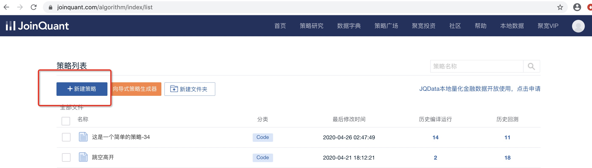
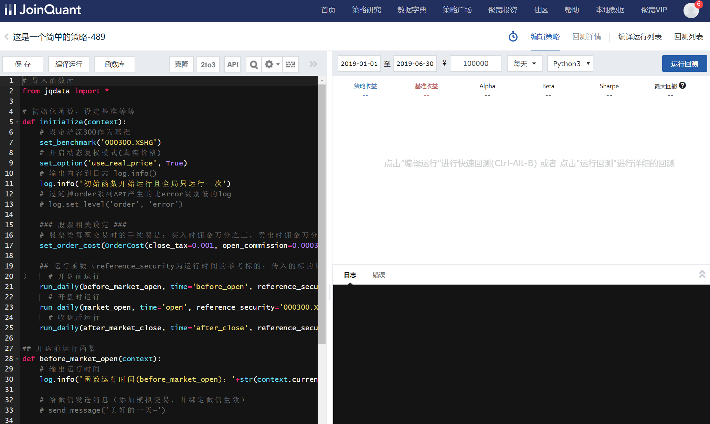
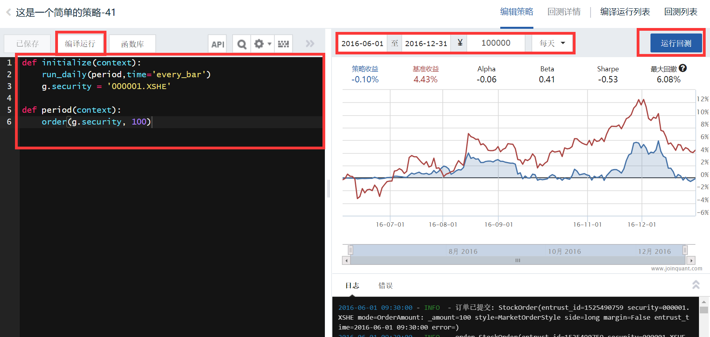
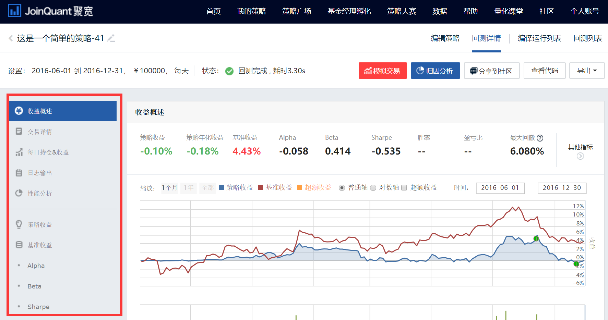
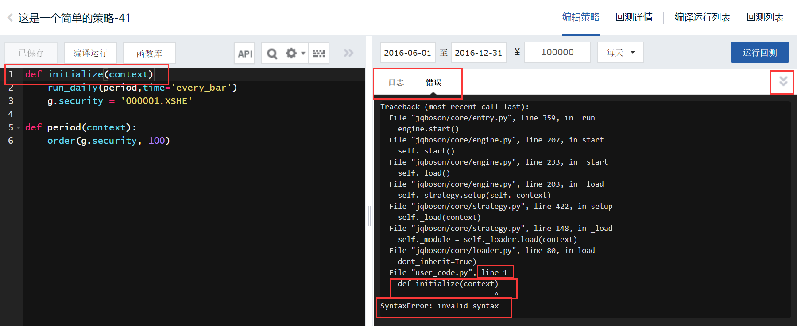
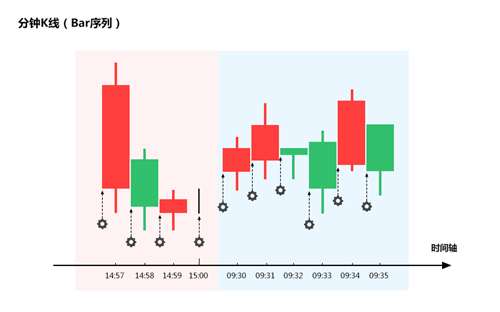

# 第二章 量化策略的基本框架

通过前文对量化交易有了一个基本认识之后，我们开始学习做量化交易。毕竟就像学游泳，有些东西讲是讲不懂，做过就会懂。由于本教程是基于[聚宽量化交易平台](https://www.joinquant.com)，所以为了后续的学习，最好去注册一个聚宽量化交易平台的账号。

## 1. 从一个简单的交易策略开始

先看一个非常简单的交易策略：**每天买 100 股的平安银行**，为了让这个策略能让计算机执行，首先要使策略符合“初始化+周期循环”框架，像这样：

- **初始化**：选定要交易的股票为平安银行
- **每天循环**：买 100 股的平安银行

## 2. 什么是“初始化+周期循环”框架？

为了将投资灵感高效地转化成计算机可执行的量化策略，必须基于一种模式来写，框架就是指这种模式。而此框架包含两个部分即初始化与周期循环：

- **初始化**：指策略最开始运行前要做的事。比如，准备好要交易的股票。
- **周期循环**：指策略开始后，随着时间一周期一周期地流逝时，每个周期要做的事。如例中，周期为天，周期循环的则是每天买 100 股的平安银行。

能帮助你理解这一框架的是，其实人本身日常做交易就是符合“**初始化+周期循环**”框架的，初始化就是已存在人脑的交易思想与知识，周期循环就是每天或每分钟地查看行情、判断、下单等行为。

## 3. 如何把策略变成计算机可执行的程序?

通过编程将策略写成计算机可识别的代码，具体说，我们这里是用 Python 这门编程语言。

另外可以用聚宽的**向导式策略生成器**，这种方法是不需编程的，但灵活性上难免是远不如写代码的。

## 4. 那么如何将策略写成代码？

这并非三言两语就能说清，尤其是对于没有编程基础的人。所以我们将通过后续的内容逐步地介绍。首先我们将学习“初始化+周期循环”框架代码的写法。

=== "写法一"

    ```python linenums="1"
    def initialize(context):
        这里是用来写初始化代码的地方,例子中就是选定要交易的股票为平安银行

    def handle_data(context,data):
        这里是用来写周期循环代码的地方,例子中就是买100股的平安银行
    ```

=== "写法二"

    ```python linenums="1"
    def initialize(context):
        run_daily(period,time='every_bar')
        这里是用来写初始化代码的地方,例子中就是选定要交易的股票为平安银行

    def handle_data(context):
        这里是用来写周期循环代码的地方,例子中就是买100股的平安银行
    ```

写法一是从前的老写法，将逐步弃用，写法二是聚宽系统改进后的新写法，推荐使用写法二。

来到[聚宽网站](https://www.joinquant.com)后，通过“导航栏-量化研究平台-策略回测”，然后点击“新建策略”。




进入策略编辑页，左侧就是策略代码编辑区域，初始会默认给你提供代码模板，全删除后写入我们的代码就好了。



!!! question "两种写法用哪个好？"

    `def`、`context` 等都是什么意思？

    其实是在调用聚宽提供好的函数，展开讲很复杂，不理解的话先记住，后面的学习内容会让你理解。

## 5. 完整的代码该怎么写呢？

剩下的两行代码这么写。完全理解需要学习后续的内容，此处不要求理解。知道大概什么样子往哪里写即可。

选定要交易的股票为平安银行：

```python linenums="1"
g.security = '000001.XSHE'
```

买 100 股的平安银行（市价单写法）:

```python
order(g.security, 100)
```

以写法二为例把剩下的代码补上后，完整代码为：

```python linenums="1"
def initialize(context):
    run_daily(period,time='every_bar')
    g.security = '000001.XSHE'

def period(context):
    order(g.security, 100)
```

## 6. 运行代码



如图把代码写到策略编辑区，设置好初始资金与起止时间（比如初始资金 100000 元，起止时间 `20160601` - `20161231`），频率设置成天。点击编译运行，运行结束后就可以看到结果了。

可以看到，若你 20160601 有初始资金 100000 元，每个交易日尝试买 100 股的平安银行，到 20161231，你的收益曲线将如图中蓝线般增长。图中红线是基准收益（默认是沪深 300 指数，代表整个市场增长水平）

接下来，点击运行回测，运行结束后就可以看到更为详细的结果，包括下单记录、持仓记录等。




## 8. 策略出错不能运行？

策略不能运行时，日志中会报错并给出一定的提示信息，像这样：



## 9. 回测、编译运行、运行回测都是什么意思？

像刚刚那样，用一段时间内的历史的真实行情数据，来验证一个确定的交易策略在这段时间表现如何，这个过程叫**回测**。

- **运行回测**：让计算机运行这次回测，运行后会告诉你策略在这段时间表现情况，比如收益率、年化收益率、最大回撤、夏普比率等指标，而且一般也会包括下单记录、持仓记录等。
- **编译运行**：让计算机运行这次回测，不过相比于点击运行回测，编译运行的结果比运行回测要简单，只有收益率等指标，因此也**速度更快**。所以，当还不必要得到详细的结果时，或只是想调试下策略的代码，看是否无误可运行时，编译运行就比运行回测更方便。

## 10. 周期循环具体是什么时候开始的呢？

如果策略频率为**天**，是每个交易日开始生效，从 9:30 直到 15:00（从股市开市到收市），所以例子中是每个交易日 9:30 开市循环就开始，一天一次地循环执行买入股票的操作。

如果策略频率为**分钟**，是每个分钟开始时执行，所以例子中的买入股票的操作是每个交易日从 9:30:00 开始，然后 9:31:00，直到 14:59:00。接着下一天 9:30:00，如此一分钟一次地循环执行的。



虽然频率只有为分钟和每天可选，但通过不同的代码可以实现按周按月周期循环，而且分钟级别里下单时间也是可以自己选的。