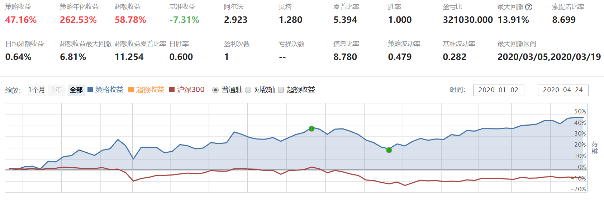

# 第三章 我的基本框架

前一章说的是**量化策略的基本框架**，很多人看了前一章后知道了怎么创建策略，但具体怎么做一个策略，代码怎么实现，肯定还是很模糊的。

我就很明白的告诉你们，前一章看不懂没关系，很多代码看不懂也没关系，这一章，我会把我写策略的代码框架直接给你们，这套框架已经给你们造好了轮子，你们只需要理解每个轮子的作用以及使用方法就可以。

一般来说要完成一个策略需要写很多函数或者说功能，比如：

1. 选股频率
2. 买卖频率
3. 持仓个数
4. 过滤停盘
5. 过滤退市
6. 过滤ST
7. 基础股票池
8. 行业过滤
9. 概念过滤
10. 黑名单
11. 下单
12. 策略选股和买卖核心程序

这么多功能，如果每个功能都用代码写出来，工作量大，难度也大，效率也低。所以我的框架里，会把 1-11 都写好，你们只要做配置就行。也就是说，你们只需要专心完成第 12 项**策略选股和买卖核心**程序就行。

这个框架是我这几年日积月累一步步完善的成果，且专门针对小白们做了一些优化和调整。

好，接下来我们开始学习我这个框架。学习有四部分：

1. 我会把我的代码框架的源代码贴出来，大家可以直接复制到聚宽上使用
2. 我会一步步告诉大家怎么用我的框架替换持股数，更改选股频率，怎么用我的框架写自己想写的策略等
3. 我把我的框架代码截了图，并注明了主要模块的功能和介绍（大家可以看得更直观）
4. 我针对主要的几个代码段做了详细解释

第1，2两部分是重点。3，4部分可以作为补充学习。

## 1. 我的代码框架

往下滑动，你们会发现有一大串 Python 代码，看不懂没关系，我们只要会用就行。

1. 先复制下面这一大串代码
2. 然后进入到[聚宽网站](https://www.joinquant.com)
3. 接着按照我们前在第二章所说的步骤，把代码复制到一个新建策略里。
4. 复制好后，把回测时间选定为 2020年1月1日-2020年4月26日。金额设置成 100 万，频率是每天，Python3。然后点击运行回测就可以了。

```python linenums="1" title="完整代码"
from kuanke.wizard import *
from jqdata import *
import numpy as np
import pandas as pd
import talib
import datetime
import time
import math


## 初始化函数，设定要操作的股票、基准等等
def initialize(context):
    # 设定基准
    set_benchmark('000300.XSHG')
    # 设定滑点
    set_slippage(FixedSlippage(0.01))
    # True为开启动态复权模式，使用真实价格交易
    set_option('use_real_price', True)
    # 设定成交量比例
    set_option('order_volume_ratio', 1)
    # 股票类交易手续费是：买入时佣金万分之三，卖出时佣金万分之三加千分之一印花税, 每笔交易佣金最低扣5块钱
    set_order_cost(OrderCost(open_tax=0, close_tax=0.001, open_commission=0.0003, close_commission=0.0003, min_commission=5), type='stock')

    #容器初始化
    check_container_initialize()
    #动态仓位、频率、计数初始化函数
    check_dynamic_initialize()
    # 股票筛选初始化函数
    check_stocks_initialize()
    # 出场初始化函数
    sell_initialize()
    # 入场初始化函数
    buy_initialize()


    # 关闭提示
    log.set_level('order', 'info')

    # 运行函数
    run_daily(check_stocks, '9:15') #选股
    run_daily(main_stock_pick, '9:16') #买入卖出列表
    run_daily(sell_every_day,'open') #卖出未卖出成功的股票
    run_daily(trade, 'open') #交易
    run_daily(selled_security_list_count, 'after_close') #卖出股票日期计数
    
    
    
#######################！！！新手需要使用的地方！！！###################################################
##动态仓位、频率、计数初始化函数(持仓比例，选股频率，买入频率，卖出频率在这里设置)
def check_dynamic_initialize():
    # 个股最大持仓比重
    g.security_max_proportion = 1
    # 选股和买卖频率
    g.check_stocks_refresh_rate = 30
    # 最大建仓数量
    g.max_hold_stocknum = 1
    
    #下面这几项不用管
    # 买入频率
    g.buy_refresh_rate = 1
    # 卖出频率
    g.sell_refresh_rate = 1

    # 选股频率计数器
    g.check_stocks_days = 0
    #机器学习选股频率计数器
    g.days = 0
    # 买卖交易频率计数器
    g.buy_trade_days=0
    g.sell_trade_days=0
    
## 股票池初筛设置函数(股票初筛在这里设置)
def check_stocks_initialize():
    # 是否过滤停盘
    g.filter_paused = True
    # 是否过滤退市
    g.filter_delisted = True
    # 是否只有ST
    g.only_st = False
    # 是否过滤ST
    g.filter_st = True
    # 股票池(填指数)
    ## 这里填写指数，全部股票就填['all_a_securities']，
    ## 沪深300股票就填 ['000300.XSHG']
    ## 中证500就填 ['000905.XSHG']
    ## 沪深300+中证500就填 ['000300.XSHG','000905.XSHG']
    g.security_universe_index = ['all_a_securities']
    # 填成分股(填成分股)
    g.security_universe_user_securities = []
    # 行业列表
    g.industry_list = ["801010","801020","801030","801040","801050","801080","801110","801120","801130","801140","801150","801160","801170","801180","801200","801210","801230","801710","801720","801730","801740","801750","801760","801770","801780","801790","801880","801890"]
    # 概念列表
    g.concept_list = []
    # 黑名单
    g.blacklist=['300268.XSHE','600035.XSHG','300028.XSHE']
    
## 买入股票，卖出股票筛选函数
def main_stock_pick(context):
    if g.days % g.check_stocks_refresh_rate != 0:
        g.days +=1
        return
    g.sell_stock_list=[]
    g.buy_stock_list = []

####自定义编辑范围#####    

#外资策略

    date = context.current_dt.strftime("%Y-%m-%d")
    today = datetime.datetime.strptime(date, "%Y-%m-%d").date()
    yesterday = shifttradingday(today ,shift = -1)
    print('前一个交易日:',yesterday) 

    q = query(finance.STK_EL_TOP_ACTIVATE).filter(finance.STK_EL_TOP_ACTIVATE.day == yesterday,finance.STK_EL_TOP_ACTIVATE.code.in_(g.check_out_lists))
    df = finance.run_query(q)
  
    
    df['net'] = df.buy - df.sell
    df = df.sort_values('net' , ascending = False)
    df = df[(df.link_id != 310003 ) & (df.link_id != 310004 )]
    a=0
    while df.empty == True:
        a=a+1
        yesterday = shifttradingday(today ,shift = -a)
        print('前一个交易日:',yesterday) 
        q = query(finance.STK_EL_TOP_ACTIVATE).filter(finance.STK_EL_TOP_ACTIVATE.day == yesterday )
        df = finance.run_query(q)
        df['net'] = df.buy - df.sell
        df = df.sort_values('net' , ascending = False)
        df = df[(df.link_id != 310003 ) & (df.link_id != 310004 )]          
    
    stockset = list(df['code'])
    
    g.sell_stock_list1 = list(context.portfolio.positions.keys())
    
    current_data = get_current_data()
    
    paused_list = [stock for stock in g.sell_stock_list1 if  current_data[stock].paused]

    for stock in g.sell_stock_list1:
        if stock in paused_list:
            continue
        elif stock not in stockset[:g.max_hold_stocknum]:
                g.sell_stock_list.append(stock)

    for stock in stockset[:g.max_hold_stocknum]:
        if stock in g.sell_stock_list:
            pass
        else:
            g.buy_stock_list.append(stock)
            
####自定义编辑范围#####              

    log.info('卖出列表:',g.sell_stock_list)
    log.info('购买列表:',g.buy_stock_list)
    g.days =1
    return g.sell_stock_list,g.buy_stock_list  
    
    
#######################！！！新手需要使用的地方！！！###################################################


##容器初始化(有新的全局容器可以加到这里)(新手忽略这里)
def check_container_initialize():
    #卖出股票列表
    g.sell_stock_list=[]
    #买入股票列表
    g.buy_stock_list = []
    # 获取未卖出的股票
    g.open_sell_securities = []
    # 卖出股票的dict
    g.selled_security_list={}
    #涨停股票列表
    g.ZT=[]    
    

## 出场初始化函数(新手忽略这里)
def sell_initialize():
    # 设定是否卖出buy_lists中的股票
    g.sell_will_buy = True

    # 固定出仓的数量或者百分比
    g.sell_by_amount = None
    g.sell_by_percent = None

## 入场初始化函数(新手忽略这里)
def buy_initialize():
    # 是否可重复买入
    g.filter_holded = False

    # 委托类型
    g.order_style_str = 'by_cap_mean'
    g.order_style_value = 100


## 股票初筛(新手忽略这里)
def check_stocks(context):
    if g.check_stocks_days%g.check_stocks_refresh_rate != 0:
        # 计数器加一
        g.check_stocks_days += 1
        return
    # 股票池赋值
    g.check_out_lists = get_security_universe(context, g.security_universe_index, g.security_universe_user_securities)
    # 行业过滤
    g.check_out_lists = industry_filter(context, g.check_out_lists, g.industry_list)
    # 概念过滤
    g.check_out_lists = concept_filter(context, g.check_out_lists, g.concept_list)
    # 过滤ST股票
    g.check_out_lists = st_filter(context, g.check_out_lists)
    # 过滤停牌股票
    g.check_out_lists = paused_filter(context, g.check_out_lists)
    # 过滤退市股票
    g.check_out_lists = delisted_filter(context, g.check_out_lists)
    # 过滤黑名单股票
    g.check_out_lists = [s for s in g.check_out_lists if s not in g.blacklist]
    # 计数器归一
    g.check_stocks_days = 1
    return


## 卖出未卖出成功的股票(新手忽略这里)
def sell_every_day(context):
    g.open_sell_securities = list(set(g.open_sell_securities))
    open_sell_securities = [s for s in context.portfolio.positions.keys() if s in g.open_sell_securities]
    if len(open_sell_securities)>0:
        for stock in open_sell_securities:
            order_target_value(stock, 0)
    g.open_sell_securities = [s for s in g.open_sell_securities if s in context.portfolio.positions.keys()]
    return


## 交易函数(新手忽略这里)
def trade(context):
   # 初始化买入列表
    buy_lists = []

    # 买入股票筛选
    if g.buy_trade_days%g.buy_refresh_rate == 0:
        # 获取 buy_lists 列表
        buy_lists = g.buy_stock_list
        # 过滤涨停股票
        buy_lists = high_limit_filter(context, buy_lists)
        log.info('购买列表最终',buy_lists)

    # 卖出操作
    if g.sell_trade_days%g.sell_refresh_rate != 0:
        # 计数器加一
        g.sell_trade_days += 1
    else:
        # 卖出股票
        sell(context, buy_lists)
        # 计数器归一
        g.sell_trade_days = 1


    # 买入操作
    if g.buy_trade_days%g.buy_refresh_rate != 0:
        # 计数器加一
        g.buy_trade_days += 1
    else:
        # 卖出股票
        buy(context, buy_lists)
        # 计数器归一
        g.buy_trade_days = 1


##################################  交易函数群 ##################################(新手忽略)

# 交易函数 - 出场
def sell(context, buy_lists):
    # 获取 sell_lists 列表
    init_sl = context.portfolio.positions.keys()
    sell_lists = context.portfolio.positions.keys()

    # 判断是否卖出buy_lists中的股票
    if not g.sell_will_buy:
        sell_lists = [security for security in sell_lists if security not in buy_lists]

    ### _出场函数筛选-开始 ###
    sell_lists = g.sell_stock_list
    ### _出场函数筛选-结束 ###

    # 卖出股票
    if len(sell_lists)>0:
        for stock in sell_lists:
            sell_by_amount_or_percent_or_none(context,stock, g.sell_by_amount, g.sell_by_percent, g.open_sell_securities)

    # 获取卖出的股票, 并加入到 g.selled_security_list中
    selled_security_list_dict(context,init_sl)

    return

# 交易函数 - 入场
def buy(context, buy_lists):

    # 判断是否可重复买入
    buy_lists = holded_filter(context,buy_lists)

    # 获取最终的 buy_lists 列表
    Num = g.max_hold_stocknum - len(context.portfolio.positions)
    buy_lists = buy_lists[:Num]

    # 买入股票
    if len(buy_lists)>0:
        # 分配资金
        for stock in buy_lists:
            position_count = len(context.portfolio.positions)
            if g.max_hold_stocknum > position_count:
                value = context.portfolio.cash / (g.max_hold_stocknum - position_count)
                if context.portfolio.positions[stock].total_amount == 0:
                    order_target_value(stock, value)
    return


###################################  公用函数群 ##################################(新手忽略)


## 过滤同一标的继上次卖出N天不再买入
def filter_n_tradeday_not_buy(security, n=0):
    try:
        if (security in g.selled_security_list.keys()) and (g.selled_security_list[security]<n):
            return False
        return True
    except:
        return True

## 是否可重复买入
def holded_filter(context,security_list):
    if not g.filter_holded:
        security_list = [stock for stock in security_list if stock not in context.portfolio.positions.keys()]
    # 返回结果
    return security_list

## 卖出股票加入dict
def selled_security_list_dict(context,security_list):
    selled_sl = [s for s in security_list if s not in context.portfolio.positions.keys()]
    if len(selled_sl)>0:
        for stock in selled_sl:
            g.selled_security_list[stock] = 0

## 过滤停牌股票
def paused_filter(context, security_list):
    if g.filter_paused:
        current_data = get_current_data()
        security_list = [stock for stock in security_list if not current_data[stock].paused]
    # 返回结果
    return security_list

## 过滤退市股票
def delisted_filter(context, security_list):
    if g.filter_delisted:
        current_data = get_current_data()
        security_list = [stock for stock in security_list if not (('退' in current_data[stock].name) or ('*' in current_data[stock].name))]
    # 返回结果
    return security_list


## 过滤ST股票
def st_filter(context, security_list):
    if g.only_st:
        current_data = get_current_data()
        security_list = [stock for stock in security_list if current_data[stock].is_st]
    else:
        if g.filter_st:
            current_data = get_current_data()
            security_list = [stock for stock in security_list if not current_data[stock].is_st]
    # 返回结果
    return security_list

# 过滤涨停股票
def high_limit_filter(context, security_list):
    current_data = get_current_data()
    security_list = [stock for stock in security_list if not (current_data[stock].last_price>= current_data[stock].high_limit)]
    # 返回结果
    return security_list

# 获取股票股票池
def get_security_universe(context, security_universe_index, security_universe_user_securities):
    temp_index = []
    for s in security_universe_index:
        if s == 'all_a_securities':
            temp_index += list(get_all_securities(['stock'], context.current_dt.date()).index)
        else:
            temp_index += get_index_stocks(s)
    for x in security_universe_user_securities:
        temp_index += x
    return  sorted(list(set(temp_index)))

# 行业过滤
def industry_filter(context, security_list, industry_list):
    if len(industry_list) == 0:
        # 返回股票列表
        return security_list
    else:
        securities = []
        for s in industry_list:
            temp_securities = get_industry_stocks(s)
            securities += temp_securities
        security_list = [stock for stock in security_list if stock in securities]
        # 返回股票列表
        return security_list

# 概念过滤
def concept_filter(context, security_list, concept_list):
    if len(concept_list) == 0:
        return security_list
    else:
        securities = []
        for s in concept_list:
            temp_securities = get_concept_stocks(s)
            securities += temp_securities
        security_list = [stock for stock in security_list if stock in securities]
        # 返回股票列表
        return security_list
        
## 卖出股票日期计数
def selled_security_list_count(context):
    #g.daily_risk_management = True
    if len(g.selled_security_list)>0:
        for stock in g.selled_security_list.keys():
            g.selled_security_list[stock] += 1
            
#获取交易日
def shifttradingday(date,shift):
    #获取N天前的交易日日期
    # 获取所有的交易日，返回一个包含所有交易日的 list,元素值为 datetime.date 类型.
    tradingday = get_all_trade_days()
    # 得到date之后shift天那一天在列表中的行标号 返回一个数
    shiftday_index = list(tradingday).index(date)+shift
    # 根据行号返回该日日期 为datetime.date类型
    return tradingday[shiftday_index]   
```

## 2. 代码框架使用方法



运行完我的代码框架后应该如上所示，是不是感觉收益还不错，这个框架里默认嵌套的策略就是我之前一直在公众号里说的外资策略。接下来我们详细说说怎么使用这个框架。

### 2.1 设置持股数量

你们应该也发现了，你们刚才运行的外资策略只会买一只股票，那怎么用我们的框架买多只股票呢？

只需要在下图框架第 56 行，途中红框框的位置，设置一下要买入股票的数量就可以了。默认是 1，你们改成 2 就会买 2 只，改成 5 就会买 5 只，你们可以试一试。

```python linenums="1" hl_lines="7" title="设置持股数量"
def check_dynamic_initialize():
    # 个股最大持仓比重
    g.security_max_proportion = 1
    # 选股和买卖频率
    g.check_stocks_refresh_rate = 30
    # 最大建仓数量
    g.max_hold_stocknum = 1
```

### 2.2 设置选股和买卖频率

你们应该还发现了，这个策略的运行时间是 30 个交易日一次，那怎么改成 60，或 20 日交易一次呢？

只需要在下图红框位置，也就是代码的第 54 行。把 30 替换成 20 或者 60 就可以了，你们可以改改试试看。

```python linenums="1" hl_lines="5" title="设置买卖频率"
def check_dynamic_initialize():
    # 个股最大持仓比重
    g.security_max_proportion = 1
    # 选股和买卖频率
    g.check_stocks_refresh_rate = 30
    # 最大建仓数量
    g.max_hold_stocknum = 1
```

### 2.3 修改策略运行的时间

你们可以发现，这个策略的买卖时间都在 9:30，那我想下午 14:30 交易，怎么操作？

你们可以在下面的红框，也就是代码的第 43 行，把 `'open'` 改成`'14:30'`。

```python linenums="1" hl_lines="8" title="修改策略运行时间"
def initialize(context):
    # 代码段
    # ...
    # 运行函数
    run_daily(check_stocks, '9:15') #选股
    run_daily(main_stock_pick, '9:16') #买入卖出列表
    run_daily(sell_every_day,'open') #卖出未卖出成功的股票
    run_daily(trade, 'open') #交易
    run_daily(selled_security_list_count, 'after_close') #卖出股票日期计数
```

### 2.4 设置基础股票池

就是说，我策略从什么池子里选股，我默认选择的是全市场股票池，你如果想从沪深300股票池里选股，那就在代码的第 83 行，把`'all_a_securities'` 替换成 `'000300.XSHG'`，其他指数同理。

```python linenums="1" hl_lines="11" title="设置基础股票池"
def check_stocks_initialize():
    # 是否过滤停盘
    g.filter_paused = True
    # 是否过滤退市
    g.filter_delisted = True
    # 是否只有ST
    g.only_st = False
    # 是否过滤ST
    g.filter_st = True
    # 股票池(填指数)
    ## 这里填写指数，全部股票就填 ['all_a_securities']，
    ## 沪深300股票就填 ['000300.XSHG']
    ## 中证500就填 ['000905.XSHG']
    ## 沪深300+中证500就填 ['000300.XSHG','000905.XSHG']
    g.security_universe_index = ['all_a_securities']
```

### 2.5 筛选行业

有人说，我不想买周期股，所以要把钢铁，化工，采掘等周期行业去掉，那怎么操作呢？

代码的第 87 行，也就是红框的位置是配置行业的地方。你们可以看到有801010，801020...... 这一系列编码，每个编码代表的是一个行业（申万一级行业），我默认把所有的行业都填上去了，所有默认会从全行业选股。

```python linenums="1" hl_lines="15" title="筛选行业"
def check_stocks_initialize():
    # 是否过滤停盘
    g.filter_paused = True
    # 是否过滤退市
    g.filter_delisted = True
    # 是否只有ST
    g.only_st = False
    # 是否过滤ST
    g.filter_st = True
    # 股票池(填指数)
    ## 这里填写指数，全部股票就填['all_a_securities']，
    ## 沪深300股票就填 ['000300.XSHG']
    ## 中证500就填 ['000905.XSHG']
    ## 沪深300+中证500就填 ['000300.XSHG','000905.XSHG']
    g.security_universe_index = ['all_a_securities']
    # 填成分股(填成分股)
    g.security_universe_user_securities = []
    # 行业列表
    g.industry_list = ["801010","801020","801030","801040","801050","801080","801110","801120","801130","801140","801150","801160","801170","801180","801200","801210","801230","801710","801720","801730","801740","801750","801760","801770","801780","801790","801880","801890"]
```

你们如果想把不想要的行业去掉，那就先进入[行业查询页面](https://www.joinquant.com/help/api/help?name=plateData#%E7%94%B3%E4%B8%87%E4%B8%80%E7%BA%A7%E8%A1%8C%E4%B8%9A)，然后找到采掘，化工和钢铁的行业编码，把他们从87行那个配置项目里删除，那策略在选股的时候就会自动去除这三个行业了。

### 2.6 筛选概念

筛选概念和行业的原理一样，不过是在第89行配置的。但注意，当概念什么都不填的时候就代表了全概念，当填的时候，就代表置灰选你填的这个概念。点击[查询地址](https://www.joinquant.com/help/api/help?name=plateData#%E6%A6%82%E5%BF%B5%E6%9D%BF%E5%9D%97) 查看概念编码。

### 2.7 添加黑名单

在实际运用策略的时候，你们可能会遇到一个情况，把某些股票排除在我的股票池之外，比如我不想买茅台，因为茅台太贵，或者我不想买亿联网络，因为他财务可能有雷。

具体怎么操作呢？我们可以在代码的第91行，把默认的两个股票 `300268.XSHE` 和 `600035.XSHG` 删除。然后把亿联网络 `300628.XSHE` 和贵州茅台 600519.XSHG黑名单里

```python linenums="1" hl_lines="17" title="添加黑名单"
def check_stocks_initialize():
    # 是否过滤停盘
    g.filter_paused = True
    # 是否过滤退市
    g.filter_delisted = True
    # 是否只有ST
    g.only_st = False
    # 是否过滤ST
    g.filter_st = True
    # 股票池(填指数)
    g.security_universe_index = ['all_a_securities']
    # 填成分股(填成分股)
    g.security_universe_user_securities = []
    # 行业列表
    g.industry_list = ["801010","801020","801030","801040","801050","801080","801110","801120","801130","801140","801150","801160","801170","801180","801200","801210","801230","801710","801720","801730","801740","801750","801760","801770","801780","801790","801880","801890"]
    # 概念列表
    g.concept_list = []
    # 黑名单
    g.blacklist=['300268.XSHE','600035.XSHG','300028.XSHE']
```

### 2.8 把外资策略替换成其他策略

这套框架适应于基本上所有的策略，只是我用外资策略做了一个示例，如果你想用这套框架写另一个策略，改怎么操作呢？

首先找到代码的第 101 行，然后找到下图红框框的位置，这个红框框就是外资策略的核心逻辑。你们把红框里的删除，替换成自己想写的策略就可以。

不过有一点要注意，你想要写的新策略必须要输出 `g.sell_stock_list`（卖出列表）和 `g.buy_stock_list`（买入列表）。

```python linenums="1" hl_lines="10" title="把外资策略替换成其他策略"
def main_stock_pick(context):
    if g.days % g.check_stocks_refresh_rate != 0:
        g.days +=1
        return
    g.sell_stock_list=[]
    g.buy_stock_list = []

####自定义编辑范围#####    

#外资策略

    date = context.current_dt.strftime("%Y-%m-%d")
    today = datetime.datetime.strptime(date, "%Y-%m-%d").date()
    yesterday = shifttradingday(today ,shift = -1)
    print('前一个交易日:',yesterday) 

    q = query(finance.STK_EL_TOP_ACTIVATE).filter(finance.STK_EL_TOP_ACTIVATE.day == yesterday,finance.STK_EL_TOP_ACTIVATE.code.in_(g.check_out_lists))
    df = finance.run_query(q)


    df['net'] = df.buy - df.sell
    df = df.sort_values('net' , ascending = False)
    df = df[(df.link_id != 310003 ) & (df.link_id != 310004 )]
    a=0
    while df.empty == True:
        a=a+1
        yesterday = shifttradingday(today ,shift = -a)
        print('前一个交易日:',yesterday) 
        q = query(finance.STK_EL_TOP_ACTIVATE).filter(finance.STK_EL_TOP_ACTIVATE.day == yesterday )
        df = finance.run_query(q)
        df['net'] = df.buy - df.sell
        df = df.sort_values('net' , ascending = False)
        df = df[(df.link_id != 310003 ) & (df.link_id != 310004 )]          

    stockset = list(df['code'])

    g.sell_stock_list1 = list(context.portfolio.positions.keys())

    current_data = get_current_data()

    paused_list = [stock for stock in g.sell_stock_list1 if  current_data[stock].paused]

    for stock in g.sell_stock_list1:
        if stock in paused_list:
            continue
        elif stock not in stockset[:g.max_hold_stocknum]:
                g.sell_stock_list.append(stock)

    for stock in stockset[:g.max_hold_stocknum]:
        if stock in g.sell_stock_list:
            pass
        else:
            g.buy_stock_list.append(stock)

####自定义编辑范围#####    
```

你们跟着我尝试一下把外资策略替换成60日均线策略：**策略的逻辑是当某只股票的昨日股价大于60日均价就买入，昨日股价小于60日均价就卖出**。

首先把高亮代码内容删除，然后要获取到我们要操作的股票，这个股票是从全局变量 `g.check_out_lists` 中获取的（这点你们可以思考一下为什么是从 `g.check_out_lists` 获取股票）。

所以获取股票的语句就是

```python
x = g.check_out_lists[0]
```

接着我们要计算这只股票的60日均价。计算股票均价需要用聚宽的查询单只股票的历史行情接口，这个接口的名字叫attribute_history。行情数据接口文档可以在聚宽查看[行情数据接口](https://www.joinquant.com/help/data/stock#get1d)。

```python linenums="1"
long_df = attribute_history(x, count=60, unit='1d',fields=['close'],skip_paused=True, df=True, fq='pre') #dataframe

long_price = long_df['close'].mean() # 这个long_price就是60日均价
```

接下来我们要计算这只股票的昨日收盘价。昨日收盘价其实就等于股票昨天的平均价，所以写法类似

```python linenums="1"
short_df = attribute_history(x, count=1, unit='1d',fields=['close'],skip_paused=True, df=True, fq='pre') #dataframe
    
short_price = short_df['close'].mean() #这个short_price就是昨日收盘价
```

接下来我们来实现**昨日收盘价大于60日均价买入，昨日收盘价小于60日均价卖出**。

```python linenums="1" hl_lines="1" title="60日均线策略"
if  short_price > long_price:
        g.buy_stock_list.append(x)   #如果昨日股价大于60日均价，把股票加入到g.buy_stock_list（买入列表）

elif short_price < long_price:
    g.sell_stock_list.append(x)  #如果昨日股价小于60日均价，把股票加入到 g.sell_stock_list（卖出列表）
```

看到了吧，这里的核心是要把选出来要买入的股票加入到 `g.buy_stock_list`（买入列表）里，然后把要卖出的股票加入到 `g.sell_stock_list`（卖出列表）里。不管是什么策略，最后都要这样做。

填写要测试的股票。因为我们这个60日均线策略不涉及到选股，只涉及到买卖特定的股票，所以我们要找到代码的第83行（下图蓝框），删除中括号里的内容。然后在85行（下图红框）填入我们想要测试的股票。

```python linenums="1" hl_lines="2 4"
# 股票池(填指数)
g.security_universe_index = ['all_a_securities']
# 填成分股(填成分股)
g.security_universe_user_securities = []
```

比如我们要测试埃斯顿这只股票，那就在85行填入 `['002747.XSHE']`，85行这里要注意，最后的格式是这样的 `[['002747.XSHE']]` 如下所示：

```python linenums="1" hl_lines="4"
# 股票池(填指数)
g.security_universe_index = ['all_a_securities']
# 填成分股(填成分股)
g.security_universe_user_securities = [['002747.XSHE']]
```

回测的时候会有一条蓝线和红线，蓝线代表策略收益，红线代表基准收益。这个基准收益是可以自己设置的，设置的位置是代码的第 14 行。默认是沪深300，但这个均线策略我们要和股票本身的走势对比，所以我们要把这个基准改成埃斯顿。

```python linenums="1" hl_lines="1"
def initialize(context):
    # 设置基准
    set_benchmark('002747.XSHE')
```

因为是测试一直股票，所以我们还得确认一下我们的最大加仓数是不是 1，建仓数你们还记得在哪里找吗？

```python linenums="1" hl_lines="1"
def check_dynamic_initialize():
    # 个股最大持仓比重
    g.security_max_proportion = 1
    # 选股和买卖频率
    g.check_stocks_refresh_rate = 30
    # 最大建仓数量
    g.max_hold_stocknum = 1
```

均线策略要每天都运行策略，因为我们也保不定那天就触发了均线信号，所以选股和买卖频率要设置成 `1`。

```python linenums="1" hl_lines="1"
def check_dynamic_initialize():
    # 个股最大持仓比重
    g.security_max_proportion = 1
    # 选股和买卖频率
    g.check_stocks_refresh_rate = 1
    # 最大建仓数量
    g.max_hold_stocknum = 1
```

然后设置一下要回测的时间，就可以运行了

### 2.9 作业

细心的读者会发现如果从2020年1月1日运行就没问题的，但从2017年1月1日开始运行就会报错，给你们留个作业：

1. 研究研究这个报错是什么原因产生的。
2. 怎么解决这个报错

你们思考完后可以在圈子里发动态说说你们这两个问题。

