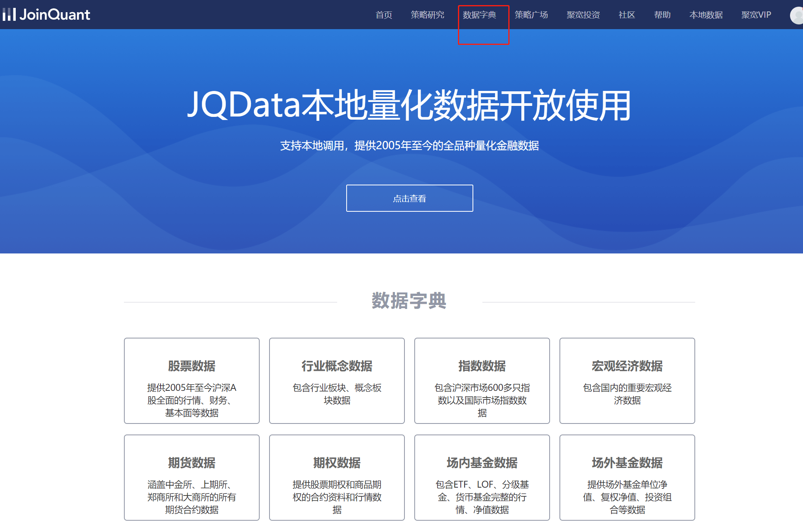
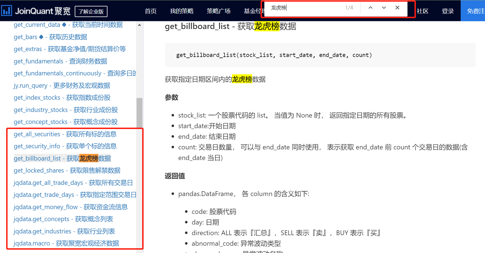

# 第四章 聚宽获取典型常用数据

这篇主要教大家怎么快速获取聚宽的指数成分股，股票行情数据，股票财务数据。

## 1. 聚宽数据

在[聚宽数据](https://www.joinquant.com/data)这个页面可以看到聚宽平台集成好的各大类数据，如下图所示，点击可以查看详情与用法。



但实际上可能有些数据要在 API 文档里才比较容易能找到，比如龙虎榜数据等。这时用 `CTRL+F` 进行网页搜索可以快速搜索需要的数据。



接下来会介绍几种常用数据的取用方法，这些取用方法比较典型，掌握后能覆盖基本的数据需求以及较容易的学会使用其他数据。

## 2. 获取指数成分股

以免有人不知道**指数成分股**是什么，简单说明下。为了衡量股市中某一大类股票整体的涨跌情况，通常会用这一类的股票加权平均编制出一个指数，而这些股票则叫做**该指数的成分股**，一般指数的成分股选取会变动。比如上证指数是用所有上交所的股票编制而成，可以衡量上交所股票整体的涨跌情况，有的股票退市了也就会被剔除成分股。比较常见的指数有**上证指数**、**深证综指**、**创业板指**、**沪深300指数**、**中证500指数**、**上证50指数**等。可以在数据-指数数据-[指数列表](https://www.joinquant.com/indexData)中找到聚宽支持的指数及其指数代码。同样要善用 `CTRL+F` 进行搜索。

获取指数成分股需要用到的 API 函数为 [`get_index_stocks`](https://www.joinquant.com/help/api/help?name=api_old#get_index_stocks-%E8%8E%B7%E5%8F%96%E6%8C%87%E6%95%B0%E6%88%90%E4%BB%BD%E8%82%A1)，可以获取一个指数给定日期在平台可交易的成分股列表，请点击指数列表查看指数信息。：

```python
get_index_stocks(index_symbol, date=None)
```

```python linenums="1" title="简单示例"
# 获取所有沪深300的股票
stocks = get_index_stocks('000300.XSHG')
log.info(stocks)
```

之前讲过怎么看 API 文档以及函数参数的含义，现在应该能直接看说明使用了。补充一个更详细点的例子应该就会用了。

```python linenums="1" title="示例"
# 获取20180301时，上证50指数（000016.XSHG）成分股
t = get_index_stocks("000016.XSHG", "2018-03-01")
print(t[0])
print(t)

# 打印日志如下。股票代码在list中被打印出来前面会带有的u代表是对字符串进行unicode编码（略复杂，不懂没关系），只是显示效果，单独打印t[0]时就没有u。

# 600000.XSHG
# [u'600000.XSHG', u'600016.XSHG', u'600019.XSHG', u'600028.XSHG', u'600029.XSHG', u'600030.XSHG', u'600036.XSHG', u'600048.XSHG', u'600050.XSHG', u'600104.XSHG', u'600111.XSHG', u'600309.XSHG', u'600340.XSHG', u'600518.XSHG', u'600519.XSHG', u'600547.XSHG', u'600606.XSHG', u'600837.XSHG', u'600887.XSHG', u'600919.XSHG', u'600958.XSHG', u'600999.XSHG', u'601006.XSHG', u'601088.XSHG', u'601166.XSHG', u'601169.XSHG', u'601186.XSHG', u'601211.XSHG', u'601229.XSHG', u'601288.XSHG', u'601318.XSHG', u'601328.XSHG', u'601336.XSHG', u'601390.XSHG', u'601398.XSHG', u'601601.XSHG', u'601628.XSHG', u'601668.XSHG', u'601669.XSHG', u'601688.XSHG', u'601766.XSHG', u'601800.XSHG', u'601818.XSHG', u'601857.XSHG', u'601878.XSHG', u'601881.XSHG', u'601985.XSHG', u'601988.XSHG', u'601989.XSHG', u'603993.XSHG']
```

## 3. 获取股票行情数据

此处的股票行情数据指[SecurityUnitData](https://joinquant.com/help/api/help?name=api_old#SecurityUnitData) 里面的所有基本属性，以下列举类常用字段，详情请看文档。

- `open`: 时间段开始时价格
- `close`: 时间段结束时价格
- `low`: 最低价
- `high`: 最高价
- `volume`: 成交的股票数量
- `money`: 成交的金额
- `factor`: 前复权因子
- `avg`: 这段时间的平均价
- `pre_close`: 前一个单位时间结束时的价格
- `paused`: 这只股票是否停牌，是则为1，否则为0

### 3.1 history

通过 [`history`](https://www.joinquant.com/help/api/help#api:history) 函数可以获取历史数据，可查询多个标的单个数据字段，返回数据格式为 `DataFrame` 或 `Dict`。

- **可以同时获得多个股票的数据，但只能获得相同的一个数据字段**。如获得 “平安银行，建设银行，农业银行” 这 3 只股票的前3天交易额。

- 默认不跳过不交易日期，由 `skip_paused` 参数控制。
- `df` 参数控制返回结果的数据类型，默认是 `True` 代表dataframe类型，稍后我们会讲到，当`df` 为 `False` 时就为之前讲过的 `dict` 类型。
- `fq` 参数控制复权方式，往往可以不管它直接用默认的前复权即可。复权的含义不难，解释略麻烦，建议自行搜索学习下。

接下来介绍的 API 还会有 `skip_paused`、`df`、`fq` 参数，就不再提了。这三个参数新手可以以后慢慢了解，现在不管也没关系，如果不想用`dataframe`，会把 `df` 参数调成 `False` 就行。


```python linenums="1" title="示例"
# 例子 df=True，返回dataframe类型
w = history(count=3, field='money', security_list=['000001.XSHE','000002.XSHE'])
print(w)

# 结果如下：
#              000001.XSHE   000002.XSHE
# 2016-08-29  5.322954e+08  1.796321e+09
# 2016-08-30  5.618541e+08  2.072873e+09
# 2016-08-31  4.638758e+08  5.748581e+09

# 例子 df=False，返回dict类型
w=history(count=3, field='money', security_list=['000001.XSHE','000002.XSHE'],df=False)
print(w)

# 结果如下：
# {'000001.XSHE': array([  5.32295362e+08,   5.61854066e+08,   4.63875763e+08]), '000002.XSHE': array([  1.79632055e+09,   2.07287325e+09,   5.74858107e+09])}
```

### 3.2 attribute_history

[attribute_history](https://www.joinquant.com/api#attributehistory) 也是用于获取历史数据


