# 第六章 经典策略学习

## 1. RSRS择时+基本面选股

近期市场早已提前入冬，普通小韭和机构大佬都在裹紧外衣抵御市场寒冬，在春天还没有到来之际，不能只是等待，不如静下来好好做些功课。

我们都在市场中苦苦寻找圣杯，希望能够找到长期战胜市场的投资方法，比如曾经风光无限的小市值的思路，带给了我们很大的信心，相信市场中是存在长期有效的超额收益的规律，直到 2017 年初失效。毕竟没有什么是一成不变的，市场在牛熊交替中也是不断变换风格，想在市场中一劳永逸，可能只是不像咸鱼的韭菜了。除非是发现了如下的策略方法（滑稽脸）。

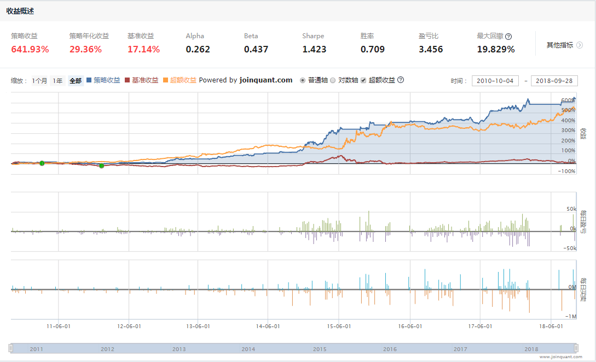
///caption
///

### 1.1 十三年超额收益稳健

在了解如上策略之前，我们先来看下下面的策略

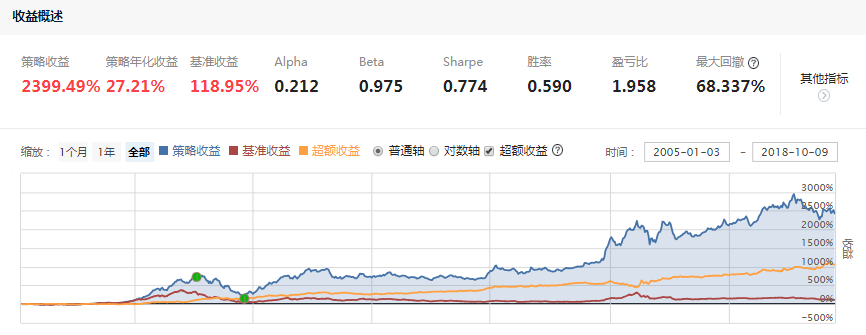
///caption
///

该策略基于**财务因子**进行选股，从 2005年到 2018年，十三年的时间，累计获得收益 2395.74% 的收益，是同期上证指数的 20 倍左右，年化 27% 的收益似乎看起来也不是很高，但是该策略却有着长期较为稳定的超额收益，可以看到，收益图中黄线代表超额收益，在长达十三年的时间里都有着平稳上升的超额收益！

那这样的策略距离直接拿来用还是有很多可以提升的地方，比如可以在这个基础上拿股指期货进行对冲，或者进行择时。我们看到策略有接近 **1** 的贝塔，熊市时候和大盘一起跌，产生较大的回撤，进行归因分析后取回撤的区间统计图示，可以看到和市场本身的熊市一致。那么我们想到，如果策略能够在熊市保住收益，应该会有更好的表现。

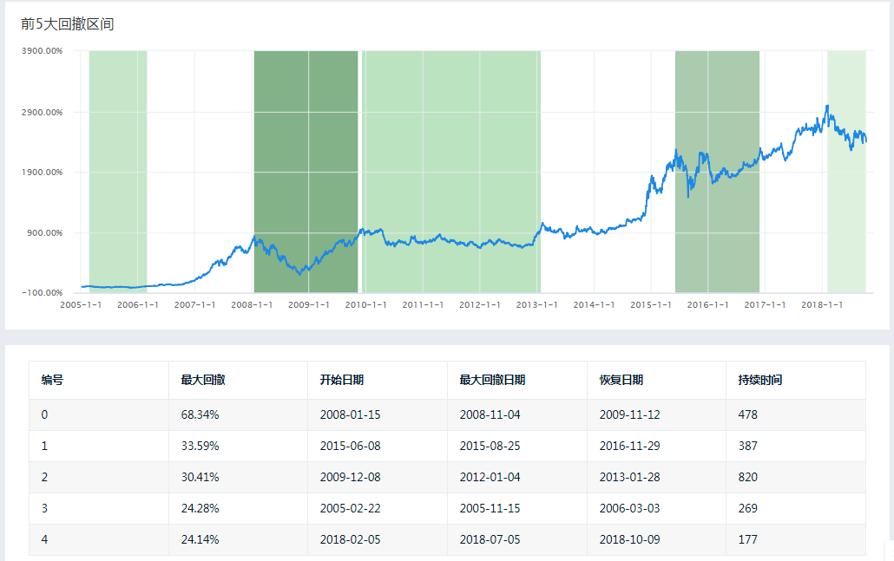
///caption
///

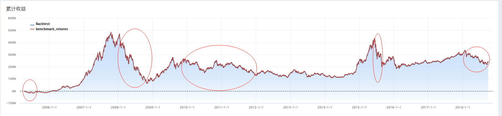
///caption
///

### 1.2 牛市作为，熊市蛰伏

A 股市场里个股与大盘的相关性很高，针对前面提到的选择精准的进场出场时间，规避熊市回撤较大的问题，我们想到可以借助近来表现不错的 RSRS，支持阻力相对强弱指标进行大盘择时。

上面提到的 **RSRS** 是一个阻力支撑相对强度指标（Resistance Support Relative Strength，简称 RSRS），出自光大证券的一篇技术择时系列的研究报告，其思路就是，以每天最高最低价格替代传统技术分析中的支持阻力，以最高价最低价变化的相对强弱替代支撑阻力具体价格阈值。下面是其思路的一些说明，具体也可参考研报和量化课堂的 RSRS 介绍的内容。

- 用最低价每变动 1的时候，最高价变动的幅度来衡量支持阻力的强弱
- 拿同时间段最高价、最低价的序列，进行回归，模型的 `beta` 值就是所需要的斜率，即衡量支持阻力的具体指标。

```python linenums="1"
import statsmodels.api as sm
import matplotlib.pyplot as plt

# step1 获取数据的高低点
security = '000001.XSHG'
prices = get_price(
    security, '2005-01-05', '2010-01-01', '1d', ['high', 'low']
    )
highs = prices.high
lows = prices.low
# step2 计算斜率，进行记录
long = 18
beta_list = []
for i in range(long,len(highs)):
  y = highs[i-long:i]
  x = lows[i-long:i]
  X = sm.add_constant(x)
  model = sm.OLS(y, X)
  results = model.fit()
  beta_list.append(results.params[1])

plt.hist(beta_list, bins=50)
```

<div class="gird cards" markdown>
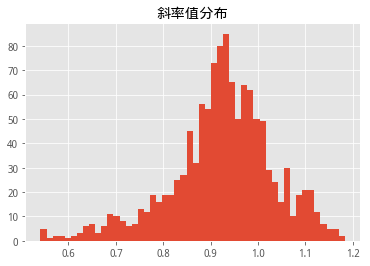

</div>

拿斜率进行阈值设置的话其波动较大，效果不佳，这里直接采用研报中将**斜率值进行标准化**（标准分的形式，如上图所示），且考虑拟合效果在内，将标准分进行决定系数（回归结果里的 **R方值**）加权，效果如下图所示，最后我们直接采用效果显著的右偏标准分，右侧标准分决定抄底买入时机。

<div class="gird cards" markdown>
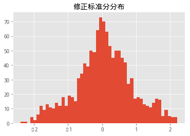
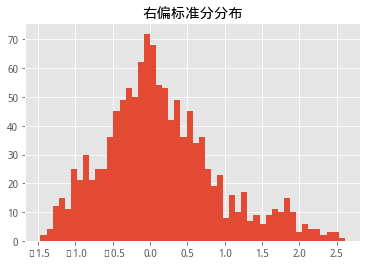
</div>

下图是 RSRS 择时效果展示，基准为沪深300指数，交易标的同为沪深300指数，自 2010至今的回测效果图展示，8年时间，最大回撤仅为 17.7%，我们可以看到空仓时机，与大盘顶底基本吻合，简直是逃顶抓底的神器。下图展示就是应用在交易自身标的策略中的收益情况。

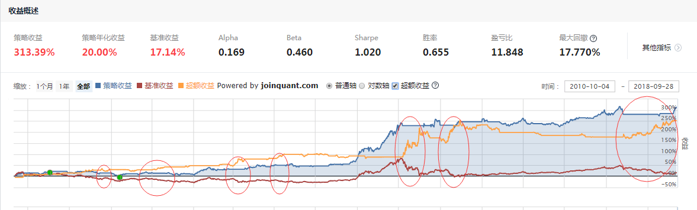
///caption
///

### 1.3 完美合璧，1+1>2

按如上思路，我们把开篇提到的有超额收益的策略，与这个 RSRS 大盘择时方法结合，就得到了这次所要分享的策略。通过 RSRS 指标的精准择时，在熊市中能够保住收益，在非熊市时能够获得市场收益和策略的超额收益。我们通过在研究中调用策略回测结果，在同一时间范围内，分别展示了开篇提到的有超额收益的策略收益、RSRS 择时策略收益、前两者结合的策略收益、基准收益的四条收益曲线，收益结果如下所示。

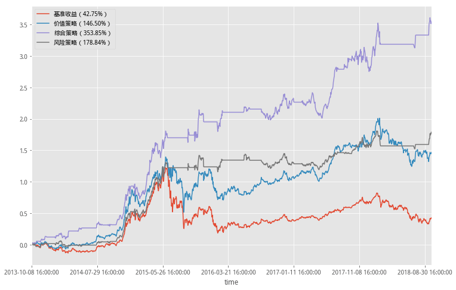
///caption
///

近 5 年里，单纯策略的收益为 146.50%（价值策略）、RSRS择时策略的收益为 178.84%（风险策略）、前两者结合的策略收益为 353.85%（综合策略），将价值选股思路与RSRS择时思路结合之后得到了 `1+1>2` 的效果！

由于策略里需要统计近 5 年的样本数据，数据最早是 2005 年，这里将综合策略从 2010年开始进行了回测，，策略获得了年化近 30%的收益，夏普率达到 1.4，回撤控制在 20%以内，近八年回测结果如下。


///caption
///

策略持仓 10 只股票，八年时间交易 1400 次交易，一年约 20 次调仓，风险超过阈值全部清仓，单只股票历史最高仓位占比不超过14%，策略非个别股票贡献大部分收益，持仓收益贡献最大的 10 只股票如下。


| NO | 股票代码 | 股票名称 | 盈亏 | 内部收益率 |
| :--- | :--- | :--- | :--- | :--- |
| 1 | 600029.XSHG | 南方航空 | 210321.00 | 0.24% |
| 2 | 601166.XSHG | 兴业银行 | 196941.00 | 0.29% |
| 3 | 600000.XSHG | 浦发银行 | 161130.00 | 0.30% |
| 4 | 600720.XSHG | 祁连山 | 154238.00 | 0.31% |
| 5 | 601668.XSHG | 中国建筑 | 144115.00 | 0.32% |
| 6 | 600782.XSHG | 新钢股份 | 129970.00 | 1.02% |
| 7 | 600971.XSHG | 恒源煤电 | 112735.00 | 0.84% |
| 8 | 600811.XSHG | 东方集团 | 101832.00 | 0.37% |
| 9 | 600981.XSHG | 汇鸿集团 | 101585.00 | 3.87% |
| 10 | 601288.XSHG | 农业银行 | 86738.00 | 0.13% |

Brinson 归因分析收益分解，超额收益、主动配置为策略贡献几乎全部收益。

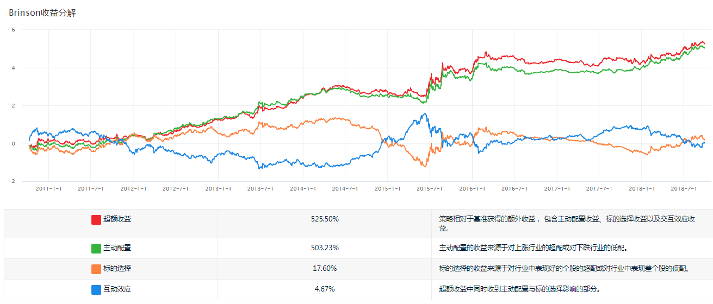
///caption
///

### 1.4 总结

策略通过将长期拥有超额收益的财务因子策略作为选股，与大盘择时方法 RSRS 相结合，保证了策略近 30% 的年化收益，规避了熊市风险，使得策略表现不俗，在 2017年大量策略失效的时候依然能够战胜市场，稳定盈利。感兴趣的朋友们可以进一步对参数敏感度以及斜率处理部分进行更细致的处理，亦或参考以 RSRS择时加超额收益选股的思路进行更多的探索。

### 1.5 策略源码

??? tip "策略源码"

    ```python linenums="1" title="策略源码"
    '''
    策略思路：
    选股：财务指标选股
    择时：RSRS择时
    持仓：有开仓信号时持有10只股票，不满足时保持空仓
    '''
    # 导入函数库
    import statsmodels.api as sm

    # 初始化函数，设定基准等等
    def initialize(context):
        # 开启动态复权模式(真实价格)
        set_option('use_real_price', True)
        # 过滤掉order系列API产生的比error级别低的log
        # log.set_level('order', 'error')
        set_parameter(context)
        ### 股票相关设定 ###
        # 股票类每笔交易时的手续费是：买入时佣金万分之三，卖出时佣金万分之三加千分之一印花税, 每笔交易佣金最低扣5块钱
        set_order_cost(OrderCost(close_tax=0.001, open_commission=0.0003, close_commission=0.0003, min_commission=5), type='stock')
        
        ## 运行函数（reference_security为运行时间的参考标的；传入的标的只做种类区分，因此传入'000300.XSHG'或'510300.XSHG'是一样的）
        # 开盘前运行
        run_daily(before_market_open, time='before_open', reference_security='000300.XSHG') 
        # 开盘时运行
        run_daily(market_open, time='open', reference_security='000300.XSHG')
        # 收盘后运行
        #run_daily(after_market_close, time='after_close', reference_security='000300.XSHG')
        
    '''
    ==============================参数设置部分================================
    '''
    def set_parameter(context):
        # 设置RSRS指标中N, M的值
        #统计周期
        g.N = 18
        #统计样本长度
        g.M = 1100
        #首次运行判断
        g.init = True
        #持仓股票数
        g.stock_num = 10
        #风险参考基准
        g.security = '000300.XSHG'
        # 设定策略运行基准
        set_benchmark(g.security)
        #记录策略运行天数
        g.days = 0
        #set_benchmark(g.stock)
        # 买入阈值
        g.buy = 0.7
        g.sell = -0.7
        #用于记录回归后的beta值，即斜率
        g.ans = []
        #用于计算被决定系数加权修正后的贝塔值
        g.ans_rightdev= []
        
        # 计算2005年1月5日至回测开始日期的RSRS斜率指标
        prices = get_price(g.security, '2009-01-05', context.previous_date, '1d', ['high', 'low'])
        highs = prices.high
        lows = prices.low
        g.ans = []
        for i in range(len(highs))[g.N:]:
            data_high = highs.iloc[i-g.N+1:i+1]
            print(data_high)
            data_low = lows.iloc[i-g.N+1:i+1]
            X = sm.add_constant(data_low)
            model = sm.OLS(data_high,X)
            results = model.fit()
            g.ans.append(results.params[1])
            #计算r2
            g.ans_rightdev.append(results.rsquared)
        
    ## 开盘前运行函数     
    def before_market_open(context):
        # 输出运行时间
        #log.info('函数运行时间(before_market_open)：'+str(context.current_dt.time()))
        g.days += 1
        # 给微信发送消息（添加模拟交易，并绑定微信生效）
        send_message('策略正常，运行第%s天~'%g.days)

    ## 开盘时运行函数
    def market_open(context):
        security = g.security
        # 填入各个日期的RSRS斜率值
        beta=0
        r2=0
        if g.init:
            g.init = False
        else:
            #RSRS斜率指标定义
            prices = attribute_history(security, g.N, '1d', ['high', 'low'])
            highs = prices.high
            lows = prices.low
            X = sm.add_constant(lows)
            model = sm.OLS(highs, X)
            beta = model.fit().params[1]
            g.ans.append(beta)
            #计算r2
            r2=model.fit().rsquared
            g.ans_rightdev.append(r2)
        
        # 计算标准化的RSRS指标
        # 计算均值序列    
        section = g.ans[-g.M:]
        # 计算均值序列
        mu = np.mean(section)
        # 计算标准化RSRS指标序列
        sigma = np.std(section)
        zscore = (section[-1]-mu)/sigma  
        #计算右偏RSRS标准分
        zscore_rightdev= zscore*beta*r2
        
        # 如果上一时间点的RSRS斜率大于买入阈值, 则全仓买入
        if zscore_rightdev > g.buy:
            # 记录这次买入
            log.info("市场风险在合理范围")
            #满足条件运行交易
            trade_func(context)
        # 如果上一时间点的RSRS斜率小于卖出阈值, 则空仓卖出
        elif (zscore_rightdev < g.sell) and (len(context.portfolio.positions.keys()) > 0):
            # 记录这次卖出
            log.info("市场风险过大，保持空仓状态")
            # 卖出所有股票,使这只股票的最终持有量为0
            for s in context.portfolio.positions.keys():
                order_target(s, 0)
                
    #策略选股买卖部分    
    def trade_func(context):
        #获取股票池
        df = get_fundamentals(query(valuation.code,valuation.pb_ratio,indicator.roe))
        #进行pb,roe大于0筛选
        df = df[(df['roe']>0) & (df['pb_ratio']>0)].sort_values('pb_ratio')
        #以股票名词作为index
        df.index = df['code'].values
        #取roe倒数
        df['1/roe'] = 1/df['roe']
        #获取综合得分
        df['point'] = df[['pb_ratio','1/roe']].rank().T.apply(f_sum)
        #按得分进行排序，取指定数量的股票
        df = df.sort_values('point')[:g.stock_num]
        pool = df.index
        log.info('总共选出%s只股票'%len(pool))
        #得到每只股票应该分配的资金
        cash = context.portfolio.total_value/len(pool)
        #获取已经持仓列表
        hold_stock = context.portfolio.positions.keys() 
        #卖出不在持仓中的股票
        for s in hold_stock:
            if s not in pool:
                order_target(s,0)
        #买入股票
        for s in pool:
            order_target_value(s,cash)
    #打分工具
    def f_sum(x):
        return sum(x)
            
    ## 收盘后运行函数  
    def after_market_close(context):
        #得到当天所有成交记录
        trades = get_trades()
        for _trade in trades.values():
            log.info('成交记录：'+str(_trade))
        #打印账户总资产
        log.info('今日账户总资产：%s'%round(context.portfolio.total_value,2))
        #log.info('##############################################################')
    ```

## 2. 网格交易

网格交易一种仓位策略，用于动态调仓。该大法秉持的原则是"仓位策略比选股策略更重要"。当然，我们做策略的，选出好的股票池是我们孜孜不倦的追求~~

### 2.1 几个基本概念

- **底仓价**：价格的标准线，建仓和调仓的重要依据。
- **低吸高抛**：仓位控制贯彻低吸高抛，绝不追涨杀跌。根据网格设置买卖价位。下面举个例子

| 趋势 | 价位 | 仓位 | `[-3%买, 5%卖]` | `[-5%买, 10%卖]` | `[-8%买, 15%卖]` |
| :--- | :--- | :--- | :--- | :--- | :--- |
| 下跌 | 买4 | 100% | 8.8 | 8.0 | 6.8 |
| 下跌 | 买3 | 90% | 9.1 | 8.5 | 7.6 |
| 下跌 | 买2 | 70% | 9.4 | 9.0 | 8.4 |
| 下跌 | 买1 | 40% | 9.7 | 9.5 | 9.2 |
| | 底仓价 | 不操作 | 10.0 | 10.0 | 10.0 |
| 上涨 | 卖1 | 60% | 10.5 | 11.0 | 11.5 |
| 上涨 | 卖2 | 30% | 11.0 | 12.0 | 13.0 |
| 上涨 | 卖3 | 10% | 11.5 | 13.0 | 14.5 |
| 上涨 | 卖4 | 0% | 12.0 | 14.0 | 16.0 |

- **网格大小**：上图给出了 3 种网格大小，特点是买入网格小于卖出网格，这种不对称编织网格的道理在于网格的目的是网获利润，将利润建立在趋势的必然性中，而不仅仅是靠震荡的偶然性。

在底仓价的附近，我们根据网格的大小，比如每跌3%按仓位买入（第一档：买40%，第二档：买30%，第三档：买20%，第四档：买10%）。要注意的是，这里买卖不是绝对的定量，而是调仓到对应仓位。如果第一次跌破 3%，而后上涨到 5% 时，是不操作的，因为下跌时只建了 40% 的仓，而上涨 5% 的仓位是 60%，不够抛出。

!!! tip "特点和局限"
    
    首先，定理&公理：**没有万能的策略**。

    1. **趋势**决定策略的成败，在长期的上涨趋势中策略才能获得满意回报。
    2. **选股**集中在波动大、成长性好的中小市值股票。不断盘整的周期股、大盘股和业绩不佳的垃圾股踩中就麻烦了。
    3. **底仓价格**设定在安全边际内。在估值顶部设立底仓价格风险极大，会造成很大的损失。
    4. **牛市表现不佳**，分散的仓位策略，没有依据价格形态来修改网格，都可能在牛市中跑输大盘。降低贝塔的代价就是阿尔法也较低。
    5. **买卖规则不灵活**，可能使一些重要的突破支持或阻力位置的买卖点被忽略在网格之外。

### 2.2 策略步骤


1. 选股：So，我们的股票池有10只股。每3个月按上述条件更新一次股票池，更新时不在新股票池的股票全部清仓。

    - 重点行业：I64 互联网和相关服务，I65 软件和信息技术服务业
    - 低估值PE小：PE < 50
    - 小市值：分行业按市值排列选市值小的30只
    - 高波动：分行业在市值最小的30只中选出过去一年波动率最大的5只股票

2. 网格：`[-3%买，5%卖]`、`[-5%买，10%卖]`、`[-8%买，15%卖]`、`[-12%买，20%卖]` 四种大小的网格都会相应尝试一下看看效果。
3. 资金安排：在仓位控制时，满仓的概念是（总资金/股票池总数 * 2.5），后面的乘数是为了提高资金利用率，因为 3 个月的周期内可能不是每只股票都能达到满仓。

回测做了很多组，大致是分市场行情（牛、震荡和熊）各做了一次。然后在震荡期调整网格大小分别做了 4 次。

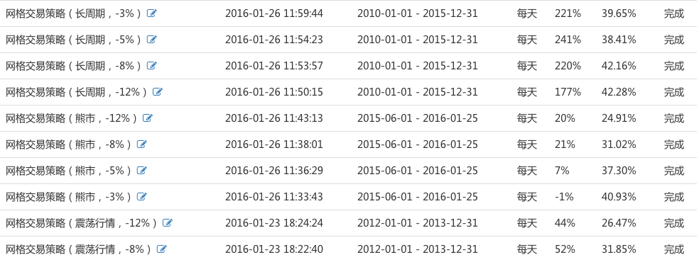

### 2.3 结论

记住啦：**熊市大网格、震荡小网格、长周期中间网格**。这个比较好理解，网格小意味着操作频繁，震荡周期就是勤能补拙了，多多的交易，熊市的话大网格容忍度高一些。

**熊市**：选取 2015-6-1 至 2016-1-26 日，大网格 -12% 买，20% 卖。最好的结果是半年多盈利 20%（大盘同期大跌35%），年化 **40%+**。

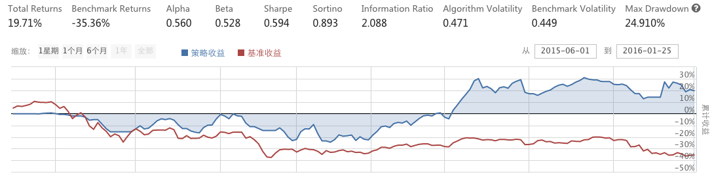


**长周期**：选取 2010-1-1 至 2015-12-31 日，中网格 -8% 买，15% 卖。最好的结果是 6 年 241%（大盘同期4%），年化 **23%**。

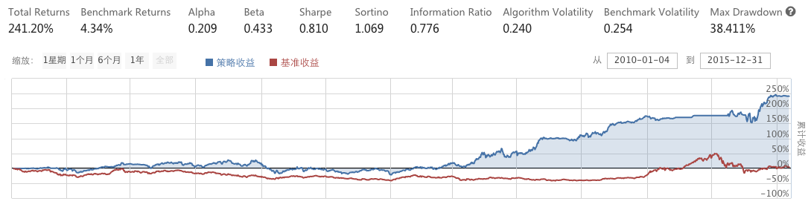


**震荡期**：选取 2012-1-1 至2013-12-31日，小网格 -3% 买，5% 卖。最好的结果 2 年 68%（大盘同期-0.5%），年化 29.6%。

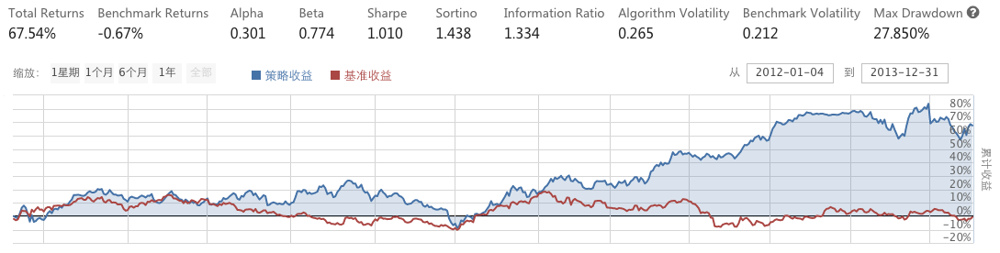

### 2.4 不同因素对策略的影响

#### 2.4.1 小市值选股对策略的影响

这是个讲交易方法的策略，那么高收益是否因为按小市值筛选股票得来的呢？

仔细看代码会发现，这个策略选股的要点是波动率，而非小市值。下面加一下去掉小市值条件的长周期回测效果（加小市值：240%，不加小市值232%，并没太大的影响）

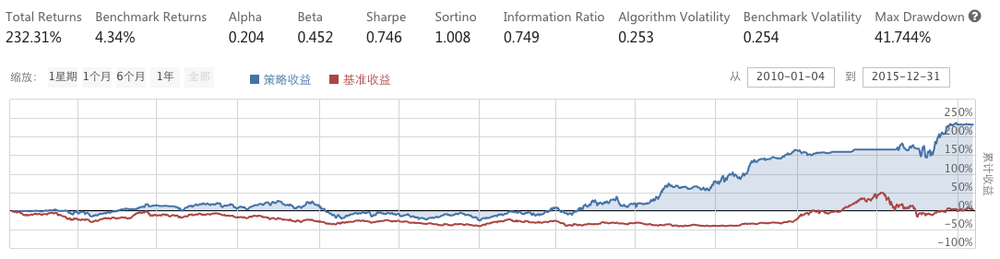

#### 2.4.2 行业选取对策略的影响

高成长性行业的股票本来就收益可观，那我们看看控制单一变量，去掉网格交易方法，长期持有股票池的股票效果如何。注意：这里每3个月股票池轮换还是在做的，大盘止损的条件也不变。（长期持有：157%，运用网格交易：240%，采用网格交易收益更高，回撤也小一些）

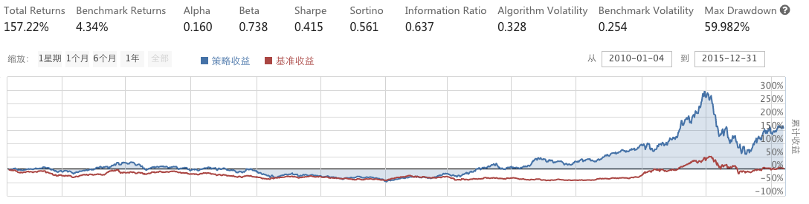


### 2.5 策略源码

```python linenums="1"
import numpy
import pandas as pd
from pandas import Series

def initialize(context):
    g.count = 30
    g.cash = 1000000
    g.buy_stock = []
    g.initial_price = {}
    g.month = context.current_dt.month
    run_monthly(select_stock_by_industry,1,'open')
# 选股
# 重点行业，低估值PE小，优质蓝筹市值大，高波动
def select_stock_by_industry(context):
    #每3个月更新
    month = context.current_dt.month
    if month%3 != g.month%3:
        return
    industry_list = [
    #'C27','C39','I63',
    'I64','I65'
    #'K70',
    #'M73','M74'
    #,'N77','R86','R87'
    ]
    stocks = []
    for industry_code in industry_list:
        stock_set = get_industry_stocks(industry_code)
        #选fundamental比较好的前15只,pe_ration<30，market_cap，按market_cap取后20只股票。
        q = query(
            valuation.code, valuation.market_cap, valuation.pe_ratio
        ).filter(
            valuation.code.in_(stock_set),
            valuation.pe_ratio < 50
        ).order_by(
            valuation.market_cap.desc()
        ).limit(
        g.count
        )
        df = get_fundamentals(q)
        stock_set = list(df['code'])
        #取波动率最高的2只
        variance_list = []
        for stock in stock_set:
            variance_list.append(variance(stock))
        s1 =Series(variance_list,index = stock_set).rank()
        stocks = list(s1[s1 < 6].index)
        for stock in stocks:
            g.buy_stock.append(stock)
            g.initial_price[stock]=0
    set_universe(g.buy_stock)
    reset_position(context)
    return None
# 轮换选股后清除新股票池外的持仓
def reset_position(context):
    if context.portfolio.positions.keys() !=[]:
        for stock in context.portfolio.positions.keys():
            if stock not in g.buy_stock:
                order_target_value(stock, 0)
    return None
# 计算波动率
def variance(security_code):
    hist1 = attribute_history(security_code, 180, '1d', 'close',df=False)
    narray=numpy.array(hist1['close'])
    sum1=narray.sum()
    narray2=narray*narray
    sum2=narray2.sum()
    N = len(hist1['close'])
    mean=sum1/N
    var=sum2/N-mean**2
    return var

# 计算股票前n日收益率
def security_return(days,security_code):
    hist1 = attribute_history(security_code, days + 1, '1d', 'close',df=False)
    security_returns = (hist1['close'][-1]-hist1['close'][0])/hist1['close'][0]
    return security_returns

# 止损，根据前n日收益率
def conduct_nday_stoploss(context,security_code,days,bench):
    if  security_return(days,security_code)<= bench:
        for stock in g.buy_stock:
            order_target_value(stock,0)
            log.info("Sell %s for stoploss" %stock)
        return True
    else:
        return False
# 计算股票累计收益率（从建仓至今）
def security_accumulate_return(context,data,stock):
    current_price = data[stock].price
    cost = context.portfolio.positions[stock].avg_cost
    if cost != 0:
        return (current_price-cost)/cost
    else:
        return None

# 个股止损，根据累计收益
def conduct_accumulate_stoploss(context,data,stock,bench):
    if security_accumulate_return(context,data,stock) != None\
    and security_accumulate_return(context,data,stock) < bench:
        order_target_value(stock,0)
        log.info("Sell %s for stoploss" %stock)
        return True
    else:
        return False

# 选股：连续N日下跌
def is_fall_nday(days,stock):
    his = history(days+1,'1d','close',[stock],df =False)
    cnt = 0
    for i in range(days):
    	daily_returns = (his[stock][i+1] - his[stock][i])/his[stock][i]
    	if daily_returns <0:
    	    cnt += 1
    if cnt == 5:
    	return True
    else:
        return False

# 比较现价与N日均价
def compare_current_nmoveavg(data,stock,days,multi):
    current_price = data[stock].price
    moveavg = data[stock].mavg(days)
    if current_price > multi * moveavg:
        return True
    else:
        return False

# 初始底仓选择，判断没有initial_price，则建立基准价
def initial_price(context,data,stock):
    if g.initial_price[stock]==0:
        g.initial_price[stock]=data[stock].price
    return None

# 补仓、空仓：分n买入/卖出
def setup_position(context,data,stock,bench,status):
    bottom_price= g.initial_price[stock]
    if bottom_price == 0:
        return
    cash = context.portfolio.cash
    current_price = data[stock].price
    amount = context.portfolio.positions[stock].amount
    current_value = current_price*amount
    unit_value = g.cash/40
    returns = (current_price-bottom_price)/bottom_price
    #卖出
    if (status == 'short'):
        if returns > bench and current_value > 6*unit_value:
            order_target_value(stock,6*unit_value)
        if returns > 2*bench and current_value > 3*unit_value:
            order_target_value(stock,3*unit_value)
        if returns > 3*bench and current_value >1*unit_value :
            order_target_value(stock,1*unit_value)
        if returns > 4*bench and current_value >0:
            order_target_value(stock,0)
    # 买入
    if (status == 'long') and cash >0:
        if returns < bench and current_value < 4*unit_value:
            order_target_value(stock,4*unit_value)
        if returns < 2*bench and current_value < 7*unit_value:
            order_target_value(stock,7*unit_value)
        if returns < 3*bench and current_value <9*unit_value :
            order_target_value(stock,9*unit_value)
        if returns < 4*bench and current_value < 10*unit_value:
            order_target_value(stock,10*unit_value)
    return True 

# 每个单位时间(如果按天回测,则每天调用一次,如果按分钟,则每分钟调用一次)调用一次
def handle_data(context, data):
    # 指数止损，前一天跌幅大于3%
    if conduct_nday_stoploss(context, '000001.XSHG', 2,-0.03):
        return
    for stock in g.buy_stock:
    	if conduct_accumulate_stoploss(context,data,stock,-0.2):
    	    return
    	#1.连续5日下跌，不操作
    	if is_fall_nday(5,stock):
    		return
    	#2.大于5日平均或10日平均1.5倍以上,不操作
    	if compare_current_nmoveavg(data,stock,5,1.5)\
    	or compare_current_nmoveavg(data,stock,10,1.5):
    		return
    	#初始设置底仓
    	initial_price(context,data,stock)
    	#补仓步长：-3%，-5%，-8%，-12%
    	setup_position(context,data,stock,-0.08,'long')
    	#空仓步长：5%，10%，15%，20%
    	setup_position(context,data,stock,0.15,'short')
```

## 3. 彼得林奇PEG策略

> 投资大师彼得·林奇（Peter Lynch）有过一个著名的论断：任何一家公司股票如果定价合理的话，市盈率就会与收益增长率相等。这就是 PEG 估值法，PEG 在综合考虑了低风险以及未来成长性的因素，可用于股票价值评估。本文浅谈“PEG估值法”，并给出策略，进行回测。 

### 3.1 PEG估值法

!!! info "财富的化身--彼得·林奇"

    彼得·林奇（Peter Lynch）生于 1944年1月19日，是一位卓越的投资家，曾被《时代杂志》评为首席基金经理。1977年至1990年，在彼得·林奇管理麦哲伦基金的 13年间，基金规模大幅扩增，由 2000万美元成长至 140亿美元！一跃成为全球之最。

    彼得·林奇在投资上的功绩和影响，几乎无人能及。今天，我们介绍一下彼得·林奇推广的“PEG估值法”，来体会大师的投资思想。

达·芬奇说过：“把最复杂的变成最简单的，才是最高明的”。PEG估值法就很好的体现了这个思想。下面，小编给出 PEG 的估值原理。

一言以蔽之：计算每只股票的 PEG 值，并排序，取PEG值最小的前n支股票，作为待买股票即可！

那么，这个PEG究竟是什么呢？先介绍几个基本概念：

**EPS**(Earnings Per Share) 表示每股收益（一般按年计算）:

$$
EPS = \frac{归属于普通股股东的当期净利润}{当期实际发行在外的普通股加权平均数}
$$


**PE**（Price to Earning Ratio）表示市盈率，是当前股价（P）相对每股收益（EPS）的比值：

$$
PE = \frac{P}{EPS}
$$

将 EPS 按照不同的计算法方法取出，我们可以得出适用范围不同的 PE（市盈率）：

- 若每股收益(EPS) 取最近 4 次的季报的每股收益的平均值，则计算出“滚动市盈率”（又称市盈率 **TTM**）；
- 若每股收益(EPS) 取去年的 12 个月的每股收益，则计算出“静态市盈率”（又称市盈率 **LYR**）；
- 若每股收益(EPS) 取预测下一年的每股收益，则计算出“动态市盈率”。

本文取 “**市盈率TTM**”，更加接近现实，靠谱。

**G**（Growth Rate of Expected Profit）表示**企业的收益增长率**。收益增长率的计算方法不一，简便起见，本文取 EPS 增长率：


$$
G = \frac{EPS_{\text{this\ year}} - EPS_{\text{last\ year}}}{EPS_{\text{last\ year}}}
$$

基于以上几个指标，得出 PEG 的计算公式:

$$
PEG = \frac{PE}{G * 100}
$$

从以上公式可以看出，PE 蕴含着股价的信息，PEG 是一个股价相对于收益增长率的比值。直观来讲，PEG 越高，代表该公司的股价有被高估的可能性，不建议买。反之，PEG 越低，代表该公司的股价有被低估的可能性，考虑买入(*一般情况下，PEG越低越好*)。

### 3.2 PEG估值法的适用条件

PEG 是一个综合指标，既考察价值，又兼顾成长性。不难看出，PEG 估值法侧重于成长型的公司，非常适合对成长型公司的股票价值评估。马克思说过:“任何真理都有自己适用的条件和范围。”在投资的世界里，倘若不在合适的范围内进行操作，就不是一个好策略。

要想成为一个好策略，就必须预先过滤股票池，筛选出符合 PEG 估值法运用条件的股票。以下几种情况就不适合用 PEG 估值法进行估值：


| 类别 | 原因 |
| :--- | :--- |
| 周期性行业 | 利润基础稳定不住，使用PEG容易造成误差 |
| 非成长股 | 收益增长率或市盈率为负的股票，不符合高增长的条件 |
| 项目类公司 | 利润高低依赖于公司接的项目数，利润基础稳定不住 |
| 稳定的大型公司 | 这类公司往往稳定有余而成长不足 |
| 融资依赖型的企业 | 因融资带来的高增长，不能稳定持续 |

本文仅对股票池的“非成长股”进行排除，有兴趣的用户，可以进行多次过滤。

### 3.3 利用PEG寻找成倍牛股

PEG 估值法是彼得·林奇用作评估成长型公司价值的方法，PEG 数值通常可分为四档：


| PEG值 | 股票价值评估 |
| :--- | :--- |
| 0至0.5 | 相对低估 |
| 0.5至1 | 相对合理 |
| 1至2 | 相对高估 |
| 大于2 | 高风险区 |

目前，我国处于高速发展的经济中，我们对A股高成长型公司的合理估值可以定为：PEG = 1。举几个例子：


| 公司名称 | 市盈率 | 收益增长率 | PEG | 股票价值评估 |
| :--- | :--- | :--- | :--- | :--- |
| A公司 | 66倍 | 30% | 2.2 | 高风险区 |
| B公司 | 30倍 | 30% | 1 | 估值合理 |
| C公司 | 30倍 | 100% | 0.3 | 低估，买入建仓 |

大家理解了吗？C 公司就是那支能为你带来N倍收益的牛股，依照 PEG 估值法的思想，PEG 值越低越牛哦！！！

### 3.4 策略思路

1. 设置沪深300为初始股票池，实际情况中，当天停牌的股票是无法进行买卖操作的，所以在整体回测前，将当日停牌的股票剔除，得到可行股票池。

2. 前面已说明，本策略仅对成长股有效，所以仅仅过滤掉当日停牌的股票是不完善的。仍需过滤掉市盈率（PE）为负值，或收益增长率（G）为负值的股票。聚宽平台的取数据函数 `get_fundamentals` 可以直接取PE，G值（详见【数据】模块的[股票财务数据](https://www.joinquant.com/fundamentals)）。`get_fundamentals` 函数的默认日期是 `context.current_dt` 的前一天（详见API）,因为当天是无法知道今日的某些数据的。本策略使用默认值（缺省），避免未来函数，不建议修改。

3. 整体思路是非常简洁的，下面对股票的 PEG 进行排序，取出 PEG 最小(且全都小于 0.5)的前 n 只支股票，作为调仓时待买入的股票列表。

4. 每次调仓时，先卖后买，腾出资金。对不在待买入列表的股票，执行卖出操作。对在待买入列表的股票，分配资金，执行买入操作。

### 3.5 应用PEG估值法的误区

在克隆（见文末，附源码）本策略之前，小编给大家列了一些预先需要注意的地方，防患于未然哈：

1. 取市盈率和收益增长率数据时，应该取回测当天的前一天的数据，避免未来函数。在聚宽平台，取数据函数 `get_fundamentals` 时间默认值是回测前一天，保持默认即可，不建议修改。

2. 计算出的 PEG 值并非越小越好，因为计算 PEG 时所用的收益增长率，是过去 n 年平均指标这样的历史数据。实际上，决定上市公司潜力的是其未来的增长率。目前小 PEG 的公司并不代表其今后这一数值一定就小。

3. 怎样选择高增长的公司？
    
    重要的是你选择的公司是要处在高增长的行业，比如互联网、环保、新材料、医药等，行业高增长是企业高增长的基石。选对了行业，再选择行业内的佼佼者即可。

4. 市盈率或收益增长率为负的公司怎么计算PEG?
    
    这种公司没什么的研究价值。

5. 市盈率用静态LYR?？滚动TTM？还是动态的?

    - 市盈率LYR: 以上一年度每股收益计算的市盈率。靠谱，但信息陈旧。
    - 市盈率TTM: 以最近四个季度每股收益计算的市盈率。靠谱，更接近现实。
    - 动态市盈率：以未来一年每股收益计算的市盈率。取决于行业研究员的财务报表的数据分析，具有预测未来的效果。
    
    其中，市盈率LYR和市盈率TTM可以用聚宽平台 `get_fundamentals` 函数直接取（见 [API](https://www.joinquant.com/api) 和[数据](https://www.joinquant.com/data) 模块的[股票财务数据](https://www.joinquant.com/fundamentals)）。

上面是聚宽的宏观经济占卜师做的，然后聚宽的小兵哥在这智商又做了一些修正，主要修正了以下条件：

1. 引入修正 PEG，把分红加入到了计算 PEG 的过程中去；
2. 剔除了周期性行业、项目类公司；
3. 参考彼得林奇的原文，剔除掉增长 >50 的股票（原文是要密切关注，因为高增长不可持续，实现里是直接剔除）
4. 修改了配仓策略，从等权重变更为风险平价
5. 日波动约束在 3% 以内；
6. 最大持仓 5 个股票，30个交易日调仓一次，无择时，无止损
7. PEG < 0.5，进入待选股；按照市值排序，优先买入市值低的（彼得林奇原文也是市值小的优先）
8. 卖条件，如果选进的股票 >5 个，则清光持仓；如果 1.0 才清掉。

```python linenums="1"
import numpy as np
import talib
import pandas
import scipy as sp
import scipy.optimize
import datetime as dt
from scipy import linalg as sla
from scipy import spatial
from jqdata import jy

def initialize(context):
    #用沪深 300 做回报基准
    set_benchmark('000300.XSHG')
    set_slippage(FixedSlippage(0.002))
    set_option('use_real_price', True)

    # 关闭部分log
    log.set_level('order', 'error')
    # 定义策略占用仓位比例
    context.lowPEG_ratio = 1.0

    # for lowPEG algorithms
    # 正态分布概率表，标准差倍数以及置信率
    # 1.96, 95%; 2.06, 96%; 2.18, 97%; 2.34, 98%; 2.58, 99%; 5, 99.9999%
    context.lowPEG_confidencelevel = 1.96
    context.lowPEG_hold_periods, context.lowPEG_hold_cycle = 0, 30
    context.lowPEG_stock_list = []
    context.lowPEG_position_price = {}

    g.quantlib = quantlib()

    run_daily(fun_main, '10:30')

def fun_main(context):

    lowPEG_trade_ratio = lowPEG_algo(context, context.lowPEG_ratio, context.portfolio.portfolio_value)
    # 调仓，执行交易
    g.quantlib.fun_do_trade(context, lowPEG_trade_ratio, context.lowPEG_moneyfund)


def lowPEG_algo(context, lowPEG_ratio, portfolio_value):
    '''
    low PEG algorithms
    输入参数：lowPEG_ratio, protfolio_value
    输出参数：lowPEG_trade_ratio
    自有类  : lowPEG_lib
    调用类  : quantlib
    '''

    # 引用 lib
    g.lowPEG = lowPEG_lib()
    # 引用 quantlib
    g.quantlib = quantlib()

    g.lowPEG.fun_initialize(context)

    recal_flag = False
    if g.lowPEG.fun_needRebalance(context):
        recal_flag = True

    # 配仓，分配持股比例
    equity_ratio = {}
    if recal_flag:
        context.lowPEG_stock_list = g.lowPEG.fun_get_stock_list(context)
        equity_ratio, bonds_ratio = g.lowPEG.fun_assetAllocationSystem(context, context.lowPEG_stock_list)
    else:
        equity_ratio = context.lowPEG_equity_ratio
        bonds_ratio = context.lowPEG_bonds_ratio

    context.lowPEG_equity_ratio = equity_ratio
    context.lowPEG_bonds_ratio = bonds_ratio

    # 分配头寸，配置市值
    trade_ratio = {}
    if recal_flag:
        trade_ratio = g.lowPEG.fun_calPosition(context, equity_ratio, bonds_ratio, lowPEG_ratio, portfolio_value)

        stock_list = list(get_all_securities(['stock']).index)
        for stock in context.portfolio.positions.keys():
            if stock not in trade_ratio and stock in stock_list:
                trade_ratio[stock] = 0
    else:
        trade_ratio = context.lowPEG_trade_ratio

    context.lowPEG_trade_ratio = trade_ratio

    return trade_ratio

class lowPEG_lib():
    
    def __init__(self, _period = '1d'):
        pass
    
    def fun_initialize(self, context):
        # 定义股票池
        lowPEG_equity = context.lowPEG_stock_list

        lowPEG_moneyfund = ['511880.XSHG']

        # 上市不足 60 天的剔除掉
        context.lowPEG_equity    = g.quantlib.fun_delNewShare(context, lowPEG_equity, 60)
        context.lowPEG_moneyfund = g.quantlib.fun_delNewShare(context, lowPEG_moneyfund, 60)

        context.lowPEG_hold_num = 5
        context.lowPEG_risk_ratio = 0.03 / context.lowPEG_hold_num

    def fun_needRebalance(self, context):
        if len(context.lowPEG_stock_list) == 0:
            context.lowPEG_hold_periods = context.lowPEG_hold_cycle
            return True
        
        if context.lowPEG_hold_periods == 0:
            context.lowPEG_hold_periods = context.lowPEG_hold_cycle
            return True
        else:
            context.lowPEG_hold_periods -= 1
            return False

    # 取得净利润增长率参数
    def fun_get_inc(self, context, stock_list):
        # 取最近的四个季度财报的日期
        def __get_quarter(stock_list):
            '''
            输入 stock_list
            返回最近 n 个财报的日期
            返回每个股票最近一个财报的日期
            '''
            # 取最新一季度的统计日期
            q = query(indicator.code, indicator.statDate
                     ).filter(indicator.code.in_(stock_list))
            df = get_fundamentals(q)

            stock_last_statDate = {}
            tmpDict = df.to_dict()
            for i in range(len(tmpDict['statDate'].keys())):
                # 取得每个股票的代码，以及最新的财报发布日
                stock_last_statDate[tmpDict['code'][i]] = tmpDict['statDate'][i]

            df = df.sort(columns='statDate', ascending=False)
            # 取得最新的财报日期
            last_statDate = df.iloc[0,1]

            this_year = int(str(last_statDate)[0:4])
            this_month = str(last_statDate)[5:7]

            if this_month == '12':
                last_quarter       = str(this_year)     + 'q4'
                last_two_quarter   = str(this_year)     + 'q3'
                last_three_quarter = str(this_year)     + 'q2'
                last_four_quarter  = str(this_year)     + 'q1'
                last_five_quarter  = str(this_year - 1) + 'q4'

            elif this_month == '09':
                last_quarter       = str(this_year)     + 'q3'
                last_two_quarter   = str(this_year)     + 'q2'
                last_three_quarter = str(this_year)     + 'q1'
                last_four_quarter  = str(this_year - 1) + 'q4'
                last_five_quarter  = str(this_year - 1) + 'q3'

            elif this_month == '06':
                last_quarter       = str(this_year)     + 'q2'
                last_two_quarter   = str(this_year)     + 'q1'
                last_three_quarter = str(this_year - 1) + 'q4'
                last_four_quarter  = str(this_year - 1) + 'q3'
                last_five_quarter  = str(this_year - 1) + 'q2'

            else:  #this_month == '03':
                last_quarter       = str(this_year)     + 'q1'
                last_two_quarter   = str(this_year - 1) + 'q4'
                last_three_quarter = str(this_year - 1) + 'q3'
                last_four_quarter  = str(this_year - 1) + 'q2'
                last_five_quarter  = str(this_year - 1) + 'q1'
        
            return last_quarter, last_two_quarter, last_three_quarter, last_four_quarter, last_five_quarter, stock_last_statDate

        # 查财报，返回指定值
        def __get_fundamentals_value(stock_list, myDate):
            '''
            输入 stock_list, 查询日期
            返回指定的财务数据，格式 dict
            '''
            q = query(indicator.code, indicator.inc_net_profit_year_on_year, indicator.statDate
                     ).filter(indicator.code.in_(stock_list))

            df = get_fundamentals(q, statDate = myDate).fillna(value=0)

            tmpDict = df.to_dict()
            stock_dict = {}
            for i in range(len(tmpDict['statDate'].keys())):
                tmpList = []
                tmpList.append(tmpDict['statDate'][i])
                tmpList.append(tmpDict['inc_net_profit_year_on_year'][i])
                stock_dict[tmpDict['code'][i]] = tmpList

            return stock_dict

        # 对净利润增长率进行处理
        def __cal_net_profit_inc(inc_list):

            inc = inc_list

            for i in range(len(inc)):   # 约束在 +- 100 之内，避免失真
                if inc[i] > 100:
                    inc[i] = 100
                if inc[i] < -100:
                    inc[i] = -100

            avg_inc = np.mean(inc[:4])
            last_inc = inc[0]
            inc_std = np.std(inc)
                
            return avg_inc, last_inc, inc_std

        # 得到最近 n 个季度的统计时间
        last_quarter, last_two_quarter, last_three_quarter, last_four_quarter, last_five_quarter, stock_last_statDate = __get_quarter(stock_list)
    
        last_quarter_dict       = __get_fundamentals_value(stock_list, last_quarter)
        last_two_quarter_dict   = __get_fundamentals_value(stock_list, last_two_quarter)
        last_three_quarter_dict = __get_fundamentals_value(stock_list, last_three_quarter)
        last_four_quarter_dict  = __get_fundamentals_value(stock_list, last_four_quarter)
        last_five_quarter_dict  = __get_fundamentals_value(stock_list, last_five_quarter)
    
        stock_dict = {}
        for stock in stock_list:
            inc_list = []

            if stock in stock_last_statDate:
                if stock in last_quarter_dict:
                    if stock_last_statDate[stock] == last_quarter_dict[stock][0]:
                        inc_list.append(last_quarter_dict[stock][1])

                if stock in last_two_quarter_dict:
                    inc_list.append(last_two_quarter_dict[stock][1])
                else:
                    inc_list.append(0)

                if stock in last_three_quarter_dict:
                    inc_list.append(last_three_quarter_dict[stock][1])
                else:
                    inc_list.append(0)

                if stock in last_four_quarter_dict:
                    inc_list.append(last_four_quarter_dict[stock][1])
                else:
                    inc_list.append(0)

                if stock in last_five_quarter_dict:
                    inc_list.append(last_five_quarter_dict[stock][1])
                else:
                    inc_list.append(0)
            else:
                inc_list = [0, 0, 0, 0]

            # 取得过去4个季度的平均增长，最后1个季度的增长，增长标准差
            avg_inc, last_inc, inc_std = __cal_net_profit_inc(inc_list)

            stock_dict[stock] = {}
            stock_dict[stock]['avg_inc'] = avg_inc
            stock_dict[stock]['last_inc'] = last_inc
            stock_dict[stock]['inc_std'] = inc_std

        return stock_dict

    def fun_cal_stock_PEG(self, context, stock_list, stock_dict):
        if not stock_list:
            PEG = {}
            return PEG

        q = query(valuation.code, valuation.pe_ratio
                ).filter(valuation.code.in_(stock_list))
        
        df = get_fundamentals(q).fillna(value=0)

        tmpDict = df.to_dict()
        pe_dict = {}
        tmp_dict = {}
        for i in range(len(tmpDict['code'].keys())):
            pe_dict[tmpDict['code'][i]] = tmpDict['pe_ratio'][i]

        # 国泰民安版本
        #df = g.quantlib.fun_get_Divid_by_year(context, stock_list)
        # 聚源版本
        statsDate = context.current_dt.date() - dt.timedelta(1)
        df = g.quantlib.fun_get_Dividend_yield(stock_list, statsDate)
        tmpDict = df.to_dict()

        stock_interest = {}
        for stock in tmpDict['divpercent']:
            stock_interest[stock] = tmpDict['divpercent'][stock]

        h = history(1, '1d', 'close', stock_list, df=False)
        PEG = {}
        for stock in stock_list:
            avg_inc  = stock_dict[stock]['avg_inc']
            last_inc = stock_dict[stock]['last_inc']
            inc_std  = stock_dict[stock]['inc_std']

            pe = -1            
            if stock in pe_dict:
                pe = pe_dict[stock]

            interest = 0
            if stock in stock_interest:
                interest = stock_interest[stock]

            PEG[stock] = -1
            '''
            原话大概是：
            1、增长率 > 50 的公司要小心，高增长不可持续，一旦转差就要卖掉；实现的时候，直接卖掉增长率 > 50 个股票
            2、增长平稳，不知道该怎么表达，用了 inc_std < last_inc。有思路的同学请告诉我
            '''
            if pe > 0 and last_inc <= 50 and last_inc > 0 and inc_std < last_inc:
                PEG[stock] = (pe / (last_inc + interest*100))

        return PEG

    def fun_get_stock_list(self, context):
        
        def fun_get_stock_market_cap(stock_list):
            q = query(valuation.code, valuation.market_cap
                    ).filter(valuation.code.in_(stock_list))
            
            df = get_fundamentals(q).fillna(value=0)
            tmpDict = df.to_dict()
            stock_dict = {}
            for i in range(len(tmpDict['code'].keys())):
                # 取得每个股票的 market_cap
                stock_dict[tmpDict['code'][i]] = tmpDict['market_cap'][i]
                
            return stock_dict
        
        today = context.current_dt
        stock_list = list(get_all_securities(['stock'], today).index)
        
        stock_list = g.quantlib.unpaused(stock_list)
        stock_list = g.quantlib.fun_remove_cycle_industry(context, stock_list)

        stock_dict = self.fun_get_inc(context, stock_list)
        old_stocks_list = []
        for stock in context.portfolio.positions.keys():
            if stock in stock_list:
                old_stocks_list.append(stock)

        stock_PEG = self.fun_cal_stock_PEG(context, stock_list, stock_dict)
        
        stock_list = []
        buydict = {}
    
        for stock in stock_PEG.keys():
            if stock_PEG[stock] < 0.5 and stock_PEG[stock] > 0:
                stock_list.append(stock)
                buydict[stock] = stock_PEG[stock]
        cap_dict = fun_get_stock_market_cap(stock_list)
        buydict = sorted(cap_dict.items(), key=lambda d:d[1], reverse=False)

        buylist = []
        i = 0
        for idx in buydict:
            if i < context.lowPEG_hold_num:
                stock = idx[0]
                buylist.append(stock) # 候选 stocks
                print stock + ", PEG = "+ str(stock_PEG[stock])
                i += 1
        
        if len(buylist) < context.lowPEG_hold_num:
            old_stocks_PEG = self.fun_cal_stock_PEG(context, old_stocks_list, stock_dict)
            tmpDict = {}
            tmpList = []
            for stock in old_stocks_PEG.keys():
                if old_stocks_PEG[stock] < 1.0 and old_stocks_PEG[stock] > 0:
                    tmpDict[stock] = old_stocks_PEG[stock]
            tmpDict = sorted(tmpDict.items(), key=lambda d:d[1], reverse=False)
            i = len(buylist)
            for idx in tmpDict:
                if i < context.lowPEG_hold_num and idx[0] not in buylist:
                    buylist.append(idx[0])
                    i += 1

        print str(len(stock_list)) + " / " + str(len(buylist))
        print buylist

        return buylist

    def fun_assetAllocationSystem(self, context, buylist):
        def __fun_getEquity_ratio(context, __stocklist):
            __ratio = {}
            # 按风险平价配仓
            if __stocklist:
                __ratio = g.quantlib.fun_calStockWeight_by_risk(context, 2.58, __stocklist)

            return __ratio

        equity_ratio = __fun_getEquity_ratio(context, buylist)
        bonds_ratio  = __fun_getEquity_ratio(context, context.lowPEG_moneyfund)
        
        return equity_ratio, bonds_ratio

    def fun_calPosition(self, context, equity_ratio, bonds_ratio, lowPEG_ratio, portfolio_value):

        #risk_ratio = len(equity_ratio.keys())
        risk_ratio = 0
        for stock in equity_ratio.keys():
            if equity_ratio[stock] <> 0 and stock not in context.lowPEG_moneyfund:
                risk_ratio += 1
        risk_money = context.portfolio.portfolio_value * risk_ratio * context.lowPEG_ratio * context.lowPEG_risk_ratio
        maxrisk_money = risk_money * 1.7

        equity_value = 0
        if equity_ratio:
            equity_value = g.quantlib.fun_getEquity_value(equity_ratio, risk_money, maxrisk_money, context.lowPEG_confidencelevel)

        value_ratio = 0
        total_value = portfolio_value * lowPEG_ratio
        if equity_value > total_value:
            bonds_value = 0
            value_ratio = 1.0 * lowPEG_ratio
        else:
            value_ratio = (equity_value / total_value) * lowPEG_ratio
            bonds_value = total_value - equity_value
        
        trade_ratio = {}
        equity_list = equity_ratio.keys()
        for stock in equity_list:
            if stock in trade_ratio:
                trade_ratio[stock] += round((equity_ratio[stock] * value_ratio), 3)
            else:
                trade_ratio[stock] = round((equity_ratio[stock] * value_ratio), 3)
    
        for stock in bonds_ratio.keys():
            if stock in trade_ratio:
                trade_ratio[stock] += round((bonds_ratio[stock] * bonds_value / total_value) * lowPEG_ratio, 3)
            else:
                trade_ratio[stock] = round((bonds_ratio[stock] * bonds_value / total_value) * lowPEG_ratio, 3)
    
        return trade_ratio

class quantlib():
    
    def __init__(self, _period = '1d'):
        pass

    # 剔除周期性行业
    def fun_remove_cycle_industry(self, context, stock_list):
        cycle_industry = [#'A01', #	农业 	1993-09-17
                          #'A02', # 林业 	1996-12-06
                          #'A03', #	畜牧业 	1997-06-11
                          #'A04', #	渔业 	1993-05-07
                          #'A05', #	农、林、牧、渔服务业 	1997-05-30
                          'B06', # 煤炭开采和洗选业 	1994-01-06
                          'B07', # 石油和天然气开采业 	1996-06-28
                          'B08', # 黑色金属矿采选业 	1997-07-08
                          'B09', # 有色金属矿采选业 	1996-03-20
                          'B11', # 开采辅助活动 	2002-02-05
                          #'C13', #	农副食品加工业 	1993-12-15
                          #C14 	食品制造业 	1994-08-18
                          #C15 	酒、饮料和精制茶制造业 	1992-10-12
                          #C17 	纺织业 	1992-06-16
                          #C18 	纺织服装、服饰业 	1993-12-31
                          #C19 	皮革、毛皮、羽毛及其制品和制鞋业 	1994-04-04
                          #C20 	木材加工及木、竹、藤、棕、草制品业 	2005-05-10
                          #C21 	家具制造业 	1996-04-25
                          #C22 	造纸及纸制品业 	1993-03-12
                          #C23 	印刷和记录媒介复制业 	1994-02-24
                          #C24 	文教、工美、体育和娱乐用品制造业 	2007-01-10
                          'C25', # 石油加工、炼焦及核燃料加工业 	1993-10-25
                          'C26', # 化学原料及化学制品制造业 	1990-12-19
                          #C27 	医药制造业 	1993-06-29
                          'C28', # 化学纤维制造业 	1993-07-28
                          'C29', # 橡胶和塑料制品业 	1992-08-28
                          'C30', # 非金属矿物制品业 	1992-02-28
                          'C31', # 黑色金属冶炼及压延加工业 	1994-01-06
                          'C32', # 有色金属冶炼和压延加工业 	1996-02-15
                          'C33', # 金属制品业 	1993-11-30
                          'C34', # 通用设备制造业 	1992-03-27
                          'C35', # 专用设备制造业 	1992-07-01
                          'C36', # 汽车制造业 	1992-07-24
                          'C37', # 铁路、船舶、航空航天和其它运输设备制造业 	1992-03-31
                          'C38', # 电气机械及器材制造业 	1990-12-19
                          #C39 	计算机、通信和其他电子设备制造业 	1990-12-19
                          #C40 	仪器仪表制造业 	1993-09-17
                          'C41', # 其他制造业 	1992-08-14
                          #C42 	废弃资源综合利用业 	2012-10-26
                          'D44', # 电力、热力生产和供应业 	1993-04-16
                          #D45 	燃气生产和供应业 	2000-12-11
                          #D46 	水的生产和供应业 	1994-02-24
                          'E47', # 房屋建筑业 	1993-04-29
                          'E48', # 土木工程建筑业 	1994-01-28
                          'E50', # 建筑装饰和其他建筑业 	1997-05-22
                          #F51 	批发业 	1992-05-06
                          #F52 	零售业 	1992-09-02
                          'G53', # 铁路运输业 	1998-05-11
                          'G54', # 道路运输业 	1991-01-14
                          'G55', # 水上运输业 	1993-11-19
                          'G56', # 航空运输业 	1997-11-05
                          'G58', # 装卸搬运和运输代理业 	1993-05-05
                          #G59 	仓储业 	1996-06-14
                          #H61 	住宿业 	1993-11-18
                          #H62 	餐饮业 	1997-04-30
                          #I63 	电信、广播电视和卫星传输服务 	1992-12-02
                          #I64 	互联网和相关服务 	1992-05-07
                          #I65 	软件和信息技术服务业 	1992-08-20
                          'J66', # 货币金融服务 	1991-04-03
                          'J67', # 资本市场服务 	1994-01-10
                          'J68', # 保险业 	2007-01-09
                          'J69', # 其他金融业 	2012-10-26
                          'K70', # 房地产业 	1992-01-13
                          #L71 	租赁业 	1997-01-30
                          #L72 	商务服务业 	1996-08-29
                          #M73 	研究和试验发展 	2012-10-26
                          'M74', # 专业技术服务业 	2007-02-15
                          #N77 	生态保护和环境治理业 	2012-10-26
                          #N78 	公共设施管理业 	1992-08-07
                          #P82 	教育 	2012-10-26
                          #Q83 	卫生 	2007-02-05
                          #R85 	新闻和出版业 	1992-12-08
                          #R86 	广播、电视、电影和影视录音制作业 	1994-02-24
                          #R87 	文化艺术业 	2012-10-26
                          #S90 	综合 	1990-12-10
                          ]
        today = context.current_dt
        for industry in cycle_industry:
            stocks = get_industry_stocks(industry, today)
            stock_list = list(set(stock_list).difference(set(stocks)))
            
        return stock_list

    def fun_do_trade(self, context, trade_ratio, moneyfund):
    
        def __fun_tradeStock(context, stock, ratio):
            total_value = context.portfolio.portfolio_value
            if stock in moneyfund:
                self.fun_tradeBond(context, stock, total_value * ratio)
            else:
                curPrice = history(1,'1d', 'close', stock, df=False)[stock][-1]
                curValue = context.portfolio.positions[stock].total_amount * curPrice
                Quota = total_value * ratio
                if Quota:
                    if abs(Quota - curValue) / Quota >= 0.25:
                        if Quota > curValue:
                            cash = context.portfolio.cash
                            if cash >= Quota * 0.25:
                                self.fun_trade(context, stock, Quota)
                        else:
                            self.fun_trade(context, stock, Quota)
                else:
                    self.fun_trade(context, stock, Quota)
    
        trade_list = trade_ratio.keys()
    
        myholdstock = context.portfolio.positions.keys()
        total_value = context.portfolio.portfolio_value
    
        # 已有仓位
        holdDict = {}
        h = history(1, '1d', 'close', myholdstock, df=False)
        for stock in myholdstock:
            tmpW = round((context.portfolio.positions[stock].total_amount * h[stock])/total_value, 2)
            holdDict[stock] = float(tmpW)
    
        # 对已有仓位做排序
        tmpDict = {}
        for stock in holdDict:
            if stock in trade_ratio:
                tmpDict[stock] = round((trade_ratio[stock] - holdDict[stock]), 2)
        tradeOrder = sorted(tmpDict.items(), key=lambda d:d[1], reverse=False)
    
        _tmplist = []
        for idx in tradeOrder:
            stock = idx[0]
            __fun_tradeStock(context, stock, trade_ratio[stock])
            _tmplist.append(stock)
    
        # 交易其他股票
        for i in range(len(trade_list)):
            stock = trade_list[i]
            if len(_tmplist) != 0 :
                if stock not in _tmplist:
                    __fun_tradeStock(context, stock, trade_ratio[stock])
            else:
                __fun_tradeStock(context, stock, trade_ratio[stock])

    def fun_getEquity_value(self, equity_ratio, risk_money, maxrisk_money, confidence_ratio):
        def __fun_getdailyreturn(stock, freq, lag):
            hStocks = history(lag, freq, 'close', stock, df=True)
            dailyReturns = hStocks.resample('D',how='last').pct_change().fillna(value=0, method=None, axis=0).values
            #dailyReturns = hStocks.pct_change().fillna(value=0, method=None, axis=0).values

            return dailyReturns

        def __fun_get_portfolio_dailyreturn(ratio, freq, lag):
            __portfolio_dailyreturn = []
            for stock in ratio.keys():
                if ratio[stock] != 0:
                    __dailyReturns = __fun_getdailyreturn(stock, freq, lag)
                    __tmplist = []
                    for i in range(len(__dailyReturns)):
                        __tmplist.append(__dailyReturns[i] * ratio[stock])
                    if __portfolio_dailyreturn:
                        __tmplistB = []
                        for i in range(len(__portfolio_dailyreturn)):
                            __tmplistB.append(__portfolio_dailyreturn[i]+__tmplist[i])
                        __portfolio_dailyreturn = __tmplistB
                    else:
                        __portfolio_dailyreturn = __tmplist
    
            return __portfolio_dailyreturn
    
        def __fun_get_portfolio_ES(ratio, freq, lag, confidencelevel):
            if confidencelevel == 1.96:
                a = (1 - 0.95)
            elif confidencelevel == 2.06:
                a = (1 - 0.96)
            elif confidencelevel == 2.18:
                a = (1 - 0.97)
            elif confidencelevel == 2.34:
                a = (1 - 0.98)
            elif confidencelevel == 2.58:
                a = (1 - 0.99)
            else:
                a = (1 - 0.95)
            dailyReturns = __fun_get_portfolio_dailyreturn(ratio, freq, lag)
            dailyReturns_sort =  sorted(dailyReturns)
    
            count = 0
            sum_value = 0
            for i in range(len(dailyReturns_sort)):
                if i < (lag * a):
                    sum_value += dailyReturns_sort[i]
                    count += 1
            if count == 0:
                ES = 0
            else:
                ES = -(sum_value / (lag * a))

            return ES

        def __fun_get_portfolio_VaR(ratio, freq, lag, confidencelevel):
            __dailyReturns = __fun_get_portfolio_dailyreturn(ratio, freq, lag)
            __portfolio_VaR = 1.0 * confidencelevel * np.std(__dailyReturns)

            return __portfolio_VaR

        # 每元组合资产的 VaR
        __portfolio_VaR = __fun_get_portfolio_VaR(equity_ratio, '1d', 180, confidence_ratio)

        __equity_value_VaR = 0
        if __portfolio_VaR:
            __equity_value_VaR = risk_money / __portfolio_VaR

        __portfolio_ES = __fun_get_portfolio_ES(equity_ratio, '1d', 180, confidence_ratio)

        __equity_value_ES = 0
        if __portfolio_ES:
            __equity_value_ES = maxrisk_money / __portfolio_ES

        if __equity_value_VaR == 0:
            equity_value = __equity_value_ES
        elif __equity_value_ES == 0:
            equity_value = __equity_value_VaR
        else:
            equity_value = min(__equity_value_VaR, __equity_value_ES)

        return equity_value

    def fun_get_Dividend_yield(self, stocks, statsDate):
        # 按照派息日计算，计算过去 12个月的派息率(TTM)
        start_date = statsDate - dt.timedelta(365)
        end_date = statsDate
        year = statsDate.year
        #将当前股票池转换为聚源的6位股票池
        stocks_symbol=[]
        for s in stocks:
            stocks_symbol.append(s[0:6])
        
        #查找聚源的内部编码
        df_code = jy.run_query(query(
                jy.SecuMain.InnerCode,       #证券内部编码
                jy.SecuMain.SecuCode         #证券代码
            ))
        df_code = df_code[df_code.SecuCode.isin(stocks_symbol)]
        list_InnerCode = list(set(list(df_code['InnerCode'])))

        # 按派息日，查找过去12个月的分红记录
        #查找有分红的（受派息日约束）；
        df = jy.run_query(query(
                jy.LC_Dividend.InnerCode,   #证券内部编码
                jy.LC_Dividend.CashDiviRMB, #派现(含税/人民币元)（***说明文档没说明分红单位是每股，还是每十股）
                jy.LC_Dividend.DiviBaseBeforeChange, #变更前分红股本基数(股)（***又是不提单位）
            ).filter(
                jy.LC_Dividend.ToAccountDate <= end_date,
                jy.LC_Dividend.ToAccountDate >= start_date,
                jy.LC_Dividend.IfDividend == 1      #不考虑特殊分红和其他分红
            )).fillna(value=0, method=None, axis=0)

        df = df[df.InnerCode.isin(list_InnerCode)]
        df = df.reset_index(drop = True)

        df.index = df['InnerCode']
        df_code = df_code[df_code.InnerCode.isin(list(set(list(df['InnerCode']))))]
        df = df.drop(['InnerCode'],axis=1)
        df_code.index = df_code['InnerCode']
        df = df.join([df_code])

        df['SecuCode']=map(normalize_code,list(df['SecuCode']))

        # 获取最新股本
        q = query(valuation.code, valuation.capitalization)
        df2 = get_fundamentals(q).fillna(value=0)

        df2 = df2[df2.code.isin(df.SecuCode)]
        df2['SecuCode'] = df2['code']
        df2 = df2.drop(['code'], axis=1)

        # 合并成一个 dataframe
        df = df.merge(df2,on='SecuCode')
        df.index = list(df['SecuCode'])
        df = df.drop(['SecuCode'], axis=1)

        # 转换成 float
        df['DiviBaseBeforeChange'] = map(float, df['DiviBaseBeforeChange'])
        # 计算股份比值
        # *** 因为聚源的 DiviBaseBeforeChange 数据全数为 0，也就是没有记录分红时的股份基数，所以暂时默认都是 1.0
        # 实际市场里，因为送股/配股转股的缘故，分红时的股份基数，往往会与当下的股份不一致
        #df['CAP_RATIO'] = df['DiviBaseBeforeChange'] / (df['capitalization'] * 10000)
        df['CAP_RATIO'] = 1.0

        df['CashDiviRMB'] = map(float, df['CashDiviRMB'])
        # 计算相对于目前股份而言的分红额度
        df['CashDiviRMB'] = df['CashDiviRMB'] * df['CAP_RATIO']

        df = df.drop(['DiviBaseBeforeChange','capitalization','CAP_RATIO'], axis=1)
        
        #接下来这一步是考虑多次分红的股票，因此需要累加股票的多次分红
        df = df.groupby(df.index).sum()
        
        #得到当前股价
        Price=history(1, unit='1d', field='close', security_list=list(df.index), df=True, skip_paused=False, fq='pre')
        Price=Price.T
        
        df['pre_close']=Price
        #计算股息率 = 股息/股票价格，* 10 是因为取到的是每 10 股分红
        df['divpercent']=df['CashDiviRMB']/(df['pre_close'] * 10)
        df = df.drop(['pre_close', 'CashDiviRMB'], axis=1)

        df = df[df.divpercent > 0]
        #print df

        return df

    def fun_get_Divid_by_year(self, context, stocks):
        year = context.current_dt.year - 1
        #将当前股票池转换为国泰安的6位股票池
        stocks_symbol=[]
        for s in stocks:
            stocks_symbol.append(s[0:6])

        df = gta.run_query(query(
                gta.STK_DIVIDEND.SYMBOL,                # 股票代码
                gta.STK_DIVIDEND.DECLAREDATE,           # 分红消息的时间
            ).filter(
                gta.STK_DIVIDEND.ISDIVIDEND == 'Y',     #有分红的股票
                gta.STK_DIVIDEND.DIVDENDYEAR == year,
                gta.STK_DIVIDEND.TERMCODE == 'P2702',   # 年度分红
                gta.STK_DIVIDEND.SYMBOL.in_(stocks_symbol)
            )).fillna(value=0, method=None, axis=0)
        # 转换时间格式
        df['pubtime'] = map(lambda x: int(x.split('-')[0]+x.split('-')[1]+x.split('-')[2]),df['DECLAREDATE'])
        # 取得当前时间
        currenttime  = int(str(context.current_dt)[0:4]+str(context.current_dt)[5:7]+str(context.current_dt)[8:10])
        # 选择在当前时间能看到的记录
        df = df[(df.pubtime < currenttime)]
        # 得到目前看起来，有上一年度年度分红的股票
        stocks_symbol_this_year = list(df['SYMBOL'])
        # 得到目前看起来，上一年度没有年度分红的股票
        stocks_symbol_past_year = list(set(stocks_symbol) - set(stocks_symbol_this_year))
        
        # 查有上一年度年度分红的
        df1 = gta.run_query(query(
                gta.STK_DIVIDEND.SYMBOL,                # 股票代码
                gta.STK_DIVIDEND.DIVIDENTBT,            # 股票分红
                gta.STK_DIVIDEND.DECLAREDATE,           # 分红消息的时间
                gta.STK_DIVIDEND.DISTRIBUTIONBASESHARES # 分红时的股本基数
            ).filter(
                gta.STK_DIVIDEND.ISDIVIDEND == 'Y',     #有分红的股票
                gta.STK_DIVIDEND.DIVDENDYEAR == year,
                gta.STK_DIVIDEND.SYMBOL.in_(stocks_symbol_this_year)
            )).fillna(value=0, method=None, axis=0)

        df1['pubtime'] = map(lambda x: int(x.split('-')[0]+x.split('-')[1]+x.split('-')[2]),df1['DECLAREDATE'])
        currenttime  = int(str(context.current_dt)[0:4]+str(context.current_dt)[5:7]+str(context.current_dt)[8:10])
        df1 = df1[(df1.pubtime < currenttime)]

        # 求上上年的年度分红
        df2 = gta.run_query(query(
                gta.STK_DIVIDEND.SYMBOL,                # 股票代码
                gta.STK_DIVIDEND.DIVIDENTBT,            # 股票分红
                gta.STK_DIVIDEND.DECLAREDATE,           # 分红消息的时间
                gta.STK_DIVIDEND.DISTRIBUTIONBASESHARES # 分红时的股本基数
            ).filter(
                gta.STK_DIVIDEND.ISDIVIDEND == 'Y',     #有分红的股票
                gta.STK_DIVIDEND.DIVDENDYEAR == (year - 1),
                gta.STK_DIVIDEND.SYMBOL.in_(stocks_symbol_past_year)
            )).fillna(value=0, method=None, axis=0)
        
        df2['pubtime'] = map(lambda x: int(x.split('-')[0]+x.split('-')[1]+x.split('-')[2]),df2['DECLAREDATE'])
        currenttime  = int(str(context.current_dt)[0:4]+str(context.current_dt)[5:7]+str(context.current_dt)[8:10])
        df2 = df2[(df2.pubtime < currenttime)]
        
        df= pd.concat((df2,df1))

        df['SYMBOL']=map(normalize_code,list(df['SYMBOL']))
        df.index=list(df['SYMBOL'])
        
        # 获取最新股本
        q = query(valuation.code, valuation.capitalization
                ).filter(valuation.code.in_(list(df.index)))
        
        df3 = get_fundamentals(q).fillna(value=0)
        df3['SYMBOL'] = df3['code']
        df3 = df3.drop(['code'], axis=1)

        # 合并成一个 dataframe
        df = df.merge(df3,on='SYMBOL')
        df.index = list(df['SYMBOL'])

        # 转换成 float
        df['DISTRIBUTIONBASESHARES'] = map(float, df['DISTRIBUTIONBASESHARES'])
        # 计算股份比值
        df['CAP_RATIO'] = df['DISTRIBUTIONBASESHARES'] / (df['capitalization'] * 10000)
        
        df['DIVIDENTBT'] = map(float, df['DIVIDENTBT'])
        # 计算相对于目前股份而言的分红额度
        df['DIVIDENTBT'] = df['DIVIDENTBT'] * df['CAP_RATIO']
        df = df.drop(['SYMBOL','DECLAREDATE','DISTRIBUTIONBASESHARES','capitalization','CAP_RATIO'], axis=1)
        
        #接下来这一步是考虑多次分红的股票，因此需要累加股票的多次分红
        df = df.groupby(df.index).sum()
        
        #得到当前股价
        Price=history(1, unit='1d', field='close', security_list=list(df.index), df=True, skip_paused=False, fq='pre')
        Price=Price.T
        
        df['pre_close']=Price
    
        #计算股息率 = 股息/股票价格，* 10 是因为取到的是每 10 股分红
        df['divpercent']=df['DIVIDENTBT']/(df['pre_close'] * 10)
        
        df['code'] = np.array(df.index)
        
        return df

    def fun_calStockWeight_by_risk(self, context, confidencelevel, stocklist):
        
        def __fun_calstock_risk_ES(stock, lag, confidencelevel):
            hStocks = history(lag, '1d', 'close', stock, df=True)
            dailyReturns = hStocks.resample('D',how='last').pct_change().fillna(value=0, method=None, axis=0).values
            if confidencelevel   == 1.96:
                a = (1 - 0.95)
            elif confidencelevel == 2.06:
                a = (1 - 0.96)
            elif confidencelevel == 2.18:
                a = (1 - 0.97)
            elif confidencelevel == 2.34:
                a = (1 - 0.98)
            elif confidencelevel == 2.58:
                a = (1 - 0.99)
            elif confidencelevel == 5:
                a = (1 - 0.99999)
            else:
                a = (1 - 0.95)
            
            dailyReturns_sort =  sorted(dailyReturns)
    
            count = 0
            sum_value = 0
            for i in range(len(dailyReturns_sort)):
                if i < (lag * a):
                    sum_value += dailyReturns_sort[i]
                    count += 1
            if count == 0:
                ES = 0
            else:
                ES = -(sum_value / (lag * a))
        
            if isnan(ES):
                ES = 0

            return ES

        def __fun_calstock_risk_VaR(stock):
            hStocks = history(180, '1d', 'close', stock, df=True)
            dailyReturns = hStocks.resample('D',how='last').pct_change().fillna(value=0, method=None, axis=0).values
            VaR = 1 * 2.58 * np.std(dailyReturns)

            return VaR
            
        __risk = {}

        stock_list = []
        for stock in stocklist:
            curRisk = __fun_calstock_risk_ES(stock, 180, confidencelevel)

            if curRisk <> 0.0:
                __risk[stock] = curRisk

        __position = {}
        for stock in __risk.keys():
            __position[stock] = 1.0 / __risk[stock]

        total_position = 0
        for stock in __position.keys():
            total_position += __position[stock]

        __ratio = {}
        for stock in __position.keys():
            tmpRatio = __position[stock] / total_position
            if isnan(tmpRatio):
                tmpRatio = 0
            __ratio[stock] = round(tmpRatio, 4)
    
        return __ratio

    def fun_tradeBond(self, context, stock, Value):
        hStocks = history(1, '1d', 'close', stock, df=False)
        curPrice = hStocks[stock]
        curValue = float(context.portfolio.positions[stock].total_amount * curPrice)
        deltaValue = abs(Value - curValue)
        if deltaValue > (curPrice*100):
            if Value > curValue:
                cash = context.portfolio.cash
                if cash > (curPrice*100):
                    self.fun_trade(context, stock, Value)
            else:
                # 如果是银华日利，多卖 100 股，避免个股买少了
                if stock == '511880.XSHG':
                    Value -= curPrice*100
                self.fun_trade(context, stock, Value)

    # 剔除上市时间较短的产品
    def fun_delNewShare(self, context, equity, deltaday):
        deltaDate = context.current_dt.date() - dt.timedelta(deltaday)
    
        tmpList = []
        for stock in equity:
            if get_security_info(stock).start_date < deltaDate:
                tmpList.append(stock)
    
        return tmpList

    def unpaused(self, _stocklist):
        current_data = get_current_data()
        return [s for s in _stocklist if not current_data[s].paused]

    def fun_trade(self, context, stock, value):
        self.fun_setCommission(context, stock)
        order_target_value(stock, value)

    def fun_setCommission(self, context, stock):
        if stock in context.lowPEG_moneyfund:
            set_order_cost(OrderCost(open_tax=0, close_tax=0, open_commission=0, close_commission=0, close_today_commission=0, min_commission=0), type='stock')
        else:
            set_order_cost(OrderCost(open_tax=0, close_tax=0.001, open_commission=0.0003, close_commission=0.0003, close_today_commission=0, min_commission=5), type='stock')
```

## 4. 股指期货对冲策略

本文介绍如何在一个量化策略的基础上使用股指期货进行对冲，以此抵消系统性风险，并获得策略的超额收益。

### 4.1 ALPHA 对冲背景

作为普通的投资者，大部分投资者都会选择基金这一投资渠道。但面对眼花缭乱的基金产品，投资者如何选择出符合自己风险偏好的基金就显得十分重要。这一选择的过程可能就需要我们对基金产品做一个绩效评价，选出其中表现最好的作为我们的投资组合。而最常见的三个评价标准有下述三个：

##### 4.1.1 夏普 (Sharpe) 指数

美国经济学家威廉•夏普于 1966 年发表《共同基金的业绩》一文，提出用基金承担单位总风险（包括系统风险和非系统风险）所带来的超额收益来衡量基金业绩，这就是**夏普指数**。夏普指数通过一定评价期内，基金投资组合的平均收益超过无风险收益率部分与基金收益率的标准差之比来衡量基金的绩效。计算公式为：

$$
S_p = \frac{R_p - R_f}{\sigma_p}
$$

其中，$S_p$ 为夏普指数，$R_p$ 为基金组合的实际收益，$R_f$ 为无风险收益率，$\sigma_p$ 为基金收益率所对应的标准差（$\sigma_p$ 里既包括了系统风险也包括了特有风险）；也可见 [CAPM 模型](https://www.joinquant.com/post/2275?f=study&m=financial)。

其直观含义是资产组合承担一单位的风险能够获得多少单位的额外收益。因此，可以认为，**夏普业绩指数越大，基金绩效就越好；反之，基金绩效就越差**。我们也可以通过图形做一个说明，以 CML（资本市场线）为例：在资本市场线以上的组合，其夏普比率较高，也就意味着承担单位的风险能获得更高的收益。

#### 4.1.2 特雷诺 (Treynor) 指数简介

杰克•特雷诺 1965 年发表《如何评价投资基金的管理》一文，认为足够的证券组合可以消除单一资产的非系统性风险，那么系统风险就可以较好地刻画基金的风险，即与收益率变动相联系应为系统性风险。因此，特雷诺指数采用在一段时间内证券组合的平均风险报酬与其系统性风险对比的方法来评价投资基金的绩效。这就是特雷诺指数，它等于基金的超额收益与其系统风险测度 $\beta$ 之比。

计算公式为：

$$
T_p = \frac{R_p - R_f}{\beta_p}
$$

其中，$T_p$ 为特雷诺指数，$\beta_p$ 表示基金投资组合的 $\beta$ 系数，是投资组合要承担的系统风险。

特雷诺业绩指数的理论依据也是资本资产定价模型（CAPM 模型），但是是以证券市场线（SML）为评价的基点，当市场处于平衡时，所有的资产组合都落在 SML 上，即 SML 的斜率就表示市场证券组合的特雷诺指数。当基金投资组合的特雷诺指数大于 SML 的斜率时， 该投资组合就位于 SML 线之上，表明其表现优于市场表现；反之，当基金投资组合的特雷诺指数小于 SML 的斜率时，该投资基金组合位于 SML 线之下，表明其表现劣于市场表现。所以，特雷诺业绩指数越大,基金的绩效就越好；反之，基金的绩效就越差。

#### 4.1.3 詹森 (Jensen) 指数简介

美国经济学家迈克尔•詹森 1968 年发表《1945-1964 年间共同基金的业绩》一文，提出了一种评价基金业绩德绝对指标，即**詹森指数**。他认为，基金投资组合的额外收益可衡量基金额外信息的价值，因而可以衡量基金的投资业绩，其计算公式为：

$$
J_p = R_p - [R_f + \beta_p \cdot (R_m - R_f)]
$$

这里 $J_p$ 为詹森指数，其他符号如之前所定义。

詹森业绩指数，又称为 $\alpha$ 值,它反映了基金与市场整体之间的绩效差异。詹森指数也以资本资产定价模型为基础，根据 SML 来估计基金的超额收益率。其实质是反映证券投资组合收益率与按该组合的 $\beta$ 系数算出来的均衡收益率之间的差额。当然，差额越大，也就是詹森系数越大,反映基金运作效果越好。如果 $\alpha$ 为正值，则说明基金经理有超常的选股能力,被评价基金与市场相比，高于市场平均水平，投资业绩良好；$\alpha$ 为负值则说明基金经理的选股能力欠佳,不能跑过指数,被评价基金的表现与市场相比较整体表现差；$\alpha$ 为零则说明基金经理的选股能力一般,只能与指数持平。

### 4.2 在策略中的应用

基于上面的逻辑，我们可以先选出一个 Alpha 较高并且稳定的交易策略组合，然后用沪深 300 股指期货进行对冲，以此以抵消掉系统性风险 $\beta$，并只剩下 $\alpha$ 的部分，使得我们的组合无论在牛熊市都能够获得稳定的收益。思路如下：假设策略选出的股票组合的超额收益为 $\alpha$，组合收益 $R_p$ 与指数收益 $R_m$ 的线性相关系数为

$$
\beta_p = \frac{\text{Cov}(R_p, R_m)}{\text{Var}(R_m)}
$$

（具体可见 [CAPM 公式](https://www.joinquant.com/post/2275?f=study&m=financial)）组合的收益可以用公式表示为：


所以对于一单位的股票组合，卖空 $\beta_p$ 单位的股指期货可得到的收益为 $\alpha$，按照这样的操作即可获得 $\alpha$ 的超额收益。

$$
R_p = \alpha + \beta_p \cdot R_m
$$

根据这个思路，我们构建一个策略：

1. 首先找一个 Alpha 比较高的投资组合（此处我们以因子研究系列中的 ALR 因子为例）
2. 设置两个仓位，一个用来交易股票，另一个用来交易股指期货。此外由于期货合约采取每日结算，并且当日卖出股票得到的现金要第二日才能转入期货账户，因此期货仓位中的钱除了满足保证金要求外，还要预留出能够扛两个涨停日的准备金。
3. 设置调仓频率，根据资产负债率选择 ALR 指标最大的 3% 的股票作为新的股票组合。
4. 每日跟踪期货账户准备金情况，如果发现准备金不足，应卖出一定量的股票来补充准备金并调整对冲的仓位。

### 4.3 回测结果

先看看我们不做 Alpha 对冲，回测的结果：

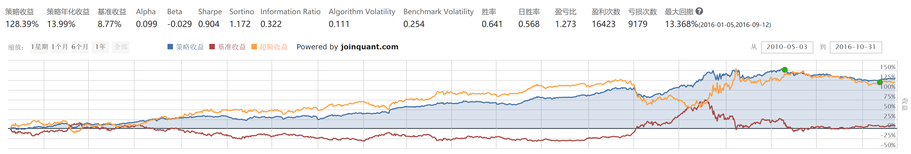

可以看出从 10年5月 到 16年11月这一阶段，不做 Alpha 对冲可得的收益为 278%，但回撤较大，有 40%。做过对冲之后的结果如下：

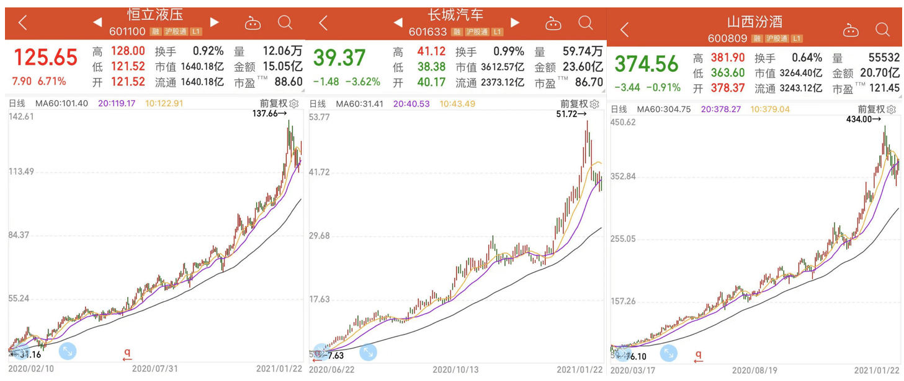

可以发现后者放弃了很多的收益，但做过对冲后系统性风险基本为零，并且回撤回测明显减小，仅为 13%，而且完全没有受到股灾的影响。

### 4.4 结语

股指期货的规则和对冲的细节实际上比较复杂。比如说当指数发生变化之后，仓位里股票和股指期货空单就会分别发生一涨一跌的情况，对冲比例发生变化，应该及时调整仓位。又比如说任何时间点都有四个不同交割日期的沪深300期货合约，它们有着不同程度的折价或溢价，选择不同的日期的合约会带来一些差异。本文中没有考虑太多的细节，但这些都是值得考虑的，所以还有很大的提升空间。

### 4.5 策略源码

```python linenums="1"
import statsmodels.api as sm
from statsmodels import regression
import numpy as np
import pandas as pd
import time 
from datetime import date
from jqdata import *
import datetime
from dateutil.relativedelta import relativedelta
'''
================================================================================
总体回测前
================================================================================
'''

#总体回测前要做的事情
def initialize(context):
    set_params()        #1设置策参数
    set_variables()     #2设置中间变量
    set_backtest()      #3设置回测条件
    set_subportfolios([SubPortfolioConfig(cash=context.portfolio.starting_cash*(1/1.3) ,type='stock'),SubPortfolioConfig(cash=context.portfolio.starting_cash*0.3/1.3,type='index_futures')])
    

#1
#设置策参数
def set_params():
    g.tc=20      #调仓频率
    g.yb=63      # 样本长度
    g.percentile=0.03 #设置选股的百分比
    g.pre_future=''#用来装上次进入的期货合约名字

#2
#设置中间变量
def set_variables():
    g.t = 0 #运行天数
    g.in_position_stocks = [] #持仓股票
    
#3
#设置回测条件
def set_backtest():
    set_option('use_real_price', True) #用真实价格交易
    log.set_level('order', 'error')
    set_slippage(FixedSlippage(0))     #将滑点设置为0

'''
================================================================================
每天开盘前
================================================================================
'''
#每天开盘前要做的事情
def before_trading_start(context):
    set_slip_fee(context)
    g.all_stocks = set_feasible_stocks(get_all_securities(['stock']).index,g.yb,context)

#4 根据不同的时间段设置滑点与手续费
def set_slip_fee(context):
    # 将滑点设置为0
    set_slippage(FixedSlippage(0)) 
    # 根据不同的时间段设置手续费
    dt=context.current_dt
    log.info(type(context.current_dt))
    
    if dt>datetime.datetime(2013,1, 1):
        set_commission(PerTrade(buy_cost=0.0003, sell_cost=0.0013, min_cost=5)) 
        
    elif dt>datetime.datetime(2011,1, 1):
        set_commission(PerTrade(buy_cost=0.001, sell_cost=0.002, min_cost=5))
            
    elif dt>datetime.datetime(2009,1, 1):
        set_commission(PerTrade(buy_cost=0.002, sell_cost=0.003, min_cost=5))
                
    else:
        set_commission(PerTrade(buy_cost=0.003, sell_cost=0.004, min_cost=5))
    
    # 设置期货合约保证金
    if dt>datetime.datetime(2015,9,7):
        g.futures_margin_rate = 0.2 
    else:
        g.futures_margin_rate = 0.1 
    set_option('futures_margin_rate', g.futures_margin_rate)

#5
# 设置可行股票池：
# 过滤掉当日停牌的股票,且筛选出前days天未停牌股票，这里我们设置为一个季度
# 输入：stock_list-list类型,样本天数days-int类型，context（见API）
# 输出：颗星股票池-list类型
def set_feasible_stocks(stock_list,days,context):
    # 得到是否停牌信息的dataframe，停牌的1，未停牌得0
    suspened_info_df = get_price(list(stock_list), start_date=context.current_dt, end_date=context.current_dt, frequency='daily', fields='paused')['paused'].T
    # 过滤停牌股票 返回dataframe
    unsuspened_index = suspened_info_df.iloc[:,0]<1
    # 得到当日未停牌股票的代码list:
    unsuspened_stocks = suspened_info_df[unsuspened_index].index
    # 进一步，筛选出前days天未曾停牌的股票list:
    feasible_stocks=[]
    current_data=get_current_data()
    for stock in unsuspened_stocks:
        if sum(attribute_history(stock, days, unit='1d',fields=('paused'),skip_paused=False))[0]==0:
            feasible_stocks.append(stock)
    return feasible_stocks


'''
================================================================================
每天交易时
================================================================================
'''
#每个交易日需要运行的函数
def handle_data(context, data):
    # 计算持仓股票
    g.in_position_stocks = compute_signals(context)
    # 计算对冲比例和 beta
    hedge_ratio, beta = compute_hedge_ratio(context, g.in_position_stocks)
    # 调仓
    rebalance(hedge_ratio, beta, context)
    # 天数加一
    g.t += 1

# 6
# 计算持仓股票
# 输出一 list 股票
def compute_signals(context):
    # 如果是调仓日
    if g.t%g.tc==0:
        # 获取所有股票的财务数据总负债和总资产
        q = query(balance.code, balance.total_liability, balance.total_assets).filter(balance.code.in_(g.all_stocks))
        data = get_fundamentals(q)
        # 计算资产负债比
        data['ALR'] = data['total_liability']/data['total_assets']
        # 资产负债比从大到小排列
        try:
            data = data.sort('ALR', ascending=False)
        except AttributeError:
            data = data.sort_values('ALR', ascending=False)
        # 输出最靠前的 3%
        return list(data.code)[:int(float(len(g.all_stocks))*g.percentile)]
    # 如果不是调仓日
    else:
        # 延续旧的持仓股票
        return g.in_position_stocks

# 7 
# 计算对冲比例
# 输出两个 float
def compute_hedge_ratio(context, in_position_stocks):
    # 取股票在样本时间内的价格
    prices = history(g.yb, '1d', 'close', in_position_stocks)
    # 取指数在样本时间内的价格
    index_prices = list(attribute_history('000300.XSHG', g.yb, '1d', 'close').close)
    # 计算股票在样本时间内的日收益率
    rets = [(prices.iloc[i+1,:]-prices.iloc[i,:])/prices.iloc[i,:] for i in range(g.yb-1)]
    # 计算日收益率平均
    mean_rets = [np.mean(x) for x in rets]
    # 计算指数的日收益率
    index_rets = [(y-x)/x for (x,y) in zip(index_prices[:-1],index_prices[1:])]
    # 计算组合和指数的协方差矩阵
    cov_mat = np.cov(mean_rets, index_rets)
    # 计算组合的系统性风险
    beta = cov_mat[0,1]/cov_mat[1,1]
    # 计算并返回对冲比例
    return 1+beta*g.futures_margin_rate+beta/5, beta
    
# 8
# 调仓函数
# 输入对冲比例
def rebalance(hedge_ratio, beta, context):
    # 计算资产总价值
    total_value = context.portfolio.total_value
    # 计算预期的股票账户价值
    expected_stock_value = total_value/hedge_ratio
    
    # 将两个账户的钱调到预期的水平
    transfer_cash(1, 0, min(context.subportfolios[1].transferable_cash, max(0, expected_stock_value-context.subportfolios[0].total_value)))
    transfer_cash(0, 1, min(context.subportfolios[0].transferable_cash, max(0, context.subportfolios[0].total_value-expected_stock_value)))

    # 计算股票账户价值（预期价值和实际价值其中更小的那个）
    stock_value = min(context.subportfolios[0].total_value, expected_stock_value)
    # 计算相应的期货保证金价值
    futures_margin = stock_value * beta * g.futures_margin_rate
    
    # 调整股票仓位，在 g.in_position_stocks 里的等权分配
    for stock in context.subportfolios[0].long_positions.keys():
        if stock not in g.in_position_stocks:
            order_target(stock,0,pindex=0)  
    for stock in g.in_position_stocks:
        order_target_value(stock, stock_value/len(g.in_position_stocks), pindex=0)
    for stock in g.in_position_stocks:
        order_target_value(stock, stock_value/len(g.in_position_stocks), pindex=0)
    
    # 获取下月连续合约 string
    current_future = get_next_month_future(context,'IF')
    # 如果下月合约和原本持仓的期货不一样
    if g.pre_future!='' and g.pre_future!=current_future:
        # 就把仓位里的期货平仓
        order_target(g.pre_future, 0, side='short', pindex=1)
    # 现有期货合约改为刚计算出来的
    g.pre_future = current_future
    # 获取沪深300价格
    index_price = attribute_history('000300.XSHG',1, '1d', 'close').close.iloc[0]
    # 计算并调整需要的空单仓位
    order_target(current_future, int(futures_margin/(index_price*300*g.futures_margin_rate)), side='short', pindex=1)

# 9
# 取下月连续string
# 输入 context 和一个 string，后者是'IF'或'IC'或'IH'
# 输出一 string，如 'IF1509.CCFX'
def get_next_month_future(context, symbol):
    dt = context.current_dt
    month_begin_day = datetime.date(dt.year, dt.month, 1).isoweekday()
    third_friday_date = 20-month_begin_day + 7*(month_begin_day>5)
    # 如果没过第三个星期五或者第三个星期五（包括）至昨日的所有天都停盘
    if dt.day<=third_friday_date or (dt.day>third_friday_date and not any([datetime.date(dt.year, dt.month, third_friday_date+i) in get_all_trade_days() for i in range(dt.day-third_friday_date)])):
        year = str(dt.year+(dt.month)//12)[2:]
        month = str(dt.month%12+1)
    else:
        next_dt = dt + relativedelta(months=2)
        year = str(dt.year+(dt.month)//12)[2:]
        month = str((dt.month)%12+1)
    if len(month)==1:
        month = '0'+month
    return(symbol+year+month+'.CCFX')
    

    


'''
================================================================================
每天收盘后
================================================================================
'''
# 每日收盘后要做的事情（本策略中不需要）
def after_trading_end(context):
    return
```

## 5. 涨停回调短线策略

思路其实很简单，就是找短线强势股：

- **买入条件**：上上一日涨停，上一日未涨停，今日 9:35 分时涨 5% 以上
- **卖出条件**：每日 14:55 检查下当前涨幅是否小于 0，如果小于 0 就卖出。
- **仓位管理**：把资金等分 5 份，发现一只符合条件的股票就买入一份。

目前这个策略是没择时的，每个交易日都会无脑买入符合条件的股票。但做短线有经验的股民应该知道，做短线择时是非常重要的，如果给这个策略配上择时，我估计效果会更好，**择时指标最好用市场情绪，涨停温度计这种**。

虽然收益还是一般，但目前来看，这个已经是众多短线策略里，相对比较靠谱的了。

```python linenums="1" title="策略源码"
from jqdata import *

def filter_paused_stock(stock_list):
    current_data = get_current_data()
    return [stock for stock in stock_list if not current_data[stock].paused]
    
def delisted_filter(security_list):
    current_data = get_current_data()
    security_list = [stock for stock in security_list if not '退' in current_data[stock].name]
    return security_list

def st_filter(security_list):
    current_data = get_current_data()
    security_list = [stock for stock in security_list if not current_data[stock].is_st]
    return security_list

# 过滤新股
def delect_stop(stocks,begin_date,n=30*4):
    stock_list = list()
    begin_date = datetime.datetime.strptime(begin_date,"%Y-%m-%d")
    for stock in stocks:
        start_date = get_security_info(stock).start_date
        if start_date < (begin_date - datetime.timedelta(days=n)).date():
            stock_list.append(stock)

    return stock_list
    
# 筛选涨停股票
def high_limit_filter(stocks):
    ret = []
    g.info = {}

    cd = get_current_data()

    for stock in stocks:
        h = attribute_history(stock, 4, unit = '1d', fields = ('close', 'high_limit', 'high', 'open'), skip_paused = True)
      
        
        if  h.close[-2] == h.high_limit[-2] and  not (h.close[-1] - h.close[-2]) / h.close[-2] > 0.095:
            ret.append(stock)
            timerange = 240
            item1history = attribute_history(stock,unit='1m',fields=['money','volume'],count=timerange)
            g.info[stock]=max(item1history['volume'])
    return ret
    
    
def get_fullist(context):
    stocks = get_index_stocks('000002.XSHG') + get_index_stocks('399106.XSHE')
    stocks = [stock for stock in stocks if not stock.startswith('300')]
    return list(stocks)

# 初始化函数，设定基准等等
def initialize(context):
    g.stocks = get_fullist(context)
    g.stock = None
    g.last_price = 0.00
    # 设定沪深300作为基准
    set_benchmark('000300.XSHG')
    # 开启动态复权模式(真实价格)
    set_option('use_real_price', True)
    # 输出内容到日志 log.info()
    log.info('初始函数开始运行且全局只运行一次')
    # 过滤掉order系列API产生的比error级别低的log
    # log.set_level('order', 'error')

    ### 股票相关设定 ###
    # 股票类每笔交易时的手续费是：买入时佣金万分之三，卖出时佣金万分之三加千分之一印花税, 每笔交易佣金最低扣5块钱
    set_order_cost(OrderCost(close_tax=0.001, open_commission=0.0003, close_commission=0.0003, min_commission=5), type='stock')

    ## 运行函数（reference_security为运行时间的参考标的；传入的标的只做种类区分，因此传入'000300.XSHG'或'510300.XSHG'是一样的）
      # 开盘前运行
    run_daily(before_market_open, time='before_open', reference_security='000300.XSHG')
      # 开盘时运行
    run_daily(market_sell, time='14:55', reference_security='000300.XSHG')
    run_daily(market_buy, time='09:35', reference_security='000300.XSHG')
    #run_daily(before_market_close, time='14:45', reference_security='000300.XSHG')
      # 收盘后运行
    run_daily(after_market_close, time='after_close', reference_security='000300.XSHG')

def handle_data(context, data):
    return

## 开盘前运行函数
def before_market_open(context):
    # 输出运行时间
    log.info('函数运行时间(before_market_open)：'+str(context.current_dt.time()))

    # 给微信发送消息（添加模拟交易，并绑定微信生效）
    # send_message('美好的一天~')
    g.stocks = get_fullist(context)
    g.stocks = filter_paused_stock(g.stocks)
    g.stocks = delisted_filter(g.stocks)
    g.stocks = st_filter(g.stocks)
    g.stocks = delect_stop(g.stocks,context.current_dt.strftime("%Y-%m-%d"))
    g.stocks = high_limit_filter(g.stocks)
    
    print(g.stocks)
    g.selllist = list(context.portfolio.positions)

def market_sell(context):
    current_data = get_current_data()
    for stock in context.portfolio.positions.keys():
        h = attribute_history(stock, 1, unit = '1d', fields = ('close'), skip_paused = True)
        last_close = h.close[0]
        current_price = current_data[stock].last_price
        cost = context.portfolio.positions[stock].avg_cost
        profit = (current_price - cost) / cost
        change = (current_price - last_close) / last_close
        init_time = context.portfolio.positions[stock].init_time
        # 低开直接卖出
        if change <= 0.00:
            order_target(stock, 0)
            
        
## 开盘时运行函数
def market_buy(context):
    current_data = get_current_data()
    cash = context.portfolio.total_value
    log.info('函数运行时间(market_open):'+str(context.current_dt.time()))
    temp = {}
    print(g.stocks)
    for stock in g.stocks:
        h = attribute_history(stock, 1, unit = '1d', fields = ('close','open'), skip_paused = True)
        last_close = h.close[0]
        current_price = current_data[stock].last_price
        change = (current_price - last_close) / last_close
           #  if (current_data[stock].day_open <= last_close):
        #     print("底开过滤" + stock)
        #     continue
        
        if change >= 0.05 and current_price < current_data[stock].high_limit:
            # temp[change] = stock
            # m1history = attribute_history(stock,unit='1m',fields=['close', 'open', 'money','volume'],count=5)
            # # print(stock + ":1分钟量能ok"+ str(max(m1history['volume'])) + " maxmxaVol:" + str(g.info[stock]) + ":price" +  str(current_price))
            # #5分钟涨幅大于2%
            # if max((m1history['close'] - m1history['open']) / m1history['open'])  <= 0.018:
            #     # print(stock + "量够了，但是涨幅不够"+ str(m1history['open'][0]))
            #     continue
            # if (current_price - current_data[stock].day_open)/ current_data[stock].day_open < 0.01:
            # # if current_price < current_data[stock].day_open:
            #     print("向下" + stock)
            #     continue
           
            temp[change] = stock
            
    temp = [temp[change] for change in sorted(temp.keys(), reverse = True)]
    for stock in temp:
         
        order_value(stock, cash / 5)

def before_market_close(context):
    current_data = get_current_data()
    log.info('函数运行时间(market_open):'+str(context.current_dt.time()))
    

## 收盘后运行函数
def after_market_close(context):
    log.info(str('函数运行时间(after_market_close):'+str(context.current_dt.time())))
    #得到当天所有成交记录
    trades = get_trades()
    for _trade in trades.values():
        log.info('成交记录：'+str(_trade))
    log.info('一天结束')
    log.info('##############################################################')
```

## 6. 净利润断层策略

- **股票池**：消费、医药、电子、通信行业。
- **选股逻辑**：业绩预告、快报、财报的业绩超预期。且公布后的一天高开3%以上，并且当日收阳线。这个超预期其实应该是超过分析师预期，但爬取分析师预期还有点难度，所以我把超预期这个指标，替换成了业绩增长大于20%。
- **买入逻辑**：在次日早上 9:30 买入。
- **卖出逻辑**：持有大于180天，个股盈利大于120%，个股跌幅20%。满足任意一个条件就卖出
- **持仓数**：5只

本质上，净利润断层策略是基本面与技术面共振双击下的选股模式，具有较强的选股逻辑和较高的可实操性。

这个策略我做了很多研究，其实更适合主观使用，首先超预期其实是需要主观去判断有没有超预期，其次主观可以筛选出更优秀的股票，卖点也比较灵活。

还有，其实如果一个票能连续触发净利润断层，那效果绝对是极佳的，比如沪电股份，之前几乎在每一次业绩披露后都跳空高开，一路从3块涨到30块。

```python linenums="1" title="策略源码"
from kuanke.wizard import *
from jqdata import *
import numpy as np
import pandas as pd
import talib
import datetime
import time
import math

from jqdata import *
from jqdata import jy
import pandas as pd
from jqdata import finance 

## 初始化函数，设定要操作的股票、基准等等
def initialize(context):
    # 设定基准
    set_benchmark('000300.XSHG')
    # 设定滑点
    set_slippage(FixedSlippage(0.02))
    # True为开启动态复权模式，使用真实价格交易
    set_option('use_real_price', True)
    # 设定成交量比例
    set_option('order_volume_ratio', 1)
    # 股票类交易手续费是：买入时佣金万分之三，卖出时佣金万分之三加千分之一印花税, 每笔交易佣金最低扣5块钱
    set_order_cost(OrderCost(open_tax=0, close_tax=0.001, open_commission=0.0003, close_commission=0.0003, min_commission=5), type='stock')
    #卖出股票列表
    g.sell_stock_list=[]

    g.buy_lists123 = []
    # 个股最大持仓比重
    g.security_max_proportion = 1
    # 选股频率
    g.check_stocks_refresh_rate = 1
    # 买入频率
    g.buy_refresh_rate = 1
    # 卖出频率
    g.sell_refresh_rate = 1
    # 最大建仓数量
    g.max_hold_stocknum = 5
    cur_time = context.current_dt
    # 选股频率计数器
    g.check_stocks_days = 0

    g.days = 0
    # 买卖交易频率计数器
    g.buy_trade_days=0
    g.sell_trade_days=0
    # 获取未卖出的股票
    g.open_sell_securities = []
    # 卖出股票的dict
    g.selled_security_list={}

    #涨停
    g.check_out_lists1=[]
    g.check_out_lists2=[]

    g.ZT =[]
    #风险参考基准
    g.security = '000300.XSHG'


    check_stocks_initialize()
    # 股票筛选排序初始化函数
    check_stocks_sort_initialize()
    # 出场初始化函数
    sell_initialize()
    # 入场初始化函数
    buy_initialize()


    # 关闭提示
    log.set_level('order', 'info')

    # 运行函数
    run_daily(check_stocks, '9:15') #选股
    run_daily(day_open_filter123, '9:16') #买入卖出列表
    run_daily(sell_every_day,'open') #卖出未卖出成功的股票
    run_daily(trade, 'open') #交易
    run_daily(selled_security_list_count, 'after_close') #卖出股票日期计数


## 股票筛选初始化函数
def check_stocks_initialize():
    # 是否过滤停盘
    g.filter_paused = True
    # 是否过滤退市
    g.filter_delisted = True
    # 是否只有ST
    g.only_st = False
    # 是否过滤ST
    g.filter_st = True
    # 股票池
    g.security_universe_index = ['all_a_securities']
    g.security_universe_user_securities = []
    # 行业列表
    g.industry_list = ["801080","801120","801150","801770"]
    # 概念列表
    g.concept_list = []
    g.blacklist= ['300601.XSHE']

## 股票筛选排序初始化函数
def check_stocks_sort_initialize():
    # 总排序准则： desc-降序、asc-升序
    g.check_out_lists_ascending = 'desc'

## 出场初始化函数
def sell_initialize():
    # 设定是否卖出buy_lists中的股票
    g.sell_will_buy = True

    # 固定出仓的数量或者百分比
    g.sell_by_amount = None
    g.sell_by_percent = None

## 入场初始化函数
def buy_initialize():
    # 是否可重复买入
    g.filter_holded = False

    # 委托类型
    g.order_style_str = 'by_cap_mean'
    g.order_style_value = 100

## 卖出未卖出成功的股票
def sell_every_day(context):
    g.open_sell_securities = list(set(g.open_sell_securities))
    open_sell_securities = [s for s in context.portfolio.positions.keys() if s in g.open_sell_securities]
    if len(open_sell_securities)>0:
        for stock in open_sell_securities:
            order_target_value(stock, 0)
    g.open_sell_securities = [s for s in g.open_sell_securities if s in context.portfolio.positions.keys()]
    return

## 股票筛选
def check_stocks(context):
    if g.check_stocks_days%g.check_stocks_refresh_rate != 0:
        # 计数器加一
        g.check_stocks_days += 1
        return
    # 股票池赋值
    g.check_out_lists = get_security_universe(context, g.security_universe_index, g.security_universe_user_securities)
    # 行业过滤
    g.check_out_lists = industry_filter(context, g.check_out_lists, g.industry_list)
    # 概念过滤
    g.check_out_lists = concept_filter(context, g.check_out_lists, g.concept_list)
    # 过滤ST股票
    g.check_out_lists = st_filter(context, g.check_out_lists)
    # 过滤停牌股票
    g.check_out_lists = paused_filter(context, g.check_out_lists)
    # 过滤退市股票
    g.check_out_lists = delisted_filter(context, g.check_out_lists)
    g.check_out_lists1=[]
    g.check_out_lists2=[]
    g.check_out_lists1= g.check_out_lists
    g.check_out_lists2= g.check_out_lists

    # 计数器归一
    g.check_stocks_days = 1
    return

## 交易函数
def trade(context):
   # 初始化买入列表
    buy_lists = []

    # 买入股票筛选
    if g.buy_trade_days%g.buy_refresh_rate == 0:
        # 获取 buy_lists 列表
        buy_lists = g.buy_lists123
        # 过滤ST股票
        buy_lists = st_filter(context, buy_lists)
        # 过滤停牌股票
        buy_lists = paused_filter(context, buy_lists)
        # 过滤退市股票
        buy_lists = delisted_filter(context, buy_lists)
        # 过滤涨停股票
        g.ZT = high_limit_filter(context, buy_lists)
        print("zhangt1:",g.ZT)

        ### _入场函数筛选-开始 ###

        ### _入场函数筛选-结束 ###
        log.info('购买列表最终',buy_lists)

    # 卖出操作
    if g.sell_trade_days%g.sell_refresh_rate != 0:
        # 计数器加一
        g.sell_trade_days += 1
    else:
        # 卖出股票
        sell(context, buy_lists)
        # 计数器归一
        g.sell_trade_days = 1


    # 买入操作
    if g.buy_trade_days%g.buy_refresh_rate != 0:
        # 计数器加一
        g.buy_trade_days += 1
    else:
        # 卖出股票
        buy(context, buy_lists)
        # 计数器归一
        g.buy_trade_days = 1

## 卖出股票日期计数
def selled_security_list_count(context):
    #g.daily_risk_management = True
    if len(g.selled_security_list)>0:
        for stock in g.selled_security_list.keys():
            g.selled_security_list[stock] += 1

##################################  选股函数群 ##################################

## 财务指标筛选函数
def financial_statements_filter(context, security_list):
    ### _财务指标筛选函数-开始 ###
    security_list = financial_data_filter_dayu(security_list, indicator.roe, 4)
    ### _财务指标筛选函数-结束 ###

    # 返回列表
    return security_list

## 行情筛选函数
def situation_filter(context, security_list):
    ### _行情筛选函数-开始 ###
    ### _行情筛选函数-结束 ###

    # 返回列表
    return security_list

## 技术指标筛选函数
def technical_indicators_filter(context, security_list):
    ### _技术指标筛选函数-开始 ###
    ### _技术指标筛选函数-结束 ###

    # 返回列表
    return security_list

## 形态指标筛选函数
def pattern_recognition_filter(context, security_list):
    ### _形态指标筛选函数-开始 ###
    ### _形态指标筛选函数-结束 ###

    # 返回列表
    return security_list

## 其他方式筛选函数
def other_func_filter(context, security_list):
    ### _其他方式筛选函数-开始 ###

    ### _其他方式筛选函数-结束 ###
    #log.info('筛选出来的股票',security_list)
    # 返回列表
    return security_list

# 获取选股排序的 input_dict
def get_check_stocks_sort_input_dict():
    input_dict = {
        indicator.roe:('desc',100),
        }
    # 返回结果
    return input_dict

##################################  交易函数群 ##################################
# 交易函数 - 出场
def sell(context, buy_lists):
    # 获取 sell_lists 列表
    init_sl = context.portfolio.positions.keys()
    sell_lists = context.portfolio.positions.keys()

    # 判断是否卖出buy_lists中的股票
    if not g.sell_will_buy:
        sell_lists = [security for security in sell_lists if security not in buy_lists]

    ### _出场函数筛选-开始 ###
    sell_lists = g.sell_stock_list
    ### _出场函数筛选-结束 ###

    # 卖出股票
    if len(sell_lists)>0:
        for stock in sell_lists:
            sell_by_amount_or_percent_or_none(context,stock, g.sell_by_amount, g.sell_by_percent, g.open_sell_securities)

    # 获取卖出的股票, 并加入到 g.selled_security_list中
    selled_security_list_dict(context,init_sl)

    return

# 交易函数 - 入场
def buy(context, buy_lists):

    # 判断是否可重复买入
    buy_lists = holded_filter(context,buy_lists)

    # 获取最终的 buy_lists 列表
    Num = g.max_hold_stocknum - len(context.portfolio.positions)
    buy_lists = buy_lists[:Num]

    # 买入股票
    if len(buy_lists)>0:
        # 分配资金
        result = order_style(context,buy_lists,g.max_hold_stocknum, g.order_style_str, g.order_style_value)
        for stock in buy_lists:
            if len(context.portfolio.positions) < g.max_hold_stocknum:
                # 获取资金
                Cash = result[stock]
                # 判断个股最大持仓比重
                value = judge_security_max_proportion(context,stock,Cash,g.security_max_proportion)
                # 判断单只最大买入股数或金额
                amount = max_buy_value_or_amount(stock,value,None,None)
                # 下单
                order(stock, amount, MarketOrderStyle())
    return

###################################  公用函数群 ##################################
## 排序
def check_stocks_sort(context,security_list,input_dict,ascending='desc'):
    if (len(security_list) == 0) or (len(input_dict) == 0):
        return security_list
    else:
        # 生成 key 的 list
        idk = list(input_dict.keys())
        # 生成矩阵
        a = pd.DataFrame()
        for i in idk:
            b = get_sort_dataframe(security_list, i, input_dict[i])
            a = pd.concat([a,b],axis = 1)
        # 生成 score 列
        a['score'] = a.sum(1,False)
        # 根据 score 排序
        if ascending == 'asc':# 升序
            if hasattr(a, 'sort'):
                a = a.sort(['score'],ascending = True)
            else:
                a = a.sort_values(['score'],ascending = True)
        elif ascending == 'desc':# 降序
            if hasattr(a, 'sort'):
                a = a.sort(['score'],ascending = False)
            else:
                a = a.sort_values(['score'],ascending = False)
        # 返回结果
        return list(a.index)

## 过滤同一标的继上次卖出N天不再买入
def filter_n_tradeday_not_buy(security, n=0):
    try:
        if (security in g.selled_security_list.keys()) and (g.selled_security_list[security]<n):
            return False
        return True
    except:
        return True

## 是否可重复买入
def holded_filter(context,security_list):
    if not g.filter_holded:
        security_list = [stock for stock in security_list if stock not in context.portfolio.positions.keys()]
    # 返回结果
    return security_list

## 卖出股票加入dict
def selled_security_list_dict(context,security_list):
    selled_sl = [s for s in security_list if s not in context.portfolio.positions.keys()]
    if len(selled_sl)>0:
        for stock in selled_sl:
            g.selled_security_list[stock] = 0

## 过滤停牌股票
def paused_filter(context, security_list):
    if g.filter_paused:
        current_data = get_current_data()
        security_list = [stock for stock in security_list if not current_data[stock].paused]
    # 返回结果
    return security_list

## 过滤退市股票
def delisted_filter(context, security_list):
    if g.filter_delisted:
        current_data = get_current_data()
        security_list = [stock for stock in security_list if not (('退' in current_data[stock].name) or ('*' in current_data[stock].name))]
    # 返回结果
    return security_list


## 过滤ST股票
def st_filter(context, security_list):
    if g.only_st:
        current_data = get_current_data()
        security_list = [stock for stock in security_list if current_data[stock].is_st]
    else:
        if g.filter_st:
            current_data = get_current_data()
            security_list = [stock for stock in security_list if not current_data[stock].is_st]
    # 返回结果
    return security_list

# 过滤涨停股票
def high_limit_filter(context, security_list):
    g.ZT = []
    current_data = get_current_data()
    g.ZT = [stock for stock in security_list if  (current_data[stock].day_open >= current_data[stock].high_limit)]
    # 返回结果
    return g.ZT

# 获取股票股票池
def get_security_universe(context, security_universe_index, security_universe_user_securities):
    temp_index = []
    for s in security_universe_index:
        if s == 'all_a_securities':
            temp_index += list(get_all_securities(['stock'], context.current_dt.date()).index)
        else:
            temp_index += get_index_stocks(s)
    for x in security_universe_user_securities:
        temp_index += x
    return  sorted(list(set(temp_index)))

# 行业过滤
def industry_filter(context, security_list, industry_list):
    if len(industry_list) == 0:
        # 返回股票列表
        return security_list
    else:
        securities = []
        for s in industry_list:
            temp_securities = get_industry_stocks(s)
            securities += temp_securities
        security_list = [stock for stock in security_list if stock in securities]
        # 返回股票列表
        return security_list

# 概念过滤
def concept_filter(context, security_list, concept_list):
    if len(concept_list) == 0:
        return security_list
    else:
        securities = []
        for s in concept_list:
            temp_securities = get_concept_stocks(s)
            securities += temp_securities
        security_list = [stock for stock in security_list if stock in securities]
        # 返回股票列表
        return security_list
#自定义函数
def day_open_filter123(context):
    #g.sell_stock_list=[]
    #g.buy_lists123 = []
    if g.days % g.check_stocks_refresh_rate != 0:
        g.days +=1
        return
    list1 = K_yeji(context)
    list2 = Y_yeji(context)
    list3 = R_yeji(context)
    list4 = g.ZT
    print("zhangt2:",list4)
    list_all = list1+list2+list3
    list_fin = list(set(list_all))
    list_fin = [s for s in list_fin if s not in g.blacklist]
    #print(list_fin)
    buylistnew = []
    ZF=[]
    for stock in list_fin:
        df = attribute_history(stock, 2, '1d', ['open','close'])

        prepreday_close_price = df['close'].tolist()
        prepreday_close_price = prepreday_close_price[0]
        preday_open_price = df['open'].tolist()
        preday_open_price = preday_open_price[1]

        preday_close_price = df['close'].tolist()
        preday_close_price = preday_close_price[1]


        open_ZF = (preday_open_price-prepreday_close_price)/prepreday_close_price
        close_ZF1 = (preday_close_price-preday_open_price)/preday_open_price

        close_ZF2 =(preday_close_price-prepreday_close_price)/prepreday_close_price

        if open_ZF > 0.03 and close_ZF1 >=0:

            buylistnew.append(stock)
            ZF.append(close_ZF1)
    p = {'code':buylistnew,'ZF':ZF}
    
    df_ZF = pd.DataFrame(p)
    df_ZF.set_index(['code'],inplace=True)
    factor = df_ZF.sort_index(by = 'ZF',ascending=False) 

    stockset = list(factor.index)
    if len(g.ZT):
        
        stockset = g.ZT+stockset
        
    g.sell_stock_list=[]
    g.buy_lists123 = []
    g.sell_stock_list1 = list(context.portfolio.positions.keys())
    now =context.current_dt
    for stock in g.sell_stock_list1:
        o =[]
        delta =now - context.portfolio.positions[stock].init_time
        days = delta.days
        cost = context.portfolio.positions[stock].avg_cost
        price = context.portfolio.positions[stock].price
        
        ZQ = (price-cost)/cost 
        
        if days >=180:
            g.sell_stock_list.append(stock)
        elif ZQ >=1.2:
            g.sell_stock_list.append(stock)
        
        elif ZQ <= -0.2:
            g.sell_stock_list.append(stock)
        #elif days >=90:
        #    g.sell_stock_list.append(stock)
                
    
    for stock in stockset[:g.max_hold_stocknum]:
        if stock in g.sell_stock_list:
            pass
        else:
            g.buy_lists123.append(stock) 

    log.info('卖出列表:',g.sell_stock_list)
    log.info('购买列表:',g.buy_lists123)
    g.days =1
    return g.sell_stock_list,g.buy_lists123
    
def K_yeji(context):
#获取业绩快报    
    preday1 = context.previous_date
    preday=preday1.strftime('%Y-%m-%d')
    print(preday)
    print(preday)
    #preday = preday1.strptime('%Y-%m-%d')
    #print(preday)
    scu_truncate = g.check_out_lists

    for i in range(len(scu_truncate)): 
        scu_truncate[i]=scu_truncate[i][0:6]
    
    
    df3 = jy.run_query(query(
                    jy.SecuMain.CompanyCode,
                    jy.SecuMain.SecuCode,
                ).filter(
                    jy.SecuMain.SecuCode.in_(scu_truncate)
                    ).limit(5000)
                )
    df3.drop_duplicates(subset=['CompanyCode'], keep='last', inplace=True)
    
    
    q =  query(
                jy.LC_FSPerformedLetters.CompanyCode,
                jy.LC_FSPerformedLetters.InfoPublDate,
                jy.LC_FSPerformedLetters.EndDate,
                jy.LC_FSPerformedLetters.NPParentCompanyOwners.label('归母净利润'),#('归母净利润'),
                jy.LC_FSPerformedLetters.NPCOwnersYOY.label('归母净利润同比增长'),#('归母净利润'), 
    
        ).filter(
            jy.LC_FSPerformedLetters.InfoPublDate == preday,
            jy.LC_FSPerformedLetters.CompanyCode.in_(df3['CompanyCode']),
            jy.LC_FSPerformedLetters.NPCOwnersYOY >= 20,
            jy.LC_FSPerformedLetters.NPParentCompanyOwners > 0
        ).limit(5000)
    
    df  = jy.run_query(q)
    
    df.drop_duplicates(subset=['CompanyCode'], keep='last', inplace=True)
    
    df.index =   df['CompanyCode']
    
    df.sort_index(ascending=False)
    
    df2 = jy.run_query(query(
                    jy.SecuMain.CompanyCode,
                    jy.SecuMain.SecuAbbr,
                    jy.SecuMain.SecuCode,
                ).filter(
                    jy.SecuMain.SecuCategory== 1,
                    jy.SecuMain.CompanyCode.in_(df['CompanyCode'])
                    ).limit(5000)
                )
    
    df2 = df2[df2['SecuCode'].isin(scu_truncate)]
    
    df2.drop_duplicates(subset=['CompanyCode'], keep='last', inplace=True)
    
    
    if df2.empty:
        df2.index == 0
    else:
        df2.index = df['CompanyCode']
    
    df.drop([ 'CompanyCode'],axis=1,inplace=True)
    df2.drop([ 'CompanyCode'],axis=1,inplace=True)
    
    codelist = df2['SecuCode'].tolist()
    
    jq_codelist = []
    
    for i in codelist:
        stock_code = normalize_code(i)
        jq_codelist.append(stock_code)
    
    df2['code'] = jq_codelist
    print(jq_codelist)
    k = g.check_out_lists
    g.check_out_lists =[]

    for i in k:
        stock_code = normalize_code(i)
        g.check_out_lists.append(stock_code)
    print(g.check_out_lists)
    return jq_codelist
    
def Y_yeji(context):

    preday = context.previous_date

    
    q=query(
            finance.STK_FIN_FORCAST.code,
            finance.STK_FIN_FORCAST.end_date,
            finance.STK_FIN_FORCAST.pub_date,
            finance.STK_FIN_FORCAST.profit_ratio_min
                ).filter(
                    finance.STK_FIN_FORCAST.pub_date == preday,
                    finance.STK_FIN_FORCAST.profit_ratio_min >= 20,
                    finance.STK_FIN_FORCAST.code.in_(g.check_out_lists)
        ).limit(5000)

    df=finance.run_query(q)

    codelist = df['code'].tolist()
    print(codelist)

    return codelist

def R_yeji(context):
#财报
    preday = context.previous_date
    q = query(valuation.code, income.pubDate,income.statDate,income.np_parent_company_owners, 
                indicator.inc_net_profit_to_shareholders_year_on_year).filter(
        income.pubDate == preday,
        indicator.inc_net_profit_to_shareholders_year_on_year>=20,
        income.np_parent_company_owners > 0,
        valuation.code.in_(g.check_out_lists)) #balance.development_expenditure
    dfR = get_fundamentals(q, date = None)
    codelist = dfR['code'].tolist()
    print(codelist)
    return codelist
```

## 7. 趋势形态策略

最近几个大牛股的形态，比如恒立液压、山西汾酒、隆基股份、长城汽车。我贴一下它们的形态：


你们应该也发现了，基本上就是很平稳的 **45度角上扬**，波动很小，且成交量非常稳定。

总结一下，就是：

1. 股价平稳，且有趋势的上涨
2. 成交量稳定，不会因为股价上涨而出现大放量，或大缩量的情况
3. 每次回调都不会很深
4. 市值相对比较大

基于此，制定量化指标：

1. 市值相对较大，我们就设定为股票池是沪深300，沪深300成分股都是中大型市值票。
2. 每次回调都不会很深，那就拍脑袋定一个，最新价距离最近30日的最高价，回调没超过 8%。
3. 放量稳定，这条我想的一个指标是最近7个交易日的均值，与最近200个交易日（大概1年）相比，交易量不超过 160%
4. 股价平稳，且有趋势的上涨。要量化这一条最难，所以引进了最简单的机器学习函数----线性回归，原理你们很简单，小学生都会，就是Y=aX+b，用股票的历史股价，算出斜率a和截距b，其实还可以算出浮动比例，然后限定a、b和浮动比例在一个范围内。

这个函数的目的很简单，就是让程序识别出，股价是在平稳上涨的。说这么多，可能有些人还不清楚，我画个图，你们大致应该就能理解了。

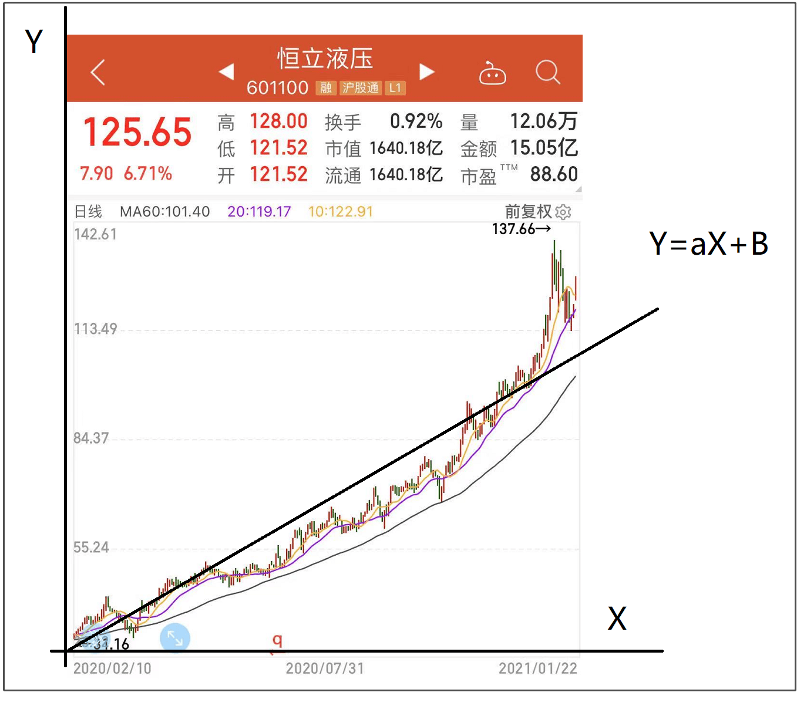

通过以上条件选股后，再通过第 4 条的线性回归函数来计算R方（R方越大，股价趋势越好，拟合度预告）进行排序，R方越大，排名越前面。

选择排名前 5 的票买入，一周选一次股，不符合前 5 就卖出，符合前 5 就继续持有。

2020年1月2日---2021年1月22日的回测结果是这样的：

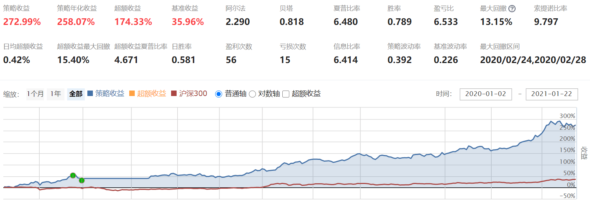

一年时间，收益 272%，最大回撤 13.15%，是不是非常优秀，简直无敌。选中的票也很牛批，都是这些大牛股。

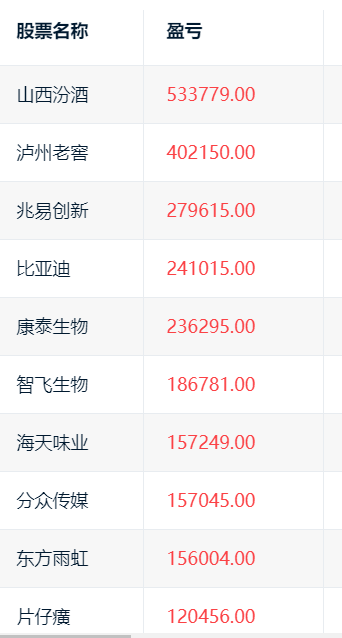

但如果把回测拉长到2017年1月1日---2021年1月22日，收益就比较一般了：

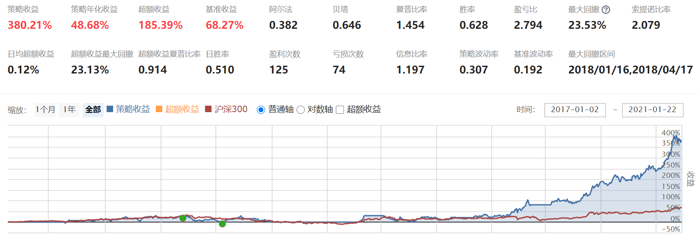

我估计原因是这样形态的票，主要还是出现在最近两年，前几年经常会出现选不到票的情况。但说实话，未来不好说，可能类似的趋势股会越来越多，这个策略也可能会越来越有效。

总之，抛砖引玉吧，仁者见仁，大家保持自己的一份思考。对了，这个策略并非完全原创，去网上找了一些资料，并且也借助了一些其他人的思路

```python linenums="1" title="策略源码"
from jqdata import *
import numpy as np
from scipy.stats import linregress


# 初始化函数，设定要操作的股票、基准等等
def initialize(context):
    # 设定基准
    set_benchmark('000300.XSHG')
    # True为开启动态复权模式，使用真实价格交易
    set_option('use_real_price', True)
    # 关闭提示
    log.set_level('order', 'error')

    # 最大建仓数量
    g.max_hold_stock_nums = 3
    # 选出来的股票
    g.target_lists = []

    # 运行函数
    run_weekly(check_stocks, 1, 'open')  # 选股
    run_weekly(trade, 1, 'open')  # 交易


# 股票筛选
def check_stocks(context):
    # type: (Context) -> None
    current_data = get_current_data()

    # 沪深300成分股
    check_out_lists = get_index_stocks("000300.XSHG", date=context.previous_date)

    # 未停牌、未涨跌停、非科创板
    check_out_lists = [stock for stock in check_out_lists if
                       (not current_data[stock].paused) and
                       (current_data[stock].low_limit < current_data[stock].day_open < current_data[
                           stock].high_limit) and
                       (not stock.startswith('688'))
                       ]

    # 昨收盘价不高于500元/股
    s_close_1 = history(1, '1d', 'close', check_out_lists).iloc[-1]
    check_out_lists = list(s_close_1[s_close_1 <= 500].index)

    # 近30个交易日的最高价 / 昨收盘价 <=1.08, 即HHV(HIGH,30)/C[-1] <= 1.1
    high_max_30 = history(30, '1d', 'high', check_out_lists).max()
    s_fall = high_max_30 / s_close_1
    check_out_lists = list(s_fall[s_fall <= 1.08].index)

    # 近7个交易日的交易量均值 与 近180给交易日的成交量均值 相比，放大不超过1.6倍  MA(VOL,7)/MA(VOL,180) <=1.6
    df_vol = history(180, '1d', 'volume', check_out_lists)
    s_vol_ratio = df_vol.iloc[-7:].mean() / df_vol.mean()
    check_out_lists = list(s_vol_ratio[s_vol_ratio <= 1.6].index)

    # 对近120个交易日的股价进行线性回归：入选条件 slope / intercept > 0.005 and r_value**2 > 0.8
    target_dict = {}
    x = np.arange(120)
    for stock in check_out_lists:
        y = attribute_history(stock, 120, '1d', 'close', df=False)['close']
        print(y)
        slope, intercept, r_value, p_value, std_err = linregress(x, y)
        print(slope)
        if slope / intercept > 0.005 and r_value > 0.9:  #  
            target_dict[stock] = slope # r_value ** 2

    # 入选股票按照R Square 降序排序, 取前N名
    g.target_lists = []
    if target_dict:
        df_score = pd.DataFrame.from_dict(
            target_dict, orient='index', columns=['score', ]
        ).sort_values(
            by='score', ascending=False
        )
        #
        g.target_lists = list(df_score.index[:g.max_hold_stock_nums])


# 交易函数
def trade(context):
    # 获取 buy_lists 列表
    buy_lists = g.target_lists
    # 卖出操作
    for s in context.portfolio.positions:
        if s not in buy_lists:
            _order = order_target_value(s, 0)
            if _order is not None:
                log.info('卖出: %s (%s)' % (get_security_info(s).display_name, s))

    if buy_lists:
        amount = context.portfolio.total_value / len(buy_lists)
        for stock in buy_lists:
            if stock in context.portfolio.positions:
                _order = order_target_value(stock, amount)
                if _order is not None:
                    log.info('调仓: %s (%s)' % (get_security_info(stock).display_name, stock))

        for stock in buy_lists:
            if stock not in context.portfolio.positions:
                _order = order_target_value(stock, amount)
                if _order is not None:
                    log.info('买入: %s (%s)' % (get_security_info(stock).display_name, stock))
```

## 8. 医药股策略

逻辑：

- **股票池**：申万一级行业医药生物。
- **筛选机制**：过滤ST，过滤退市股。
- **选股条件**：PE 在 20-80 倍之间，营收、净利润同比皆增长 20% 以上。并按照ROE从大到小排序，取排名前10的股票。
- **调仓逻辑**：策略用轮动的方式进行买卖，每日触发一次选股条件，在前10名的股票会继续持有，掉出前10名股票就会卖掉

```python linenums="1" title="策略代码"
from kuanke.wizard import *
from jqdata import *
import numpy as np
import pandas as pd
import talib
import datetime

## 初始化函数，设定要操作的股票、基准等等
def initialize(context):
    # 设定基准
    set_benchmark('000300.XSHG')
    # 设定滑点
    set_slippage(FixedSlippage(0.02))
    # True为开启动态复权模式，使用真实价格交易
    set_option('use_real_price', True)
    # 设定成交量比例
    set_option('order_volume_ratio', 1)
    # 股票类交易手续费是：买入时佣金万分之三，卖出时佣金万分之三加千分之一印花税, 每笔交易佣金最低扣5块钱
    set_order_cost(OrderCost(open_tax=0, close_tax=0.001, open_commission=0.0003, close_commission=0.0003, min_commission=5), type='stock')
    # 个股最大持仓比重
    g.security_max_proportion = 1
    # 选股频率
    g.check_stocks_refresh_rate = 1
    # 买入频率
    g.buy_refresh_rate = 1
    # 卖出频率
    g.sell_refresh_rate = 1
    # 最大建仓数量
    g.max_hold_stocknum = 10

    # 选股频率计数器
    g.check_stocks_days = 0
    # 买卖交易频率计数器
    g.buy_trade_days=0
    g.sell_trade_days=0
    # 获取未卖出的股票
    g.open_sell_securities = []
    # 卖出股票的dict
    g.selled_security_list={}

    # 股票筛选初始化函数
    check_stocks_initialize()
    # 股票筛选排序初始化函数
    check_stocks_sort_initialize()
    # 出场初始化函数
    sell_initialize()
    # 入场初始化函数
    buy_initialize()
    # 风控初始化函数
    risk_management_initialize()

    # 关闭提示
    log.set_level('order', 'info')

    # 运行函数
    run_daily(sell_every_day,'open') #卖出未卖出成功的股票
    run_daily(risk_management, 'every_bar') #风险控制
    run_daily(check_stocks, 'open') #选股
    run_daily(trade, 'open') #交易
    run_daily(selled_security_list_count, 'after_close') #卖出股票日期计数


## 股票筛选初始化函数
def check_stocks_initialize():
    # 是否过滤停盘
    g.filter_paused = True
    # 是否过滤退市
    g.filter_delisted = True
    # 是否只有ST
    g.only_st = False
    # 是否过滤ST
    g.filter_st = True
    # 股票池
    g.security_universe_index = ["all_a_securities"]
    g.security_universe_user_securities = []
    # 行业列表
    g.industry_list = ["801150"]
    # 概念列表
    g.concept_list = []

## 股票筛选排序初始化函数
def check_stocks_sort_initialize():
    # 总排序准则： desc-降序、asc-升序
    g.check_out_lists_ascending = 'desc'

## 出场初始化函数
def sell_initialize():
    # 设定是否卖出buy_lists中的股票
    g.sell_will_buy = False

    # 固定出仓的数量或者百分比
    g.sell_by_amount = None
    g.sell_by_percent = None

## 入场初始化函数
def buy_initialize():
    # 是否可重复买入
    g.filter_holded = False

    # 委托类型
    g.order_style_str = 'by_cap_mean'
    g.order_style_value = 100

## 风控初始化函数
def risk_management_initialize():
    # 策略风控信号
    g.risk_management_signal = True

    # 策略当日触发风控清仓信号
    g.daily_risk_management = True

    # 单只最大买入股数或金额
    g.max_buy_value = None
    g.max_buy_amount = None


## 卖出未卖出成功的股票
def sell_every_day(context):
    g.open_sell_securities = list(set(g.open_sell_securities))
    open_sell_securities = [s for s in context.portfolio.positions.keys() if s in g.open_sell_securities]
    if len(open_sell_securities)>0:
        for stock in open_sell_securities:
            order_target_value(stock, 0)
    g.open_sell_securities = [s for s in g.open_sell_securities if s in context.portfolio.positions.keys()]
    return

## 风控
def risk_management(context):
    ### _风控函数筛选-开始 ###
    ### _风控函数筛选-结束 ###
    return

## 股票筛选
def check_stocks(context):
    if g.check_stocks_days%g.check_stocks_refresh_rate != 0:
        # 计数器加一
        g.check_stocks_days += 1
        return
    # 股票池赋值
    g.check_out_lists = get_security_universe(context, g.security_universe_index, g.security_universe_user_securities)
    # 行业过滤
    g.check_out_lists = industry_filter(context, g.check_out_lists, g.industry_list)
    # 概念过滤
    g.check_out_lists = concept_filter(context, g.check_out_lists, g.concept_list)
    # 过滤ST股票
    g.check_out_lists = st_filter(context, g.check_out_lists)
    # 过滤退市股票
    g.check_out_lists = delisted_filter(context, g.check_out_lists)
    # 财务筛选
    g.check_out_lists = financial_statements_filter(context, g.check_out_lists)
    # 行情筛选
    g.check_out_lists = situation_filter(context, g.check_out_lists)
    # 技术指标筛选
    g.check_out_lists = technical_indicators_filter(context, g.check_out_lists)
    # 形态指标筛选函数
    g.check_out_lists = pattern_recognition_filter(context, g.check_out_lists)
    # 其他筛选函数
    g.check_out_lists = other_func_filter(context, g.check_out_lists)

    # 排序
    input_dict = get_check_stocks_sort_input_dict()
    g.check_out_lists = check_stocks_sort(context,g.check_out_lists,input_dict,g.check_out_lists_ascending)

    # 计数器归一
    g.check_stocks_days = 1
    return

## 交易函数
def trade(context):
   # 初始化买入列表
    buy_lists = []

    # 买入股票筛选
    if g.buy_trade_days%g.buy_refresh_rate == 0:
        # 获取 buy_lists 列表
        buy_lists = g.check_out_lists
        # 过滤ST股票
        buy_lists = st_filter(context, buy_lists)
        # 过滤停牌股票
        buy_lists = paused_filter(context, buy_lists)
        # 过滤退市股票
        buy_lists = delisted_filter(context, buy_lists)
        # 过滤涨停股票
        buy_lists = high_limit_filter(context, buy_lists)

        ### _入场函数筛选-开始 ###
        ### _入场函数筛选-结束 ###

    # 卖出操作
    if g.sell_trade_days%g.sell_refresh_rate != 0:
        # 计数器加一
        g.sell_trade_days += 1
    else:
        # 卖出股票
        sell(context, buy_lists)
        # 计数器归一
        g.sell_trade_days = 1


    # 买入操作
    if g.buy_trade_days%g.buy_refresh_rate != 0:
        # 计数器加一
        g.buy_trade_days += 1
    else:
        # 卖出股票
        buy(context, buy_lists)
        # 计数器归一
        g.buy_trade_days = 1

## 卖出股票日期计数
def selled_security_list_count(context):
    g.daily_risk_management = True
    if len(g.selled_security_list)>0:
        for stock in g.selled_security_list.keys():
            g.selled_security_list[stock] += 1

##################################  选股函数群 ##################################

## 财务指标筛选函数
def financial_statements_filter(context, security_list):
    ### _财务指标筛选函数-开始 ###
    security_list = financial_data_filter_qujian(security_list, valuation.pe_ratio, (20,80))
    security_list = financial_data_filter_dayu(security_list, indicator.inc_revenue_year_on_year, 20)
    security_list = financial_data_filter_dayu(security_list, indicator.inc_net_profit_year_on_year, 20)
    ### _财务指标筛选函数-结束 ###

    # 返回列表
    return security_list

## 行情筛选函数
def situation_filter(context, security_list):
    ### _行情筛选函数-开始 ###
    ### _行情筛选函数-结束 ###

    # 返回列表
    return security_list

## 技术指标筛选函数
def technical_indicators_filter(context, security_list):
    ### _技术指标筛选函数-开始 ###
    ### _技术指标筛选函数-结束 ###

    # 返回列表
    return security_list

## 形态指标筛选函数
def pattern_recognition_filter(context, security_list):
    ### _形态指标筛选函数-开始 ###
    ### _形态指标筛选函数-结束 ###

    # 返回列表
    return security_list

## 其他方式筛选函数
def other_func_filter(context, security_list):
    ### _其他方式筛选函数-开始 ###
    ### _其他方式筛选函数-结束 ###

    # 返回列表
    return security_list

# 获取选股排序的 input_dict
def get_check_stocks_sort_input_dict():
    input_dict = {
        indicator.roe:('desc',100),
        }
    # 返回结果
    return input_dict

##################################  交易函数群 ##################################
# 交易函数 - 出场
def sell(context, buy_lists):
    # 获取 sell_lists 列表
    init_sl = context.portfolio.positions.keys()
    sell_lists = context.portfolio.positions.keys()

    # 判断是否卖出buy_lists中的股票
    if not g.sell_will_buy:
        sell_lists = [security for security in sell_lists if security not in buy_lists]

    ### _出场函数筛选-开始 ###
    ### _出场函数筛选-结束 ###

    # 卖出股票
    if len(sell_lists)>0:
        for stock in sell_lists:
            sell_by_amount_or_percent_or_none(context,stock, g.sell_by_amount, g.sell_by_percent, g.open_sell_securities)

    # 获取卖出的股票, 并加入到 g.selled_security_list中
    selled_security_list_dict(context,init_sl)

    return

# 交易函数 - 入场
def buy(context, buy_lists):
    # 风控信号判断
    if not g.risk_management_signal:
        return

    # 判断当日是否触发风控清仓止损
    if not g.daily_risk_management:
        return
    # 判断是否可重复买入
    buy_lists = holded_filter(context,buy_lists)

    # 获取最终的 buy_lists 列表
    Num = g.max_hold_stocknum - len(context.portfolio.positions)
    buy_lists = buy_lists[:Num]

    # 买入股票
    if len(buy_lists)>0:
        # 分配资金
        result = order_style(context,buy_lists,g.max_hold_stocknum, g.order_style_str, g.order_style_value)
        for stock in buy_lists:
            if len(context.portfolio.positions) < g.max_hold_stocknum:
                # 获取资金
                Cash = result[stock]
                # 判断个股最大持仓比重
                value = judge_security_max_proportion(context,stock,Cash,g.security_max_proportion)
                # 判断单只最大买入股数或金额
                amount = max_buy_value_or_amount(stock,value,g.max_buy_value,g.max_buy_amount)
                # 下单
                order(stock, amount, MarketOrderStyle())
    return

###################################  公用函数群 ##################################
## 排序
def check_stocks_sort(context,security_list,input_dict,ascending='desc'):
    if (len(security_list) == 0) or (len(input_dict) == 0):
        return security_list
    else:
        # 生成 key 的 list
        idk = list(input_dict.keys())
        # 生成矩阵
        a = pd.DataFrame()
        for i in idk:
            b = get_sort_dataframe(security_list, i, input_dict[i])
            a = pd.concat([a,b],axis = 1)
        # 生成 score 列
        a['score'] = a.sum(1,False)
        # 根据 score 排序
        if ascending == 'asc':# 升序
            if hasattr(a, 'sort'):
                a = a.sort(['score'],ascending = True)
            else:
                a = a.sort_values(['score'],ascending = True)
        elif ascending == 'desc':# 降序
            if hasattr(a, 'sort'):
                a = a.sort(['score'],ascending = False)
            else:
                a = a.sort_values(['score'],ascending = False)
        # 返回结果
        return list(a.index)

## 过滤同一标的继上次卖出N天不再买入
def filter_n_tradeday_not_buy(security, n=0):
    try:
        if (security in g.selled_security_list.keys()) and (g.selled_security_list[security]<n):
            return False
        return True
    except:
        return True

## 是否可重复买入
def holded_filter(context,security_list):
    if not g.filter_holded:
        security_list = [stock for stock in security_list if stock not in context.portfolio.positions.keys()]
    # 返回结果
    return security_list

## 卖出股票加入dict
def selled_security_list_dict(context,security_list):
    selled_sl = [s for s in security_list if s not in context.portfolio.positions.keys()]
    if len(selled_sl)>0:
        for stock in selled_sl:
            g.selled_security_list[stock] = 0

## 过滤停牌股票
def paused_filter(context, security_list):
    if g.filter_paused:
        current_data = get_current_data()
        security_list = [stock for stock in security_list if not current_data[stock].paused]
    # 返回结果
    return security_list

## 过滤退市股票
def delisted_filter(context, security_list):
    if g.filter_delisted:
        current_data = get_current_data()
        security_list = [stock for stock in security_list if not (('退' in current_data[stock].name) or ('*' in current_data[stock].name))]
    # 返回结果
    return security_list


## 过滤ST股票
def st_filter(context, security_list):
    if g.only_st:
        current_data = get_current_data()
        security_list = [stock for stock in security_list if current_data[stock].is_st]
    else:
        if g.filter_st:
            current_data = get_current_data()
            security_list = [stock for stock in security_list if not current_data[stock].is_st]
    # 返回结果
    return security_list

# 过滤涨停股票
def high_limit_filter(context, security_list):
    current_data = get_current_data()
    security_list = [stock for stock in security_list if not (current_data[stock].day_open >= current_data[stock].high_limit)]
    # 返回结果
    return security_list

# 获取股票股票池
def get_security_universe(context, security_universe_index, security_universe_user_securities):
    temp_index = []
    for s in security_universe_index:
        if s == 'all_a_securities':
            temp_index += list(get_all_securities(['stock'], context.current_dt.date()).index)
        else:
            temp_index += get_index_stocks(s)
    for x in security_universe_user_securities:
        temp_index += x
    return  sorted(list(set(temp_index)))

# 行业过滤
def industry_filter(context, security_list, industry_list):
    if len(industry_list) == 0:
        # 返回股票列表
        return security_list
    else:
        securities = []
        for s in industry_list:
            temp_securities = get_industry_stocks(s)
            securities += temp_securities
        security_list = [stock for stock in security_list if stock in securities]
        # 返回股票列表
        return security_list

# 概念过滤
def concept_filter(context, security_list, concept_list):
    if len(concept_list) == 0:
        return security_list
    else:
        securities = []
        for s in concept_list:
            temp_securities = get_concept_stocks(s)
            securities += temp_securities
        security_list = [stock for stock in security_list if stock in securities]
        # 返回股票列表
        return security_list
```


