# 第七章 实盘交易

有合适的量化策略后，最重要的就是去实盘跟踪，实盘的方法有两种，第一种是根据策略的买卖信号，手动跟踪。第二种是自动交易。

我的建议是用自动交易，手动跟踪很难跟上，时间长了节奏会乱掉，自动交易的好处我就不多说了，主打就是一个省心省力。不过我还是会介绍关于手动跟踪的方法，毕竟每个人的需求不一样，条条大路通罗马，教程的关键点在于把这些“路”都打通，让大家有得选择。

这一章，我会介绍手动跟踪和自动交易的方法：经过十年多的实践，推荐自动交易，支持的策略多，且简单容易上手，可以先开PT，目前国盛PT比较稳定。也可以开国金PT，有一定概率会被风控，如果国金PT不能用了，可以切换为QMT，如果都是开的国金，那么两个方案可以互相平替


| 实盘方式 | 具体实盘形式 | 需要的准备 | 支持券商 | 门槛 | 优点 | 缺点 |
| :--- | :--- | :--- | :--- | :--- | :--- | :--- |
| 手动跟踪 | 聚宽创建实时模拟，通过微信通知手动操作 | 1.只需要开通聚宽实时模拟 | 无限制 | 无 | 简单 | 手动可能跟不上 |
| 自动交易-QMT | 聚宽创建实时模拟，把交易信号传递给券商QMT，通过QMT自动下单 | 1.需要开通聚宽实时模拟<br>2.需要开通券商QMT软件的权限 | 国金 | 国金要10万开权限 | 1.可以实时自动跟着聚宽模拟策略<br>2.只要聚宽支持的策略，都可以实现自动交易 | 流程略复杂，需要有耐心 |
| 自动交易-Ptrade | 聚宽创建实时模拟，把交易信号传递给券商Ptrade，通过Ptrade自动下单 | 1.需要开通聚宽实时模拟<br>2.需要开通券商QMT软件的权限 | 国盛 | 国盛要20万开权限 | 1.可以实时自动跟着聚宽模拟策略<br>2.只要聚宽支持的策略，都可以实现自动交易 | 流程略复杂，需要有耐心 |

上面每一种我都会介绍具体的方法，都是保姆级教程，大家可以根据自己的需要选择其中的一种来操作：

- 经过一年多的实践，推荐自动交易，支持的策略多，且简单容易上手
- 券商支持自动交易的软件有两种，分别叫QMT和PT，我后面会逐一介绍

## 1. 手动跟踪：微信通知(手动跟踪)

这篇主要教大家怎么通过微信接收聚宽的实时交易信号，然后手动跟踪。此方法的预计成本：

1. 最大花费999元一年
2. 最小花费0元

### 1.1 开通聚宽实时模拟

聚宽默认是延时模拟，延时模拟会延时一天交易，比如策略12月14日9点35分买进股票A，但延时模拟会延时到15日的凌晨3点发出交易信号，并且延时模拟不支持微信通知。

所以如果想要微信通知，就要先开通实时模拟权限。

开通实时模拟有两种方式：

1. 购买聚宽的蓝V会员，价格是999元一年，会员会送三个实时模拟的坑位。
2. 通过聚宽的社区的积分，兑换实时模拟坑位。兑换的流程可以看这个帖子：[用积分兑换实时模拟的流程](https://t.zsxq.com/15qQPMp7A)

积分不要钱，但需每天去聚宽签到、看帖子、留言。

开通完实时模拟后，可以在[聚宽模拟交易列表页](https://www.joinquant.com/algorithm/trade/list?process=1)，看到模拟交易的状态，如果显示是“实时进行中”，那就说明实时模拟设置成功了


### 1.2 开通微信通知

只要开通了实时模拟，点击下面这个按钮，开通微信通知开关就可以了，只要按钮的状态显示“ON”，就代表这个策略已经开启微信通知。


### 1.3 如何进行模拟交易？

这个老圈友就不用看了，有些新圈友可能还不清楚进行模拟交易的方法，可以看这个

可以通过以下两种方法进行模拟交易(推荐使用方法一)，创建模拟交易的前提是已经运行了回测，如果没有回测的话，请先创建回测

**方法一：使用回测结果创建**

找到需要创建模拟交易的回测，点击模拟交易，输入参数，点击确定


**方法二：在模拟交易列表中创建**

1. [进入模拟交易列表](https://www.joinquant.com/algorithm/trade/list)
2. 点击新建模拟交易，在跳出的窗口中依次输入交易名称和初始资金，并选择策略及其回测后点击确定。


如果提示没有可用的模拟交易位，请点击模拟交易列表最下面的获取新的模拟交易位，使用积分兑换模拟交易位

## 2. 自动交易Ptrade：聚宽实时模拟，通过ptrade自动下单

本章主要教大家实现聚宽实时模拟，然后通过 ptrade 自动下单。**好处就是： 1.可以实时自动跟单聚宽模拟策略。2.只要聚宽支持的策略，都可以实现自动交易**。

大致的架构可以看下图：

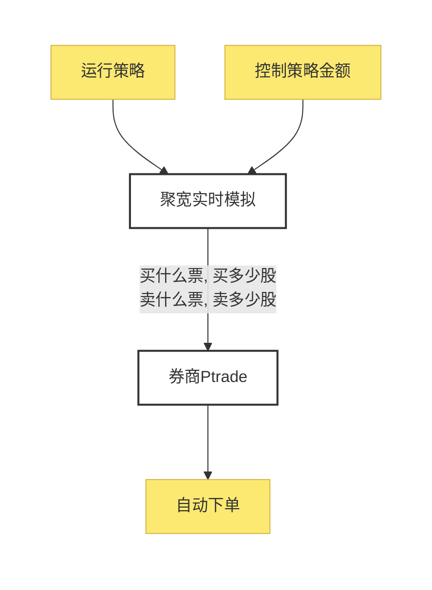

这个方案设置完后，你们就可以把聚宽实时模拟当成以前的一创聚宽了，第一次设置完后，之后都可以忽略 ptrade 的存在，还实现了邮件提醒，ptrade下单成功，或者是报错都会通过邮件告知，不用经常登 ptrade 去查看，可以把ptrade理解成一个隐形的下单工具。

参考资料：聚宽---蒋老师

此方法的预计成本：

1. 最大花费999元一年
2. 最小花费0元

### 2.1 证券开户

支持两种证券，分别是国金和国盛，但目前国金PT会封外网，开了也可能用不了，所以只支持开国盛。

国金证券：ptrade权限的开通门槛10万，手续费是万1。可以联系客户经理直接开户。国盛证券：nb823412

还是要强调一下，目前只有国金/国盛才支持该方案。

### 2.2 开通ptrade权限

开完户后，只要入金的金额达到了要求，就可以让客户经理帮你们开通ptrade的权限了，监管目前对量化有很多要求，所以开权限的时候客户经理会让你们填很多材料，按照要求填就可以了，这个有问题可以找客户经理。

开完ptrade权限后，客户经理会告诉你们怎么下载ptrade软件。

### 2.3 申请mysql数据库

先说明一下，mysql数据库的作用是转发下单消息，目的是用它把聚宽的信号转移到Ptrade上，Ptrade一旦下单成功，就会从数据库删除这条交易信息。

申请mysql数据库的方法：

微信联系doudougua2，我会给你一个星球专属的数据库账号密码和连接地址，但这个数据库账号到期时间同星球到期时间，星球到期不续费就没法用了，续费才可以继续用。这个的好处是数据库很稳定，不容易出问题。

### 2.4 在ptrade上运行接收聚宽信号的自动交易代码

登录ptrade软件，先点击左侧【量化】按钮，再点击顶部的【回测】按钮，就可以看到量化的界面了。


点击左上角的【+】按钮，会弹出一个框框，你在框内输入策略的名称，名称可以随便取，比如我就叫mysql实盘。


创建完成后，会出现几行默认的代码，把红框内的这些默认代码全部删除。


把我提供的ptrade自动交易策略代码直接复制进去。如果开了国盛PT，可以询问客户经理自己开的是旧版，还是信创版，不同的版本需要用不同的自动交易代码。

??? code "国金ptrade自动交易代码"

    ```python linenums="1"
    from sqlalchemy.ext.declarative import declarative_base
    from sqlalchemy import Column, Integer, String
    from sqlalchemy import create_engine
    from sqlalchemy.orm import sessionmaker
    from sqlalchemy.exc import OperationalError
    import sqlalchemy.engine.url as url
    import threading
    from sqlalchemy import and_
    import pandas as pd  
    import pymysql
    import time as d_time


    def initialize(context):
        g.email_count = 1
        set_commission(commission_ratio=0.0003, min_commission=5.0, type="STOCK")
        run_interval(context, trademain, seconds = 60)

    
    def trademain(context):
        
        host = '这里输入host'
        port = 3306
        dbname = '这里输入数据库名称'
        dbuser = '这里输入数据库账户'
        dbpassword = '这里输入数据库密码'
        
        is_use_email = False                    #填写True代表启用邮箱，False表示不启用邮箱。注意：使用邮箱必须填写三个信息
        send_email_name = '139XXXXX@qq.com'     #填写发送的邮箱地址
        get_email_name = ['312XXXXX@qq.com']    #填写接收的邮箱地址
        smtp_code_info = '这里填写smtp授权码'    #邮箱的smtp授权码，注意，不是邮箱密码
    


    
        try:
            uri = url.URL(
                drivername="mysql+pymysql",
                host=host,
                port=port,
                username=dbuser,
                password=dbpassword,
                database=dbname,
                query={'charset': 'utf8mb4'}
            )
            engine = create_engine(uri, echo=False,pool_size=10, max_overflow=5,pool_recycle=3600)
        
            Base.metadata.create_all(engine)

            Session = sessionmaker(bind=engine)
            session = Session() 
    
            sell_order_list = session.query(Stock).filter(and_(Stock.strategy == "dougua1",Stock.action == "SELL",Stock.mode == "1")).all() #获取卖出股票列表
            buy_order_list = session.query(Stock).filter(and_(Stock.strategy == "dougua1",Stock.action == "BUY",Stock.mode == "1")).all() #获取买入股票列表

            email_info = []
            for order_info in sell_order_list:
                amt = -int(order_info.amt)
                stock = order_info.code
                time = order_info.time
                info = {"推送股票":stock,"交易数量":amt,"交易时间":time}
                log.info("推送的卖出信息：%s" % info)
                buy_limit,sell_limit = get_trade_limit_price(stock)
                order_id = order_market(stock, amt, 4, limit_price=sell_limit) #市价单委托，最优五档即时成交剩余撤销；
                session.delete(order_info)
                email_info.append(info)
            if len(email_info)>0:
                log.info('卖出订单已全部委托，30秒后开始买入')
                d_time.sleep(30)  #延迟30秒
    
            for order_info in buy_order_list:
                amt = int(order_info.amt)
                stock = order_info.code
                time = order_info.time
                info = {"推送股票":stock,"交易数量":amt,"交易时间":time}
                log.info("推送的买入信息：%s" % info)
                buy_limit,sell_limit = get_trade_limit_price(stock)
                order_id = order_market(stock, amt, 4, limit_price=buy_limit) #市价单委托，最优五档即时成交剩余撤销；
                session.delete(order_info)
                email_info.append(info)
    
            session.commit()
            session.close() 
            engine.dispose()

            df_email_info = pd.DataFrame(email_info)
            if not df_email_info.empty and is_use_email: 
                email(send_email_name, get_email_name, smtp_code_info,df_email_info)
                
            elif df_email_info.empty:
                log.info("此刻没有需要交易的股票" )
            
        except Exception as e:
            log.info("发生错误: {}".format(e))
            if is_use_email and g.email_count == 1:
                email_info = "策略代码错误,请尽快检查"
                email(send_email_name, get_email_name, smtp_code_info,email_info)
                g.email_count = 0
            return(e)    


    def before_trading_start(context, data):
        
        g.email_count = 1

        
    def email(send_email_name, get_email_name, smtp_code_info,email_info):     
        try:
            send_email(send_email_name, get_email_name, smtp_code_info, info=email_info)
        except Exception as e:
            print("发送邮件失败: {}".format(e))
            return(e)       
    
        
        
    def get_trade_limit_price(stock):

        df = get_snapshot(stock)

        last_price = df[stock]['last_px']
        high_limit = df[stock]['up_px']
        low_limit = df[stock]['down_px']

        buy_limit = min(round(max(last_price*1.02-0.01,last_price+0.1),2),high_limit)
        sell_limit= max(round(min(last_price*0.98+0.01,last_price-0.1),2),low_limit)
        
        return buy_limit,sell_limit


    Base = declarative_base()

    class Stock(Base):
        __tablename__ = 'stocks'

        id = Column(Integer, primary_key=True, autoincrement = True)
        time = Column(String(255))
        action = Column(String(255))
        code = Column(String(255))
        amt = Column(String(255))
        pct = Column(String(255))
        strategy = Column(String(255))
        isconsum = Column(String(255))
        mode = Column(String(255))
        
    def handle_data(context, data):   
        pass
    ```

??? code "国盛ptrade自动交易代码"

    ```python linenums="1"
    from sqlalchemy.ext.declarative import declarative_base
    from sqlalchemy import Column, Integer, String
    from sqlalchemy import create_engine
    from sqlalchemy.orm import sessionmaker
    from sqlalchemy.exc import OperationalError
    import sqlalchemy.engine.url as url
    import threading
    from sqlalchemy import and_
    import pandas as pd  
    import pymysql
    import time as d_time


    def initialize(context):
        g.email_count = 1
        set_commission(commission_ratio=0.0003, min_commission=5.0, type="STOCK")
        run_interval(context, trademain, seconds = 60)

    
    def trademain(context):
        
        host = '这里输入host'
        port = 3306
        dbname = '这里输入数据库名称'
        dbuser = '这里输入数据库账户'
        dbpassword = '这里输入数据库密码'
        
        is_use_email = False                    #填写True代表启用邮箱，False表示不启用邮箱。注意：使用邮箱必须填写三个信息
        send_email_name = '139XXXXX@qq.com'     #填写发送的邮箱地址
        get_email_name = ['312XXXXX@qq.com']    #填写接收的邮箱地址
        smtp_code_info = '这里填写smtp授权码'    #邮箱的smtp授权码，注意，不是邮箱密码
    


    
        try:
            uri = url.URL(
                drivername="mysql+pymysql",
                host=host,
                port=port,
                username=dbuser,
                password=dbpassword,
                database=dbname,
            )
            engine = create_engine(uri, encoding='utf-8',echo=False,pool_size=10, max_overflow=5,pool_recycle=3600)
        
            Base.metadata.create_all(engine)

            Session = sessionmaker(bind=engine)
            session = Session() 
    
            sell_order_list = session.query(Stock).filter(and_(Stock.strategy == "dougua1",Stock.action == "SELL",Stock.mode == "1")).all() #获取卖出股票列表
            buy_order_list = session.query(Stock).filter(and_(Stock.strategy == "dougua1",Stock.action == "BUY",Stock.mode == "1")).all() #获取买入股票列表

            email_info = []
            for order_info in sell_order_list:
                amt = -int(order_info.amt)
                stock = order_info.code
                time = order_info.time
                info = {"推送股票":stock,"交易数量":amt,"交易时间":time}
                log.info("推送的卖出信息：%s" % info)
                buy_limit,sell_limit = get_trade_limit_price(stock)
                order_id = order_market(stock, amt, 4, limit_price=sell_limit) #市价单委托，最优五档即时成交剩余撤销；
                session.delete(order_info)
                email_info.append(info)
            if len(email_info)>0:
                log.info('卖出订单已全部委托，30秒后开始买入')
                d_time.sleep(30)  #延迟30秒
    
            for order_info in buy_order_list:
                amt = int(order_info.amt)
                stock = order_info.code
                time = order_info.time
                info = {"推送股票":stock,"交易数量":amt,"交易时间":time}
                log.info("推送的买入信息：%s" % info)
                buy_limit,sell_limit = get_trade_limit_price(stock)
                order_id = order_market(stock, amt, 4, limit_price=buy_limit) #市价单委托，最优五档即时成交剩余撤销；
                session.delete(order_info)
                email_info.append(info)
    
            session.commit()
            session.close() 
            engine.dispose()

            df_email_info = pd.DataFrame(email_info)
            if not df_email_info.empty and is_use_email: 
                email(send_email_name, get_email_name, smtp_code_info,df_email_info)
                
            elif df_email_info.empty:
                log.info("此刻没有需要交易的股票" )
            
        except Exception as e:
            log.info("发生错误: {}".format(e))
            if is_use_email and g.email_count == 1:
                email_info = "策略代码错误,请尽快检查"
                email(send_email_name, get_email_name, smtp_code_info,email_info)
                g.email_count = 0
            return(e)    


    def before_trading_start(context, data):
        
        g.email_count = 1

        
    def email(send_email_name, get_email_name, smtp_code_info,email_info):     
        try:
            send_email(send_email_name, get_email_name, smtp_code_info, info=email_info)
        except Exception as e:
            print("发送邮件失败: {}".format(e))
            return(e)       
    
        
        
    def get_trade_limit_price(stock):

        df = get_snapshot(stock)

        last_price = df[stock]['last_px']
        high_limit = df[stock]['up_px']
        low_limit = df[stock]['down_px']

        buy_limit = min(round(max(last_price*1.02-0.01,last_price+0.1),2),high_limit)
        sell_limit= max(round(min(last_price*0.98+0.01,last_price-0.1),2),low_limit)
        
        return buy_limit,sell_limit


    Base = declarative_base()

    class Stock(Base):
        __tablename__ = 'stocks'

        id = Column(Integer, primary_key=True, autoincrement = True)
        time = Column(String(255))
        action = Column(String(255))
        code = Column(String(255))
        amt = Column(String(255))
        pct = Column(String(255))
        strategy = Column(String(255))
        isconsum = Column(String(255))
        mode = Column(String(255))
        
    def handle_data(context, data):   
        pass
    ```

??? code "国盛（信创版）ptrade自动交易代码"

    ```python linenums="1"
    from sqlalchemy.ext.declarative import declarative_base
    from sqlalchemy import Column, Integer, String
    from sqlalchemy import create_engine
    from sqlalchemy.orm import sessionmaker
    from sqlalchemy.exc import OperationalError
    import sqlalchemy.engine.url as url
    import threading
    from sqlalchemy import and_
    import pandas as pd  
    import pymysql
    import time as d_time
    from sqlalchemy import create_engine, make_url


    def initialize(context):
        g.email_count = 1
        set_commission(commission_ratio=0.0003, min_commission=5.0, type="STOCK")
        run_interval(context, trademain, seconds = 60)

    
    def trademain(context):
        
        host = '这里输入host'
        port = 3306
        dbname = '这里输入数据库名称'
        dbuser = '这里输入数据库账户'
        dbpassword = '这里输入数据库密码'
        
        is_use_email = False                    #填写True代表启用邮箱，False表示不启用邮箱。注意：使用邮箱必须填写三个信息
        send_email_name = '139XXXXX@qq.com'     #填写发送的邮箱地址
        get_email_name = ['312XXXXX@qq.com']    #填写接收的邮箱地址
        smtp_code_info = '这里填写smtp授权码'    #邮箱的smtp授权码，注意，不是邮箱密码
    


    
        try:
            # 构建带 charset 的 URL
            db_url = f"mysql+pymysql://{dbuser}:{dbpassword}@{host}:{port}/{dbname}?charset=utf8mb4"
            connect_url = make_url(db_url)
            
            engine = create_engine(connect_url, echo=False,
                                pool_size=10, max_overflow=5, pool_recycle=3600)
            
            Base.metadata.create_all(engine)

            Session = sessionmaker(bind=engine)
            session = Session() 
    
            sell_order_list = session.query(Stock).filter(and_(Stock.strategy == "dougua1",Stock.action == "SELL",Stock.mode == "1")).all() #获取卖出股票列表
            buy_order_list = session.query(Stock).filter(and_(Stock.strategy == "dougua1",Stock.action == "BUY",Stock.mode == "1")).all() #获取买入股票列表

            email_info = []
            for order_info in sell_order_list:
                amt = -int(order_info.amt)
                stock = order_info.code
                time = order_info.time
                info = {"推送股票":stock,"交易数量":amt,"交易时间":time}
                log.info("推送的卖出信息：%s" % info)
                buy_limit,sell_limit = get_trade_limit_price(stock)
                order_id = order_market(stock, amt, 4, limit_price=sell_limit) #市价单委托，最优五档即时成交剩余撤销；
                session.delete(order_info)
                email_info.append(info)
            if len(email_info)>0:
                log.info('卖出订单已全部委托，30秒后开始买入')
                d_time.sleep(30)  #延迟30秒
    
            for order_info in buy_order_list:
                amt = int(order_info.amt)
                stock = order_info.code
                time = order_info.time
                info = {"推送股票":stock,"交易数量":amt,"交易时间":time}
                log.info("推送的买入信息：%s" % info)
                buy_limit,sell_limit = get_trade_limit_price(stock)
                order_id = order_market(stock, amt, 4, limit_price=buy_limit) #市价单委托，最优五档即时成交剩余撤销；
                session.delete(order_info)
                email_info.append(info)
    
            session.commit()
            session.close() 
            engine.dispose()

            df_email_info = pd.DataFrame(email_info)
            if not df_email_info.empty and is_use_email: 
                email(send_email_name, get_email_name, smtp_code_info,df_email_info)
                
            elif df_email_info.empty:
                log.info("此刻没有需要交易的股票" )
            
        except Exception as e:
            log.info("发生错误: {}".format(e))
            if is_use_email and g.email_count == 1:
                email_info = "策略代码错误,请尽快检查"
                email(send_email_name, get_email_name, smtp_code_info,email_info)
                g.email_count = 0
            return(e)    


    def before_trading_start(context, data):
        
        g.email_count = 1

        
    def email(send_email_name, get_email_name, smtp_code_info,email_info):     
        try:
            send_email(send_email_name, get_email_name, smtp_code_info, info=email_info)
        except Exception as e:
            print("发送邮件失败: {}".format(e))
            return(e)       
    
        
        
    def get_trade_limit_price(stock):

        df = get_snapshot(stock)

        last_price = df[stock]['last_px']
        high_limit = df[stock]['up_px']
        low_limit = df[stock]['down_px']

        buy_limit = min(round(max(last_price*1.02-0.01,last_price+0.1),2),high_limit)
        sell_limit= max(round(min(last_price*0.98+0.01,last_price-0.1),2),low_limit)
        
        return buy_limit,sell_limit


    Base = declarative_base()

    class Stock(Base):
        __tablename__ = 'stocks'

        id = Column(Integer, primary_key=True, autoincrement = True)
        time = Column(String(255))
        action = Column(String(255))
        code = Column(String(255))
        amt = Column(String(255))
        pct = Column(String(255))
        strategy = Column(String(255))
        isconsum = Column(String(255))
        mode = Column(String(255))
        
    def handle_data(context, data):   
        pass
    ```

复制粘贴完源码后，一定要检测一下，看看是否复制完整。


填写数据库的信息，在下面红框的对应位置，把第三步拿到的数据库连接信息填进去。这个千万不能填错，这步有问题的可以星球提问，或者联系微信doudougua2


填写邮箱信息，这个地方即便不填也没关系，填了的话，策略下单成功，或者代码出问题，都会发邮件到你的邮箱，比较省心。这里邮箱只支持QQ邮箱，不支持其他邮箱。发送邮箱和接收邮箱可以填同一个。


QQ邮箱，SMTP授权码获取的流程如下：


以上修改完成后，一定要点击下图中的保存按钮。回测周期默认是分钟，这个千万别改成天，千万别改成天，千万别改成天。


开启实盘，如下图，先点击顶部的【交易】按钮，再点击【新增】按钮，再选择刚才保存的策略。选完后写个交易名称，再点击【确定】按钮，即可开启自动交易。这个是没有延迟的，当天设置，当天就可交易。最好不要在盘中（早上9点---下午4点）开启交易，我的建议是盘后开启交易，这样不容易出错。


开启实盘交易后，前几天，记得每天都来看下交易日志，如果不报错，就代表没问题了。下图红色区域就是看日志的地方。


ptrade设置完成了，接下来就要移步聚宽，去设置其他内容了。PS：PT端接收聚宽信号的自动交易代码，只需要运行一个，即便聚宽有100个策略，PT也只需要一个。

### 2.5 下载自定义库

下载百度网盘的文件：链接: 链接: https://pan.baidu.com/s/1nmHJBUZRBXb-eA4VbCMlMA?pwd=aupc 提取码: aupc


打开聚宽的研究环境


把刚才下载的文件，上传到聚宽的研究环境。可以点左上角【上传】按钮上传，也可以把文件直接拖进去。


在研究环境中，打开这个文件，然后把第三步拿到的数据库连接信息填进去。这个千万不能填错，这步有问题的可以星球提问，或者联系微信doudougua2。


填完后，切记一定要点左上角的保存。


### 2.6 对聚宽的策略进行修改

修改的目的是为了让聚宽的策略可以把交易信息发送到数据库。
**部分策略我已经修改，源码已经上传，如果你们还想实盘这几个策略，那么直接复制我的源码就可以。**

- [高股息小市值（自动交易）](https://k7pl9l9npy.k.topthink.com/@dougua666/gaoguxixiaoshizhi（zidongjiaoyi）.html)
- [高股息小市值-增加了1底和4月底择时-增加了止损（自动交易）](https://k7pl9l9npy.k.topthink.com/@dougua666/gaoguxixiaoshizhi-zengjiale1dihe4yuedizeshi-zengjialezhisun（zidongjiaoyi）.html)
- [中小板小市值（自动交易）](https://k7pl9l9npy.k.topthink.com/@dougua666/zhongxiaobanxiaoshizhi（zidongjiaoyi）.html)
- [中小板小市值-1月底和4月底不买入(自动交易)](https://k7pl9l9npy.k.topthink.com/@dougua666/zhongxiaobanxiaoshizhi-1yuedihe4yuedibumairu(zidongjiaoyi).html)
- [中小板小市值-国九升级版-1月4月空仓-调仓时间随机(自动交易)](https://k7pl9l9npy.k.topthink.com/@dougua666/zhongxiaobanxiaoshizhi-guojiushengjiban-1yue4yuekongcang-tiaocangshijiansuiji(zidongjiaoyi).html)
- [基本面小市值（自动交易）](https://k7pl9l9npy.k.topthink.com/@dougua666/jibenmianxiaoshizhi（zidongjiaoyi）.html)
- [基本面小市值-周调仓-1月底和4月底空仓（自动交易）](https://k7pl9l9npy.k.topthink.com/@dougua666/jibenmianxiaoshizhi-zhoutiaocang-1yuedihe4yuedikongcang（zidongjiaoyi）.html)
- [动态持仓中小板小市值国九条版（自动交易）](https://k7pl9l9npy.k.topthink.com/@dougua666/dongtaichicangzhongxiaobanxiaoshizhiguojiutiaoban（zidongjiaoyi）.html)
- [动态持仓创业板小市值（自动交易）](https://k7pl9l9npy.k.topthink.com/@dougua666/dongtaichicangchuangyebanxiaoshizhi（zidongjiaoyi）.html)
- [纯高股息基本面策略(自动交易)](https://k7pl9l9npy.k.topthink.com/@dougua666/chungaoguxijibenmiancelve(zidongjiaoyi).html)


如果想实盘其他策略，可以按照以下三个步骤对自己想实盘的策略进行修改：

在策略最顶部加入下面的语句，意思是引入"研究"中的 mysqltrade.py 这个文件的内容。

```python
from mysqltrade import *
```

入下图所示：


再策略里，增加一个全局变量: `g.strategy`，这个我们不用做修改，统计都叫dougua1就可以。

```python
g.strategy = 'dougua1' # 策略名
```

如下图所示：


修改策略的下单函数order系列。例如：

```python linenums="1"
order(stock, 100) 修改为： order_(context, stock, 100)
order_target(stock, 0) 修改为： order_target_(context, stock, 0)
order_value(stock, 10000)修改为： order_value_(context, stock, 10000)
order_target_value(stock, value) 修改为： order_target_value_(context, stock, value)
```

具体的修改规则是：给order系列下单函数加个小尾巴下划线 `_`, 并增加一个参数 `context`。

告诉大家一个小技巧，可以用ctrl+f，然后输入order来搜索这个策略包含以上4个order下单函数的位置。


修改下单函数order系列，其目的是为了调用mysqltrade.py中的对应函数。mysqltrade的对应函数在完成下单后，将返回的Order对象转换成交易信号并通过mysql发送出去，是mysqltrade最核心的函数。

其实已经很简单了，如果有想实盘的策略，但实在学不会怎么改，可以找我，我来帮改。

### 2.7 开通聚宽实时模拟

聚宽默认是延时模拟，延时模拟会延时一天交易，比如策略12月14日9点35分买进股票A，但延时模拟会延时到15日的凌晨3点发出交易信号，并且延时模拟不支持微信通知。

所以如果想要微信通知，就要先开通实时模拟权限。

开通实时模拟有两种方式：

1. 购买聚宽的蓝V会员，价格是999元一年，会员会送三个实时模拟的坑位。
2. 通过聚宽的社区的积分，兑换实时模拟坑位。兑换的流程可以看这个帖子：用积分兑换实时模拟的流程

积分不要钱，但需每天去聚宽签到、看帖子、留言。

开通完实时模拟后，可以在聚宽模拟交易列表页（链接），看到模拟交易的状态，如果显示是“实时进行中”，那就说明实时模拟设置成功了。

### 2.8 将修改后的策略源码在聚宽上进行实时模拟

**注意**：在ptrade未设置完成前，千万不要先在聚宽运行mysql版本的实时模拟，一定要ptrade先运行，再去运行聚宽实时模拟，或者聚宽实时模拟（要在24点前）和PT同一天运行。

这步我就不多讲了，就是把我们修改后的策略源码在聚宽上进行实时模拟。这里有一点要注意，你模拟填写的金额是多少，那么对应ptrade下单的金额就会是多少。举个例子，你模拟了高股息小市值策略，起始资金是10万，买10只，那么对应发给ptrade就会每只买1万。也就是说ptrade买多少股票，全看模拟设置的金额是多少。

实盘时，一定要确保券商账户的资金比聚宽模拟策略设置的资金多5%左右，举个例子，你聚宽模拟设置的是10万，那么国盛券商账户最好放10.5万，不然可能会报资金不足。

### 2.9 其他进阶扩展功能

设置后实盘后，基本就没问题了。

但后续如果要修改聚宽代码、修改PT代码、修改聚宽模拟的资金、修改数据库账号密码，还需要一些操作，这些操作也不难，具体可看下面：

1. [聚宽替换代码](https://k7pl9l9npy.k.topthink.com/@dougua666/tihuandaima.html)
2. [修改聚宽模拟的资金](https://k7pl9l9npy.k.topthink.com/@dougua666/yongCSVwenjianxiugaicelvezijin.html)
3. [修改PT代码](https://k7pl9l9npy.k.topthink.com/@dougua666/PTxiugaidaima1.html)
4. [修改数据库账号密码步骤](https://k7pl9l9npy.k.topthink.com/@dougua666/xiugaishujukuzhanghaomimabuzhou.html)

### 2.10 修改数据库账号密码步骤

!!! warning "注意"
    
    修改数据库账号密码，必须要盘后操作，不要在盘中操作。

#### 2.10.1 修改PT端数据库账号密码

进入【交易】，勾选原策略后，点击【停止】原策略。


进入【回测】，替换掉红框里的数据库信息，然后点击左上角的保存。


进入【交易】，点击【新增】，选择刚才保存的策略


#### 2.10.2 修改聚宽端数据库账号密码

进入聚宽的研究环境，找到我们自定义的第三方库 mysqltrade


替换掉红框里的数据库信息，填入的信息和上面PT端一样


点击保存。

进入正在实盘的实时模拟策略，点击【替换代码】，选择最新的一个回测，替换代码即可。这个步骤并不需要真正的修改代码，做这个步骤的目的，只是为了让策略重新导入上面的mysqltrade。


### 2.11 PT修改代码

进入【交易】，勾选原策略后，点击【停止】原策略。


进入【回测】，复制新代码，或者修改代码后点击保存。


进入【交易】，点击【新增】，选择刚才保存的策略


### 2.12 自动申购新股和逆回购（Ptrade版）

几点说明：

1. 此方法需要先开通Ptrade。
2. 我设置了早上10点申购新股，下午14:57自动逆回购。
3. 中新股的要注意了，新股可能是下午16点才扣资金，逆回购后资金就不可用了，如果中签，务必要在14:57前先暂停这个程序。

设置自动申购新股和逆回购的步骤如下：

1. 登录ptrade软件，先点击左侧【量化】按钮，再点击顶部的【回测】按钮，就可以看到量化的界面了。


2. 点击左上角的【+】按钮，会弹出一个框框，你在框内输入策略的名称，名称可以随便取，比如叫做：自动申购新股和逆回购。


3. 创建完成后，会出现几行默认的代码，把红框内的这些默认代码全部删除。


4. 把我贴在文末的策略代码直接复制进去。复制粘贴完源码后，一定要检查一下，看看代码是否复制完整，着重检查首行和末行是否和教程对应的上。

5. 以上修改完成后，一定要点击下图中的保存按钮。还有一点要注意，回测周期默认是分钟，**这个千万==别改成==天，千万==别改成==天，千万==别改成==天**。


6. 开启自动申购新股和逆回购的程序，如下图，先点击顶部的【交易】按钮，再点击【新增】按钮，再选择刚才保存的策略。选完后写个交易名称（这个名称不会对策略有影响，可以看自己喜好填），再点击【确定】按钮，即可开启自动交易。这个是没有延迟的，当天设置，当天就可运行。最好不要在盘中（早上9点---下午4点）开启交易，我的建议是盘后开启交易，这样不容易出错。

```python linenums="1"
import time

def initialize(context):
    
    run_daily(context, ipo, '10:00')   #申购新股和可转债
    run_daily(context, reverse_repurchase, '14:57') #账户剩余资金自动逆回购深市1天期
    

def reverse_repurchase(context):
    cash = context.portfolio.cash
    amount = int(cash*(1-1/100000)/1000)*10
    order('131810.SZ', -1*amount)
    

def ipo(context):
    ipo_stocks_order()    
        
def handle_data(context, data):
    pass
```

## 3. 自动交易QMT：聚宽实时模拟，通过QMT自动下单

本章主要教大家实现聚宽实时模拟，然后通过QMT自动下单。好处就是： 1.可以实时自动跟单聚宽模拟策略。2.只要聚宽支持的策略，都可以实现自动交易。

这个方案设置完后，你们只需要关注聚宽模拟，之后都可以忽略QMT的存在，还实现了邮件提醒，每天9点08会通过邮箱提醒你QMT是否正常运行，不用经常登QMT去查看，可以把QMT理解成一个隐形的下单工具。

此方法的预计成本：

1. 最大花费999元一年（聚宽VIP）+99元（腾讯云）一年
2. 最小花费0元

支持国金证券，QMT权限的开通门槛10万，手续费是万1。可以联系客户经理直接开户。国金客户经理微信：zzh200108131513

### 3.1 证券开户

还是要强调一下，目前只在国金QMT上测试过该方案，其他券商不一定支持。

### 3.2 开通QMT权限

开完户后，只要入金的金额达到了要求，就可以让客户经理帮你们开通QMT的权限了，监管目前对量化有很多要求，所以开权限的时候可能会在线上填一些材料，按照要求填就可以了，这个有问题可以找客户经理。

开完QMT权限后，客户经理会告诉你们怎么下载QMT软件。

### 3.3 申请mysql数据库

先说明一下，mysql数据库的作用是转发下单消息，目的是用它把聚宽的信号转移到QMT上，QMT一旦下单成功，就会从数据库删除这条交易信息。

PS：已经申请过数据库的就不需要申请了，用原先的数据库即可。

**申请mysql数据库的方法**：微信联系doudougua2，我会给你一个星球专属的数据库账号密码和连接地址，但这个数据库账号到期时间同星球到期时间，星球到期不续费就没法用了，续费才可以继续用。这个的好处是数据库很稳定，不容易出问题。

### 3.4 安装QMT

这里有两种方案：

**方案一：在自己电脑上安装QMT。**

优点：设置简单，省钱，不需要买腾讯云服务器，如果自己有一台windows电脑，可以先用这个方案。

缺点：交易时间9点30----15点，需要一直开着电脑和券商QMT软件。不过这个我觉得还是可以解决的，不算是太大的缺点。比如你是上班族，把软件挂后台就可以了。当然，也可以找一台家里不用的笔记本，设置为不休眠模式，一直挂着就行。

方案一可以直接点击这里：[方案一：在自家电脑上安装QMT](http://localhost:8000/books/%E9%87%8F%E5%8C%96%E6%95%99%E7%A8%8B/ch07/#341-qmt)

**方案二：在腾讯云上安装QMT。**

如果自己没有windows电脑，或者不具备交易时间一直开着电脑的条件，那么就可以用这个方案。但一定要注意，一定要不要先买腾讯云，可以先试用，因为有些人的QMT可能在腾讯云上登录不了，比较随机。

优点：实现7 * 24小时无人值守的交易，不需要开着电脑，就可以全天候自动交易，弄完一次后，就不需要再管了。

缺点：需要每年花99元购买腾讯云服务，且部署起来相对麻烦一点。

方案二可以直接看这里：[方案二：在腾讯云上安装QMT](https://k7pl9l9npy.k.topthink.com/@dougua666/fanganer：zaitengxunyunshanganzhuangQMT.html)

#### 3.4.1 方案一：在自家电脑上安装QMT

优点：设置简单，省钱，不需要买腾讯云服务器，如果自己有一台windows电脑，可以先用这个方案。

缺点：交易时间9点30----15点，需要一直开着电脑和券商QMT软件。不过这个我觉得还是可以解决的，不算是太大的缺点。比如你是上班族，把软件挂后台就可以了。当然，也可以找一台家里不用的笔记本，设置为不休眠模式，一直挂着就行。

1. 安装国金QMT：下载国金QMT的[安装包](http://download.gjzq.com.cn/gjty/organ/gjzqqmt.rar)；
1. 为QMT下载Python库
    1. 登录QMT，注意，不要勾选独立交易。 
    1. 先点击左侧【模型研究】，然后点击页面上方【下载python库】
        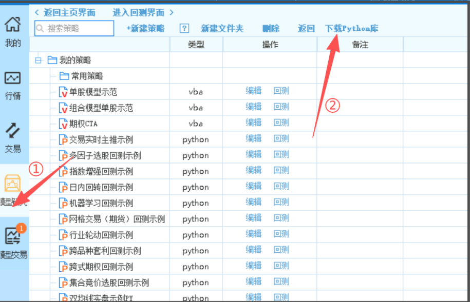
    1. 进入python库下载界面后，点击【python库下载】，等待下载完成。
        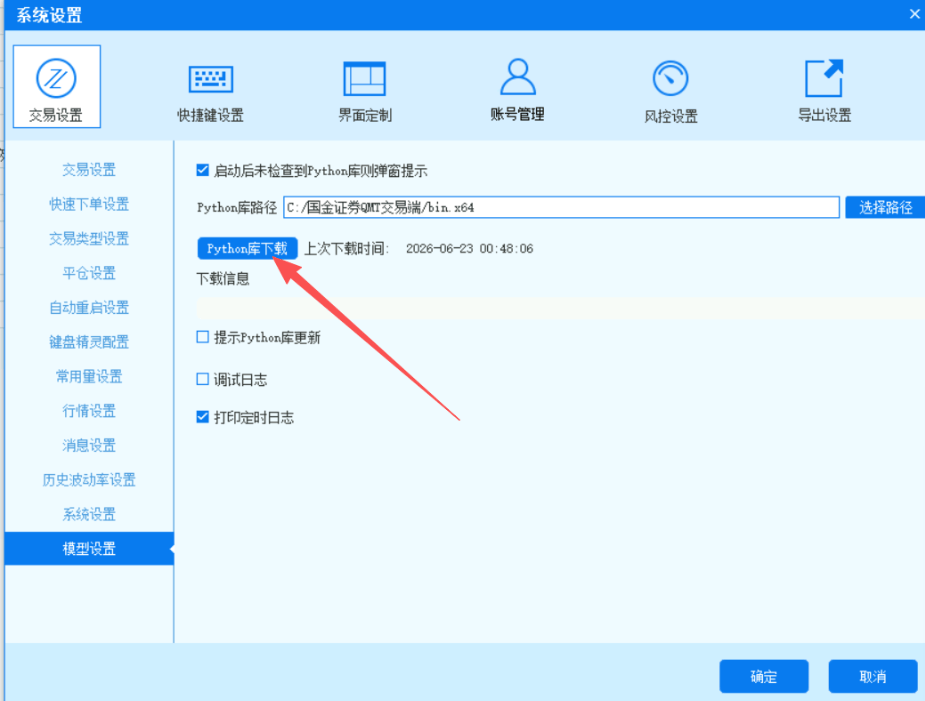
    1. Python库下载完成后，按照提示，重启QMT客户端。
    1. 下载下面的[附件](https://lfs.k.topthink.com/lfs/8a3f8c908890f183ef85ba9d21770dd882fb5eccf4ac830b7aad732c843d75d9)（其实就是 pymysql 和 sqlalchemy），解压后，会看到下面两个文件夹，暂时不动它们。
1. 打开回收站或者我的电脑，在地址栏输入：`C:\国金证券QMT交易端\bin.x64\Lib\site-packages\`
    1. 点击回车键，会进入到一个全是文件夹的页面。这个得看你的国金QMT安装路径，如果你安装在D盘根目录，那就填写`D:\国金证券QMT交易端\bin.x64\Lib\site-packages\`
    1. 然后把刚才解压的两个文件，拖入这个页面，或者复制粘贴到这个页面。

1. 在QMT上运行接收聚宽信号的自动交易代码
    1. 登录QMT软件，先点击左侧【模型研究】按钮，再点击顶部的【新建策略】按钮，选择【python策略】。
        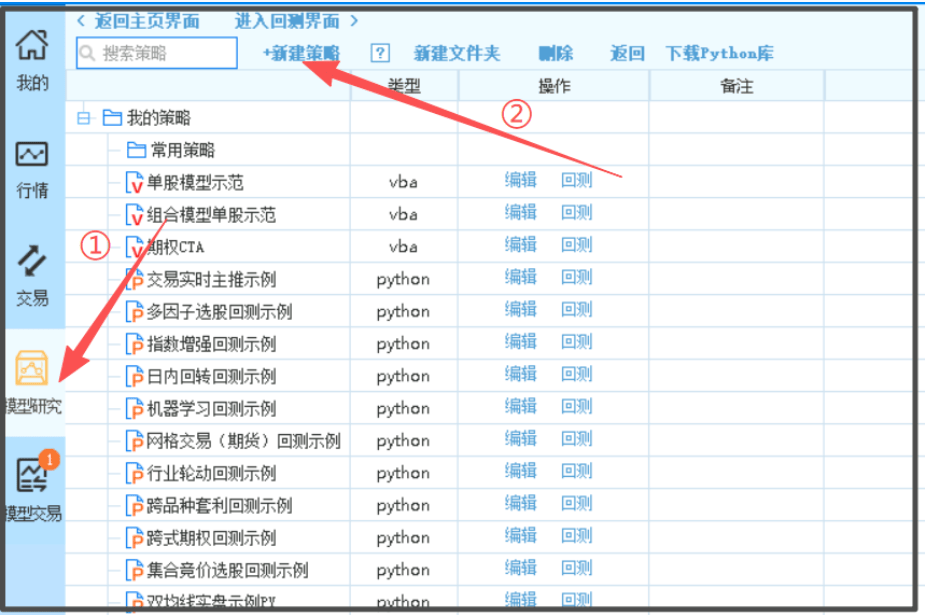
    1. 创建完成后，会出现一大串默认的代码，Crtl+A全选默认代码，然后把这些默认代码全部清空删除。
        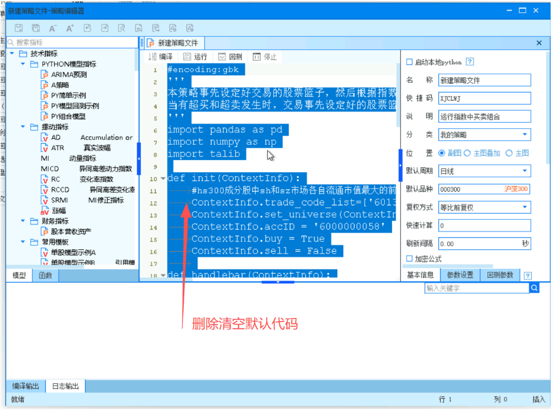
    1. 把我提供的QMT自动交易策略代码直接复制进去，[国金QMT自动交易代码](http://localhost:8000/books/%E9%87%8F%E5%8C%96%E6%95%99%E7%A8%8B/ch07/#310-qmt)。复制粘贴完源码后，一定要检测一下，看看是否复制完整。
        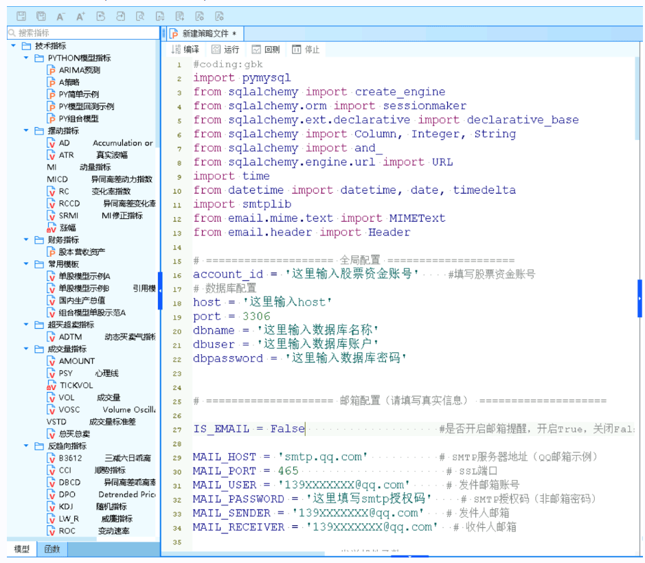
    1. 填写股票资金账号和数据库的信息，在下面红框的对应位置，先把自己国金的资金账号填到对应的位置。再把第三步拿到的数据库连接信息填进去。这个千万不能填错，这步有问题的可以星球提问，或者联系微信doudougua2
        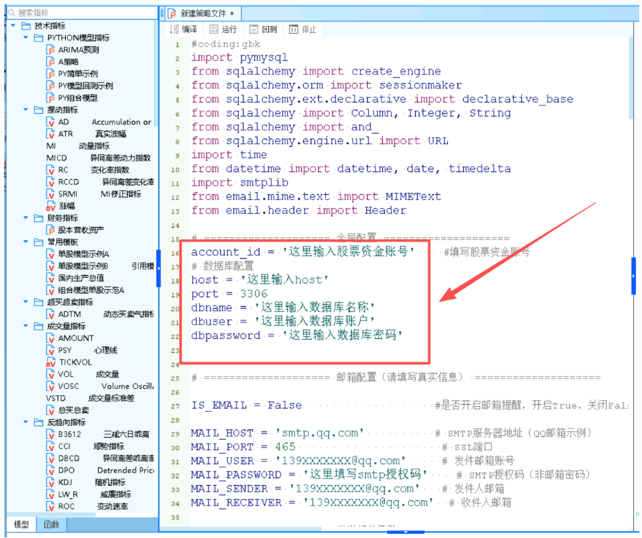
    1. 填写邮箱信息，这个地方即便不填也没关系，填了的话，每天早上9点08会发邮件提醒QMT是否正常运行，能收到邮件就是正常运行，没收到就可能没正常运行。这里邮箱只支持QQ邮箱，不支持其他邮箱。发送邮箱和接收邮箱可以填同一个。
        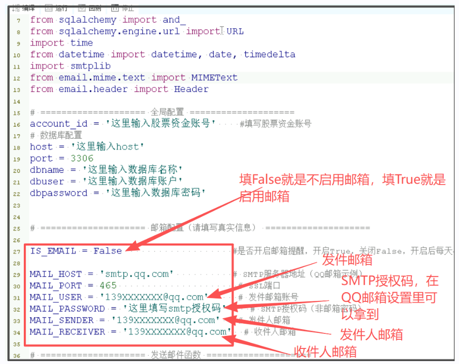
    1. QQ邮箱，SMTP授权码获取的流程如下：
        
    1. 以上修改完成后，一定要点击下图中的保存按钮。
        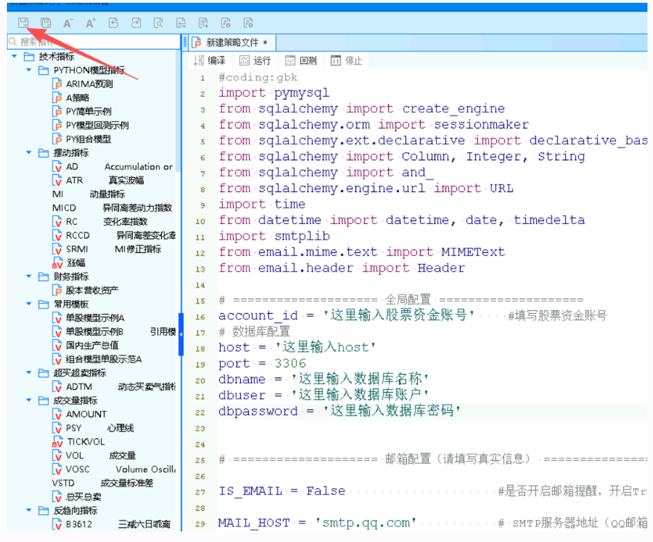
    1. 修改程序的名称。退回到①【模型研究】，找到刚才保存的②新建策略文件，鼠标右键点击【修改名称】，改成"mysql自动交易”
        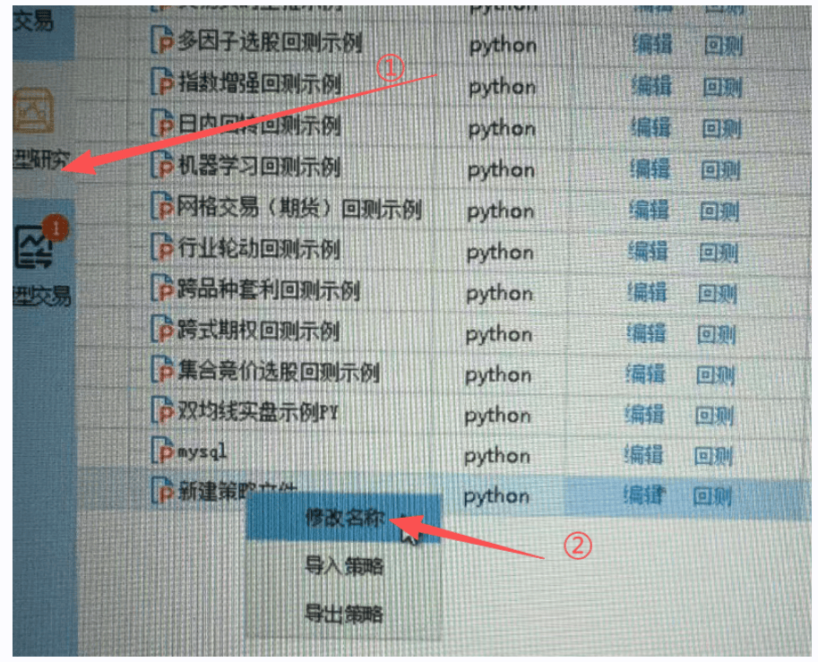
    1. 在QMT上运行实盘程序。如下图，先点击左侧的【模型交易】按钮，再点击顶部【新建策略交易】按钮。
        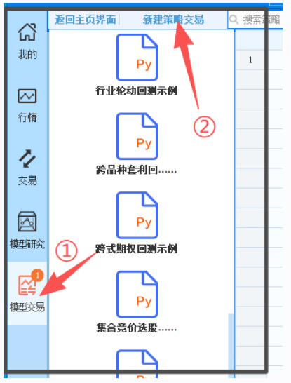
    1. 选择策略类型，找到刚才创建的“mysql自动交易”
        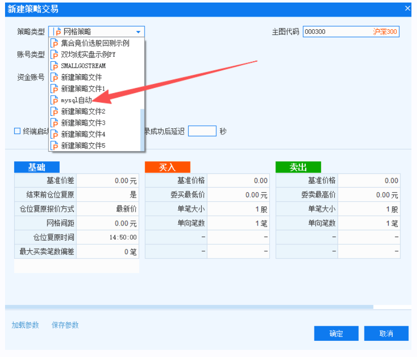
    1. 设置账号类型：股票账号。选择设置好资金账号。运行周期选择为1分钟。勾选终端启动后自动运行。
        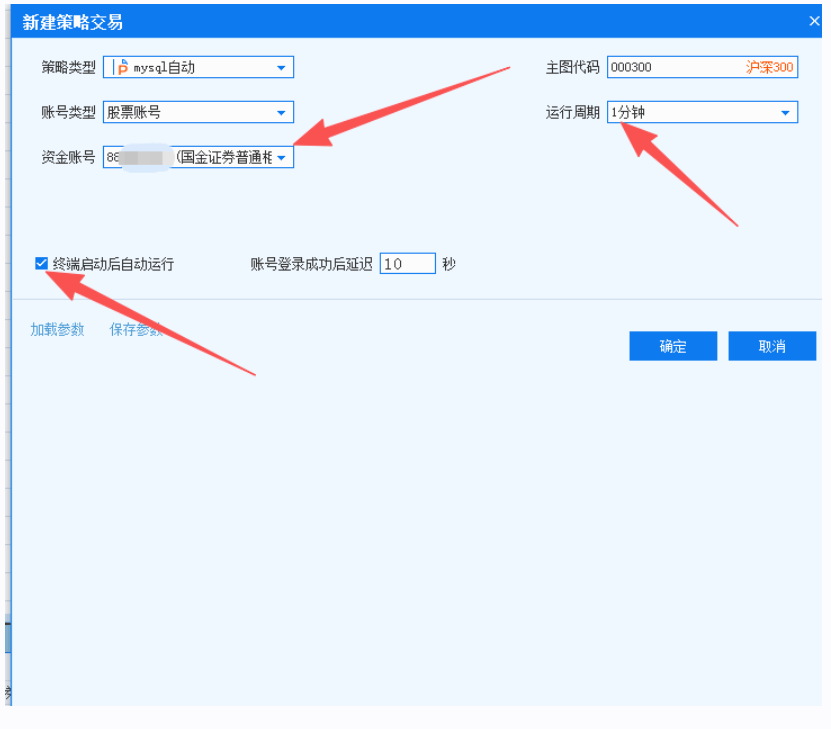
    1. 设置好后，就能看到实盘的策略了，此时默认是模拟盘，且状态为停止。要按照下图点击箭头两处，使其状态变为运行中和实盘。
        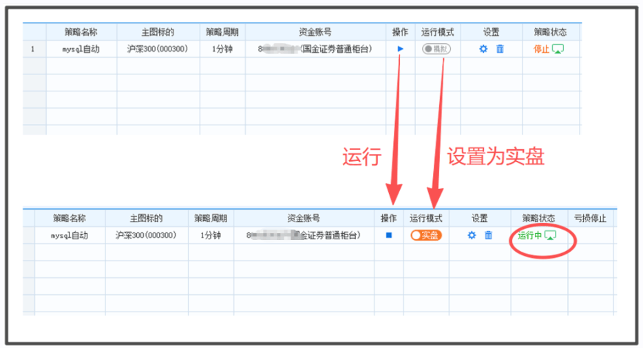
    1. 启动后，可以立马查看日志，如果看到“此刻无需要交易的股票”，就代表成功了。
        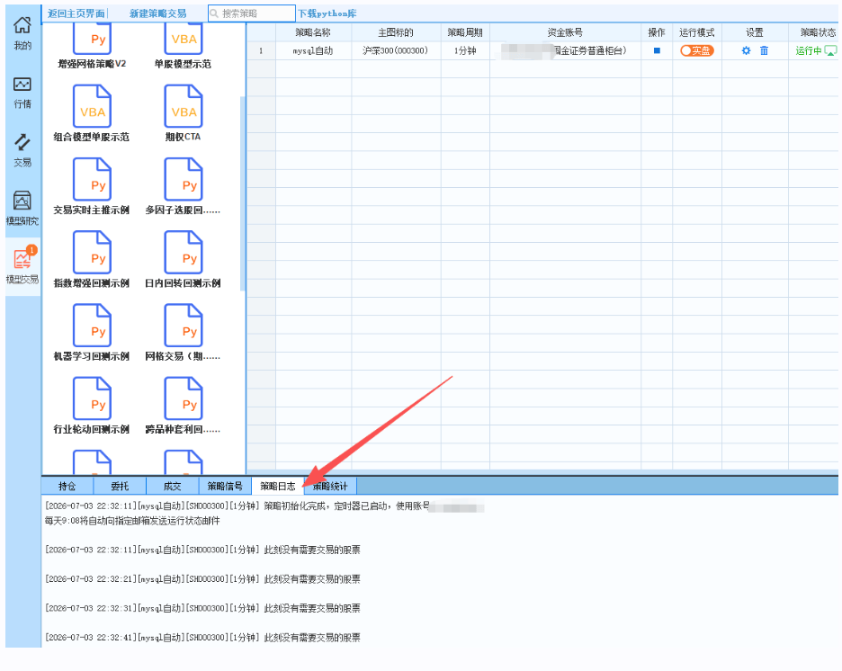

1. 下载QMT自启动工具：QMT有个很难受的设定，每天早上8点多会强制退出，不能一直挂着，所以要想办法电脑每天9点后能自动登录QMT。当然，如果每天9点25之前，你可以手动登录QMT软件，那么就不需要做这一步。如果你的电脑可以一直开着，但不能保证每天9点25之前可以手动打开QMT软件，那么就可以安装一个自启动工具，让QMT每天盘前能自动登录。
    1. 下载下面的附件，解压后会得到一个QMT_Login.exe的文件，右键单击 [QMT_Login.exe](https://lfs.k.topthink.com/lfs/7a2bb2474746d72bfa47fab2ada1dea318fe5467f091b60c1c897ca05f783771)，以管理员身份运行
    1. 然后按照下图标记设置。QMT客户端路径得看你把QMT安装在哪里，比如我安装在C盘根目录，那么路径就是：`C:/国金证券QMT交易端/bin.x64/XtItClient.exe`，可以直接复制进去。当然如果你安装在其他位置，那么就得填其他路径。
        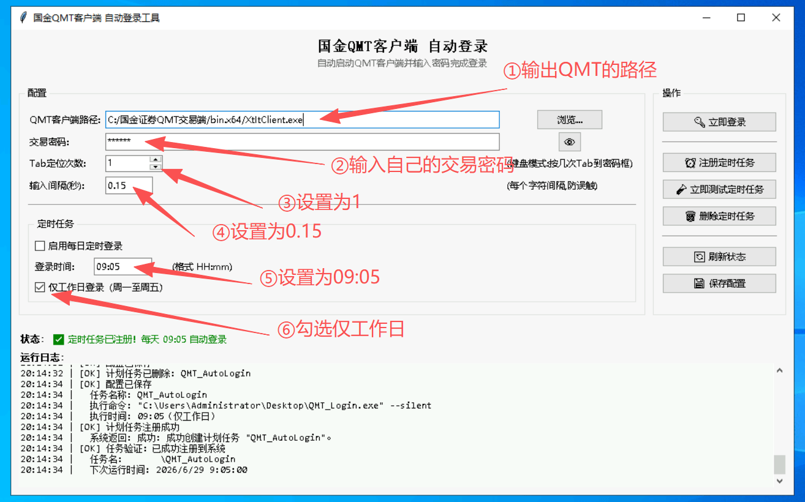
    1. 设置完后，点击右侧按钮【注册定时任务】。注册完成后，不要关闭，让它一直运行着即可。如果看不到右侧的【注册定时任务】按钮，可以把QMT_Login.exe的页面放大，或者向右扩展拖动一下。
        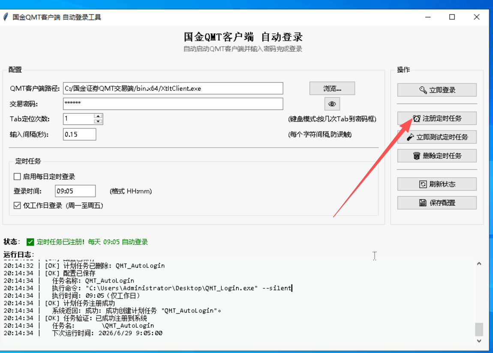
    1. 完成以上步骤，然后保证电脑不休眠不待机，那么QMT就会在每天早上9点05自动登录了。

1. 让自己电脑不休眠不待机：如果每天9点25之前，你可以手动登录QMT软件，那么就不需要做这一步。如果你的电脑可以一直开着，人不能值守，那么就需要让自己电脑不休眠不待机，这个每个人的电脑都不一样，具体的方法可以问AI，自己尝试设置，应该都是简单的。

### 3.5 下载自定义库

下载百度网盘的文件：链接: 链接: https://pan.baidu.com/s/1nmHJBUZRBXb-eA4VbCMlMA?pwd=aupc 提取码: aupc


打开聚宽的研究环境


把刚才下载的文件，上传到聚宽的研究环境。可以点左上角【上传】按钮上传，也可以把文件直接拖进去。


在研究环境中，打开这个文件，然后把第三步拿到的数据库连接信息填进去。这个千万不能填错，这步有问题的可以星球提问，或者联系微信doudougua2。


填完后，切记一定要点左上角的保存。


### 3.6 对聚宽的策略进行修改

修改的目的是为了让聚宽的策略可以把交易信息发送到数据库。
**部分策略我已经修改，源码已经上传，如果你们还想实盘这几个策略，那么直接复制我的源码就可以。**

- [高股息小市值（自动交易）](https://k7pl9l9npy.k.topthink.com/@dougua666/gaoguxixiaoshizhi（zidongjiaoyi）.html)
- [高股息小市值-增加了1底和4月底择时-增加了止损（自动交易）](https://k7pl9l9npy.k.topthink.com/@dougua666/gaoguxixiaoshizhi-zengjiale1dihe4yuedizeshi-zengjialezhisun（zidongjiaoyi）.html)
- [中小板小市值（自动交易）](https://k7pl9l9npy.k.topthink.com/@dougua666/zhongxiaobanxiaoshizhi（zidongjiaoyi）.html)
- [中小板小市值-1月底和4月底不买入(自动交易)](https://k7pl9l9npy.k.topthink.com/@dougua666/zhongxiaobanxiaoshizhi-1yuedihe4yuedibumairu(zidongjiaoyi).html)
- [中小板小市值-国九升级版-1月4月空仓-调仓时间随机(自动交易)](https://k7pl9l9npy.k.topthink.com/@dougua666/zhongxiaobanxiaoshizhi-guojiushengjiban-1yue4yuekongcang-tiaocangshijiansuiji(zidongjiaoyi).html)
- [基本面小市值（自动交易）](https://k7pl9l9npy.k.topthink.com/@dougua666/jibenmianxiaoshizhi（zidongjiaoyi）.html)
- [基本面小市值-周调仓-1月底和4月底空仓（自动交易）](https://k7pl9l9npy.k.topthink.com/@dougua666/jibenmianxiaoshizhi-zhoutiaocang-1yuedihe4yuedikongcang（zidongjiaoyi）.html)
- [动态持仓中小板小市值国九条版（自动交易）](https://k7pl9l9npy.k.topthink.com/@dougua666/dongtaichicangzhongxiaobanxiaoshizhiguojiutiaoban（zidongjiaoyi）.html)
- [动态持仓创业板小市值（自动交易）](https://k7pl9l9npy.k.topthink.com/@dougua666/dongtaichicangchuangyebanxiaoshizhi（zidongjiaoyi）.html)
- [纯高股息基本面策略(自动交易)](https://k7pl9l9npy.k.topthink.com/@dougua666/chungaoguxijibenmiancelve(zidongjiaoyi).html)
- [低资产回报小市值策略（自动交易）](https://k7pl9l9npy.k.topthink.com/@dougua666/dizichanhuibaoxiaoshizhicelve%EF%BC%88zidongjiaoyi%EF%BC%89.html)

如果想实盘其他策略，可以按照以下三个步骤对自己想实盘的策略进行修改：

在策略最顶部加入下面的语句，意思是引入"研究"中的 mysqltrade.py 这个文件的内容。

```python
from mysqltrade import *
```

入下图所示：


再策略里，增加一个全局变量: `g.strategy`，这个我们不用做修改，统计都叫dougua1就可以。

```python
g.strategy = 'dougua1' # 策略名
```

如下图所示：


修改策略的下单函数order系列。例如：

```python linenums="1"
order(stock, 100) 修改为： order_(context, stock, 100)
order_target(stock, 0) 修改为： order_target_(context, stock, 0)
order_value(stock, 10000)修改为： order_value_(context, stock, 10000)
order_target_value(stock, value) 修改为： order_target_value_(context, stock, value)
```

具体的修改规则是：给order系列下单函数加个小尾巴下划线 `_`, 并增加一个参数 `context`。

告诉大家一个小技巧，可以用ctrl+f，然后输入order来搜索这个策略包含以上4个order下单函数的位置。


修改下单函数order系列，其目的是为了调用mysqltrade.py中的对应函数。mysqltrade的对应函数在完成下单后，将返回的Order对象转换成交易信号并通过mysql发送出去，是mysqltrade最核心的函数。

其实已经很简单了，如果有想实盘的策略，但实在学不会怎么改，可以找我，我来帮改。

### 3.7 开通聚宽实时模拟

聚宽默认是延时模拟，延时模拟会延时一天交易，比如策略12月14日9点35分买进股票A，但延时模拟会延时到15日的凌晨3点发出交易信号，并且延时模拟不支持微信通知。

所以如果想要微信通知，就要先开通实时模拟权限。

开通实时模拟有两种方式：

1. 购买聚宽的蓝V会员，价格是999元一年，会员会送三个实时模拟的坑位。
2. 通过聚宽的社区的积分，兑换实时模拟坑位。兑换的流程可以看这个帖子：[用积分兑换实时模拟的流程](https://t.zsxq.com/15qQPMp7A)

积分不要钱，但需每天去聚宽签到、看帖子、留言。

开通完实时模拟后，可以在[聚宽模拟交易列表页](https://www.joinquant.com/algorithm/trade/list?process=1)，看到模拟交易的状态，如果显示是“实时进行中”，那就说明实时模拟设置成功了。

### 3.8 将修改后的策略源码在聚宽上进行实时模拟

**注意**：在ptrade未设置完成前，千万不要先在聚宽运行mysql版本的实时模拟，一定要ptrade先运行，再去运行聚宽实时模拟，或者聚宽实时模拟（要在24点前）和PT同一天运行。

这步我就不多讲了，就是把我们修改后的策略源码在聚宽上进行实时模拟。这里有一点要注意，你模拟填写的金额是多少，那么对应ptrade下单的金额就会是多少。举个例子，你模拟了高股息小市值策略，起始资金是10万，买10只，那么对应发给ptrade就会每只买1万。也就是说ptrade买多少股票，全看模拟设置的金额是多少。

实盘时，一定要确保券商账户的资金比聚宽模拟策略设置的资金多5%左右，举个例子，你聚宽模拟设置的是10万，那么国盛券商账户最好放10.5万，不然可能会报资金不足。

### 3.9 其他进阶扩展功能

设置后实盘后，基本就没问题了。

但后续如果要修改聚宽代码、修改PT代码、修改聚宽模拟的资金、修改数据库账号密码，还需要一些操作，这些操作也不难，具体可看下面：

1. [聚宽替换代码](https://k7pl9l9npy.k.topthink.com/@dougua666/tihuandaima.html)
2. [修改聚宽模拟的资金](https://k7pl9l9npy.k.topthink.com/@dougua666/yongCSVwenjianxiugaicelvezijin.html)

### 3.10 国金QMT自动交易代码

和PT不一样，QMT下单用的限价单，比如买，会用卖4的价格挂单；卖，会用买4的价格挂单。这可能会导致一个问题，在极端情况下，30秒内可能不会成交，卖单不成交，账户可能就没资金买。但这个概率很低，一般不会遇到。

这个代码下单函数我原来用的最新价挂单，用卖4和买4挂单是我周末刚修改的，不知道会不会有问题，我下周还会继续测试。

总之，这还是一个测试版，着急的圈友可以先搞起来，不着急的可以再等等。

```python linenums="1"
#coding:gbk
import pymysql
from sqlalchemy import create_engine
from sqlalchemy.orm import sessionmaker
from sqlalchemy.ext.declarative import declarative_base
from sqlalchemy import Column, Integer, String
from sqlalchemy import and_
from sqlalchemy.engine.url import URL
import time
from datetime import datetime, date, timedelta
import smtplib
from email.mime.text import MIMEText
from email.header import Header

# ==================== 全局配置 ====================
account_id = '这里输入股票资金账号'    #填写股票资金账号
# 数据库配置
host = '这里输入host'
port = 3306
dbname = '这里输入数据库名称'
dbuser = '这里输入数据库账户'
dbpassword = '这里输入数据库密码'


# ==================== 邮箱配置（请填写真实信息） ====================

IS_EMAIL = False                   #是否开启邮箱提醒，开启True，关闭False，开启后每天早上9点08可以收到邮件提醒QMT是否正常运行。

MAIL_HOST = 'smtp.qq.com'          # SMTP服务器地址（QQ邮箱示例）
MAIL_PORT = 465                     # SSL端口
MAIL_USER = '139XXXXXXX@qq.com'     # 发件邮箱账号
MAIL_PASSWORD = '这里填写smtp授权码'    # SMTP授权码（非邮箱密码）
MAIL_SENDER = '139XXXXXXX@qq.com'   # 发件人邮箱
MAIL_RECEIVER = '139XXXXXXX@qq.com'  # 收件人邮箱

# ==================== 发送邮件函数 ====================
def send_status_email():
    """
    发送"QMT正常运行中"邮件
    """
    try:
        content = 'QMT正常运行中，收到邮件代表QMT正常运行'
        message = MIMEText(content, 'plain', 'utf-8')
        message['From'] = Header(MAIL_SENDER)
        message['To'] = Header(MAIL_RECEIVER)
        message['Subject'] = Header('QMT运行状态通知', 'utf-8')
        
        # 使用SSL连接SMTP服务器
        smtp = smtplib.SMTP_SSL(MAIL_HOST, MAIL_PORT)
        smtp.login(MAIL_USER, MAIL_PASSWORD)
        smtp.sendmail(MAIL_SENDER, [MAIL_RECEIVER], message.as_string())
        smtp.quit()
        print(f"[{datetime.now().strftime('%Y-%m-%d %H:%M:%S')}] 邮件发送成功: {content}")
    except Exception as e:
        print(f"邮件发送失败: {e}")

# ==================== 数据库模型 ====================
Base = declarative_base()

class Stock(Base):
    __tablename__ = 'stocks'
    id = Column(Integer, primary_key=True, autoincrement=True)
    time = Column(String(255))
    action = Column(String(255))
    code = Column(String(255))
    amt = Column(String(255))
    pct = Column(String(255))
    strategy = Column(String(255))
    isconsum = Column(String(255))
    mode = Column(String(255))

# ==================== 委托状态查询（下单后等待新委托并打印状态） ====================
def wait_and_query_new_order(accid, ContextInfo, prev_order_id, timeout=5):
    """
    等待新委托生成并查询状态。
    返回新委托ID；超时返回None。
    """
    start = time.time()
    while time.time() - start < timeout:
        orderid = get_last_order_id(accid, 'stock', 'order')
        if orderid != '-1' and orderid != prev_order_id:
            obj = get_value_by_order_id(orderid, accid, 'stock', 'order')
            # 委托状态映射
            status_map = {
                0: '等待中', 48: '未报', 49: '待报', 50: '已报',
                51: '已报待撤', 52: '部成待撤', 53: '部撤', 54: '已撤',
                55: '部成', 56: '已成', 57: '废单', 86: '已确认', 255: '未知'
            }
            status_code = obj.m_nOrderStatus
            status_text = status_map.get(status_code, f'未知({status_code})')
            print(f"委托号: {obj.m_strOrderSysID}, 股票: {obj.m_strInstrumentID}, "
                  f"数量: {obj.m_nVolumeTotalOriginal}, 状态: {status_text}")
            return orderid
        time.sleep(0.2)
    print(f"等待委托超时({timeout}秒)，可能委托未生成或有延迟")
    return None

# ==================== 交易主逻辑（定时器回调） ====================
def trade_main(ContextInfo):
    try:
        # 1. 连接数据库
        uri = URL(
            drivername="mysql+pymysql",
            host=host,
            port=port,
            username=dbuser,
            password=dbpassword,
            database=dbname,
        )
        engine = create_engine(uri, encoding='utf-8', echo=False,
                               pool_size=10, max_overflow=5, pool_recycle=3600)
        Base.metadata.create_all(engine)
        Session = sessionmaker(bind=engine)
        session = Session()

        # 2. 获取待买卖列表
        sell_order_list = session.query(Stock).filter(
            and_(Stock.strategy == "dougua1", Stock.action == "SELL", Stock.mode == "1")
        ).all()
        buy_order_list = session.query(Stock).filter(
            and_(Stock.strategy == "dougua1", Stock.action == "BUY", Stock.mode == "1")
        ).all()

        # 3. 处理卖出
        if sell_order_list:
            # 记录当前最新委托号，用于后续判断新委托
            last_id = get_last_order_id(account_id, 'stock', 'order')

        for order_info in sell_order_list:
            stock = order_info.code
            # 后缀转换 .SS → .SH
            if stock.endswith('.SS'):
                stock = stock.replace('.SS', '.SH')
            amt = int(order_info.amt)
            print("推送的卖出信息：%s" % {"推送股票": stock, "交易数量": amt, "交易时间": order_info.time})
            
            passorder(24, 1101, account_id, stock, 9, 0, amt,1, ContextInfo)
        
            # 【新增】等待并查询刚下的委托状态，更新 last_id
            new_id = wait_and_query_new_order(account_id, ContextInfo, last_id)
            if new_id:
                last_id = new_id

            session.delete(order_info)

        if len(sell_order_list) > 0:
            print('卖出订单已全部委托，30秒后开始买入')
            time.sleep(30)

        # 4. 处理买入
        if buy_order_list:
            # 重新获取当前最新委托号（间隔30秒后可能有变化）
            last_id = get_last_order_id(account_id, 'stock', 'order')

        for order_info in buy_order_list:
            stock = order_info.code
            if stock.endswith('.SS'):
                stock = stock.replace('.SS', '.SH')
            amt = int(order_info.amt)
            print("推送的买入信息：%s" % {"推送股票": stock, "交易数量": amt, "交易时间": order_info.time})
            passorder(23, 1101, account_id, stock, 1, 0, amt,1, ContextInfo)

            # 【新增】等待并查询刚下的委托状态
            new_id = wait_and_query_new_order(account_id, ContextInfo, last_id)
            if new_id:
                last_id = new_id

            session.delete(order_info)

        session.commit()
        session.close()
        engine.dispose()

        if len(sell_order_list) == 0 and len(buy_order_list) == 0:
            print("此刻没有需要交易的股票")

    except Exception as e:
        print("发生错误: {}\n".format(e))

# ==================== QMT策略必需接口 ====================
def init(ContextInfo):
    ContextInfo.set_account(account_id)
    """初始化函数,5秒交易一次"""
    ContextInfo.run_time("trade_main", "5nSecond", "2020-01-01 00:00:00", "SH")
    print('策略初始化完成，定时器已启动，使用账号:', account_id)
    # 注册每天早上9:08发送邮件的定时器
    ContextInfo.run_time("send_mail_task", "1d", "2026-06-30 09:08:00", "SH") 
    if IS_EMAIL:
        print('每天9:08将自动向指定邮箱发送运行状态邮件')
    else:
        print('未开启邮箱提醒') 

def handlebar(ContextInfo):
    pass

def account_callback(ContextInfo, accountInfo):
    print('accountInfo')
    print(accountInfo.m_strStatus) # m_strStatus 为资金账号的属性之一，表示资金账号的状态

# ==================== 定时器回调：定时发送邮件 ====================
def send_mail_task(ContextInfo):
    """
    每天早上9:08触发的邮件发送任务
    """
    if IS_EMAIL:
        send_status_email()
    else:
        return
```


## 4. 聚宽实盘示例策略

### 4.1 用CSV修改策略资金的步骤

此方法，支持修改策略资金。举个例子，你先用 5 万运行了某个第八章的策略，你想要加仓 1 万，或者减仓 1 万，那么就可以用下面这个方式进行操作 。

1. 当使用自动交易版本的策略代码模拟时，会在研究环境生成一个CSV文件，比如：

    - 高股息小市值策略的CSV文件名称叫：高股息修改资金.csv
    - 中小板小市值策略：中小板修改资金.csv
    - 基本面小市值策略：基本面小市值修改资金.csv
    - 纯高股息基本面策略：纯高股息基本面修改资金.csv

    除了动态中小板小市值，其他第八章教程内自动交易的策略都支持用CSV修改资金。

2. 当你要运行多个同类策略时，比如你要运行两个高股息小市值策略，那么为了保证 CSV 文件可以一一对控制对应策略的资金，需要修改策略代码中的 `g.filename`，位置可参见下图红框。比如你有两个高股息小市值，另一个可以修改为：高股息修改资金2号.csv。

    ```python linenums="1"
    def after_code_changed(context):
        now = context.current_dt.time()
        print("{0}替换了代码".format(now))
        unschedule_all()
        g.strategy = 'douqua1'  # 策略名
        g.filename = '高股息修改资金.csv'  #入金配置文件名称
        g.first = 1
        g.out_cash = 0
        g.high_limit_list
    ```


策略运行后，点击 CSV 文件就可以修改策略资金了。举个例子，你如果想加仓 10000，那就可以把下面这个 `（0，否，否）`，改成 `（10000，是，是）`。如果你想减仓 10000，那就改成 `（-10000，是，是）`。然后点击左上角文件---保存，就可以生效了。

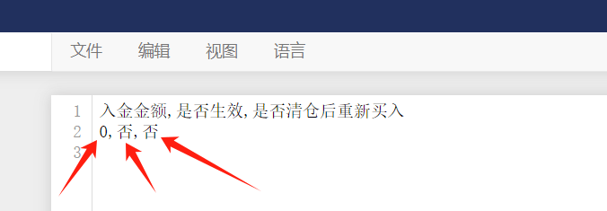
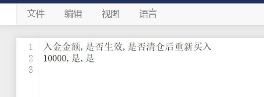

这里我做了一个设定，一旦你增加或者减少了资金，当天就会清仓重买。

!!! warning "注意"

    1. 保存后不要再去回测策略。
    2. 替换代码和修改资金不要在同一天操作，最好隔天去操作。
    3. 修改资金，不能在交易日的早上8点---下午4点修改，一定要在盘后修改，早上8点--下午4点修改可能会导致策略出错。


### 4.2 替换代码的步骤

模拟交易你如果要修改代码，直接用【替换代码】功能，替换为你修改后的回测就可以了。不要用【修改代码】，要用【替换代码】


只有第七章自动交易的代码支持这样直接【替换代码】。

### 4.3 高股息小市值（自动交易）

实时模拟该策略时，有几点优化：

1. 支持修改策略资金。举个例子，你先用5万运行了高股息小市值，你想要加仓1万，或者减仓1万，那么就可以用下面这个方式进行操作 。

策略开始运行后，会在研究环境生成一个文件，叫：高股息修改资金.csv。

点开这个文件就可以修改策略资金了。举个例子，你如果想加仓 10000，那就可以把下面这个（0,否,否），改成（10000，是，是）。如果你想减仓10000，那就改成（-10000，是，是）。然后点击左上角文件---保存，就可以生效了。

这里我做了一个设定，一旦你增加或者减少了资金，当天就会清仓重买。

!!! warning "注意"

    修改资金，不能在交易日的早上8点---下午4点修改，一定要在盘后修改，早上8点--下午4点修改可能会导致策略出错。

2. 替换代码：我做了优化，模拟交易你如果要修改代码，直接用【替换代码】功能，替换为你修改后的回测就可以了。不要用【修改代码】，要用【替换代码】

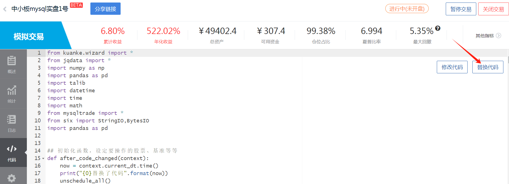

```python linenums="1"
import pandas as pd
import numpy as np
import jqdata
from kuanke.wizard import *
from six import StringIO,BytesIO

from mysqltrade import *

 
    
def after_code_changed(context):
    now = context.current_dt.time()
    print("{0}替换了代码".format(now))
    unschedule_all()
    g.strategy = 'dougua1' # 策略名
    g.filename = '高股息修改资金.csv' #入金配置文件名称

    g.first = 1
    g.out_cash = 0
    g.high_limit_list = []
    set_option('use_real_price', True)
    set_benchmark('000905.XSHG')
    # 设置滑点为理想情况，纯为了跑分好看，实际使用注释掉为好
    set_slippage(PriceRelatedSlippage(0.01))
    # 设置交易成本
    set_order_cost(OrderCost(open_tax=0, close_tax=0.0005, open_commission=0.0003, close_commission=0.0003, close_today_commission=0, min_commission=5),type='fund')
    # strategy
    g.stock_num = 10

    run_daily(prepare_stock_list, time='9:05', reference_security='000300.XSHG') #每日9:05跑一次股票池（不交易）
    run_daily(change_cash, "9:30")#检查入金
    run_monthly(my_Trader, 1 ,time='9:31') #每月的第一个交易日的9:31调仓
    run_daily(check_limit_up, time='14:20') #每日14:20检查一下持仓股中是否有涨停票
  


#1-1 根据最近一年分红除以当前总市值计算股息率并筛选    
def get_dividend_ratio_filter_list(context, stock_list, sort, p1, p2):
    time1 = context.previous_date
    time0 = time1 - datetime.timedelta(days=365)
    #获取分红数据，由于finance.run_query最多返回4000行，以防未来数据超限，最好把stock_list拆分后查询再组合
    interval = 1000 #某只股票可能一年内多次分红，导致其所占行数大于1，所以interval不要取满4000
    list_len = len(stock_list)
    #截取不超过interval的列表并查询
    q = query(finance.STK_XR_XD.code, finance.STK_XR_XD.a_registration_date, finance.STK_XR_XD.bonus_amount_rmb
    ).filter(
        finance.STK_XR_XD.a_registration_date >= time0,
        finance.STK_XR_XD.a_registration_date <= time1,
        finance.STK_XR_XD.code.in_(stock_list[:min(list_len, interval)]))
    df = finance.run_query(q)
    #对interval的部分分别查询并拼接
    if list_len > interval:
        df_num = list_len // interval
        for i in range(df_num):
            q = query(finance.STK_XR_XD.code, finance.STK_XR_XD.a_registration_date, finance.STK_XR_XD.bonus_amount_rmb
            ).filter(
                finance.STK_XR_XD.a_registration_date >= time0,
                finance.STK_XR_XD.a_registration_date <= time1,
                finance.STK_XR_XD.code.in_(stock_list[interval*(i+1):min(list_len,interval*(i+2))]))
            temp_df = finance.run_query(q)
            df = df.append(temp_df)
    dividend = df.fillna(0)
    #dividend = dividend.set_index('code')
    #print(dividend)
    dividend = dividend.groupby('code').sum()
   # print(dividend)
    temp_list = list(dividend.index) #query查询不到无分红信息的股票，所以temp_list长度会小于stock_list
    #获取市值相关数据
    q = query(valuation.code,valuation.market_cap).filter(valuation.code.in_(temp_list))
    cap = get_fundamentals(q, date=time1)
    cap = cap.set_index('code')
    #计算股息率
    DR = pd.concat([dividend, cap] ,axis=1)
    DR['dividend_ratio'] = (DR['bonus_amount_rmb']/10000) / DR['market_cap']
    #排序并筛选
    DR = DR.sort_values(by=['dividend_ratio'], ascending=sort)
    print(len(DR))
    final_list = list(DR.index)[int(p1*len(DR)):int(p2*len(DR))]
    return final_list

def my_Trader(context):
    # all stocks
    dt_last = context.previous_date
    stocks = get_all_securities('stock', dt_last).index.tolist()
    stocks = filter_kcbj_stock(stocks)
     #高股息(全市场最大25%)
    stocks = get_dividend_ratio_filter_list(context, stocks, False, 0, 0.25)
    # fuandamental data，按照市值排序，市值越小排在越靠前
    df = get_fundamentals(query(valuation.code,valuation.market_cap).filter(valuation.code.in_(stocks)).order_by(valuation.market_cap.asc()))
    print(df)
    
    choice = list(df.code)
    choice = filter_st_stock(choice) #过滤ST
    choice = filter_paused_stock(choice) #过滤停牌股票
    choice = filter_limitup_stock(context,choice) #过滤涨停的股票
    choice = filter_limitdown_stock(context,choice) #过滤跌停的股票
    choice = filter_highprice_stock(context,choice) #过滤股价高于9元的股票
    choice = choice[:g.stock_num] #选前前N只票
    cdata = get_current_data()
    # Sell
    for s in context.portfolio.positions:
        if (s  not in choice) :
            log.info('Sell', s, cdata[s].name)
            order_target_(context,s, 0)
    # buy
    position_count = len(context.portfolio.positions)
    if g.stock_num > position_count:
        psize = (context.portfolio.available_cash+g.out_cash)/(g.stock_num - position_count)
        for s in choice:
            if s not in context.portfolio.positions:
                log.info('buy', s, cdata[s].name)
                order_value_(context,s, psize)
                if len(context.portfolio.positions) == g.stock_num:
                    break
            

# 准备股票池
def prepare_stock_list(context):
    #获取已持有列表
    g.high_limit_list = []
    hold_list = list(context.portfolio.positions)
    if hold_list:
        panel = get_price(hold_list, end_date=context.previous_date, frequency='daily',
                       fields=['close', 'high_limit'],
                       count=1)

        df_close = panel['close'].T
        df_close.columns = ['close']
        print(df_close)
        df_high_limit = panel['high_limit'].T
        df_high_limit.columns = ['high_limit']
        print(df_high_limit)
        df = pd.concat([df_close, df_high_limit] ,axis=1)
        print(df)
        g.high_limit_list = df[df['close'] == df['high_limit']].index.tolist()
        
#  调整昨日涨停股票
def check_limit_up(context):
     # 获取持仓的昨日涨停列表
    current_data = get_current_data()
    if g.high_limit_list:
        for stock in g.high_limit_list:
            if current_data[stock].last_price < current_data[stock].high_limit:
                log.info("[%s]涨停打开，卖出" % stock)
                order_target_(context,stock, 0)
            else:
                log.info("[%s]涨停，继续持有" % stock)
 
 
# 过滤科创北交股票
def filter_kcbj_stock(stock_list):
    for stock in stock_list[:]:
        if stock[0] == '4' or stock[0] == '8' or stock[:2] == '68':
            stock_list.remove(stock)
    return stock_list

# 过滤停牌股票
def filter_paused_stock(stock_list):
	current_data = get_current_data()
	return [stock for stock in stock_list if not current_data[stock].paused]


# 过滤ST及其他具有退市标签的股票
def filter_st_stock(stock_list):
	current_data = get_current_data()
	return [stock for stock in stock_list
			if not current_data[stock].is_st
			and 'ST' not in current_data[stock].name
			and '*' not in current_data[stock].name
			and '退' not in current_data[stock].name]


# 过滤涨停的股票
def filter_limitup_stock(context, stock_list):
	current_data = get_current_data()
	
	
	# 已存在于持仓的股票即使涨停也不过滤，避免此股票再次可买，但因被过滤而导致选择别的股票
	return [stock for stock in stock_list if stock in context.portfolio.positions.keys()
			or current_data[stock].day_open < current_data[stock].high_limit]

# 过滤跌停的股票
def filter_limitdown_stock(context, stock_list):
	last_prices = history(1, unit='1m', field='close', security_list=stock_list)
	current_data = get_current_data()
	
	return [stock for stock in stock_list if stock in context.portfolio.positions.keys()
			or current_data[stock].day_open > current_data[stock].low_limit]

#2-4 过滤股价高于9元的股票	
def filter_highprice_stock(context,stock_list):
	last_prices = history(1, unit='1m', field='close', security_list=stock_list)
	return [stock for stock in stock_list if stock in context.portfolio.positions.keys()
			or last_prices[stock][-1] < 9]

    
def change_cash(context): 
    if g.first == 1:
        data1 = {  
            '入金金额': 0,  
            '是否生效': "否",  
            '是否清仓后重新买入': "否"
        }  
        df2 = pd.DataFrame([data1], columns=['入金金额', '是否生效', '是否清仓后重新买入'])  
        write_file(g.filename, df2.to_csv(index=False), append=False)
        g.first = 0
    if g.out_cash < 0:
        inout_cash(g.out_cash, pindex=0)
        g.out_cash = 0
    else:
        try:
    
            df2 = pd.read_csv(BytesIO(read_file(g.filename)))
            log.info("入金文件",df2)
            single =  df2.at[0,"是否生效"]
            log.info("入金信号",single)
            is_sell = df2.at[0,"是否清仓后重新买入"]
            if single =="是":
                if is_sell == "是":
                    log.info("入金后先清仓，再重新买入，清仓股票为",list(context.portfolio.positions.keys()))
                    for s in context.portfolio.positions:
                        order_target_(context,s, 0)
                df2.loc[0,"是否清仓后重新买入"] = "否"    
                change_cash = df2.at[0,"入金金额"]
                log.info("入金金额",change_cash)
                if change_cash < 0 :
                    g.out_cash = change_cash
                else:
                    inout_cash(change_cash, pindex=0)
                df2.loc[0,"是否生效"] = "否" 
                log.info("重置后",df2)
                my_Trader(context)
                write_file(g.filename, df2.to_csv(index=False), append=False)
    
        except Exception as e:
            log.info("修改资金发生错误: {}".format(e))  

# end
```

### 4.4 高股息小市值-增加了1底和4月底择时-增加了止损（自动交易）


高股息小市值也改造好了，主要加了几个逻辑：

1. 1月19日-1月31日，4月19日-4月31日空仓 。
1. 增加止损逻辑：每日早上10点检查好，只要持仓股票跌幅大于-10%，就卖出。
1. 尾盘14:50，判断是否异常放量，当日异常放量就卖出。单日放量的定义：当日成交量超过过去120天中最大量能的90%。
1. 增加了筛选条件：过去四个季度营收必须大于5亿，eps必须大于0。
1. 如果因为连续不涨停卖出，则次日会把仓位重新买满。如果因为止损而卖出，次日不会重新买满，而是等到下一个调仓日再买满。
1. 调仓日期，我发现不一定要每月第一个交易日调仓，设定为每日第3/4/5个交易日也不错。还有就是也可以设定为周调仓，周调仓设定很简单，把`run_monthly`，换成 `run_weekly` 就好了。如果设定为周调仓，且每周第二个交易日调仓，我发现效果特别好，不知道是否有拟合的因素。新代码里，我设定的还是月调仓，每月的第5个交易日调仓，有兴趣的可以自己改改试试，不一定要按照原代码来。

修改后，收益增强挺明显的，原策略2016年---2024年，收益是864%，最大回撤-40%。修改后是3259%，最大回撤-24.8%。

我还是那个观点，我做这些改造和优化，增加止损，只要是给低风险偏好的圈友一个选择，不一定说必须要去择时，毕竟择时也可能会付出踏空的代价，但择时和止损，确实可以降低一定的风险，这是一个取舍的问题。

另外，这次加上了应对新规的财务筛选，营收和eps都做了最低筛选，财务安全性应该还是比较高的。

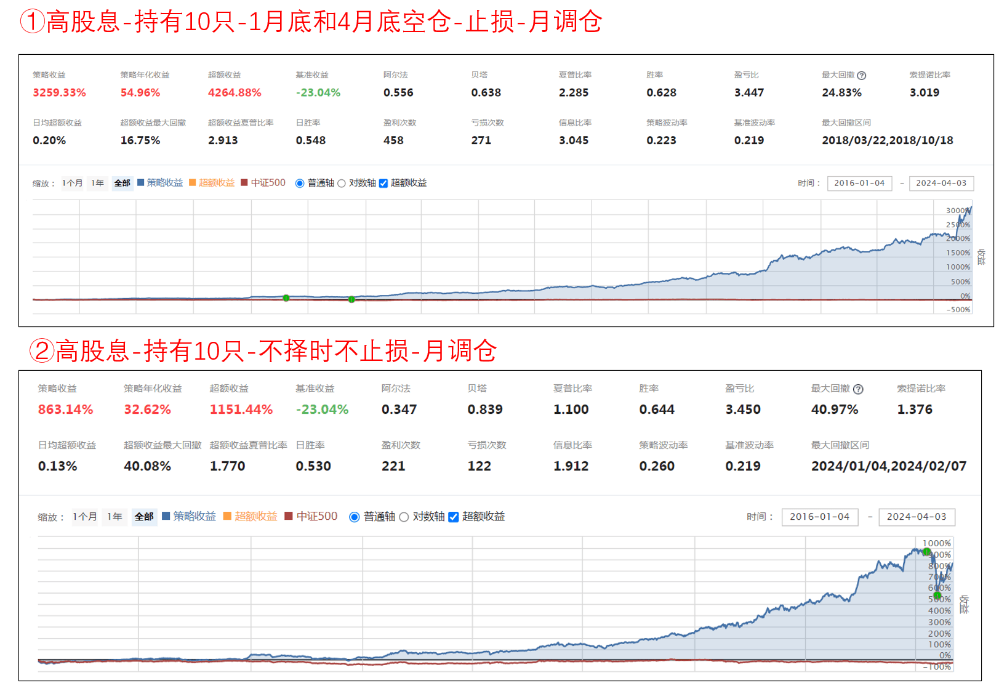

```python linenums="1"
import pandas as pd
import numpy as np
import jqdata
from kuanke.wizard import *
from six import StringIO,BytesIO

from mysqltrade import *
from jqfactor import get_factor_values
 
    
def after_code_changed(context):
    now = context.current_dt.time()
    print("{0}替换了代码".format(now))
    unschedule_all()
    g.strategy = 'dougua1' # 策略名
    g.filename = '高股息修改资金.csv' #入金配置文件名称

    g.first = 1
    g.out_cash = 0
    g.high_limit_list = []
    set_option('use_real_price', True)
    set_benchmark('000905.XSHG')
    # 模拟的时候，有滑点会导致没跌停也卖不掉的情况，所以滑点设置为0
    set_slippage(PriceRelatedSlippage(0))
    # 设置交易成本
    set_order_cost(OrderCost(open_tax=0, close_tax=0.0005, open_commission=0.0003, close_commission=0.0003, close_today_commission=0, min_commission=5),type='fund')
    # strategy
    g.stock_num = 10
    g.stoploss_rate = 0.90  #止损率为10%
    
    #单日放量超过过去120天中最大量能的90%，就卖出
    g.HV_duration = 120 
    g.HV_ratio = 0.9   
    
    g.not_buy_again = []
    g.target_list = []
    
    g.reason_to_sell = 0
    

    run_daily(prepare_stock_list, time='9:05', reference_security='000300.XSHG') #每日9:05跑一次股票池（不交易）
    run_daily(change_cash, "9:30")#检查入金
    run_daily(no_trade,time='9:31')
    run_monthly(my_Trader, 5 ,time='9:31') #每月的第一个交易日的9:31调仓
    run_daily(stoploss, time='10:00') # 止损函数
    run_daily(check_limit_up, time='14:20') #每日14:20检查一下持仓股中是否有涨停票
    run_daily(check_high_volume, time='14:50') #每日14:50检查一下是否异常放量，如果异常放量就卖出
  


#1-1 根据最近一年分红除以当前总市值计算股息率并筛选    
def get_dividend_ratio_filter_list(context, stock_list, sort, p1, p2):
    time1 = context.previous_date
    time0 = time1 - datetime.timedelta(days=365)
    #获取分红数据，由于finance.run_query最多返回4000行，以防未来数据超限，最好把stock_list拆分后查询再组合
    interval = 1000 #某只股票可能一年内多次分红，导致其所占行数大于1，所以interval不要取满4000
    list_len = len(stock_list)
    #截取不超过interval的列表并查询
    q = query(finance.STK_XR_XD.code, finance.STK_XR_XD.a_registration_date, finance.STK_XR_XD.bonus_amount_rmb
    ).filter(
        finance.STK_XR_XD.a_registration_date >= time0,
        finance.STK_XR_XD.a_registration_date <= time1,
        finance.STK_XR_XD.code.in_(stock_list[:min(list_len, interval)]))
    df = finance.run_query(q)
    #对interval的部分分别查询并拼接
    if list_len > interval:
        df_num = list_len // interval
        for i in range(df_num):
            q = query(finance.STK_XR_XD.code, finance.STK_XR_XD.a_registration_date, finance.STK_XR_XD.bonus_amount_rmb
            ).filter(
                finance.STK_XR_XD.a_registration_date >= time0,
                finance.STK_XR_XD.a_registration_date <= time1,
                finance.STK_XR_XD.code.in_(stock_list[interval*(i+1):min(list_len,interval*(i+2))]))
            temp_df = finance.run_query(q)
            df = df.append(temp_df)
    dividend = df.fillna(0)
    #dividend = dividend.set_index('code')
    #print(dividend)
    dividend = dividend.groupby('code').sum()
   # print(dividend)
    temp_list = list(dividend.index) #query查询不到无分红信息的股票，所以temp_list长度会小于stock_list
    #获取市值相关数据
    q = query(valuation.code,valuation.market_cap).filter(valuation.code.in_(temp_list))
    cap = get_fundamentals(q, date=time1)
    cap = cap.set_index('code')
    #计算股息率
    DR = pd.concat([dividend, cap] ,axis=1)
    DR['dividend_ratio'] = (DR['bonus_amount_rmb']/10000) / DR['market_cap']
    #排序并筛选
    DR = DR.sort_values(by=['dividend_ratio'], ascending=sort)
    print(len(DR))
    final_list = list(DR.index)[int(p1*len(DR)):int(p2*len(DR))]
    return final_list

def no_trade(context):
    mon = context.current_dt.month
    day = context.current_dt.day
    if (mon ==4 or mon == 1) and day>=19:
        s_list = list(context.portfolio.positions.keys())
        print(s_list)
        for s in s_list:
            order_target_value_(context,s, 0)
    else:
        check_remain_amount(context)
    


def my_Trader(context):
    mon = context.current_dt.month
    day = context.current_dt.day
    if (mon ==4 or mon == 1) and day>=19:
        s_list = list(context.portfolio.positions.keys())
        print(s_list)
        for s in s_list:
            order_target_value_(context,s, 0)
        return
    
    # all stocks
    dt_last = context.previous_date
    stocks = get_all_securities('stock', dt_last).index.tolist()
    stocks = filter_kcbj_stock(stocks)
     #高股息(全市场最大25%)
    stocks = get_dividend_ratio_filter_list(context, stocks, False, 0, 0.25)
    df = get_factor_values(stocks, "operating_revenue_ttm", end_date=dt_last, count=1)
    df = df["operating_revenue_ttm"].T
    
    df.columns = ["operating_revenue_ttm"]
    
    df = df[df["operating_revenue_ttm"]>500000000]
    stocks = list(df.index)
    # fuandamental data，按照市值排序，市值越小排在越靠前
    df = get_fundamentals(query(valuation.code,valuation.market_cap,indicator.eps).filter(valuation.code.in_(stocks)).order_by(valuation.market_cap.asc()))
    df = df[df['eps']>0]
    

    choice = list(df.code)
    choice = filter_st_stock(choice) #过滤ST
    choice = filter_paused_stock(choice) #过滤停牌股票
    choice = filter_limitup_stock(context,choice) #过滤涨停的股票
    choice = filter_limitdown_stock(context,choice) #过滤跌停的股票
    choice = filter_highprice_stock(context,choice) #过滤股价高于9元的股票
    g.target_list = choice
    choice = choice[:g.stock_num] #选前前N只票
    cdata = get_current_data()
    # Sell
    for s in context.portfolio.positions:
        if (s  not in choice) :
            log.info('Sell', s, cdata[s].name)
            order_target_(context,s, 0)
    # buy
    g.not_buy_again=[]
    position_count = len(context.portfolio.positions)
    if g.stock_num > position_count:
        psize = (context.portfolio.available_cash+g.out_cash)/(g.stock_num - position_count)
        for s in choice:
            if s not in context.portfolio.positions:
                log.info('buy', s, cdata[s].name)
                order_value_(context,s, psize)
                g.not_buy_again.append(s)
                if len(context.portfolio.positions) == g.stock_num:
                    break
            

# 准备股票池
def prepare_stock_list(context):
    #获取已持有列表
    g.high_limit_list = []
    hold_list = list(context.portfolio.positions)
    if hold_list:
        panel = get_price(hold_list, end_date=context.previous_date, frequency='daily',
                       fields=['close', 'high_limit'],
                       count=1)

        df_close = panel['close'].T
        df_close.columns = ['close']
        print(df_close)
        df_high_limit = panel['high_limit'].T
        df_high_limit.columns = ['high_limit']
        print(df_high_limit)
        df = pd.concat([df_close, df_high_limit] ,axis=1)
        print(df)
        g.high_limit_list = df[df['close'] == df['high_limit']].index.tolist()
        
#  调整昨日涨停股票
def check_limit_up(context):
     # 获取持仓的昨日涨停列表
    current_data = get_current_data()
    if g.high_limit_list:
        for stock in g.high_limit_list:
            if current_data[stock].last_price < current_data[stock].high_limit:
                log.info("[%s]涨停打开，卖出" % stock)
                g.reason_to_sell = 1
                order_target_(context,stock, 0)
            else:
                log.info("[%s]涨停，继续持有" % stock)
                
def stoploss(context):
    
    for stock in context.portfolio.positions.keys():
        if context.portfolio.positions[stock].price < context.portfolio.positions[stock].avg_cost * g.stoploss_rate:
            order_target_value_(context,stock, 0)
            log.debug("止损,卖出{}".format(stock))

                
#如果昨天有股票卖出或者买入失败，剩余的金额今天早上买入
def check_remain_amount(context):
    if g.reason_to_sell == 1: #判断提前售出原因，如果是涨停售出则次日再次交易，如果是止损售出则不交易
        g.hold_list= []
        for position in list(context.portfolio.positions.values()):
            stock = position.security
            g.hold_list.append(stock)
        if len(g.hold_list) < g.stock_num:
            target_list = g.target_list
            #剔除本次调仓买入的股票，不再买入
            target_list = [stock for stock in target_list if stock not in g.not_buy_again]
            target_list = target_list[:min(g.stock_num, len(target_list))]
            log.info('有余额可用'+str(round((context.portfolio.cash),2))+'元。'+ str(target_list))
              
            value = (context.portfolio.cash+g.out_cash) / (g.stock_num - len(g.hold_list))  
            for stock in target_list:  
                if context.portfolio.positions[stock].total_amount == 0:  
                    order_target_value_(context,stock, value)
                    g.not_buy_again.append(stock)
                    if len(context.portfolio.positions) == g.stock_num:
                        break
                    
        g.reason_to_sell = 0
    else:
        log.info('虽然有余额可用，但是为止损后余额，下周再交易')
        g.reason_to_sell = 0
        
# 过滤科创北交股票
def filter_kcbj_stock(stock_list):
    for stock in stock_list[:]:
        if stock[0] == '4' or stock[0] == '8' or stock[:2] == '68':
            stock_list.remove(stock)
    return stock_list

# 过滤停牌股票
def filter_paused_stock(stock_list):
	current_data = get_current_data()
	return [stock for stock in stock_list if not current_data[stock].paused]


# 过滤ST及其他具有退市标签的股票
def filter_st_stock(stock_list):
	current_data = get_current_data()
	return [stock for stock in stock_list
			if not current_data[stock].is_st
			and 'ST' not in current_data[stock].name
			and '*' not in current_data[stock].name
			and '退' not in current_data[stock].name]


# 过滤涨停的股票
def filter_limitup_stock(context, stock_list):
	current_data = get_current_data()
	
	
	# 已存在于持仓的股票即使涨停也不过滤，避免此股票再次可买，但因被过滤而导致选择别的股票
	return [stock for stock in stock_list if stock in context.portfolio.positions.keys()
			or current_data[stock].day_open < current_data[stock].high_limit]

# 过滤跌停的股票
def filter_limitdown_stock(context, stock_list):
	last_prices = history(1, unit='1m', field='close', security_list=stock_list)
	current_data = get_current_data()
	
	return [stock for stock in stock_list if stock in context.portfolio.positions.keys()
			or current_data[stock].day_open > current_data[stock].low_limit]

#2-4 过滤股价高于9元的股票	
def filter_highprice_stock(context,stock_list):
	last_prices = history(1, unit='1m', field='close', security_list=stock_list)
	return [stock for stock in stock_list if stock in context.portfolio.positions.keys()
			or last_prices[stock][-1] < 9]
			
# 3-2 调整放量股票
def check_high_volume(context):
    current_data = get_current_data()
    for stock in context.portfolio.positions:
        if current_data[stock].paused == True:
            continue
        if current_data[stock].last_price == current_data[stock].high_limit:
            continue
        if context.portfolio.positions[stock].closeable_amount ==0:
            continue
        df_volume = get_bars(stock,count=g.HV_duration,unit='1d',fields=['volume'],include_now=True, df=True)
        if df_volume['volume'].values[-1] > g.HV_ratio*df_volume['volume'].values.max():
            log.info("[%s]天量，卖出" % stock)
            position = context.portfolio.positions[stock]
            order_target_value_(context,stock, 0)

    
def change_cash(context): 
    if g.first == 1:
        data1 = {  
            '入金金额': 0,  
            '是否生效': "否",  
            '是否清仓后重新买入': "否"
        }  
        df2 = pd.DataFrame([data1], columns=['入金金额', '是否生效', '是否清仓后重新买入'])  
        write_file(g.filename, df2.to_csv(index=False), append=False)
        g.first = 0
    if g.out_cash < 0:
        inout_cash(g.out_cash, pindex=0)
        g.out_cash = 0
    else:
        try:
    
            df2 = pd.read_csv(BytesIO(read_file(g.filename)))
            log.info("入金文件",df2)
            single =  df2.at[0,"是否生效"]
            log.info("入金信号",single)
            is_sell = df2.at[0,"是否清仓后重新买入"]
            if single =="是":
                if is_sell == "是":
                    log.info("入金后先清仓，再重新买入，清仓股票为",list(context.portfolio.positions.keys()))
                    for s in context.portfolio.positions:
                        order_target_(context,s, 0)
                df2.loc[0,"是否清仓后重新买入"] = "否"    
                change_cash = df2.at[0,"入金金额"]
                log.info("入金金额",change_cash)
                if change_cash < 0 :
                    g.out_cash = change_cash
                else:
                    inout_cash(change_cash, pindex=0)
                df2.loc[0,"是否生效"] = "否" 
                log.info("重置后",df2)
                my_Trader(context)
                write_file(g.filename, df2.to_csv(index=False), append=False)
    
        except Exception as e:
            log.info("修改资金发生错误: {}".format(e))  

# end
```

### 4.5 中小板小市值（自动交易）

实时模拟该策略时，支持修改策略资金。举个例子，你先用5万运行了中小板小市值，你想要加仓1万，或者减仓1万，那么就可以用下面这个方式进行操作 。

策略开始运行后，会在研究环境生成一个文件，叫：中小板修改资金.csv。

点开这个文件就可以修改策略资金了。举个例子，你如果想加仓10000，那就可以把下面这个（0,否,否），改成（10000，是，是）。如果你想减仓10000，那就改成（-10000，是，是）。然后点击左上角文件---保存，就可以生效了。

这里我做了一个设定，一旦你增加或者减少了资金，当天就会清仓重买。

!!! warning "注意"
    
    修改资金，不能在交易日的早上8点---下午4点修改，一定要在盘后修改，早上8点--下午4点修改可能会导致策略出错。

2. 替换代码：我做了优化，模拟交易你如果要修改代码，直接用【替换代码】功能，替换为你修改后的回测就可以了。不要用【修改代码】，要用【替换代码】


```python linenums="1"
from kuanke.wizard import *
from jqdata import *
import numpy as np
import pandas as pd
import talib
import datetime
import time
import math
from mysqltrade import *
from six import StringIO,BytesIO
import pandas as pd


## 初始化函数，设定要操作的股票、基准等等
def after_code_changed(context):
    now = context.current_dt.time()
    print("{0}替换了代码".format(now))
    unschedule_all()
    g.strategy = 'dougua1' # 策略名
    g.filename = '中小板修改资金.csv' #入金配置文件名称
    
    g.first = 1
    g.out_cash = 0
    # 设定基准
    set_benchmark('000300.XSHG')
    # 设定滑点
    set_slippage(FixedSlippage(0.01))
    # True为开启动态复权模式，使用真实价格交易
    set_option('use_real_price', True)
    # 设定成交量比例
    set_option('order_volume_ratio', 1)
    # 股票类交易手续费是：买入时佣金万分之三，卖出时佣金万分之三加千分之一印花税, 每笔交易佣金最低扣5块钱
    set_order_cost(OrderCost(open_tax=0, close_tax=0.0005, open_commission=0.0003, close_commission=0.0003, min_commission=5), type='stock')

    #容器初始化
    check_container_initialize()
    #动态仓位、频率、计数初始化函数
    check_dynamic_initialize()
    # 股票筛选初始化函数
    check_stocks_initialize()
    # 出场初始化函数
    sell_initialize()
    # 入场初始化函数
    buy_initialize()


    # 关闭提示
    log.set_level('order', 'info')

    # 运行函数
    run_daily(change_cash, "9:30")#检查入金
    run_daily(check_stocks, '9:31') #选股
    run_daily(main_stock_pick, '9:31') #买入卖出列表
    #run_daily(sell_every_day,'open') #卖出未卖出成功的股票
    run_daily(trade, '9:31') #交易
    run_daily(no_zt_sell, '14:50')
    run_daily(selled_security_list_count, 'after_close') #卖出股票日期计数
    run_daily(after_market_close, 'after_close') #卖出股票日期计数
    
    
    
#######################！！！新手需要使用的地方！！！###################################################
##动态仓位、频率、计数初始化函数(持仓比例，选股频率，买入频率，卖出频率在这里设置)
def check_dynamic_initialize():
    # 个股最大持仓比重
    g.security_max_proportion = 1
    # 选股和买卖频率
    g.check_stocks_refresh_rate = 1
    # 最大建仓数量
    g.max_hold_stocknum = 5
    #跌出多少排名卖出
    g.sell_rank = 7
    
    #下面这几项不用管
    # 买入频率
    g.buy_refresh_rate = 1
    # 卖出频率
    g.sell_refresh_rate = 1

    # 选股频率计数器
    g.check_stocks_days = 0
    #机器学习选股频率计数器
    g.days = 0
    # 买卖交易频率计数器
    g.buy_trade_days=0
    g.sell_trade_days=0
    
    
## 股票池初筛设置函数(股票初筛在这里设置)
def check_stocks_initialize():
    # 是否过滤停盘
    g.filter_paused = True
    # 是否过滤退市
    g.filter_delisted = True
    # 是否只有ST
    g.only_st = False
    # 是否过滤ST
    g.filter_st = True
    # 股票池(填指数)
    g.security_universe_index = ['all_a_securities']#这里填写指数，全部股票就填['all_a_securities']，沪深300股票就填['000300.XSHG'],中证500就填['000905.XSHG'],沪深300+中证500就填['000300.XSHG','000905.XSHG']
    # 填成分股(填成分股)
    g.security_universe_user_securities = []
    # 行业列表
    g.industry_list = ["801010","801020","801030","801040","801050","801080","801110","801120","801130","801140","801150","801160","801170","801180","801200","801210","801230","801710","801720","801730","801740","801750","801760","801770","801780","801790","801880","801890"]
    # 概念列表
    g.concept_list = []
    # 黑名单
    g.blacklist=[]
    
## 买入股票，卖出股票筛选函数
def main_stock_pick(context):
    if g.days % g.check_stocks_refresh_rate != 0:
        g.days +=1
        return
    g.sell_stock_list=[]
    g.buy_stock_list = []

####自定义编辑范围#####    

#中小板小市值

    g.check_out_lists = [stock for stock in g.check_out_lists if stock[0:3] == '002'] #只买深市A股中小板

    q = query(valuation.code, valuation.circulating_market_cap).order_by(
            valuation.circulating_market_cap.asc()).filter(
            valuation.code.in_(g.check_out_lists),
            valuation.circulating_market_cap <= 100).limit(100)
    df = get_fundamentals(q)
    stockset = list(df['code'])
    stockset = stockset[:20]

    g.sell_stock_list1 = list(context.portfolio.positions.keys())


    g.ZT=[] #涨停列表
    
    for stock in g.sell_stock_list1:
        if stock in g.paused:
            continue
        elif stock not in stockset[:g.sell_rank]:
            
            df2=attribute_history(stock,count=2,unit='1d',\
                          fields=['open','close','volume','high','low','money','high_limit','low_limit','paused'],\
                          fq='pre')

            if (df2['close'][-1]==df2['high_limit'][-1] and df2['volume'][-1]>0 and df2['money'][-1]>0):
                g.ZT.append(stock)
            else:
                g.sell_stock_list.append(stock)


    for stock in stockset[:g.max_hold_stocknum]:
        if stock in g.sell_stock_list:
            pass
        else:
            g.buy_stock_list.append(stock) 

    g.paused = []        
    current_data = get_current_data()
    g.paused = [stock for stock in g.sell_stock_list1 if  current_data[stock].paused]
            
####自定义编辑范围#####              

    log.info('卖出列表:',g.sell_stock_list)
    log.info('购买列表:',g.buy_stock_list)
    g.days =1
    return g.sell_stock_list,g.buy_stock_list  
    
    
#######################！！！新手需要使用的地方！！！###################################################

#不涨停就卖出

def no_zt_sell(context):
    c=[]
    for stock in g.ZT:
        df2_3=attribute_history(stock,count=1,unit='1m',fields=['close','high_limit'],fq='pre')
        if df2_3['close'][-1]==df2_3['high_limit'][-1]:
            c.append(stock)
        else:
            order_target_(context,stock, 0)


## 收盘后运行函数  
def after_market_close(context):
    #得到当天所有成交记录
    trades = get_trades()
    for _trade in trades.values():
        log.info('成交记录：'+str(_trade))
    #打印账户总资产
    log.info('今日账户总资产：%s'%round(context.portfolio.total_value,2))
    #log.info('##############################################################')
    # 计算当前仓位
    record(P=(100-math.ceil(context.portfolio.available_cash / context.portfolio.total_value * 100)))


##容器初始化(有新的全局容器可以加到这里)(新手忽略这里)
def check_container_initialize():
    #卖出股票列表
    g.sell_stock_list=[]
    #买入股票列表
    g.buy_stock_list = []
    # 获取未卖出的股票
    g.open_sell_securities = []
    # 卖出股票的dict
    g.selled_security_list={}
    #涨停股票列表
    g.ZT=[]    
    

## 出场初始化函数(新手忽略这里)
def sell_initialize():
    # 设定是否卖出buy_lists中的股票
    g.sell_will_buy = True

    # 固定出仓的数量或者百分比
    g.sell_by_amount = None
    g.sell_by_percent = None

## 入场初始化函数(新手忽略这里)
def buy_initialize():
    # 是否可重复买入
    g.filter_holded = False

    # 委托类型
    g.order_style_str = 'by_cap_mean'
    g.order_style_value = 100


## 股票初筛(新手忽略这里)
def check_stocks(context):
    if g.check_stocks_days%g.check_stocks_refresh_rate != 0:
        # 计数器加一
        g.check_stocks_days += 1
        return
    # 股票池赋值
    g.check_out_lists = get_security_universe(context, g.security_universe_index, g.security_universe_user_securities)
    # 行业过滤
    #g.check_out_lists = industry_filter(context, g.check_out_lists, g.industry_list)
    # 概念过滤
    #g.check_out_lists = concept_filter(context, g.check_out_lists, g.concept_list)
    # 过滤ST股票
    g.check_out_lists = st_filter(context, g.check_out_lists)
    # 过滤停牌股票
    g.check_out_lists = paused_filter(context, g.check_out_lists)
    # 过滤退市股票
    g.check_out_lists = delisted_filter(context, g.check_out_lists)
    # 过滤黑名单股票
    g.check_out_lists = [s for s in g.check_out_lists if s not in g.blacklist]
    # 计数器归一
    g.check_stocks_days = 1
    return


## 卖出未卖出成功的股票(新手忽略这里)
def sell_every_day(context):
    g.open_sell_securities = list(set(g.open_sell_securities))
    open_sell_securities = [s for s in context.portfolio.positions.keys() if s in g.open_sell_securities]
    if len(open_sell_securities)>0:
        for stock in open_sell_securities:
            order_target_value_(context,stock, 0)
    g.open_sell_securities = [s for s in g.open_sell_securities if s in context.portfolio.positions.keys()]
    return


## 交易函数(新手忽略这里)
def trade(context):
    
   # 初始化买入列表
    buy_lists = []

    # 买入股票筛选
    if g.buy_trade_days%g.buy_refresh_rate == 0:
        # 获取 buy_lists 列表
        buy_lists = g.buy_stock_list
        # 过滤涨停股票
        buy_lists = high_limit_filter(context, buy_lists)
        log.info('购买列表最终',buy_lists)

    # 卖出操作
    if g.sell_trade_days%g.sell_refresh_rate != 0:
        # 计数器加一
        g.sell_trade_days += 1
    else:
        # 卖出股票
        sell(context, buy_lists)
        # 计数器归一
        g.sell_trade_days = 1


    # 买入操作
    if g.buy_trade_days%g.buy_refresh_rate != 0:
        # 计数器加一
        g.buy_trade_days += 1
    else:
        # 卖出股票
        buy(context, buy_lists)
        # 计数器归一
        g.buy_trade_days = 1


##################################  交易函数群 ##################################(新手忽略)

# 交易函数 - 出场
def sell(context, buy_lists):
    # 获取 sell_lists 列表
    init_sl = context.portfolio.positions.keys()
    sell_lists = context.portfolio.positions.keys()

    # 判断是否卖出buy_lists中的股票
    if not g.sell_will_buy:
        sell_lists = [security for security in sell_lists if security not in buy_lists]

    ### _出场函数筛选-开始 ###
    sell_lists = g.sell_stock_list
    ### _出场函数筛选-结束 ###

    # 卖出股票
    if len(sell_lists)>0:
        for stock in sell_lists:
            order_target_(context, stock, 0)

    # 获取卖出的股票, 并加入到 g.selled_security_list中
    selled_security_list_dict(context,init_sl)

    return

# 交易函数 - 入场
def buy(context, buy_lists):

    # 判断是否可重复买入
    buy_lists = holded_filter(context,buy_lists)

    # 获取最终的 buy_lists 列表
    Num = g.max_hold_stocknum - len(context.portfolio.positions)
    buy_lists = buy_lists[:Num]

    # 买入股票
    if len(buy_lists)>0:
        # 分配资金
        for stock in buy_lists:
            position_count = len(context.portfolio.positions)
            if g.max_hold_stocknum > position_count:
                value = (context.portfolio.cash+g.out_cash) / (g.max_hold_stocknum - position_count)
                if context.portfolio.positions[stock].total_amount == 0:
                    order_target_value_(context,stock, value)
    return


###################################  公用函数群 ##################################(新手忽略)


## 过滤同一标的继上次卖出N天不再买入
def filter_n_tradeday_not_buy(security, n=0):
    try:
        if (security in g.selled_security_list.keys()) and (g.selled_security_list[security]<n):
            return False
        return True
    except:
        return True

## 是否可重复买入
def holded_filter(context,security_list):
    if not g.filter_holded:
        security_list = [stock for stock in security_list if stock not in context.portfolio.positions.keys()]
    # 返回结果
    return security_list

## 卖出股票加入dict
def selled_security_list_dict(context,security_list):
    selled_sl = [s for s in security_list if s not in context.portfolio.positions.keys()]
    if len(selled_sl)>0:
        for stock in selled_sl:
            g.selled_security_list[stock] = 0

## 过滤停牌股票
def paused_filter(context, security_list):
    if g.filter_paused:
        current_data = get_current_data()
        security_list = [stock for stock in security_list if not current_data[stock].paused]
    # 返回结果
    return security_list

## 过滤退市股票
def delisted_filter(context, security_list):
    if g.filter_delisted:
        current_data = get_current_data()
        security_list = [stock for stock in security_list if not (('退' in current_data[stock].name) or ('*' in current_data[stock].name))]
    # 返回结果
    return security_list


## 过滤ST股票
def st_filter(context, security_list):
    if g.only_st:
        current_data = get_current_data()
        security_list = [stock for stock in security_list if current_data[stock].is_st]
    else:
        if g.filter_st:
            current_data = get_current_data()
            security_list = [stock for stock in security_list if not current_data[stock].is_st]
    # 返回结果
    return security_list

# 过滤涨停股票
def high_limit_filter(context, security_list):
    current_data = get_current_data()
    security_list = [stock for stock in security_list if not (current_data[stock].last_price >= current_data[stock].high_limit)]
    # 返回结果
    return security_list

# 获取股票股票池
def get_security_universe(context, security_universe_index, security_universe_user_securities):
    temp_index = []
    for s in security_universe_index:
        if s == 'all_a_securities':
            temp_index += list(get_all_securities(['stock'], context.current_dt.date()).index)
        else:
            temp_index += get_index_stocks(s)
    for x in security_universe_user_securities:
        temp_index += x
    return  sorted(list(set(temp_index)))

# 行业过滤
def industry_filter(context, security_list, industry_list):
    if len(industry_list) == 0:
        # 返回股票列表
        return security_list
    else:
        securities = []
        for s in industry_list:
            temp_securities = get_industry_stocks(s)
            securities += temp_securities
        security_list = [stock for stock in security_list if stock in securities]
        # 返回股票列表
        return security_list

# 概念过滤
def concept_filter(context, security_list, concept_list):
    if len(concept_list) == 0:
        return security_list
    else:
        securities = []
        for s in concept_list:
            temp_securities = get_concept_stocks(s)
            securities += temp_securities
        security_list = [stock for stock in security_list if stock in securities]
        # 返回股票列表
        return security_list
        
## 卖出股票日期计数
def selled_security_list_count(context):
    #g.daily_risk_management = True
    if len(g.selled_security_list)>0:
        for stock in g.selled_security_list.keys():
            g.selled_security_list[stock] += 1
            
#获取交易日
def shifttradingday(date,shift):
    #获取N天前的交易日日期
    # 获取所有的交易日，返回一个包含所有交易日的 list,元素值为 datetime.date 类型.
    tradingday = get_all_trade_days()
    # 得到date之后shift天那一天在列表中的行标号 返回一个数
    shiftday_index = list(tradingday).index(date)+shift
    # 根据行号返回该日日期 为datetime.date类型
    return tradingday[shiftday_index]    
    
    
def change_cash(context): 
    if g.first == 1:
        data1 = {  
            '入金金额': 0,  
            '是否生效': "否",  
            '是否清仓后重新买入': "否"
        }  
        df2 = pd.DataFrame([data1], columns=['入金金额', '是否生效', '是否清仓后重新买入'])  
        write_file(g.filename, df2.to_csv(index=False), append=False)
        g.first = 0
    if g.out_cash < 0:
        inout_cash(g.out_cash, pindex=0)
        g.out_cash = 0
    else:
        try:
    
            df2 = pd.read_csv(BytesIO(read_file(g.filename)))
            log.info("入金文件",df2)
            single =  df2.at[0,"是否生效"]
            log.info("入金信号",single)
            is_sell = df2.at[0,"是否清仓后重新买入"]
            if single =="是":
                if is_sell == "是":
                    log.info("入金后先清仓，再重新买入，清仓股票为",list(context.portfolio.positions.keys()))
                    for s in context.portfolio.positions:
                        order_target_(context,s, 0)
                df2.loc[0,"是否清仓后重新买入"] = "否"    
                change_cash = df2.at[0,"入金金额"]
                log.info("入金金额",change_cash)
                if change_cash < 0 :
                    g.out_cash = change_cash
                else:
                    inout_cash(change_cash, pindex=0)
                df2.loc[0,"是否生效"] = "否" 
                log.info("重置后",df2)
                write_file(g.filename, df2.to_csv(index=False), append=False)
    
        except Exception as e:
            log.info("修改资金发生错误: {}".format(e))  

# end
```

### 4.6 中小板小市值-1月底和4月底不买入(自动交易)

中小板小市值 ，1月20日以后和4月20日以后清仓不买入版本，收益如下：

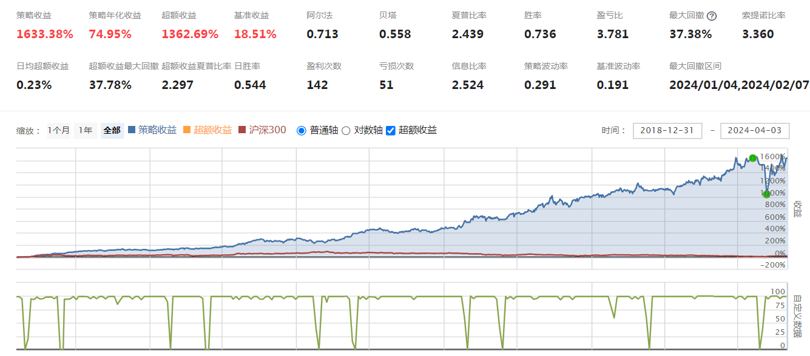

```python linenums="1"
from kuanke.wizard import *
from jqdata import *
import numpy as np
import pandas as pd
import talib
import datetime
import time
import math
from mysqltrade import *
from six import StringIO,BytesIO
import pandas as pd


## 初始化函数，设定要操作的股票、基准等等
def after_code_changed(context):
    now = context.current_dt.time()
    print("{0}替换了代码".format(now))
    unschedule_all()
    g.strategy = 'dougua1' # 策略名
    g.filename = '中小板修改资金.csv' #入金配置文件名称
    
    g.first = 1
    g.out_cash = 0
    # 设定基准
    set_benchmark('000300.XSHG')
    # 设定滑点
    set_slippage(FixedSlippage(0.01))
    # True为开启动态复权模式，使用真实价格交易
    set_option('use_real_price', True)
    # 设定成交量比例
    set_option('order_volume_ratio', 1)
    # 股票类交易手续费是：买入时佣金万分之三，卖出时佣金万分之三加千分之一印花税, 每笔交易佣金最低扣5块钱
    set_order_cost(OrderCost(open_tax=0, close_tax=0.0005, open_commission=0.0003, close_commission=0.0003, min_commission=5), type='stock')

    #容器初始化
    check_container_initialize()
    #动态仓位、频率、计数初始化函数
    check_dynamic_initialize()
    # 股票筛选初始化函数
    check_stocks_initialize()
    # 出场初始化函数
    sell_initialize()
    # 入场初始化函数
    buy_initialize()


    # 关闭提示
    log.set_level('order', 'info')

    # 运行函数
    run_daily(change_cash, "9:30")#检查入金
    run_daily(check_stocks, '9:31') #选股
    run_daily(main_stock_pick, '9:31') #买入卖出列表
    #run_daily(sell_every_day,'open') #卖出未卖出成功的股票
    run_daily(trade, '9:31') #交易
    run_daily(no_zt_sell, '14:50')
    run_daily(selled_security_list_count, 'after_close') #卖出股票日期计数
    run_daily(after_market_close, 'after_close') #卖出股票日期计数
    
    
    
#######################！！！新手需要使用的地方！！！###################################################
##动态仓位、频率、计数初始化函数(持仓比例，选股频率，买入频率，卖出频率在这里设置)
def check_dynamic_initialize():
    # 个股最大持仓比重
    g.security_max_proportion = 1
    # 选股和买卖频率
    g.check_stocks_refresh_rate = 1
    # 最大建仓数量
    g.max_hold_stocknum = 5
    #跌出多少排名卖出
    g.sell_rank = 7
    
    #下面这几项不用管
    # 买入频率
    g.buy_refresh_rate = 1
    # 卖出频率
    g.sell_refresh_rate = 1

    # 选股频率计数器
    g.check_stocks_days = 0
    #机器学习选股频率计数器
    g.days = 0
    # 买卖交易频率计数器
    g.buy_trade_days=0
    g.sell_trade_days=0
    
    
## 股票池初筛设置函数(股票初筛在这里设置)
def check_stocks_initialize():
    # 是否过滤停盘
    g.filter_paused = True
    # 是否过滤退市
    g.filter_delisted = True
    # 是否只有ST
    g.only_st = False
    # 是否过滤ST
    g.filter_st = True
    # 股票池(填指数)
    g.security_universe_index = ['all_a_securities']#这里填写指数，全部股票就填['all_a_securities']，沪深300股票就填['000300.XSHG'],中证500就填['000905.XSHG'],沪深300+中证500就填['000300.XSHG','000905.XSHG']
    # 填成分股(填成分股)
    g.security_universe_user_securities = []
    # 行业列表
    g.industry_list = ["801010","801020","801030","801040","801050","801080","801110","801120","801130","801140","801150","801160","801170","801180","801200","801210","801230","801710","801720","801730","801740","801750","801760","801770","801780","801790","801880","801890"]
    # 概念列表
    g.concept_list = []
    # 黑名单
    g.blacklist=[]
    
## 买入股票，卖出股票筛选函数
def main_stock_pick(context):
    if g.days % g.check_stocks_refresh_rate != 0:
        g.days +=1
        return
    g.sell_stock_list=[]
    g.buy_stock_list = []
    
    mon = context.current_dt.month
    day = context.current_dt.day
    if (mon ==4 or mon == 1) and day>=20:
        s_list = list(context.portfolio.positions.keys())
        print(s_list)
        for s in s_list:
            order_target_value_(context,s, 0)
        return

####自定义编辑范围#####    

#中小板小市值

    g.check_out_lists = [stock for stock in g.check_out_lists if stock[0:3] == '002'] #只买深市A股中小板

    q = query(valuation.code, valuation.circulating_market_cap).order_by(
            valuation.circulating_market_cap.asc()).filter(
            valuation.code.in_(g.check_out_lists),
            valuation.circulating_market_cap <= 100).limit(100)
    df = get_fundamentals(q)
    stockset = list(df['code'])
    stockset = stockset[:20]

    g.sell_stock_list1 = list(context.portfolio.positions.keys())


    g.ZT=[] #涨停列表
    
    for stock in g.sell_stock_list1:
        if stock in g.paused:
            continue
        elif stock not in stockset[:g.sell_rank]:
            
            df2=attribute_history(stock,count=2,unit='1d',\
                          fields=['open','close','volume','high','low','money','high_limit','low_limit','paused'],\
                          fq='pre')

            if (df2['close'][-1]==df2['high_limit'][-1] and df2['volume'][-1]>0 and df2['money'][-1]>0):
                g.ZT.append(stock)
            else:
                g.sell_stock_list.append(stock)


    for stock in stockset[:g.max_hold_stocknum]:
        if stock in g.sell_stock_list:
            pass
        else:
            g.buy_stock_list.append(stock) 

    g.paused = []        
    current_data = get_current_data()
    g.paused = [stock for stock in g.sell_stock_list1 if  current_data[stock].paused]
            
####自定义编辑范围#####              

    log.info('卖出列表:',g.sell_stock_list)
    log.info('购买列表:',g.buy_stock_list)
    g.days =1
    return g.sell_stock_list,g.buy_stock_list  
    
    
#######################！！！新手需要使用的地方！！！###################################################

#不涨停就卖出

def no_zt_sell(context):
    c=[]
    for stock in g.ZT:
        df2_3=attribute_history(stock,count=1,unit='1m',fields=['close','high_limit'],fq='pre')
        if df2_3['close'][-1]==df2_3['high_limit'][-1]:
            c.append(stock)
        else:
            order_target_(context,stock, 0)


## 收盘后运行函数  
def after_market_close(context):
    #得到当天所有成交记录
    trades = get_trades()
    for _trade in trades.values():
        log.info('成交记录：'+str(_trade))
    #打印账户总资产
    log.info('今日账户总资产：%s'%round(context.portfolio.total_value,2))
    #log.info('##############################################################')
    # 计算当前仓位
    record(P=(100-math.ceil(context.portfolio.available_cash / context.portfolio.total_value * 100)))


##容器初始化(有新的全局容器可以加到这里)(新手忽略这里)
def check_container_initialize():
    #卖出股票列表
    g.sell_stock_list=[]
    #买入股票列表
    g.buy_stock_list = []
    # 获取未卖出的股票
    g.open_sell_securities = []
    # 卖出股票的dict
    g.selled_security_list={}
    #涨停股票列表
    g.ZT=[]    
    

## 出场初始化函数(新手忽略这里)
def sell_initialize():
    # 设定是否卖出buy_lists中的股票
    g.sell_will_buy = True

    # 固定出仓的数量或者百分比
    g.sell_by_amount = None
    g.sell_by_percent = None

## 入场初始化函数(新手忽略这里)
def buy_initialize():
    # 是否可重复买入
    g.filter_holded = False

    # 委托类型
    g.order_style_str = 'by_cap_mean'
    g.order_style_value = 100


## 股票初筛(新手忽略这里)
def check_stocks(context):
    if g.check_stocks_days%g.check_stocks_refresh_rate != 0:
        # 计数器加一
        g.check_stocks_days += 1
        return
    # 股票池赋值
    g.check_out_lists = get_security_universe(context, g.security_universe_index, g.security_universe_user_securities)
    # 行业过滤
    #g.check_out_lists = industry_filter(context, g.check_out_lists, g.industry_list)
    # 概念过滤
    #g.check_out_lists = concept_filter(context, g.check_out_lists, g.concept_list)
    # 过滤ST股票
    g.check_out_lists = st_filter(context, g.check_out_lists)
    # 过滤停牌股票
    g.check_out_lists = paused_filter(context, g.check_out_lists)
    # 过滤退市股票
    g.check_out_lists = delisted_filter(context, g.check_out_lists)
    # 过滤黑名单股票
    g.check_out_lists = [s for s in g.check_out_lists if s not in g.blacklist]
    # 计数器归一
    g.check_stocks_days = 1
    return


## 卖出未卖出成功的股票(新手忽略这里)
def sell_every_day(context):
    g.open_sell_securities = list(set(g.open_sell_securities))
    open_sell_securities = [s for s in context.portfolio.positions.keys() if s in g.open_sell_securities]
    if len(open_sell_securities)>0:
        for stock in open_sell_securities:
            order_target_value_(context,stock, 0)
    g.open_sell_securities = [s for s in g.open_sell_securities if s in context.portfolio.positions.keys()]
    return


## 交易函数(新手忽略这里)
def trade(context):
    
   # 初始化买入列表
    buy_lists = []

    # 买入股票筛选
    if g.buy_trade_days%g.buy_refresh_rate == 0:
        # 获取 buy_lists 列表
        buy_lists = g.buy_stock_list
        # 过滤涨停股票
        buy_lists = high_limit_filter(context, buy_lists)
        log.info('购买列表最终',buy_lists)

    # 卖出操作
    if g.sell_trade_days%g.sell_refresh_rate != 0:
        # 计数器加一
        g.sell_trade_days += 1
    else:
        # 卖出股票
        sell(context, buy_lists)
        # 计数器归一
        g.sell_trade_days = 1


    # 买入操作
    if g.buy_trade_days%g.buy_refresh_rate != 0:
        # 计数器加一
        g.buy_trade_days += 1
    else:
        # 卖出股票
        buy(context, buy_lists)
        # 计数器归一
        g.buy_trade_days = 1


##################################  交易函数群 ##################################(新手忽略)

# 交易函数 - 出场
def sell(context, buy_lists):
    # 获取 sell_lists 列表
    init_sl = context.portfolio.positions.keys()
    sell_lists = context.portfolio.positions.keys()

    # 判断是否卖出buy_lists中的股票
    if not g.sell_will_buy:
        sell_lists = [security for security in sell_lists if security not in buy_lists]

    ### _出场函数筛选-开始 ###
    sell_lists = g.sell_stock_list
    ### _出场函数筛选-结束 ###

    # 卖出股票
    if len(sell_lists)>0:
        for stock in sell_lists:
            order_target_(context, stock, 0)

    # 获取卖出的股票, 并加入到 g.selled_security_list中
    selled_security_list_dict(context,init_sl)

    return

# 交易函数 - 入场
def buy(context, buy_lists):

    # 判断是否可重复买入
    buy_lists = holded_filter(context,buy_lists)

    # 获取最终的 buy_lists 列表
    Num = g.max_hold_stocknum - len(context.portfolio.positions)
    buy_lists = buy_lists[:Num]

    # 买入股票
    if len(buy_lists)>0:
        # 分配资金
        for stock in buy_lists:
            position_count = len(context.portfolio.positions)
            if g.max_hold_stocknum > position_count:
                value = (context.portfolio.cash+g.out_cash) / (g.max_hold_stocknum - position_count)
                if context.portfolio.positions[stock].total_amount == 0:
                    order_target_value_(context,stock, value)
    return


###################################  公用函数群 ##################################(新手忽略)


## 过滤同一标的继上次卖出N天不再买入
def filter_n_tradeday_not_buy(security, n=0):
    try:
        if (security in g.selled_security_list.keys()) and (g.selled_security_list[security]<n):
            return False
        return True
    except:
        return True

## 是否可重复买入
def holded_filter(context,security_list):
    if not g.filter_holded:
        security_list = [stock for stock in security_list if stock not in context.portfolio.positions.keys()]
    # 返回结果
    return security_list

## 卖出股票加入dict
def selled_security_list_dict(context,security_list):
    selled_sl = [s for s in security_list if s not in context.portfolio.positions.keys()]
    if len(selled_sl)>0:
        for stock in selled_sl:
            g.selled_security_list[stock] = 0

## 过滤停牌股票
def paused_filter(context, security_list):
    if g.filter_paused:
        current_data = get_current_data()
        security_list = [stock for stock in security_list if not current_data[stock].paused]
    # 返回结果
    return security_list

## 过滤退市股票
def delisted_filter(context, security_list):
    if g.filter_delisted:
        current_data = get_current_data()
        security_list = [stock for stock in security_list if not (('退' in current_data[stock].name) or ('*' in current_data[stock].name))]
    # 返回结果
    return security_list


## 过滤ST股票
def st_filter(context, security_list):
    if g.only_st:
        current_data = get_current_data()
        security_list = [stock for stock in security_list if current_data[stock].is_st]
    else:
        if g.filter_st:
            current_data = get_current_data()
            security_list = [stock for stock in security_list if not current_data[stock].is_st]
    # 返回结果
    return security_list

# 过滤涨停股票
def high_limit_filter(context, security_list):
    current_data = get_current_data()
    security_list = [stock for stock in security_list if not (current_data[stock].last_price >= current_data[stock].high_limit)]
    # 返回结果
    return security_list

# 获取股票股票池
def get_security_universe(context, security_universe_index, security_universe_user_securities):
    temp_index = []
    for s in security_universe_index:
        if s == 'all_a_securities':
            temp_index += list(get_all_securities(['stock'], context.current_dt.date()).index)
        else:
            temp_index += get_index_stocks(s)
    for x in security_universe_user_securities:
        temp_index += x
    return  sorted(list(set(temp_index)))

# 行业过滤
def industry_filter(context, security_list, industry_list):
    if len(industry_list) == 0:
        # 返回股票列表
        return security_list
    else:
        securities = []
        for s in industry_list:
            temp_securities = get_industry_stocks(s)
            securities += temp_securities
        security_list = [stock for stock in security_list if stock in securities]
        # 返回股票列表
        return security_list

# 概念过滤
def concept_filter(context, security_list, concept_list):
    if len(concept_list) == 0:
        return security_list
    else:
        securities = []
        for s in concept_list:
            temp_securities = get_concept_stocks(s)
            securities += temp_securities
        security_list = [stock for stock in security_list if stock in securities]
        # 返回股票列表
        return security_list
        
## 卖出股票日期计数
def selled_security_list_count(context):
    #g.daily_risk_management = True
    if len(g.selled_security_list)>0:
        for stock in g.selled_security_list.keys():
            g.selled_security_list[stock] += 1
            
#获取交易日
def shifttradingday(date,shift):
    #获取N天前的交易日日期
    # 获取所有的交易日，返回一个包含所有交易日的 list,元素值为 datetime.date 类型.
    tradingday = get_all_trade_days()
    # 得到date之后shift天那一天在列表中的行标号 返回一个数
    shiftday_index = list(tradingday).index(date)+shift
    # 根据行号返回该日日期 为datetime.date类型
    return tradingday[shiftday_index]    
    
    
def change_cash(context): 
    if g.first == 1:
        data1 = {  
            '入金金额': 0,  
            '是否生效': "否",  
            '是否清仓后重新买入': "否"
        }  
        df2 = pd.DataFrame([data1], columns=['入金金额', '是否生效', '是否清仓后重新买入'])  
        write_file(g.filename, df2.to_csv(index=False), append=False)
        g.first = 0
    if g.out_cash < 0:
        inout_cash(g.out_cash, pindex=0)
        g.out_cash = 0
    else:
        try:
    
            df2 = pd.read_csv(BytesIO(read_file(g.filename)))
            log.info("入金文件",df2)
            single =  df2.at[0,"是否生效"]
            log.info("入金信号",single)
            is_sell = df2.at[0,"是否清仓后重新买入"]
            if single =="是":
                if is_sell == "是":
                    log.info("入金后先清仓，再重新买入，清仓股票为",list(context.portfolio.positions.keys()))
                    for s in context.portfolio.positions:
                        order_target_(context,s, 0)
                df2.loc[0,"是否清仓后重新买入"] = "否"    
                change_cash = df2.at[0,"入金金额"]
                log.info("入金金额",change_cash)
                if change_cash < 0 :
                    g.out_cash = change_cash
                else:
                    inout_cash(change_cash, pindex=0)
                df2.loc[0,"是否生效"] = "否" 
                log.info("重置后",df2)
                write_file(g.filename, df2.to_csv(index=False), append=False)
    
        except Exception as e:
            log.info("修改资金发生错误: {}".format(e))  

# end
```

### 4.7 中小板小市值-国九升级版-1月4月空仓-调仓时间随机(自动交易)

中小板小市值更新了一版，主要是为了适应新国九的条件，国九对小票影响最大的条件是【财务类退市】：年报利润总额、净利润、扣非净利润三者孰低为负值且主板扣除后营收低于3亿元。

主要针对这条进行筛选，至于分红被ST的问题，这个我认为不是特别大的风险，只要规避掉4月下半月，基本没什么问题。

这次还增加了一个调仓时间随机的逻辑，策略会在首次运行的时候，随机在9点32分-9点45分之间选择一个时间，之后策略就会按照随机的这个时间进行交易。这样做的目的是尽量规避掉大家集中交易的问题，当然如果自己自定义为自己想要的时间也很简单，只要把这两处的 `g.trade_time` 删除，并修改为你想要的时间即可。

```python linenums="1" hl_lines="3-4"
run_dai1y(change_cash,"9:30")  # 检查入
run_dai1y(check_stocks,'9:31')  # 选股
run_daily(main_stock_pick, g.trade_time)  # 买入卖出列表
run_daily(trade,g.trade_time)  # 交易
run_dai1y(no_zt_se11, '14:49')
run_daily(selled_security_1ist_count, 'after_close') #
run_daily(after_market_close, 'after_close') #卖出股票日
```

另外，空仓的时间也设置了两个参数，策略默认是1月1日-1月31日空仓，4月1日到4月30日空仓。如果想修改，只需要在下图这里改就行了，比如你想改为1月和4月的15号后空仓，那么就把 `g.notrade_day` 设置为 15 即可。

```python linenums="1" hl_lines="1"
# 取人建仓数量
g.max_hold_stocknum日5
# 跌出多少排名卖出
g.sel1_rank = 7
g.notrade_mon =[1, 4]  #1月和4月
g.notrade_day = 1  # 1月和4月的10号后
```

中小板小市值策略，依然会贯彻大道至简的原则，不会增加复杂的止损止盈和择时逻辑，只会加必要的筛选逻辑。

加上以上条件后，2019年1月1日----2024年12月25日，收益是2884%，年化80%，最大回撤-30%，总体还是不错的。

详细说一下这个策略优化后的逻辑：

- **选股逻辑**：选择股票代码开头1位是“0”开头，净利润大于0，归母净利润大于0，扣非净利润大于0，上个季度营收大于1亿。
- **排序逻辑**：按照市值从小到大排序，买入市值最小的5只票。
- **买卖逻辑**：按照市值轮动，每天检查一次，一旦市值掉出最小的前7，就卖出，并重新买入当前排名前5的票。
- **择时逻辑**：每年1月1日-1月31日空仓，4月1日到4月30日空仓。
- **资金分配**：动态等权重买入，比如用10万跑这个策略，当前持仓1只（4万元），还剩6万，且还有4只可以买，那么剩下4只就是6/4=1.5万元每只。


```python linenums="1"
from kuanke.wizard import *
from jqdata import *
import numpy as np
import pandas as pd
import talib
import datetime
import time
import math
from mysqltrade import *
from six import StringIO,BytesIO
import pandas as pd


## 初始化函数，设定要操作的股票、基准等等
def after_code_changed(context):
    now = context.current_dt.time()
    print("{0}替换了代码".format(now))
    unschedule_all()
    g.strategy = 'dougua1' # 策略名
    g.filename = '中小板国九修改资金.csv' #入金配置文件名称
    
    g.first = 1
    g.out_cash = 0
    g.paused = [] 
    g.check_out_lists = []
    # 设定基准
    set_benchmark('000300.XSHG')
    # 设定滑点
    set_slippage(FixedSlippage(0))
    # True为开启动态复权模式，使用真实价格交易
    set_option('use_real_price', True)
    # 设定成交量比例
    set_option('order_volume_ratio', 1)
    # 股票类交易手续费是：买入时佣金万分之三，卖出时佣金万分之三加千分之一印花税, 每笔交易佣金最低扣5块钱
    set_order_cost(OrderCost(open_tax=0, close_tax=0.0005, open_commission=0.0003, close_commission=0.0003, min_commission=5), type='stock')

    #容器初始化
    check_container_initialize()
    #动态仓位、频率、计数初始化函数
    check_dynamic_initialize()
    # 股票筛选初始化函数
    check_stocks_initialize()
    # 出场初始化函数
    sell_initialize()
    # 入场初始化函数
    buy_initialize()
    # 计算时间范围内的分钟数
    start_minute = 9 * 60 + 32  # 9点32分转换为一天中的分钟数
    end_minute = 9 * 60 + 45    # 9点45分转换为一天中的分钟数
    # 生成随机分钟数
    random_minute = random.randint(start_minute, end_minute)
    # 将随机分钟数转换回小时和分钟
    random_hour = random_minute // 60
    random_minute = random_minute % 60
    g.trade_time=f"{random_hour}:{random_minute}"
    print("trade_time",g.trade_time)
    # 关闭提示
    log.set_level('order', 'info')

    # 运行函数
    run_daily(change_cash, "9:30")#检查入金
    run_daily(check_stocks, '9:31') #选股
    run_daily(main_stock_pick, g.trade_time) #买入卖出列表
    run_daily(trade, g.trade_time) #交易
    run_daily(no_zt_sell, '14:49')
    run_daily(selled_security_list_count, 'after_close') #卖出股票日期计数
    run_daily(after_market_close, 'after_close') #卖出股票日期计数
    
    
    
#######################！！！新手需要使用的地方！！！###################################################
##动态仓位、频率、计数初始化函数(持仓比例，选股频率，买入频率，卖出频率在这里设置)
def check_dynamic_initialize():
    # 个股最大持仓比重
    g.security_max_proportion = 1
    # 选股和买卖频率
    g.check_stocks_refresh_rate = 1
    # 最大建仓数量
    g.max_hold_stocknum = 5
    #跌出多少排名卖出
    g.sell_rank = 7
    
    g.notrade_mon = [1,4] #1月和4月空仓
    g.notrade_day = 1 #1月和4月的1号后空仓
    #下面这几项不用管
    # 买入频率
    g.buy_refresh_rate = 1
    # 卖出频率
    g.sell_refresh_rate = 1

    # 选股频率计数器
    g.check_stocks_days = 1
    #机器学习选股频率计数器
    g.days = 0
    # 买卖交易频率计数器
    g.buy_trade_days=0
    g.sell_trade_days=0
    
    
## 股票池初筛设置函数(股票初筛在这里设置)
def check_stocks_initialize():
    # 是否过滤停盘
    g.filter_paused = True
    # 是否过滤退市
    g.filter_delisted = True
    # 是否只有ST
    g.only_st = False
    # 是否过滤ST
    g.filter_st = True
    # 股票池(填指数)
    g.security_universe_index = ['all_a_securities']#这里填写指数，全部股票就填['all_a_securities']，沪深300股票就填['000300.XSHG'],中证500就填['000905.XSHG'],沪深300+中证500就填['000300.XSHG','000905.XSHG']
    # 填成分股(填成分股)
    g.security_universe_user_securities = []
    # 行业列表
    g.industry_list = ["801010","801020","801030","801040","801050","801080","801110","801120","801130","801140","801150","801160","801170","801180","801200","801210","801230","801710","801720","801730","801740","801750","801760","801770","801780","801790","801880","801890"]
    # 概念列表
    g.concept_list = []
    # 黑名单
    g.blacklist=[]
    g.notbuy = []
    
## 买入股票，卖出股票筛选函数
def main_stock_pick(context):
    if g.days % g.check_stocks_refresh_rate != 0:
        g.days +=1
        return
    g.sell_stock_list=[]
    g.buy_stock_list = []
    
    mon = context.current_dt.month
    day = context.current_dt.day
    if (mon in g.notrade_mon) and day>=g.notrade_day:
        s_list = list(context.portfolio.positions.keys())
        print(s_list)
        for s in s_list:
            order_target_value_(context,s, 0)
        return

####自定义编辑范围#####    

#中小板小市值

    g.check_out_lists = [stock for stock in g.check_out_lists if stock[0:1] == '0'] #只买深市A股中小板

    q = query(
        valuation.code,
    ).filter(
        valuation.code.in_(g.check_out_lists),
        income.np_parent_company_owners > 0,   # 归属于母公司所有者的净利润(元)
        income.net_profit > 0,  # 净利润(元)
        indicator.adjusted_profit>0,#扣非净利润（元）
        income.operating_revenue > 1e8 # 营业收入 (元)
    ).order_by(valuation.market_cap.asc()).limit(g.max_hold_stocknum*5)
    df = get_fundamentals(q)
    final_list = df['code'].tolist()
    stockset = final_list[:20]
    stockset = [stock for stock in stockset if stock not in g.notbuy] #过滤卖掉的股票
    

    g.sell_stock_list1 = list(context.portfolio.positions.keys())


    g.ZT=[] #涨停列表
    
    for stock in g.sell_stock_list1:
        
        df2=attribute_history(stock,count=2,unit='1d',\
                      fields=['open','close','volume','high','low','money','high_limit','low_limit','paused'],\
                      fq='pre')

        if stock in g.paused:
            continue
        elif df2['close'][-1]==df2['high_limit'][-1]:
            g.ZT.append(stock)
            
        elif (stock not in stockset[:g.sell_rank]) and (stock not in g.ZT):
                g.sell_stock_list.append(stock)


    for stock in stockset[:g.max_hold_stocknum]:
        if stock in g.sell_stock_list:
            pass
        else:
            g.buy_stock_list.append(stock) 

    g.paused = []        
    current_data = get_current_data()
    g.paused = [stock for stock in g.sell_stock_list1 if  current_data[stock].paused]
            
####自定义编辑范围#####              

    #log.info('卖出列表:',g.sell_stock_list)
    #log.info('购买列表:',g.buy_stock_list)
    g.days =1
    return g.sell_stock_list,g.buy_stock_list  
    
    
#######################！！！新手需要使用的地方！！！###################################################

#不涨停就卖出

def no_zt_sell(context):
    c=[]
    g.notbuy = []
    for stock in g.ZT:
        df2_3=attribute_history(stock,count=1,unit='1m',fields=['close','high_limit'],fq='pre')
        if df2_3['close'][-1]==df2_3['high_limit'][-1]:
            c.append(stock)
        else:
            order_target_(context,stock, 0)
            g.notbuy.append(stock)


## 收盘后运行函数  
def after_market_close(context):
    #得到当天所有成交记录
    trades = get_trades()
    for _trade in trades.values():
        log.info('成交记录：'+str(_trade))
    #打印账户总资产
    log.info('今日账户总资产：%s'%round(context.portfolio.total_value,2))
    #log.info('##############################################################')
    # 计算当前仓位
    record(P=(100-math.ceil(context.portfolio.available_cash / context.portfolio.total_value * 100)))


##容器初始化(有新的全局容器可以加到这里)(新手忽略这里)
def check_container_initialize():
    #卖出股票列表
    g.sell_stock_list=[]
    #买入股票列表
    g.buy_stock_list = []
    # 获取未卖出的股票
    g.open_sell_securities = []
    # 卖出股票的dict
    g.selled_security_list={}
    #涨停股票列表
    g.ZT=[]    
    

## 出场初始化函数(新手忽略这里)
def sell_initialize():
    # 设定是否卖出buy_lists中的股票
    g.sell_will_buy = True

    # 固定出仓的数量或者百分比
    g.sell_by_amount = None
    g.sell_by_percent = None

## 入场初始化函数(新手忽略这里)
def buy_initialize():
    # 是否可重复买入
    g.filter_holded = False

    # 委托类型
    g.order_style_str = 'by_cap_mean'
    g.order_style_value = 100


## 股票初筛(新手忽略这里)
def check_stocks(context):
    if g.check_stocks_days%g.check_stocks_refresh_rate != 0:
        # 计数器加一
        g.check_stocks_days += 1
        return
    # 股票池赋值
    g.check_out_lists = get_security_universe(context, g.security_universe_index, g.security_universe_user_securities)
    # 行业过滤
    #g.check_out_lists = industry_filter(context, g.check_out_lists, g.industry_list)
    # 概念过滤
    #g.check_out_lists = concept_filter(context, g.check_out_lists, g.concept_list)
    # 过滤ST股票
    g.check_out_lists = st_filter(context, g.check_out_lists)
    # 过滤停牌股票
    g.check_out_lists = paused_filter(context, g.check_out_lists)
    # 过滤退市股票
    g.check_out_lists = delisted_filter(context, g.check_out_lists)
    # 过滤黑名单股票
    g.check_out_lists = [s for s in g.check_out_lists if s not in g.blacklist]
    # 计数器归一
    g.check_stocks_days = 1
    return


## 卖出未卖出成功的股票(新手忽略这里)
def sell_every_day(context):
    g.open_sell_securities = list(set(g.open_sell_securities))
    open_sell_securities = [s for s in context.portfolio.positions.keys() if s in g.open_sell_securities]
    if len(open_sell_securities)>0:
        for stock in open_sell_securities:
            order_target_value_(context,stock, 0)
    g.open_sell_securities = [s for s in g.open_sell_securities if s in context.portfolio.positions.keys()]
    return


## 交易函数(新手忽略这里)
def trade(context):
    
   # 初始化买入列表
    buy_lists = []

    # 买入股票筛选
    if g.buy_trade_days%g.buy_refresh_rate == 0:
        # 获取 buy_lists 列表
        buy_lists = g.buy_stock_list
        # 过滤涨停股票
        buy_lists = high_limit_filter(context, buy_lists)
        #log.info('购买列表最终',buy_lists)

    # 卖出操作
    if g.sell_trade_days%g.sell_refresh_rate != 0:
        # 计数器加一
        g.sell_trade_days += 1
    else:
        # 卖出股票
        sell(context, buy_lists)
        # 计数器归一
        g.sell_trade_days = 1


    # 买入操作
    if g.buy_trade_days%g.buy_refresh_rate != 0:
        # 计数器加一
        g.buy_trade_days += 1
    else:
        # 卖出股票
        buy(context, buy_lists)
        # 计数器归一
        g.buy_trade_days = 1


##################################  交易函数群 ##################################(新手忽略)

# 交易函数 - 出场
def sell(context, buy_lists):
    # 获取 sell_lists 列表
    init_sl = context.portfolio.positions.keys()
    sell_lists = context.portfolio.positions.keys()

    # 判断是否卖出buy_lists中的股票
    if not g.sell_will_buy:
        sell_lists = [security for security in sell_lists if security not in buy_lists]

    ### _出场函数筛选-开始 ###
    sell_lists = g.sell_stock_list
    ### _出场函数筛选-结束 ###

    # 卖出股票
    if len(sell_lists)>0:
        for stock in sell_lists:
            order_target_(context, stock, 0)

    # 获取卖出的股票, 并加入到 g.selled_security_list中
    selled_security_list_dict(context,init_sl)

    return

# 交易函数 - 入场
def buy(context, buy_lists):

    # 判断是否可重复买入
    buy_lists = holded_filter(context,buy_lists)

    # 获取最终的 buy_lists 列表
    Num = g.max_hold_stocknum - len(context.portfolio.positions)
    buy_lists = buy_lists[:Num]

    # 买入股票
    if len(buy_lists)>0:
        # 分配资金
        for stock in buy_lists:
            position_count = len(context.portfolio.positions)
            if g.max_hold_stocknum > position_count:
                value = (context.portfolio.cash+g.out_cash) / (g.max_hold_stocknum - position_count)
                if context.portfolio.positions[stock].total_amount == 0:
                    order_target_value_(context,stock, value)
    return


###################################  公用函数群 ##################################(新手忽略)


## 过滤同一标的继上次卖出N天不再买入
def filter_n_tradeday_not_buy(security, n=0):
    try:
        if (security in g.selled_security_list.keys()) and (g.selled_security_list[security]<n):
            return False
        return True
    except:
        return True

## 是否可重复买入
def holded_filter(context,security_list):
    if not g.filter_holded:
        security_list = [stock for stock in security_list if stock not in context.portfolio.positions.keys()]
    # 返回结果
    return security_list

## 卖出股票加入dict
def selled_security_list_dict(context,security_list):
    selled_sl = [s for s in security_list if s not in context.portfolio.positions.keys()]
    if len(selled_sl)>0:
        for stock in selled_sl:
            g.selled_security_list[stock] = 0

## 过滤停牌股票
def paused_filter(context, security_list):
    if g.filter_paused:
        current_data = get_current_data()
        security_list = [stock for stock in security_list if not current_data[stock].paused]
    # 返回结果
    return security_list

## 过滤退市股票
def delisted_filter(context, security_list):
    if g.filter_delisted:
        current_data = get_current_data()
        security_list = [stock for stock in security_list if not (('退' in current_data[stock].name) or ('*' in current_data[stock].name))]
    # 返回结果
    return security_list


## 过滤ST股票
def st_filter(context, security_list):
    if g.only_st:
        current_data = get_current_data()
        security_list = [stock for stock in security_list if current_data[stock].is_st]
    else:
        if g.filter_st:
            current_data = get_current_data()
            security_list = [stock for stock in security_list if not current_data[stock].is_st]
    # 返回结果
    return security_list

# 过滤涨停股票
def high_limit_filter(context, security_list):
    current_data = get_current_data()
    security_list = [stock for stock in security_list if not (current_data[stock].last_price >= current_data[stock].high_limit)]
    # 返回结果
    return security_list

# 获取股票股票池
def get_security_universe(context, security_universe_index, security_universe_user_securities):
    temp_index = []
    for s in security_universe_index:
        if s == 'all_a_securities':
            temp_index += list(get_all_securities(['stock'], context.current_dt.date()).index)
        else:
            temp_index += get_index_stocks(s)
    for x in security_universe_user_securities:
        temp_index += x
    return  sorted(list(set(temp_index)))

# 行业过滤
def industry_filter(context, security_list, industry_list):
    if len(industry_list) == 0:
        # 返回股票列表
        return security_list
    else:
        securities = []
        for s in industry_list:
            temp_securities = get_industry_stocks(s)
            securities += temp_securities
        security_list = [stock for stock in security_list if stock in securities]
        # 返回股票列表
        return security_list

# 概念过滤
def concept_filter(context, security_list, concept_list):
    if len(concept_list) == 0:
        return security_list
    else:
        securities = []
        for s in concept_list:
            temp_securities = get_concept_stocks(s)
            securities += temp_securities
        security_list = [stock for stock in security_list if stock in securities]
        # 返回股票列表
        return security_list
        
## 卖出股票日期计数
def selled_security_list_count(context):
    #g.daily_risk_management = True
    if len(g.selled_security_list)>0:
        for stock in g.selled_security_list.keys():
            g.selled_security_list[stock] += 1
            
#获取交易日
def shifttradingday(date,shift):
    #获取N天前的交易日日期
    # 获取所有的交易日，返回一个包含所有交易日的 list,元素值为 datetime.date 类型.
    tradingday = get_all_trade_days()
    # 得到date之后shift天那一天在列表中的行标号 返回一个数
    shiftday_index = list(tradingday).index(date)+shift
    # 根据行号返回该日日期 为datetime.date类型
    return tradingday[shiftday_index]  
    
#2.1 筛选审计意见
def filter_audit(context, code):
    # 获取审计意见，近三年内如果有不合格(report_type为2、3、4、5)的审计意见则返回False，否则返回True
    lstd = context.previous_date
    last_year = lstd.replace(year=lstd.year - 3, month=1, day=1)
    q=query(finance.STK_AUDIT_OPINION.code, finance.STK_AUDIT_OPINION.report_type
          ).filter(finance.STK_AUDIT_OPINION.code==code,finance.STK_AUDIT_OPINION.pub_date>=last_year)
    df=finance.run_query(q)
    df['report_type'] = df['report_type'].astype(str)
    contains_nums = df['report_type'].str.contains(r'2|3|4|5')
    return not contains_nums.any()
    
    
def change_cash(context): 
    if g.first == 1:
        data1 = {  
            '入金金额': 0,  
            '是否生效': "否",  
            '是否清仓后重新买入': "否"
        }  
        df2 = pd.DataFrame([data1], columns=['入金金额', '是否生效', '是否清仓后重新买入'])  
        write_file(g.filename, df2.to_csv(index=False), append=False)
        g.first = 0
    if g.out_cash < 0:
        inout_cash(g.out_cash, pindex=0)
        g.out_cash = 0
    else:
        try:
    
            df2 = pd.read_csv(BytesIO(read_file(g.filename)))
            log.info("入金文件",df2)
            single =  df2.at[0,"是否生效"]
            log.info("入金信号",single)
            is_sell = df2.at[0,"是否清仓后重新买入"]
            if single =="是":
                if is_sell == "是":
                    log.info("入金后先清仓，再重新买入，清仓股票为",list(context.portfolio.positions.keys()))
                    for s in context.portfolio.positions:
                        order_target_(context,s, 0)
                df2.loc[0,"是否清仓后重新买入"] = "否"    
                change_cash = df2.at[0,"入金金额"]
                log.info("入金金额",change_cash)
                if change_cash < 0 :
                    g.out_cash = change_cash
                else:
                    inout_cash(change_cash, pindex=0)
                df2.loc[0,"是否生效"] = "否" 
                log.info("重置后",df2)
                write_file(g.filename, df2.to_csv(index=False), append=False)
    
        except Exception as e:
            log.info("修改资金发生错误: {}".format(e))  

# end
```

### 4.8 基本面小市值（自动交易）

实时模拟该策略时 ，有几点优化：

1. 支持修改策略资金。举个例子，你先用5万运行了基本面小市值，你想要加仓1万，或者减仓1万，那么就可以用下面这个方式进行操作。

策略开始运行后，会在研究环境生成一个文件，叫：基本面小市值修改资金.csv。

点开这个文件就可以修改策略资金了。举个例子，你如果想加仓10000，那就可以把下面这个（0,否,否），改成（10000，是，是）。如果你想减仓10000，那就改成（-10000，是，是）。然后点击左上角文件---保存，就可以生效了。

这里我做了一个设定，一旦你增加或者减少了资金，当天就会清仓重买。
注意：修改资金，不能在交易日的早上8点---下午4点修改，一定要在盘后修改，早上8点--下午4点修改可能会导致策略出错。

2. 替换代码：我做了优化，模拟交易你如果要修改代码，直接用【替换代码】功能，替换为你修改后的回测就可以了。不要用【修改代码】，要用【替换代码】

```python linenums="1"
#导入函数库
from jqdata import *
from jqfactor import get_factor_values
import numpy as np
import pandas as pd
from six import StringIO,BytesIO
from mysqltrade import *

def after_code_changed(context):
    now = context.current_dt.time()
    print("{0}替换了代码".format(now))
    unschedule_all()

    g.strategy = 'dougua1' # 策略名
    g.filename = '基本面小市值修改资金.csv' #入金配置文件名称

    g.first = 1
    g.out_cash = 0
    g.high_limit_list = []
    g.stock_num = 5 #持仓数
    # 设置交易时间
    run_daily(prepare_stock_list, time='9:15') #每日9:15跑一次股票池
    run_daily(change_cash, "9:30")#检查入金
    run_monthly(my_trade, 1, time='9:35') #每月第一个交易日交易
    run_daily(check_limit_up, time='14:00') #每日14:30检查一下持仓股中是否有涨停票
    run_daily(print_trade_info, time='15:30')

#2-1 选股模块
def get_factor_filter_list(context,stock_list,jqfactor,sort,p1,p2):
    yesterday = context.previous_date
    score_list = get_factor_values(stock_list, jqfactor, end_date=yesterday, count=1)[jqfactor].iloc[0].tolist()
    df = pd.DataFrame(columns=['code','score'])
    df['code'] = stock_list
    df['score'] = score_list
    df.dropna(inplace=True)
    df.sort_values(by='score', ascending=sort, inplace=True)
    filter_list = list(df.code)[int(p1*len(stock_list)):int(p2*len(stock_list))]
    return filter_list

#2-2 选股模块
def get_stock_list(context):
    initial_list = get_all_securities().index.tolist()
    initial_list = filter_new_stock(context,initial_list)
    initial_list = filter_kcbj_stock(initial_list)
    initial_list = filter_st_stock(initial_list)
    peg_list = get_factor_filter_list(context, initial_list, 'PEG', True, 0, 0.1)
    test_list = get_factor_filter_list(context, peg_list, 'EBIT', True, 0, 0.25)
    q = query(valuation.code,valuation.market_cap).filter(valuation.code.in_(test_list)).order_by(valuation.market_cap.asc())
    df = get_fundamentals(q)
    final_list = list(df.code)
    return final_list


#3-1 过滤模块-过滤停牌股票
#输入选股列表，返回剔除停牌股票后的列表
def filter_paused_stock(stock_list):
	current_data = get_current_data()
	return [stock for stock in stock_list if not current_data[stock].paused]

#3-2 过滤模块-过滤ST及其他具有退市标签的股票
#输入选股列表，返回剔除ST及其他具有退市标签股票后的列表
def filter_st_stock(stock_list):
	current_data = get_current_data()
	return [stock for stock in stock_list
			if not current_data[stock].is_st
			and 'ST' not in current_data[stock].name
			and '*' not in current_data[stock].name
			and '退' not in current_data[stock].name]

#3-3 过滤模块-过滤涨停的股票
#输入选股列表，返回剔除未持有且已涨停股票后的列表
def filter_limitup_stock(context, stock_list):
	last_prices = history(1, unit='1m', field='close', security_list=stock_list)
	current_data = get_current_data()
	# 已存在于持仓的股票即使涨停也不过滤，避免此股票再次可买，但因被过滤而导致选择别的股票
	return [stock for stock in stock_list if stock in context.portfolio.positions.keys()
			or last_prices[stock][-1] < current_data[stock].high_limit]

#3-4 过滤模块-过滤跌停的股票
#输入股票列表，返回剔除已跌停股票后的列表
def filter_limitdown_stock(context, stock_list):
	last_prices = history(1, unit='1m', field='close', security_list=stock_list)
	current_data = get_current_data()
	return [stock for stock in stock_list if stock in context.portfolio.positions.keys()
			or last_prices[stock][-1] > current_data[stock].low_limit]

#3-5 过滤模块-过滤科创板北交所
def filter_kcbj_stock(stock_list):
    for stock in stock_list[:]:
        if stock[0] == '4' or stock[0] == '8' or stock[:2] == '68':
            stock_list.remove(stock)
    return stock_list

#3-6 过滤次新股
#输入股票列表，返回剔除上市日期不足250日股票后的列表
def filter_new_stock(context,stock_list):
    yesterday = context.previous_date
    return [stock for stock in stock_list if not yesterday - get_security_info(stock).start_date < datetime.timedelta(days=250)]

#4-1 交易模块
def my_trade(context):  
    #获取选股列表并过滤掉:st,st*,退市,涨停,跌停,停牌  
    check_out_list = get_stock_list(context)  
    check_out_list = filter_limitup_stock(context, check_out_list)  
    check_out_list = filter_limitdown_stock(context, check_out_list)  
    check_out_list = filter_paused_stock(check_out_list)  
    #check_out_list = filter_highprice_stock(context,check_out_list)
    buy_stocks = check_out_list[:g.stock_num]  
    print('今日自选股:{}'.format(buy_stocks))  

    for stock in list(context.portfolio.positions.keys()):
        if stock not in buy_stocks:
            df2=attribute_history(stock,count=2,unit='1d',\
                          fields=['open','close','volume','high','low','money','high_limit','low_limit','paused'],\
                          fq='pre')
            if (df2['close'][-1]==df2['high_limit'][-1] and df2['volume'][-1]>0 and df2['money'][-1]>0):
                g.high_limit_list.append(stock)
            else:
                order_target_value_(context,stock, 0) 
  
    # 根据股票数量分仓  
    # 此处只根据可用金额平均分配购买，不能保证每个仓位平均分配  
    position_count = len(context.portfolio.positions)  
    if g.stock_num > position_count:  
        value = (context.portfolio.cash+g.out_cash) / (g.stock_num - position_count)  
        for stock in buy_stocks:  
            if context.portfolio.positions[stock].total_amount == 0:  
                order_target_value_(context,stock, value)

# 准备股票池
def prepare_stock_list(context):
    #获取已持有列表
    g.high_limit_list = []
    hold_list = list(context.portfolio.positions)
    if hold_list:
        panel = get_price(hold_list, end_date=context.previous_date, frequency='daily',
                       fields=['close', 'high_limit'],
                       count=1)

        df_close = panel['close'].T
        df_close.columns = ['close']
        print(df_close)
        df_high_limit = panel['high_limit'].T
        df_high_limit.columns = ['high_limit']
        print(df_high_limit)
        df = pd.concat([df_close, df_high_limit] ,axis=1)
        print(df)
        g.high_limit_list = df[df['close'] == df['high_limit']].index.tolist()
        
#  调整昨日涨停股票
def check_limit_up(context):
     # 获取持仓的昨日涨停列表
    current_data = get_current_data()
    if g.high_limit_list:
        for stock in g.high_limit_list:
            if current_data[stock].last_price < current_data[stock].high_limit:
                log.info("[%s]涨停打开，卖出" % stock)
                order_target_(context,stock, 0)
            else:
                log.info("[%s]涨停，继续持有" % stock)
                
def change_cash(context): 
    if g.first == 1:
        data1 = {  
            '入金金额': 0,  
            '是否生效': "否",  
            '是否清仓后重新买入': "否"
        }  
        df2 = pd.DataFrame([data1], columns=['入金金额', '是否生效', '是否清仓后重新买入'])  
        write_file(g.filename, df2.to_csv(index=False), append=False)
        g.first = 0
    if g.out_cash < 0:
        inout_cash(g.out_cash, pindex=0)
        g.out_cash = 0
    else:
        try:
    
            df2 = pd.read_csv(BytesIO(read_file(g.filename)))
            log.info("入金文件",df2)
            single =  df2.at[0,"是否生效"]
            log.info("入金信号",single)
            is_sell = df2.at[0,"是否清仓后重新买入"]
            if single =="是":
                if is_sell == "是":
                    log.info("入金后先清仓，再重新买入，清仓股票为",list(context.portfolio.positions.keys()))
                    for s in context.portfolio.positions:
                        order_target_(context,s, 0)
                        
                df2.loc[0,"是否清仓后重新买入"] = "否"    
                change_cash = df2.at[0,"入金金额"]
                log.info("入金金额",change_cash)
                if change_cash < 0 :
                    g.out_cash = change_cash
                else:
                    inout_cash(change_cash, pindex=0)
                df2.loc[0,"是否生效"] = "否" 
                log.info("重置后",df2)
                my_trade(context)
                write_file(g.filename, df2.to_csv(index=False), append=False)
    
        except Exception as e:
            log.info("修改资金发生错误: {}".format(e))  

#5-1 复盘模块-打印
#打印每日持仓信息
def print_trade_info(context):
    #打印当天成交记录
    trades = get_trades()
    for _trade in trades.values():
        print('成交记录：'+str(_trade))
    #打印账户信息
    for position in list(context.portfolio.positions.values()):
        securities=position.security
        cost=position.avg_cost
        price=position.price
        ret=100*(price/cost-1)
        value=position.value
        amount=position.total_amount    
        print('代码:{}'.format(securities))
        print('成本价:{}'.format(format(cost,'.2f')))
        print('现价:{}'.format(price))
        print('收益率:{}%'.format(format(ret,'.2f')))
        print('持仓(股):{}'.format(amount))
        print('市值:{}'.format(format(value,'.2f')))
        print('———————————————————————————————————')
    print('———————————————————————————————————————分割线————————————————————————————————————————')
```

### 4.9 基本面小市值-周调仓-1月底和4月底空仓（自动交易）

升级了基本面小市值，调整为按照周调仓，并且1月20日、4月20日以后空仓 。收益是原版的4倍：

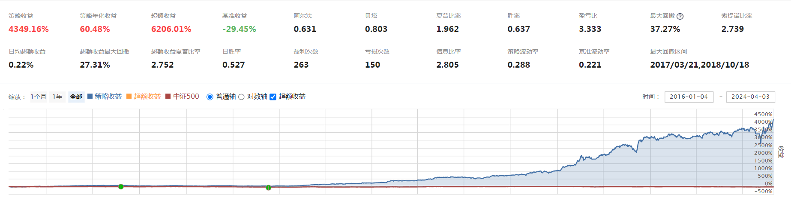

```python linenums="1"
#导入函数库
from jqdata import *
from jqfactor import get_factor_values
import numpy as np
import pandas as pd
from six import StringIO,BytesIO
from mysqltrade import *

def after_code_changed(context):
    now = context.current_dt.time()
    print("{0}替换了代码".format(now))
    unschedule_all()
    
    set_benchmark('000905.XSHG')
    # 用真实价格交易
    set_option('use_real_price', True)
    # 将滑点设置为0.005
    set_slippage(FixedSlippage(0.005))
    # 设置交易成本万分之三
    set_order_cost(OrderCost(open_tax=0, close_tax=0.0005, open_commission=0.0003, close_commission=0.0003, close_today_commission=0, min_commission=5),type='fund')
    # 过滤order中低于error级别的日志

    g.strategy = 'dougua1' # 策略名
    g.filename = '基本面小市值修改资金.csv' #入金配置文件名称

    g.first = 1
    g.out_cash = 0
    g.high_limit_list = []
    g.stock_num = 5 #持仓数
    # 设置交易时间
    run_daily(prepare_stock_list, time='9:15') #每日9:15跑一次股票池
    run_daily(change_cash, "9:30")#检查入金
    run_daily(no_trade,time='9:31')
    run_weekly(my_trade, 1, time='9:35')
    run_daily(check_limit_up, time='14:00') #每日14:30检查一下持仓股中是否有涨停票
    run_daily(print_trade_info, time='15:30')

#2-1 选股模块
def get_factor_filter_list(context,stock_list,jqfactor,sort,p1,p2):
    yesterday = context.previous_date
    score_list = get_factor_values(stock_list, jqfactor, end_date=yesterday, count=1)[jqfactor].iloc[0].tolist()
    df = pd.DataFrame(columns=['code','score'])
    df['code'] = stock_list
    df['score'] = score_list
    df.dropna(inplace=True)
    df.sort_values(by='score', ascending=sort, inplace=True)
    filter_list = list(df.code)[int(p1*len(stock_list)):int(p2*len(stock_list))]
    return filter_list

#2-2 选股模块
def get_stock_list(context):
    initial_list = get_all_securities().index.tolist()
    initial_list = filter_new_stock(context,initial_list)
    initial_list = filter_kcbj_stock(initial_list)
    initial_list = filter_st_stock(initial_list)
    peg_list = get_factor_filter_list(context, initial_list, 'PEG', True, 0, 0.1)
    test_list = get_factor_filter_list(context, peg_list, 'EBIT', True, 0, 0.25)
    q = query(valuation.code,valuation.market_cap).filter(valuation.code.in_(test_list)).order_by(valuation.market_cap.asc())
    df = get_fundamentals(q)
    final_list = list(df.code)
    
    stock_name =[]
    for i in final_list:
        r=get_security_info(i)
        t=r.display_name 
        stock_name.append(t)
    df["name"] = stock_name
    print(df)
    
    return final_list


#3-1 过滤模块-过滤停牌股票
#输入选股列表，返回剔除停牌股票后的列表
def filter_paused_stock(stock_list):
	current_data = get_current_data()
	return [stock for stock in stock_list if not current_data[stock].paused]

#3-2 过滤模块-过滤ST及其他具有退市标签的股票
#输入选股列表，返回剔除ST及其他具有退市标签股票后的列表
def filter_st_stock(stock_list):
	current_data = get_current_data()
	return [stock for stock in stock_list
			if not current_data[stock].is_st
			and 'ST' not in current_data[stock].name
			and '*' not in current_data[stock].name
			and '退' not in current_data[stock].name]

#3-3 过滤模块-过滤涨停的股票
#输入选股列表，返回剔除未持有且已涨停股票后的列表
def filter_limitup_stock(context, stock_list):
	last_prices = history(1, unit='1m', field='close', security_list=stock_list)
	current_data = get_current_data()
	# 已存在于持仓的股票即使涨停也不过滤，避免此股票再次可买，但因被过滤而导致选择别的股票
	return [stock for stock in stock_list if stock in context.portfolio.positions.keys()
			or last_prices[stock][-1] < current_data[stock].high_limit]

#3-4 过滤模块-过滤跌停的股票
#输入股票列表，返回剔除已跌停股票后的列表
def filter_limitdown_stock(context, stock_list):
	last_prices = history(1, unit='1m', field='close', security_list=stock_list)
	current_data = get_current_data()
	return [stock for stock in stock_list if stock in context.portfolio.positions.keys()
			or last_prices[stock][-1] > current_data[stock].low_limit]

#3-5 过滤模块-过滤科创板北交所
def filter_kcbj_stock(stock_list):
    for stock in stock_list[:]:
        if stock[0] == '4' or stock[0] == '8' or stock[:2] == '68':
            stock_list.remove(stock)
    return stock_list

#3-6 过滤次新股
#输入股票列表，返回剔除上市日期不足250日股票后的列表
def filter_new_stock(context,stock_list):
    yesterday = context.previous_date
    return [stock for stock in stock_list if not yesterday - get_security_info(stock).start_date < datetime.timedelta(days=250)]


def no_trade(context):
    mon = context.current_dt.month
    day = context.current_dt.day
    if (mon ==4 or mon == 1) and day>=20:
        s_list = list(context.portfolio.positions.keys())
        print(s_list)
        for s in s_list:
            order_target_value_(context,s, 0)
        return
    

#4-1 交易模块
def my_trade(context):  
    mon = context.current_dt.month
    day = context.current_dt.day
    if (mon ==4 or mon == 1) and day>=20:
        s_list = list(context.portfolio.positions.keys())
        print(s_list)
        for s in s_list:
            order_target_value_(context,s, 0)
        return
    #获取选股列表并过滤掉:st,st*,退市,涨停,跌停,停牌  
    check_out_list = get_stock_list(context)  
    check_out_list = filter_limitup_stock(context, check_out_list)  
    check_out_list = filter_limitdown_stock(context, check_out_list)  
    check_out_list = filter_paused_stock(check_out_list)  
    #check_out_list = filter_highprice_stock(context,check_out_list)
    buy_stocks = check_out_list[:g.stock_num]  
    print('今日自选股:{}'.format(buy_stocks))  

    for stock in list(context.portfolio.positions.keys()):
        if stock not in buy_stocks:
            df2=attribute_history(stock,count=2,unit='1d',\
                          fields=['open','close','volume','high','low','money','high_limit','low_limit','paused'],\
                          fq='pre')
            if (df2['close'][-1]==df2['high_limit'][-1] and df2['volume'][-1]>0 and df2['money'][-1]>0):
                g.high_limit_list.append(stock)
            else:
                order_target_value_(context,stock, 0) 
  
    # 根据股票数量分仓  
    # 此处只根据可用金额平均分配购买，不能保证每个仓位平均分配  
    position_count = len(context.portfolio.positions)  
    if g.stock_num > position_count:  
        value = (context.portfolio.cash+g.out_cash) / (g.stock_num - position_count)  
        for stock in buy_stocks:  
            if context.portfolio.positions[stock].total_amount == 0:  
                order_target_value_(context,stock, value)

# 准备股票池
def prepare_stock_list(context):
    #获取已持有列表
    g.high_limit_list = []
    hold_list = list(context.portfolio.positions)
    if hold_list:
        panel = get_price(hold_list, end_date=context.previous_date, frequency='daily',
                       fields=['close', 'high_limit'],
                       count=1)

        df_close = panel['close'].T
        df_close.columns = ['close']
        print(df_close)
        df_high_limit = panel['high_limit'].T
        df_high_limit.columns = ['high_limit']
        print(df_high_limit)
        df = pd.concat([df_close, df_high_limit] ,axis=1)
        print(df)
        g.high_limit_list = df[df['close'] == df['high_limit']].index.tolist()
        
#  调整昨日涨停股票
def check_limit_up(context):
     # 获取持仓的昨日涨停列表
    current_data = get_current_data()
    if g.high_limit_list:
        for stock in g.high_limit_list:
            if current_data[stock].last_price < current_data[stock].high_limit:
                log.info("[%s]涨停打开，卖出" % stock)
                order_target_(context,stock, 0)
            else:
                log.info("[%s]涨停，继续持有" % stock)
                
def change_cash(context): 
    if g.first == 1:
        data1 = {  
            '入金金额': 0,  
            '是否生效': "否",  
            '是否清仓后重新买入': "否"
        }  
        df2 = pd.DataFrame([data1], columns=['入金金额', '是否生效', '是否清仓后重新买入'])  
        write_file(g.filename, df2.to_csv(index=False), append=False)
        g.first = 0
    if g.out_cash < 0:
        inout_cash(g.out_cash, pindex=0)
        g.out_cash = 0
    else:
        try:
    
            df2 = pd.read_csv(BytesIO(read_file(g.filename)))
            log.info("入金文件",df2)
            single =  df2.at[0,"是否生效"]
            log.info("入金信号",single)
            is_sell = df2.at[0,"是否清仓后重新买入"]
            if single =="是":
                if is_sell == "是":
                    log.info("入金后先清仓，再重新买入，清仓股票为",list(context.portfolio.positions.keys()))
                    for s in context.portfolio.positions:
                        order_target_(context,s, 0)
                        
                df2.loc[0,"是否清仓后重新买入"] = "否"    
                change_cash = df2.at[0,"入金金额"]
                log.info("入金金额",change_cash)
                if change_cash < 0 :
                    g.out_cash = change_cash
                else:
                    inout_cash(change_cash, pindex=0)
                df2.loc[0,"是否生效"] = "否" 
                log.info("重置后",df2)
                my_trade(context)
                write_file(g.filename, df2.to_csv(index=False), append=False)
    
        except Exception as e:
            log.info("修改资金发生错误: {}".format(e))  

#5-1 复盘模块-打印
#打印每日持仓信息
def print_trade_info(context):
    #打印当天成交记录
    trades = get_trades()
    for _trade in trades.values():
        print('成交记录：'+str(_trade))
    #打印账户信息
    for position in list(context.portfolio.positions.values()):
        securities=position.security
        cost=position.avg_cost
        price=position.price
        ret=100*(price/cost-1)
        value=position.value
        amount=position.total_amount    
        print('代码:{}'.format(securities))
        print('成本价:{}'.format(format(cost,'.2f')))
        print('现价:{}'.format(price))
        print('收益率:{}%'.format(format(ret,'.2f')))
        print('持仓(股):{}'.format(amount))
        print('市值:{}'.format(format(value,'.2f')))
        print('———————————————————————————————————')
    print('———————————————————————————————————————分割线————————————————————————————————————————')
```

### 4.10 动态持仓中小板小市值国九条版（自动交易）

圈友@飞扬 提供了一个动态持仓中小板小市值策略，看起来还不错，2024年收益136%，可以研究研究。

这个策略比原版中小板小市值强，加了动态持仓逻辑，行情好的时候集中持仓，行情差分散持仓。另外，还加了部分国九条的条件。不过这个策略因为有择时和止损逻辑，容易左右打脸，实盘体验不一定好。

我看了下，大致是以下逻辑：

- **股票池**：中小板成分股
- **选股逻辑**：

    - 总市值在10-100亿之间
    - 上个季度净利润净利润大于0
    - 上个季度归母净利润净利润大于0
    - 最近一个季度营收大于1亿
    - 过滤近一年审计建议无法出具或者为负面建议的
    - 股价不高于50块

- **排序逻辑**：按照总市值，从小到大排序
- **择时逻辑**：1月和4月时，计算国证2000指是否止跌，止跌则买入，不止跌则空仓。
- **止盈止损逻辑**：持仓个股赚100%，或者持仓个股亏损-9%，或者中小板指数单日跌-5%
- **持股数量逻辑**：默认持有4只，但会根据中小板综指（399101）的diff来判断持有多少只：

    - diff 大于等于500时，持有3只；
    - diff 在200和500之间时，持有3只；
    - diff 在-200和200之间时，持有4只；
    - diff 在-500和-200之间时，持有5只；
    - 其他情况，持有6只。

    diff的计算方法是用指数最新收盘价-过去10个交易日的均价

- **调仓频次**：每周第三个交易日的9点31进行调仓，每日10点止盈止损，每日14:20卖出连续不涨停的票。

ps:如果模拟，首周运行的第一天算是以第一个交易日。

这个策略具体实盘表现怎么样我没研究过，提供的圈友认为是挺不错的，感兴趣可以自己研究一下。

```python linenums="1" title="策略源码"
from jqdata import *
from jqfactor import *
import numpy as np
import pandas as pd
from datetime import time,date
from jqdata import finance
from mysqltrade import *

    
def after_code_changed(context):
    now = context.current_dt.time()
    print("{0}替换了代码".format(now))
    unschedule_all()    
    # 设定基准
    set_benchmark('399101.XSHE')
    # 用真实价格交易
    set_option('use_real_price', True)
    # 将滑点设置为0
    set_slippage(FixedSlippage(3/10000))
    # 设置交易成本万分之三，不同滑点影响可在归因分析中查看
    set_order_cost(OrderCost(open_tax=0, close_tax=0.001, open_commission=2.5/10000, close_commission=2.5/10000, close_today_commission=0, min_commission=5),type='stock')
    # 过滤order中低于error级别的日志
    log.set_level('order', 'error')
    log.set_level('system', 'error')
    log.set_level('strategy', 'debug')
    #初始化全局变量 bool
    g.strategy = 'dougua1' # 策略名
    
    g.trading_signal = True  # 是否为可交易日
    g.run_stoploss = True  # 是否进行止损
    g.filter_audit = False  # 是否筛选审计意见
    g.adjust_num = True  # 是否调整持仓数量
    #全局变量list
    g.hold_list = [] #当前持仓的全部股票    
    g.yesterday_HL_list = [] #记录持仓中昨日涨停的股票
    g.target_list = []
    g.pass_months = [1, 4]  # 空仓的月份
    g.limitup_stocks = []   # 记录涨停的股票避免再次买入
    #全局变量float/str
    g.min_mv = 10  # 股票最小市值要求
    g.max_mv = 100  # 股票最大市值要求
    g.stock_num = 4  # 持股数量

    g.stoploss_list = []  # 止损卖出列表
    g.other_sale    = []  # 其他卖出列表
    g.stoploss_strategy = 3  # 1为止损线止损，2为市场趋势止损, 3为联合1、2策略
    g.stoploss_limit = 0.09  # 止损线
    g.stoploss_market = 0.05  # 市场趋势止损参数
    g.highest = 50  # 股票单价上限设置
    # 设置交易运行时间
    run_daily(prepare_stock_list, '9:05')
    run_daily(trade_afternoon, time='14:20', reference_security='399101.XSHE') #检查持仓中的涨停股是否需要卖出
    run_daily(stop_loss, time='10:00') # 止损函数
    run_daily(close_account, '14:50')
    run_weekly(weekly_adjustment,3,'09:31') #每周三:31调仓
    #run_weekly(print_position_info, 5, time='15:10', reference_security='000300.XSHG')

#1-1 准备股票池
def prepare_stock_list(context):
    #获取已持有列表
    g.limitup_stocks = []
    g.hold_list = list(context.portfolio.positions)
    #获取昨日涨停列表
    if g.hold_list:
        df = get_price(g.hold_list, end_date=context.previous_date, frequency='daily', fields=['close','high_limit','low_limit'], count=1, panel=False, fill_paused=False)
        df = df[df['close'] == df['high_limit']]
        g.yesterday_HL_list = df['code'].tolist()
    else:
        g.yesterday_HL_list = []
    #判断今天是否为账户资金再平衡的日期
    g.trading_signal = today_is_between(context)

#1-2 选股模块
def get_stock_list(context):
    final_list = []
    MKT_index = '399101.XSHE'
    initial_list = filter_stocks(context, get_index_stocks(MKT_index))
    # 国九更新：过滤近一年净利润为负且营业收入小于1亿的
    # 国九更新：过滤近一年期末净资产为负的 (经查询没有为负数的，所以直接pass这条)
    # 国九更新：过滤近一年审计建议无法出具或者为负面建议的 (经过净利润等筛选，审计意见几乎不会存在异常)
    q = query(
        valuation.code,
    ).filter(
        valuation.code.in_(initial_list),
        valuation.market_cap.between(g.min_mv,g.max_mv),  # 总市值 circulating_market_cap/market_cap 单位：亿元
        income.np_parent_company_owners > 0,   # 归属于母公司所有者的净利润(元)
        income.net_profit > 0,  # 净利润(元)
        income.operating_revenue > 1e8  # 营业收入 (元)
    ).order_by(valuation.market_cap.asc()).limit(g.stock_num*3)
    df = get_fundamentals(q)
    # 如果筛选审计意见会大幅度增加回测时长，实测增加此项筛选不影响选股
    if g.filter_audit:
        before_audit_filter = len(df)
        df['audit'] = df['code'].apply(lambda x: filter_audit(context, x))
        df_audit = df[df['audit'] == True]
        log.info('去除掉了存在审计问题的股票{}只'.format(len(df)-before_audit_filter))
    final_list = df['code'].tolist()

    if final_list:
        last_prices = history(1, unit='1d', field='close', security_list=final_list)
        return [stock for stock in final_list if stock in g.hold_list or last_prices[stock][-1] <= g.highest]
    else:
        # 由于有时候选股条件苛刻，所以会没有股票入选，这时买入银华日利ETF
        log.info('无适合股票')

#1-3 整体调整持仓
def weekly_adjustment(context):
    if g.trading_signal:
        if g.adjust_num:
            new_num = adjust_stock_num(context)
            g.stock_num = new_num
            log.info(f'持仓数量修改为{new_num}')
        g.target_list = get_stock_list(context)[:g.stock_num]
        log.info(str(g.target_list))
        
        sell_list = [stock for stock in g.hold_list if stock not in g.target_list and stock not in g.yesterday_HL_list]
        hold_list = [stock for stock in g.hold_list if stock in g.target_list or stock in g.yesterday_HL_list]
        log.info("卖出[%s]" % (str(sell_list)))
        log.info("已持有[%s]" % (str(hold_list)))

        for stock in sell_list:
            order_target_value_(context,stock, 0)
        
        buy_list = [stock for stock in g.target_list if stock not in g.hold_list]
        buy_security(context, buy_list,len(buy_list))

    else:
        log.info('该月份为空仓月份')


#1-4 调整昨日涨停股票
def check_limit_up(context):
    now_time = context.current_dt
    if g.yesterday_HL_list != []:
        #对昨日涨停股票观察到尾盘如不涨停则提前卖出，如果涨停即使不在应买入列表仍暂时持有
        for stock in g.yesterday_HL_list:
            current_data = get_price(stock, end_date=now_time, frequency='1m', fields=['close','high_limit'], skip_paused=False, fq='pre', count=1, panel=False, fill_paused=True)
            if current_data.iloc[0,0] <    current_data.iloc[0,1]:
                log.info("[%s]涨停打开，卖出" % (stock))
                order_target_value_(context,stock, 0)
                g.other_sale.append(stock)
                g.limitup_stocks.append(stock)
            else:
                log.info("[%s]涨停，继续持有" % (stock))

#1-5 如果昨天有股票卖出或者买入失败造成空仓，剩余的金额当日买入
def check_remain_amount(context):
    addstock_num = len(g.other_sale)
    loss_num = len(g.stoploss_list)
    empty_num = addstock_num + loss_num
    
    g.hold_list = context.portfolio.positions
    if len(g.hold_list) < g.stock_num:   
        # 计算需要买入的股票数量，止损仓位补足货币etf
        # 可替换下一行代码以更换逻辑：改为将清空仓位全部补足股票，而非原作中止损仓位补充货币etf
        # num_stocks_to_buy = min(empty_num,g.stock_num-len(g.hold_list))
        num_stocks_to_buy = min(addstock_num,g.stock_num-len(g.hold_list))
        target_list = [stock for stock in g.target_list if stock not in g.limitup_stocks][:num_stocks_to_buy]
        log.info('有余额可用'+str(round((context.portfolio.cash),2))+'元。买入'+ str(target_list))
        buy_security(context,target_list,len(target_list))
        if loss_num !=0:
            log.info('有余额可用'+str(round((context.portfolio.cash),2))+'元')
    
    g.stoploss_list = []
    g.other_sale    = []

#1-6 下午检查交易
def trade_afternoon(context):
    if g.trading_signal:
        check_limit_up(context)
        check_remain_amount(context)
        
#1-7 止盈止损
def stop_loss(context):
    if g.run_stoploss:
        current_positions = context.portfolio.positions
        if g.stoploss_strategy == 1 or g.stoploss_strategy == 3:
            for stock in current_positions.keys():
                price = current_positions[stock].price
                avg_cost = current_positions[stock].avg_cost
                # 个股盈利止盈
                if price >= avg_cost * 2:
                    order_target_value_(context,stock, 0)
                    log.debug("收益100%止盈,卖出{}".format(stock))
                    g.other_sale.append(stock)
                # 个股止损
                elif price < avg_cost * (1 - g.stoploss_limit):
                    order_target_value_(context,stock, 0)
                    log.debug("收益止损,卖出{}".format(stock))
                    g.stoploss_list.append(stock)

        if g.stoploss_strategy == 2 or g.stoploss_strategy == 3:
            stock_df = get_price(security=get_index_stocks('399101.XSHE')
                        ,end_date=context.previous_date, frequency='daily'
                        ,fields=['close', 'open'], count=1, panel=False)
            # 计算成分股平均涨跌，即指数涨跌幅
            down_ratio = (1 - stock_df['close'] / stock_df['open']).mean()
            # 市场大跌止损
            if down_ratio >= g.stoploss_market:
                log.debug("大盘惨跌,平均降幅{:.2%}".format(down_ratio))
                for stock in current_positions.keys():
                    order_target_value_(context,stock, 0)
                    g.stoploss_list.append(stock)


#1-8 动态调仓代码
def adjust_stock_num(context):
    ma_para = 10  # 设置MA参数
    today = context.previous_date
    index_df = get_price('399101.XSHE', end_date=today,count = ma_para,fields = 'close', frequency='daily')
    ma = index_df['close'].mean()
    last_row = index_df['close'].iloc[-1]
    diff = last_row - ma
    # 根据差值结果返回数字
    result = 3 if diff >= 500 else \
             3 if 200 <= diff < 500 else \
             4 if -200 <= diff < 200 else \
             5 if -500 <= diff < -200 else \
             6
    print("diff：",diff)
    print("num：",result)
    return result
    

#2 过滤各种股票
def filter_stocks(context, stock_list):
    current_data = get_current_data()
        # 涨跌停和最近价格的判断
    last_prices = history(1, unit='1m', field='close', security_list=stock_list)
        # 过滤标准
    filtered_stocks = []
    for stock in stock_list:
        if current_data[stock].paused:  # 停牌
            continue
        if current_data[stock].is_st:  # ST
            continue
        if '退' in current_data[stock].name:  # 退市
            continue
        if stock.startswith('30') or stock.startswith('68') or stock.startswith('8') or stock.startswith('4'):  # 市场类型
            continue
        if not (stock in context.portfolio.positions or last_prices[stock][-1] < current_data[stock].high_limit):  # 涨停
            continue
        if not (stock in context.portfolio.positions or last_prices[stock][-1] > current_data[stock].low_limit):  # 跌停
            continue
        # 次新股过滤
        start_date = get_security_info(stock).start_date
        if context.previous_date - start_date < timedelta(days=375):
            continue
        filtered_stocks.append(stock)
    return filtered_stocks

#2.1 筛选审计意见
def filter_audit(context, code):
    # 获取审计意见，近三年内如果有不合格(report_type为2、3、4、5)的审计意见则返回False，否则返回True
    lstd = context.previous_date
    last_year = lstd.replace(year=lstd.year - 3, month=1, day=1)
    q=query(finance.STK_AUDIT_OPINION.code, finance.STK_AUDIT_OPINION.report_type
          ).filter(finance.STK_AUDIT_OPINION.code==code,finance.STK_AUDIT_OPINION.pub_date>=last_year)
    df=finance.run_query(q)
    df['report_type'] = df['report_type'].astype(str)
    contains_nums = df['report_type'].str.contains(r'2|3|4|5')
    return not contains_nums.any()


#3-4 买入模块
def buy_security(context,target_list,num):
    #调仓买入
    position_count = len(context.portfolio.positions)
    target_num = num
    if target_num !=0:
        value = context.portfolio.cash / target_num
        for stock in target_list:
            order_target_value_(context,stock, value)
            log.info("买入[%s]（%s元）" % (stock,value))
            if len(context.portfolio.positions) == g.stock_num:
                break


#4-1 判断今天是否跳过月份
def today_is_between(context):
    # 根据g.pass_month跳过指定月份
    month = context.current_dt.month
    # 判断当前月份是否在指定月份范围内
    if month in g.pass_months:
        code = '399303.XSHE'
        close = history(count = 3, unit='1d', field='close', security_list= [code], df = False, skip_paused = False, fq = 'none')[code]
        if close[-1] > close[-2] * 0.995 and close[-1] > close[-3] * 0.994:
            return True
        # 判断当前日期是否在指定日期范围内
        return False
    else:
        return True

def close_account(context):
    if not g.trading_signal:
        curr_data = get_current_data()
        if len(g.hold_list) != 0 :
            for stock in g.hold_list:
                if curr_data[stock].last_price == curr_data[stock].low_limit or curr_data[stock].paused:
                    continue
                order_target_value_(context,stock, 0)
                log.info("卖出[%s]" % (stock))

def print_position_info(context):
    for position in list(context.portfolio.positions.values()):
        securities=position.security
        cost=position.avg_cost
        price=position.price
        ret=100*(price/cost-1)
        value=position.value
        amount=position.total_amount    
        print('代码:{}'.format(securities))
        print('成本价:{}'.format(format(cost,'.2f')))
        print('现价:{}'.format(price))
        print('收益率:{}%'.format(format(ret,'.2f')))
        print('持仓(股):{}'.format(amount))
        print('市值:{}'.format(format(value,'.2f')))
    print('———————————————————————————————————————分割线————————————————————————————————————————')
```

### 4.11 动态持仓创业板小市值（自动交易）

由圈友提出思路，动态持仓中小板小市值策略改造而来，看起来还不错，2024年收益136%，可以研究研究。

相比于动态中小板，不同的点有：

1. 只买创业板股票。
2. 使用流通市值排序。

2017年10月至2024年11月14日的收益曲线如下：

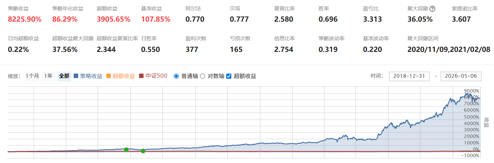

```python linenums="1" title="策略源码"
from jqdata import *
from jqfactor import *
import numpy as np
import pandas as pd
from datetime import time,date
from jqdata import finance
from mysqltrade import *


 
    
def after_code_changed(context):
    now = context.current_dt.time()
    print("{0}替换了代码".format(now))
    unschedule_all()    
    # 设定基准
    set_benchmark('399101.XSHE')
    # 用真实价格交易
    set_option('use_real_price', True)
    # 将滑点设置为0
    set_slippage(FixedSlippage(3/10000))
    # 设置交易成本万分之三，不同滑点影响可在归因分析中查看
    set_order_cost(OrderCost(open_tax=0, close_tax=0.001, open_commission=2.5/10000, close_commission=2.5/10000, close_today_commission=0, min_commission=5),type='stock')
    # 过滤order中低于error级别的日志
    log.set_level('order', 'error')
    log.set_level('system', 'error')
    log.set_level('strategy', 'debug')
    #初始化全局变量 bool
    g.strategy = 'dougua1' # 策略名
    
    g.trading_signal = True  # 是否为可交易日
    g.run_stoploss = True  # 是否进行止损
    g.filter_audit = False  # 是否筛选审计意见
    g.adjust_num = True  # 是否调整持仓数量
    #全局变量list
    g.hold_list = [] #当前持仓的全部股票    
    g.yesterday_HL_list = [] #记录持仓中昨日涨停的股票
    g.target_list = []
    g.pass_months = [1, 4]  # 空仓的月份
    g.limitup_stocks = []   # 记录涨停的股票避免再次买入
    #全局变量float/str
    g.min_mv = 10  # 股票最小市值要求
    g.max_mv = 100  # 股票最大市值要求
    g.stock_num = 4  # 持股数量

    g.stoploss_list = []  # 止损卖出列表
    g.other_sale    = []  # 其他卖出列表
    g.stoploss_strategy = 3  # 1为止损线止损，2为市场趋势止损, 3为联合1、2策略
    g.stoploss_limit = 0.09  # 止损线
    g.stoploss_market = 0.05  # 市场趋势止损参数
    g.highest = 50  # 股票单价上限设置
    # 设置交易运行时间
    run_daily(prepare_stock_list, '9:05')
    run_daily(trade_afternoon, time='14:20', reference_security='399101.XSHE') #检查持仓中的涨停股是否需要卖出
    run_daily(stop_loss, time='10:00') # 止损函数
    run_daily(close_account, '14:50')
    run_weekly(weekly_adjustment,3,'09:35') #每周三:31调仓
    #run_weekly(print_position_info, 5, time='15:10', reference_security='000300.XSHG')

#1-1 准备股票池
def prepare_stock_list(context):
    #获取已持有列表
    g.limitup_stocks = []
    g.hold_list = list(context.portfolio.positions)
    #获取昨日涨停列表
    if g.hold_list:
        df = get_price(g.hold_list, end_date=context.previous_date, frequency='daily', fields=['close','high_limit','low_limit'], count=1, panel=False, fill_paused=False)
        df = df[df['close'] == df['high_limit']]
        g.yesterday_HL_list = df['code'].tolist()
    else:
        g.yesterday_HL_list = []
    #判断今天是否为账户资金再平衡的日期
    g.trading_signal = today_is_between(context)

#1-2 选股模块
def get_stock_list(context):
    
    #today = context.current_dt.date()
    #df = get_all_securities(types=['stock'], date=today)
    final_list = []
    MKT_index = '399102.XSHE'
    #stocklist = get_index_stocks(MKT_index)
    #print(stocklist)
    initial_list = filter_stocks(context, get_index_stocks(MKT_index))
    # 国九更新：过滤近一年净利润为负且营业收入小于1亿的
    # 国九更新：过滤近一年期末净资产为负的 (经查询没有为负数的，所以直接pass这条)
    # 国九更新：过滤近一年审计建议无法出具或者为负面建议的 (经过净利润等筛选，审计意见几乎不会存在异常)
    q = query(
        valuation.code,
    ).filter(
        valuation.code.in_(initial_list),
        valuation.market_cap.between(g.min_mv,g.max_mv),  # 总市值 circulating_market_cap/market_cap 单位：亿元
        income.np_parent_company_owners > 0,   # 归属于母公司所有者的净利润(元)
        income.net_profit > 0,  # 净利润(元)
        income.operating_revenue > 1e8  # 营业收入 (元)
    ).order_by(valuation.circulating_market_cap.asc()).limit(g.stock_num*3)
    df = get_fundamentals(q)
    # 如果筛选审计意见会大幅度增加回测时长，实测增加此项筛选不影响选股
    if g.filter_audit:
        before_audit_filter = len(df)
        df['audit'] = df['code'].apply(lambda x: filter_audit(context, x))
        df_audit = df[df['audit'] == True]
        log.info('去除掉了存在审计问题的股票{}只'.format(len(df)-before_audit_filter))
    final_list = df['code'].tolist()

    if final_list:
        last_prices = history(1, unit='1d', field='close', security_list=final_list)
        return [stock for stock in final_list if stock in g.hold_list or last_prices[stock][-1] <= g.highest]
    else:
        # 由于有时候选股条件苛刻，所以会没有股票入选，这时买入银华日利ETF
        log.info('无适合股票')

#1-3 整体调整持仓
def weekly_adjustment(context):
    if g.trading_signal:
        if g.adjust_num:
            new_num = adjust_stock_num(context)
            g.stock_num = new_num
            log.info(f'持仓数量修改为{new_num}')
        g.target_list = get_stock_list(context)[:g.stock_num]
        log.info(str(g.target_list))
        
        sell_list = [stock for stock in g.hold_list if stock not in g.target_list and stock not in g.yesterday_HL_list]
        hold_list = [stock for stock in g.hold_list if stock in g.target_list or stock in g.yesterday_HL_list]
        log.info("卖出[%s]" % (str(sell_list)))
        log.info("已持有[%s]" % (str(hold_list)))

        for stock in sell_list:
            order_target_value_(context,stock, 0)
        
        buy_list = [stock for stock in g.target_list if stock not in g.hold_list]
        buy_security(context, buy_list,len(buy_list))

    else:
        log.info('该月份为空仓月份')


#1-4 调整昨日涨停股票
def check_limit_up(context):
    now_time = context.current_dt
    if g.yesterday_HL_list != []:
        #对昨日涨停股票观察到尾盘如不涨停则提前卖出，如果涨停即使不在应买入列表仍暂时持有
        for stock in g.yesterday_HL_list:
            current_data = get_price(stock, end_date=now_time, frequency='1m', fields=['close','high_limit'], skip_paused=False, fq='pre', count=1, panel=False, fill_paused=True)
            if current_data.iloc[0,0] <    current_data.iloc[0,1]:
                log.info("[%s]涨停打开，卖出" % (stock))
                order_target_value_(context,stock, 0)
                g.other_sale.append(stock)
                g.limitup_stocks.append(stock)
            else:
                log.info("[%s]涨停，继续持有" % (stock))

#1-5 如果昨天有股票卖出或者买入失败造成空仓，剩余的金额当日买入
def check_remain_amount(context):
    addstock_num = len(g.other_sale)
    loss_num = len(g.stoploss_list)
    empty_num = addstock_num + loss_num
    
    g.hold_list = context.portfolio.positions
    if len(g.hold_list) < g.stock_num:   
        # 计算需要买入的股票数量，止损仓位补足货币etf
        # 可替换下一行代码以更换逻辑：改为将清空仓位全部补足股票，而非原作中止损仓位补充货币etf
        # num_stocks_to_buy = min(empty_num,g.stock_num-len(g.hold_list))
        num_stocks_to_buy = min(addstock_num,g.stock_num-len(g.hold_list))
        target_list = [stock for stock in g.target_list if stock not in g.limitup_stocks][:num_stocks_to_buy]
        log.info('有余额可用'+str(round((context.portfolio.cash),2))+'元。买入'+ str(target_list))
        buy_security(context,target_list,len(target_list))
        if loss_num !=0:
            log.info('有余额可用'+str(round((context.portfolio.cash),2))+'元')
    
    g.stoploss_list = []
    g.other_sale    = []

#1-6 下午检查交易
def trade_afternoon(context):
    if g.trading_signal:
        check_limit_up(context)
        check_remain_amount(context)
        
#1-7 止盈止损
def stop_loss(context):
    if g.run_stoploss:
        current_positions = context.portfolio.positions
        if g.stoploss_strategy == 1 or g.stoploss_strategy == 3:
            for stock in current_positions.keys():
                price = current_positions[stock].price
                avg_cost = current_positions[stock].avg_cost
                # 个股盈利止盈
                if price >= avg_cost * 2:
                    order_target_value_(context,stock, 0)
                    log.debug("收益100%止盈,卖出{}".format(stock))
                    g.other_sale.append(stock)
                # 个股止损
                elif price < avg_cost * (1 - g.stoploss_limit):
                    order_target_value_(context,stock, 0)
                    log.debug("收益止损,卖出{}".format(stock))
                    g.stoploss_list.append(stock)

        if g.stoploss_strategy == 2 or g.stoploss_strategy == 3:
            stock_df = get_price(security=get_index_stocks('399101.XSHE')
                        ,end_date=context.previous_date, frequency='daily'
                        ,fields=['close', 'open'], count=1, panel=False)
            # 计算成分股平均涨跌，即指数涨跌幅
            down_ratio = (1 - stock_df['close'] / stock_df['open']).mean()
            # 市场大跌止损
            if down_ratio >= g.stoploss_market:
                log.debug("大盘惨跌,平均降幅{:.2%}".format(down_ratio))
                for stock in current_positions.keys():
                    order_target_value_(context,stock, 0)
                    g.stoploss_list.append(stock)


#1-8 动态调仓代码
def adjust_stock_num(context):
    ma_para = 10  # 设置MA参数
    today = context.previous_date
    index_df = get_price('399101.XSHE', end_date=today,count = ma_para,fields = 'close', frequency='daily')
    ma = index_df['close'].mean()
    last_row = index_df['close'].iloc[-1]
    diff = last_row - ma
    # 根据差值结果返回数字
    result = 3 if diff >= 500 else \
             3 if 200 <= diff < 500 else \
             4 if -200 <= diff < 200 else \
             5 if -500 <= diff < -200 else \
             6
    print("diff：",diff)
    print("num：",result)
    return result
    

#2 过滤各种股票
def filter_stocks(context, stock_list):
    current_data = get_current_data()
        # 涨跌停和最近价格的判断
    last_prices = history(1, unit='1m', field='close', security_list=stock_list)
        # 过滤标准
    filtered_stocks = []
    for stock in stock_list:
        if current_data[stock].paused:  # 停牌
            continue
        if current_data[stock].is_st:  # ST
            continue
        if '退' in current_data[stock].name:  # 退市
            continue
        if stock.startswith('68') or stock.startswith('8') or stock.startswith('4'):  # 市场类型
            continue
        if not (stock in context.portfolio.positions or last_prices[stock][-1] < current_data[stock].high_limit):  # 涨停
            continue
        if not (stock in context.portfolio.positions or last_prices[stock][-1] > current_data[stock].low_limit):  # 跌停
            continue
        # 次新股过滤
        start_date = get_security_info(stock).start_date
        if context.previous_date - start_date < timedelta(days=375):
            continue
        filtered_stocks.append(stock)
    return filtered_stocks

#2.1 筛选审计意见
def filter_audit(context, code):
    # 获取审计意见，近三年内如果有不合格(report_type为2、3、4、5)的审计意见则返回False，否则返回True
    lstd = context.previous_date
    last_year = lstd.replace(year=lstd.year - 3, month=1, day=1)
    q=query(finance.STK_AUDIT_OPINION.code, finance.STK_AUDIT_OPINION.report_type
          ).filter(finance.STK_AUDIT_OPINION.code==code,finance.STK_AUDIT_OPINION.pub_date>=last_year)
    df=finance.run_query(q)
    df['report_type'] = df['report_type'].astype(str)
    contains_nums = df['report_type'].str.contains(r'2|3|4|5')
    return not contains_nums.any()


#3-4 买入模块
def buy_security(context,target_list,num):
    #调仓买入
    position_count = len(context.portfolio.positions)
    target_num = num
    if target_num !=0:
        value = context.portfolio.cash / target_num
        for stock in target_list:
            order_target_value_(context,stock, value)
            log.info("买入[%s]（%s元）" % (stock,value))
            if len(context.portfolio.positions) == g.stock_num:
                break


#4-1 判断今天是否跳过月份
def today_is_between(context):
    # 根据g.pass_month跳过指定月份
    month = context.current_dt.month
    # 判断当前月份是否在指定月份范围内
    if month in g.pass_months:
        code = '399303.XSHE'
        close = history(count = 3, unit='1d', field='close', security_list= [code], df = False, skip_paused = False, fq = 'none')[code]
        if close[-1] > close[-2] * 0.995 and close[-1] > close[-3] * 0.994:
            return True
        # 判断当前日期是否在指定日期范围内
        return False
    else:
        return True

def close_account(context):
    if not g.trading_signal:
        curr_data = get_current_data()
        if len(g.hold_list) != 0 :
            for stock in g.hold_list:
                if curr_data[stock].last_price == curr_data[stock].low_limit or curr_data[stock].paused:
                    continue
                order_target_value_(context,stock, 0)
                log.info("卖出[%s]" % (stock))

def print_position_info(context):
    for position in list(context.portfolio.positions.values()):
        securities=position.security
        cost=position.avg_cost
        price=position.price
        ret=100*(price/cost-1)
        value=position.value
        amount=position.total_amount    
        print('代码:{}'.format(securities))
        print('成本价:{}'.format(format(cost,'.2f')))
        print('现价:{}'.format(price))
        print('收益率:{}%'.format(format(ret,'.2f')))
        print('持仓(股):{}'.format(amount))
        print('市值:{}'.format(format(value,'.2f')))
    print('———————————————————————————————————————分割线————————————————————————————————————————')
```

### 4.12 低资产回报小市值策略（自动交易）

低资产回报小市值。底层逻辑：固定资产越少，资产回报率越低的小市值公司，躺平的概率越低，寻求转型或者并购的概率越高，能产生更大的潜在预期差。

策略录入时间：2026-04-30。
策略更新：修复了获取全市场股票的问题，2026-05-07。
提醒：不要分享到社区，用的人越多，拥挤度越高，没必要这么做。

详细逻辑如下：

- **股票池**：排除科创北交外，所有A股股票。
- **选股逻辑**：先选出全市场资产回报率最低的10%的股票，然后再从这些股票里再选出固定资产最低的25%股票。
- **排序逻辑**：按照市值从小到大排序，取前10个股票。
- **调仓逻辑**：策略用轮动的方式进行买卖，每周轮动一次，在前12名的股票会继续持有，掉出前12名股票就会卖掉。轮动时间为每周的第1个交易日。
- **择时逻辑**：每年的1月和4月的20号之后空仓，其他时间皆满仓。

2019年1月1日---2026年5月6日的收益如下，初始资金15万的回测，历史收益还是不错的，不过未来怎么样还没经过实践。


```python linenums="1" title="策略源码"
#导入函数库
from jqdata import *
from jqfactor import get_factor_values
import numpy as np
import pandas as pd
from six import StringIO,BytesIO
from mysqltrade import *

def after_code_changed(context):
    now = context.current_dt.time()
    print("{0}替换了代码".format(now))
    unschedule_all()
    
    set_benchmark('000905.XSHG')
    set_option("avoid_future_data", True)
    # 用真实价格交易
    set_option('use_real_price', True)
    # 将滑点设置为0.005
    set_slippage(FixedSlippage(0.005))
    # 设置交易成本万分之三
    set_order_cost(OrderCost(open_tax=0, close_tax=0.0005, open_commission=0.0003, close_commission=0.0003, close_today_commission=0, min_commission=5),type='fund')
    # 过滤order中低于error级别的日志

    g.strategy = 'dougua1' # 策略名
    g.filename = '低资产回报小市值修改资金.csv' #入金配置文件名称

    g.first = 1
    g.out_cash = 0
    g.high_limit_list = []
    g.stock_num = 10 #持仓数
    g.rank = 12 #掉出排名卖出
    
    g.notrade_mon = [1,4] #1月和4月空仓
    g.notrade_day = 20 #1月和4月的20号后空仓
    
    # 设置交易时间
    run_daily(prepare_stock_list, time='9:15') #每日9:15跑一次股票池
    run_daily(change_cash, "9:30")#检查入金
    run_daily(no_trade,time='9:31')
    run_weekly(my_trade, 1, time='9:35') #调仓
    run_daily(check_limit_up, time='14:00') #每日14:00检查一下持仓股中是否有涨停票
    run_daily(print_trade_info, time='15:30')

#选股模块
def get_stock_list(context):
    initial_list = list(get_all_securities(['stock'], context.previous_date).index)
    initial_list = filter_new_stock(context,initial_list)
    initial_list = filter_kcbj_stock(initial_list)
    initial_list = filter_st_stock(initial_list)
    roaebit_list = get_factor_filter_list(context, initial_list, 'ROAEBITTTM', True, 0, 0.1)
    test_list = get_factor_filter_list(context, roaebit_list, 'fixed_asset_ratio', True, 0, 0.25)
    q = query(valuation.code,valuation.market_cap).filter(valuation.code.in_(test_list)).order_by(valuation.market_cap.asc())
    df = get_fundamentals(q)
    final_list = list(df.code)
    
    stock_name =[]
    for i in final_list:
        r=get_security_info(i)
        t=r.display_name 
        stock_name.append(t)
    df["name"] = stock_name
    print(df)
    
    return final_list


#过滤模块-过滤停牌股票
#输入选股列表，返回剔除停牌股票后的列表
def filter_paused_stock(stock_list):
	current_data = get_current_data()
	return [stock for stock in stock_list if not current_data[stock].paused]

#过滤模块-过滤ST及其他具有退市标签的股票
#输入选股列表，返回剔除ST及其他具有退市标签股票后的列表
def filter_st_stock(stock_list):
	current_data = get_current_data()
	return [stock for stock in stock_list
			if not current_data[stock].is_st
			and 'ST' not in current_data[stock].name
			and '*' not in current_data[stock].name
			and '退' not in current_data[stock].name]

#过滤模块-过滤涨停的股票
#输入选股列表，返回剔除未持有且已涨停股票后的列表
def filter_limitup_stock(context, stock_list):
	last_prices = history(1, unit='1m', field='close', security_list=stock_list)
	current_data = get_current_data()
	# 已存在于持仓的股票即使涨停也不过滤，避免此股票再次可买，但因被过滤而导致选择别的股票
	return [stock for stock in stock_list if stock in context.portfolio.positions.keys()
			or last_prices[stock][-1] < current_data[stock].high_limit]

#过滤模块-过滤跌停的股票
#输入股票列表，返回剔除已跌停股票后的列表
def filter_limitdown_stock(context, stock_list):
	last_prices = history(1, unit='1m', field='close', security_list=stock_list)
	current_data = get_current_data()
	return [stock for stock in stock_list if stock in context.portfolio.positions.keys()
			or last_prices[stock][-1] > current_data[stock].low_limit]

#过滤模块-过滤科创板北交所
def filter_kcbj_stock(stock_list):
    for stock in stock_list[:]:
        if stock[0] == '4' or stock[0] == '8' or stock[:2] == '68':
            stock_list.remove(stock)
    return stock_list

#输入股票列表，返回剔除上市日期不足250日股票后的列表
def filter_new_stock(context,stock_list):
    yesterday = context.previous_date
    return [stock for stock in stock_list if not yesterday - get_security_info(stock).start_date < datetime.timedelta(days=250)]


def no_trade(context):
    mon = context.current_dt.month
    day = context.current_dt.day
    if (mon in g.notrade_mon) and day>=g.notrade_day:
        s_list = list(context.portfolio.positions.keys())
        print(s_list)
        for s in s_list:
            order_target_value_(context,s, 0)
        return

#4-1 交易模块
def my_trade(context):  
    mon = context.current_dt.month
    day = context.current_dt.day
    if (mon in g.notrade_mon) and day>=g.notrade_day:
        s_list = list(context.portfolio.positions.keys())
        print(s_list)
        for s in s_list:
            order_target_value_(context,s, 0)
        return
    #获取选股列表并过滤掉:st,st*,退市,涨停,跌停,停牌  
    check_out_list = get_stock_list(context)  
    check_out_list = filter_limitup_stock(context, check_out_list)  
    check_out_list = filter_limitdown_stock(context, check_out_list)  
    check_out_list = filter_paused_stock(check_out_list)  
    #check_out_list = filter_highprice_stock(context,check_out_list)
    rank = check_out_list[:g.rank] 
    buy_stocks = check_out_list[:g.stock_num]  
    print('今日自选股:{}'.format(buy_stocks))  

    for stock in list(context.portfolio.positions.keys()):
        if (stock not in rank) and (stock not in g.high_limit_list):
            order_target_value_(context,stock, 0) 
  
    # 根据股票数量分仓  
    # 此处只根据可用金额平均分配购买，不能保证每个仓位平均分配  
    position_count = len(context.portfolio.positions)  
    if g.stock_num > position_count:  
        value = (context.portfolio.cash+g.out_cash) / (g.stock_num - position_count)  
        for stock in buy_stocks:  
            if context.portfolio.positions[stock].total_amount == 0:  
                order_target_value_(context,stock, value)
                
def get_factor_filter_list(context,stock_list,jqfactor,sort,p1,p2):
    yesterday = context.previous_date
    score_list = get_factor_values(stock_list, jqfactor, end_date=yesterday, count=1)[jqfactor].iloc[0].tolist()
    df = pd.DataFrame(columns=['code','score'])

    df['code'] = stock_list
    df['score'] = score_list
    df.dropna(inplace=True)
    df.sort_values(by='score', ascending=sort, inplace=True)
    filter_list = list(df.code)[int(p1*len(stock_list)):int(p2*len(stock_list))]
    return filter_list  
    
# 准备股票池
def prepare_stock_list(context):
    #获取已持有列表
    g.high_limit_list = []
    hold_list = list(context.portfolio.positions)
    if hold_list:
        panel = get_price(hold_list, end_date=context.previous_date, frequency='daily',
                       fields=['close', 'high_limit'],
                       count=1)

        df_close = panel['close'].T
        df_close.columns = ['close']
        print(df_close)
        df_high_limit = panel['high_limit'].T
        df_high_limit.columns = ['high_limit']
        print(df_high_limit)
        df = pd.concat([df_close, df_high_limit] ,axis=1)
        print(df)
        g.high_limit_list = df[df['close'] == df['high_limit']].index.tolist()
        
#  调整昨日涨停股票
def check_limit_up(context):
     # 获取持仓的昨日涨停列表
    current_data = get_current_data()
    if g.high_limit_list:
        for stock in g.high_limit_list:
            if current_data[stock].last_price < current_data[stock].high_limit:
                log.info("[%s]涨停打开，卖出" % stock)
                order_target_(context,stock, 0)
            else:
                log.info("[%s]涨停，继续持有" % stock)
                
def change_cash(context): 
    if g.first == 1:
        data1 = {  
            '入金金额': 0,  
            '是否生效': "否",  
            '是否清仓后重新买入': "否"
        }  
        df2 = pd.DataFrame([data1], columns=['入金金额', '是否生效', '是否清仓后重新买入'])  
        write_file(g.filename, df2.to_csv(index=False), append=False)
        g.first = 0
    if g.out_cash < 0:
        inout_cash(g.out_cash, pindex=0)
        g.out_cash = 0
    else:
        try:
    
            df2 = pd.read_csv(BytesIO(read_file(g.filename)))
            log.info("入金文件",df2)
            single =  df2.at[0,"是否生效"]
            log.info("入金信号",single)
            is_sell = df2.at[0,"是否清仓后重新买入"]
            if single =="是":
                if is_sell == "是":
                    log.info("入金后先清仓，再重新买入，清仓股票为",list(context.portfolio.positions.keys()))
                    for s in context.portfolio.positions:
                        order_target_(context,s, 0)
                        
                df2.loc[0,"是否清仓后重新买入"] = "否"    
                change_cash = df2.at[0,"入金金额"]
                log.info("入金金额",change_cash)
                if change_cash < 0 :
                    g.out_cash = change_cash
                else:
                    inout_cash(change_cash, pindex=0)
                df2.loc[0,"是否生效"] = "否" 
                log.info("重置后",df2)
                my_trade(context)
                write_file(g.filename, df2.to_csv(index=False), append=False)
    
        except Exception as e:
            log.info("修改资金发生错误: {}".format(e))  

#5-1 复盘模块-打印
#打印每日持仓信息
def print_trade_info(context):
    #打印当天成交记录
    trades = get_trades()
    for _trade in trades.values():
        print('成交记录：'+str(_trade))
    #打印账户信息
    for position in list(context.portfolio.positions.values()):
        securities=position.security
        cost=position.avg_cost
        price=position.price
        ret=100*(price/cost-1)
        value=position.value
        amount=position.total_amount    
        print('代码:{}'.format(securities))
        print('成本价:{}'.format(format(cost,'.2f')))
        print('现价:{}'.format(price))
        print('收益率:{}%'.format(format(ret,'.2f')))
        print('持仓(股):{}'.format(amount))
        print('市值:{}'.format(format(value,'.2f')))
        print('———————————————————————————————————')
    print('———————————————————————————————————————分割线————————————————————————————————————————')
```

### 4.13 纯高股息基本面策略(自动交易)

纯高股息策略，没有任何小市值因子，纯纯的高股息+基本面筛选的策略。按照持股数不同，最近12年的年化不同，持有3只，年化可以接近50%，最大回撤-28%。持有5只，年化42%，最大回撤-28%。持有8只，年化31%，最大回撤-28%。。

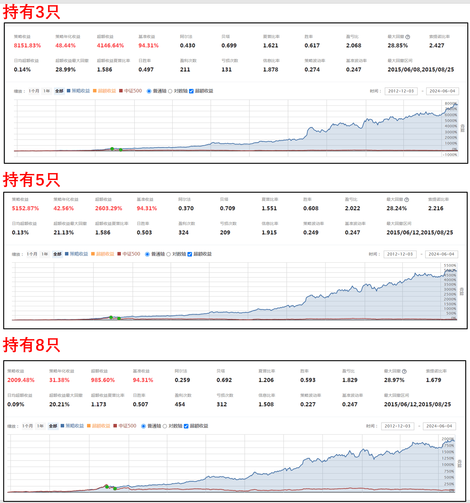

这个策略其实很简单，是在高股息小市值的基础上演变的，去掉了小市值排序改为最近3年股息率排序，还加了一些基本面的筛选因子。

具体逻辑：

1. 筛选最近三年股息率排名前10%的票。
2. PEG要在0.1-2之间。PEG太低是不合理的，比如PE是10，但业绩增速达到了200%，PEG达到0.05，这种要么是周期股，要么业绩有异常。PEG太高也不行，比如PE是10，但业绩增速只有2%，PEG达到5，这种增速太低了。相对来说，限制在0.1-2之间，就比较合适。
3. 营收增速同比大于3%，净利润增速同比大于8%，季度ROE大于4.5%，保证有一定的增长性。
4. 筛选完成后，按照股息率排行，买股息率最高的那几只票。
5. 一周调仓一次，每周一调仓。
6. 昨日涨幅大于8%，就暂时卖出。

大致就是这些，挺简单的，选出来的票主要是几百亿市值的中大盘股，小盘很少会被选中。这个策略从道理上讲，基本是靠谱的，高股息，合理的PEG，有一定的业绩增速，这种票确实挑不出毛病了。

风格的话，不算严格意义上的大票风格，小中大，都有可能会选上，中大盘选的会比较多，举个例子，最近6月份持有的5支票分别是4400亿市值的美的集团、86亿的陕天然气、462亿的海澜之家、33亿的宁波精达、300亿的养元饮品。

对了，这个策略我默认持有的事5只，因为8只太多了，有时候甚至可能都选不满，3只太少了，风险相对比较大，5只就恰恰好，不多也不少。PS：激进点的话，或者资金不多，选择3只比较合适。策略默认是5只。

实时模拟该策略时，有几点优化：

1. 支持修改策略资金。举个例子，你先用5万运行了该策略，你想要加仓1万，或者减仓1万，那么就可以用下面这个方式进行操作 。

策略开始运行后，会在研究环境生成一个文件，叫：纯高股息基本面修改资金.csv。

点开这个文件就可以修改策略资金了。举个例子，你如果想加仓10000，那就可以把下面这个（0,否,否），改成（10000，是，是）。如果你想减仓10000，那就改成（-10000，是，是）。然后点击左上角文件---保存，就可以生效了。

这里我做了一个设定，一旦你增加或者减少了资金，当天就会清仓重买。
注意：修改资金，不能在交易日的早上8点---下午4点修改，一定要在盘后修改，早上8点--下午4点修改可能会导致策略出错。

2. 替换代码：我做了优化，模拟交易你如果要修改代码，直接用【替换代码】功能，替换为你修改后的回测就可以了。不要用【修改代码】，要用【替换代码】

```python linenums="1" title="策略源码"
import pandas as pd
import numpy as np
import jqdata
from kuanke.wizard import *
from six import StringIO,BytesIO

from mysqltrade import *

 
    
def after_code_changed(context):
    now = context.current_dt.time()
    print("{0}替换了代码".format(now))
    unschedule_all()
    g.strategy = 'dougua1' # 策略名
    g.filename = '纯高股息基本面修改资金.csv' #入金配置文件名称

    g.first = 1
    g.out_cash = 0
    g.high_limit_list = []
    g.hold_list= []
    set_option('use_real_price', True)
    set_benchmark('000300.XSHG')
    # 设置滑点为理想情况，纯为了跑分好看，实际使用注释掉为好
    set_slippage(FixedSlippage(0.005))# 设置滑点
    # 设置交易成本
    set_order_cost(OrderCost(open_tax=0, close_tax=0.0005, open_commission=0.0003, close_commission=0.0003, close_today_commission=0, min_commission=5),type='fund')
    # strategy
    g.stock_num = 5

    run_daily(prepare_stock_list, time='9:05', reference_security='000300.XSHG') #每日9:05跑一次股票池（不交易）
    run_daily(change_cash, "9:30")#检查入金
    run_weekly(my_Trader, 1 ,time='9:31') #每周的第一个交易日的9:31调仓
    run_daily(check_limit_up, time='14:00') #每日14:00检查一下持仓股中是否涨幅过大的票
  

#1-1 根据最近一年分红除以当前总市值计算股息率并筛选    
def get_dividend_ratio_filter_list(context, stock_list, sort, p1, p2):
    time1 = context.previous_date
    time0 = time1 - datetime.timedelta(days=365*3)
    #获取分红数据，由于finance.run_query最多返回4000行，以防未来数据超限，最好把stock_list拆分后查询再组合
    interval = 1000 #某只股票可能一年内多次分红，导致其所占行数大于1，所以interval不要取满4000
    list_len = len(stock_list)
    #截取不超过interval的列表并查询
    q = query(finance.STK_XR_XD.code, finance.STK_XR_XD.a_registration_date, finance.STK_XR_XD.bonus_amount_rmb
    ).filter(
        finance.STK_XR_XD.a_registration_date >= time0,
        finance.STK_XR_XD.a_registration_date <= time1,
        finance.STK_XR_XD.code.in_(stock_list[:min(list_len, interval)]))
    df = finance.run_query(q)
    #对interval的部分分别查询并拼接
    if list_len > interval:
        df_num = list_len // interval
        for i in range(df_num):
            q = query(finance.STK_XR_XD.code, finance.STK_XR_XD.a_registration_date, finance.STK_XR_XD.bonus_amount_rmb
            ).filter(
                finance.STK_XR_XD.a_registration_date >= time0,
                finance.STK_XR_XD.a_registration_date <= time1,
                finance.STK_XR_XD.code.in_(stock_list[interval*(i+1):min(list_len,interval*(i+2))]))
            temp_df = finance.run_query(q)
            df = df.append(temp_df)
    dividend = df.fillna(0)
    dividend = dividend.groupby('code').sum()
    temp_list = list(dividend.index) #query查询不到无分红信息的股票，所以temp_list长度会小于stock_list
    #获取市值相关数据
    q = query(valuation.code,valuation.market_cap).filter(valuation.code.in_(temp_list))
    cap = get_fundamentals(q, date=time1)
    cap = cap.set_index('code')
    #计算股息率
    DR = pd.concat([dividend, cap] ,axis=1)
    DR['dividend_ratio'] = (DR['bonus_amount_rmb']/10000) / DR['market_cap']
    #排序并筛选
    DR = DR.sort_values(by=['dividend_ratio'], ascending=sort)
    print(len(DR))
    final_list = list(DR.index)[int(p1*len(DR)):int(p2*len(DR))]
    return final_list

def my_Trader(context):
    # all stocks
    dt_last = context.previous_date
    stocks = get_all_securities('stock', dt_last).index.tolist()
    choice = filter_kcbj_stock(stocks)
    choice = filter_st_stock(choice) #过滤ST
    choice = filter_paused_stock(choice) #过滤停牌股票
    choice = filter_limitup_stock(context,choice) #过滤涨停的股票
    choice = filter_limitdown_stock(context,choice) #过滤跌停的股票
    #高股息(全市场最大10%)
    stock_list = get_dividend_ratio_filter_list(context, choice, False, 0, 0.1)
    print(stock_list)
    #PEG合理区间(PEG在0.1和2之间的)
    stock_list = peg_stock(context,stock_list,0.1,2)
    #业绩筛选
    q = query(valuation.code).filter(
                valuation.code.in_(stock_list),
                indicator.inc_total_revenue_year_on_year>3,
                indicator.inc_net_profit_year_on_year>8,
                indicator.inc_return >4.5)
    df=get_fundamentals(q)
    stockset = list(df['code'])
    
    stock_list =  stockset[:g.stock_num] #选前前N只票
    cdata = get_current_data()
    # Sell
    for s in context.portfolio.positions:
        if (s  not in stock_list) and (cdata[s].last_price <  cdata[s].high_limit) :
            log.info('Sell', s, cdata[s].name)
            order_target_(context,s, 0)
    # buy
    position_count = len(context.portfolio.positions)
    if g.stock_num > position_count:
        psize = (context.portfolio.available_cash+g.out_cash)/(g.stock_num - position_count)
        for s in stock_list:
            if s not in context.portfolio.positions:
                log.info('buy', s, cdata[s].name)
                order_value_(context,s, psize)
                if len(context.portfolio.positions) == g.stock_num:
                    break
            

# 准备股票池
def prepare_stock_list(context):
    #获取已持有列表
    g.hold_list= []
    g.high_limit_list=[]
    for position in list(context.portfolio.positions.values()):
        stock = position.security
        g.hold_list.append(stock)
    #获取昨日涨停列表
    if g.hold_list != []:
        for stock in g.hold_list:
            df = get_price(stock, end_date=context.previous_date, frequency='daily', fields=['close','high_limit'], count=1)
            if df['close'][0] >= df['high_limit'][0]*0.98:#如果昨天有股票涨停，则放入列表
                g.high_limit_list.append(stock)
        
#  调整昨日涨停股票
def check_limit_up(context):
     # 获取持仓的昨日涨停列表
    current_data = get_current_data()
    if g.high_limit_list:
        for stock in g.high_limit_list:
            if current_data[stock].last_price < current_data[stock].high_limit:
                log.info("[%s]涨停打开，卖出" % stock)
                order_target_(context,stock, 0)
            else:
                log.info("[%s]涨停，继续持有" % stock)
 
 
# 过滤科创北交股票
def filter_kcbj_stock(stock_list):
    for stock in stock_list[:]:
        if stock[0] == '4' or stock[0] == '8' or stock[:2] == '68':
            stock_list.remove(stock)
    return stock_list

# 过滤停牌股票
def filter_paused_stock(stock_list):
	current_data = get_current_data()
	return [stock for stock in stock_list if not current_data[stock].paused]


# 过滤ST及其他具有退市标签的股票
def filter_st_stock(stock_list):
	current_data = get_current_data()
	return [stock for stock in stock_list
			if not current_data[stock].is_st
			and 'ST' not in current_data[stock].name
			and '*' not in current_data[stock].name
			and '退' not in current_data[stock].name]


# 过滤涨停的股票
def filter_limitup_stock(context, stock_list):
	current_data = get_current_data()
	
	
	# 已存在于持仓的股票即使涨停也不过滤，避免此股票再次可买，但因被过滤而导致选择别的股票
	return [stock for stock in stock_list if stock in context.portfolio.positions.keys()
			or current_data[stock].day_open < current_data[stock].high_limit]

# 过滤跌停的股票
def filter_limitdown_stock(context, stock_list):
	last_prices = history(1, unit='1m', field='close', security_list=stock_list)
	current_data = get_current_data()
	
	return [stock for stock in stock_list if stock in context.portfolio.positions.keys()
			or current_data[stock].day_open > current_data[stock].low_limit]

#2-4 筛选PEG	
def peg_stock(context,stock_list,pegmin,pegmax):
    
    q = query(valuation.code).filter(
                valuation.code.in_(stock_list),
                valuation.pe_ratio / indicator.inc_net_profit_year_on_year>pegmin,
                valuation.pe_ratio / indicator.inc_net_profit_year_on_year<pegmax)
    df=get_fundamentals(q)
    stock_list = list(df['code'])
    return stock_list
    
def change_cash(context): 
    if g.first == 1:
        data1 = {  
            '入金金额': 0,  
            '是否生效': "否",  
            '是否清仓后重新买入': "否"
        }  
        df2 = pd.DataFrame([data1], columns=['入金金额', '是否生效', '是否清仓后重新买入'])  
        write_file(g.filename, df2.to_csv(index=False), append=False)
        g.first = 0
    if g.out_cash < 0:
        inout_cash(g.out_cash, pindex=0)
        g.out_cash = 0
    else:
        try:
    
            df2 = pd.read_csv(BytesIO(read_file(g.filename)))
            log.info("入金文件",df2)
            single =  df2.at[0,"是否生效"]
            log.info("入金信号",single)
            is_sell = df2.at[0,"是否清仓后重新买入"]
            if single =="是":
                if is_sell == "是":
                    log.info("入金后先清仓，再重新买入，清仓股票为",list(context.portfolio.positions.keys()))
                    for s in context.portfolio.positions:
                        order_target_(context,s, 0)
                df2.loc[0,"是否清仓后重新买入"] = "否"    
                change_cash = df2.at[0,"入金金额"]
                log.info("入金金额",change_cash)
                if change_cash < 0 :
                    g.out_cash = change_cash
                else:
                    inout_cash(change_cash, pindex=0)
                df2.loc[0,"是否生效"] = "否" 
                log.info("重置后",df2)
                my_Trader(context)
                write_file(g.filename, df2.to_csv(index=False), append=False)
    
        except Exception as e:
            log.info("修改资金发生错误: {}".format(e))  

# end
```

### 4.14 大类资产再平衡（自动交易）

相比于绝对收益策略，大类资产再平衡更关注风险，多低相关资产对冲最大的优势并不是产生绝对收益，而是不同风格产生对冲，降低回撤。

多风格配置的核心一定是低相关性的核心大类资产，最典型的就是纳指、黄金、A股科技成长，A股小市值。

- **纳指（纳指ETF）**，是美国最优质的科技资产，降息周期+美国复苏+产业革命，纳斯达克都会起飞。
- **黄金（黄金ETF）**， 是优质避险资产，在全球风险剧增时，黄金可能走出独立行情。
- **A股科技成长（创业板ETF）**： 属于抽风资产，在特定环境下，弹性巨大，涨幅可以超过纳斯达克。
- **A股小市值**：熊市扛把子，市场越熊，小市值可能走得越好。

就用最简单的方案去做组合，每一种风格固定仓位权重，比如黄金20%，纳指20%，创业板20%，小市值40%。每个月再平衡一次，全年满仓，不择时。

这个策略思路非常简单，大道至简，逻辑越简单，鲁棒性就越强。

PS：策略中的小市值，用的是全市场选股，过滤ST和退市，过滤北交所和科创板，只取市值最小的5只票，掉出第7卖出，每周轮动一次。

这几种资产的权重，可以在策略里设置，小市值权重=100%-ETF相加的权重，比如你黄金20%，纳指20%，创业板20%，那么小市值就是40%。

不过，说实话，我心中最佳配比是黄金20%，纳指30%，创业板10%，小市值40%。我不喜欢创业板，创业板我认为不是一个非常好的资产，降低它的比率，可以有效降低回撤和波动率。

为了应对ETF停牌的事件，策略的交易时间改为10点40之后。

```python linenums="1" title="策略代码"
# 导入相关库
import pandas as pd
import numpy as np
import math
from jqdata import *
from mysqltrade import *

def after_code_changed(context):
    now = context.current_dt.time()
    print("{0}替换了代码".format(now))
    unschedule_all()
    # 设置基准
    set_benchmark('513100.XSHG')

    # 设置交易成本和滑点
    set_commission(PerTrade(buy_cost=0.0003, sell_cost=0.0008, min_cost=0))
    set_slippage(FixedSlippage(0.02),type='stock')
    set_slippage(FixedSlippage(0.002),type='fund')
    set_slippage(FixedSlippage(0.002),type='QDII_fund')

    # 使用真实价格交易
    set_option('use_real_price', True)
    g.strategy = 'dougua1' # 策略名

    g.weights = {
        '518880.XSHG': 0.2,  # 黄金ETF
        '513100.XSHG': 0.2,  # 纳指ETF
        '159915.XSHE': 0.2,  # 创业板ETF
        # '小市值' 的权重将由 1- 其他ETF总权重 自动计算得出
    }

    g.etf_pool = {code: name for code, name in [
        ('518880.XSHG', '黄金ETF'),
        ('513100.XSHG', '纳指ETF'),
        ('159915.XSHE', '创业板ETF'),
    ]}
    g.etf_codes = list(g.etf_pool.keys())
    g.etf_count = len(g.etf_codes)
    
    
    etf_total_weight = sum(list(g.weights.values()))
    g.small_cap_weight = 1.0 - etf_total_weight
    
    if g.small_cap_weight < 0:
        log.error("ETF总权重超过1.0，请检查g.weights设置！小市值权重为负，策略可能异常。")
        
    log.info("当前权重配置：ETF各 %.2f%% | 小市值 %.2f%%" % 
             (etf_total_weight * 100, g.small_cap_weight * 100))

    # 小市值策略参数
    g.smallest_stock_num = 5               # 持仓前10只
    g.smallest_sell_threshold = 7          # 掉出前15名卖出
    g.high_limit_list = []
    g.sold_from_limit_up = []
    g.need_small_cap_rebalance = False      # 标记是否需要次日执行小市值调仓
    
    g.cached_small_cap_targets = None       # 缓存小市值目标股票列表
    g.cached_candidate_stocks = None        # 缓存小市值候选池
    
    # 定时运行任务
    run_daily(prepare_high_limit_list, time='9:10')
    run_monthly(rebalance_monthly, 1, time='10:40')
    run_weekly(weekly_small_cap_rotation, 1, time='10:40') #小市值调仓
    
    run_daily(replenish_sold_stocks, time='10:45') #小市值次日补仓
    run_daily(delayed_small_cap_adjust, time='10:45')
    run_daily(check_limit_up_small_cap, time='14:00')


def is_empty_month(context):
    return context.current_dt.month in [1, 4]

def prepare_high_limit_list(context):
    g.high_limit_list = []
    
    # 如果小市值持仓为0，直接跳过
    hold_small_cap_stocks = [stock for stock in context.portfolio.positions.keys()
                             if stock not in g.etf_codes]
    
    if not hold_small_cap_stocks:
        return
    
    yesterday = context.previous_date
    df = get_price(hold_small_cap_stocks, end_date=yesterday, frequency='daily',
                   fields=['close', 'high_limit'], count=1, panel=False, fill_paused=False)
    limit_up_stocks = df[df['close'] == df['high_limit']]
    g.high_limit_list = list(limit_up_stocks.code)
    if g.high_limit_list:
        log.info("昨日涨停的小市值股票: %s" % g.high_limit_list)

def check_limit_up_small_cap(context):
    if not g.high_limit_list:
        return

    if is_empty_month(context):
        g.high_limit_list = []
        return

    now_time = context.current_dt
    for stock in g.high_limit_list:
        current_data = get_price(stock, end_date=now_time, frequency='1m',
                                 fields=['close', 'high_limit'], skip_paused=False,
                                 fq='pre', count=1, panel=False, fill_paused=True)
        if len(current_data) == 0:
            continue

        close_price = current_data.iloc[0, 0]
        high_limit_price = current_data.iloc[0, 1]

        if close_price < high_limit_price:
            order_target_value_(context, stock, 0)
            g.sold_from_limit_up.append(stock)

    g.high_limit_list = []

def replenish_sold_stocks(context):
    if not g.sold_from_limit_up:
        return

    if is_empty_month(context):
        g.sold_from_limit_up = []
        return

    log.info("需要补仓的股票: %s" % g.sold_from_limit_up)

    if g.cached_candidate_stocks is None:
        yesterday = context.previous_date
        all_stocks = get_all_securities(types=['stock'], date=yesterday).index.tolist()
        stocks = filter_stocks(all_stocks)

        q = query(valuation.code).filter(
            valuation.code.in_(stocks)
        ).order_by(
            valuation.market_cap.asc()
        ).limit(g.smallest_sell_threshold)

        df = get_fundamentals(q)
        g.cached_candidate_stocks = list(df.code)
        g.cached_small_cap_targets = g.cached_candidate_stocks[:g.smallest_stock_num]

    candidate_stocks = g.cached_candidate_stocks
    replenish_targets = [stock for stock in g.sold_from_limit_up if stock in candidate_stocks]

    if replenish_targets:
        log.info("补仓目标股票: %s" % replenish_targets)
        total_value = context.portfolio.total_value
        small_cap_target = total_value * g.small_cap_weight
        valid_target_value = small_cap_target * 0.98
        every_value = valid_target_value / g.smallest_stock_num

        for stock in replenish_targets:
            current_data = get_current_data()
            if current_data[stock].last_price >= current_data[stock].high_limit * 0.995:
                continue
            order_target_value_(context, stock, every_value)
            log.info("补仓 %s" % stock)

    g.sold_from_limit_up = []


def delayed_small_cap_adjust(context):
    if not g.need_small_cap_rebalance:
        return

    if is_empty_month(context):
        g.need_small_cap_rebalance = False
        return

    # 满仓时跳过选股和调仓
    current_hold_count = len([s for s in context.portfolio.positions.keys() if s not in g.etf_codes])
    if current_hold_count >= g.smallest_stock_num:
        log.info("小市值持仓已满(%d只)，跳过延迟调仓。" % current_hold_count)
        g.need_small_cap_rebalance = False
        return

    log.info("== 执行延迟的小市值调仓 ==")
    total_value = context.portfolio.total_value
    small_cap_target = total_value * g.small_cap_weight
    
    # 执行调仓时同时更新缓存
    adjust_small_cap_position(context, small_cap_target)
    
    g.need_small_cap_rebalance = False
    log.info("延迟的小市值调仓已完成")

def rebalance_monthly(context):
    log.info('== 开始每月再平衡 ==')

    total_value = context.portfolio.total_value
    current_month = context.current_dt.month
    empty_month = is_empty_month(context)

    # 重置缓存，确保下次调仓使用最新数据
    g.cached_small_cap_targets = None
    g.cached_candidate_stocks = None

    if empty_month:
        # 清仓小市值
        for stock in list(context.portfolio.positions.keys()):
            if stock not in g.etf_codes:
                order_target_value_(context, stock, 0)
        log.info("小市值策略已清仓")

        # 空仓月份：每只ETF占 1/3
        per_etf_value = total_value / g.etf_count
        for etf in g.etf_codes:
            order_target_value_(context, etf, per_etf_value)
            log.info("调整 %s 至目标市值 %.2f" % (g.etf_pool[etf], per_etf_value))

    else:
        log.info("非空仓月份，按全局权重配置调仓")
        g.need_small_cap_rebalance = True

        for etf in g.etf_codes:
            per_etf_value = total_value * g.weights.get(etf, 0.25)
            order_target_value_(context, etf, per_etf_value)
            log.info("调整 %s 至目标市值 %.2f (权重 %.1f%%)" % 
                     (g.etf_pool[etf], per_etf_value, g.weights.get(etf, 0.25)*100))

def weekly_small_cap_rotation(context):
    if is_empty_month(context):
        return

    if g.need_small_cap_rebalance:
        log.info("本月第一个交易日，月度再平衡已执行，跳过每周轮动。")
        return

    # 满仓时跳过选股和调仓
    current_hold_count = len([s for s in context.portfolio.positions.keys() if s not in g.etf_codes])
    if current_hold_count >= g.smallest_stock_num:
        log.info("小市值持仓已满(%d只)，跳过每周轮动。" % current_hold_count)
        return

    log.info('== 开始每周小市值轮动 ==')
    total_value = context.portfolio.total_value
    small_cap_target = total_value * g.small_cap_weight
    
    # 执行调仓时同时更新缓存
    adjust_small_cap_position(context, small_cap_target)


def adjust_small_cap_position(context, target_value):
    if g.cached_candidate_stocks is None:
        yesterday = context.previous_date
        all_stocks = get_all_securities(types=['stock'], date=yesterday).index.tolist()
        stocks = filter_stocks(all_stocks)

        q = query(valuation.code).filter(
            valuation.code.in_(stocks)
        ).order_by(
            valuation.market_cap.asc()
        ).limit(g.smallest_sell_threshold)

        df = get_fundamentals(q)
        g.cached_candidate_stocks = list(df.code)
        g.cached_small_cap_targets = g.cached_candidate_stocks[:g.smallest_stock_num]

    candidate_stocks = g.cached_candidate_stocks
    target_stocks = g.cached_small_cap_targets

    if not candidate_stocks or target_value <= 0:
        for stock in list(context.portfolio.positions.keys()):
            if stock not in g.etf_codes:
                order_target_value_(context, stock, 0)
        return

    for stock in list(context.portfolio.positions.keys()):
        if stock not in g.etf_codes:
            if stock not in candidate_stocks:
                if stock in g.high_limit_list:
                    pass  # 涨停保留
                else:
                    order_target_value_(context, stock, 0)
            elif stock not in target_stocks:
                if stock in g.high_limit_list:
                    pass
                else:
                    order_target_value_(context, stock, 0)

    every_value = (target_value) / g.smallest_stock_num
    for stock in target_stocks:
        current_data = get_current_data()
        if current_data[stock].last_price >= current_data[stock].high_limit * 0.995:
            continue
        order_target_value_(context, stock, every_value)
        log.info("调整 %s 至目标市值 %.2f" % (stock, every_value))

def filter_stocks(stock_list):
    current_data = get_current_data()
    return [stock for stock in stock_list if 
            not current_data[stock].is_st and
            not current_data[stock].paused and
            '退' not in current_data[stock].name and
            not stock.startswith('688') and
            current_data[stock].last_price != current_data[stock].high_limit and
            current_data[stock].last_price != current_data[stock].low_limit]
```
