# 第七章 实盘交易

有合适的量化策略后，最重要的就是去实盘跟踪，实盘的方法有两种，第一种是根据策略的买卖信号，手动跟踪。第二种是自动交易。

我的建议是用自动交易，手动跟踪很难跟上，时间长了节奏会乱掉，自动交易的好处我就不多说了，主打就是一个省心省力。不过我还是会介绍关于手动跟踪的方法，毕竟每个人的需求不一样，条条大路通罗马，教程的关键点在于把这些“路”都打通，让大家有得选择。

这一章，我会介绍手动跟踪和自动交易的方法：经过十年多的实践，推荐自动交易，支持的策略多，且简单容易上手，可以先开PT，目前国盛PT比较稳定。也可以开国金PT，有一定概率会被风控，如果国金PT不能用了，可以切换为QMT，如果都是开的国金，那么两个方案可以互相平替


| 实盘方式 | 具体实盘形式 | 需要的准备 | 支持券商 | 门槛 | 优点 | 缺点 |
| :--- | :--- | :--- | :--- | :--- | :--- | :--- |
| 手动跟踪 | 聚宽创建实时模拟，通过微信通知手动操作 | 1.只需要开通聚宽实时模拟 | 无限制 | 无 | 简单 | 手动可能跟不上 |
| 自动交易-QMT | 聚宽创建实时模拟，把交易信号传递给券商QMT，通过QMT自动下单 | 1.需要开通聚宽实时模拟<br>2.需要开通券商QMT软件的权限 | 国金 | 国金要10万开权限 | 1.可以实时自动跟着聚宽模拟策略<br>2.只要聚宽支持的策略，都可以实现自动交易 | 流程略复杂，需要有耐心 |
| 自动交易-Ptrade | 聚宽创建实时模拟，把交易信号传递给券商Ptrade，通过Ptrade自动下单 | 1.需要开通聚宽实时模拟<br>2.需要开通券商QMT软件的权限 | 国盛 | 国盛要20万开权限 | 1.可以实时自动跟着聚宽模拟策略<br>2.只要聚宽支持的策略，都可以实现自动交易 | 流程略复杂，需要有耐心 |

上面每一种我都会介绍具体的方法，都是保姆级教程，大家可以根据自己的需要选择其中的一种来操作：

- 经过一年多的实践，推荐自动交易，支持的策略多，且简单容易上手
- 券商支持自动交易的软件有两种，分别叫QMT和PT，我后面会逐一介绍

## 1. 手动跟踪：微信通知(手动跟踪)

这篇主要教大家怎么通过微信接收聚宽的实时交易信号，然后手动跟踪。此方法的预计成本：

1. 最大花费999元一年
2. 最小花费0元

### 1.1 开通聚宽实时模拟

聚宽默认是延时模拟，延时模拟会延时一天交易，比如策略12月14日9点35分买进股票A，但延时模拟会延时到15日的凌晨3点发出交易信号，并且延时模拟不支持微信通知。

所以如果想要微信通知，就要先开通实时模拟权限。

开通实时模拟有两种方式：

1. 购买聚宽的蓝V会员，价格是999元一年，会员会送三个实时模拟的坑位。
2. 通过聚宽的社区的积分，兑换实时模拟坑位。兑换的流程可以看这个帖子：[用积分兑换实时模拟的流程](https://t.zsxq.com/15qQPMp7A)

积分不要钱，但需每天去聚宽签到、看帖子、留言。

开通完实时模拟后，可以在[聚宽模拟交易列表页](https://www.joinquant.com/algorithm/trade/list?process=1)，看到模拟交易的状态，如果显示是“实时进行中”，那就说明实时模拟设置成功了

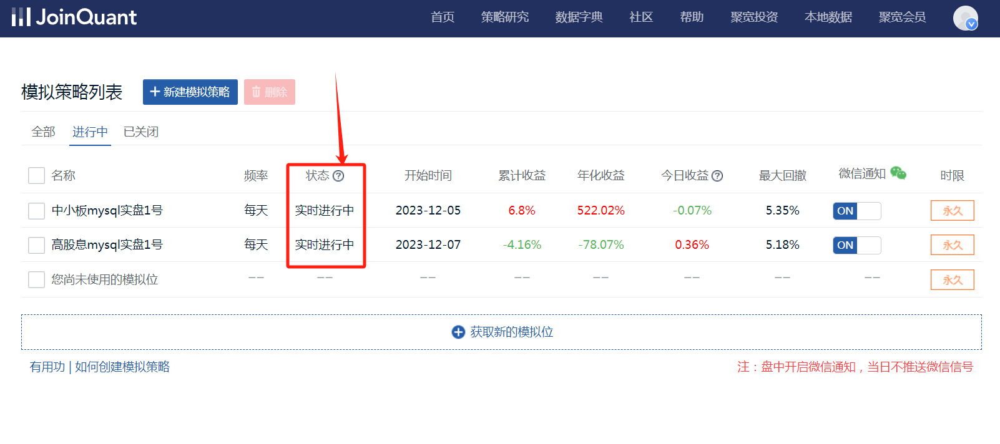

### 1.2 开通微信通知

只要开通了实时模拟，点击下面这个按钮，开通微信通知开关就可以了，只要按钮的状态显示“ON”，就代表这个策略已经开启微信通知。

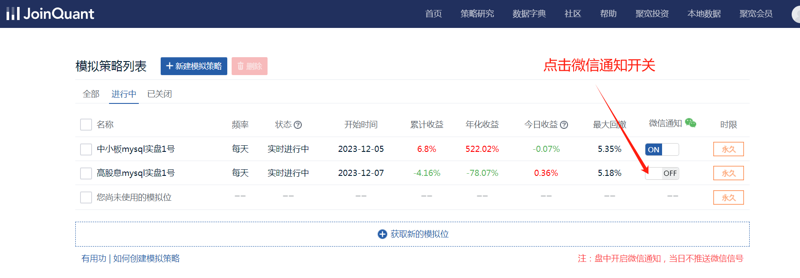

### 1.3 如何进行模拟交易？

这个老圈友就不用看了，有些新圈友可能还不清楚进行模拟交易的方法，可以看这个

可以通过以下两种方法进行模拟交易(推荐使用方法一)，创建模拟交易的前提是已经运行了回测，如果没有回测的话，请先创建回测

**方法一：使用回测结果创建**

找到需要创建模拟交易的回测，点击模拟交易，输入参数，点击确定

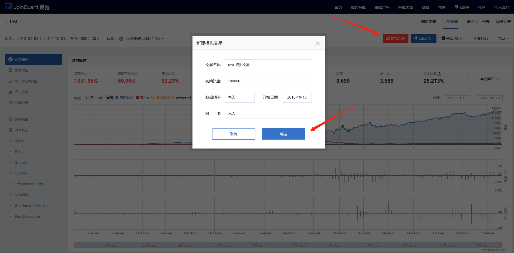

**方法二：在模拟交易列表中创建**

1. [进入模拟交易列表](https://www.joinquant.com/algorithm/trade/list)
2. 点击新建模拟交易，在跳出的窗口中依次输入交易名称和初始资金，并选择策略及其回测后点击确定。

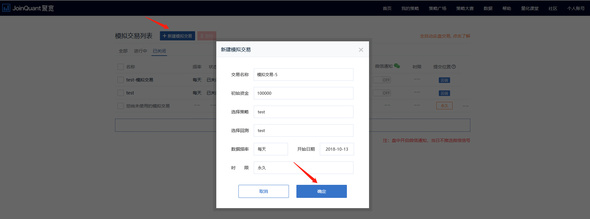

如果提示没有可用的模拟交易位，请点击模拟交易列表最下面的获取新的模拟交易位，使用积分兑换模拟交易位

## 2. 自动交易Ptrade：聚宽实时模拟，通过ptrade自动下单

本章主要教大家实现聚宽实时模拟，然后通过 ptrade 自动下单。**好处就是： 1.可以实时自动跟单聚宽模拟策略。2.只要聚宽支持的策略，都可以实现自动交易**。

大致的架构可以看下图：

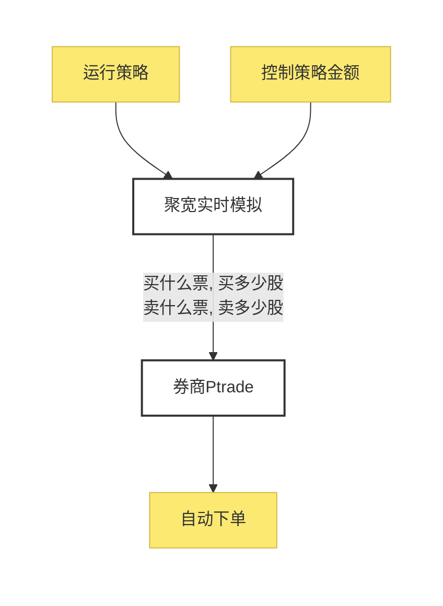

这个方案设置完后，你们就可以把聚宽实时模拟当成以前的一创聚宽了，第一次设置完后，之后都可以忽略 ptrade 的存在，还实现了邮件提醒，ptrade下单成功，或者是报错都会通过邮件告知，不用经常登 ptrade 去查看，可以把ptrade理解成一个隐形的下单工具。

参考资料：聚宽---蒋老师

此方法的预计成本：

1. 最大花费999元一年
2. 最小花费0元

### 2.1 证券开户

支持两种证券，分别是国金和国盛，但目前国金PT会封外网，开了也可能用不了，所以只支持开国盛。

国金证券：ptrade权限的开通门槛10万，手续费是万1。可以联系客户经理直接开户。国盛证券：nb823412

还是要强调一下，目前只有国金/国盛才支持该方案。

### 2.2 开通ptrade权限

开完户后，只要入金的金额达到了要求，就可以让客户经理帮你们开通ptrade的权限了，监管目前对量化有很多要求，所以开权限的时候客户经理会让你们填很多材料，按照要求填就可以了，这个有问题可以找客户经理。

开完ptrade权限后，客户经理会告诉你们怎么下载ptrade软件。

### 2.3 申请mysql数据库

先说明一下，mysql数据库的作用是转发下单消息，目的是用它把聚宽的信号转移到Ptrade上，Ptrade一旦下单成功，就会从数据库删除这条交易信息。

申请mysql数据库的方法：

微信联系doudougua2，我会给你一个星球专属的数据库账号密码和连接地址，但这个数据库账号到期时间同星球到期时间，星球到期不续费就没法用了，续费才可以继续用。这个的好处是数据库很稳定，不容易出问题。

### 2.4 在ptrade上运行接收聚宽信号的自动交易代码

登录ptrade软件，先点击左侧【量化】按钮，再点击顶部的【回测】按钮，就可以看到量化的界面了。

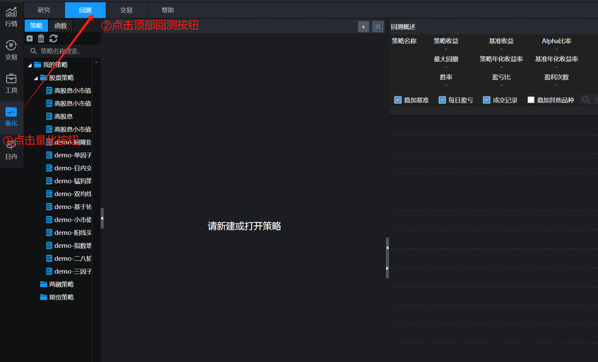

点击左上角的【+】按钮，会弹出一个框框，你在框内输入策略的名称，名称可以随便取，比如我就叫mysql实盘。

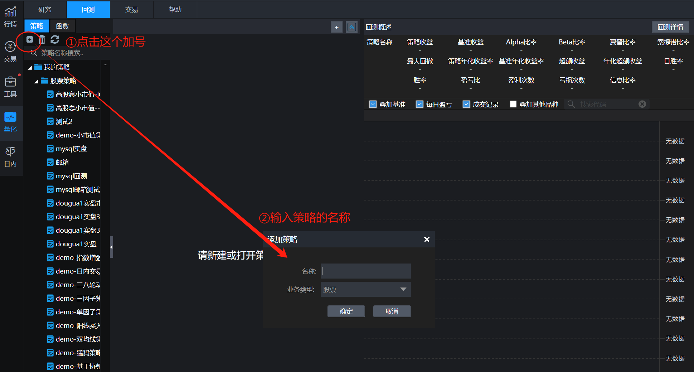

创建完成后，会出现几行默认的代码，把红框内的这些默认代码全部删除。

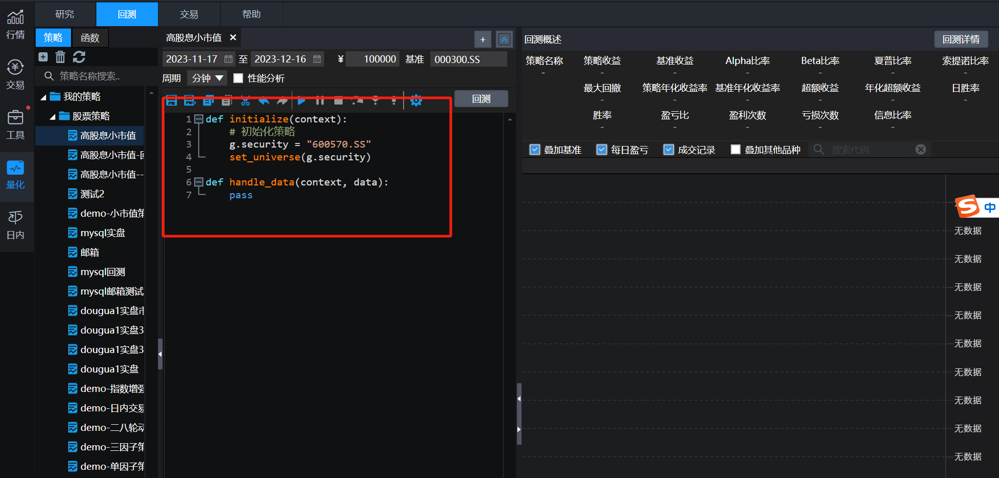

把我提供的ptrade自动交易策略代码直接复制进去。如果开了国盛PT，可以询问客户经理自己开的是旧版，还是信创版，不同的版本需要用不同的自动交易代码。

??? code "国金ptrade自动交易代码"

    ```python linenums="1"
    from sqlalchemy.ext.declarative import declarative_base
    from sqlalchemy import Column, Integer, String
    from sqlalchemy import create_engine
    from sqlalchemy.orm import sessionmaker
    from sqlalchemy.exc import OperationalError
    import sqlalchemy.engine.url as url
    import threading
    from sqlalchemy import and_
    import pandas as pd  
    import pymysql
    import time as d_time


    def initialize(context):
        g.email_count = 1
        set_commission(commission_ratio=0.0003, min_commission=5.0, type="STOCK")
        run_interval(context, trademain, seconds = 60)

    
    def trademain(context):
        
        host = '这里输入host'
        port = 3306
        dbname = '这里输入数据库名称'
        dbuser = '这里输入数据库账户'
        dbpassword = '这里输入数据库密码'
        
        is_use_email = False                    #填写True代表启用邮箱，False表示不启用邮箱。注意：使用邮箱必须填写三个信息
        send_email_name = '139XXXXX@qq.com'     #填写发送的邮箱地址
        get_email_name = ['312XXXXX@qq.com']    #填写接收的邮箱地址
        smtp_code_info = '这里填写smtp授权码'    #邮箱的smtp授权码，注意，不是邮箱密码
    


    
        try:
            uri = url.URL(
                drivername="mysql+pymysql",
                host=host,
                port=port,
                username=dbuser,
                password=dbpassword,
                database=dbname,
                query={'charset': 'utf8mb4'}
            )
            engine = create_engine(uri, echo=False,pool_size=10, max_overflow=5,pool_recycle=3600)
        
            Base.metadata.create_all(engine)

            Session = sessionmaker(bind=engine)
            session = Session() 
    
            sell_order_list = session.query(Stock).filter(and_(Stock.strategy == "dougua1",Stock.action == "SELL",Stock.mode == "1")).all() #获取卖出股票列表
            buy_order_list = session.query(Stock).filter(and_(Stock.strategy == "dougua1",Stock.action == "BUY",Stock.mode == "1")).all() #获取买入股票列表

            email_info = []
            for order_info in sell_order_list:
                amt = -int(order_info.amt)
                stock = order_info.code
                time = order_info.time
                info = {"推送股票":stock,"交易数量":amt,"交易时间":time}
                log.info("推送的卖出信息：%s" % info)
                buy_limit,sell_limit = get_trade_limit_price(stock)
                order_id = order_market(stock, amt, 4, limit_price=sell_limit) #市价单委托，最优五档即时成交剩余撤销；
                session.delete(order_info)
                email_info.append(info)
            if len(email_info)>0:
                log.info('卖出订单已全部委托，30秒后开始买入')
                d_time.sleep(30)  #延迟30秒
    
            for order_info in buy_order_list:
                amt = int(order_info.amt)
                stock = order_info.code
                time = order_info.time
                info = {"推送股票":stock,"交易数量":amt,"交易时间":time}
                log.info("推送的买入信息：%s" % info)
                buy_limit,sell_limit = get_trade_limit_price(stock)
                order_id = order_market(stock, amt, 4, limit_price=buy_limit) #市价单委托，最优五档即时成交剩余撤销；
                session.delete(order_info)
                email_info.append(info)
    
            session.commit()
            session.close() 
            engine.dispose()

            df_email_info = pd.DataFrame(email_info)
            if not df_email_info.empty and is_use_email: 
                email(send_email_name, get_email_name, smtp_code_info,df_email_info)
                
            elif df_email_info.empty:
                log.info("此刻没有需要交易的股票" )
            
        except Exception as e:
            log.info("发生错误: {}".format(e))
            if is_use_email and g.email_count == 1:
                email_info = "策略代码错误,请尽快检查"
                email(send_email_name, get_email_name, smtp_code_info,email_info)
                g.email_count = 0
            return(e)    


    def before_trading_start(context, data):
        
        g.email_count = 1

        
    def email(send_email_name, get_email_name, smtp_code_info,email_info):     
        try:
            send_email(send_email_name, get_email_name, smtp_code_info, info=email_info)
        except Exception as e:
            print("发送邮件失败: {}".format(e))
            return(e)       
    
        
        
    def get_trade_limit_price(stock):

        df = get_snapshot(stock)

        last_price = df[stock]['last_px']
        high_limit = df[stock]['up_px']
        low_limit = df[stock]['down_px']

        buy_limit = min(round(max(last_price*1.02-0.01,last_price+0.1),2),high_limit)
        sell_limit= max(round(min(last_price*0.98+0.01,last_price-0.1),2),low_limit)
        
        return buy_limit,sell_limit


    Base = declarative_base()

    class Stock(Base):
        __tablename__ = 'stocks'

        id = Column(Integer, primary_key=True, autoincrement = True)
        time = Column(String(255))
        action = Column(String(255))
        code = Column(String(255))
        amt = Column(String(255))
        pct = Column(String(255))
        strategy = Column(String(255))
        isconsum = Column(String(255))
        mode = Column(String(255))
        
    def handle_data(context, data):   
        pass
    ```

??? code "国盛ptrade自动交易代码"

    ```python linenums="1"
    from sqlalchemy.ext.declarative import declarative_base
    from sqlalchemy import Column, Integer, String
    from sqlalchemy import create_engine
    from sqlalchemy.orm import sessionmaker
    from sqlalchemy.exc import OperationalError
    import sqlalchemy.engine.url as url
    import threading
    from sqlalchemy import and_
    import pandas as pd  
    import pymysql
    import time as d_time


    def initialize(context):
        g.email_count = 1
        set_commission(commission_ratio=0.0003, min_commission=5.0, type="STOCK")
        run_interval(context, trademain, seconds = 60)

    
    def trademain(context):
        
        host = '这里输入host'
        port = 3306
        dbname = '这里输入数据库名称'
        dbuser = '这里输入数据库账户'
        dbpassword = '这里输入数据库密码'
        
        is_use_email = False                    #填写True代表启用邮箱，False表示不启用邮箱。注意：使用邮箱必须填写三个信息
        send_email_name = '139XXXXX@qq.com'     #填写发送的邮箱地址
        get_email_name = ['312XXXXX@qq.com']    #填写接收的邮箱地址
        smtp_code_info = '这里填写smtp授权码'    #邮箱的smtp授权码，注意，不是邮箱密码
    


    
        try:
            uri = url.URL(
                drivername="mysql+pymysql",
                host=host,
                port=port,
                username=dbuser,
                password=dbpassword,
                database=dbname,
            )
            engine = create_engine(uri, encoding='utf-8',echo=False,pool_size=10, max_overflow=5,pool_recycle=3600)
        
            Base.metadata.create_all(engine)

            Session = sessionmaker(bind=engine)
            session = Session() 
    
            sell_order_list = session.query(Stock).filter(and_(Stock.strategy == "dougua1",Stock.action == "SELL",Stock.mode == "1")).all() #获取卖出股票列表
            buy_order_list = session.query(Stock).filter(and_(Stock.strategy == "dougua1",Stock.action == "BUY",Stock.mode == "1")).all() #获取买入股票列表

            email_info = []
            for order_info in sell_order_list:
                amt = -int(order_info.amt)
                stock = order_info.code
                time = order_info.time
                info = {"推送股票":stock,"交易数量":amt,"交易时间":time}
                log.info("推送的卖出信息：%s" % info)
                buy_limit,sell_limit = get_trade_limit_price(stock)
                order_id = order_market(stock, amt, 4, limit_price=sell_limit) #市价单委托，最优五档即时成交剩余撤销；
                session.delete(order_info)
                email_info.append(info)
            if len(email_info)>0:
                log.info('卖出订单已全部委托，30秒后开始买入')
                d_time.sleep(30)  #延迟30秒
    
            for order_info in buy_order_list:
                amt = int(order_info.amt)
                stock = order_info.code
                time = order_info.time
                info = {"推送股票":stock,"交易数量":amt,"交易时间":time}
                log.info("推送的买入信息：%s" % info)
                buy_limit,sell_limit = get_trade_limit_price(stock)
                order_id = order_market(stock, amt, 4, limit_price=buy_limit) #市价单委托，最优五档即时成交剩余撤销；
                session.delete(order_info)
                email_info.append(info)
    
            session.commit()
            session.close() 
            engine.dispose()

            df_email_info = pd.DataFrame(email_info)
            if not df_email_info.empty and is_use_email: 
                email(send_email_name, get_email_name, smtp_code_info,df_email_info)
                
            elif df_email_info.empty:
                log.info("此刻没有需要交易的股票" )
            
        except Exception as e:
            log.info("发生错误: {}".format(e))
            if is_use_email and g.email_count == 1:
                email_info = "策略代码错误,请尽快检查"
                email(send_email_name, get_email_name, smtp_code_info,email_info)
                g.email_count = 0
            return(e)    


    def before_trading_start(context, data):
        
        g.email_count = 1

        
    def email(send_email_name, get_email_name, smtp_code_info,email_info):     
        try:
            send_email(send_email_name, get_email_name, smtp_code_info, info=email_info)
        except Exception as e:
            print("发送邮件失败: {}".format(e))
            return(e)       
    
        
        
    def get_trade_limit_price(stock):

        df = get_snapshot(stock)

        last_price = df[stock]['last_px']
        high_limit = df[stock]['up_px']
        low_limit = df[stock]['down_px']

        buy_limit = min(round(max(last_price*1.02-0.01,last_price+0.1),2),high_limit)
        sell_limit= max(round(min(last_price*0.98+0.01,last_price-0.1),2),low_limit)
        
        return buy_limit,sell_limit


    Base = declarative_base()

    class Stock(Base):
        __tablename__ = 'stocks'

        id = Column(Integer, primary_key=True, autoincrement = True)
        time = Column(String(255))
        action = Column(String(255))
        code = Column(String(255))
        amt = Column(String(255))
        pct = Column(String(255))
        strategy = Column(String(255))
        isconsum = Column(String(255))
        mode = Column(String(255))
        
    def handle_data(context, data):   
        pass
    ```

??? code "国盛（信创版）ptrade自动交易代码"

    ```python linenums="1"
    from sqlalchemy.ext.declarative import declarative_base
    from sqlalchemy import Column, Integer, String
    from sqlalchemy import create_engine
    from sqlalchemy.orm import sessionmaker
    from sqlalchemy.exc import OperationalError
    import sqlalchemy.engine.url as url
    import threading
    from sqlalchemy import and_
    import pandas as pd  
    import pymysql
    import time as d_time
    from sqlalchemy import create_engine, make_url


    def initialize(context):
        g.email_count = 1
        set_commission(commission_ratio=0.0003, min_commission=5.0, type="STOCK")
        run_interval(context, trademain, seconds = 60)

    
    def trademain(context):
        
        host = '这里输入host'
        port = 3306
        dbname = '这里输入数据库名称'
        dbuser = '这里输入数据库账户'
        dbpassword = '这里输入数据库密码'
        
        is_use_email = False                    #填写True代表启用邮箱，False表示不启用邮箱。注意：使用邮箱必须填写三个信息
        send_email_name = '139XXXXX@qq.com'     #填写发送的邮箱地址
        get_email_name = ['312XXXXX@qq.com']    #填写接收的邮箱地址
        smtp_code_info = '这里填写smtp授权码'    #邮箱的smtp授权码，注意，不是邮箱密码
    


    
        try:
            # 构建带 charset 的 URL
            db_url = f"mysql+pymysql://{dbuser}:{dbpassword}@{host}:{port}/{dbname}?charset=utf8mb4"
            connect_url = make_url(db_url)
            
            engine = create_engine(connect_url, echo=False,
                                pool_size=10, max_overflow=5, pool_recycle=3600)
            
            Base.metadata.create_all(engine)

            Session = sessionmaker(bind=engine)
            session = Session() 
    
            sell_order_list = session.query(Stock).filter(and_(Stock.strategy == "dougua1",Stock.action == "SELL",Stock.mode == "1")).all() #获取卖出股票列表
            buy_order_list = session.query(Stock).filter(and_(Stock.strategy == "dougua1",Stock.action == "BUY",Stock.mode == "1")).all() #获取买入股票列表

            email_info = []
            for order_info in sell_order_list:
                amt = -int(order_info.amt)
                stock = order_info.code
                time = order_info.time
                info = {"推送股票":stock,"交易数量":amt,"交易时间":time}
                log.info("推送的卖出信息：%s" % info)
                buy_limit,sell_limit = get_trade_limit_price(stock)
                order_id = order_market(stock, amt, 4, limit_price=sell_limit) #市价单委托，最优五档即时成交剩余撤销；
                session.delete(order_info)
                email_info.append(info)
            if len(email_info)>0:
                log.info('卖出订单已全部委托，30秒后开始买入')
                d_time.sleep(30)  #延迟30秒
    
            for order_info in buy_order_list:
                amt = int(order_info.amt)
                stock = order_info.code
                time = order_info.time
                info = {"推送股票":stock,"交易数量":amt,"交易时间":time}
                log.info("推送的买入信息：%s" % info)
                buy_limit,sell_limit = get_trade_limit_price(stock)
                order_id = order_market(stock, amt, 4, limit_price=buy_limit) #市价单委托，最优五档即时成交剩余撤销；
                session.delete(order_info)
                email_info.append(info)
    
            session.commit()
            session.close() 
            engine.dispose()

            df_email_info = pd.DataFrame(email_info)
            if not df_email_info.empty and is_use_email: 
                email(send_email_name, get_email_name, smtp_code_info,df_email_info)
                
            elif df_email_info.empty:
                log.info("此刻没有需要交易的股票" )
            
        except Exception as e:
            log.info("发生错误: {}".format(e))
            if is_use_email and g.email_count == 1:
                email_info = "策略代码错误,请尽快检查"
                email(send_email_name, get_email_name, smtp_code_info,email_info)
                g.email_count = 0
            return(e)    


    def before_trading_start(context, data):
        
        g.email_count = 1

        
    def email(send_email_name, get_email_name, smtp_code_info,email_info):     
        try:
            send_email(send_email_name, get_email_name, smtp_code_info, info=email_info)
        except Exception as e:
            print("发送邮件失败: {}".format(e))
            return(e)       
    
        
        
    def get_trade_limit_price(stock):

        df = get_snapshot(stock)

        last_price = df[stock]['last_px']
        high_limit = df[stock]['up_px']
        low_limit = df[stock]['down_px']

        buy_limit = min(round(max(last_price*1.02-0.01,last_price+0.1),2),high_limit)
        sell_limit= max(round(min(last_price*0.98+0.01,last_price-0.1),2),low_limit)
        
        return buy_limit,sell_limit


    Base = declarative_base()

    class Stock(Base):
        __tablename__ = 'stocks'

        id = Column(Integer, primary_key=True, autoincrement = True)
        time = Column(String(255))
        action = Column(String(255))
        code = Column(String(255))
        amt = Column(String(255))
        pct = Column(String(255))
        strategy = Column(String(255))
        isconsum = Column(String(255))
        mode = Column(String(255))
        
    def handle_data(context, data):   
        pass
    ```

复制粘贴完源码后，一定要检测一下，看看是否复制完整。

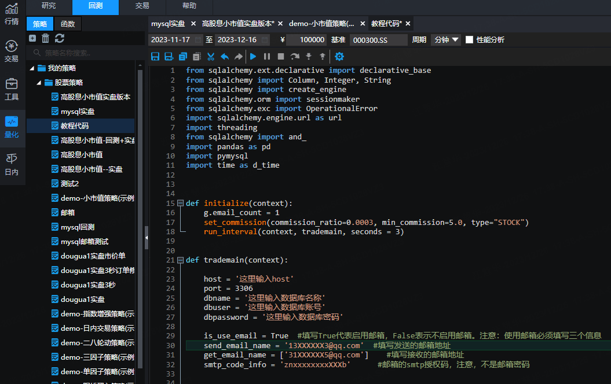

填写数据库的信息，在下面红框的对应位置，把第三步拿到的数据库连接信息填进去。这个千万不能填错，这步有问题的可以星球提问，或者联系微信doudougua2

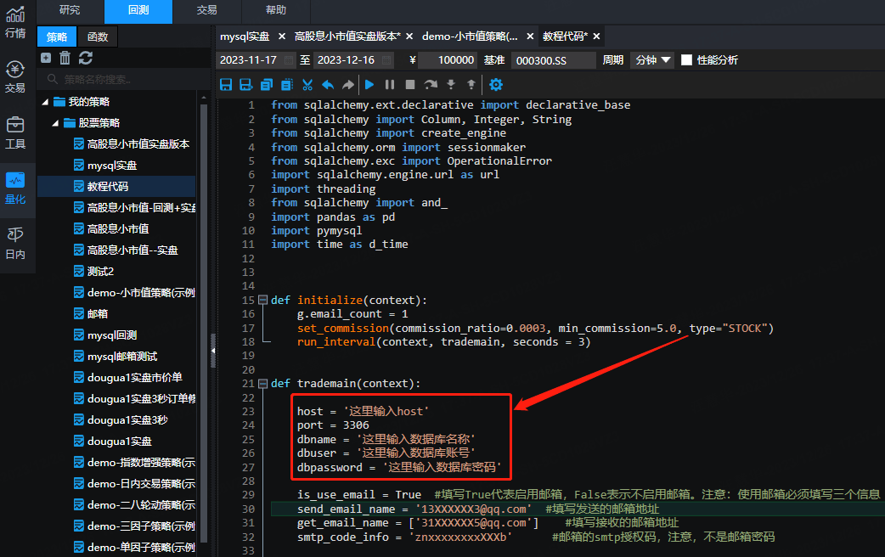

填写邮箱信息，这个地方即便不填也没关系，填了的话，策略下单成功，或者代码出问题，都会发邮件到你的邮箱，比较省心。这里邮箱只支持QQ邮箱，不支持其他邮箱。发送邮箱和接收邮箱可以填同一个。

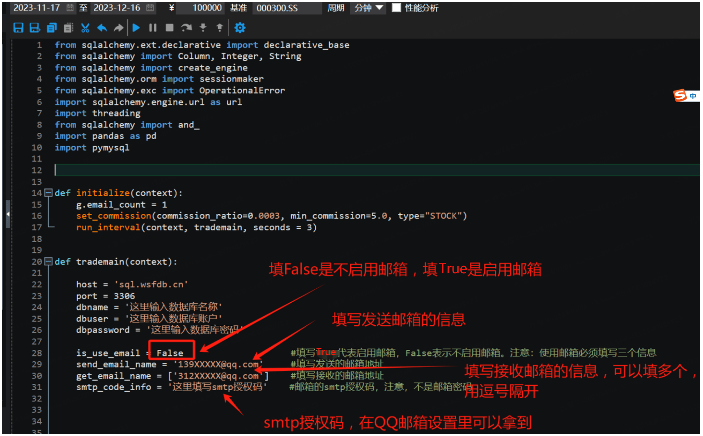

QQ邮箱，SMTP授权码获取的流程如下：

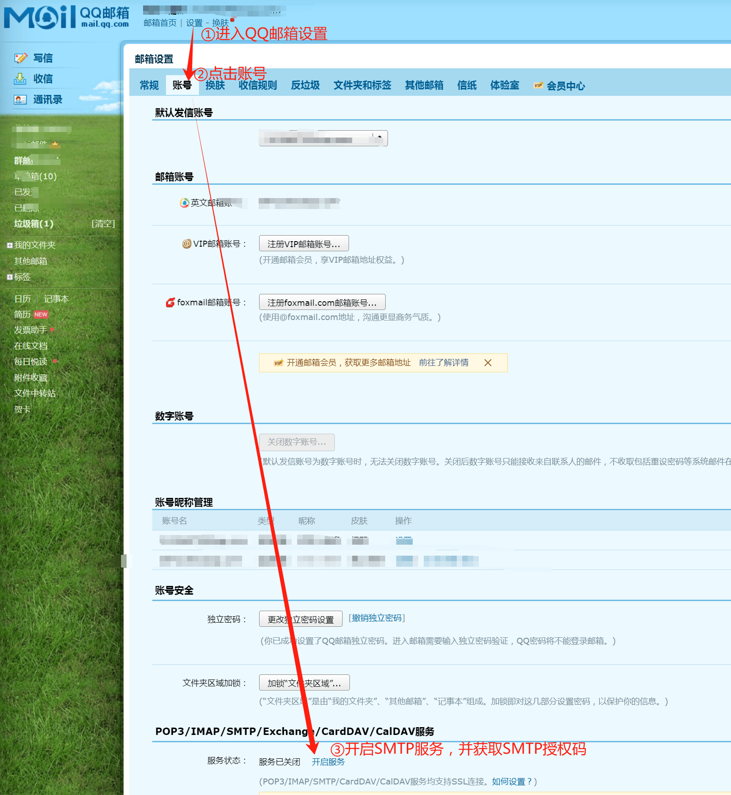

以上修改完成后，一定要点击下图中的保存按钮。回测周期默认是分钟，这个千万别改成天，千万别改成天，千万别改成天。

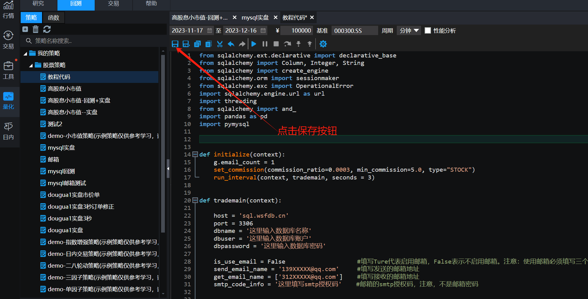

开启实盘，如下图，先点击顶部的【交易】按钮，再点击【新增】按钮，再选择刚才保存的策略。选完后写个交易名称，再点击【确定】按钮，即可开启自动交易。这个是没有延迟的，当天设置，当天就可交易。最好不要在盘中（早上9点---下午4点）开启交易，我的建议是盘后开启交易，这样不容易出错。

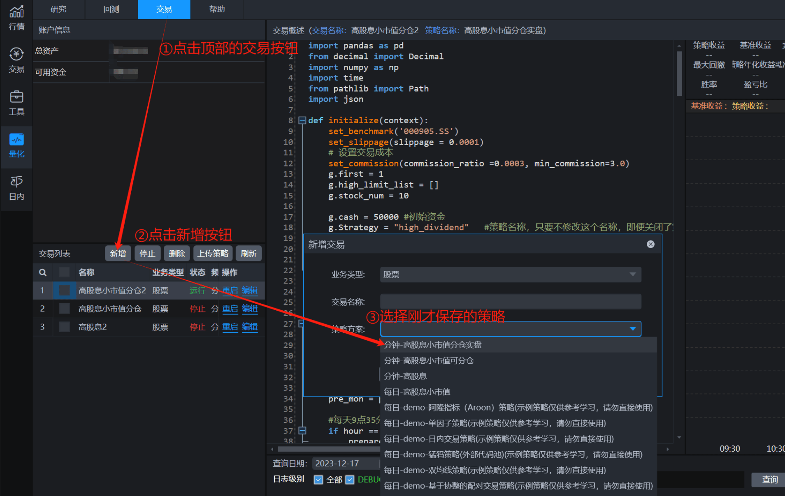

开启实盘交易后，前几天，记得每天都来看下交易日志，如果不报错，就代表没问题了。下图红色区域就是看日志的地方。

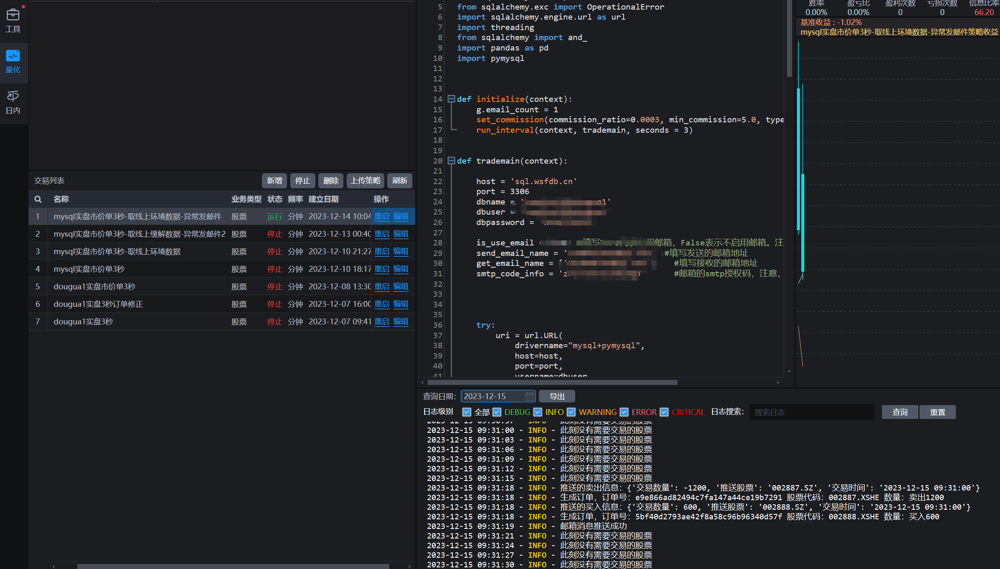

ptrade设置完成了，接下来就要移步聚宽，去设置其他内容了。PS：PT端接收聚宽信号的自动交易代码，只需要运行一个，即便聚宽有100个策略，PT也只需要一个。

### 2.5 下载自定义库

下载百度网盘的文件：链接: 链接: https://pan.baidu.com/s/1nmHJBUZRBXb-eA4VbCMlMA?pwd=aupc 提取码: aupc

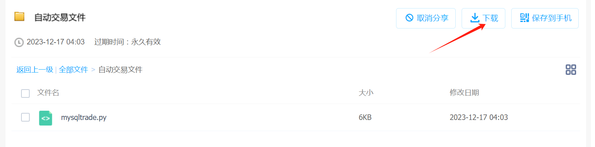

打开聚宽的研究环境

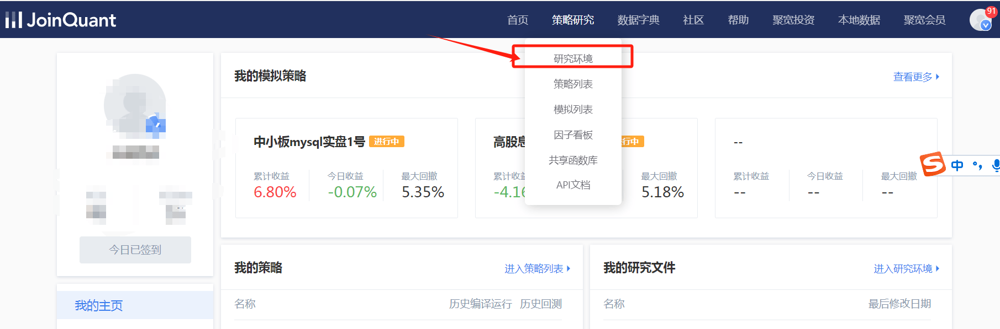

把刚才下载的文件，上传到聚宽的研究环境。可以点左上角【上传】按钮上传，也可以把文件直接拖进去。

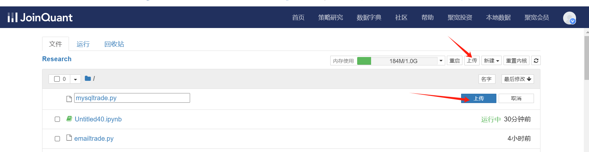

在研究环境中，打开这个文件，然后把第三步拿到的数据库连接信息填进去。这个千万不能填错，这步有问题的可以星球提问，或者联系微信doudougua2。

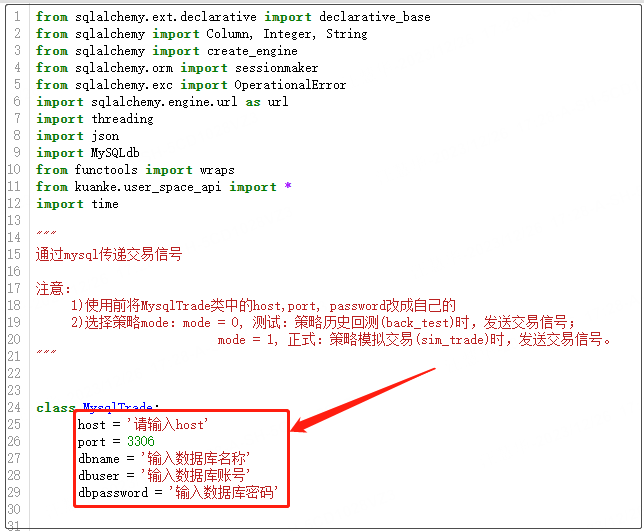

填完后，切记一定要点左上角的保存。

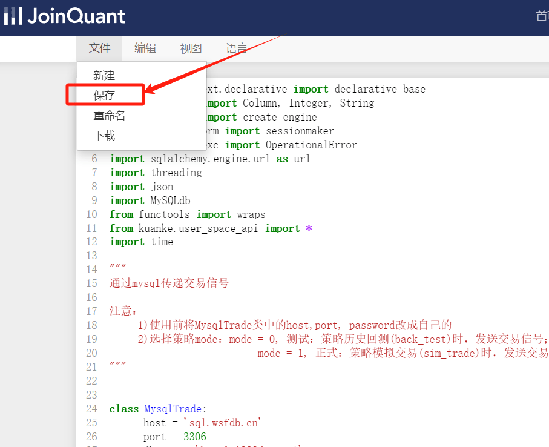

### 2.6 对聚宽的策略进行修改

修改的目的是为了让聚宽的策略可以把交易信息发送到数据库。
**部分策略我已经修改，源码已经上传，如果你们还想实盘这几个策略，那么直接复制我的源码就可以。**

- [高股息小市值（自动交易）](https://k7pl9l9npy.k.topthink.com/@dougua666/gaoguxixiaoshizhi（zidongjiaoyi）.html)
- [高股息小市值-增加了1底和4月底择时-增加了止损（自动交易）](https://k7pl9l9npy.k.topthink.com/@dougua666/gaoguxixiaoshizhi-zengjiale1dihe4yuedizeshi-zengjialezhisun（zidongjiaoyi）.html)
- [中小板小市值（自动交易）](https://k7pl9l9npy.k.topthink.com/@dougua666/zhongxiaobanxiaoshizhi（zidongjiaoyi）.html)
- [中小板小市值-1月底和4月底不买入(自动交易)](https://k7pl9l9npy.k.topthink.com/@dougua666/zhongxiaobanxiaoshizhi-1yuedihe4yuedibumairu(zidongjiaoyi).html)
- [中小板小市值-国九升级版-1月4月空仓-调仓时间随机(自动交易)](https://k7pl9l9npy.k.topthink.com/@dougua666/zhongxiaobanxiaoshizhi-guojiushengjiban-1yue4yuekongcang-tiaocangshijiansuiji(zidongjiaoyi).html)
- [基本面小市值（自动交易）](https://k7pl9l9npy.k.topthink.com/@dougua666/jibenmianxiaoshizhi（zidongjiaoyi）.html)
- [基本面小市值-周调仓-1月底和4月底空仓（自动交易）](https://k7pl9l9npy.k.topthink.com/@dougua666/jibenmianxiaoshizhi-zhoutiaocang-1yuedihe4yuedikongcang（zidongjiaoyi）.html)
- [动态持仓中小板小市值国九条版（自动交易）](https://k7pl9l9npy.k.topthink.com/@dougua666/dongtaichicangzhongxiaobanxiaoshizhiguojiutiaoban（zidongjiaoyi）.html)
- [动态持仓创业板小市值（自动交易）](https://k7pl9l9npy.k.topthink.com/@dougua666/dongtaichicangchuangyebanxiaoshizhi（zidongjiaoyi）.html)
- [纯高股息基本面策略(自动交易)](https://k7pl9l9npy.k.topthink.com/@dougua666/chungaoguxijibenmiancelve(zidongjiaoyi).html)


如果想实盘其他策略，可以按照以下三个步骤对自己想实盘的策略进行修改：

在策略最顶部加入下面的语句，意思是引入"研究"中的 mysqltrade.py 这个文件的内容。

```python
from mysqltrade import *
```

入下图所示：

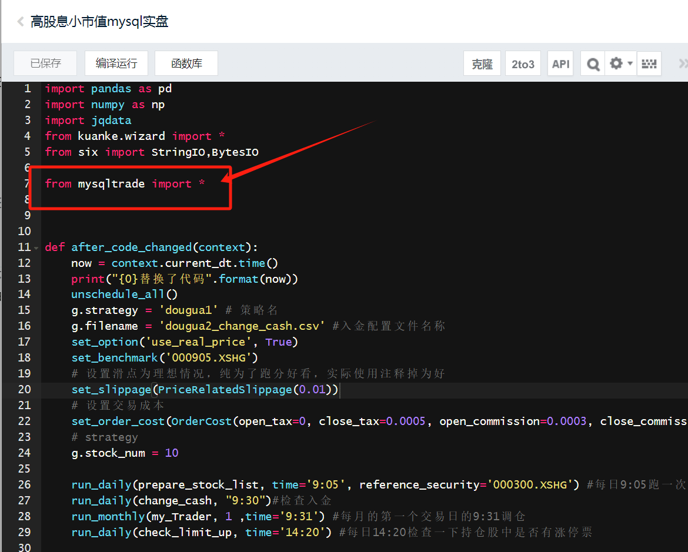

再策略里，增加一个全局变量: `g.strategy`，这个我们不用做修改，统计都叫dougua1就可以。

```python
g.strategy = 'dougua1' # 策略名
```

如下图所示：

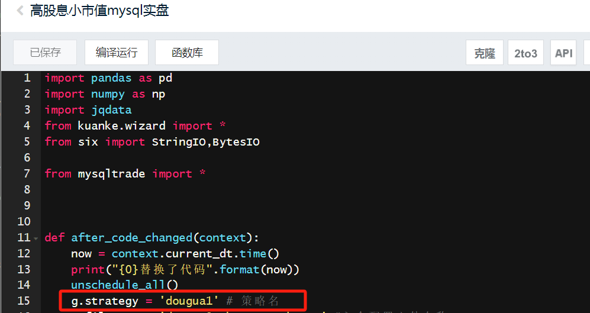


修改策略的下单函数order系列。例如：

```python linenums="1"
order(stock, 100) 修改为： order_(context, stock, 100)
order_target(stock, 0) 修改为： order_target_(context, stock, 0)
order_value(stock, 10000)修改为： order_value_(context, stock, 10000)
order_target_value(stock, value) 修改为： order_target_value_(context, stock, value)
```

具体的修改规则是：给order系列下单函数加个小尾巴下划线 `_`, 并增加一个参数 `context`。

告诉大家一个小技巧，可以用ctrl+f，然后输入order来搜索这个策略包含以上4个order下单函数的位置。

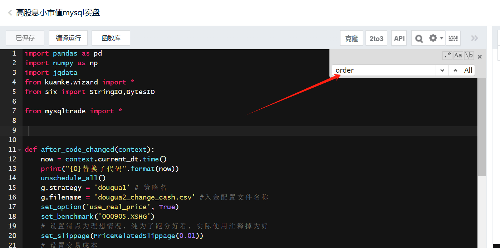

修改下单函数order系列，其目的是为了调用mysqltrade.py中的对应函数。mysqltrade的对应函数在完成下单后，将返回的Order对象转换成交易信号并通过mysql发送出去，是mysqltrade最核心的函数。

其实已经很简单了，如果有想实盘的策略，但实在学不会怎么改，可以找我，我来帮改。

### 2.7 开通聚宽实时模拟

聚宽默认是延时模拟，延时模拟会延时一天交易，比如策略12月14日9点35分买进股票A，但延时模拟会延时到15日的凌晨3点发出交易信号，并且延时模拟不支持微信通知。

所以如果想要微信通知，就要先开通实时模拟权限。

开通实时模拟有两种方式：

1. 购买聚宽的蓝V会员，价格是999元一年，会员会送三个实时模拟的坑位。
2. 通过聚宽的社区的积分，兑换实时模拟坑位。兑换的流程可以看这个帖子：用积分兑换实时模拟的流程

积分不要钱，但需每天去聚宽签到、看帖子、留言。

开通完实时模拟后，可以在聚宽模拟交易列表页（链接），看到模拟交易的状态，如果显示是“实时进行中”，那就说明实时模拟设置成功了。

### 2.8 将修改后的策略源码在聚宽上进行实时模拟

**注意**：在ptrade未设置完成前，千万不要先在聚宽运行mysql版本的实时模拟，一定要ptrade先运行，再去运行聚宽实时模拟，或者聚宽实时模拟（要在24点前）和PT同一天运行。

这步我就不多讲了，就是把我们修改后的策略源码在聚宽上进行实时模拟。这里有一点要注意，你模拟填写的金额是多少，那么对应ptrade下单的金额就会是多少。举个例子，你模拟了高股息小市值策略，起始资金是10万，买10只，那么对应发给ptrade就会每只买1万。也就是说ptrade买多少股票，全看模拟设置的金额是多少。

实盘时，一定要确保券商账户的资金比聚宽模拟策略设置的资金多5%左右，举个例子，你聚宽模拟设置的是10万，那么国盛券商账户最好放10.5万，不然可能会报资金不足。

### 2.9 其他进阶扩展功能

设置后实盘后，基本就没问题了。

但后续如果要修改聚宽代码、修改PT代码、修改聚宽模拟的资金、修改数据库账号密码，还需要一些操作，这些操作也不难，具体可看下面：

1. [聚宽替换代码](https://k7pl9l9npy.k.topthink.com/@dougua666/tihuandaima.html)
2. [修改聚宽模拟的资金](https://k7pl9l9npy.k.topthink.com/@dougua666/yongCSVwenjianxiugaicelvezijin.html)
3. [修改PT代码](https://k7pl9l9npy.k.topthink.com/@dougua666/PTxiugaidaima1.html)
4. [修改数据库账号密码步骤](https://k7pl9l9npy.k.topthink.com/@dougua666/xiugaishujukuzhanghaomimabuzhou.html)

### 2.10 修改数据库账号密码步骤

!!! warning "注意"
    
    修改数据库账号密码，必须要盘后操作，不要在盘中操作。

#### 2.10.1 修改PT端数据库账号密码

进入【交易】，勾选原策略后，点击【停止】原策略。

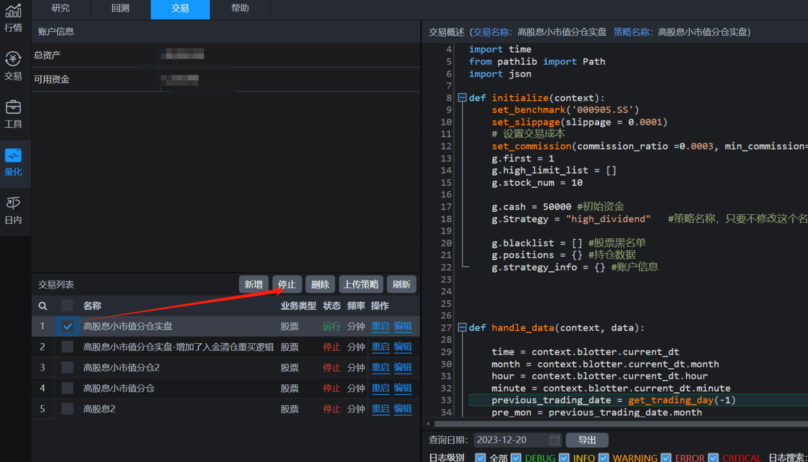

进入【回测】，替换掉红框里的数据库信息，然后点击左上角的保存。

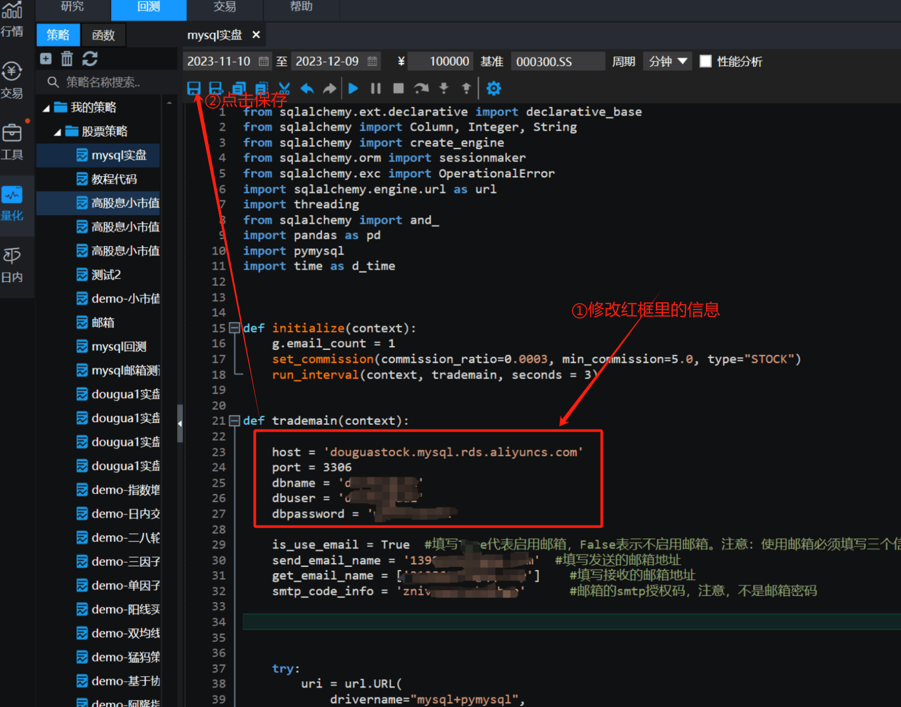

进入【交易】，点击【新增】，选择刚才保存的策略

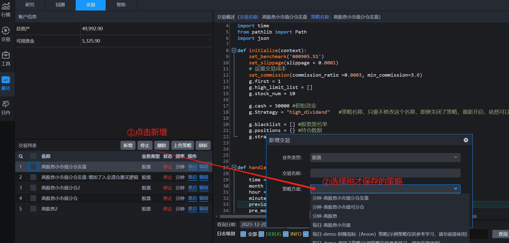


#### 2.10.2 修改聚宽端数据库账号密码

进入聚宽的研究环境，找到我们自定义的第三方库 mysqltrade

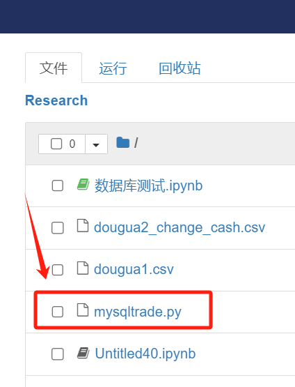

替换掉红框里的数据库信息，填入的信息和上面PT端一样

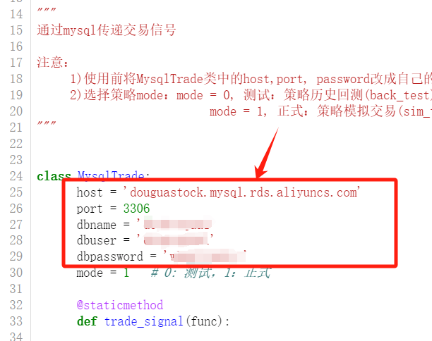

点击保存。

进入正在实盘的实时模拟策略，点击【替换代码】，选择最新的一个回测，替换代码即可。这个步骤并不需要真正的修改代码，做这个步骤的目的，只是为了让策略重新导入上面的mysqltrade。

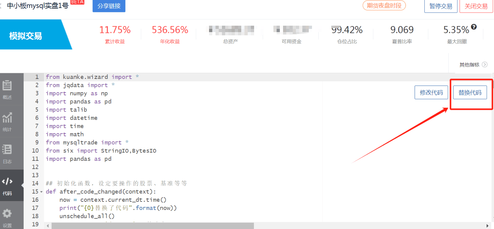

### 2.11 PT修改代码

进入【交易】，勾选原策略后，点击【停止】原策略。


进入【回测】，复制新代码，或者修改代码后点击保存。

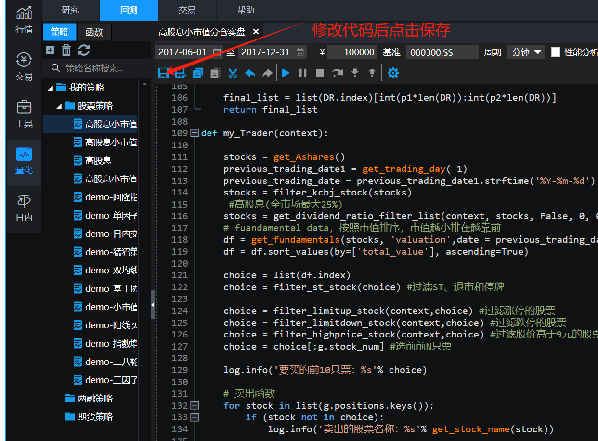

进入【交易】，点击【新增】，选择刚才保存的策略


### 2.12 自动申购新股和逆回购（Ptrade版）

几点说明：

1. 此方法需要先开通Ptrade。
2. 我设置了早上10点申购新股，下午14:57自动逆回购。
3. 中新股的要注意了，新股可能是下午16点才扣资金，逆回购后资金就不可用了，如果中签，务必要在14:57前先暂停这个程序。

设置自动申购新股和逆回购的步骤如下：

1. 登录ptrade软件，先点击左侧【量化】按钮，再点击顶部的【回测】按钮，就可以看到量化的界面了。

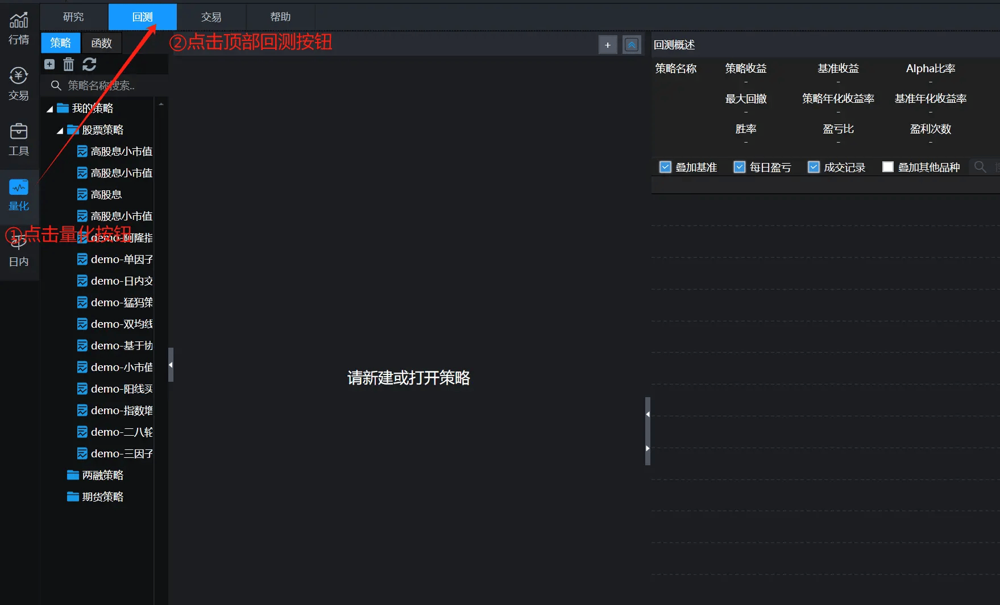

2. 点击左上角的【+】按钮，会弹出一个框框，你在框内输入策略的名称，名称可以随便取，比如叫做：自动申购新股和逆回购。

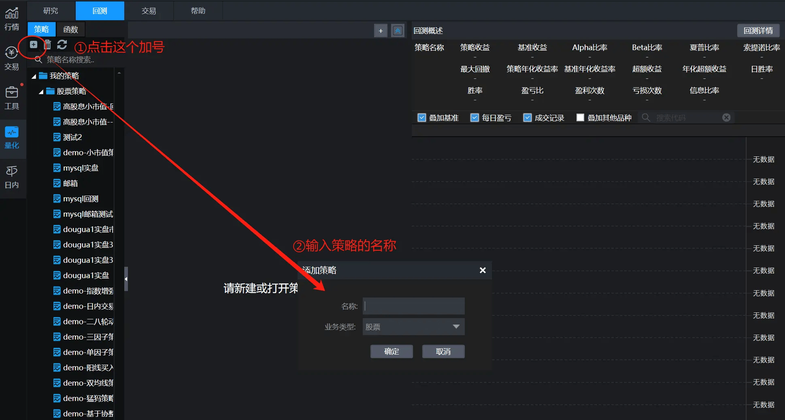

3. 创建完成后，会出现几行默认的代码，把红框内的这些默认代码全部删除。

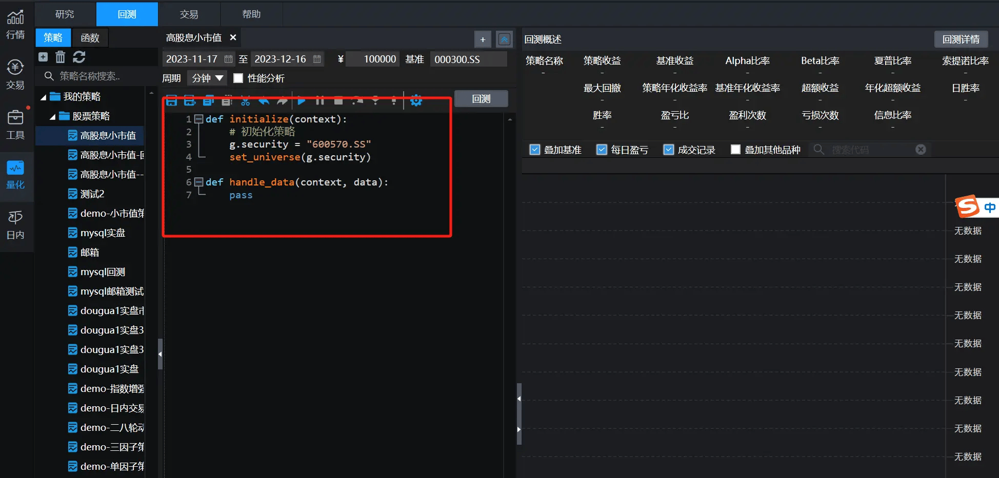

4. 把我贴在文末的策略代码直接复制进去。复制粘贴完源码后，一定要检查一下，看看代码是否复制完整，着重检查首行和末行是否和教程对应的上。

5. 以上修改完成后，一定要点击下图中的保存按钮。还有一点要注意，回测周期默认是分钟，**这个千万==别改成==天，千万==别改成==天，千万==别改成==天**。

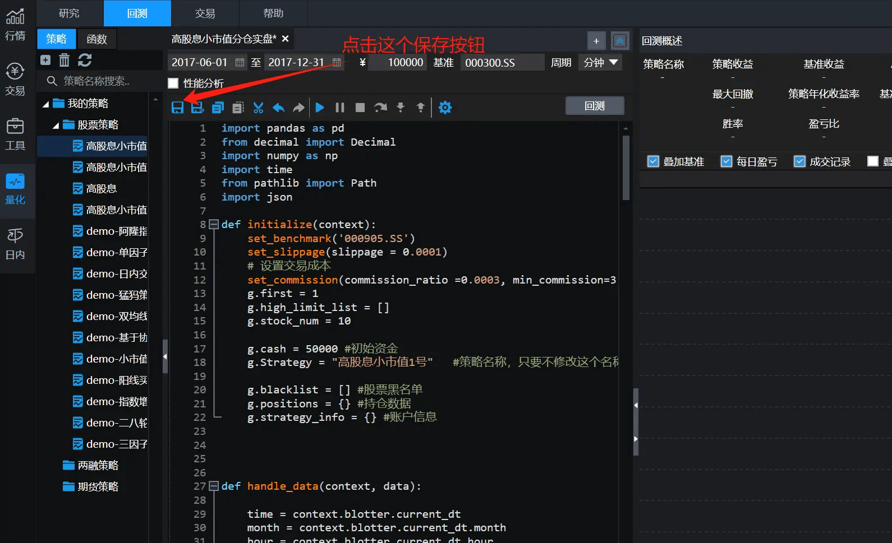

6. 开启自动申购新股和逆回购的程序，如下图，先点击顶部的【交易】按钮，再点击【新增】按钮，再选择刚才保存的策略。选完后写个交易名称（这个名称不会对策略有影响，可以看自己喜好填），再点击【确定】按钮，即可开启自动交易。这个是没有延迟的，当天设置，当天就可运行。最好不要在盘中（早上9点---下午4点）开启交易，我的建议是盘后开启交易，这样不容易出错。

```python linenums="1"
import time

def initialize(context):
    
    run_daily(context, ipo, '10:00')   #申购新股和可转债
    run_daily(context, reverse_repurchase, '14:57') #账户剩余资金自动逆回购深市1天期
    

def reverse_repurchase(context):
    cash = context.portfolio.cash
    amount = int(cash*(1-1/100000)/1000)*10
    order('131810.SZ', -1*amount)
    

def ipo(context):
    ipo_stocks_order()    
        
def handle_data(context, data):
    pass
```

## 3. 自动交易QMT：聚宽实时模拟，通过QMT自动下单

## 4. 聚宽实盘示例策略


