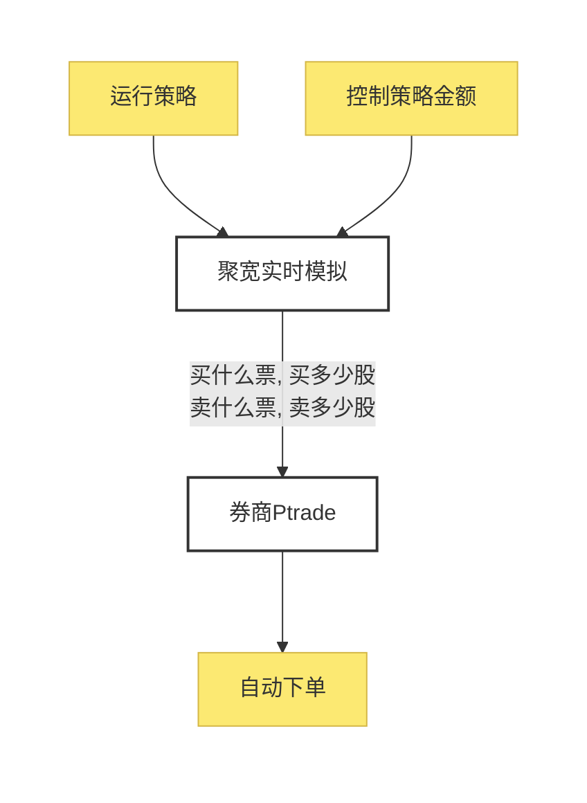

# 第七章 实盘交易

有合适的量化策略后，最重要的就是去实盘跟踪，实盘的方法有两种，第一种是根据策略的买卖信号，手动跟踪。第二种是自动交易。

我的建议是用自动交易，手动跟踪很难跟上，时间长了节奏会乱掉，自动交易的好处我就不多说了，主打就是一个省心省力。不过我还是会介绍关于手动跟踪的方法，毕竟每个人的需求不一样，条条大路通罗马，教程的关键点在于把这些“路”都打通，让大家有得选择。

这一章，我会介绍手动跟踪和自动交易的方法：经过十年多的实践，推荐自动交易，支持的策略多，且简单容易上手，可以先开PT，目前国盛PT比较稳定。也可以开国金PT，有一定概率会被风控，如果国金PT不能用了，可以切换为QMT，如果都是开的国金，那么两个方案可以互相平替

| 实盘方式 | 具体实盘形式 | 需要的准备 | 支持券商 | 门槛 | 优点 | 缺点 |
| :--- | :--- | :--- | :--- | :--- | :--- | :--- |
| 手动跟踪 | 聚宽创建实时模拟，通过微信通知手动操作 | 1.只需要开通聚宽实时模拟 | 无限制 | 无 | 简单 | 手动可能跟不上 |
| 自动交易-QMT | 聚宽创建实时模拟，把交易信号传递给券商QMT，通过QMT自动下单 | 1.需要开通聚宽实时模拟 2.需要开通券商QMT软件的权限 | 国金 | 国金要10万开权限 | 1.可以实时自动跟着聚宽模拟策略 2.只要聚宽支持的策略，都可以实现自动交易 | 流程略复杂，需要有耐心 |
| 自动交易-Ptrade | 聚宽创建实时模拟，把交易信号传递给券商Ptrade，通过Ptrade自动下单 | 1.需要开通聚宽实时模拟 2.需要开通券商QMT软件的权限 | 国盛 | 国盛要20万开权限 | 1.可以实时自动跟着聚宽模拟策略 2.只要聚宽支持的策略，都可以实现自动交易 | 流程略复杂，需要有耐心 |

上面每一种我都会介绍具体的方法，都是保姆级教程，大家可以根据自己的需要选择其中的一种来操作：

- 经过一年多的实践，推荐自动交易，支持的策略多，且简单容易上手
- 券商支持自动交易的软件有两种，分别叫QMT和PT，我后面会逐一介绍

## 1. 手动跟踪：微信通知(手动跟踪)

这篇主要教大家怎么通过微信接收聚宽的实时交易信号，然后手动跟踪。此方法的预计成本：

1. 最大花费999元一年
2. 最小花费0元

### 1.1 开通聚宽实时模拟

聚宽默认是延时模拟，延时模拟会延时一天交易，比如策略12月14日9点35分买进股票A，但延时模拟会延时到15日的凌晨3点发出交易信号，并且延时模拟不支持微信通知。

所以如果想要微信通知，就要先开通实时模拟权限。

开通实时模拟有两种方式：

1. 购买聚宽的蓝V会员，价格是999元一年，会员会送三个实时模拟的坑位。
2. 通过聚宽的社区的积分，兑换实时模拟坑位。兑换的流程可以看这个帖子：[用积分兑换实时模拟的流程](https://t.zsxq.com/15qQPMp7A)

积分不要钱，但需每天去聚宽签到、看帖子、留言。

开通完实时模拟后，可以在[聚宽模拟交易列表页](https://www.joinquant.com/algorithm/trade/list?process=1)，看到模拟交易的状态，如果显示是“实时进行中”，那就说明实时模拟设置成功了

### 1.2 开通微信通知

只要开通了实时模拟，点击下面这个按钮，开通微信通知开关就可以了，只要按钮的状态显示“ON”，就代表这个策略已经开启微信通知。

### 1.3 如何进行模拟交易？

这个老圈友就不用看了，有些新圈友可能还不清楚进行模拟交易的方法，可以看这个

可以通过以下两种方法进行模拟交易(推荐使用方法一)，创建模拟交易的前提是已经运行了回测，如果没有回测的话，请先创建回测

**方法一：使用回测结果创建**

找到需要创建模拟交易的回测，点击模拟交易，输入参数，点击确定

**方法二：在模拟交易列表中创建**

1. [进入模拟交易列表](https://www.joinquant.com/algorithm/trade/list)
2. 点击新建模拟交易，在跳出的窗口中依次输入交易名称和初始资金，并选择策略及其回测后点击确定。

如果提示没有可用的模拟交易位，请点击模拟交易列表最下面的获取新的模拟交易位，使用积分兑换模拟交易位

## 2. 自动交易Ptrade：聚宽实时模拟，通过ptrade自动下单

本章主要教大家实现聚宽实时模拟，然后通过 ptrade 自动下单。**好处就是： 1.可以实时自动跟单聚宽模拟策略。2.只要聚宽支持的策略，都可以实现自动交易**。

大致的架构可以看下图：

这个方案设置完后，你们就可以把聚宽实时模拟当成以前的一创聚宽了，第一次设置完后，之后都可以忽略 ptrade 的存在，还实现了邮件提醒，ptrade下单成功，或者是报错都会通过邮件告知，不用经常登 ptrade 去查看，可以把ptrade理解成一个隐形的下单工具。

参考资料：聚宽---蒋老师

此方法的预计成本：

1. 最大花费999元一年
2. 最小花费0元

