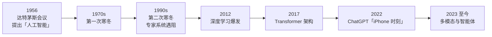

# 第一章 走进人工智能世界

> 理解什么是人工智能，了解它的发展历程和应用场景

---

人工智能（Artificial Intelligence，AI）已经从科幻小说中的概念变成了我们日常生活的一部分。每天清晨，智能手机的语音助手提醒我们当天的日程；出门时，导航应用根据实时路况规划最优路线；购物时，电商平台推荐我们可能感兴趣的商品；晚间，流媒体服务精准推送我们喜欢的影视内容。

这些看似普通的体验背后，都有人工智能技术在默默运作。然而，对于大多数人来说，AI 仍然披着一层神秘的面纱——它究竟是什么？它是如何工作的？它会如何影响我们的未来？

本章将带领读者走进人工智能的世界，从最基础的概念讲起，回顾 AI 的发展历程，了解不同类型的 AI 技术，并探索 AI 在各行各业的真实应用。通过本章的学习，读者将建立对人工智能的整体认知，为深入学习后续章节打下坚实基础。

## 1. 那个永远认不出猫的超级计算机

> 以前是教电脑“怎么做”，现在是给电脑“看例子”。

### 1.1 算得快不代表更聪明

我们经常听到一种观点：计算机比人类聪明，因为它算数快，记忆力好。

每当听到有人这样说，我就想给他讲一个故事——**“认猫悖论”**。

早在几十年前，计算机就能在几毫秒内计算出炮弹的飞行轨迹，这可是几十个数学家要算几天的量。那时候，人们乐观地认为，既然这么复杂的数学题都能解，那让计算机“看懂一张照片”，简直是小菜一碟。

结果，科学家们被当头泼了一盆冷水。

他们发现，要写一个程序来识别照片里有没有 **“猫”**，几乎是不可能的任务。

### 1.2 为什么“规则”失效了？

你可能会问：这有什么难的？我定个规则不就行了？
*   有胡须？
*   有尖耳朵？
*   有毛？

好，那我给你看一张“折耳猫”的照片（没尖耳朵），在这个规则下，它就不是猫了。

那我再给你看一张“玩具猫”的照片（有胡须、有尖耳朵、有毛），在你的规则下，它却被误判成了猫。

这就是传统计算机程序的死穴：**它严重依赖“清晰的规则”**。

在传统软件的世界里（比如 Excel、计算器），这一步做什么，下一步做什么，必须严丝合缝。只要规则有一点模糊，程序就会崩溃。

但这恰恰是人类最擅长的地方。我们从来没背过“什么是猫”的定义，但我们看一眼就知道。这种能力，叫 **“直觉”**（Intuition），或者说 **“默会知识”**（Tacit Knowledge）——那些我们会做，但说不清楚怎么做的事情。

### 1.3 AI 的本质：从“教导”转向“喂养”

既然“定规则”这条路走不通，科学家们就换了一条路。

这新的思路，跟教小孩子一模一样。

我们不给计算机下定义了。相反，我们找来海量的猫的照片和不是猫的照片，全部提供给它（这里的数量只是举例）。

我们对它说：“你自己看。我不管你怎么看，反正这张是猫，那张不是。”

刚开始，它全是瞎猜。但猜错了我们就“惩罚”它（本质是让模型根据错误去调整参数、降低损失），猜对了我们就“奖励”它。

在看了几百万张照片后，神奇的事情发生了：这台计算机好像突然“开窍”了。它学会了从照片的像素里提取特征，哪怕是一只只露出尾巴尖的猫，它也能一眼认出来。

**这就是人工智能（AI）的本质转变：**
*   **过去（Coding）**：我们需要把 **人类的智慧** 翻译成 **代码规则**。
*   **现在（Training）**：我们把 **人类的经验**（即使是不可言传的）打包成 **数据** 喂给它。

### 1.4 价值互换：用算力换认知

AI 的出现，其实是一场巨大的 **成本互换**。

在 AI 出现之前，**计算力**（Calculation）很便宜，但 **认知力**（Cognition）很贵。所以我们用 Excel 处理表格（便宜），但必须雇佣高薪的会计来做判断（贵）。

AI 做的事情，就是 **燃烧大量的计算力（现在变得越来越便宜），通过海量数据的训练，提炼出认知力。**
当“认知”变得像自来水一样便宜时，世界的逻辑就变了。以前需要十年经验的老中医才能看懂的片子，现在消耗一点电费的 AI 就能看懂。

所以，不仅仅是程序员，各行各业的人都得重新思考：你的工作里，有哪些是“死板的计算”（将被淘汰），有哪些是“模糊的认知”（将被 AI 廉价化），又有哪些是 AI 依然无法替代的呢？

### 1.5 思考题

这一讲的主题是 AI 擅长处理“规则不明”的问题。

请你想想，在你的工作或生活中，有哪些事情是 **“很难写出说明书，但你做起来却游刃有余”** 的？如果有，这件工作将来就很可能被 AI 取代。

## 2. 达特茅斯的夏天与漫长的寒冬

AI 发展的历史证明，光有“脑子”（算法）不够，还得有“肌肉”（算力）和“粮食”（数据）。两起两落，皆因“时机未到”。

本节将简要回顾 AI 发展中的几次关键起落，包括探究历史上的两次“寒冬”，以及分析当前这轮 AI 浪潮爆发的核心驱动力。

图 1-1：人工智能发展时间线。两次寒冬之后，算力、数据、算法三要素终于齐备，AI 才迎来真正的春天。

### 2.1 过于乐观的那个夏天

1956 年的夏天，美国达特茅斯学院，几位年轻的科学家聚在了一起。他们包括后来的图灵奖得主麦卡锡、明斯基等人。正是这场会议，首次正式提出了 **“人工智能”**（Artificial Intelligence）这一术语。

他们开这个会的目的很单纯：用一个夏天的时间，解决“机器模拟智能”的问题。

是的，你没看错，**“一个夏天”**。

当时的科学家认为，智能无非就是逻辑推理。既然已经造出了能计算的机器，那让机器学会思考也只是时间问题。

这就像是一个刚学会走路的孩子，宣称自己下个月就要去跑马拉松。他们大大低估了“智能”的复杂性，也高估了当时计算机的能力。

这种盲目的乐观，直接导致了 AI 的第一场危机。

### 2.2 为什么会经历“寒冬”？

在 AI 的历史上，发生过两次著名的“寒冬”（Funding Winter）。

所谓寒冬，就是大家都觉得 AI 是骗人的，投资者撤资，政府停掉经费，科学家甚至不敢在简历上写自己是研究 AI 的。

为什么会这样？这可以用经济学里的 **“泡沫破裂”** 来解释。

当人们对一项技术的 **期望值**（Expectation），远远超过了它的 **实际能力**（Capability）时，灾难就不可避免。

*   **第一次寒冬（70 年代）**：人们发现，那个年代的电脑连几句简单的俄语都翻译不通。
*   **第二次寒冬（90 年代）**：昂贵的“专家系统”维护成本极高，却解决不了稍微变通一点的问题。

> [!NOTE]
> **AI 战胜人类的三座里程碑**
>
> 回顾历史，AI 在特定领域超越人类的标志性事件同样让人印象深刻：
> - **1997 年**：“深蓝”（Deep Blue）战胜国际象棋世界冠军卡斯帕罗夫，主要依赖于 **强大的算力和穷举搜索**。
> - **2016 年**：“AlphaGo”战胜围棋世界冠军李世石，让大众首次见识到了 **深度学习与强化学习** 的巨大威力。
> - **2022 年起**：以 ChatGPT 为代表的大语言模型，则在 **自然语言理解和生成** 上达到了甚至超越了人类平均水平。

### 2.3 为什么这一轮更扎实？

直到 2012 年，深度学习（Deep Learning）爆发，AI 迎来了真正的春天。特别是 2022 年 ChatGPT 的发布，常被媒体称为 AI 的 **“iPhone 时刻”**。

而随后的多模态与智能体浪潮，更是将 AI 推向了全新的高度。

很多人问：这次会不会又是泡沫？

更稳妥的说法是：**与前两次相比，这一轮的基础条件更扎实，但仍可能出现周期波动。**

回顾历史，我们可以看到，这一次的爆发，是因为三个关键要素终于齐备了：
1.  **算力（Chips）**：GPU/专用加速器持续迭代，训练与推理成本快速下降。
2.  **数据（Data）**：互联网数据用完后，高质量的 **合成数据**（Synthetic Data，即 AI 为了训练自己而自动生成的“练习题”）接过了接力棒。
3.  **算法（Algorithm）**：Transformer 架构依然稳健（其原理详见第 5 章），而“更擅长推理/规划”的新一代模型与方法，让机器学会了某种意义上的“慢思考”。

这就好比，以前你想做饭，要么缺米，要么缺锅。而现在，米有了，锅有了，食谱也有了，满汉全席自然就做出来了。

### 2.4 “iPhone 时刻”的真正含义

把 ChatGPT 比作 iPhone，不仅仅是因为它很火。

iPhone 最大的贡献，是把复杂的智能手机，变成了连三岁小孩都会用的设备（多点触控）。

ChatGPT 最大的贡献，是把复杂的 AI，变成了连老奶奶都会用的工具（自然语言交互）。

当一项技术，**使用门槛被大幅降低** 时，它就不再是少数人的技术，而更接近像水和电一样的基础设施。这才是“春天”真正到来的标志。

### 2.5 思考题

我们说这次 AI 爆发是因为“算力、数据、算法”三位一体。

请你思考一下，如果在未来，数据的获取变得更加困难（比如版权保护越来越严，或者高质量数据被用光了），AI 的发展会被锁死吗？还是会像当年克服算力瓶颈一样，出现新的突破？

## 3. 为什么贾维斯还不够聪明？

> 弱 AI 与强 AI 的分野

我们现在拥有的，与其说是“人一样的 **伙伴**”，不如说是“神一样的 **工具**”——能干活的是弱 AI，会思考的才是强 AI。这一节我们来聊聊这条分界线。

### 3.1 电影里的 AI vs 现实里的 AI

电影《钢铁侠》里的管家贾维斯（Jarvis），简直是完美的 AI：

他能幽默地吐槽老板，能自主设计战甲，能在危机时刻做出生死决策。

看过电影后，我们再去看看现实里的 Siri 或者小爱同学。

“Siri，帮我订一张去北京的票。”

“好的，正在为你搜索北京的图片……”

这种 **巨大的落差**，就是“强人工智能”（AGI）和“弱人工智能”（Narrow AI）的区别。

### 3.2 弱人工智能：专才的极致

不要因为带个“弱”字就看不起它。

在它的那个小圈子里，它比任何人类都强。
*   **AlphaGo**：下围棋，全世界没人下得过它。
*   **人脸识别 AI**：哪怕你化了妆，它也能不到 0.1 秒把你认出来。

但它们的致命弱点是 **“不可迁移”**。

围棋冠军 AlphaGo 只要换成下五子棋，就会失去原有优势，得从头学起。人脸识别 AI，换成识别猫狗，它就完全没用了。

这就好比一个只会拧螺丝的机械臂，你让它去炒菜，它只会把锅砸了。

目前，**我们生活中用到的绝大多数 AI，本质上仍是弱 AI**。它们是极致的工具（Tools），而不是通用的智能（Intelligence）。

### 3.3 强人工智能：通用的圣杯

科学家梦寐以求的，是像人类一样“一通百通”的智能，这也就是人们常说的 **通用人工智能（AGI，Artificial General Intelligence）**，甚至未来可能演化出超越人类的 **超级人工智能（ASI）**。

理想中，人类不需要为每个任务单独写程序。我们学会了骑自行车，很快就能学会骑摩托车，这就是 **“迁移学习”** 的能力。

ChatGPT 的出现，让我们第一次看到了“更通用的弱 AI”的曙光。

因为它不再是只能干一件事了。它既能写诗，又能写代码，还能看病，甚至能懂一些幽默感。

虽然它距离真正的“有意识”还很远，但它已经不再是那种只会拧螺丝的机械臂，而更像是一个博学的实习生。

### 3.4 生成式 AI：不仅是分类，更是创造

在强弱之分以外，我们还可以再加一条理解坐标：**判别式 vs 生成式**。

*   **以前的 AI（判别式）**：像是 **“质检员”**。给它东西，它只负责打标签（是猫/不是猫，是垃圾邮件/不是）。
*   **现在的 AI（生成式）**：像是 **“设计师”**。你给它要求，它给你“造”出东西来。

这个转变是革命性的。因为“创造”（Creation）一直被认为是人类独有的神性。现在，机器也能画出从未见过的画，写出从未有过的诗。

这意味着，AI 从“做判断”（决策辅助）转变成了“做生产”（生产力工具）。

### 3.5 思考题

假设你是一家公司的老板。现在有两个员工供你选择：
*   **A 员工**：是某个细分领域的顶尖专家，全世界第一，但除了这个领域他什么都不会（弱 AI）。
*   **B 员工**：什么都懂一点，只有普通人的水平，但他学习能力强，哪块不足就能补哪块（强 AI）。

在当前的技术阶段，你会更愿意花钱买哪类 AI 服务？为什么？

## 4. 消失的收银员与看不见的算法

> 最顶级的技术，往往是“看不见”的。当你不觉得它是 AI 时，它才真正成功了。

### 4.1 被“隐藏”起来的 AI

走进今天的超市，你可能会用自助结账、扫码支付、刷脸支付等方式完成付款。虽然流程更“自动化”了，但你知道背后一定有一套系统在运作。

这套系统，往往就包含了 AI（例如识别、风控、推荐与调度）。但我们很少称呼它为 AI，我们更愿意把它叫作“功能”：自助结账、支付、推荐。

有一个著名的 **“AI 效应”**：**一旦 AI 真的把某件事做成了，人们就不再叫它 AI，而只要叫它软件或程序。**
*   几十年前，打败国际象棋冠军被认为是 AI 的巅峰。现在你的手机里随便下个象棋 App 都能虐你，但你觉得那是普通的“软件”。
*   几年前，文字识别（OCR）被认为是高科技。现在你拍一张满是外语的菜单，手机直接给你翻译成中文并算出汇率，你觉得那是“基础功能”。

**AI 正以前所未有的速度，钻进日常每一个场景背后，然后“隐身”起来。**

### 4.2 隐形人的工作日志

要理解 AI 有多普及，最好的办法是看看 **“如果它罢工了会怎样”**。

**场景一：早上 8:00 的早高峰**
*   **现状**：你在 9 点前准时赶到公司。
*   **AI 罢工后**：全城的红绿灯变回了 20 年前的固定读秒模式，不再根据车流量自动调节。全城大拥堵，你迟到 1 小时。
*   *（隐形者：智能交通调度系统）*

**场景二：中午 12:00 点外卖**
*   **现状**：你想吃“微辣”的湘菜，App 首页正好推荐了这家，30 分钟送到。
*   **AI 罢工后**：App 给你推荐了 5 公里外的法式大餐（因为你没填喜好）。下单后，外卖小哥因为没有路径规划，1 小时才送到。
*   *（隐形者：推荐算法 + 运筹优化算法）*

**场景三：晚上 20:00 刷短视频**
*   **现状**：你刷了 2 小时，感觉每个视频都特别懂你。
*   **AI 罢工后**：你刷到了——拖拉机维修教程、你不懂的方言剧、无聊的广告。你刷了 2 分钟就不想继续了。
*   *（隐形者：个性化分发引擎）*

### 4.3 为什么“看不见”很重要？

经济学家巴斯夏写过一篇文章《看得见的和看不见的》。

在 AI 领域，**“看得见”的是炫酷的机器人、会聊天的 ChatGPT。**

**“看不见”的，是由无数算法编织成的智能网络。**

两者都重要：生成式 AI 让“内容生产”可见，隐形 AI 让“社会运转”更高效。

这些看不见的 AI，正在极大地降低社会的 **交易费用**。
*   它让“人找货”变成了“货找人”（推荐系统），降低了 **搜索成本**。
*   它让“不懂外语”的人能做跨国生意（翻译系统），降低了 **沟通成本**。
*   它让“车找路”变成了“路引车”（导航系统），降低了 **决策成本**。

商业的本质是降低交易费用。而 AI，是目前人类手上最锋利的降低费用的武器。

### 4.4 思考题

试着做一个假设：

如果明天全世界的 AI 算法全部失效，但互联网和电力依然存在。你的生活里，哪一个环节会受影响最大？是打不了车？还是收不到快递？或者，你的工作岗位会因此变得更重要，还是变得毫无价值？
