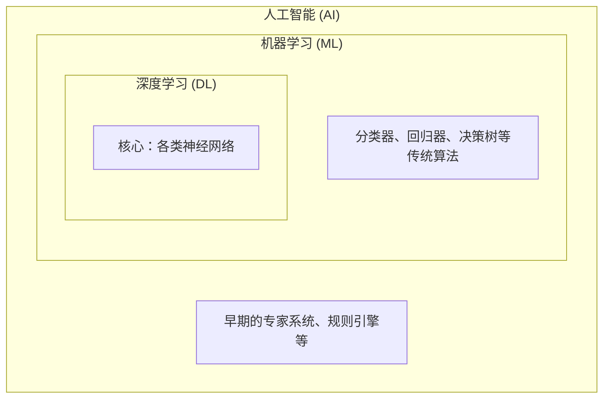

# 第二章 AI 核心概念速览

> 掌握 AI 领域的基础概念与核心术语

---

在上一章中，我们了解了人工智能的基本定义、发展历程和应用场景。本章将深入探讨 AI 领域的核心概念，帮助读者建立扎实的概念基础。

理解 AI、机器学习、深度学习之间的关系，认识数据在 AI 系统中的核心地位，初步了解算法和模型的基本概念，以及掌握训练和推理的基本流程——这些知识将为后续学习更深入的技术内容打下坚实基础。

本章内容力求用最通俗的语言解释专业概念，让零基础的读者也能轻松理解。每个概念都会配合生活化的类比和实际案例，帮助读者建立直观认知。

## 1. 智能的套娃

**AI、机器学习与深度学习**。别被这三个高大上的词绕晕了——它们其实是“一层包一层”的关系：AI 是大圈，机器学习是小圈，深度学习是核心。

### 1.1 名字越长，技术越新？

在 AI 的新闻里，你一会儿听到“人工智能”，一会儿听到“机器学习”，一会儿又是“深度学习”。

很多人以为这是三种不同的东西，或者认为名字越长越厉害。

其实，这是一个巨大的误解。

它们的关系就像是 **套娃**：
1.  最外层的大娃娃叫 **AI（人工智能）** —— 这是一个 **愿景**（让机器像人）。
2.  中间层的娃娃叫 **ML（机器学习）** —— 这是一个 **手段**（不用规则，用数据）。
3.  最里层的娃娃叫 **DL（深度学习）** —— 这是一个 **具体的工具**（用神经网络）。

可以通过下面的示意图来直观理解它们层层包含的关系：

图 2-1：AI、ML 与 DL 的“套娃”包含关系

所以，当我们说 ChatGPT 是“深度学习”时，它自然也是“机器学习”，更是“人工智能”。

### 1.2 拆开第一层娃娃：从 AI 到 ML

我们在第一章说过，早期的 AI 是靠人手写规则（Expert Systems）。

那就像是给机器人写好了“操作手册”。
*   见到红灯 -> 停。
*   见到绿灯 -> 行。

但从 1980 年代开始，人们发现规则写不完，于是发明了 **“机器学习”（Machine Learning）**。

这相当于不再写手册了，而是给机器人看 10 万小时的开车视频，让它自己悟出红绿灯的规律。

**这一次进化，是从“授人以鱼”（给规则）变成了“授人以渔”（给数据）。**

### 1.3 拆开第二层娃娃：从 ML 到 DL

机器学习里有很多方法，比如“决策树”、“贝叶斯”等等。它们都很优秀，但有一个共同的瓶颈：**虽然不用写规则了，但还得告诉机器关注哪里。**

比如认猫，你得告诉算法：关注“耳朵”是不是尖的，关注“胡须”长不长。这些“耳朵”、“胡须”叫 **特征**。发现和选择合适特征的过程叫 **“特征工程”**。长期以来，特征工程是机器学习领域最核心的技术。

人们曾试图用人工神经网络来自动解决特征工程的问题，但是受限于计算能力，一直只能用浅层网络来处理一些简单的任务。

直到 2012 年，**“深度学习”（Deep Learning）** 横空出世，多层人工神经网络取得了突破。

人工神经网络的灵感来自人脑的神经元。它最大的本事是：**我什么都不需要你告诉我，我自己找特征**。它会自动发现，原来“瞳孔的形状”比“耳朵的形状”更能区分猫。

**这一次进化，是从“半自动”（人找特征）变成了“全自动”（端到端学习）。**

### 1.4 为什么深度学习成了主角？

明明机器学习有那么多门派，为什么现在一提起 AI，大家讨论的几乎全是深度学习？核心原因可以归结为以下两点。

**第一，“胃口大，没有天花板”**

传统的机器学习算法像是一个容量有限的杯子。给它 1 万条数据，它学得很好；但给它 100 万条数据时，杯子就满了，它的准确率基本就不再明显提升了。

而深度学习的神经网络，像是一块可以不断吸水的巨大海绵。给它 1 亿条数据，它变聪明；给它 100 亿条数据并配上强大的算力，它还能继续变强。这种“大数据+大算力”就能“大力出奇迹”的特质，极其适合当前的数据爆炸时代。

**第二，擅长破解“非结构化数据”**

我们日常生活中的绝大部分信息，比如照片、声音、文章，形式上都是杂乱无章的，在计算机眼中这被称为“非结构化数据”。传统算法面对这些数据极其头疼，高度依赖专家去手动提取特征。而如前所述，深度学习具备“全自动找规律”的本事，可以直接吞下原始的图片或文字，自己去理解画面和语义。

正因为 **数据喂得多就能一直变强**，且 **能直接搞定复杂的图文和声音**，深度学习最终脱颖而出，成为了推动当下这波 AI 浪潮的绝对核心。

理解了这个嵌套关系，后续章节里再遇到这些名词时你就不会头大了。接下来，我们来看看驱动这一切的原料——数据。

### 1.5 思考题

当你在一篇文章里看到“某某公司用 AI/ML/DL 做了一个产品”时，你能不能用“套娃”的方式判断：
1) 它更像是在说愿景（AI）、手段（ML）还是具体技术路线（DL）？
2) 这个产品最可能依赖的“数据”是什么？

## 2. 作为燃料的数据

> 为什么代码开源，数据却保密？

> 垃圾进去，垃圾出来（Garbage In, Garbage Out）。在这个时代，谁拥有高质量数据，谁就拥有了“石油”。

### 2.1 免费的菜谱，昂贵的食材

大家有没有发现一个奇怪的现象？

Google、Facebook 这样的巨头，经常把他们最先进的 AI 框架（TensorFlow, PyTorch）或者模型架构（Transformer）免费开源出来，恨不得不仅送你代码，还手把手教你用。

但他们从来不公开 **“训练数据”**。

为什么？

因为 **算法是菜谱，数据是食材。**

满汉全席的菜谱（算法）全世界都知道，但这不重要。重要的是你有没有那么顶级的熊掌、燕窝（数据）。

如果只有烂白菜（劣质数据），再好的厨子（算法）也做不出好菜。

这就是 AI 时代常见的一条经验法则：**高质量数据和算法同等关键，但数据质量往往决定上限**。

### 2.2 数据就是石油

以前，我们认为软件公司的核心资产是 **可口可乐配方（源代码）**。

现在，AI 公司的核心资产是 **地下的油田（用户数据）**。

一旦你理解了这一点，就能看懂很多商业竞争：
*   为什么微信不让淘宝爬它的数据？
*   为什么马斯克要把 Twitter (X) 的 API 收费？
*   为什么 Reddit 在 2024 年开始要向谷歌收取数据使用费？

因为他们突然意识到：**哪怕是网友们灌水的评论（语料），现在也是炼制“大模型”的珍贵原油。**

没有这些原油，那个被称为“智能”的引擎根本转不动。

### 2.3 数据的诅咒：垃圾进，垃圾出

在数据这个领域，有一个著名的诅咒叫 **GIGO (Garbage In, Garbage Out)**。

如果你用网上带有偏见的帖子去训练 AI，AI 很可能会学到并放大这些偏见。

如果你用错误的医疗记录去训练 AI，AI 的医疗建议就会显著增大出错风险。

所以，AI 工程师 80% 的时间，其实不是在高大上的写代码，而是在当 **“数据清洁工”**。

清洗、去重、标注、对齐……这像极了在炼油厂里过滤杂质。只要杂质没去干净，炼出来的油（模型）就会损坏发动机。

### 2.4 比黄金还贵的“标注”与合成数据

现在最缺的不是原始数据（网上到处都是），而是 **“高质量数据”**。

近年来，公开可用的高质量语料增速放缓，AI 开始更多依赖自己生产训练样本，这就是 **合成数据（Synthetic Data）**。
*   一张 X 光片不值钱。
*   一张 **“被顶尖 AI 详细圈出肿瘤位置并由人类专家复核”** 的 X 光片，千金难求。

这就是为什么现在有一个庞大的“数据标注产业”。

人工智能，也就是 **“有多少人工，就有多少智能”**。

### 2.5 思考题

既然数据是石油。

请评估一下你自己或者你的公司：你们有没有囤积某种 **“只有你们有，别人拿不到，且质量极高”** 的数据？

这可能是你们在 AI 时代最重要的护城河之一。

## 3. 算法：就是一张番茄炒蛋的菜谱

> 别把“算法”神话了

算法不是只有数学家才懂的咒语。简单说：步骤就是算法，经验就是模型。

### 3.1 怎么向奶奶解释“算法”？

“算法”（Algorithm）这个词听起来特别高冷，感觉是数学天才在黑板上写的那些希腊字母。

其实，你每天都在用算法，只是你不知道。

想象一下，你要教一个没进过厨房的人做 **番茄炒蛋**。

你会写一张纸条：
1.  把两个鸡蛋打散。
2.  两个番茄切块。
3.  热锅倒油。
4.  先炒鸡蛋，盛出来。
5.  再炒番茄...

**这张纸条，就是“算法”。**
所谓算法，就是 **“解决某个问题的明确步骤”**。无论是计算卫星轨道，还是煮一碗面，只要步骤是明确的，它就叫算法。

### 3.2 菜谱（算法）vs 炒好的菜（模型）

在 AI 里，有两个词经常打架：一个叫 **算法**，一个叫 **模型**。

很多人分不清。

*   **算法（Algorithm）**：是那张 **“菜谱”**。比如“深度神经网络”、“决策树”，它们是一套通用的逻辑方法。你没做菜之前，它就在那儿了。
*   **模型（Model）**：是你照着菜谱，用具体的食材（数据），炒出来的 **“那盘菜”**。

Google 发明的 Transformer 是 **算法**（大家都能用）。

OpenAI 用这个算法，结合海量数据和算力训练出来的 GPT 系列，是 **模型**（由其团队具体实现和发布）。

**咱们老百姓平时用的，不是算法，而是人家训练好的模型。**

### 3.3 黑盒：当我们不知道菜谱时

传统的“番茄炒蛋算法”，是人写出来的。先做什么后做什么，清清楚楚。

但 **深度学习算法**，是一个 **“黑盒”**。

这就好比，你有一个从不外传的祖传秘方。你只知道把鸡肉扔进去，出来的就是好吃的炸鸡。但中间到底发生了什么？油温是多少？炸了几分钟？连你也说不清楚。

现在的 AI 就是这样。我们知道输入（照片），知道输出（猫），但中间那几百层神经网络到底是怎么判断的？就像那个黑盒一样，连制造它的科学家都很难解释清楚。

这就是为什么 AI 有时候会犯一些莫名其妙的错误（幻觉），因为它本身就是一种 **“概率的黑魔法”**。

记住这个区分：算法是“菜谱”，模型是“炒好的菜”。当模型变成了黑盒，新的问题就来了——这也是后面讨论 AI 伦理和可解释性时绕不开的话题。

### 3.4 思考题

选一个你熟悉的小任务（比如写周报、做一道菜、做一次报表）：
1) 写出它的“算法”（尽量明确的步骤）。
2) 再想想：如果让 AI 来做，这个任务里哪些部分更像“模型能学出来的经验”，哪些部分仍需要你把“规则/标准”说清楚？

## 4. 怎么训练？就像反复做题并订正

> 训练、推理与损失函数

> 机器没有“灵感”，它通过反复试错和反馈逐步逼近正确答案。犯错就纠正，迭代就进步。

### 4.1 AI 是怎么读书的？

我们经常说“训练”（Training）这个词。

很多人脑补的画面是：机器人哪怕坐在图书馆里，如饥似渴地阅读人类的经典名著，然后突然顿悟了。

完全错了。

真实的训练过程，更像是一个 **只做练习题、靠反馈改错** 的学生。

这个学生（模型）什么都不懂，一上来就被迫做几百万道选择题。
1.  **瞎猜**：它看第一题（一张图片），瞎猜“是猫”。
2.  **反馈**：老师（算法）看了一眼标准答案“是狗”，告诉它这次偏差很大。
3.  **更新参数**：模型内部参数调了一下，记住“下次看到这种毛茸茸的东西，猜狗不猜猫”。

这个过程重复几亿次后，它就变成了一个“高熟练度刷题机器”，看到相似题型时更容易答对。

这就是 **“训练”**。

### 4.2 损失函数：痛苦的度量

在 AI 领域，偏差有多大，有一个专门的数学名字，叫 **“损失函数”（Loss Function）**。

你也可以把它叫作 **“误差指数”**。

*   猜对了：损失接近 0。
*   猜得离谱：损失很高。
*   猜得沾边：损失中等。

模型训练的核心优化目标之一，就是 **“让损失降到最低”**（Minimize Loss）。

它没有“理解世界”的主观意图，只是在参数空间里不断优化。

这听起来很冷酷，但也是最符合经济学原理的：**任何智能系统，本质上都是在追求成本最小化（Cost Minimization）。**

### 4.3 训练 vs 推理：十年寒窗与一朝成名

训练完了，模型出师了。这时候我们把它拿来用，给它一张新照片，它一眼认出“这是猫”。

这个使用的过程，叫 **“推理”（Inference）**。

这两个阶段的成本是天壤之别：
*   **训练（Training）**：是 **“造核弹”**。需要成千上万张显卡，耗电量相当于一个小城市，花好几个月，烧掉几亿美金。这是只有巨头才玩得起的游戏。
*   **推理（Inference）**：是 **“放鞭炮”**。训练好的模型，甚至能在你的手机上运行。每次问它一个问题，只消耗一点电。

所以，我们普通人、开发者，绝大多数时候是在做 **推理**，也就是在享受 AI 厂商训练出来的成果。

### 4.4 思考题

* 既然 AI 主要是在“反复做题并优化误差”，那它真的 **“理解”** 它做的题吗？
* 一个只会做题、且正确率 100% 的机器，和一个真正理解题目意思的人类，有什么本质区别？（提示：这就是著名的“中文房间”思想实验）
