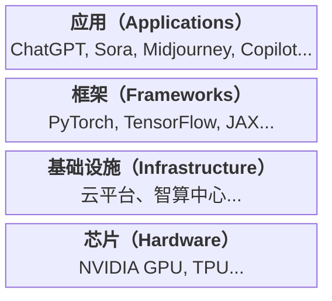

# 第三章 AI 技术生态与工具全景

> 了解 AI 技术栈、平台服务和开发框架

---

在前两章中，我们学习了 AI 的基本概念和核心原理。然而，从概念到实际应用，还需要借助各种工具和平台。本章将带领读者全面了解 AI 技术生态系统，包括技术栈的组成、主流平台和服务、开源框架，以及云端与边缘 AI 的发展趋势。

对于希望动手实践 AI 的读者，本章提供了一份全景地图，帮助理解不同工具和平台的定位与选择。即使不打算亲自开发 AI 系统，了解这些背景知识也有助于更好地理解和使用 AI 产品和服务。

## 1. 盖房子的艺术

> 从显卡地基到应用装修

### 1.1 那个著名的“倒金字塔”

如果我们把 AI 行业画成一张图，它是一个巨大的倒金字塔：
*   最底层最窄，也是最硬的，是 **芯片（Hardware）**，比如 NVIDIA GPU、TPU 等。
*   往上一层是 **基础设施（Infrastructure）**，比如云平台、智算中心等。
*   再往上是 **框架（Frameworks）**，比如 PyTorch、TensorFlow、JAX 等。
*   最上面最宽的，是 **应用（Applications）**，比如 ChatGPT、Sora、Midjourney、Copilot 等。

图 3-1：AI 行业倒金字塔结构

越到底层，门槛越高，玩家越少（显卡基本就是 NVIDIA 一家独大）。

越到上层，机会越多，也是我们普通人最应该关注的地方。

### 1.2 芯片：昂贵的地基

想象一下，你要盖一栋摩天大楼。**GPU（显卡）** 就是这栋楼的 **地基**。

没有地基，再好的图纸也变不成房子。

现在 AI 最大的瓶颈就是“缺地基”。谁手里有显卡，谁就有盖楼的资格。

### 1.3 框架：建筑师的 CAD

有了地基，我们怎么画图纸？

这就需要 **PyTorch** 或 **TensorFlow** 这样的 **深度学习框架**。

它们就像是建筑师用的 CAD 软件。

以前的程序员要手写数学公式（相当于用手画图），现在用框架，一行代码就能调用复杂的神经网络（相当于 CAD 里拖拽一个模块）。

### 1.4 模型：预制板

现在盖房子很少一砖一瓦砌了，都是用 **预制板**（Pre-trained Models）。

OpenAI 训练好的大语言模型（LLM，以 GPT 系列为例），就是一块超级巨大的、功能万能的预制板。

开发者不需要从头训练，直接把这块板子拿来，稍微装修一下（微调），就能变成客服系统、写作助手、翻译软件。

### 1.5 思考题

现在的 AI 创业，有两条路：
1.  **造轮子**：去研发新的芯片、新的框架（风险极大，回报极高）。
2.  **造车**：利用现有的芯片和框架，去做一个好用的 App（风险较小，竞争激烈）。

如果你有 1000 万创业资金，你会选哪条路？为什么？

## 2. 选云厂商就像选厨房

> AWS、Azure 与 Google 的三国杀

大模型时代，云厂商不仅卖服务器，还卖模型与工具链。一句话：大厂拼生态，小厂拼特色。

### 2.1 租厨房还是点外卖？

以前的云计算（IaaS），就像是 **“租厨房”**。

AWS 给你提供锅碗瓢盆（服务器、算力），你自己买菜（数据），自己雇厨子（开发人员），自己做饭（训练模型）。

这很灵活，但太累了。

现在的 AI 云（MaaS - Model as a Service），就像是 **“点外卖”**。

你不必自己训练大模型，而是直接调用云上的托管模型、向量数据库、内容审核、监控等服务。

这种模式把 AI 的门槛从“自己造引擎”降到了“按需组合能力”。

### 2.2 三大平台：策略差异在哪里？

在 AI 云这场竞争中，三个玩家的策略很不一样：

1.  **微软 (Microsoft Azure)**：**企业集成与治理导向**。
    *   强项在企业身份体系（Microsoft 365、Entra、Defender）与 AI 服务整合，适合“要治理、要审计、要统一采购”的大组织。

2.  **谷歌 (Google Cloud)**：**模型与数据产品一体化**。
    *   自研芯片（TPU）+ Gemini + 数据分析产品协同较强，适合与 Google 生态深度结合的团队。

3.  **亚马逊 (AWS)**：**多模型与基础设施深耕**。
    *   Bedrock 支持多家模型，配合 AWS 原有基础设施和 DevOps 体系，适合“多云/多模型并行评测”的工程团队。

### 2.3 我们该怎么选？

不要按“哪家最强”来选，要按 **约束条件** 来选：

*   **合规优先**：先看数据驻留、审计能力、权限体系和法务要求。
*   **技术优先**：先跑同一套基准任务，比较延迟、成本、质量和稳定性。
*   **组织优先**：看团队既有技术栈（IAM、监控、CI/CD、采购流程）能否平滑接入。
*   **个人学习者优先**：对于零基础学习者或独立开发者，建议先跳过多云架构，直接使用第三方 API 聚合平台（如硅基流动、OpenRouter 等）或即插即用的 SaaS 工具，低成本快速验证想法。

很多企业会采用 **“主云 + 备云 + 多模型网关”** 的折中方案，降低单点依赖和供应商锁定风险。

### 2.4 思考题

除了这三家国际巨头，国内云厂商（阿里云、百度云、腾讯云、火山引擎等）也在快速推进 AI 平台化。

如果你是一家中国企业，你会如何在 **模型效果、数据合规、网络延迟、供应商绑定成本** 之间做取舍？

## 3. 开源的盛宴：Hold 住你的 Hugging Face

> 框架与社区的力量

> AI 的繁荣不只靠大公司，更靠全球千万开发者的“用爱发电”。

### 3.1 PyTorch、TensorFlow 与 JAX：主流框架格局

在深度学习框架里，**PyTorch** 和 **TensorFlow** 仍是最常见的两大阵营，另外 **JAX** 在研究和高性能训练场景也越来越活跃。

这有点像手机系统里既有主流双寡头，也有细分强者。

*   **TensorFlow**（由 Google 创造并主要支持）：生态成熟，部署工具链完整，在部分传统企业场景仍很常见。
*   **PyTorch**（由 Meta 创造并主要支持）：在研究和开源社区占比更高，教程和示例丰富，上手门槛相对低。
*   **JAX**（由 Google 创造并主要支持）：函数式和并行化能力强，常见于前沿研究和高性能训练实验。

现在的趋势是：**PyTorch 在研究和开源社区的使用占比很高**。大量最新论文和开源项目会优先给出 PyTorch 版本。

对初学者来说，先学 PyTorch 往往更顺手；但落地到生产时，仍要尊重团队技术现状和部署要求。

### 3.2 Hugging Face：AI 界的 GitHub

如果你问 AI 开发者最常用的模型社区之一，**Hugging Face** 基本绕不开。

它本来是一家做聊天机器人的公司，后来无心插柳变成了全球最大的 **AI 模型集市**。

在这里，你可以：
1.  **下载模型**：全世界的开发者把训练好的模型（LLaMA, BERT, Stable Diffusion）上传上来，你一键就能下载用。
2.  **体验 Demo**：不用写代码，直接在网页上点一点，就能体验最新的 AI 功能。
3.  **下载数据**：海量的公开数据集供你训练。

可以说，Hugging Face 显著降低了开源 AI 的试错成本。

### 3.3 GitHub Copilot 与 Agentic Coding：当 AI 开始写 AI

这一讲必须提到一个关键方向：**AI 编程助手**（如 GitHub Copilot、Cursor 等）。

近几年，单纯的代码补全已经不稀奇了，现在更常被讨论的是 **Agentic Coding（智能体编程）**。

以前，程序员写代码要一个字一个字敲。现在，你写注释或需求描述，AI 就能生成初稿，甚至给出重构方案。

但要注意：**AI 代码不是免检代码**，仍需要测试、代码审查和安全扫描。

这引发了一个现实问题：当越来越多代码由 AI 参与生成时，我们如何保证代码质量、版权合规和可维护性？

这已经是工程团队正在面对的问题。

开源与闭源的博弈仍在继续。对初学者而言，先从 Hugging Face 上找一个感兴趣的模型跑起来，比纠结“选哪个框架”重要得多。

### 3.4 思考题

如果你要在一周内“把一个开源模型跑起来并做出一个小 Demo”，你会怎么选：
- 你更愿意先学 **PyTorch** 还是先用 **Hugging Face** 的现成管线？为什么？
- 你会如何验证“AI 生成的代码/配置”是可靠的（至少做哪 2 件事）？

## 4. 中央厨房与自热火锅

> 云端 AI 与端侧 AI

> 大事上云，小事在手。算力在哪，智能就在哪——但现在，智能正在从“云端”流向你的“指尖”。

### 4.1 为什么要上云？（中央厨房）

以云端为主的 ChatGPT 服务，为什么通常需要连网才能用？

因为它太大了。

大语言模型（LLM）的参数量有万亿级别，运行它一次需要的显存高达几百 GB。你最好的手机也存不下它的一只“脚趾头”。

所以，我们只能把模型放在 **云端**（巨大的中央厨房）。
*   你发请求（点菜）。
*   云端几百台服务器轰鸣计算（大厨做菜）。
*   把结果发回给你（上菜）。

**优点**：脑子足够大，什么复杂问题都能解决。
**缺点**：没网就歇菜，而且数据都要传给别人（隐私泄露）。

### 4.2 为什么要下端？（自热火锅）

但是，并非所有事情都要找米其林大厨。

比如“人脸解锁”，比如“拍照美颜”。

这种高频、简单、隐私极其敏感的操作，如果每次都要传到云端，不仅慢，而且你也不放心。

所以，现在手机芯片里的 NPU（神经网络处理单元）就是为了解决这个问题。

这就是 **“端侧 AI”（Edge AI）**。

它就像是 **“自热火锅”**，虽然口感不如中央厨房现做的，但胜在 **随时随地、不依赖网络、隐私风险相对更可控**。

### 4.3 混合 AI：未来的常态

未来的 AI 体验，很可能是 **混合** 的。
*   日常的、私密的、简单的（读短信、美图、实时翻译）：**端侧 AI 搞定**。
*   复杂的、创造性的、需要海量知识的（写论文、画海报、查资料）：**云端 AI 搞定**。

这就好比：你家里有厨房（端侧），能做家常菜；想吃大餐了，再去外面的饭店（云端）。

### 4.4 思考题

* 现在 AI PC（人工智能电脑）和 AI Phone（人工智能手机）的概念炒得很火。你觉得这究竟是 **“为了卖硬件而生造出来的营销词”**，还是 **“确实解决了云端 AI 无法解决的痛点”**？
* 如果你的手机能跑大语言模型（LLM），但严重影响待机时间，你愿意买吗？
