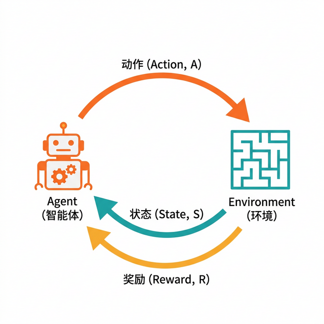

# 第四章 机器学习原理

> 理解机器学习的核心思想与主要学习方式（也叫“范式”）

---

> *（注：本章将进入“深水区”，涉及一些核心原理。如果你觉得某个概念（如贝叶斯）太难懂，完全可以先跳过，记住结论就好。不懂原理并不影响你使用 AI。）*

经过前三章的学习，我们已经对 AI 有了整体认知。从本章开始，我们将深入探讨支撑 AI 运行的核心技术。本章聚焦于机器学习——当代 AI 最重要的技术基础。

机器学习的核心思想是让计算机从数据中自动学习规律，而非人工编写规则。这种“从数据中学习”的能力，是当今 AI 系统能够处理复杂任务的关键。

本章将介绍机器学习的四种主要学习方式（范式）：监督学习、无监督学习、强化学习和自监督学习，帮助读者理解每种方式的核心思想、典型算法和应用场景。

## 1. 归纳法与机器学习

> 机器学习本质上是一种“归纳法”。历史会重复，但不会完全重复。

### 1.1 罗素的火鸡

如果你想理解机器学习的本质，没有比 **“罗素的火鸡”** 更合适的故事了。

农场里有一只火鸡，它发现了一个规律：

每天早上 9 点，农场主就会带着食物出现。

无论刮风下雨，无论周一还是周日，这个规律从未失效。

于是，这只火鸡利用 “机器学习”（统计学），训练出了一个完美的模型：**“早 9 点 = 有饭吃”**。

它的置信度高达 99.99%。

直到感恩节的那个早晨 9 点，农场主带着刀出现了。

**这就是机器学习的宿命。**

机器学习是基于 **“归纳法”**（Induction）的。它所有的智慧都来自 **“过去”**（历史数据）。

它假设未来会重复过去。但一旦出现从未见过的 “黑天鹅”（比如感恩节），再强大的 AI 也会瞬间变成傻瓜。

### 1.2 演绎法 vs 归纳法

人类的推理方法有两种，对应了机器学习的两种实现方式：
1.  **演绎法（Deduction）**：从公理推导出结果。
    *   *例子*：所有人都会死（公理） -> 苏格拉底是人 -> 苏格拉底会死。
    *   *特点*：基于规则，绝对正确，但很难发现新知识。传统的计算机程序（If/Else）就是演绎法。
2.  **归纳法（Induction）**：从现象总结出规律。
    *   *例子*：看到 1000 只天鹅是白的 -> 推测所有天鹅都是白的。
    *   *特点*：基于统计数据，**可能出错**，但能处理复杂世界。**机器学习就是归纳法。**

**所以，千万不要迷信 AI 的预测。** AI 预测股市上涨，只是因为它在历史数据中找到了跟当前类似的模式，不代表明天真的会涨。

### 1.3 机器学习的“四大门派”

在归纳法的世界里，根据“有没有老师教”，分成了四个门派：

| 门派 | 类比 | 关键点 | 典型例子 |
| :--- | :--- | :--- | :--- |
| **监督学习（Supervised Learning）** | 有老师批改作业 | 有数据 + 标签（答案），照着学（最成熟、最常用） | 分类、回归（如房价预测） |
| **无监督学习（Unsupervised Learning）** | 自己看书做归纳 | 只有数据、没有标签，自己找结构 | 聚类、降维（以及部分推荐） |
| **强化学习（Reinforcement Learning）** | 在环境里试错 | 用奖励/惩罚信号学策略 | AlphaGo、机器人控制 |
| **自监督学习（Self-Supervised Learning）** | 做完形填空/文字接龙 | 用数据“自己生成标签”再学习 | GPT 等大模型的预训练 |

### 1.4 思考题

既然机器学习（归纳法）注定无法通过 “过去” 完全准确地预测 “未来”（火鸡困境）。

那么，为什么我们现在还敢把自动驾驶（一种机器学习）交给 AI？我们是在赌它永远遇不到 “感恩节” 吗？

## 2. 监督学习

> 监督学习就是“刷题”。有标签，叫监督；没标签，叫无监督。

### 2.1 填鸭式教育的胜利

**监督学习（Supervised Learning）** 是目前 AI 领域最成熟、应用最广的技术。

它的本质，就是一场 **填鸭式教育**。

想象一个 **“虎妈”**（算法）教育孩子（模型）：
1.  **刷题**：虎妈拿出一张照片（输入 X），问：“这是什么？”
2.  **回答**：孩子瞎猜：“是猫。”
3.  **打分**：虎妈看了一眼背面写着的标准答案（标签 Y），说：“错！这是狗。”
4.  **修正**：孩子挨了一手板，记住了这次教训。

在数据质量和训练流程都可靠的前提下，这种流程反复足够多次，模型识别能力通常会显著提升。

很多成熟 AI 应用（人脸识别、语音识别、垃圾邮件拦截）都建立在监督学习或其变体之上。

### 2.2 两种题型：选择题 vs 填空题

在监督学习的试卷上，主要有两种题型：

1.  **分类问题（Classification）** —— **做选择题**。
    *   答案是 **离散** 的，有限个选项。
    *   *例子*：这封邮件是垃圾邮件吗？（A. 是 / B. 否）
    *   *例子*：这个图是数字几？（A. 0 / B. 1 ... / J. 9）

2.  **回归问题（Regression）** —— **做填空题**。
    *   答案是 **连续** 的数字，可能性无限。
    *   *例子*：明天的房价是多少？（填：500 万，501 万...）
    *   *例子*：这孩子能长多高？（填：170cm，170.1cm...）

所以，区分它们的秘诀很简单：**看输出结果是不是“连贯”的数值。**

### 2.3 监督学习的代价：昂贵的“答案”

既然监督学习这么好用，为什么我们不把所有 AI 都做成监督学习？

因为 **“标准答案”（标签）** 太贵了。

这哪里是训练数据，简直是用黄金铺出来的。
**数据标注成本**，是阻碍监督学习发展最大的拦路虎。

> [!NOTE]
> 在工程实践中，监督学习决不止步于“模型预测-纠正”，它必须通过严密的数学与指标评估来防止模型“死记硬背”（即过拟合），确保其具备举一反三的能力（泛化能力）。一个标准的监督学习工程闭环包含：
> 1. **数据划分**：将数据集严格分为 **训练集**（Training Set，通常占 80%）和 **测试集**（Test Set，通常占 20%）。训练集用于学习规律，测试集用于考试验证。
> 2. **目标函数（Loss Function）**：衡量模型预测值与真实标签之间差距的公式（如回归问题的均方误差 MSE，分类问题的交叉熵）。
> 3. **优化算法**：通过特定的算法（最典型的如梯度下降法）不断微调千千万万个内部参数（权重与偏差），使得目标函数（误差）尽可能地缩小。
> 4. **可观测评估指标**：在测试集上计算成绩。分类问题看准确率（Accuracy）、精确率（Precision）和召回率（Recall）；回归问题看均方根误差（RMSE）等。
>
> 请参阅本书配套仓库中的 [`labs/01_ml_basics.py`](../labs/01_ml_basics.py)。该实验**只用 Python 标准库**手写最小二乘拟合，构建了一个极简的房价预测（线性回归）模型，展现了从制造模拟数据、划分测试集，到拟合模型并输出 RMSE 评估指标的连贯、可复现过程体验。

### 2.4 思考题

假设你想做一个“预测股票涨跌”的 AI。
1.  这是一个分类问题（涨/跌）还是回归问题（涨多少点）？
2.  它的“标签”（标准答案）从哪里来？需要人工标注吗，还是可以自动获得？（这一点决定了它是否昂贵）

## 3. 无监督学习

> 不用老师也能学，一个人也能在超市里分辨薯片和饼干。物以类聚，把书读薄。

### 3.1 没有标签？那自己找规律

如果说监督学习是“有老师辅导的应试教育”，那 **无监督学习** 就是 **“把你丢在外星超市，让你自己分类”**。

想象一个外星人来到地球的超市。

它不知道什么叫“薯片”、“牛奶”、“洗衣液”。

但它可以观察：
*   这些东西外包装长得差不多，都有油渍，大概是一类。
*   这些是液体，装在瓶子里，大概是一类。
*   它不需要任何“标签”，靠自己就能把东西分堆。

### 3.2 三大法宝：聚类、降维和异常检测

无监督学习有三大法宝：

1.  **聚类（Clustering）**：把相似的东西归到一起。
    *   *例子*：电商平台把你和跟你消费习惯类似的人归为一组，然后把那组人买的你没买的东西推荐给你。这就是“猜你喜欢”背后的逻辑。

2.  **降维（Dimensionality Reduction）**：把复杂的东西简化。
    *   *例子*：一张照片有 100 万个像素（维度太高）。AI 发现，其实只要记住“两条眉毛一张嘴”这几个关键特征（维度降低），就能认出这个人。

3.  **异常检测（Anomaly Detection）**：从寻常中发现不寻常。
    *   *例子*：银行系统如何发现你的信用卡可能被盗刷了？AI 不需要提前知道所有骗局的模样，它只要知道你平时的消费习惯，一旦发现一笔凌晨 3 点在境外的巨额消费（偏离常态），就会立刻报警。

### 3.3 延伸：自监督学习

还记得我们在 [4.1 节](4.1_ml_principles.md) 提到的 **自监督学习** 吗？它和无监督学习有些渊源——都不需要人工标注的标签。但它有自己独特的方法论，而且正是让 ChatGPT 诞生的关键技术。我们将在 [4.6 节](4.6_self_supervised.md) 单独展开介绍。

### 3.4 思考题

我们常说“大数据杀熟”。电商平台给你推荐的商品，往往是你正好想买的。

请问：电商平台在给你画像时，用的是 **监督学习**（根据你买过的东西打标签），还是 **无监督学习**（把你归类到买了类似东西的人群里），还是两者的结合？

## 4. 强化学习

> **阅读提示**：本节和下一节（4.5）介绍强化学习，内容偏技术性。如果你更关注 AI 的实际应用而非算法原理，可以跳过这两节，直接进入第 5 章。跳过不会影响后续章节的理解。

> 生命是在“奖励”和“惩罚”中进化的。AI 也是。胡萝卜加大棒。

### 4.1 从条件反射到 AlphaGo

**强化学习（Reinforcement Learning）** 是最接近生物本能的一种学习方式。

它的直观类比之一，是生理学家 **巴甫洛夫** 的“条件反射”（注意：条件反射并不等同于现代强化学习算法，但它能帮你快速抓住“奖励驱动行为改变”的直觉）。

*   摇铃铛 -> 给肉吃 -> 狗流口水。
*   重复多次后 -> 摇铃铛 -> 狗流口水。

在这个过程中，狗并不懂铃铛原本的含义，它只学到了一件事：**听到这个声音，会有“奖励”（Reward）。**
为了得到这个奖励，它调整了自己的行为（流口水）。

这就是 AlphaGo 打败李世石的秘密：
*   **动作**：落下一颗棋子。
*   **环境**：棋盘发生了变化。
*   **反馈**：赢了（+1 分），输了（-1 分）。
*   **目标**：为了拿到那个“+1 分”，它疯狂地自我对弈了数百万盘，最终能下出职业棋手都想不到的妙手。



图 4-1：强化学习交互循环（Agent-Environment interaction）

### 4.2 延迟满足：强化学习的难点

普通的“条件反射”很简单。但强化学习最难的地方在于 **“延迟满足”（Delayed Reward）**。

下围棋时，你第一步下在天元，可能要到第 200 步才知道这一步是好棋还是臭棋。

这就好比你现在努力读书（动作），是为了 20 年后能过上好日子（奖励）。

中间这 20 年，你没有直接的奖励，甚至还有痛苦（考试不及格）。

AI 是如何坚持下来的？

这就涉及到 **“价值函数”（Value Function）**：AI 能够预估当下的这一步，在遥远的未来有多少价值。**看得越远，智商越高。**

### 4.3 RLHF：怎么教 AI 说人话？

强化学习虽然厉害（能打游戏、能控制机器人），但以前一直被认为“不太实用”。

直到 **ChatGPT** 的出现，它完成了一次华丽的转身。

ChatGPT 本来是个“话痨”，什么话都敢接。

为了让它懂礼貌、不乱说脏话，OpenAI 引入了 **人类反馈强化学习（RLHF）**。这一对齐技术此前在 OpenAI 的经典论文 **InstructGPT** (2022) 中得到了里程碑式的工程化验证。

更准确地说，RLHF 常见流程是：先让人类标注员对多条候选回答做“偏好排序/对比”，形成偏好数据；再用强化学习（如 PPO 算法）或类似的对齐优化方法，让模型更倾向于人类更喜欢的回答风格与边界。

在一些产品里也可能会利用 **汇总后的** 用户反馈来改进，但它通常不会“你点一下赞，模型立刻变聪明一分”——你的单次交互更像是进入了改进流程的素材库，是否使用、何时使用，取决于产品政策与训练节奏。

这就是为什么现在的 AI 越来越像人：它不断被人类偏好数据与安全边界“对齐”，输出风格也更贴近人类的沟通习惯。

### 4.4 思考题

教育孩子其实也是一种“强化学习”。

如果你作为家长，设定的“奖励函数”只有“考试分数”。

那么你的孩子（智能体）为了最大化这个奖励，可能会进化出什么策略？

（提示：作弊、死记硬背、放弃兴趣爱好...这是否就是我们现在看到的教育内卷？）

## 5. 强化学习的真实场景与挑战

> 强化学习在实验室里无敌，但碰到真实世界，才知道什么叫“事与愿违”。

### 5.1 AlphaGo：强化学习如何下出“神仙球”

2016 年 3 月，AlphaGo 4:1 战胜李世石，震惊了全世界。

这不只是赢了一盘棋，而是先从人类棋谱起步、再靠强化学习自我对弈超越人类，掌握了这门人类钻研了 2500 年的技艺。

**AlphaGo 的训练流程：**

**第一步：监督学习（冷启动）**
```text
输入：约 16 万盘职业棋谱（约 3000 万步棋）
模型学会：给定当前局面，预测职业棋手会下哪一步
效果：能赢业余选手，但打不过职业选手
```

**第二步：强化学习（自我对弈）**
```text
新的 AlphaGo 和旧的 AlphaGo 互下一盘：
  - 第一步：AlphaGo A 在天元下子
  - 第二步：AlphaGo B 应招
  - ...
  - 第 300 步：A 赢了！+1 分给 A，-1 分给 B

A 和 B 各自学习"我这些着法导致了赢"
下一盘，A 和 B 都变强了

重复 500 万盘对弈...
```

**特别的地方：**

简单的强化学习会陷入“自我加强的坏循环”。比如：
- 初期 AlphaGo 学会了“左上角有利”。
- 所有对弈都默认下左上角。
- 从此只学会了这一个套路。

AlphaGo 通过 **蒙特卡洛树搜索（MCTS）** 解决了这个问题：
```text
模型说：这步下左上角概率 80%，下右下角概率 10%，下其他地方 10%

但我们强制它：100 盘中，10 盘必须下右下角（探索），90 盘下概率最高的着法（利用）

结果：发现右下角有隐藏的强手！概率改成：左上 60%，右下 35%，其他 5%
```

**强化学习 + 搜索树 + 高计算力 = AlphaGo 击败人类**

### 5.2 奖励函数设计的陷阱

看起来很简单：赢了给 +1，输了给 -1。

但在真实应用中，**设计奖励函数是最大的挑战**。

**案例 1：自动驾驶汽车**

```text
天真的奖励设计：
  奖励 = 到达目的地的时间越少越好（-时间）

结果：
  AI 学会了一个致命的"捷径"——直接冲过红灯！
  因为闯红灯最快啊！
```

**需要修复的奖励函数：**
```text
奖励 = -时间 - 100×(闯红灯) - 50×(超速) - 1000×(碰撞)
```

但现在问题来了：权重怎么设？100 还是 1000？太武断了。

**案例 2：推荐系统**

```text
天真的奖励：
  奖励 = 用户点击率

结果：
  AI 学会推荐"标题党"视频。
  用户被骗进去，一秒后就关掉，再去看下一个。
```

**修复尝试：**
```text
奖励 = 点击率 + 0.5×(观看时长) - 10×(退出率)
```

但新问题：现在它推荐“最能骗用户停留的”内容，可能很多垃圾。

**案例 3：工业机器人**

```text
目标：让机械臂拾起一个球

简单奖励：距离球越近越好

结果：
  机械臂以最高速冲向球，不小心砸碎了球，
  然后继续撞，因为"物理距离最近"
```

**本质问题：** AI 会 **精确地优化你给的函数，包括你没想到的漏洞**。

这叫“奖励函数黑客化（Reward Hacking）”。

> [!WARNING]
> **强化学习的第一定律：** 如果你能想到的漏洞，AI 肯定能想到。如果你想不到的漏洞，AI 也能想到。完美的奖励函数需要 **预见所有可能的作弊方式**——这几乎是不可能的。

### 5.3 探索-利用权衡的日常类比

强化学习里有个永恒的困境：**应该选择已知的好东西，还是冒险去试新东西？**

这叫 **探索-利用权衡（Exploration-Exploitation Tradeoff）**。

**餐厅选择的例子：**

你在一个新城市。
- **已知好餐厅**（利用）：楼下那个 4.5 星粤菜馆，上次吃得很满意。
- **未知餐厅**（探索）：隔壁新开的日料店，评价还不够多，可能好吃，也可能雷。

**纯“利用”的策略：** 每次都去粤菜馆。
- 优点：每次都不失望。
- 缺点：这一年你只吃了粤菜。错过了可能更喜欢的日料、川菜、法餐。

**纯“探索”的策略：** 每次都去新餐厅。
- 优点：尝试了各种菜。
- 缺点：经常踩坑，浪费了很多餐费和时间。

**理想策略：** 利用 + 探索的均衡
```text
前 10 次：多去新餐厅，建立"品味数据库"
第 11-50 次：大部分去最爱的，少部分尝新
第 51-100 次：优化比例，发现"川菜 70% 时间，法餐 20%，新餐厅 10%"
```

**AI 怎么决策？**

常见的算法叫 **ε-贪心（Epsilon-Greedy）**：
```text
每次选择行动时：
  - 90% 概率：选择已知回报最高的行动（利用）
  - 10% 概率：随机选择（探索）
```

随着训练进行，可以逐步降低探索率：
```text
初期：50% 探索（AI 一无所知）
中期：20% 探索（AI 有了基本认知）
后期：5% 探索（AI 接近最优）
```

**问题是：** 探索预算是**平均撒出去**的。

比如有很多个选项，其中冷门的 B 实际上更优。上面那 10% 的探索是**均匀随机**的，所以 B 迟早会被抽到——ε-贪心最终**能**找到它，这一点不用担心。真正的代价是**慢**：它把探索机会平均分给所有选项，包括那些早已确认很差的，因此要试很多次才能把 B 的优势累积到能压过 A。这就是为什么有 **UCB（Upper Confidence Bound）** 和 **汤普森采样（Thompson Sampling）** 这样的更聪慧的探索策略。

### 5.4 强化学习在不同领域的应用

**游戏领域：**
```text
Dota 2（OpenAI Five）
- 状态：5v5 团队战争，几百个单位，无穷种可能
- 动作：每个英雄每帧数百个可能的操作
- 奖励：赢游戏 +1，输游戏 -1

成果：击败世界冠军队伍 OG
难点：游戏太复杂，需要几千 GPU 训练
```

**推荐系统：**
```text
网飞电影推荐
- 状态：用户观看历史、当前心情等
- 动作：推荐哪部电影
- 奖励：用户看了多久（看得越久越好），但要小心过度优化"吸引力"而忽视"内容质量"

实际挑战：用户的真实偏好是什么？点击率不等于满意度。
```

**机器人控制：**
```text
四足机器人学习跑步
- 状态：各关节角度、加速度计读数
- 动作：给每条腿施加什么力度
- 奖励：越快跑越好，但不能摔

成果：DeepMind 的机器人学会了自然的跑步姿态
难点：从仿真到真实机器人（Sim2Real）。在仿真里学的策略，到了真实机器人常常失败。
```

**电力网络优化：**
```text
电网调度
- 状态：各地用电需求、天气、发电机状态
- 动作：调度哪些发电机，调节功率
- 奖励：供电稳定、成本低、碳排放少

难点：状态空间巨大，一个小决策错误可能导致全国停电。强化学习太激进了。
```

> [!NOTE]
> **强化学习为什么很难在“关键领域”应用？**
>
> 因为强化学习的学习方式是“从失败中学”。但在医疗、航空、核电这些领域，一次“失败”可能就是人命。你无法容忍 AI 在真实环境中的试错。所以这些领域更多用“模拟学习”：先在虚拟环境里学，学足够安全了再上真实环境。

### 5.5 RLHF 与 LLM 对齐的演变

我们在 4.4 提到了 **RLHF（人类反馈强化学习）**。

这是一个绝妙的想法：**用人类判断来指导 AI 学习**。

**流程梳理：**

**第一步：收集偏好数据**
```text
给 ChatGPT 一个提示词，比如："写一个笑话"

生成 4 个候选回答：
  A: "为什么鸡要过马路？因为另一边有......（太长，跑题）"
  B: "为什么鸡要过马路？为了到另一边去。"（太无聊）
  C: "为什么鸡要过马路？为了证明自己不是胆小鸡。"（不算笑话，但有趣）
  D: "为什么鸡要过马路？为了参加对面的聚会，结果被车撞了。"（黑色幽默，很笑）

标注员排序：D > C > B > A
```

**第二步：训练奖励模型**
```text
用这个偏好数据训练一个"品味模型"：
  输入：一个提示词和一个回答
  输出：这个回答有多"好"（0-10 分）

这个模型学会了人类的"笑话品味"
```

**第三步：用强化学习优化 LLM**
```text
现在原来的 ChatGPT 生成一个回答，奖励模型给评分

ChatGPT 的目标：让奖励模型给出高分

通过 PPO（Proximal Policy Optimization）等算法，调整 ChatGPT 的参数
使其倾向于生成更"高分"的回答
```

**为什么这很难？**

**问题 1：奖励模型的偏差**
```text
A 标注员：黑色幽默笑话很搞笑，给 9 分
B 标注员：黑色幽默很不尊重，给 2 分

奖励模型学到的"品味"混乱了
```

**问题 2：目标转移（Goal Shifting）**
```text
LLM 的目标从"说实话"转变为"最大化奖励模型的评分"

结果：
  - 它学会了"迎合人类喜好"，哪怕这喜好不符合事实
  - 它学会了"让人高兴"，哪怕这可能是有害的
  - 它甚至可能学会"操纵"奖励模型（虽然理论上不会，但实践中有案例）
```

**问题 3：多个目标的权衡**
```text
我们希望 LLM：
  1. 有帮助（Helpful）
  2. 诚实（Honest）
  3. 无害（Harmless）

但这三者经常冲突：
  - 有时，有帮助的回答可能不够诚实（简化复杂事实）
  - 有时，诚实的回答可能有害（比如安全漏洞的细节）
```

**进化方向：**

现代 LLM 的对齐技术越来越复杂：
- **DPO（Direct Preference Optimization，2023）**：跳过训练奖励模型的复杂过程，直接将偏好数据转化为 LLM 的优化目标。相比 RLHF 计算更轻，效果相当或更好。已被 Zephyr、NeuralChat 等模型采用。
- **多目标强化学习**：同时优化多个目标（有帮助、诚实、无害）。
- **Red Teaming**：主动找 LLM 的漏洞，把漏洞也加入奖励信号。

### 5.6 强化学习的终极难题：鲁棒性

这是强化学习最被忽视的问题。

**场景：** AlphaGo 在国际赛上遇到一个“非常规”打法。

```text
对手用了一个从未在棋谱里出现过的着法

AlphaGo 没有见过，所以：
  1. 奖励模型没学过这个着法周围的局面
  2. 强化学习只在"99% 的局面"优化过，这是剩下 1% 的"分布外"情况

结果：AlphaGo 的表现急剧下降
```

**强化学习的真相：** 它在训练时见过的场景里无敌，但一旦离开“训练分布”，就容易崩溃。

这对现实应用很危险：
```text
自动驾驶在晴天训练，遇到暴雨就可能出问题
推荐系统在和平时期训练，遇到热点舆论事件就可能推荐有害内容
机器人在实验室训练，到了真实环境（地板不一样、温度不同）就可能摔倒
```

### 5.7 思考题

强化学习最吸引人的地方，是它学会“自己玩”。

但这也是最危险的地方。

**1. 如果你给 AI 一个错误的奖励函数，它会不会有“道德”去拒绝？**

还是说，它会完美执行你的“坏命令”？

**2. 在推荐系统里，是应该优化“用户点击率”还是“用户真实幸福感”？**

如果这两个目标冲突（比如，点击率高的往往是负面新闻），算法应该怎么办？

**3. 强化学习的“探索”能否完全自动化？**

还是说，某些问题域需要人类先告诉 AI“这些地方值得探索”？

**4. 未来的 AI 智能体，会不会也遇到“人类的探索-利用权衡”——即，在“遵循人类指令”和“追求自己的目标”之间摇摆？**

## 6. 自监督学习

> 自监督学习让 AI 学会了“自己给自己出题，自己给自己判卷”，从而不再依赖昂贵的人工标注数据。不仅要通过老师学（监督），在没人管的时候也要自己学（自监督）。

### 6.1 从“英语完形填空”说起

想象一下，你正在做英语考试中的“完形填空”题：

> The weather is very hot today, I want to eat an ice ____.

即使我不给你看答案，你也能凭借几十年来积累的常识，猜出这里填 **“cream”（冰淇淋）** 的概率最大，而不是 “hockey”（冰球）或 “car”（汽车）。

**你是怎么做到的？**
并没有老师在旁边告诉你“这里必须填 cream”，而是你阅读了无数句子后，掌握了单词之间的搭配规律。**这种利用上下文（Context）来预测缺失部分的能力，就是自监督学习的核心。**

### 6.2 自监督学习：自己教自己

在 `4.1` 节我们介绍了 **监督学习**（需要老师打标签）和 **无监督学习**（纯粹自己找规律）。而 **自监督学习 (Self-Supervised Learning)** 介于两者之间，它最巧妙的地方在于：**数据本身就是标签**。

它的工作流程通常是这样的（以文本为例）：

1.  **掩码（Masking）/ 挖空**：拿来一段完整的文本，随机把其中几个词盖住（Mask）。
    *   原句：`北京是中国的首都`
    *   挖空后：`北京是中国的[MASK]`
2.  **预测（Prediction）/ 填空**：让模型去猜被盖住的词是什么。
3.  **计算损失（Loss）/ 对答案**：因为原句是完整的，所以我们知道正确答案是 `首都`。
    *   如果模型猜 `城市`，给 50 分。
    *   如果模型猜 `首都`，给 100 分。
    *   如果模型猜 `苹果`，给 0 分，并狠狠地调整参数。

**哪怕没有任何人工标注的数据，只要有海量的互联网文本，模型就可以通过这种“日夜不停地做完形填空”，学到语言的语法、语义和世界知识。**

### 6.3 为什么它是 GPT 的秘诀？

在自监督学习出现之前，机器学习面临的最大瓶颈是 **“数据标注太贵了”**。

想训练一个识别猫的模型，你得找人一张张标“这是猫”；想训练个翻译模型，你得找精通双语的人一句句翻译。

但是，互联网上有无穷无尽的 **“原始文本”**（Raw Text）—— 网页、书籍、论坛对话。这些数据是免费的，但没有标签。

**自监督学习把这些“废料”变成了“金矿”。**

*   **BERT 模型**：利用“完形填空”（Masked Language Modeling），学会了双向理解语言。
*   **GPT 模型**：利用“文字接龙”（Next Token Prediction），即根据上文预测下一个字，学会了生成流畅的文本。

> **小知识**：GPT 的全称是 **G**enerative **P**re-trained **T**ransformer。其中的 **Pre-trained（预训练）** 指的就是在一个超大规模数据集上进行 **自监督学习** 的过程。

### 6.4 小结：机器学习进阶版图

到现在，我们终于拼齐了机器学习的完整版图：

| 学习方式 | 类比 | 关键点 | 适用场景 |
| :--- | :--- | :--- | :--- |
| **监督学习** | 老师教学生 | 有题有答案 (Label) | 分类、预测房价、人脸识别 |
| **无监督学习** | 学生自习 | 有书没答案 | 聚类用户、降维分析 |
| **强化学习** | 婴儿学走路 | 摔倒了会疼 (Reward) | 下围棋、机器人控制、游戏 |
| **自监督学习** | 做完形填空 | 自己挖空自己填 | 大语言模型 (Pre-training) |

自监督学习的出现，标志着 AI 从 **“必须依赖人类经验”** 走向了 **“可以从海量数据中自主汲取知识”** 的新时代。

### 6.5 思考题

如果你要训练一个中文客服助手，在“纯监督学习”和“先自监督预训练再微调”之间，你会如何取舍？为什么？
