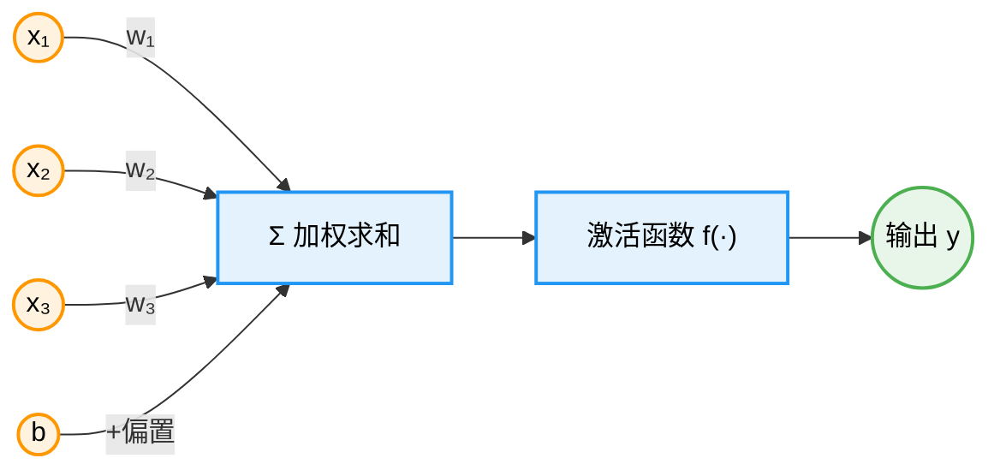
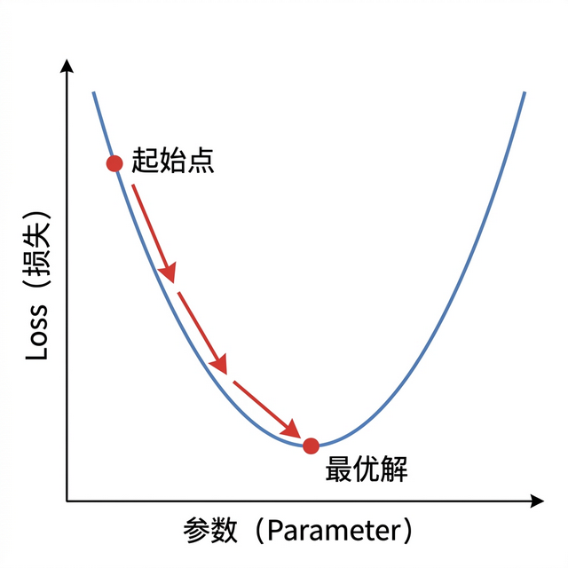
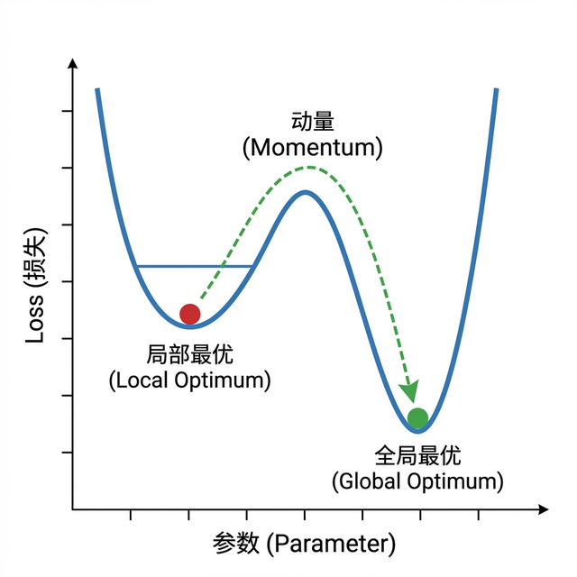
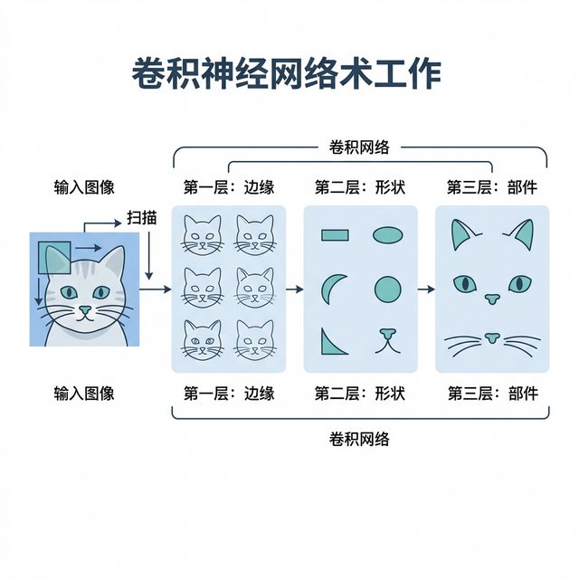
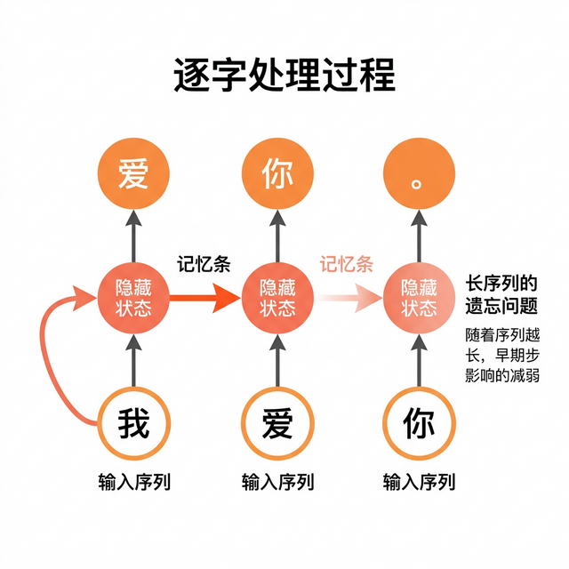
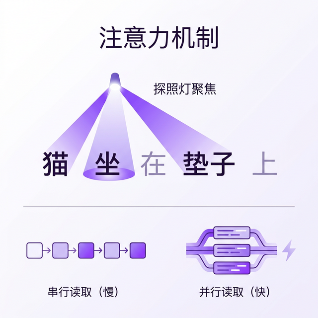
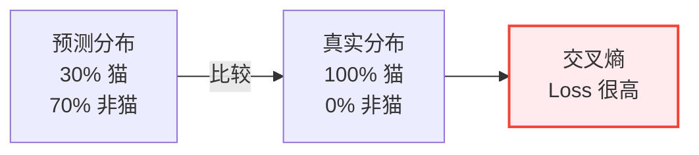

# 第五章 深度学习揭秘

> 解析神经网络的工作原理与现代深度学习技术

---

深度学习是当今 AI 最核心的技术，几乎所有令人惊叹的 AI 应用——从 ChatGPT 到自动驾驶——都建立在深度学习之上。本章将揭开深度学习的神秘面纱，帮助读者理解神经网络如何工作，以及支撑其成功的关键技术。

## 1. 神经网络

> 虽然叫“神经网络”，但它和生物大脑的差距，可能比纸飞机和波音 747 的差距还大。但胜在方向对了——层数越深，表达能力通常越强。

### 1.1 仿生学的起点

人类一直有个梦想：既然大脑能产生智能，那我们能不能造一个 **电子大脑**？

于是，科学家模仿大脑的结构，造出了 **“人工神经元”**。

*   **生物神经元**：接收电信号 -> 达到阈值 -> 啪！发电给下一个神经元。
*   **人工神经元**：接收数字 -> 加权求和 -> 激活函数 -> 把结果传给下一层。



图 5-1：人工神经元结构

虽然原理简化了无数倍，但当这几亿个简单的小东西连在一起时，奇迹发生了：**涌现（Emergence）**。

就像一只蚂蚁没有智慧，但蚁群却有智慧一样；单个神经元只是个计算器，但亿万个神经元连接起来，就成了 ChatGPT。

### 1.2 什么是“深度”？

为什么叫 **深度** 学习？

因为神经网络是分层的。
*   输入层：接收图片像素。
*   隐藏层：负责处理。
*   输出层：告诉你是猫是狗。

如果中间的隐藏层只有几层，叫“浅层网络”（它很笨，只能解决简单问题）。

如果中间有几百层，就叫 **“深度网络”（Deep Neural Network）**。

**深度**，就是网络的 **层数很多**。


图 5-2：深度神经网络的分层结构

每一层都在把信息进行一次“抽象”。
*   第 1 层：看到线条。
*   第 10 层：看到眼睛。
*   第 100 层：看到“这是一只悲伤的猫”。

层数越深，理解得越深刻。这就是为什么现在的模型都要做大、做深。

### 1.3 激活函数：画龙点睛

如果只有加减乘除，神经网络其实就是一堆线性方程，永远无法解决复杂问题。

必须给它加一点 **非线性** 的“佐料”，这就叫 **激活函数**。

在很长一段时间里，科学家们爱用一种叫 **Sigmoid** 的函数，但它在网络很深时容易“失灵”。现在，最著名的激活函数变成了 **ReLU**。别看名字高大上，它的逻辑简单得令人发指：
*   如果输入 < 0，输出 0（不激活，装死）。
*   如果输入 > 0，输出原值（激活，传递信号）。

就是这么个简单的开关，让神经网络有了模拟世间万物的能力。

### 1.4 思考题

人脑的功率大约只有 20 瓦（相当于一个灯泡），而训练大语言模型（LLM）需要成千上万张显卡，耗电量相当于一个发电厂。

为什么我们在“算力效率”上比 AI 高出那么多？ AI 的进化方向是不是错了？

## 2. 深度学习训练

> 训练模型就像在黑夜里下山，目标是找到山谷最低点（损失最小）。下山要看路，步子别太大。

### 2.1 梯度下降：AI 是怎么“悔过”的

我们之前说，训练就是“犯错挨打”。

但关键是，挨打之后，怎么改？

这就要用到 **梯度下降（Gradient Descent）**。

想象一下：你被直升机扔到了一座崇山峻岭中，四周漆黑一片（高维空间），你的目标是找到海拔最低的山谷（Loss = 0）。

你看不见路，只能用脚试探周围的坡度（计算梯度）。
*   如果你感觉那边是下坡，就往那边迈一步。
*   这就是 **“更新参数”**。

只要你不停地往“下坡”的方向走，理论上总能走到谷底。下图直观展示了这个过程：



图 5-3：梯度下降——沿损失曲线逐步走向最优解

### 2.2 学习率：步子迈多大？

在下山过程中，有一个生死攸关的参数：**学习率（Learning Rate）**。

它决定了你一步迈多远。

*   **步子太大**（学习率高）：虽然走得快，但容易直接跨过山谷，跑到对面山上去了（震荡不收敛）。
*   **步子太小**（学习率低）：像蚂蚁挪窝一样，走了一万年还没走到谷底（训练太慢）。

所以，最好的策略是 **“先快后慢”**：在山顶时步伐大一点，快到底时步伐小一点，慢慢挪进去（学习率衰减）。

### 2.3 局部最优：陷在半山腰

梯度下降有一个致命的缺陷：**局部最优陷阱**。

有时候你以为你到底了（四周都是上坡），但其实你只是在一个半山腰的小坑里。真正的谷底还在几公里外。



图 5-4：局部最优陷阱——动量帮助跳出局部最小值

为了解决这个问题，科学家发明了两类改进。一类是每次只看一小批数据就更新，也就是 **SGD（随机梯度下降）**，走得快、还自带一点随机抖动；另一类是给下山过程加上 **“惯性”（动量）**。**Adam** 把两者结合了起来。

当你冲进小坑时，利用惯性直接冲出去，继续寻找真正的大海。

> [!NOTE]
> **可观测的过拟合与早停策略**
>
> 从工程角度看，只讲“梯度下降”是不够的。模型训练最大的敌人是 **过拟合（Overfitting）**——模型在训练题上拿了满分，遇到没见过的新题却一塌糊涂。
> 1. **可观测证据**：我们需要同时绘制两条跟踪曲线：**训练集 Loss 曲线**（通常持续下降）和 **验证集（Validation Set）Loss 曲线**。一旦发现验证集 Loss 降到某一点后开始停滞甚至 **反弹上升**，这就是模型“死记硬背”导致泛化能力崩溃的铁证。
> 2. **早停与回调（Early Stopping）**：在监控到上述的“剪刀差”现象，即验证集 Loss 连续 N 轮没有改善时，框架（如 PyTorch Lightning / Keras）通过代码强制触发拦截停止训练，并回滚恢复到保存的最佳权重状态（Checkpoint）。
>
> **代码实验**：
> 直观可执行的过拟合观察代码，可参阅 `labs/03_dl_overfitting.py`。该脚本通过故意缩减数据量，稳定复现出**验证损失先降到最低点、随后回升**的过拟合信号，并据此标出早停点。注意该脚本的验证集是无噪声的，所以验证损失始终低于训练损失、两条曲线不会出现上面所说的“剪刀差”形状——它演示的是“验证损失出现拐点”这一判据本身。

### 2.4 思考题

为什么现在的 AI 工程师，经常自嘲是 **“炼丹师”**？

因为调节这些超参数（学习率、层数、Batch Size）就像配火药一样，往往没有绝对的科学公式，全靠经验和直觉（还有运气）。

你觉得未来会有“AI 炼丹师”这个职业吗？还是说 AI 最终能学会“自己调节参数”（AutoML）？

## 3. 深度学习架构

> 不同的器官负责不同的功能。AI 也是如此，不同的架构负责不同的数据。看图用卷积，听话用循环，万事不决转 Transformer。

### 3.1 CNN：计算机的“眼睛”

**卷积神经网络（CNN）** 是专门为 **图像** 而生的。

通过它，计算机终于“看”懂了世界。

它的核心法宝叫 **“卷积核”（Filter）**。



图 5-5：CNN 卷积过程示意图

想象你拿一个小的方形放大镜，在图片上从左到右、从上到下地扫描。
*   第一层扫描：发现了“横线”、“竖线”（边缘）。
*   第二层扫描：发现线条组成了“圆圈”、“方块”（形状）。
*   第三层扫描：发现圆圈组成了“眼睛”、“轮子”（物体部件）。

CNN 的哲学是：**局部这一小块像素，比整张图更重要。**
正是因为 CNN，我们才有了人脸识别、自动驾驶、医学影像 AI。

### 3.2 RNN：计算机的“耳朵”

如果说图像是 **空间** 的（上下左右），那么语言就是 **时间** 的（先后顺序）。

“我爱你”和“你爱我”，字完全一样，但顺序变了，意思就反了。

处理这种序列数据，就要靠 **RNN（循环神经网络）**。

RNN 有一个 **“记忆条”**。



图 5-6：RNN 记忆机制示意图

处理“爱”这个字时，它脑子里还留着“我”的残影；处理“你”时，它还记得前面的“我爱”。

正因为有了记忆，它才能由上文推断下文，才能做翻译、语音识别。

但 RNN 有个大毛病：**记性不好**。

句子太长（比如隔了 500 字），它就忘了开头讲啥了。这背后的技术原因是“梯度消失”——在反向传播时，梯度信号通过许多层会逐步衰减，导致早期输入的信息难以有效流向输出层。这也是早期机器翻译总是驴唇不对马嘴的原因。

### 3.3 Transformer：全能的“大脑”

2017 年，Google 一篇论文《Attention Is All You Need》，改变了 AI 的历史。
**Transformer** 横空出世。

它抛弃了 RNN 那种“一个字一个字读”的慢节奏，直接 **“一目十行”**（并行计算）。

它用 **“注意力机制”（Attention）**，就像探照灯一样，能瞬间聚焦到整篇文章里最相关的那个词，不管它离得有多远。



图 5-7：Transformer 注意力机制示意图

Transformer 是如此强大，它不仅横扫了 NLP（语言），现在还杀进了 CV（视觉）。

它可以说是现在的 **大一统架构**。GPT、Claude、Sora，骨子里流的都是 Transformer 的基因。

### 3.4 思考题

人类的进化是先有眼睛耳朵（感官），最后才进化出强大的大脑皮层（思维）。

AI 的发展似乎也是这样：先搞定 CNN（视觉识别），再搞定 Transformer（理解思维）。

那么下一阶段的进化会是什么？是 **身体（机器人）** 吗？

## 4. 深度学习的局限性

> 深度学习虽然强大，但它有两个致命死穴：不可解释（黑箱）和不可持续（能耗）。知其然，不知其所以然。

### 4.1 黑箱：你为什么说是猫？

如果你的医生告诉你：“你得了这个病，但我不知道为什么，是我的 AI 助手说的，它看了一眼你的片子就确诊了。”

你敢信吗？

这就是深度学习最大的问题：**不可解释性（Black Box）**。

神经网络内部有几千亿个参数，就像一个巨大而混乱的线团。虽然它输出了正确答案，但人类无法理清它中间的逻辑路径。

在金融风控、自动驾驶、医疗诊断这些 **“人命关天”** 的领域，黑箱是一个巨大的合规风险。

### 4.2 吞金兽：不仅烧钱，还烧碳

训练顶级大模型常常需要极高电力和算力成本。

其碳排放也可能达到传统软件系统难以相比的量级。

深度学习是一种 **“暴力美学”**：大力出奇迹。虽然效果好，但它极其低效。

人脑只消耗 20W 功率，就能写出《红楼梦》；AI 消耗兆瓦级功率，可能还在算错一道数学题。

这种 **“能源换智能”** 的模式，长期来看是不可持续的。

### 4.3 数据饥渴：有多少人工，就有多少智能

深度学习模型是个不折不扣的“吃货”，不仅要吃算力，更要吃海量的高质量数据。

如果是没人标注过的稀缺领域数据，模型往往表现糟糕。“有多少人工，就有多少智能”这句玩笑话，在很多特定场景下依然成立。

### 4.4 灾难性遗忘：学了新知识，忘了老朋友

如果你让一个训练好的模型去学习新任务（比如学完了识别猫狗，再去学识别飞机），它很可能会把怎么识别猫狗给忘了。

这种“狗熊掰棒子”的现象被称为 **灾难性遗忘（Catastrophic Forgetting）**，说明它缺少人类那种举一反三和持续学习的机制。

### 4.5 幻觉：一本正经地胡说八道

当你问 AI 一个它不知道的问题，它不会说“我不知道”，而是会编造一个看起来非常有道理的假答案。

这叫 **“幻觉”（Hallucination）**。

因为 AI 本质上是在做“文字接龙”（详见后文 6.2 节），它只管概率上通顺，不管事实上真假。

这是大模型刻在基因里的缺陷，目前还没有完美的解药。

### 4.6 思考题

我们是否真的需要 AI 具有“可解释性”？

我们自己的大脑其实也是个黑箱（你也不知道你是怎么突然想到一个好点子的，对吧？）。

如果 AI 能保证 99.999% 的准确率，远高于人类专家，我们是否可以接受它是一个黑箱？

## 5. 数学直觉：理解神经网络的灵魂（可选）

> 不需要你成为数学家。但你需要理解：为什么这些数学操作能把“垃圾进”变成“宝贝出”。

### 5.1 激活函数：为什么需要非线性？

假设你是个快递公司的经理。有一个最朴素的运营模式：

**只做线性操作**：
- 揽件数 × 2 = 派件效率
- 派件效率 × 3 = 收入
- 收入 × 0.1 = 你的奖金

这套公式再怎么组合（乘以 100 次），结果永远还是线性的——**收入永远和揽件数成正比**。你再聪明也逃不出这个魔咒。

但现实中，成功的快递公司是这样运作的：

```text
揽件数 → 分拣（激活）→ 按区域优化 → 再激活 → 智能配车 → 收益爆炸
```

**中间那些“激活”步骤，就是引入非线性**。因为：
- 低揽件量时，分拣效率差。
- 达到临界点后，分拣流程变得非常高效。
- 这不是线性关系，而是 **如果...就...** 的逻辑。

**激活函数就是这个“如果...就...”**。

在神经网络中，最常见的激活函数是 **ReLU**：

$$f(x) = \max(0, x)$$

用白话说就是：
- 如果输入是负数，输出就是 0（这个神经元“睡着了”）。
- 如果输入是正数，输出就是输入本身（这个神经元“醒了”）。


**为什么这个简单的开关有魔力？**

因为当你把数百层这样的“开关”叠加起来时，每一层都能学会在特定条件下打开或关闭。

层层递进，最终：
- 第 1 层的开关：识别“是否有边缘”
- 第 10 层的开关：识别“是否像眼睛”
- 第 100 层的开关：识别“是否像猫脸”

就这样，通过无数个简单的非线性开关组合，神经网络获得了解决复杂问题的能力。

> [!TIP]
> **没有激活函数，神经网络就是一个线性回归器**。不论多深，都无法学会复杂的模式。激活函数就是给神经网络注入了“智能的种子”。

### 5.2 损失函数：用“考试分数”理解优化目标

训练 AI 就像教学生做题。

**损失函数（Loss Function）** 就是那张试卷。它衡量“你的答案离正确答案有多远”。

简单例子：预测房价。

**真实房价**：100 万
**你的模型说**：120 万

**损失** = 偏离程度 = 20 万

怎么量化这个偏离程度？有好几种方法：

#### 最简单的：绝对误差

$$L = |预测 - 真实|$$

就像评分：你说 100，实际是 120，扣 20 分。

#### 最常用的：均方误差

$$L = (预测 - 真实)^2$$

特点是“惩罚犯大错”——偏离 20 万的代价是 400 万（20²），偏离 1 万的代价是 1 万（1²）。

这样设计有个好处：AI 会极力避免犯大错误，宁可均匀分散小错误。

#### 分类问题：交叉熵

如果你在做选择题（是猫 / 不是猫）：

```text
模型说：30% 概率是猫，70% 概率不是猫
正确答案：100% 是猫
```

交叉熵会计算：“你在最确定的地方最不确定”的代价有多大。



**损失函数就是 AI 的“良心”。** 只要你给了它一个清晰的损失函数，它就会拼命地想办法降低这个数字。

> [!WARNING]
> **损失函数的设计决定了 AI 的行为。** 如果你教 AI“只要分类准确率高就给满分”，它可能会为了准确率而输出充满偏见的结果。这就是为什么 AI 的“伦理问题”，很多时候是“损失函数设计问题”。

### 5.3 梯度下降的直觉：下山找路

回到前面的登山类比，但这次我们讲清楚数学原理。

你在黑夜里被扔到山上，目标是到谷底（Loss 最小）。

**梯度（Gradient）** 就是“坡度的方向”。

具体来说，在任何一个点，梯度告诉你：
- **哪个方向最陡**（Loss 下降最快）
- **有多陡**（下降速率多快）

数学符号：

$$\nabla L = \left( \frac{\partial L}{\partial w_1}, \frac{\partial L}{\partial w_2}, \ldots \right)$$

读法：“L 对每个权重参数的偏导数”。

每次更新参数时，AI 会沿着这个“最陡下降”的方向走一小步：

$$w_{new} = w_{old} - \eta \cdot \nabla L$$

其中 $\eta$ 就是“学习率”（一步迈多远）。

**用地形比喻：**

```text
第 1 步：你在山顶，梯度陡峭 → 快速下降
  ↓
第 10 步：你靠近山谷，梯度平缓 → 小心挪步
  ↓
第 100 步：你到达最低点，梯度接近 0 → 停止移动
```

**为什么叫“梯度下降”？** 因为每一步都是“沿着梯度的反方向”（opposite to gradient）。梯度指向最陡上升，所以反方向就是最陡下降。

> [!NOTE]
> **随机梯度下降（SGD）vs 批量梯度下降（BGD）**
>
> - **BGD**：一次看遍整个训练集，计算平均梯度，再更新。优点：方向准确；缺点：一次计算量巨大。
> - **SGD**：随机抽一个样本，计算那个样本的梯度，立刻更新。优点：快；缺点：方向有噪音，可能“左右摇晃”。
> - **Mini-batch**：折中方案。一次用 32/64 个样本，既快又稳定。这也是现在最常用的。

### 5.4 反向传播：错误是怎么回传的？

最后一个难点：一个神经网络有几十亿个参数，怎么知道每个参数该改多少？

这就是 **反向传播（Backpropagation）**。

**类比：一个制造工厂出了问题。**

假设你是工厂老板，发现最终产品质量不符合要求。

你需要追溯：
1. 最后一道工序（装配）有问题吗？
2. 有问题，那是因为零件（产品 A、产品 B）的规格不对吗？
3. 产品 A 规格不对，那是因为 A 的上游工序（焊接）出错了吗？
4. 不是。那是因为原材料（钢材）质量差吗？

通过这样层层反推，你最终找到了根源，并在那个环节修正。

**神经网络的反向传播也是这个逻辑：**

```text
前向传播：输入 → 层1 → 层2 → ... → 层N → 输出 → 损失
            |                                    |
反向传播：输入 ← 层1 ← 层2 ← ... ← 层N ← 损失反推
```

在反向传播中，每一层都会计算：

$$\frac{\partial L}{\partial w_i}$$

（这一层的参数对总损失的贡献度是多少）

**一个简化例子：**

```text
层 2 的梯度 = 层 3 的梯度 × 当前层对层 3 的影响程度
```

就像：
```text
最后销售额没达成，那是因为：
  = 市场需求不足的影响 × 我们营销的贡献度
```

**链式法则（Chain Rule）就是这个原理。**

通过反向传播，AI 在一次前向推理之后，用一次反向推理，就能计算出每一个参数需要调整的方向和幅度。这是现代深度学习的核心。

> [!TIP]
> **反向传播的计算复杂度** 和前向传播差不多（也许慢 2 倍），但它解决了一个无法绕过的问题：**在深度网络中，怎么高效地找到每个参数的梯度。**

### 5.5 为什么是“梯度”而不是“坡度”？

最后一个数学细节。

在一维空间中（比如一条直线），“坡度”就够了。

但神经网络的参数空间是 **超高维的**（几百万维）。

在这种空间中：
- **偏导数**：沿着某一个参数方向的“斜率”。
- **梯度**：所有偏导数组合成的“方向向量”，指向最陡上升方向。

因为参数不止一个，所以要用“梯度”（向量）而不是“导数”（标量）。


就这样，通过梯度这个“指路灯”，AI 在无比高维的参数空间中，一步步逼近最优解。

### 5.6 思考题

现在你知道了：
- **激活函数** = 非线性开关
- **损失函数** = 教学目标
- **梯度下降** = 下山法则
- **反向传播** = 反向追责

那么问题来了：**为什么最简单的 “下山法则”，能训练出 GPT 这样的超级智能？**

是不是意味着，智能本身就是“朝着正确方向不停迭代”的结果？

换句话说，**会不会有一天，人类的“进化”也能被某种“损失函数”完美解释？**
