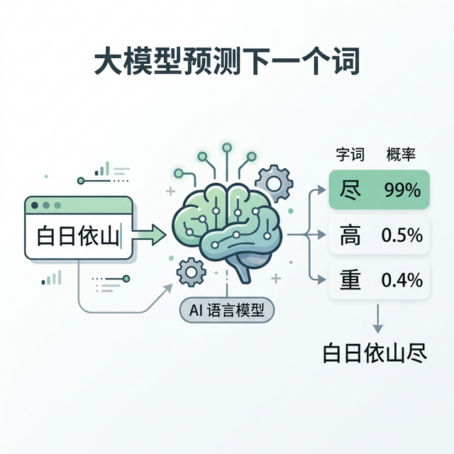
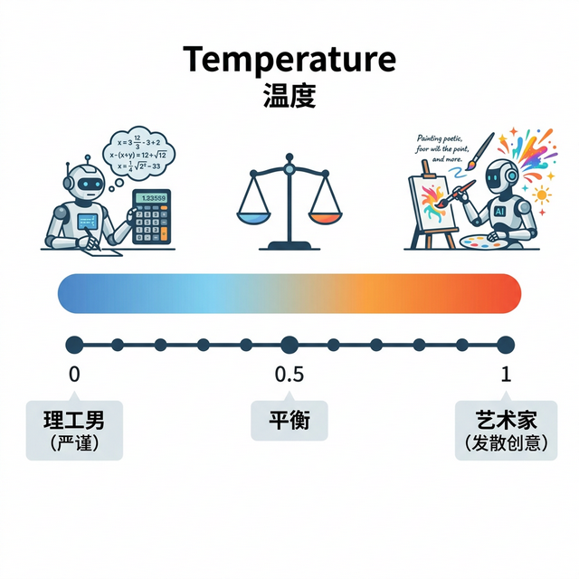
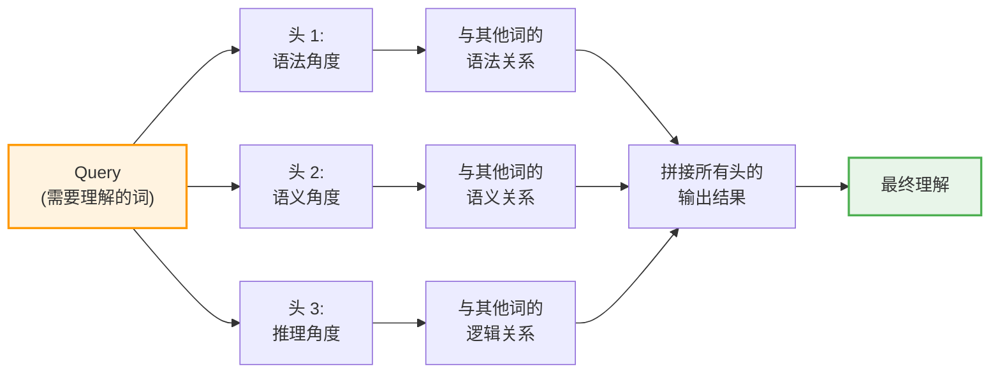
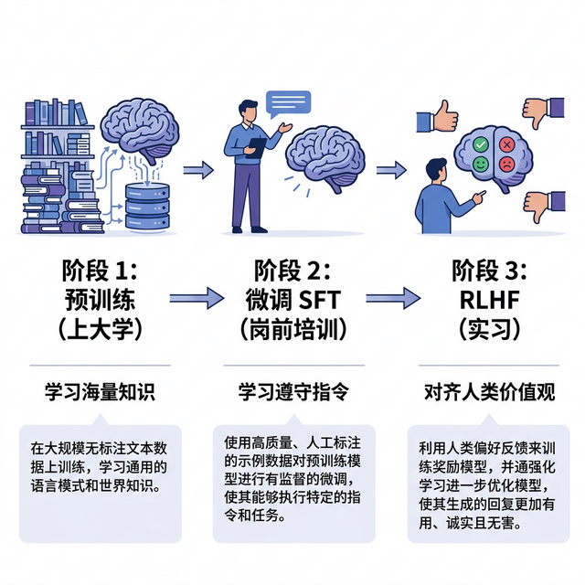

# 第六章 大语言模型详解

> 深入理解 ChatGPT、Claude 等大语言模型的技术原理

---

大语言模型（Large Language Models，LLM）是当今 AI 最热门的技术方向。ChatGPT 的发布引爆了全球对 AI 的关注，让 AI 从专业领域走进了普通公众的生活。本章将深入解析大语言模型的技术原理，帮助读者理解这些令人惊叹的系统是如何工作的。

## 1. 语言模型演变

> 为什么几十年前的聊天机器人像“模板机”，现在更像真人？因为方法变了。从定规则，到统计学，再到“大力出奇迹”。

### 1.1 远古时代：Eliza（1964-1967）

最早的聊天机器人叫 **Eliza**，由 MIT 的 Joseph Weizenbaum 在 1964-1967 年间开发，1966 年在《美国计算机学会通讯》上正式发表。它扮演一个心理医生。
*   你：我很难过。
*   它：请告诉我你为什么难过？
*   你：因为我失恋了。
*   它：听到你失恋了，我很有兴趣。

看起来像模像样？其实它只是在 **“套公式”**：
*   如果用户说 “I am X”，就回复 “Why are you X?”。
*   这本质上还是 If/Else。一旦你稍微说复杂点，它就露馅了。

到了 20 世纪 90 年代和 21 世纪初，随着 **统计机器翻译** 等技术的出现，AI 开始从“写规则”转向“找规律”。

### 1.2 统计时代：2011 年的 Siri

到了 Siri 时代，AI 开始用 **“统计学”** 了。

它并不懂你在说什么，但它算过，当你是说“明天天气”时，有 90% 的概率是想看天气预报。

所以它不是在“思考”，而是在“查表”。

这也是为什么 Siri 经常听不懂人话，只能在预设的框架里回答。

### 1.3 大模型时代：2018 年以来的 GPT

大模型时代（2018-）的关键变化是：以 GPT 为代表的模型不再依赖人工规则，而是在大规模语料上进行预训练。

它做的事情看似简单：给定上文，预测下一个 token。

但当模型规模、数据规模和训练算力同时上去后，能力会出现明显跃迁。

从 GPT-3 的惊艳，到后续多代模型在推理、工具调用、多模态上的持续进步，AI 已经通过“大力出奇迹”的方式，实现了质的飞跃。

从规则驱动（Rule-based）到数据驱动（Data-driven），这就是 AI 变聪明的根本原因。

### 1.4 思考题

我们经常吐槽以前的 Siri “不够聪明”。

现在的大模型看起来很聪明。

有没有一种可能，在 10 年后的 AI 看来，现在的模型也只是“过渡阶段的助手”？

你觉得下一代 AI 会在什么地方超越现在的 AI？

## 2. 大模型原理

> 你眼中的“思考”，在 AI 眼里只是“概率计算”。根据上文，猜下一个字。

### 2.1 这里的“接龙”不简单

大语言模型（LLM）到底在干什么？

一句话就能说清：**Next Token Prediction（预测下一个词）**。

这听起来像是在玩“文字接龙”。
*   你说：“白日依山”
*   模型脑子里算了一下，“尽”字出现的概率是 99%。
*   于是它说：“尽”。

你可能会问：**“就这？这也能叫智能？”**
是的，就这。

但当它的阅读量达到千亿级别时，奇迹发生了。

它不仅仅是在接“白日依山尽”，它能接代码、能接论文、能接菜谱。
**当“接龙”的能力达到极致，外在表现出来的就是“智能”。**



图 6-1：大模型预测下一个词（Next Token Prediction）示意图

### 2.2 什么是 Token？

AI 不认识“字”，它只认识 **Token**。

Token 就像是 AI 的“积木块”。

Token 并不是“一个字/一个词”的固定单位，而是由 **分词器（Tokenizer）** 切出来的子词片段：
*   在英文里，一个 token 可能是一个词、词的一部分（如 `ing`）、甚至是标点和空格；长度不固定。例如，一句 `“Hello, world!”` 在 GPT 的分词器中可能会被切分成约 4 个 token（`Hello`、`,`、` world`、`!`）。
*   在中文里，一个 token **经常** 接近 1 个汉字，但也可能把常见词组、数字、英文混排切成不同粒度。

近年来，前沿模型的上下文窗口已达到百万 token 级别（如 Gemini 3.1 Pro 为 1M token、Llama 4 Scout 达 10M token），这意味着它一次能“记住”大量积木块的顺序。

### 2.3 温度：AI 的性格开关

在调用 AI 时，有一个很重要的参数叫 **“温度”**。
*   **温度 = 0**：AI 变成 **理工男**。每次都选概率最高的那个词，输出最稳定，但也极度无聊。注意，稳定不等于正确：它照样可能一本正经地说错。适合写代码、做数学题。
*   **温度 = 1（甚至更高）**：AI 变成 **艺术家**。它会尝试选一些概率没那么高、但比较新奇的词。随着温度继续升高（部分模型最高可达 2），它甚至会变得“语无伦次”。适合写诗、发散脑洞。

**通过调节温度，我们赋予了那个冰冷的计算器以“性格”。**



图 6-2：温度（Temperature）机制示意图

### 2.4 思考题

如果 AI 只是在做“概率预测”，那它真的有 **“自我意识”** 吗？

还是说，我们的 **“自我意识”**，本质上也是一种极其复杂的、生物学层面的“概率预测”？

（这个问题目前没有科学定论，只有哲学争论。）

## 3. Transformer 的注意力机制详解

> 注意力机制就是 AI 的“聚焦能力”。当你同时看一句话和一张图，你的眼睛不是均匀扫过每个像素，而是集中在重要的部分——AI 也是这样。

### 3.1 一个词的多重身份：歧义问题

在自然语言里，同一个词在不同上下文中可能有完全不同的含义。

**例子 1：苹果**
- “我吃苹果。”—— 苹果 = 水果。
- “苹果发布新品。”—— 苹果 = 公司名。

**例子 2：bank**
- “I went to the bank to withdraw money.” —— bank = 金融机构。
- “We sat on the river bank.” —— bank = 河岸。

相同的字/词，在不同句子里，角色完全改变。

**传统的方法有多笨？**

早期的 RNN 模型（如 LSTM）会这样处理：
1. 读第一个字 → 记住“苹”的某种特征。
2. 读第二个字“果”→ 根据之前的“苹”，逐步更新对整个词的理解。
3. 这种“逐个处理”的方式天生受限：当信息链条太长（比如 100 个字后才出现关键信息），之前的信息会被“遗忘”。

**Transformer 的聪慧方式：**

不是逐个处理，而是 **“一下子看遍全部”，然后根据上下文重新理解每个字**。

### 3.2 注意力的三重奏：Query、Key、Value

Transformer 的核心是 **自注意力机制（Self-Attention）**。

**最简化的解释：在图书馆里找书。**

```text
场景：你是图书馆员，有 100 本书在面前。

Visitor 走进来说："我要找关于'猫'的书。"
这句话叫 Query（查询）。

你的大脑里有一份书单记忆（索引），上面记着：
  - 第 1 本：关于"狗"
  - 第 2 本：关于"猫咪的故事"
  - 第 3 本：关于"猫科动物进化"
  - 第 4 本：关于"家具设计"
这份记忆叫 Key（索引）。

现在你根据 Query（找"猫"的书）去扫描 Key（书单），找出匹配度：
  - 第 2 本：匹配度 95%（就是讲猫的）
  - 第 3 本：匹配度 92%（也讲猫，但角度不同）
  - 第 1 本：匹配度 5%（讲的是狗，不是猫）
  - 第 4 本：匹配度 2%（讲家具，完全无关）

最后，你根据这些"匹配度权重"，把对应的书内容（Value）加权组合起来，递给 Visitor。
```

**用数学表达：**

$$\text{Attention}(Q, K, V) = \text{softmax}\left(\frac{QK^T}{\sqrt{d_k}}\right)V$$

翻译成白话：
1. $QK^T$ ：Query 和 Key 的匹配度（点积）。
2. $\text{softmax}$ ：把匹配分数转成权重分布（同一行权重加起来 = 1，可理解为 100%）。
3. $\sqrt{d_k}$ ：一个平衡因子（防止权重被冲击得太极端）。
4. $\times V$ ：用这些权重组合 Value（实际内容）。

**具体例子：处理“我吃苹果”**

```text
原句：我 吃 苹 果
```

当处理“苹”字时：

| 词语 | Key（身份）| Query（“苹”看其他词） | 匹配分数（示意） | softmax 后权重（示意） |
|------|----------|------------------|------|------|
| 我   | 主语     | 我和苹有关吗？    | 低  | 5%  |
| 吃   | 动词     | 吃和苹有关吗？    | 高  | 35%  |
| 苹   | 当前字   | 苹和苹有关吗？    | 中  | 25% |
| 果   | 水果的补充| 果和苹有关吗？   | 高  | 35% |

最后，模型根据这些权重的组合，理解“苹”在这个句子中特指“苹果（水果）”。

### 3.3 自注意力 vs 交叉注意力

**自注意力（Self-Attention）：** 一句话内部的各个字/词相互看对方。

```text
句子：我 吃 了 一 个 红 苹 果

自注意力：
  "我" 看其他词 → "吃"很重要，"苹果"是宾语，与我有关
  "苹" 看其他词 → "红"是修饰我的，"吃"是动词，我是被吃的
```

**交叉注意力（Cross-Attention）：** 一句话的部分去看另一句话。

```text
中文："我吃苹果"
英文："I eat an apple"

交叉注意力：
  中文的"我" 去看英文的每个词 → 最匹配"I"
  中文的"吃" 去看英文的每个词 → 最匹配"eat"
```

**Transformer 在不同任务中的用法：**

| 任务 | 自注意力 | 交叉注意力 |
|------|---------|----------|
| 语言模型（GPT） | 用。上下文理解 | 不用。只需要前文 |
| 机器翻译 | 用。理解原句结构 | 用。对齐原文和目标文 |
| 图像 + 文字（多模态） | 用。图像内部和文字内部各自理解 | 用。让文字去“看”图像 |

### 3.4 多头注意力：听不同的声音

一个 Query 对 Key 的关注，可能有多种角度。

**比如看一个人：**
- 头 1：从“长相”的角度看，这个人像我朋友 A。
- 头 2：从“气质”的角度看，这个人像我朋友 B。
- 头 3：从“身高”的角度看，这个人像我朋友 C。

**三个不同的“关注视角”，给了模型更丰富的信息。**



在实践中，现代 LLM 用的多头注意力通常有 64、96 甚至 128 个“头”，每个头都从不同的特征空间去理解。

### 3.5 为什么 Transformer 击败了 RNN？

这是个扭转整个 AI 历史的问题。

**RNN（如 LSTM）的悲剧：**
- 必须从左到右逐个处理字。
- 第 1 个字处理时，还不知道第 100 个字是什么。
- 当要用第 100 个字的信息来修正第 1 个字的理解时，可能“来不及”或“信息衰减”。
- **结果：长距离依赖（Long-range Dependency）很难学。**

**Transformer 的优势：**
- 一次性看遍全部词。
- 每个词都能直接“看到”所有其他词。
- 注意力权重会自动学会“哪些词对这个词重要”。
- **结果：再远的距离依赖，也只要一步“注意力距离”。**

**性能对比：**
- RNN/LSTM：可以处理相对长的序列，但超过几百个词时，长距离依赖开始失效。
- Transformer：能处理数百万 token 的上下文（当然，显卡要很贵）。

**计算效率：**
- RNN：必须逐个处理，无法并行。
- Transformer：所有词可以并行处理。

所以，**Transformer 用“并行计算”换来了“全局感知”**，这笔生意太划算了。

### 3.6 位置编码：让 AI 知道“顺序”

有个细节很容易被忽视：**Transformer 没有“顺序”的概念。**

它一次性处理全部词，完全是平行的。那它怎么知道“第 1 个词在最前面，第 10 个词在中间”？

答案：**位置编码（Positional Encoding）**。

最简单的方法就是：给每个位置加一个“ID”。

```text
词 1：[词向量] + [位置 ID: 1]
词 2：[词向量] + [位置 ID: 2]
词 3：[词向量] + [位置 ID: 3]
```

这样，模型就知道了“顺序”。

原始 Transformer 用的是三角函数编码（Sinusoidal Positional Encoding）：

$$PE_{(pos, 2i)} = \sin(pos / 10000^{2i/d})$$
$$PE_{(pos, 2i+1)} = \cos(pos / 10000^{2i/d})$$

（数学细节不重要，只需知道：每个位置都有独特的“编码指纹”）

> [!TIP]
> **一个小秘密：** 现在很多 LLM 已经放弃了固定的位置编码，改用“相对位置”或“旋转位置编码（RoPE）”。原因是：如果你用了固定位置编码，模型就无法处理比训练时更长的序列（比如，你用长度 2K 的文本训练，突然来了 4K 的输入，模型就懵了）。

### 3.7 思考题

现在你理解了注意力机制的核心逻辑。

那么问题来了：

**1. 人类的“注意力”和 AI 的“注意力”有什么本质区别吗？**

你读这段文字时，你的视觉和理解，是不是也在“权衡”每个词的重要性？

**2. 如果 Transformer 能处理数百万 token，为什么不能处理“无限”的上下文？**

（提示：想想内存和计算成本。注意力矩阵的大小是 $O(n^2)$ 的——token 数量翻倍，计算量就翻四倍）

**3. 会不会有更高效的“注意力”替代品？**

（实际上，这是当前 AI 研究的热门方向。Mamba、Hyena Network 等新模型都在尝试挑战 Transformer）

## 4. 预训练与微调

> 通用大模型是“通才”，垂直行业模型是“专才”。预训练练内功，微调练招式。

### 4.1 预训练：通识教育

训练像 **大语言模型（LLM）** 这样的模型，第一步叫做 **预训练**。

这就是 **“上大学”**。

OpenAI 把全网的数据喂给它，不分学科，什么都学。物理、化学、编程、莎士比亚、八卦新闻...
这个阶段 **极其昂贵**（通常需要超大规模 GPU 集群，训练周期也可能按月计算）。

**目标**：让 AI 掌握人类的语言规律和世界的基本知识。
**结果**：它变成了一个博学多才，但不太懂规矩的“野人”。你问它“怎么制造炸弹”，它可能真的会告诉你。

### 4.2 后来微调：岗前培训

这就需要第二步：**微调（Supervised Fine-Tuning）**。

这就是 **“岗前培训”**。

我们雇佣人类老师，写好标准的“问答对”（Instruction），教它如何对话，如何有礼貌，什么该说什么不该说。

这个阶段 **便宜** 得多。
**目标**：把“野人”变成“客服”、“医生”或“程序员”。
**结果**：它学会了遵循指令，变成了一个好用的助手。

### 4.3 RLHF：去人类社会实习

最后一步是 **人类反馈强化学习（RLHF）**。

这就是 **“实习”**。

如我们在 [4.4 节](../04_machine_learning/4.4_reinforcement.md)介绍的，RLHF 的常见做法是：先让人类标注员对多条候选回答做偏好排序，再用强化学习让模型更倾向于人类喜欢的回答。

这一步让 AI 逐步学会了什么该说、什么不该说，输出风格也更贴近人类的沟通习惯。



图 6-3：大模型训练的三阶段流水线：预训练、微调与 RLHF

### 4.4 不只一条路：RAG、工具调用与工作流

在真实项目里，很多团队不会一上来就微调模型，而是先做：

1. **RAG（检索增强生成）**：先查企业私有资料，再让模型回答。
2. **工具调用（Tool Use）**：让模型调用数据库、搜索、日历、ERP 等外部系统。
3. **工作流编排（Workflow）**：把“检索 -> 生成 -> 校验 -> 审批”串成可追踪流程。

这三种方式通常比“从零训练/深度微调”更快落地、成本更低。

### 4.5 思考题

很多公司想拥有自己的“行业大模型”（比如法律大模型）。

他们通常不需要从头做“预训练”（太贵了），而是在通用模型的基础上做“微调”。

这就好比：你是想自己从幼儿园开始培养一个律师（预训练），还是直接招一个法学毕业生，给他培训两周你们公司的规定（微调）？

多数情况下会先选后者；但在不少场景里，RAG 和工具调用也能先解决 80% 的需求。

## 5. 主流大模型

> 这个领域变化太快，不要死记硬背排名，要看懂各家的“独门绝技”。闭源与开源并行，能力、成本、合规三者都要看。具体版本和可用性统一维护在[快变事实核验表](../appendices/appendix_f_volatile_facts.md)，生产选型还需打开其中的官方来源。

### 5.1 三大闭源巨头

近年来，OpenAI、Anthropic、Google 仍是闭源大模型的第一梯队。

注意：它们在不同评测和场景（代码、数学、写作、工具调用）里的名次会持续变化，不存在“永久第一”。

1.  **OpenAI（GPT 系列）**
    *   **特点**：综合能力和产品生态通常都很强，工具链较完整。
    *   **学习快照**：OpenAI 的前沿型号更替很快，同代里还常分出 pro 档（更多算力换更强推理，定价显著更高）；gpt-5.5 等较早的型号在被新一代接替后通常仍留在目录中可用。当前的前沿型号、可用性、价格和上下文窗口一律以[快变事实核验表](../appendices/appendix_f_volatile_facts.md)及其中的官方模型页和价格页为准，不要从本文记住某个具体型号。
    *   **取舍**：闭源能力强，但企业需要关注数据治理，以及“供应商绑定”风险（例如后续切换平台时成本可能更高）。

2.  **Anthropic（Claude 系列）**
    *   **特点**：在长文本理解、写作、代码任务上常有突出表现，风格相对稳健。
    *   **学习快照**：官方模型比较表列出广泛可用的 **Claude Fable 5.1**、**Claude Opus 5.5**、**Claude Sonnet 5.5** 与 **Claude Haiku 4.5**；Mythos 5.1 属于受限可用。Fable 5.1 面向最高能力需求，Sonnet 5.5 强调速度、能力和成本的平衡。thinking 模式、上下文窗口、价格与平台覆盖见[快变事实核验表](../appendices/appendix_f_volatile_facts.md)，不要从旧型号类推。
    *   **取舍**：产品功能节奏和生态覆盖与其他厂商各有长短。

3.  **Google（Gemini 系列）**
    *   **特点**：多模态能力强，且与 Google Workspace、搜索等生态整合紧密。
    *   **学习快照**：Gemini 官方模型页更新很快，长上下文、多模态输入和推理能力是其重点方向；生产选型时应以 Google AI 官方模型页列出的当前可用版本、弃用状态和限制为准。
    *   **取舍**：优势常出现在 Google 生态内，跨生态体验需看具体产品形态。

### 5.2 开源之光：LLaMA

如果说闭源模型是 iOS，那 Meta 的 **LLaMA** 更像 Android 阵营里的关键基座之一。

Meta 把高质量权重开放出来后，显著降低了学术界和创业团队做二次创新的门槛。2025 年 4 月发布的 **Llama 4** 系列首次采用 MoE（混合专家）架构，其中 Scout（109B 总参数，16 个专家 / 17B 活跃参数，支持 10M 上下文）和 Maverick（400B 总参数，128 个专家 / 17B 活跃参数，支持 1M 上下文）是这一代的两款主力开放权重模型。MoE 架构的关键特性是：每个 token 在推理时只激活部分专家（活跃参数），而非全部参数，从而在保持强能力的同时降低推理成本。

开源生态并不只有 LLaMA，也包括 Qwen、Mistral、Gemma 等多条路线。
**重点不是“谁是唯一图腾”，而是开源让更多人有能力做本地化和垂直化改造。**

### 5.3 中国的“百模大战”

中国 AI 在 **应用落地**、**中文能力**、**成本效率** 上竞争非常激烈。

1.  **阿里（通义千问 Qwen）**：开源生态活跃，工程化能力强。
2.  **百度（文心）**：搜索与知识服务体系结合较深。
3.  **DeepSeek（深度求索）**：以高性价比和推理/代码能力出圈。通用的 DeepSeek-V3（2024-12，MoE 架构）和推理专用的 DeepSeek-R1（2025-01，MIT 开源）是其代表作。
4.  **Kimi（月之暗面）**：在长文档阅读和信息整合场景表现突出。

### 5.4 思考题

如果你是公司的 CTO，现在要引入 AI。

你会为了数据安全选择 **自部署开源模型**（如 LLaMA，需要买昂贵的显卡），还是为了效果选择 **接入闭源 API**（如 GPT/Claude/Gemini，数据要传给服务商）？

这个决策的平衡点在哪里？

## 6. 大模型的部署与推理：让模型跑起来

当我们在网页上向大模型提问，几秒钟后它就开始流利地回答我们时，你是否好奇过它在云端到底是怎样运行的？

在真实的工业级环境中，让大模型“跑起来”的过程被称为 **推理 (Inference)**。这并不是简单地在电脑上运行一段脚本程序，而是一个需要调用成千上万张昂贵显卡、极其复杂的系统工程。

### 6.1 算力与显存：谁更重要？

很多人以为大模型运行最耗费的是计算能力（算力），也就是 GPU 的处理速度。但在实际应用中，真正“卡脖子”的往往是 **显存容量** 和 **显存带宽**。

大模型在回答我们的问题时，它的工作可以分为截然不同的两个阶段：

1. **阅读阶段（预填充 Prefill）**：模型会把你发送的历史上下文和提示词一次性“吃”下去。这个阶段 **极度消耗算力（Compute-bound）**，GPU 会开足马力进行并发的矩阵运算。用户能否感受到秒回，取决于 **首字延迟（TTFT，Time to First Token）**。
2. **回答阶段（解码 Decode）**：模型像一台打字机一样，一个字一个字地往外蹦答案。因为必须等上一个字生成后才能去猜下一个字，这个阶段系统其实 **受限于内存带宽（Memory-bound）**。这时候 GPU 大部分时间处于等待数据的状态，主要时间都花在了从显存里把庞大的模型权重和历史记录来回搬运上。这就好比一个跑得飞快的厨师，却被狭窄的厨房运菜通道挡住了。这阶段的流畅体验取决于 **词间延迟（ITL，Inter-Token Latency）**。

### 6.2 吞噬显存的怪兽：KV Cache

为了不让模型在每生成一个新词时都必须把前面的整段话重新理解一遍，它会把读过和写过的字的中间计算结果存进这本记事本里。由于这段记录会随着对话的进行不断变长，因此 **上下文越长、并发用户越多，显存消耗也就急剧增加**。

> [!NOTE]
> **显存占用的可计算规则**
>
> 在部署真实系统时，显存需要依靠明确的公式预估，而非仅靠直觉：
>
> **1. 纯权重显存** = 参数量 × 每参数所需字节数
> 比如知名的开源大模型 Llama 3 70B（700 亿参数），在默认的半精度浮点数（FP16/BF16，即占 2 个字节）下：**$70 \times 10^9 \times 2 \text{ bytes} \approx 140\text{GB}$**。
> 这意味着，**如果直接用 FP16 加载，单张 80GB 的顶级显卡根本装不下哪怕仅仅是模型本身**，更别说进行推理对话了。书中过去关于“80GB 顶级显卡装几千亿参数的模型”的比喻在物理上是不成立的。
> 为此工程师们引入了 **量化技术（Quantization）**，把权重压缩成 INT8（1 字节）或 INT4（0.5 字节）。将其压缩至 INT4 后，纯权重只需大概不到 40GB，此时 80GB 的显卡才有充足的剩余空间装入。
>
> **2. KV Cache 显存**
> 模型在推理时还需要分配巨大的运行时显存来存放历史记忆 KV Cache。如果没有先进的内存分页技术（如基于 PagedAttention 思想的 **vLLM** 引擎），显存很快会碎片化导致崩溃（内存溢出 OOM）。

### 6.3 把显卡组装成超级大脑：分布式推理

既然单张甚至单台机器的显卡装不下，我们就必须用网络把十几台、甚至几百台服务器上的显卡连接起来一起算，这叫做 **分布式部署**。

它跑起来就像一家大型数据工厂在进行极其默契的流水线作业：
- **切分模型**：这半边神经网络交由显卡 A 计算，那半边交由显卡 B 计算。它们彼此之间通过极其昂贵且高速的内部网络（比如 NVLink 或专用的高速以太网）在微秒级别交换数据。
- **解耦工厂**：一些最前沿的 AI 公司，甚至会将整个数据中心切分为两波。一波机器纯粹负责“阅读长文”（计算集群），另一波机器纯粹负责“逐字打字”（显存带宽集群）。这就像餐厅的前台负责极速点单和备菜，后厨负责快速出餐，以此达到极高的接待效率。

**总结**：在几百亿、几千亿参数的巨兽面前，隐藏在幕后的“推理技术”决定了 AI 公司的成本底线与回答速度。当你每次惊叹于大模型一秒钟能写出几十个词的回复时，要知道，这背后是成百上千张昂贵显卡在高速光缆的连接下，进行着精妙绝伦的硬件接力赛。

### 6.4 思考题

为什么推理成本如此重要？如果推理成本降到现在的 1/100，会催生出什么样的新应用？
