# 第七章 推理模型与推理计算

> 从快速反应到深入思考：理解 AI“慢思考”革命与推理计算的崛起

---

2024 年底，一个重大转变正在 AI 领域发生。传统的大语言模型都在追求“快速反应”——输入提示词，瞬间得到答案。但现在，一个新的思路正在成为主流：**给 AI 充足的时间来思考**。

这就是“推理模型”（Reasoning Models）的核心理念。OpenAI 从 o 系列演进到 GPT-5 及其迭代版本；Anthropic 从 Extended Thinking 演进到 Claude Fable 5.1 与 **Claude Sonnet 5.5** 等新一代型号所采用的 Adaptive Thinking；DeepSeek-R1 则展示了开放权重推理路线。版本与可用性以快变事实核验表为准。

## 1. 两种思维方式：System 1 vs System 2

> 心理学启示：为什么有些问题需要冷静思考，而有些可以快速判断？

### 1.1 你的大脑有两套系统

想象一下，你在驾车时突然看到一个红灯。你马上踩刹车——这是快速的、本能的、几乎不需要“思考”。

现在想象一下，你要计算：“23 × 47 等于多少？”你需要停顿一下，在脑子里做乘法。这需要你集中注意力，一步步推导。

认知心理学家丹尼尔·卡尼曼用两个术语描述这种现象：

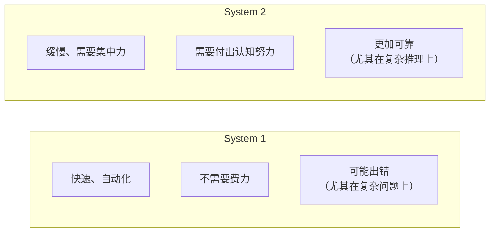

### 1.2 System 1：快速反应的能力

System 1 处理的任务包括：
- **识别物体**：“这是一只猫”
- **理解简单的句子**：“天空是蓝色的”
- **应对熟悉的情况**：“红灯就是停止”
- **快速反应**：你见到老朋友，立即认出他

想象一下一个聊天机器人只有 System 1 的能力。它可以快速、流畅地和你聊天。它学过数百万条对话样本，所以能够很好地预测下一个词。但是，当面对一个需要深入推理的问题时，比如：

**问题**：“一个房间里有 100 只鸡和 3 个农民。每个农民拿走 10 只鸡，但其中一个农民把 3 只鸡放回来了。最后有多少只鸡在房间里？”

传统的大语言模型（只依赖 System 1）可能会快速输出一个错误的答案，因为它只是在基于模式匹配来预测词序列。

### 1.3 System 2：深入思考的能力

System 2 需要：
- **分解问题**：这道题有几个步骤？
- **追踪逻辑**：每一步的推导是否正确？
- **反思与验证**：答案合理吗？有其他的理解方式吗？
- **多步推理**：前面的步骤如何影响后续的计算？

回到那道鸡的问题。使用 System 2 的思维方式：

```text
步骤1：初始状态有100只鸡
步骤2：3个农民各拿走10只
      → 100 - (3 × 10) = 100 - 30 = 70只鸡
步骤3：其中一个农民把3只放回来
      → 70 + 3 = 73只鸡
答案：73只鸡
```

这需要的不仅是“预测下一个词”，而是真正地 **建立一个思维模型** 来追踪问题的状态变化。

### 1.4 为什么 System 2 更难实现？

在传统的神经网络中，所有的计算都是 **并行且即时的**。当你输入一个提示，模型从左到右、一次一个 token 地生成文本。这很快，但也意味着：

1. **没有“思考空间”**：模型没有时间在一个中间步骤上“停顿”和“反思”
2. **错误传播**：第一步出错，后续所有推理都可能受到影响
3. **无法回溯**：模型不能说“等等，让我重新思考这个问题”

就像一个人在脑子里快速说话一样——他说出的第一句话可能有问题，但没有改正的机会。

### 1.5 System 1 vs System 2 在 AI 中的体现

| 能力 | System 1 LLM | System 2 推理模型 |
|------|------------|--------------|
| 生成速度 | 极快（<1 秒） | 较慢（3-60 秒） |
| 处理问题复杂度 | 简单、直接 | 复杂、多步骤 |
| 可解释性 | “给出答案” | “显示思考过程” |
| 推理能力 | 受限（依赖训练数据中的模式） | 强（可以组合已知概念） |
| 错误类型 | 快速但可能不准确 | 慢但更准确 |
| 适合场景 | 聊天、摘要、分类 | 数学、代码、逻辑推理 |

### 1.6 现实中的例子

#### 1.6.1 例 1：写一封邮件

```text
用户：帮我写一封感谢邮件给我的老板
```

这时 System 1 就足够了。邮件不需要深入逻辑推理，只需要：
- 理解感谢的语境
- 生成得体、真诚的表达
- 符合邮件的格式约定

传统 LLM 在这里表现很好，瞬间完成。

#### 1.6.2 例 2：解决一个复杂的算法问题

```text
用户：给定一个整数数组，找到乘积最大的连续子数组
```

这时需要 System 2：
1. 理解问题的约束条件
2. 想到可能的方法（暴力搜索、动态规划等）
3. 分析为什么某些方法更优
4. 推导算法的每一步
5. 验证边界情况（负数、零等）

推理模型会“思考”这些步骤，而不是直接给答案。

### 1.7 混合的未来

聪明的 AI 系统不会只依赖其中一种。实际上：

- **快速问题用 System 1 处理**：聊天、翻译、摘要
- **复杂问题用 System 2 处理**：数学、编程、深度分析

现代推理模型正在学习一种 **自适应** 能力——判断什么时候该快速反应，什么时候该深入思考。但目前做得并不好：7.5 节会看到它在“1+1 等于几”这种问题上照样想很久。

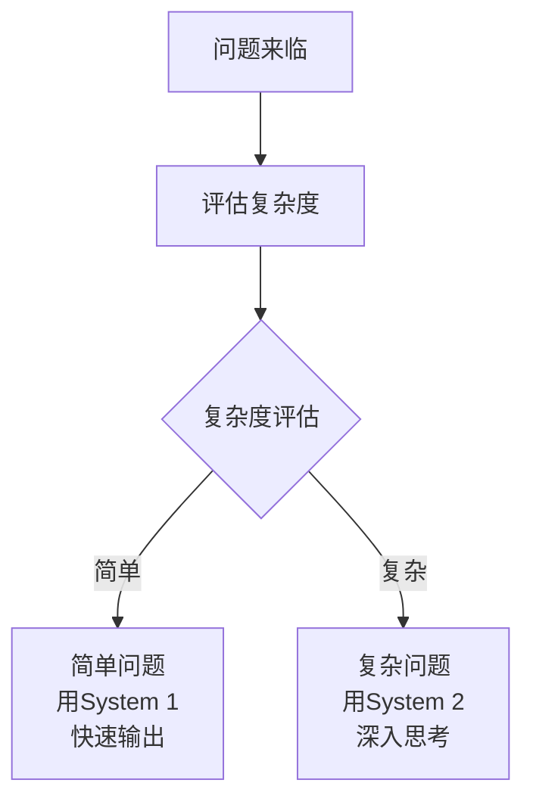

### 1.8 本节小结

- **System 1** 是快速、直觉的处理方式——适合日常交互
- **System 2** 是缓慢、深思的处理方式——适合复杂推理
- 传统 LLM 更像 System 1，而推理模型开始融合两者
- 理解这个区别是理解为什么 2024-2026 年会出现推理模型革命的关键

下一节，我们将深入看看推理模型具体是如何实现 System 2 能力的。

### 1.9 与其他章节的联系

📖 **延伸阅读**：
- 想了解传统大语言模型的工作原理？请参阅《第六章 大语言模型详解》和《第 6.2 大模型原理》
- 想了解推理模型如何实现 System 2？请参阅《第 7.2 推理模型的工作原理》
- 想了解不同 AI 模型的实际应用？请参阅《第十章 主流 AI 工具使用指南》

### 1.10 思考题

1. 在你日常使用 ChatGPT 或 Claude 的经历中，哪些问题需要 System 2 的思考？哪些可以用 System 1 快速解决？

2. 如果你是一名学生，你会用什么方式区分何时需要“让 AI 快速帮你”，何时需要“让 AI 深入思考后再回答”？

3. 人类有时候会犯 System 1 的错误（比如快速判断）。那么推理模型也可能犯 System 2 的“过度思考”错误吗？

## 2. 推理模型的工作原理

> 推理模型如何在“思考”过程中找到答案的技术解密

### 2.1 传统 LLM 的“快速预测”流程

为了理解推理模型的创新之处，我们先回顾一下传统 LLM 是如何工作的：

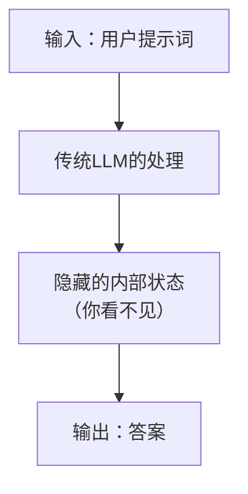

当你问 ChatGPT 一个问题时，模型在内部进行了很多计算，但你只能看到最终答案。就像一个黑盒子——输入进去，输出出来。

传统 LLM 的问题是：**它的思考过程完全隐藏**。如果答案错了，你无法看到推理路径哪里出了问题。

### 2.2 推理模型的“先思考后作答”流程

推理模型的核心创新，不是让模型的完整内部思考过程原样显示，而是 **在回答前投入更多推理计算**，并根据不同产品形态决定向用户展示的详细程度。有的产品只提供最终答案，有的提供思路摘要或步骤说明，有的展示部分中间验证过程。

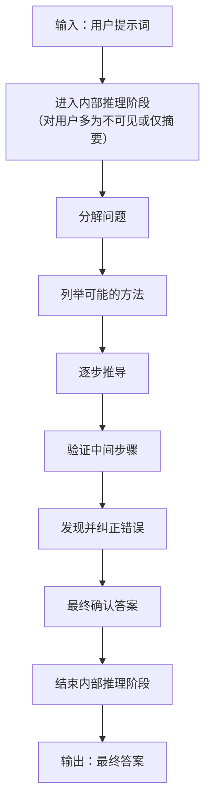

最关键的是：**不同厂商对“思考过程”的展示程度不同**。有的只给最终答案，有的会给简短摘要，有的会显示更丰富的过程性说明；但原始内部推理通常不会完整公开。

#### 具体例子：计算 23 × 47

**传统 LLM**
```text
用户：计算 23 × 47
LLM：答案是 1081
```

你不知道它是如何得出这个答案的。如果错了，你也不知道错在哪。

**推理模型（可能展示给用户的步骤摘要）**
```text
用户：计算 23 × 47

【步骤摘要】
我需要计算 23 × 47。让我分解一下：
23 × 47 = 23 × (40 + 7)
        = 23 × 40 + 23 × 7

23 × 40 = 920
23 × 7 = 161

920 + 161 = 1081

让我验证一下：
47 × 20 = 940
47 × 3 = 141
940 + 141 = 1081 ✓

【回答用户】
答案是 1081。

23 × 47 = 1081
```

在支持这类展示的产品里，你能看到的是**经过整理后的说明**，而不是未经处理的原始内部推理 token。

### 2.3 三个关键的技术创新

#### 1. 思考链的扩展

传统 LLM 已经支持“思维链”——让模型在输出答案前写下推理步骤。例如：

```text
问题：如果一个盒子里有红球和蓝球各50个，我随机取出10个红球，
      现在还剩多少个球？

传统思维链输出：
1. 初始总数：100个（50红+50蓝）
2. 取出10个红球
3. 剩余：100 - 10 = 90个球
```

但这个过程仍然可能出错。推理模型进一步扩展了思维链：

```text
推理模型的思维链输出：

[初始思考]
题目要求：计算剩余的球数。
已知条件：初始50红+50蓝，取出10红

[第一遍推导]
总球数：50 + 50 = 100
取出10红
剩余：100 - 10 = 90

[验证]
检查逻辑：是否理解正确了题意？
- "随机取出10个红球" → 只取红球，不取蓝球
- 所以蓝球数量不变：还是50个
- 红球数量变化：50 - 10 = 40个
- 总计：40 + 50 = 90个 ✓

[更仔细的验证]
让我想想有没有其他理解方式...
不，题意很清楚：只取了10个红球。

[最终答案]
90个球
```

推理模型不仅给出推理步骤，还会 **自我验证** 和 **自我纠正**。

#### 2. 推理计算

这是推理模型最重要的概念。在传统模型中：

```text
时间分配：
├─ 训练时（Training Time）：花费大量计算资源
│  └─ 学习如何解决问题
│
└─ 推理时（Inference Time）：用户提问时
   └─ 快速给出答案（计算资源很少）
```

但推理模型改变了这个比例：

```text
时间分配：
├─ 训练时：在基座之上还要**额外**做一轮“教它思考”的强化学习
│
└─ 推理时：现在分配大量计算资源！
   ├─ 思考（内部推理）：80% 的时间
   └─ 输出答案：20% 的时间
```

这听起来很浪费——为什么不提前思考好，而是在用户问问题时才思考呢？

**答案**：因为不同的问题需要不同深度的思考。

```text
┌─────────────────────────────────┐
│  推理计算的经济学               │
├─────────────────────────────────┤
│                                 │
│ 简单问题                        │
│ "法国的首都是什么？"           │
│ 需要思考时间：1秒              │
│                                 │
│ 中等难度问题                    │
│ "解释量子纠缠"                 │
│ 需要思考时间：10秒             │
│                                 │
│ 困难问题                        │
│ "设计一个分布式系统架构"       │
│ 需要思考时间：60秒             │
│                                 │
│ 极难问题                        │
│ "证明黎曼假设"                 │
│ 需要思考时间：可能需要数分钟   │
│                                 │
└─────────────────────────────────┘
```

推理模型可以 **动态调整** 每个问题的思考时间。简单问题快速回答，难题可以花更多时间思考。

#### 3. 多路径探索

这是一个有趣的能力。推理模型在思考过程中可以：

```text
问题：有一个问题有多种可能的解法

[思路A]
方法1：使用直接法...
这可能导致答案X

[思路B]
方法2：使用间接法...
这可能导致答案Y

[思路C]
方法3：使用对比法...
这可能导致答案Z

[综合分析]
让我检查哪个答案更合理：
- 答案X：符合条件吗？✓
- 答案Y：符合条件吗？✗（这里有矛盾）
- 答案Z：符合条件吗？✓

在X和Z之间，哪个更优雅或更高效？
...

[最终选择]
答案是Z
```

这就像一个聪明的学生在做一道题时的思考过程——尝试多种方法，然后选择最好的。

### 2.4 四大推理模型的工作原理对比

#### OpenAI o 系列与 GPT-5.x 路线

**核心机制**：强化学习优化

```text
训练流程：
1. 初始模型学习多种推理风格
2. 使用强化学习鼓励"正确的思考过程"
3. 奖励信号来自于：
   ├─ 最终答案是否正确
   ├─ 推理步骤是否合理
   └─ 思考效率（用最少步骤解决）
```

这条路线的关键特点是：o 系列验证了“推理优先”的产品方向，随后的 GPT-5.x 主线把这套推理能力并入了通用模型，不再单独维护一条推理专用产品线。具体型号与当前前沿状态见快变事实核验表。

OpenAI 推理路线的特点：
- 专门在 **数学、代码、科学问题** 上优化
- 思考过程相对“严谨”和“有逻辑”
- 成本较高（需要更多推理时间）

#### Claude Extended Thinking

**核心机制**：扩展的内部状态管理

```text
思考模式：
1. 初始化思考空间（类似一个"草稿纸"）
2. 逐步在这个空间中思考和修改
3. 允许"涂鸦"、"修改"、"回溯"
4. 最后整理成最终答案
```

Claude Extended Thinking 的特点：
- 思考过程更“自然”和“人性化”
- 善于处理 **开放性问题** 和 **写作任务**
- 在部分产品入口中，可以看到经过整理后的思考内容或摘要

#### DeepSeek-R1

**核心机制**：强化学习驱动的推理能力，外加蒸馏版小模型

```text
核心路线：
第1阶段：
└─ 基于 DeepSeek-V3-Base 构建推理底座

第2阶段：
└─ 通过冷启动数据和强化学习获得推理能力

补充路线：
└─ 再把能力蒸馏到更小的 Distill 模型中
  └─ 方便本地部署和社区使用
```

DeepSeek-R1 的特点：
- **成本极低**（相比 o1）
- 思考过程 **更快** 但不失质量
- 开源且 **可本地部署**

#### Google 的 Gemini Deep Research 模式

**核心机制**：多轮查询和信息整合

```text
研究流程：
1. 分解问题成多个子问题
2. 对每个子问题进行搜索和思考
3. 整合不同来源的信息
4. 建立问题的完整理解
5. 输出综合性答案
```

Gemini Deep Research 模式的特点：
- 特别擅长 **信息聚合** 和 **研究任务**
- 可以整合来自互联网的最新信息
- 思考过程更像“学术研究”

### 2.5 推理计算的成本与收益

这是使用推理模型时的关键考虑：

```text
┌─────────────────────────────────────┐
│ 推理模型的成本结构                   │
├─────────────────────────────────────┤
│                                     │
│ 计算成本（Token计费）               │
│ 思考token（按输出计费）             │
│    + 输出token（正常价格）          │
│    ──────────────────────          │
│    总成本 = 思考 + 输出            │
│                                     │
│ 一个"困难"问题可能需要：           │
│ • 思考token：8000个                │
│ • 输出token：200个                 │
│ • 总计：8200个token成本            │
│                                     │
│ 对比快速回答（无思考）              │
│ • 输出token：200个                 │
│                                     │
│ 额外成本：8000个思考token           │
│                                     │
└─────────────────────────────────────┘
```

**什么时候值得用推理模型？**

```text
✓ 值得用                          ✗ 不值得用
├─ 数学计算题                     ├─ 简单事实查询
├─ 编程调试                       ├─ 日常聊天
├─ 逻辑推理                       ├─ 文本摘要
├─ 策略规划                       ├─ 创意写作（初稿）
├─ 科学分析                       └─ 翻译任务
└─ 复杂问题分解
```

### 2.6 本节小结

- 推理模型通过 **更强的回答前推理** 改进了传统 LLM，部分产品还会提供思路摘要或过程性说明
- **推理计算** 允许在用户问问题时分配计算资源，而不仅仅在训练时
- 四条代表性路线（OpenAI、Claude、DeepSeek-R1、Gemini Deep Research 工作流）采用不同的技术方案
- 推理模型的成本更高，但在复杂问题上的准确率也高得多

### 2.7 思考题

1. 如果一个问题的答案很简单，推理模型仍然会进行长时间的思考吗？它会自动停止思考吗？

2. 推理模型可能“想太多”的情况是什么？过度思考会导致什么问题？

3. 如果你是一个学生，使用推理模型的 Claude 或 o1 来做数学作业，这算“作弊”吗？为什么？

## 3. 推理计算：新的 AI 范式

> 从固定参数到动态计算：为什么在推理时多花时间是件好事

### 3.1 问题：为什么我们一直只在乎“模型大小”？

在过去的十年，AI 发展遵循一个简单的规律：

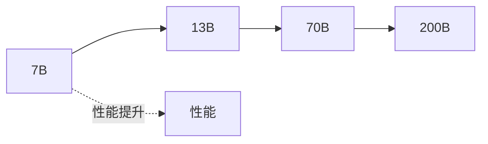

这就是所谓的“扩展法则”（Scaling Law）。为了让模型更聪明，研究人员就训练更大的模型。

**但是**，2024 年开始，一个新的想法出现了：

> 与其训练一个超级大的模型，不如让一个足够大的模型花更多时间思考问题。

这就是推理计算的核心思想。

### 3.2 一个生活类比：考试的两种方式

想象一下两个学生在备考：

### 学生 A：死记硬背所有内容（传统方法）

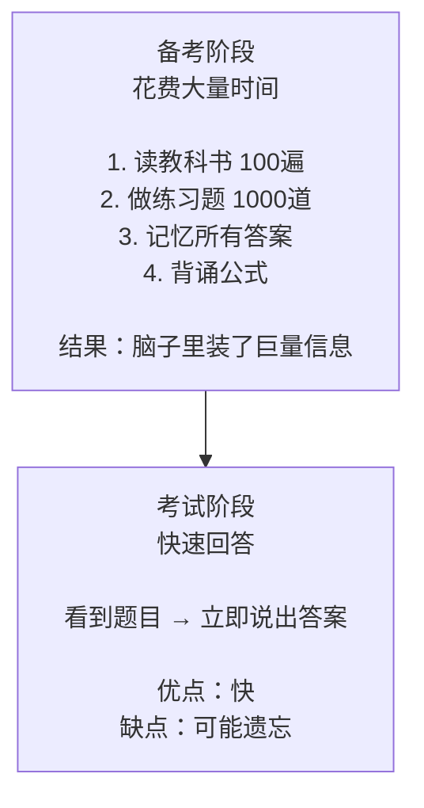

### 学生 B：掌握原理，考试时推导（推理计算方法）

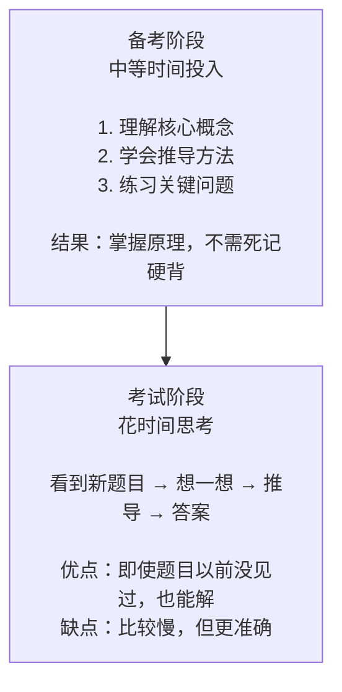

学生 A 代表传统 LLM，学生 B 代表推理模型。

### 3.3 推理计算的三个维度

### 1. 计算在何时分配

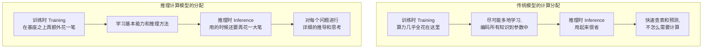

这是一个 **范式转变**。

### 2. 计算的深度

不同问题需要不同的计算深度：

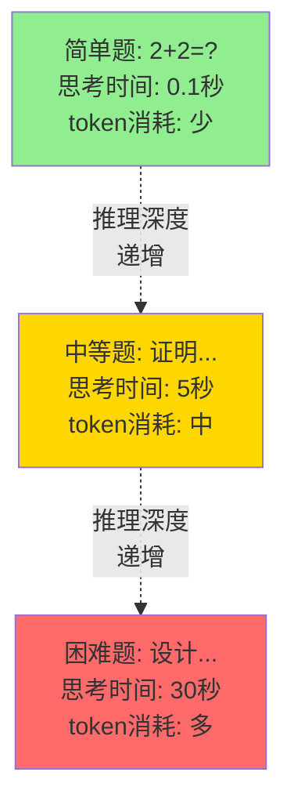

### 3. 计算的方式

推理模型在推理时进行的计算包括：

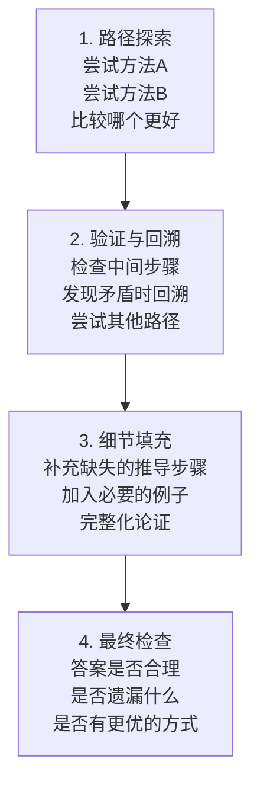

### 3.4 推理计算的经济学

### 成本-效益分析

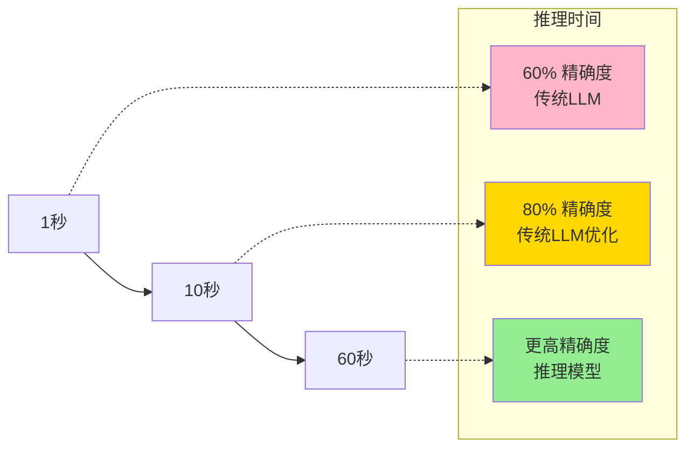

### 什么时候推理计算是值得的？

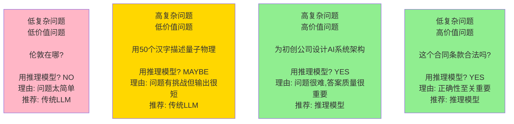

### 3.5 推理计算的天花板

虽然推理计算很强大，但也有局限：

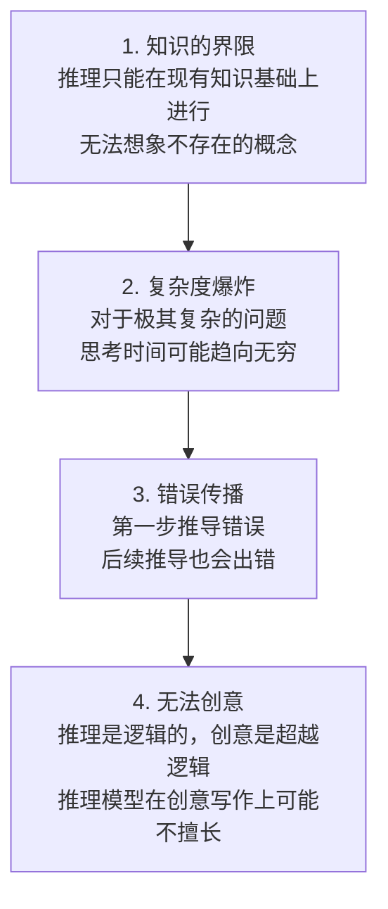

### 3.6 推理计算 vs. 参数扩展

现在 AI 界有一个重要的讨论：

> 未来应该继续训练更大的模型，还是让现有模型花更多时间思考？

```text
两条发展路线：

路线A：参数扩展（Scaling Parameters）
模型参数：70B → 300B → 1T
训练成本：持续增加
部署成本：巨大（需要大显卡集群）
推理速度：快
适合：需要快速响应的场景

     vs

路线B：推理计算扩展（Scaling Compute）
模型参数：固定（70B或100B）
训练成本：相对稳定
部署成本：可控（普通显卡也能跑）
推理速度：较慢但更准确
适合：对准确性要求高的场景
```

目前的共识是：**两条路线同时推进**

- **快速应用场景**：用传统的参数扩展（更大的模型）
- **精确应用场景**：用推理计算扩展（推理时间更长）

### 3.7 本节小结

推理计算是 AI 发展的新范式：
- 从“训练时的大量投入 + 推理时的快速查表”转变
- 到“训练时学习基础方法 + 推理时深入思考”

这意味着：
- 推理时间变得和准确度一样重要
- 用户需要在“快速”和“准确”之间做选择
- 成本结构发生了变化（更多 token 消耗在思考上）

### 3.8 思考题

1. 在你的日常工作中，有哪些任务可以受益于推理计算？哪些任务不需要？

2. 如果推理模型在推理时要消耗 10 倍的 token，这会如何改变 AI 的商业模式？

3. 未来是否会出现“推理时间太长”反而成为劣势的场景？什么时候？

## 4. 主流推理模型深度对比

> OpenAI 推理路线、Claude 的扩展思考、DeepSeek-R1，以及 Gemini 的 Deep Research 工作流：各有绝技

模型与 thinking 支持矩阵会变化；本节的版本性描述以快变事实核验表及其官方来源为准。

### 4.1 四条代表性推理路线的风景线

2024-2026 年，四条主要的推理/研究路线各自占据了一席之地。让我们从初学者的角度看看它们的区别：

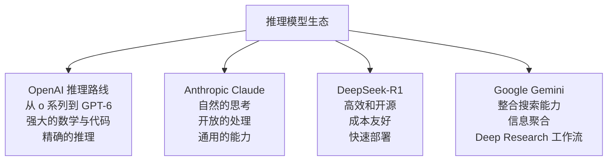

### 4.1.1 OpenAI 推理路线：从 o 系列到 GPT-6

#### 特点速览

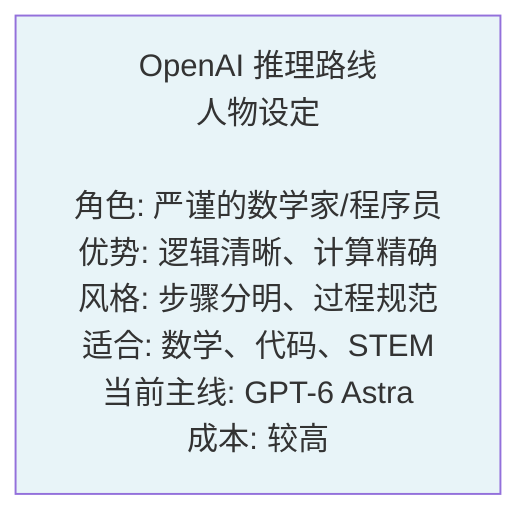

#### 工作原理

OpenAI 的 o 系列率先把 **强化学习** 推到了推理产品线上——从 o1（2024-12）到 o3-mini（2025-01）、o3（2025-04）、o4-mini（2025-04-16，已于 2026-02 退役），推理能力逐步增强。与此同时，OpenAI 主线模型从 GPT-4 演进到 GPT-5（2025-08）及其迭代版本（GPT-5.5 于 2026-04-23 发布，2026-07-09 起 GPT-5.6 系列接替前沿位置，2026-09-03 又由 GPT-6 Astra 接替）：

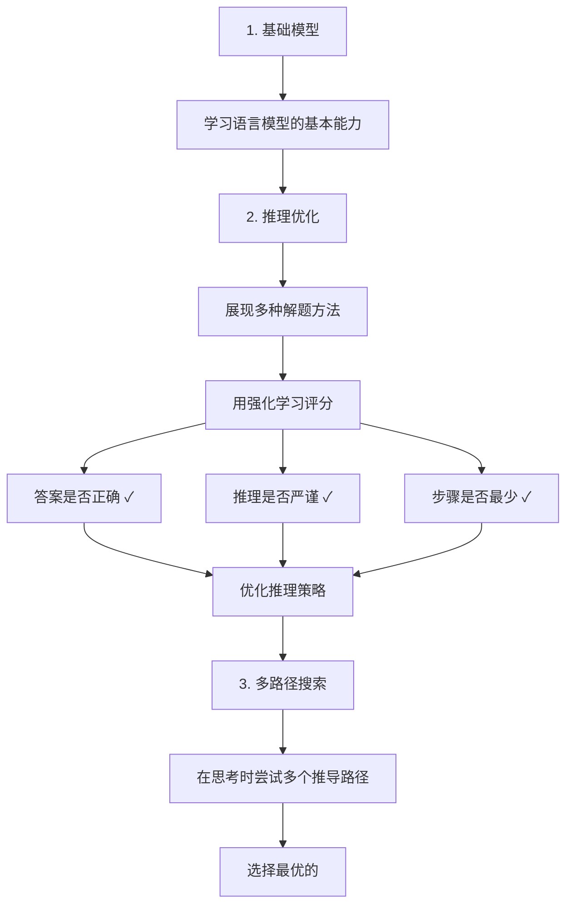

#### 具体例子：数学题

**题目**：求解方程 x² - 5x + 6 = 0

```text
面向用户可见的“推理摘要”通常更接近下面这种形式：

问题识别：
- 这是一个标准二次方程

候选方法：
- 因式分解
- 配方法
- 求根公式

比较结果：
- 三种方法都能得到一致答案
- 因式分解最直接

最终结论：
- x = 2 或 x = 3
```

注意：OpenAI 的公开产品和 API 通常不会直接暴露**原始推理 tokens**；你更常见到的是经过整理后的摘要、步骤说明或最终答案。

#### 何时选择 OpenAI 推理路线

```text
✓ 适合场景
├─ 复杂数学问题
├─ 算法设计
├─ 物理/化学计算
├─ 代码调试
└─ 正式推导

✗ 不适合场景
├─ 创意写作
├─ 一般对话
├─ 快速查询
└─ 开放性讨论
```

### 4.1.2 Anthropic Claude Extended Thinking：富有同情心的思想家

#### 特点速览

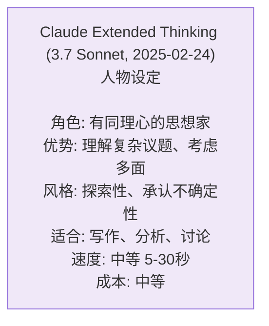

#### 工作原理

Claude 的 Extended Thinking 采用的是 **内部状态管理**：

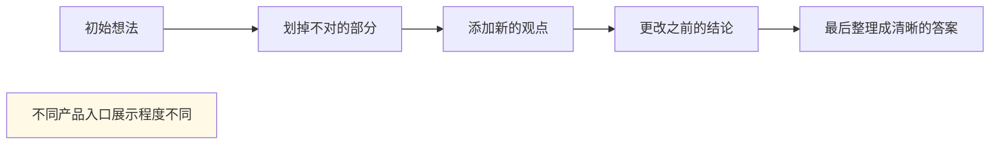

#### 具体例子：开放性问题

**题目**：在家工作的利弊是什么？

```text
在部分 Claude 产品入口中，用户可能看到更丰富的过程性说明。一个更稳妥的教学示例如下：

【过程性说明】
- 先分别梳理效率、通勤、工作生活边界、社交和协作成本
- 再补充“个人性格”和“工作性质”两个影响变量
- 最后整理成平衡分析

【答案】
在家工作的优点包括灵活性和省时间，但也面临隔离感和工作-生活边界模糊的挑战。最终的效果取决于你的工作类型和个人性格。
```

#### 何时选择 Claude Extended Thinking

```text
✓ 适合场景
├─ 写作和编辑
├─ 复杂议题分析
├─ 开放性讨论
├─ 批评性思考
├─ 伦理两难问题
└─ 内容策划

✗ 不适合场景
├─ 快速计算
├─ 正式数学证明
├─ 标准化测试
└─ 简单事实查询
```

> 💡 **演进提示**：Extended Thinking 是 Claude 推理能力的一条早期产品路线。当前官方比较表中，Claude Fable 5.1 与 Claude Opus 5.5 的 Adaptive Thinking 常开；**Claude Sonnet 5.5** 使用 Adaptive Thinking；Claude Haiku 4.5 使用 Extended Thinking。Fable 5.1 面向广泛用户，Mythos 5.1 为受限可用。不要把旧型号的开关或预算参数直接套到新型号；使用前查看快变事实核验表。

### 4.1.3 DeepSeek-R1：经济高效的工程师

#### 特点速览

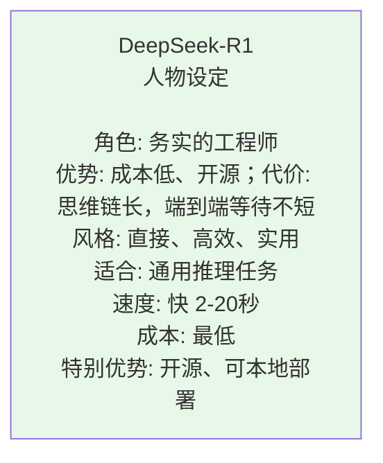

#### 工作原理

DeepSeek-R1（2025-01-20 发布）的核心路线是先在大模型上通过 **冷启动数据 + 强化学习** 获得推理能力，再额外发布若干**蒸馏版小模型**给社区使用：

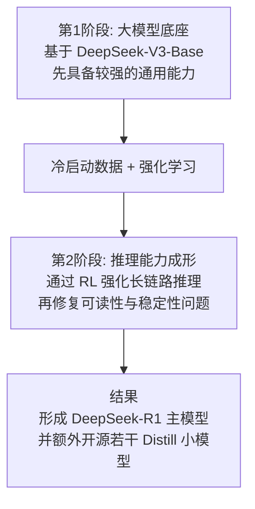

#### 成本对比

```text
推理任务的成本不要死记“每题多少钱”，因为它会被三件事强烈影响：

1. 厂商当前的 token 单价是否调整
2. 你是否命中了缓存
3. 这个问题实际消耗了多少推理 token

以 DeepSeek 为例，官方 API 当前是按百万 token 计价，而不是按“每道难题固定几美元”计价；并且 `deepseek-chat` / `deepseek-reasoner` 这对旧模型名已于 2026-07-24 退役，官方 API 现在改为按模型名（如 `deepseek-flash`）加思考模式开关提供推理能力，而不是把论文里的 R1 主模型价格直接写死成一个数字。
```

#### 何时选择 DeepSeek-R1

```text
✓ 特别适合
├─ 预算有限的团队
├─ 需要本地部署
├─ 需要可定制化
├─ 高频调用的应用
├─ 对延迟不太敏感
└─ 开源爱好者

✗ 不太适合
├─ 对生成速度要求极高
├─ 需要最前沿的性能
└─ 企业级支持需求
```

### 4.1.4 Google Gemini 的 Deep Research 模式：知识的聚合家

#### 特点速览

```mermaid
graph LR
    A["Gemini + Deep Research<br/>人物设定<br/><br/>角色: 学术研究员<br/>优势: 信息聚合、多源综合<br/>风格: 学术严谨、引用完整<br/>适合: 研究性任务、信息查询<br/>速度: 较慢 30-180秒<br/>特点: 借助 Gemini 模型进行研究工作流"]
    style A fill:#F8F0E8
```

#### 工作原理

这里要特别区分：**Gemini 是模型家族，Deep Research 是建立在 Gemini 之上的研究工作流/功能模式**。它的工作方式不同于前三者：

```mermaid
graph TD
    A["1. 理解问题<br/>分解成多个子问题"]
    B["2. 搜索阶段<br/>对每个子问题进行网络搜索<br/>收集来自多个来源的信息<br/>评估信息的可靠性"]
    C["3. 整合阶段<br/>比较不同来源的观点<br/>识别共识和分歧<br/>建立综合理解"]
    D["4. 输出阶段<br/>撰写结构化报告<br/>包含引用和来源<br/>清晰地标注不同观点"]

    A --> B --> C --> D
```

#### 具体例子：研究问题

**题目**：2026 年 AI 芯片行业的最新进展是什么？

```text
Gemini Deep Research 模式的处理方式：

[搜索分解]
子问题1：主要的AI芯片制造商在2026年推出了什么？
子问题2：这些芯片的性能提升是什么？
子问题3：价格和可用性如何变化？
子问题4：对AI产业有什么影响？

[搜索执行]
→ 搜索NVIDIA、AMD、Intel最新新闻
→ 搜索AI芯片性能基准测试
→ 搜索行业分析报告
→ 搜索学术论文

[信息整合]
根据搜索结果，综合出当前的芯片景观...
对比来自不同来源的观点...
识别核心趋势...

[输出]
完整的研究报告，包括：
- 执行摘要
- 主要发现
- 数据支撑
- 引用清单
- 我的分析限制（什么信息不确定）
```

#### 何时选择 Gemini 的 Deep Research 模式

```text
✓ 特别适合
├─ 需要最新信息的研究
├─ 需要多来源验证
├─ 学术或专业写作
├─ 行业趋势分析
├─ 政策研究
└─ 综合性报告撰写

✗ 不太适合
├─ 需要快速回答
├─ 隐私敏感的问题（会搜索）
├─ 本地离线使用
└─ 涉及专有信息
```

### 4.2 快速选择指南

```text
┌─────────────────────────────────────┐
│ 我应该用哪个推理模型？             │
├─────────────────────────────────────┤
│                                     │
│ 问题类型          首选        备选  │
│ ─────────────────────────────────  │
│ 数学/代码        GPT-6      R1      │
│ 写作/创意        Claude     GPT-6   │
│ 信息研究         Gemini（Deep Research） Claude  │
│ 日常聊天         R1         Claude  │
│ 部署受限         R1(本地)   无      │
│ 预算有限         R1         无      │
│                                     │
└─────────────────────────────────────┘
```

### 4.3 四大模型的评测对比

```text
各维度对比（满分5分，基于各平台公开基准与社区实测，仅供参考）：

                 OpenAI   Claude  DeepSeek  Gemini（研究模式）
数学推理能力         5      4       4.5       3
代码生成质量         5      4.5     4.5       3
写作自然度           4      5       4         4
信息聚合能力         2      3       2         5
成本效率             1      2       5         3
部署灵活性           1      1       5         2
推理速度             2      3       4         2
通用性               4      5       4         4

注：跨厂商评分存在多重变量影响（评测版本、提示词设置、采样方法等），
仅反映当前大致印象，非严格的科学评判，不宜作为最终采购依据。
```

### 4.4 本节小结

四条主流推理路线各有所长：

- **OpenAI 推理路线（当前首推 GPT-6 Astra、GPT-6.1 Sol 与 GPT-6 Luna，GPT-5.6 系列与 GPT-5.5 仍可用）**：逻辑和计算能力强，适合复杂专业任务
- **Claude thinking 路线（当前包含 Claude Fable 5.1、Opus 5.5、Claude Sonnet 5.5 与 Haiku 4.5）**：不同型号使用 Adaptive 或 Extended Thinking，适合按能力、速度和成本选择
- **DeepSeek-R1**：最经济的选择，可本地部署
- **Gemini + Deep Research 模式**：擅长多来源检索、信息整合与研究型输出

**选择的原则**：
1. 优先看 **问题类型**
2. 其次考虑 **成本约束**
3. 最后看 **部署环境**

### 4.5 思考题

1. 如果你是一个初创公司，只有有限的 API 预算，你会选择哪个推理模型？为什么？

2. DeepSeek-R1 的成本优势会如何改变 AI 应用的商业模式？

3. 五年后，这四个推理模型中哪个可能会“消亡”或被新模型取代？为什么？

## 5. 推理模型的局限与成本

> 没有完美的模型：理解推理模型为什么不是万能的

### 5.1 现实检查：推理模型不是解决所有问题的良药

在深入了解了推理模型的强大能力之后，是时候诚实地面对它们的局限了。

```mermaid
graph LR
    subgraph Promise["承诺"]
        P1["推理更深入"]
        P2["答案更准确"]
        P3["过程可解释"]
    end

    subgraph Reality["现实"]
        R1["但时间和成本显著增加"]
        R2["但在某些领域仍然会出错"]
        R3["但有时思考过程本身很困惑"]
    end

    P1 -.-> R1
    P2 -.-> R2
    P3 -.-> R3
```

### 5.2 局限 1：时间成本

### 5.2.1 推理需要时间，而时间就是金钱

```text
推理时间分布：

简单问题（"巴黎在哪？"）
时间：1-2秒
用户体验：✓ 可以接受

中等问题（"解释量子纠缠"）
时间：10-15秒
用户体验：△ 有点长，但还能接受

复杂问题（"设计分布式系统"）
时间：30-60秒
用户体验：✗ 很长，用户可能会不耐烦

极难问题（"证明新的数学定理"）
时间：可能数分钟
用户体验：✗✗ 不现实，用户会离开
```

### 5.2.2 实际例子

你在使用 Claude 的 Extended Thinking 处理一个复杂的合同分析：

```text
等待中..............................（30秒）
Claude正在思考您的问题...

实际发生的情况：
0-5秒：理解问题
5-15秒：搜索相关条款
15-25秒：分析法律含义
25-30秒：综合结论

用户的感觉：
"为什么这么慢？我的网络有问题吗？"
"我可能应该用别的工具..."
"还没好吗？算了，我先做别的..."
```

### 5.2.3 何时时间成本不可接受

```text
✗ 不适合的场景

1. 实时交互
   └─ 聊天界面、客服系统
   └─ 用户期望：<2秒回应

2. 高频调用
   └─ 处理大量请求的API
   └─ 每个请求等待30秒 = 极大延迟

3. 移动应用
   └─ 电池消耗、网络可靠性
   └─ 长等待时间 = 糟糕的UX

4. 流式需求
   └─ 需要显示进度条
   └─ 思考阶段不能流式输出
```

### 5.3 局限 2：知识的边界

### 5.3.1 推理不能创造知识，只能组织知识

这是最根本的限制：

```mermaid
graph TD
    A["推理的本质<br/><br/>推理 = 已知信息的组合和推导<br/><br/>推理 ≠ 创造全新知识"]

    B["✓ 推理能做<br/>从A=B和B=C推出A=C<br/>从已知的物理定律推导新现象<br/>从既有的代码模式推断最佳实践"]

    C["✗ 推理做不了<br/>创造全新的物理定律<br/>发明从未听说过的编程范式<br/>想象人类从未想过的艺术风格"]

    A --> B
    A --> C

    style B fill:#90EE90
    style C fill:#FFB6C6
```

### 5.3.2 知识缺口的问题

```text
情景1：推理模型被问到过时信息

问：2024年GPT-4的最新性能如何？
推理模型的思考：
"我的训练数据只到2024年4月...
现在是2026年...
我无法知道最新的性能数据...
我只能基于旧数据推断...
这可能会给出错误的答案"

结果：
虽然推理过程逻辑清晰
但答案仍可能不准确（因为基础信息过时）
```

### 5.3.3 幻觉仍然存在

即使是推理模型，也可能出现幻觉：

```text
幻觉的两种形式：

形式1：基础事实幻觉
推理基础本身就错了
即使推理逻辑正确，结论也是错的

例子：
[思考]
据我所知，法国首都是伦敦
伦敦在英国
所以法国的首都在英国
等等...这不对...
[输出]
法国的首都是伦敦
（虽然推理过程逻辑清晰，但基础事实错误）

形式2：推理创造
推理过程中"凭空创造"了不存在的信息

例子：
"这个Python库提供了XYZ功能"
（实际上这个库从没有这个功能）
```

### 5.4 局限 3：推理可能过度或低效

### 5.4.1 “想太多”的危险

推理模型有时会陷入循环：

```text
问题：1+1等于多少？

合理的推理：
1+1 = 2 ✓

过度推理：
[思考]
1表示什么？
1是一个整数
1等于0.9999... 吗？
1是否依赖于计数系统？
在不同的进制中...
在虚数域中...
从集合论的角度...
从范畴论的角度...

[10分钟后]
经过全面分析...
[输出]
在标准十进制整数系统中，1+1=2

用户反应：
"我只是想要一个简单的答案..."
```

### 5.4.2 计算成本的爆炸

```mermaid
graph TD
    A["浅度推理<br/>成本: 低<br/>但可能错误"]

    B["中度推理<br/>成本: 中<br/>通常足够准确"]

    C["深度推理<br/>成本: 高<br/>质量高但浪费"]

    D["边际效应递减<br/>第一个30秒: 提升50%准确度<br/>第二个30秒: 只提升10%准确度<br/>第三个30秒: 只提升2%准确度"]

    A -.->|成本增加| B
    B -.->|成本增加| C
    C -.-> D

    style A fill:#FFB6C6
    style B fill:#FFD700
    style C fill:#FF6B6B
    style D fill:#FFE4E1
```

### 5.5 局限 4：无法处理某些类型的任务

### 5.5.1 创意和发散思维

推理模型在严格的逻辑问题上很强，但在需要创意的任务上可能不如快速模型：

```mermaid
graph LR
    A["逻辑推理<br/>推理模型 > 快速模型<br/>例: 解决复杂问题"]

    B["创意写作<br/>快速模型 ≥ 推理模型<br/>例: 写小说、诗歌"]

    C["头脑风暴<br/>快速模型 > 推理模型<br/>例: 想新创意、新产品"]

    D["实用建议<br/>两者相当<br/>例: 项目建议"]

    style A fill:#90EE90
    style B fill:#FFB6C6
    style C fill:#FFB6C6
    style D fill:#FFD700
```

### 5.5.2 语调和风格

推理过程中，模型可能更关注“正确”而不是“优雅”：

```text
问题：用两句话形容一下春天

快速模型的答案（富有诗意）：
春天是大地的苏醒，
万物竞相展现绿色的欢歌。

推理模型的答案（严谨但生硬）：
春天是四季中温度升高、降水增加的季节。
此时植物恢复生长，动物苏醒，光照时间延长。

哪个更好？
取决于用途！
```

### 5.6 局限 5：成本结构的问题

### 5.6.1 Token 成本的上升

```text
成本对比（处理一个困难问题）

传统LLM：
→ 输出token：300个
→ 成本：$0.015（很便宜）

推理模型：
→ 思考token：8000个
→ 输出token：300个
→ 总成本：$0.50（30倍！）

大规模应用的后果：

日处理1000个询问的应用

传统LLM：
1000 × $0.015 = $15/天

推理模型：
1000 × $0.50 = $500/天

年成本：
传统：$5,475
推理：$182,500

差别巨大！
```

### 5.6.2 企业预算的限制

```text
成本与选择的关系：

初创企业（预算：$1000/月）
└─ 能处理：2000个推理查询/月
└─ 意味着：60个/天

大企业（预算：$100000/月）
└─ 能处理：200000个推理查询/月
└─ 意味着：6600个/天

小企业无法像大企业一样频繁使用推理模型
```

### 5.7 实际问题：何时推理模型不是最佳选择？

```text
场景1：客服聊天机器人
为什么不用推理模型：
✗ 30秒延迟无法接受
✗ 高并发会导致成本爆炸
✓ 快速模型 + 检索增强足够了

场景2：内容创意工作
为什么不用推理模型：
✗ 创意不需要长时间思考
✗ 反而可能"想死"想出不来
✓ 快速模型更灵活、成本低

场景3：代码补全
为什么不用推理模型：
✗ IDE中等待10秒无法接受
✗ 大多数代码补全很直接
✓ 快速模型就足够，只在调试时用推理

场景4：学生作业
为什么应该用推理模型：
✓ 准确性至关重要
✓ 时间约束不是实时的
✓ 看思考过程能帮助学习
✓ 相对低频使用
```

### 5.8 推理模型的最佳实践

既然推理模型有局限，那么如何最大化其价值？

```text
最佳实践清单：

1. 选对问题类型
   ├─ 只用于：复杂、高价值、逻辑密集
   └─ 避免：简单、低价值、创意类

2. 设置合理的期望
   ├─ 预期：思考时间会很长
   ├─ 预期：成本会显著增加
   └─ 不预期：完美答案、实时反应

3. 混合使用模型
   ├─ 简单问题 → 快速模型
   ├─ 复杂问题 → 推理模型
   └─ 混合 → 两者配合

4. 监控和验证
   ├─ 检查思考过程
   ├─ 验证基础事实
   └─ 不要盲目信任

5. 成本管理
   ├─ 设置配额
   ├─ 定期审计使用
   └─ 考虑本地部署（如DeepSeek）
```

### 5.9 未来的改进方向

推理模型虽然有局限，但这些局限正在被逐步解决：

```text
问题              正在进行的改进

时间成本    → 更高效的推理算法
            → 更聪明的早停策略

知识过时    → 推理模型+实时搜索
            → 动态知识库整合

幻觉问题    → 更好的事实验证
            → 与检索系统集成

创意不足    → 混合系统架构
            → System 1+System 2融合

成本高昂    → 模型压缩和蒸馏
            → 开源模型竞争
```

### 5.10 本节小结

推理模型很强大，但也有明确的边界：

- **时间成本**：30 秒的思考对实时应用来说太长
- **知识局限**：推理不能创造新知识
- **过度思考**：有时候想太多反而浪费资源
- **任务局限**：不适合创意和发散任务
- **经济成本**：大规模使用成本极高

**关键洞察**：
最优的 AI 系统不是“永远用推理模型”，而是“在合适的时候用推理模型”。

这就像你做工作一样——有些任务快速处理就行，有些任务需要深入思考。聪明人知道什么时候该快，什么时候该慢。

### 5.11 思考题

1. 如果推理模型的成本能降低到与快速模型相同，是否所有任务都应该用推理？为什么或为什么不？

2. 推理模型可能在什么情况下会给出“逻辑上完美但事实上错误”的答案？

3. 如果一个推理模型用 50 秒思考一个问题，最终答案仍然是错的，这反映了什么问题？
