# 第八章 新架构与创新案例

> 从 Transformer 的天花板到 SSM 混合架构，再到 DeepSeek 的低成本奇迹

---

Transformer 架构统治了 AI 世界近十年，但它并非完美——二次复杂度（O(N²)）让处理超长文本变得极其昂贵。2024 年起，状态空间模型（SSM）和混合架构（Mamba、Jamba）开始挑战这一格局。

与此同时，DeepSeek 披露其一次代表性训练运行的成本约 560 万美元（注意这是单次运行，不等于全部研发投入），证明了架构创新和工程效率可以击败规模堆叠。

本章将这两条技术线索合为一体：先理解“为什么需要新架构”，再看“新架构如何在实践中大放异彩”。

## 1. 问题的根源：Transformer 的二次复杂度

> 为什么“所有的大模型都用 Transformer”这句话不再完全正确

### 1.1 Transformer 曾经是完美的

2017 年“Attention is All You Need”论文发表时，Transformer 看起来是一个优雅的解决方案。相比之前的 RNN（递归神经网络），它有一个关键优势：

```text
RNN的问题：
序列处理 → 一个token一个token处理
           └─ 必须等待前面的token处理完
           └─ 无法并行化

Transformer的优势：
注意力机制 → 所有token可以同时看到彼此
             └─ 可以并行处理
             └─ 训练速度大幅提升
```

这就是为什么 Transformer 能够支撑更大的模型规模。更大的模型需要更快的训练，而 Transformer 的并行性正好满足这个需求。

### 1.2 问题显露：二次复杂度

虽然 Transformer 很强大，但它有一个隐藏的数学问题，只有在处理非常长的序列时才会显现：

### 1.2.1 什么是二次复杂度？

```text
Transformer的注意力机制工作方式：

对于每一个token，它需要：
1. 计算这个token与所有其他token的相似度
2. 这涉及一个名为"注意力矩阵"的计算

如果序列中有N个token：
- 注意力矩阵大小：N × N
- 计算复杂度：O(N²)

例子：
100 token → 100×100 = 10,000 单位计算
1,000 token → 1,000×1,000 = 1,000,000 单位计算
10,000 token → 10,000×10,000 = 100,000,000 单位计算

看到问题了吗？随着序列长度增加，计算量以平方增长！
```

### 1.2.2 用生活中的例子理解

想象一个会议：

```text
场景1：5个人的会议
- 每个人需要听其他4个人说话
- 如果建一个“谁关注谁”的矩阵：5×5 = 25 个格子
- 如果不算自己关注自己：5×4 = 20 次有方向的互动
- 管理起来还可以

场景2：100个人的会议
- 每个人需要听其他99个人说话
- 注意力矩阵：100×100 = 10,000 个格子
- 开始变得很混乱

场景3：1,000,000个人的"会议"
- 注意力矩阵：1,000,000×1,000,000 个格子
- 完全不可能！

这就是Transformer处理长文本时的情况。
```

### 1.3 影响：为什么这很重要？

### 1.3.1 速度的代价

```text
处理不同长度文本的时间：

长度        处理时间      成本（相对）
─────────────────────────────
2K token    0.5秒        $0.01
4K token    1秒          $0.04
8K token    2秒          $0.16
16K token   4秒          $0.64
100K token  25秒         $25
200K token  50秒         $100
```

看到趋势了吗？处理长文本的成本增长非常快。

### 1.3.2 内存的代价

显存这一侧则要分开看。**计算量**随长度平方增长，所以长文本又慢又贵；但**显存**的大头并不是那张 N×N 的注意力矩阵——现代实现会分块计算、不把它整个写进显存。真正占显存的是 **KV Cache**（模型为已经读过的每个 token 保存的“记忆”），它随长度**线性**增长。

本书 6.6.2 有一整节讲 KV Cache 为什么是「吞噬显存的怪兽」，8.6 讲的 MLA 也正是冲着压缩它去的。

这就是为什么百万 token 的窗口在今天能跑起来，但依然很贵——贵在平方增长的**算力**，以及线性增长却基数很大的 **KV Cache**。

### 1.4 真实的影响：哪些应用受限？

### 1.4.1 受影响的应用场景

```text
✗ Transformer无法很好处理的任务：

1. 长文档处理
   - 处理整本书（几百万字）
   - 处理完整的法律文件库
   - 原因：成本和内存都会爆炸

2. 持久的对话记忆
   - 保留完整的对话历史（几千条消息）
   - 在一个关键字段中应用集合知识
   - 原因：历史消息越多，处理越慢

3. 实时信息流处理
   - 实时监控日志或数据流
   - 持续分析数据而不丢失历史
   - 原因：流的长度不断增加

4. 多文档分析
   - 同时分析多个长文档
   - 比较和综合大量资料
   - 原因：总序列长度会非常长

✓ Transformer仍然很擅长的任务：
├─ 一般的对话
├─ 代码生成（通常不需要超长上下文）
├─ 摘要和翻译
└─ 大多数日常任务
```

### 1.5 行业的应对方式

### 1.5.1 现有的解决方案（不太完美）

为了解决这个问题，行业采取了一些变通方案：

```text
方案1：上下文窗口扩展
做法：用更复杂的工程技巧，支持更长的序列
成本：仍然是二次复杂度，只是常数更大
效果：只是延后了问题，没有根本解决

例如：
- Claude Opus 5.5 的 1M token 窗口
- GPT-5.5 的 1M token 窗口
- 这些仍然很昂贵，而且有上限

方案2：检索增强生成（RAG）
做法：不是把所有文本都给模型，而是只检索相关部分
成本：降低了Transformer需要处理的序列长度
效果：有用，但不够灵活

方案3：信息压缩
做法：把长文本先压缩成摘要，再给模型
成本：损失信息，可能遗漏重要细节
效果：是权衡，但不完美
```

### 1.6 新的解决方案：状态空间模型

### 1.6.1 核心思想

这就是为什么一个新的想法变得引人注目：

> **与其扩展注意力机制，不如放弃它，用完全不同的方法。**

这个新方法就是 **状态空间模型**（State Space Models，SSM）。

```text
Transformer vs SSM：

Transformer：
复杂度：O(N²)
内存：O(N²)
特点：每个token都与所有其他token互动
问题：长序列时爆炸

SSM：
复杂度：O(N)  ← 线性！
内存：O(N)    ← 线性！
特点：维护一个"状态"，处理每个token时更新
优点：长序列也可以处理
```

### 1.6.2 简单类比：记忆的方式

想象两个人在看一部电影：

```text
Transformer的方式：
观看者必须记住电影中的每一帧，
然后计算每一帧与所有其他帧的关系。
看100分钟的电影 = 144,000帧 × 144,000帧的比较
= 完全不可能！

SSM的方式：
观看者只需要维护对"当前故事状态"的理解。
看到新的一幕时，更新理解。
看完了，就有了完整的故事理解。
随着电影长度增加，需要的处理量线性增加。
```

### 1.7 本节小结

Transformer 的二次复杂度是其根本的数学限制：
- 处理长序列时，时间和内存成平方增长
- 这限制了许多实际应用
- 为了解决这个问题，新的架构（SSM）被开发出来

这不是说 Transformer“坏”——它在当前的任务上仍然很好。而是说它不是所有问题的最优解。

就像飞机适合跨城长途，却不适合小区到地铁站的短途。SSM 不是更高级的“万能交通工具”，而是针对长序列处理换了一种取舍。

### 1.8 思考题

1. 如果你要处理一部 100 万字的小说，用 Transformer 和 SSM 分别需要多少计算资源？

2. 二次复杂度是 Transformer 的根本性问题吗？还是可以通过工程优化来解决？

3. 如果 SSM 没有注意力机制，它是如何理解上下文的？（这是我们在下一节要回答的问题）

## 2. 状态空间模型入门

> 用自来水管的类比理解 SSM 如何替代注意力机制

### 2.1 什么是状态空间模型？

首先，别被名字吓住。“状态空间模型”听起来很复杂，但核心思想其实很简单：

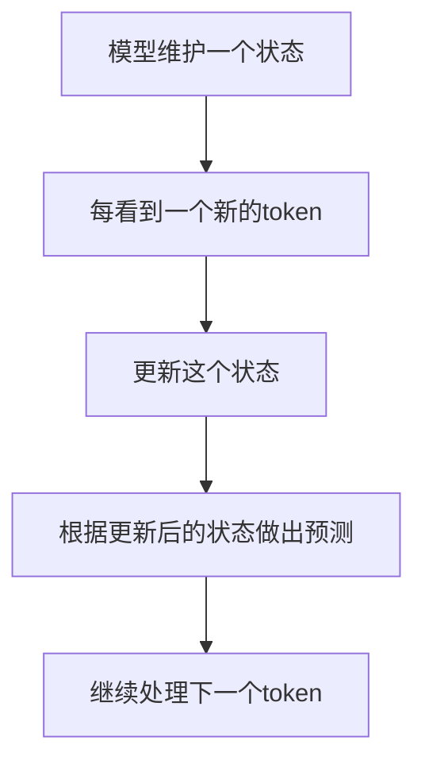

这就是全部。没有注意力，没有复杂的矩阵乘法。只是不断更新一个状态。

### 2.2 类比 1：自来水管

想象一个自来水管系统：

```text
传统的"注意力"管道：
所有的水龙头都连接到一个中央枢纽
每个水龙头都需要与所有其他水龙头通信
水龙头数量增加 → 中央枢纽变得极其复杂

缺点：如果有100个水龙头，需要100×100的连接点！

─────────────────────────────────────

SSM管道：
水从上游流下来 → 通过一系列的管道 → 流向下游
每个节点只需要：
  • 接收来自上游的水
  • 向其中加入一点"处理"
  • 把结果传给下游

优点：无论有多少个节点，都是线性的连接！
```

### 用管道类比 SSM 如何工作

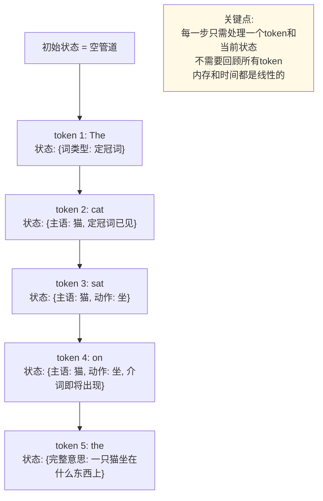

### 2.3 类比 2：河流与河床

```text
Transformer的注意力机制：
所有的水分子都需要互相比较权重
你有1000个水分子 → 需要比较1,000,000次

SSM的方式：
水流沿着河道向下
河床（状态）被水流塑造和改变
新的水分子到来时，河床给予它"方向"

关键：河床记住了"历史"，但不需要逐个比较每一滴水
```

### 2.4 与本章其他部分的关系

📖 **相关内容**：
- 本章第 8.1 节介绍了为什么我们需要超越 Transformer
- 本章第 8.3 节展示了如何将 SSM 与 Transformer 混合使用
- 本章第 8.4 节讨论 SSM 如何支持更长的上下文（这对第 12.5 节的上下文工程很重要）

### 2.5 状态是如何“记忆”的？

这是 SSM 最巧妙的地方。如果没有注意力机制，SSM 如何记得之前的信息？

答案是：**通过状态中的隐藏维度**

```text
SSM维护的状态是一个向量：

状态 = [维度1, 维度2, 维度3, ..., 维度D]

这个向量中的每个维度可以编码不同的信息：

维度1可能编码：前面是否出现过名词
维度2可能编码：前面的句子是陈述还是疑问
维度3可能编码：当前主语是单数还是复数
...
维度D可能编码：...（数百个这样的特征）

当一个新token到来时：
旧状态 + 新token → 新状态

这个转换保留了旧状态中的重要信息（需要的会保留）
并融合了新token的信息。

结果：虽然没有显式的"注意力"，但状态中却编码了必要的历史信息。
```

### 类比：棋局的记忆

```text
棋手在思考时：

Transformer的方式：
需要分析所有之前下过的棋子，
计算每一步对当前局面的影响
1000步棋 → 需要分析1,000,000次棋子对

SSM的方式：
棋手的大脑维护一个"局面理解"
看到新的一步棋时，更新这个理解
不需要重新分析所有历史棋步

棋手的大脑中的"理解"就像SSM的状态：
- 包含了历史信息的浓缩版本
- 足以做出好的判断
- 但不需要逐步回顾所有历史
```

### 2.6 Mamba：最重要的 SSM 实现

2023 年底，一个团队（来自 CMU 和 Princeton）发布了 Mamba，这是第一个真正有竞争力的 SSM 实现。

### Mamba 为什么重要？

之前，SSM 理论上很好，但实际运行并不比 Transformer 快。原因是：

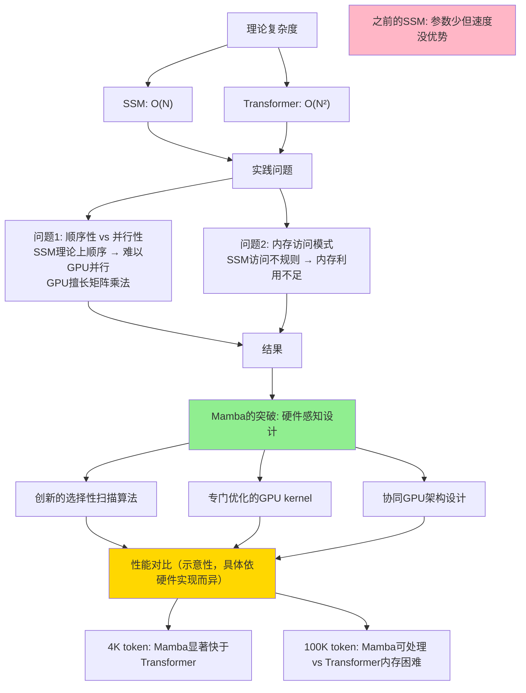

### Mamba 的名字含义

“Mamba”是一种快速的蛇。名字暗示：快速、敏捷的数据处理。

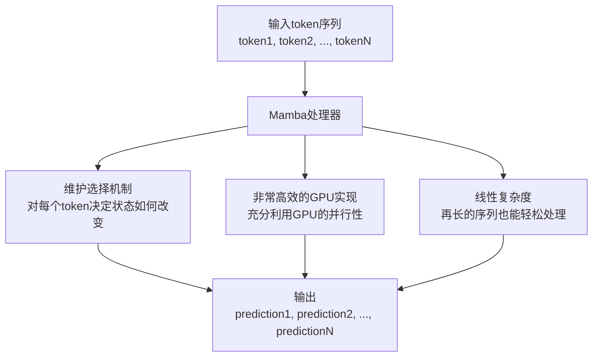

### 2.7 SSM vs Transformer：基本对比

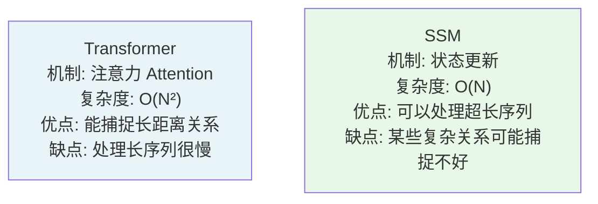

### 2.8 实际场景中的应用

### SSM 擅长的任务

```text
✓ 非常适合用SSM：

1. 长文本处理
   - 处理整个论文、书籍
   - SSM的线性复杂度是游戏改变者

2. 流式数据处理
   - 实时日志分析
   - 连续的传感器数据
   - SSM天生适合流式输入

3. 持久上下文
   - 在一个长对话中保持一致性
   - 记住数小时前的信息
   - SSM的状态可以不断更新

✗ SSM可能不如Transformer的任务：

1. 需要捕捉复杂长距离依赖
   - 某些数学推导
   - 复杂的逻辑推理
   - 注意力机制在这里可能更好

2. 需要"往回看"
   - Transformer可以轻松关注之前的任何地方
   - SSM只能通过状态间接关注
```

### 2.9 本节小结

状态空间模型是一个完全不同的思考方式：
- **不是** 计算每个 token 对所有其他 token 的影响
- **而是** 维护一个不断进化的“理解状态”

主要优势：
- 线性而不是二次的复杂度
- 能处理超长的序列
- 可以自然地处理流式数据

主要挑战：
- 某些任务上可能不如 Transformer 强
- 还没有多年的工程优化积累
- 学术界仍在探索如何最好地设计 SSM

### 2.10 思考题

1. 如果 SSM 这么好，为什么之前没有人广泛使用？

2. 你能想到其他领域（不是 AI）中，线性方法优于二次方法的例子吗？

3. 如果一个 SSM 模型说“我不确定这个答案”，它的不确定性来自哪里？（提示：没有显式的注意力）

## 3. 混合架构的未来：Jamba、Bamba、Titans

> 为什么最好的解决方案不是“选择 Transformer 或 SSM”，而是“同时用两者”

### 3.1 问题：为什么不能都要？

既然 Transformer 和 SSM 各有优缺点，为什么不在同一个模型中结合两者的优势？

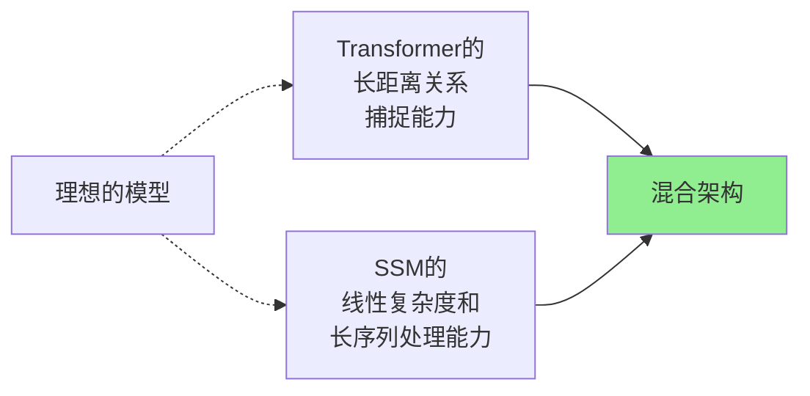

### 3.2 Jamba：AI21 的混合方案

#### 什么是 Jamba？

Jamba 是 AI21 在 2024 年发布的一个模型，它同时融合了 Transformer 和 SSM（Mamba）。

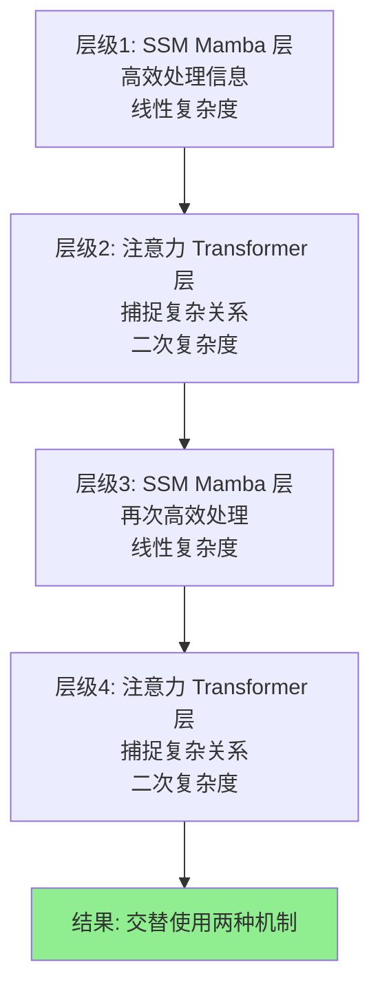

#### Jamba 的优势

```text
混合的好处：

1. 兼顾两个世界
   SSM层处理高效的"流处理"
   注意力层处理复杂的关系

2. 长上下文支持
   AI21 官方资料给 Jamba 系列标注了 256K token 窗口
   这适合长文档和 RAG 场景，但不是所有任务都会自动受益

3. 仍然很快
   在长序列场景中有潜在效率优势
   实际速度取决于实现、硬件、batch、上下文长度和服务配置

4. 成本更低
   处理长文本时可能更有性价比
   但价格会随厂商、日期、缓存和部署方式变化

成本判断应看：
├─ 当前官方价格页
├─ 输入/输出 token 拆分
├─ 是否命中缓存
├─ 是否需要私有部署
└─ 长上下文是否真的减少了检索、摘要和人工返工
```

#### Jamba 的实际性能

```text
在不同任务上的表现要按评测集看，不能用一个固定分数概括：

长文本理解：
Jamba 的 256K 窗口适合长材料任务，但仍要看具体 benchmark 和提示设置

快速推理：
长序列效率可能是优势，短任务未必占优

代码生成：
代码任务通常还受工具、上下文、测试和模型家族特化影响

总体性能：
不要写成 85/100、90/100 这类无来源总分；生产选型应自己跑样本集

关键优势：长上下文 + 成本
```

### 3.3 Bamba：IBM 的企业级混合方案

#### IBM 的不同想法

IBM 发布的 Bamba 与 Jamba 同属分层混合，但配比和工程目标不同：

```text
Bamba-9B 的实际结构（见官方 config.json）：
共 32 层，其中只有第 9、18、27 层是注意力层
其余 29 层都是 Mamba-2 层

也就是说：以 SSM 为主干，每隔约 9 层插一层注意力
```

#### Bamba 的特点

```text
Bamba相比Jamba的差异：

Jamba：
├─ 架构：分层混合（一些层是SSM，一些是注意力）
├─ 复杂度：中等
└─ 性能：全能

Bamba：
├─ 架构：同为分层交替，但注意力层占比极低（32 层中仅 3 层）
├─ 复杂度：相对更低
└─ 性能：主打推理吞吐（KV 缓存更小）

适用场景：
Jamba：需要顶尖性能 + 长上下文的通用用途
Bamba：企业级应用，需要稳定性 + 效率的平衡
```

### 3.4 Google Titans + MIRAS：学术界的融合

#### Google 的研究方向

Google 的研究团队提出了“Titans”，思路与上面几种都不同。

```text
Titans的核心创新：
1. 注意力负责"短期记忆"——把眼前这段上下文看准
   （论文原话：注意力上下文有限但依赖建模准确，充当短期记忆）
2. 新增的"神经记忆模块"负责长期记忆——记住更早的历史内容
3. 关键在于这个记忆模块会在使用过程中临场学习该记住什么

所以它不是"按距离切换 SSM 和注意力"，
而是给注意力配了一个会自己学习的长期记忆
```

#### MIRAS

Google 还在研究 MIRAS，这是一个更高级的混合概念：

```text
MIRAS的想法：
不是固定地混合Transformer和SSM
而是让模型自己学会什么时候用哪个

伪代码：
def process_token(token, context):
    if token 关系到长距离信息:
        使用 Transformer 的注意力
    else if token 可以用局部信息处理:
        使用 SSM 的高效状态更新
    else:
        两者都用，权衡考虑

这样的模型可以根据具体情况自适应，可能是未来的方向。
```

### 3.5 混合架构的实际架构对比

```text
┌─────────────────────────────────────────────┐
│ 混合方案的对比（2024-2025）                 │
├─────────────────────────────────────────────┤
│                                             │
│ Jamba（AI21）                               │
│ ├─ 混合方式：层级混合（层级交替）           │
│ ├─ 上下文窗口：256K                         │
│ ├─ 速度：快                                 │
│ ├─ 成本：低                                 │
│ └─ 适合：需要长上下文的通用任务            │
│                                             │
│ Bamba（IBM）                                │
│ ├─ 混合方式：分层交替（29 Mamba2 + 3 注意力）│
│ ├─ 上下文窗口：基础权重 4K，另有长上下文版本 │
│ ├─ 速度：中等                               │
│ ├─ 成本：中等                               │
│ └─ 适合：企业应用和稳定性要求               │
│                                             │
│ Titans/MIRAS（Google）                      │
│ ├─ 混合方式：动态自适应                     │
│ ├─ 上下文窗口：研究目标是更好扩展长序列     │
│ ├─ 速度：取决于具体实现和硬件               │
│ ├─ 成本：需要实际部署后评估                 │
│ └─ 适合：未来研究方向                       │
│                                             │
│ Llama 4 Scout（Meta, 2025-04）             │
│ ├─ 架构：MoE 混合（109B/16专家/17B激活）  │
│ ├─ 上下文窗口：10M token                   │
│ ├─ 速度：高效                               │
│ ├─ 成本：中等（相比大模型）                 │
│ └─ 适合：超长上下文任务，边缘部署           │
│                                             │
│ Llama 4 Maverick（Meta, 2025-04）          │
│ ├─ 架构：MoE 混合（400B/128专家/17B激活） │
│ ├─ 上下文窗口：1M token                    │
│ ├─ 速度：高效（MoE 稀疏激活）              │
│ ├─ 成本：中高（参数量大但激活参数少）       │
│ └─ 适合：高质量生成，开源模型标杆           │
│                                             │
└─────────────────────────────────────────────┘
```

### 3.6 混合架构为什么是未来？

#### 问题 1：你不需要同一个机制处理所有问题

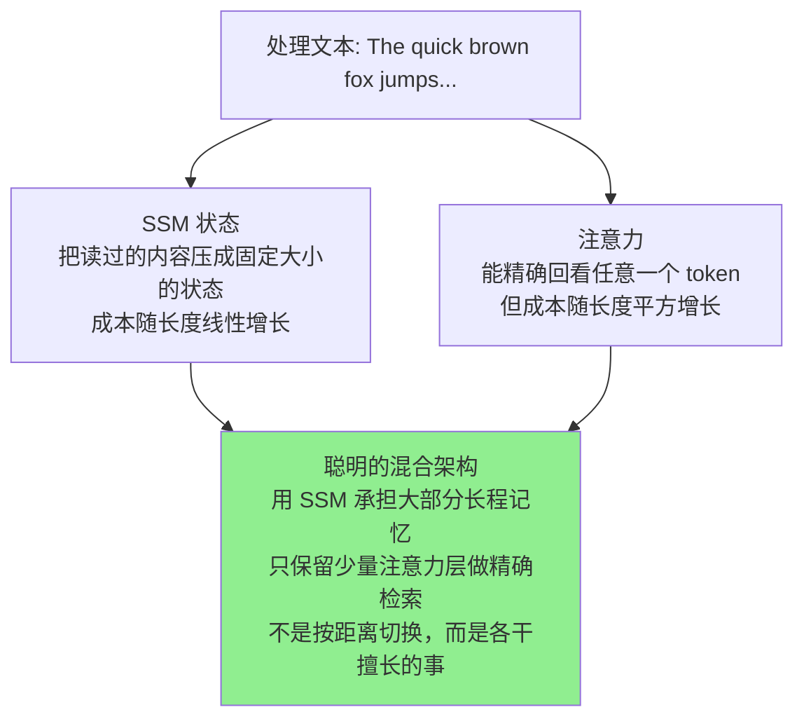

#### 问题 2：为什么不是所有情况都用 Transformer？

成本和规模的现实：

```text
GPU内存限制（单张A100 GPU）：

纯Transformer处理不同长度：
4K token：可以
16K token：勉强
32K token：需要优化
64K token：基本不行
128K token：根本不行

混合架构处理不同长度：
4K token：可以（且比Transformer快）
16K token：可以（且快得多）
64K token：可以（Transformer无法处理）
256K token：可以（Transformer无法做到）
```

### 3.7 长上下文能力的实际意义

有了长上下文能力后，什么应用变成了可能？

```text
新的应用场景：

1. 完整代码库分析
   之前：无法同时理解整个项目
   现在：可以用256K窗口装下整个中型项目
   影响：更好的代码补全 + 自动重构

2. 完整的书籍理解
   之前：只能处理几个章节
   现在：可以处理整本书（假设在256K之内）
   影响：真正的"通读"能力

3. 法律文件库搜索
   之前：无法同时看多个长文档
   现在：可以同时处理多个长合同
   影响：更好的法律文件分析

4. 对话记忆
   之前：长对话中记忆逐渐丢失
   现在：可以记得整个对话历史（数小时）
   影响：更连贯的长期助手体验
```

### 3.8 本节小结

混合架构代表了 AI 模型设计的新方向：
- **不是** 选择 Transformer 或 SSM，而是两者兼取
- **利用** 不同机制的优势处理不同情况
- **成本和性能** 都能得到优化

主要参与者：
- **Jamba**：最早的商用混合方案，成熟且平衡
- **Bamba**：企业级选项，强调稳定性
- **Titans/MIRAS**：未来方向，动态自适应

这表明 AI 模型设计的未来不再是“一种机制统治全部”，而是“聪慧的多元方案”。

### 3.9 与其他章节的联系

📖 **延伸阅读**：
- 想了解 Transformer 的基本限制？请参阅《第 8.1 Transformer 的二次复杂度问题》
- 想了解 SSM 的工作原理？请参阅《第 8.2 状态空间模型基础》
- 想了解长上下文能力的实际意义？请参阅《第 8.4 长上下文时代》

### 3.10 思考题

1. 如果你正在设计一个混合架构，你会在什么深度进行混合（层级、块级、还是单个注意力头）？

2. 混合架构的缺点是什么？它是否变得太复杂了？

3. 五年后，会有全新的架构出现来替代 Transformer 和 SSM 的混合吗？会是什么？

## 4. 长上下文与持久记忆：新能力的社会影响

> 从“受上下文窗口限制”到“可以处理更长材料”的转变意味着什么

### 4.1 上下文窗口曾经的局限

在混合架构出现之前，上下文窗口的大小一直是一个痛点：

```text
上下文窗口的进化：

GPT-2（2019）：1K token
GPT-3（2020）：2K token
Claude 1（2023）：100K token ← 第一次的大突破
GPT-4 Turbo（2023）：128K token
Claude 3（2024）：200K token
Jamba（2024）：256K token
Gemini 1.5 Pro（2024）：1M token ← 百万级别的里程碑
Claude Opus 5 / Sonnet 5 / Gemini 3.1 Pro Preview（2026）：1M token
Llama 4 Scout（2025-04）：109B 总参数/17B 激活，10M token ← 千万级别新纪录

能力不仅仅是数字增长，而是质的飞跃。
```

#### 1M 和 10M token 窗口等于什么？

为了理解这些数字的意义，我们需要转换成现实的内容：

```text
1M token ≈ 多少字数？

token 不是字数单位，取决于语言、分词器和文本类型。
非常粗略地说：
├─ 英文：1 token 通常约等于 0.75 个英文词
├─ 中文：常见情况接近 1 个汉字一个 token，但标点、英文、代码会改变比例
└─ 代码/表格/JSON：token 密度可能明显高于自然语言

所以 1M token 更适合理解为“几十万到上百万字级别的材料容量”，
不要机械换算成固定字数。

1M token 量级等于什么？

中文：
└─ 可能覆盖一本很长的书、数十份长文档，或一个小型知识包
└─ 是否“读懂”仍取决于任务、提示、模型能力和材料结构

代码：
└─ 可能装下中小型项目或大型项目的一部分
└─ 真实代码库还需要依赖图、测试结果和检索工具配合

法律文件：
└─ 可一次处理多份合同或证据材料
└─ 但高风险结论仍需要引用、校验和人工复核

学术论文：
└─ 可处理一组论文、报告和引用材料
└─ 不等于可以无损综合整个领域

10M token 量级意味着什么？

中文：
└─ 容量非常大，适合超长文档、代码库或知识库切片
└─ 但推理质量、延迟、成本和召回稳定性仍是独立问题

能做到的事：
└─ 让模型看到更多原始材料，减少手工切片
└─ 与 RAG、索引、引用和摘要结合，构建更稳的长文档工作流
└─ 对医疗、法律、金融等高风险场景，仍不能替代专业审查
```

### 4.2 这带来了什么实际改变？

#### 改变 1：代码理解的质的飞跃

```text
之前（8K-32K窗口的时代）：
问题：帮我优化这个函数
AI回应：看到你的代码了
         但我只能同时看到几个文件
         我无法理解整个项目的架构
         我的建议可能不符合你的项目模式

现在（1M窗口）：
问题：帮我优化这个函数
AI回应：我已经看完了你整个项目
         我知道这个函数在系统中的位置
         我看到了相关的5个模块
         我可以给出考虑全局的建议
         甚至可以告诉你是否有更好的架构改造
```

#### 改变 2：文档理解的完整性

```text
法律行业的转变：

之前：
律师需要：
├─ 手工阅读所有合同（10小时）
├─ 手工标记重点和风险
├─ 手工对比条款
结果：容易遗漏、容易出错、非常耗时

现在（长上下文AI）：
律师：帮我分析这30份合同的风险
AI：立即分析所有合同
   ├─ 找出所有高风险条款
   ├─ 对比不同合同间的不一致
   ├─ 发现隐藏的风险模式
   └─ 生成详细的风险报告
结果：30分钟完成，准确性更高
```

#### 改变 3：真正的对话记忆

```text
聊天机器人的进化：

之前（短窗口）：
用户：我想建一个AI公司
AI：好的，祝你成功
（10条消息后）
用户：你觉得我的想法怎么样？
AI：（不记得你的想法了）
   请重新描述你的想法...

现在（长窗口）：
用户：我想建一个AI公司
AI：那很棒！[记住想法]
（100条消息后）
用户：你觉得我的想法怎么样？
AI：根据我们之前的讨论，你的想法是...
   我认为这个方向很有潜力
   特别是你提到的那个市场空缺...

差异：AI 可以在同一会话内维持更长的上下文；跨会话记忆仍需要产品层的持久存储和权限设计
```

### 4.3 持久记忆的含义

有了长窗口，另一个概念变成了可能：**持久记忆**

```text
持久记忆 ≠ 长窗口

长窗口：
└─ 在一次对话中能记得很久的信息
└─ 但这次对话结束就全忘了
└─ 下次用户回来，一切从零开始

持久记忆：
└─ AI能够跨越不同的对话会话
└─ 记得用户的偏好、历史、背景
└─ 下次用户回来，AI说："上次你提到..."

实现方式：
会话1：用户告诉AI一些个人信息
会话2：用户回来，AI把会话1的内容加到上下文中
这样虽然不是"永久存储"，但看起来像是

局限：如果内容太多，即使1M也装不下
所以实际的持久记忆系统会：
├─ 对旧内容进行摘要
├─ 只保留最相关的信息
└─ 把它们加入新的对话
```

### 4.4 长上下文的深层影响

#### 编程：从代码补全到代码理解

```text
之前的代码补全：
def calculate_tax(income):
    AI只看到这个函数附近的代码
    └─ 可以完成这个函数
    └─ 但不知道它在系统中的作用

现在的代码补全：
AI看到了：
├─ 这个函数调用的所有其他函数
├─ 调用这个函数的所有地方
├─ 整个项目的数据流
└─ 相关的测试代码

结果：AI理解的不是"这段代码做什么"
     而是"这段代码为什么这样做，应该如何改进"
```

#### 教育：从知识灌输到理解指导

```text
在线教育的转变：

老方法：
学生问问题 → AI给出答案

新方法（长上下文）：
AI可以看到：
├─ 学生之前问过的所有问题
├─ 学生的学习进度和知识漏洞
├─ 学生的学习风格和偏好
└─ 学生在某个主题上的困难

AI的回答会：
├─ 根据学生的历史做出个性化
├─ 填补学生的具体知识漏洞
├─ 用学生最容易理解的方式
└─ 建立与之前学过的内容的关系

结果：更像一个真正了解学生的导师
```

#### 商业：从文件管理到知识系统

```text
企业知识管理的转变：

之前：
公司有一个文件库
搜索系统给你找到相关文件
但你还要自己理解和综合

现在（长上下文）：
给AI一整个知识库
AI可以：
├─ 一次性理解所有文档
├─ 回答复杂的跨文档问题
├─ 发现文档间的矛盾和重叠
└─ 生成综合的知识摘要

例如：
问："我们的客户成功部门有哪些最佳实践？"
AI不只是返回相关文件
而是综合所有相关文档，给出最佳实践的总结
```

### 4.5 长上下文的现实局限

虽然 1M token 已经很大，但仍然有限制：

```text
1M token的实际限制：

不够用的情况：

1. 完整的学术论文库
   一个领域的所有论文 >> 1M tokens
   即使1M也装不下全部

2. 企业完整知识库
   大公司的所有文档、邮件、笔记
   远远超过1M

3. 互联网上的所有相关信息
   对于某个问题的完整信息
   往往超过1M

解决方案：
├─ 检索增强生成（RAG）
│  └─ 只提取最相关的部分到上下文中
├─ 分块处理
│  └─ 把大任务分成多个小任务
└─ 持续过滤
   └─ 动态更新上下文，移除不重要的部分
```

### 4.6 未来的可能性

#### 假设 1：无限上下文

假设某天我们有无限的上下文窗口：

```text
理论上的可能：
AI可以看到互联网上的所有信息
└─ 对任何问题都有最完整的答案
└─ 不需要任何知识库或数据库
└─ 只需一个AI

现实中的障碍：
├─ 即使有无限内存，访问时间也会很长
├─ 垃圾和假信息会淹没真信息
├─ 隐私问题：不能给AI整个互联网
└─ 计算成本会天文数字

结论：无限上下文不会成为现实解决方案
智能的选择（RAG + 长窗口）才是未来
```

#### 假设 2：专业化长上下文模型

未来的发展可能是：

```text
而不是一个通用的1M窗口模型
我们会有多个专业化的模型：

医学AI：
└─ 可以处理患者的完整医疗历史
└─ 包括所有诊断、处方、检查结果

法律AI：
└─ 可以处理完整的案件文档库
└─ 包括判例法、相关法规、先例

代码AI：
└─ 可以处理整个大型开源项目
└─ 包括所有源代码、测试、文档、issue

每个都针对其领域优化，能装下其领域的典型场景。
```

### 4.7 本节小结

长上下文的出现（从 4K 到 1M）不仅是数字上的增长，而是质的飞跃：

- **代码理解**：从片段到系统的转变
- **文档分析**：从单文档到多文档综合的转变
- **对话体验**：从无记忆到有记忆的转变
- **知识管理**：从查询到理解的转变

但长上下文不是终极答案。真正的未来是：
- 长上下文（处理已给定的大量信息）
- 与检索（找出相关信息）
- 与持久记忆（记住跨会话信息）
的智能组合。

### 4.8 思考题

1. 如果你的工作依赖于处理长文档，1M token 窗口改变了什么？是否足够？

2. 在你的行业，长上下文 AI 最可能改变什么工作流程？

3. 持久记忆带来了隐私问题（AI 记得关于你的所有事情）。如何平衡隐私和个性化？

## 5. DeepSeek 是什么：从小创业到 AI 独角兽

> 理解一个 AI 公司如何在不到 5 年内从无到有，挑战全球巨头

### 5.1 DeepSeek 的三个版本

要理解 DeepSeek，需要知道它不是一个“模型”，而是一个“产品系列”。

```text
DeepSeek的演化：

DeepSeek V1（2023年底）
└─ 开源模型，初次亮相
└─ 性能：不错，但不突出

DeepSeek V2（2024年中）
└─ 升级版本
└─ MLA架构首次亮相
└─ 开始被关注

DeepSeek V3（2024-12）
└─ 最新基础版本，也是最强基础模型
└─ 多个新创新
└─ 官方报告中在多项基准与GPT-4 Turbo相当
└─ 一次代表性训练运行显示成本相对低廉

DeepSeek-R1（2025年01月20日）
└─ 推理模型版本
└─ 官方报告称在推理任务上与o1竞争
└─ 开源权重与托管API成本相对低廉
```

### 5.2 为什么叫“DeepSeek”？

名字的含义：
- **Deep**：深入思考和研究
- **Seek**：探求真理和最优方案

公司的理念就体现在名字里：不是最快推出产品，而是最深入地理解问题。

### 5.3 DeepSeek 公司的背景

#### 创始人和融资

```text
创始人：梁文锋
背景：
├─ DeepSeek 创始人兼 CEO
├─ 也是量化机构 High-Flyer 的联合创始人之一
├─ 公司早期发展与 High-Flyer 的团队和算力积累密切相关
└─ 以低成本高性能模型路线受到行业关注

融资历程：
└─ 公开资料未见清晰的种子轮 / A 轮融资披露
└─ 早期发展更常被描述为依托既有团队与资源积累
└─ 外部融资细节并非其公开叙事重点

总融资：公开口径有限，不宜与 OpenAI 直接按融资轮次类比
但足以支持AI研究
```

#### 公司规模和位置

```text
公司规模：
├─ 员工数：数百人（对比OpenAI的千人规模）
├─ 研究团队：专业的深度学习团队
└─ 工程团队：高效的实现和优化

位置：中国（杭州）
└─ 访问中国的算力资源
└─ 但也面临出口管制的挑战
└─ 创新性地在这些约束下工作
```

### 5.4 DeepSeek 的战略选择

#### 选择 1：开源而非闭源

```text
这是关键的战略决定：

闭源的好处：
├─ 可以完全控制产品
├─ 可以通过API收费
└─ 不担心竞争对手直接复制

开源的好处：
├─ 获得社区的信任和支持
├─ 加快创新（社区贡献）
├─ 建立品牌和影响力
├─ 长期的商业机会（企业版、咨询）
└─ 对抗"AI垄断"的叙事

DeepSeek的选择：
开放核心权重路线，同时保留官方托管 API。

这意味着：
- 研究者和开发者可以下载公开发布的模型或 Distill 版本做本地部署与二次开发
- 普通用户和企业也可以直接使用官方托管 API
- "是否免费"取决于你选择的是本地自部署，还是官方/第三方托管服务

为什么这很勇敢？
└─ 意味着无法通过模型本身直接获利
└─ 意味着竞争对手可以直接使用你的研究
└─ 意味着相信长期价值而不是短期收入
```

#### 选择 2：专注于效率而非规模

```text
大多数AI公司的策略：
更大的模型 = 更好的性能
不断增加参数和数据

DeepSeek的策略：
相同性能下，最小化成本和资源

这导致了一系列的架构创新：
├─ MLA（多头潜在注意力）
├─ MoE（专家混合）
├─ 高效的训练流程
└─ 智能的数据选择
```

#### 选择 3：推理与基础模型并行

```text
大多数公司：
先做基础模型（如GPT-4）
然后才考虑推理模型（如o1）

DeepSeek的速度：
V3和R1几乎同时推出
意味着：
├─ 强大的研究能力
├─ 快速的迭代周期
├─ 对推理问题的早期关注
```

### 5.5 DeepSeek 的成功指标

#### 性能对标

```text
更稳妥的结论应该是：

- DeepSeek 在官方技术报告披露的多项评测中进入了第一梯队
- 它在若干数学、代码和综合推理任务上，已经足以与当时的主流闭源强模型正面对比
- 但跨厂商横向分数很容易受到评测版本、采样设置、提示词和披露口径影响

因此，对入门读者来说，最重要的不是死记某个百分比，
而是理解：DeepSeek 证明了"高性能 + 高效率"可以在一次代表性训练运行中同时成立。
```

#### 用户采纳

```text
DeepSeek的关注度增长非常快：

- 技术社区对其论文、开放权重和推理能力高度关注
- 社交媒体与开发者社区的讨论在短期内迅速升温
- 但若没有统一、可核对的官方口径，不宜把月度用户增长曲线写成精确数字
```

### 5.6 DeepSeek 与中国 AI 生态的关系

#### 中国 AI 的现状

```text
中国的AI模型：
├─ 通义千问（阿里）：商用为主
├─ 文心一言（百度）：商用为主
├─ Kimi（月之暗面）：注重长上下文
└─ DeepSeek：注重开源和效率

DeepSeek的独特点：
└─ 采取更开放的权重与生态路线，国际导向明显
└─ 强调技术创新而非商业优先
└─ 获得国际研究社区的高度关注

这改变了国际社会对"中国AI"的认知：
从"本地化的模仿"
到"技术创新的领导者"
```

#### 地缘政治的考量

```text
DeepSeek面临的挑战：

芯片限制：
├─ 美国对中国实施芯片出口管制
├─ 限制高端GPU的使用
└─ DeepSeek必须在这些约束下创新

但DeepSeek的成功表明：
├─ 算法创新可以弥补硬件限制
├─ 高效的设计可以用更少资源做更多事
└─ 这对全球AI产业有深远影响
```

### 5.7 DeepSeek 的商业模式

#### 如何盈利（虽然开源）？

```text
短期收入：
├─ API服务（DeepSeek API）
│  └─ 在不少场景下价格明显低于头部闭源推理服务，但应以当期官方价格页为准
├─ 企业付费版本
│  └─ 高级支持、定制化、部署协助
└─ 研究和咨询

长期价值：
├─ 品牌和影响力
│  └─ 成为全球AI研究的参考
├─ 人才吸引
│  └─ 顶级研究人员想为这样的公司工作
├─ 技术积累
│  └─ 建立长期的技术领导地位
└─ 生态建设
   └─ 在开源模型上构建的整个生态
```

#### 为什么这个模式可行？

```text
与传统软件的对比：

传统模式：
├─ 开发私有软件
├─ 收费给用户
└─ 利润高但用户有限

开源模式：
├─ 开发开源软件
├─ 通过服务赚钱（支持、云托管、企业版）
└─ 利润可能更高（因为用户基数大）

例子：
└─ Linux：完全开源，但红帽靠支持赚数十亿
└─ Python：完全开源，但相关服务价值巨大
└─ DeepSeek：更接近"开放权重 + 托管服务 + 生态扩展"的组合路线

关键：制造极好的产品，然后围绕它提供价值
```

### 5.8 本节小结

DeepSeek 的成功不是侥幸，而是战略和执行的结果：

- **战略选择**：开源、注重效率而非规模
- **技术创新**：MLA、MoE 等突破性架构
- **快速迭代**：从 V1 到 R1 的快速发展
- **国际视野**：面向全球，而非仅国内市场

这开启了 AI 产业的新可能：
- 除了超大融资和闭源规模路线，也可以通过架构效率、工程优化和开放生态进入第一梯队
- 开源和闭源不必对立，可以共存
- 效率和创新可能比规模更重要

DeepSeek 证明了 AI 产业还有更多的玩法。

### 5.9 思考题

1. 为什么 DeepSeek 敢于完全开源？有什么长期风险吗？

2. 如果 DeepSeek 的模型可以本地运行（不需要云），这对 OpenAI 的商业模式意味着什么？

3. DeepSeek 的成功是否意味着“大公司的 AI 优势”消失了？

## 6. DeepSeek 的技术创新：MLA 和 MoE

> 用更聪明的方式而不是更大的规模来实现更好的性能

### 6.1 传统注意力的浪费

为了理解 DeepSeek 为什么需要 MLA，先看看传统 Transformer 注意力机制的问题：

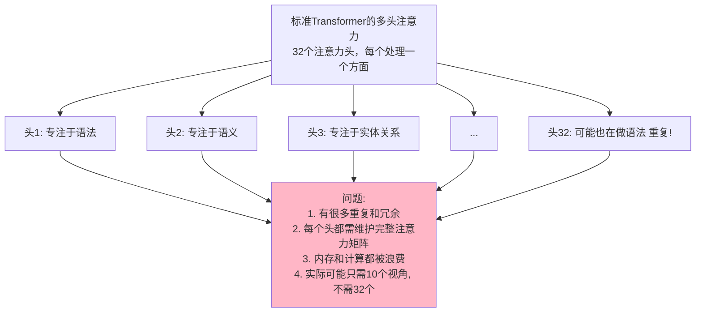

### 6.2 MLA：多头潜在注意力

DeepSeek 引入的 MLA（Multi-head Latent Attention）解决了这个问题。

#### 核心思想

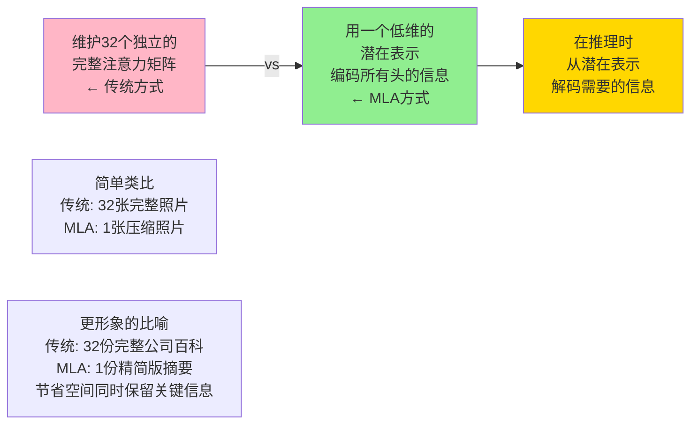

#### 如何工作？

```text
MLA的工作流程：

输入：序列 [token1, token2, ..., tokenN]
   ↓
投影到潜在空间：
├─ 将高维的Q,K,V投影到低维潜在空间
├─ 假设原始维度是4096（embed_dim）
├─ 投影到256维的潜在空间
├─ 这一步压缩比 = 4096/256 = 16倍
└─ 节省93%+的KV缓存！（关键：只存储256维的缓存）
   ↓
注意力计算：
├─ 缓存的是压缩后的低秩隐向量；真正算注意力时，低秩投影会被“吸收”进权重、恢复到各头维度
├─ 复杂度仍是O(N²)（N 为序列长度，不因 MLA 变小），注意力算力与标准多头注意力大致相当
├─ 变小的是**每个 token 需要缓存的向量维度**：4096 → 256
├─ KV 缓存占用从 16MB → 1MB（减少约93%，对应 16 倍压缩）
└─ 长序列推理的显存与带宽瓶颈大幅缓解
   ↓
解压层（投影回原始维度）：
├─ 使用学习的映射矩阵将结果恢复
├─ 从256维映射回4096维
├─ 这个映射是在训练中优化的，丢失的信息很少
├─ 关键：解压层很轻量（只是矩阵乘法）
└─ 恢复的质量接近原始注意力
   ↓
输出：与传统注意力相同的质量

推理优化的关键（KV缓存）：
传统Transformer：
├─ 处理1000个token，需要存储1000×4096维的K和V
├─ 总占用内存 = 1000 × 4096 × 4bytes = 16MB（仅KV）
└─ 序列越长，内存爆炸

MLA方式：
├─ 处理1000个token，只需存储1000×256维的压缩K和V
├─ 总占用内存 = 1000 × 256 × 4bytes = 1MB（仅压缩KV）
└─ 节省93%的KV缓存！这正是长序列推理的瓶颈
```

#### 数学直觉（简化版）

```text
传统注意力：
Attention(Q,K,V) = softmax(QK^T/√d_k)V

其中：
Q, K, V 都是大矩阵（d_model × sequence_length）
- d_model通常是4096（对于大模型）
- 计算QK^T需要4096×4096的矩阵乘法
- 存储完整的KV缓存很昂贵

MLA的方式（三个关键步骤）：

第1步：投影到潜在空间
Q_low = Q @ W_q_down   # 维度：d_model → d_latent
K_low = K @ W_k_down   # (4096维 → 256维)
V_low = V @ W_v_down

第2步：在潜在空间进行注意力计算
Attention_low(Q_low, K_low, V_low) = softmax(Q_low·K_low^T/√d_latent)V_low

这里的直观感受：
- Q_low·K_low^T 是 256×256 的矩阵乘法（而不是 4096×4096），中间矩阵明显更小
- 但 MLA 真正省下的不是注意力算力，而是需要缓存的 K/V：压缩后 KV 缓存大幅减小，这才是它的核心收益（见下方"效果总结"）

第3步：投影回原始维度
Output = Attention_low @ W_output  # 256维 → 4096维

效果总结：
- KV缓存大小：从16MB → 1MB（减少约93%，对应约16倍压缩）—— 这是 MLA 最主要的收益
- 推理速度：长序列推理的瓶颈通常在显存带宽（反复读取巨大的 KV 缓存），缓存变小后访问更快，推理吞吐随之提升
- 注意力计算量：与标准多头注意力大致相当（实现中会把低秩投影"吸收"进权重、恢复到各头维度），所以 MLA 省的是显存而非算力
- 质量：通过训练优化投影矩阵，质量接近原始注意力

为什么这样做有效？
- 32个注意力头中有大量冗余（很多头学到类似的模式）
- 潜在空间能够有效编码这些冗余
- 类比：就像JPEG压缩图像，去掉看不见的细节，保留重要信息
```

#### KV 缓存压缩的实际影响

```text
对长序列推理的革命性改进：

场景：处理128K token的长文本

传统Transformer：
├─ 每层的KV缓存占用：128K × 4096 × 2 × 2bytes = 2GB
├─ 假设96层：96 × 2GB = 192GB（仅KV缓存！）
└─ 需要H100级别的GPU才能运行

MLA方式：
├─ 每层的KV缓存占用：128K × 256 × 2 × 2bytes = 128MB
├─ 假设96层：96 × 128MB = 12.3GB（仅KV缓存）
└─ 可以在A100 40GB上轻松运行

成本对比：
- H100 GPU：$40,000/个
- A100 GPU：$10,000/个
- MLA节省的硬件成本：4倍

这就是DeepSeek能用更便宜GPU的原因之一！
```

### 6.3 MoE：混合专家

#### 第二个创新：不是所有 token 都需要所有参数

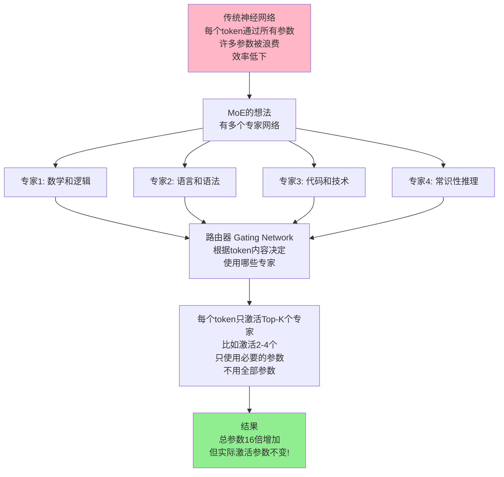

#### 具体工作方式：路由器如何工作

公司部门分工的比喻：

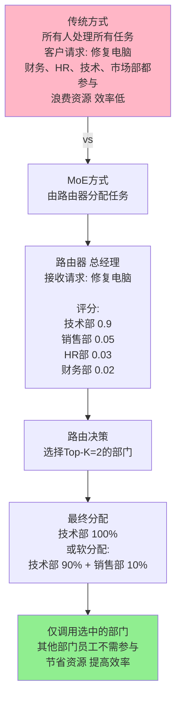

MoE 的路由机制详解：

1. 路由网络（Gating Network）的结构：
   ├─ 输入：token 的嵌入表示（比如 4096 维）
   ├─ 简单的线性层：4096 维 → 8 个专家分数
   ├─ 输出：8 个 softmax 分数 [0.3, 0.4, 0.2, 0.05, ...]
   └─ 速度：非常快（只是一次矩阵乘法）

2. Top-K 选择：
   ├─ 经典 MoE（如 Mixtral-8x7B）使用 K=2（每个 token 激活 2 个专家）
   ├─ 路由权重：假设分数是[0.4, 0.35, 0.15, 0.1, ...]
   ├─ 硬选择：选择最高的 2 个（0.4 和 0.35）
   │  └─ 专家 A: 40%, 专家 B: 35%, 其他: 0%
   │
   └─ 软选择（也叫平衡选择）：
      └─ 按照概率分配（基于分数）
      └─ 专家 A: 40%, 专家 B: 35%, 专家 C: 15%, ...

3. 负载均衡：防止所有 token 都选择同一个专家
   ├─ 问题：如果路由器总是倾向于选择专家 A
   │       那么其他专家就会被浪费
   │
   ├─ 解决方案：添加辅助损失函数
   │  ├─ 在训练时添加额外的损失：
   │  │  “确保每个专家被使用的次数相近”
   │  │
   │  ├─ 如果有 8 个专家和 1000 个 token
   │  │  └─ 理想情况：每个专家处理 1000/8 = 125 个 token
   │  │  └─ 如果某个专家只被选了 10 次，就增加损失
   │  │
   │  └─ 训练到收敛：负载均衡自动实现
   │
   └─ 效果：即使 MoE 参数很多，也能高效使用

#### MoE 在 DeepSeek-V3 中的实现

```text
DeepSeek-V3的MoE架构：

参数配置（基于 DeepSeek-V3 技术报告）：
├─ 总专家数：256 个
├─ 共享专家：1 个（所有 token 都必须通过）
├─ 每次激活：Top-K=8 个路由专家 + 1 个共享专家
├─ 总参数：约 671B（MoE 层含 256 个专家的全部参数）
├─ 每个 token 激活参数：约 37B（8 个路由专家 + 共享专家）
└─ 稀疏性：每个 token 只激活全参数的一小部分

推理流程：
输入：一个token的嵌入向量
   ↓
路由器（Gating Network）：
├─ 计算分数：[分数1, 分数2, ..., 分数256]
├─ 应用softmax
└─ 选择Top-K=8 的路由专家（基于分数）+ 1 个共享专家
   ↓
执行计算：
├─ 8 个被选中的路由专家分别处理这个 token
├─ 共享专家也处理这个 token（所有 token 都通过）
├─ 单 token 激活参数共约 37B（含路由专家 + 共享专家）
└─ 按照路由权重混合结果
   ↓
输出：融合后的特征表示
```

#### 稀疏激活的力量

```text
稀疏激活 = 只激活部分参数，而不是全部参数

DeepSeek-V3的参数配置解释：

总参数数 vs 激活参数数 的区别：

┌────────────────────────────────────────┐
│ 总参数：671B（约 6,710 亿参数）        │
│ 这包括：                               │
│ ├─ 256 个路由专家（占大头）            │
│ ├─ 1 个共享专家                        │
│ └─ 注意力层等共享组件                  │
│                                        │
│ 每次推理激活：约 37B（约 370 亿参数）  │
│ 这来自：                               │
│ ├─ Top-K=8 个被路由器选中的专家        │
│ ├─ 加上 1 个共享专家                   │
│ └─ 加上注意力层等共享部分              │
│                                        │
│ 稀疏性：37B / 671B ≈ 5.5%             │
│ 含义：每次推理只激活约 5.5% 的参数     │
└────────────────────────────────────────┘

重点理解：为什么"总参数 671B，激活 37B"？

DeepSeek-V3 共 61 层 Transformer：
├─ 每层的前向网络（FFN）是 MoE 结构
│  ├─ 256 个路由专家 + 1 个共享专家
│  ├─ 每个 token 只激活其中 Top-K=8 个路由专家
│  └─ 加上共享专家 → 每层 MoE 激活 9 个专家
│
├─ 注意力层是所有 token 共享的
│  └─ 使用 MLA（多头潜在注意力，详见 8.6.2）
│
└─ 推理时：每层只激活 9 个专家 + 注意力层
   全部 61 层加总，激活参数约 37B（每个 token）

对比不同模型的参数配置：

传统密集模型（比如 200B 量级的 dense 模型）：
├─ 总参数：200B
├─ 激活参数（推理）：200B（全部）
└─ 推理成本：必须运行 200B 的计算

MoE 稀疏模型（DeepSeek-V3）：
├─ 总参数：671B（容量更大）
├─ 激活参数（推理）：37B（仅 5.5%）
├─ 推理成本：只运行 37B 的计算
├─ 对比 200B 密集模型：37B / 200B ≈ 0.19 倍
│ 即推理成本"反而显著低于"同代 dense 模型
└─ 好处：用更低的推理成本，访问 671B 规模的知识容量！

为什么这样设计有效？

知识分布假设：
不同的知识分散在不同的"专家"中
- 256 个细粒度专家分别擅长不同领域
- 数学、代码、语言、常识、长尾知识等
- 路由器根据 token 内容选出最匹配的 8 个

对于一个数学 token：
不需要激活与之无关的专家（浪费）
只需要激活路由器选中的 8 个专家（高效）
路由器在训练中学会了这种选择

结果效果对比：

方案 1：使用 200B 密集模型
├─ 参数数：200B
├─ 推理速度：1.0x（基准）
├─ 性能：取决于训练，通常 GPT-3.5 量级

方案 2：使用 671B 稀疏模型（DeepSeek-V3）
├─ 参数数：671B（总）/ 37B（激活）
├─ 推理速度：约 0.19x 的 FLOPs（远少于 200B dense）
├─ 性能：在 MMLU/HumanEval/Math 等基准上达到前沿水平
└─ 关键：知识容量×3.4，激活计算量÷5

这就是为什么 DeepSeek 能用更低推理成本达到更好效果！
```

### 6.4 DeepSeek 如何结合 MLA 和 MoE

#### 两大创新的协同

```text
DeepSeek V3的架构：

1. 在注意力层使用MLA
   ├─ 减少内存占用
   ├─ 大幅压缩 KV 缓存（省显存，不是省算力）
   └─ 没有牺牲性能

2. 在前向网络层使用MoE
   ├─ 增加模型的知识广度
   ├─ 但只激活必要的参数
   └─ 推理速度不受影响

整体效果对标（基于各自官方报告）：
┌──────────────────────────────────┐
│ DeepSeek V3 与GPT-4 Turbo对比  │
├──────────────────────────────────┤
│ 参数规模：在同一量级             │
│ 激活参数：DeepSeek的稀疏性优势  │
│ 推理性能：多数任务相当             │
│ 训练成本：DeepSeek报告低成本案例│
└──────────────────────────────────┘

注：跨厂商比对易受多种因素影响，
宜参考各自官方技术报告。
```

### 6.5 这为什么节省了这么多成本？

#### 训练成本的分解

```text
训练一个大模型的成本：

总成本 = 数据成本 + 计算成本 + 人员成本

计算成本 = FLOPs × 硬件成本

FLOPs = Forward-Backward Operations
      = 模型大小 × 数据大小 × 迭代次数

DeepSeek相比GPT-4的改进：

1. 模型更高效
   └─ MLA + MoE = 同性能下更少激活计算

2. 数据选择更聪明
   └─ 高质量数据 > 大量数据
   └─ 不需要训练在垃圾数据上

3. 利用更少GPU资源
   └─ 不需要最新最贵的GPU
   └─ 可以用A100而不必须用H100

4. 中国成本更低
   └─ 电费更便宜
   └─ 工程师成本更低

所有这些因素的组合：

根据 DeepSeek 官方报告，一次代表性训练运行的成本约 $5.6M
业界对 GPT-4 的训练成本估计范围较广（未见官方披露）
成本优势显著，但不宜简化为"固定倍数"（详见本节8.6.7）
```

### 6.6 实际的性能影响

#### 推理成本

```text
推理成本对比示例（仅为量级示意，价格以各厂商官方当期价目页为准）：

OpenAI GPT-4 Turbo（历史示例）：
├─ 输入：$0.01/1K token
├─ 输出：$0.03/1K token
└─ 一个典型问题：成本随输入/输出比例变化，不宜固化为单值

Claude 3.5 Sonnet（示例）：
├─ 输入：$0.003/1K token
├─ 输出：$0.015/1K token
└─ 一个典型问题：~$0.005

DeepSeek Flash（示例，官方价目表按非高峰 / 高峰两档计价，非高峰为高峰的一半）：
├─ deepseek-flash 输入（cache hit）：$0.003 / $0.006 每 1M token
├─ deepseek-flash 输入（cache miss）：$0.15 / $0.3 每 1M token
├─ deepseek-flash 输出：$0.6 / $1.2 每 1M token
└─ 型号名换过好几轮：deepseek-chat / deepseek-reasoner 已于 2026-07-24 退役；deepseek-v4-flash 如今只是兼容别名，请求由 DeepSeek-V4.1-Flash 承接；当前价目表列出的是 deepseek-flash 与 deepseek-v4-pro

成本相对关系：
GPT-4 Turbo : Claude : DeepSeek 只能作为同一日期、同一 token 结构下的量级比较；生产选型应重新计算。

说明：
- 实际成本受缓存命中率、模型版本、问题难度、输出长度等影响
- 自部署 vs 托管 API 的成本结构完全不同
- 价格政策会随时更新，应以官方当期价格为准（DeepSeek 见 api-docs.deepseek.com 的 Models & Pricing 页）
```

### 6.7 本节小结

DeepSeek 的成本优势来自于两个关键创新：

1. **MLA（多头潜在注意力）**
   - 压缩注意力的表示
   - 减少显存（KV 缓存）占用，注意力算力基本不变
   - 保持性能

2. **MoE（混合专家）**
   - 稀疏激活参数
   - 更多知识，更少计算
   - 高效的权衡

加上工程和数据策略，DeepSeek 展示了一个重要方向：
- 在部分公开基准和应用场景中取得有竞争力的模型性能
- 通过 MLA、MoE、数据选择和系统优化降低训练与推理成本
- 具体“便宜多少倍”取决于对比对象、价格口径、缓存命中率和部署方式，不宜写成固定倍数

这改变了 AI 产业的格局：不再需要巨额融资才能做出顶级模型。

### 6.8 思考题

1. MoE 如今几乎是大模型标配（Llama 4、Mixtral、DeepSeek 都在用）。那它的代价是什么？为什么不是所有模型都用？

2. MoE 有什么缺点？是否所有问题都适合用 MoE？

3. MLA 和 MoE 的组合还有改进空间吗？下一个创新可能是什么？

## 7. DeepSeek-R1：推理模型的黑马

> 用远低于 o1 的训练成本达到相当的推理能力

### 7.1 DeepSeek-R1 的出现

2024 年 12 月 DeepSeek 发布了 V3，随后在 2025 年 1 月 20 日又发布了 R1（推理模型版本）。

这有两个重要意义：
1. **速度**：从无到有推出与顶级模型竞争的产品的时间表
2. **推理能力**：证明推理模型可以用相对经济的方式构建

### 7.2 性能对标

#### 复杂问题上的表现

#### 数学与代码推理基准

```text
更稳妥的结论应该这样理解：

- 在 DeepSeek 官方技术报告列出的数学、代码和综合推理基准中，R1 确实进入了第一梯队
- 它在若干推理任务上可以与 OpenAI o 系列等强模型正面竞争
- 但不同厂商公布的分数常受提示词、采样设置、评测版本和披露口径影响

因此，不建议把跨厂商对比写成“固定领先几个百分点”的硬结论。
```

**建议来源：**
- [DeepSeek 官方技术报告](https://github.com/deepseek-ai/DeepSeek-R1)
- 相关基准测试的官方说明与评测仓库

### 综合对标结论

```text
综合来看，DeepSeek-R1 的真正意义不在于“永远稳压所有对手”，
而在于它证明了：

1. 开源/开放权重路线也能做出第一梯队推理模型
2. 高质量推理能力不一定只能靠最高成本路线获得
3. 推理模型的价格与部署门槛可以继续下降
```

### 7.3 如何实现如此低的成本？

### DeepSeek-R1 的架构

DeepSeek 公开了完整的技术报告，训练流程如下（与 7.2.4 一致）：

```text
推断的R1架构：

基础模型：DeepSeek V3
  ├─ 已经有MLA + MoE的效率优势
  ├─ 已经有很强的基础能力
  └─ 这是推理模型的基础

推理训练：
  ├─ 方法1：强化学习微调
  │  └─ 类似OpenAI o1的方法
  │  └─ 但基于V3的高效基础
  │  └─ 成本更低
  │
  ├─ 方法2：思维链蒸馏
  │  └─ 从大型模型学习思维过程
  │  └─ 然后压缩到小型模型
  │  └─ DeepSeek可能用的方向
  │
  └─ 方法3：混合方法
     └─ 两种方法结合
     └─ 最可能

核心优势：
从已经高效的V3出发
└─ 基础计算成本已经很低
└─ 推理训练的成本也会很低
└─ 总成本是底部的百分比
```

### 成本对比（详细版）

```text
成本问题要拆成两层看：

1. 训练成本
   - DeepSeek-V3 论文披露过一次代表性训练运行的成本量级
   - 但这并不等于“R1 全部研发总成本”
   - OpenAI 并未公开 o1 的完整训练账单，因此两者不能做精确的一比一财务对账

2. 使用成本
   - 托管 API 通常按输入/输出 token 计费
   - 开源权重自部署则会转化为显卡、运维、电力和延迟成本
   - 所谓“每道复杂问题固定多少钱”只适合做粗略示意，不适合写成精确结论
```

### 7.4 DeepSeek-R1 的思考过程

### 显示思考 vs 隐藏思考

```text
OpenAI o1的方法：
思考过程 → 隐藏在内部
用户看不到
直接给出答案

DeepSeek-R1的方法：
思考过程 → 可以选择显示或隐藏
用户可以看到"思路"（如果想要）
或只看最终答案（如果想快速）

这是一个用户体验的优势：
透明性 > 神秘性
用户可以理解AI是如何思考的
```

### 思考效率

```text
更稳妥的说法是：

- 推理模型的延迟高度依赖问题难度、上下文长度、服务负载和产品设置
- 公开材料通常不会给出“同一道题固定思考多少秒”的稳定结论
- DeepSeek-R1 的优势更适合描述为“在成本与性能之间取得了很强平衡”，
  而不是写成某类问题永远比 o1 快多少秒
```

### 7.5 对整个推理模型市场的影响

### 改变价格预期

```text
推理模型在o1之前：
不存在（没有商用推理模型）

推理模型在o1之后：
OpenAI o1：很贵（token成本很高）
用户期望：推理模型就是要贵

推理模型在DeepSeek-R1之后：
DeepSeek-R1：证明强推理模型可以用更低成本路线构建和开放
用户期望：推理能力不应只属于少数高价闭源产品

市场反应：
├─ 闭源厂商面临价格和开放生态压力
├─ 创业公司有机会基于开源权重做垂直产品
├─ 企业会更认真比较 API、私有化和本地部署
└─ 价格趋势仍取决于供应商策略、硬件成本和需求规模
```

### 推理模型的民主化

```text
之前（o1时代）：
推理模型是高端产品
├─ 只有有钱的用户能用
├─ 主要用于高价值的任务
└─ 大众无法访问

之后（DeepSeek-R1时代）：
推理模型更接近大众可用
├─ 权重开放后，开发者可以下载和研究
├─ 可以用于日常问题
├─ 在硬件足够时可以本地运行
└─ 在线服务和 API 仍会受服务条款、速率、地区和价格限制

影响：
└─ 推理能力变成"基础设施"而不是"奢侈品"
```

### 7.6 开源 vs 闭源的策略

### DeepSeek-R1 的开源策略

```text
DeepSeek 的做法：
开放了 R1 相关权重与若干 Distill 模型

└─ 任何人都可以下载
└─ 可以在满足硬件条件时本地运行
└─ 可以继续做微调和二次开发
└─ 商业使用需遵循对应许可证与合规要求

为什么这样做？

表面理由：
├─ 相信开源的力量
├─ 推动AI民主化
└─ 获得社区支持

战略理由：
├─ 无法靠闭源竞争
│  （已经有o1了）
├─ 开源是更好的差异化
│  （成本低、可本地运行、可定制）
├─ 围绕开源建立生态
│  （而不是API调用）
└─ 长期价值 > 短期API收入

对比OpenAI的闭源策略：
OpenAI：保护产品，通过API赚钱
DeepSeek：开放权重，推动生态和部署选择

哪个更聪慧？
└─ 闭源路线更容易直接变现
└─ 开源路线更容易扩大采用和二次创新
└─ 谁更成功，取决于产品体验、生态、合规和成本结构
```

### 7.7 DeepSeek-R1 对不同用户的意义

### 对于开发者

```text
之前：
├─ 想用推理模型 → 必须用OpenAI的o1
├─ 成本很高
└─ 无法定制

之后：
├─ 可以下载DeepSeek-R1开源版本
├─ 在自己的服务器上运行
├─ 成本只是计算资源（自部署后边际成本主要是显卡和电力）
├─ 可以完全定制
└─ 无需依赖OpenAI
```

### 对于创业公司

```text
之前的困境：
├─ 想提供"推理AI服务" → 成本太高
├─ 无法大规模推理用户
└─ 商业模式不可行

之后的机会：
├─ 可以用DeepSeek-R1作为基础
├─ 成本可控
├─ 可以提供专业化的服务
└─ 商业模式可行

例子：
编程助手 → 可以用DeepSeek-R1进行深入代码分析
学习平台 → 可以提供个性化的推理帮助
企业用户 → 可以自部署进行机密推理
```

### 对于学生和个人

```text
之前：
├─ 想用推理能力 → 必须付钱给OpenAI
├─ 每个问题花几毛钱
└─ 只能用API

之后：
├─ 可以免费下载DeepSeek-R1
├─ 在自己的电脑上运行（如果有GPU）
├─ 本地运行没有 API 单次调用费，但有硬件、电力、部署和维护成本
├─ 在线服务通常仍有速率、可用性、隐私和条款限制
└─ 可用于学习开源推理模型的工作方式
```

### 7.8 本节小结

DeepSeek-R1 证明了：
- 推理模型可以以经济的方式构建
- 不需要数十亿的融资来竞争
- 开源可以是比闭源更强的策略

在推理模型领域：
- 在数学、代码和推理等部分公开基准上进入第一梯队
- 成本路线明显更有压力测试价值
- 自由度更高（可本地运行、可研究、可定制），但不等于所有任务都优于闭源模型

这可能改变推理模型的整个市场格局。

### 7.9 与其他章节的联系

📖 **延伸阅读**：
- 想了解推理模型的工作原理？请参阅《第 7.2 推理模型的工作原理》
- 想了解 DeepSeek 使用的 MLA 和 MoE 架构？请参阅《第 8.6 技术创新：MLA 和 MoE》
- 想比较不同推理模型的性能？请参阅《第 7.4 主流推理模型深度对比》
- 对量子计算如何破解加密感兴趣？请参阅《第十六章 AI 硬件与量子计算入门》

### 7.10 思考题

1. 如果 DeepSeek-R1 权重开放且本地运行成本持续下降，闭源推理模型如何保持竞争力？

2. 推理模型的开源对 AI 安全有什么影响？（好的和坏的）

3. 五年后，用户会如何在闭源 API、开源权重、本地部署和托管服务之间做选择？
